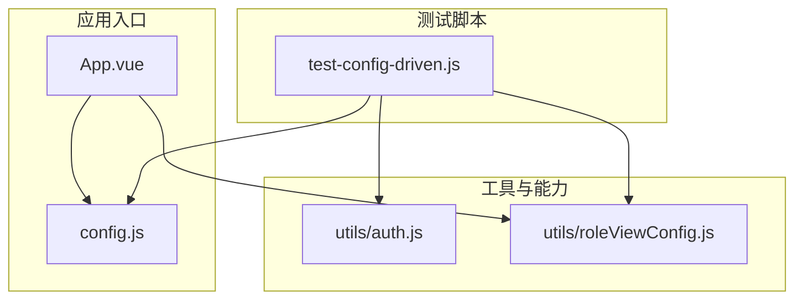
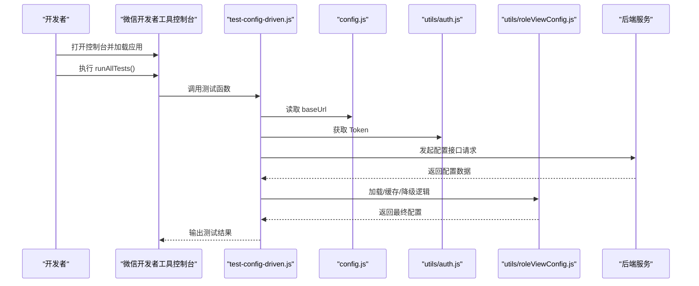
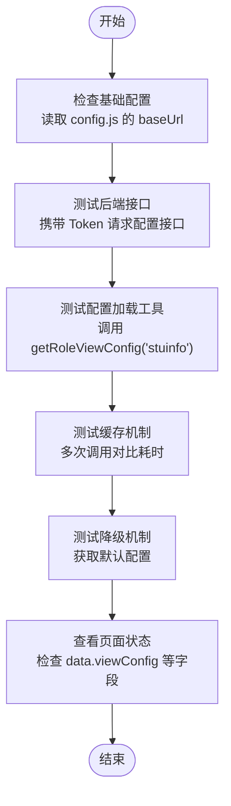
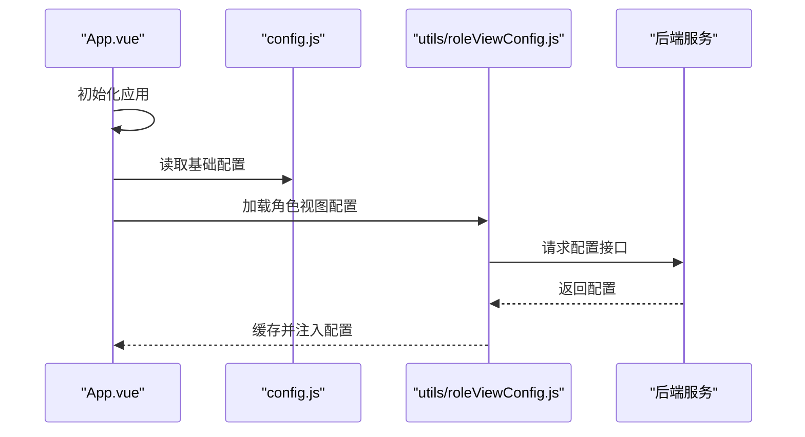
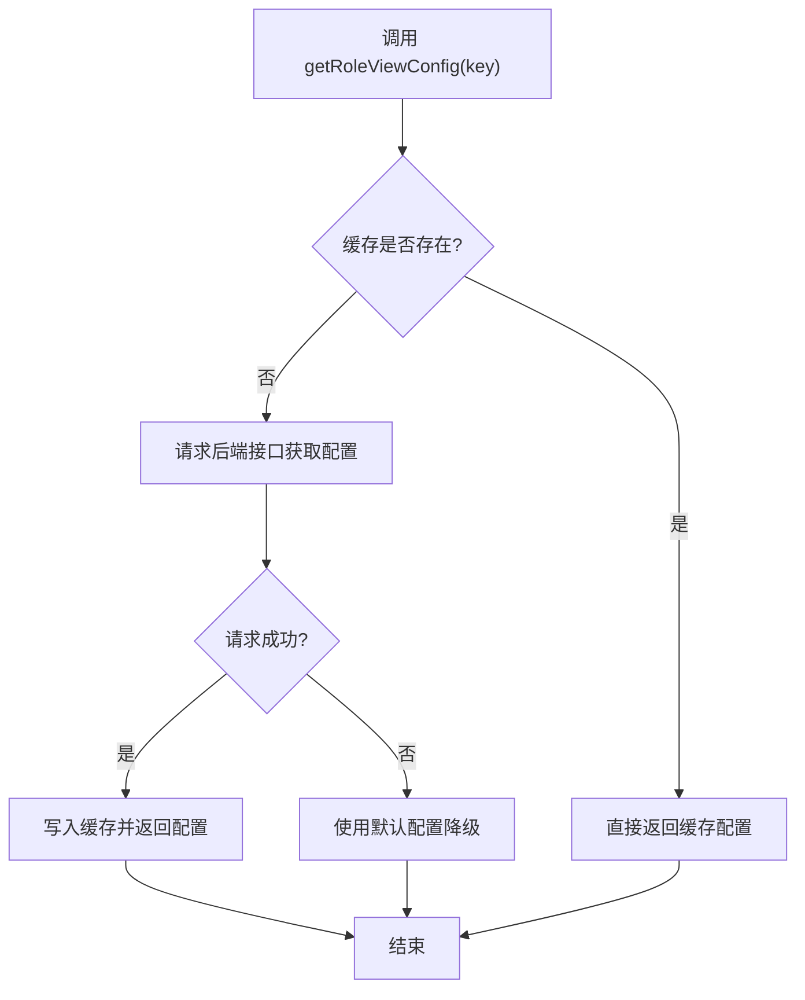
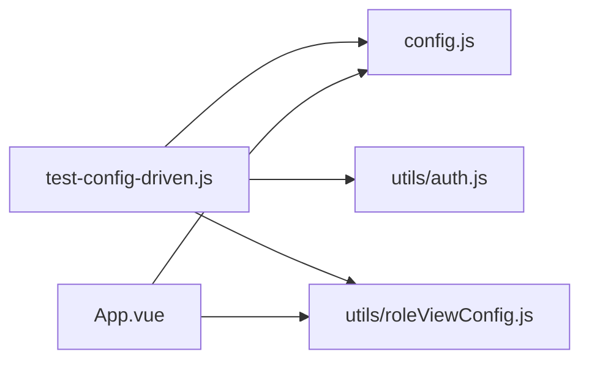

# 测试指南

<cite>
**本文引用的文件**   
- [test-config-driven.js](file://test-config-driven.js)
- [config.js](file://config.js)
- [utils/auth.js](file://utils/auth.js)
- [utils/roleViewConfig.js](file://utils/roleViewConfig.js)
- [App.vue](file://App.vue)
- [README.md](file://README.md)
</cite>

## 目录
1. [简介](#简介)
2. [项目结构](#项目结构)
3. [核心组件](#核心组件)
4. [架构总览](#架构总览)
5. [详细组件分析](#详细组件分析)
6. [依赖分析](#依赖分析)
7. [性能考虑](#性能考虑)
8. [故障排查指南](#故障排查指南)
9. [结论](#结论)
10. [附录](#附录)

## 简介
本测试指南面向开发者，提供在 RuoYi-App（基于 UniApp）项目中开展测试的完整方法与工具使用指导。内容覆盖：
- 测试框架与配置建议（单元测试、集成测试、端到端测试）
- 测试用例编写规范（组织方式、命名约定、断言方法）
- 具体测试示例（Vue 组件、API 接口、工具函数）
- 自动化测试与 CI/CD 集成
- 性能与压力测试方法（小程序性能监控、内存泄漏检测）
- 覆盖率统计与报告生成
- 常见问题排查与解决方案

本项目为移动端多端应用，当前仓库未内置自动化测试框架与脚本，但提供了可在微信开发者工具控制台执行的“配置驱动”测试脚本，可用于快速验证基础配置、后端连通性、配置加载与缓存、降级机制等关键路径。

章节来源
- [README.md:1-52](file://README.md#L1-L52)

## 项目结构
从测试视角，建议将现有代码按以下维度组织测试资产：
- 单元测试：针对 utils 下的纯函数与工具模块（如权限、校验、存储、请求封装等）
- 集成测试：针对 api 层与后端接口的联调验证（可复用现有 API 定义）
- 端到端测试：针对页面级流程（登录、角色切换、页面渲染与交互）
- 运行环境：微信小程序开发工具控制台用于执行轻量级配置驱动脚本；H5/APP 可使用对应平台的调试器或自动化方案

图表来源
- [App.vue:1-30](file://App.vue#L1-L30)
- [config.js](file://config.js)
- [utils/auth.js](file://utils/auth.js)
- [utils/roleViewConfig.js](file://utils/roleViewConfig.js)
- [test-config-driven.js:1-255](file://test-config-driven.js#L1-L255)

章节来源
- [App.vue:1-30](file://App.vue#L1-L30)
- [test-config-driven.js:1-255](file://test-config-driven.js#L1-L255)

## 核心组件
本节聚焦于测试相关的关键模块与脚本，说明其职责与在测试中的作用。

- 配置驱动测试脚本（test-config-driven.js）
  - 作用：在微信开发者工具控制台中执行，提供一组可独立运行的测试函数，覆盖基础配置检查、后端接口连通性、配置加载、缓存与降级机制、页面状态查看等。
  - 典型用法：在控制台直接调用 runAllTests() 或单个测试函数。
  - 输出：通过 console.group/console.log/error 输出结构化结果，便于快速定位问题。

- 应用初始化与配置（App.vue）
  - 作用：应用启动时进行全局初始化与配置加载，是端到端测试中需要关注的生命周期起点。
  - 测试关注点：确保初始化顺序正确、配置加载成功、错误分支有兜底。

- 基础配置（config.js）
  - 作用：集中管理 baseUrl 等运行时配置，影响所有网络请求与资源访问。
  - 测试关注点：不同环境（开发/测试/生产）下 baseUrl 的正确性与一致性。

- 认证与鉴权（utils/auth.js）
  - 作用：提供 token 获取、设置、过期处理等能力。
  - 测试关注点：token 存在性与有效性对接口请求的影响。

- 角色视图配置加载（utils/roleViewConfig.js）
  - 作用：根据角色动态加载页面视图配置，支持缓存与默认降级。
  - 测试关注点：首次加载耗时、缓存命中、降级策略是否生效。

章节来源
- [test-config-driven.js:1-255](file://test-config-driven.js#L1-L255)
- [App.vue:1-30](file://App.vue#L1-L30)
- [config.js](file://config.js)
- [utils/auth.js](file://utils/auth.js)
- [utils/roleViewConfig.js](file://utils/roleViewConfig.js)

## 架构总览
下图展示了测试脚本与核心模块之间的交互关系，以及端到端流程中的关键节点。

图表来源
- [test-config-driven.js:1-255](file://test-config-driven.js#L1-L255)
- [config.js](file://config.js)
- [utils/auth.js](file://utils/auth.js)
- [utils/roleViewConfig.js](file://utils/roleViewConfig.js)

## 详细组件分析

### 配置驱动测试脚本分析
该脚本以模块化函数形式组织，每个函数负责一个独立的测试场景，并提供统一的入口 runAllTests() 串联执行。

图表来源
- [test-config-driven.js:1-255](file://test-config-driven.js#L1-L255)

章节来源
- [test-config-driven.js:1-255](file://test-config-driven.js#L1-L255)

### 应用初始化与配置加载流程
应用启动后，会进行全局初始化与配置加载。测试应关注初始化顺序、配置加载失败时的降级行为。

图表来源
- [App.vue:1-30](file://App.vue#L1-L30)
- [config.js](file://config.js)
- [utils/roleViewConfig.js](file://utils/roleViewConfig.js)

章节来源
- [App.vue:1-30](file://App.vue#L1-L30)

### 角色视图配置加载与缓存流程
角色视图配置加载包含首次请求、缓存命中与降级策略。测试需验证各分支行为。

图表来源
- [utils/roleViewConfig.js](file://utils/roleViewConfig.js)

章节来源
- [utils/roleViewConfig.js](file://utils/roleViewConfig.js)

## 依赖分析
测试脚本与核心模块的依赖关系如下：

图表来源
- [test-config-driven.js:1-255](file://test-config-driven.js#L1-L255)
- [App.vue:1-30](file://App.vue#L1-L30)
- [config.js](file://config.js)
- [utils/auth.js](file://utils/auth.js)
- [utils/roleViewConfig.js](file://utils/roleViewConfig.js)

章节来源
- [test-config-driven.js:1-255](file://test-config-driven.js#L1-L255)
- [App.vue:1-30](file://App.vue#L1-L30)

## 性能考虑
- 小程序性能监控
  - 使用微信开发者工具的 Performance 面板监控首屏渲染时间、长任务与布局抖动。
  - 结合 test-config-driven.js 的缓存测试思路，记录关键操作耗时，评估优化效果。
- 内存泄漏检测
  - 在控制台观察内存快照变化，重点关注页面跳转与配置加载后的对象释放情况。
  - 避免在页面销毁后仍持有定时器、事件监听或未清理的网络回调。
- 网络请求优化
  - 利用 roleViewConfig 的缓存机制减少重复请求；必要时增加失效策略与重试机制。
- 渲染性能
  - 减少不必要的 re-render，合理使用 v-if/v-show，列表分页与虚拟滚动。

[本节为通用性能建议，不直接分析具体文件]

## 故障排查指南
- 接口请求失败
  - 可能原因：后端未启动、baseUrl 配置错误、域名校验未关闭。
  - 排查步骤：在控制台执行 test2_testAPI()，检查响应码与错误信息；确认 config.js 的 baseUrl 与后端一致；勾选“不校验合法域名”。
- 配置加载异常
  - 可能原因：网络超时、后端返回格式不一致、缓存脏数据。
  - 排查步骤：执行 test3_testConfigLoader() 与 test4_testCache()，观察耗时与返回值；必要时清除缓存后重试。
- 降级机制未生效
  - 可能原因：默认配置缺失或字段不匹配。
  - 排查步骤：执行 test5_testFallback()，核对默认配置结构与业务期望。
- 页面状态异常
  - 可能原因：初始化顺序错误或配置未注入到页面 data。
  - 排查步骤：执行 test6_checkPageState()，检查 data.viewConfig 等关键字段。

章节来源
- [test-config-driven.js:1-255](file://test-config-driven.js#L1-L255)

## 结论
本项目已提供轻量级的配置驱动测试脚本，适合在微信开发者工具中进行快速验证。建议在后续迭代中引入更完善的自动化测试体系（单元测试、集成测试、端到端测试），并结合 CI/CD 实现持续质量保障。同时，完善性能监控与覆盖率统计，提升整体交付质量与稳定性。

[本节为总结性内容，不直接分析具体文件]

## 附录

### 测试框架与配置建议
- 单元测试
  - 推荐：Jest + Vue Test Utils（H5 环境）
  - 目标：utils 下的纯函数与工具模块（权限、校验、存储、请求封装等）
  - 配置要点：启用 coverage，设置阈值；隔离外部依赖（mock 网络与文件系统）
- 集成测试
  - 推荐：Jest + Supertest（Node 侧模拟后端）或 Postman/Newman（真实后端）
  - 目标：api 层与后端接口的联调验证，覆盖正常与异常分支
- 端到端测试
  - 推荐：Playwright（H5）、Appium（APP）、微信开发者工具自动化（小程序）
  - 目标：登录、角色切换、页面渲染与交互流程

[本节为通用建议，不直接分析具体文件]

### 测试用例编写规范
- 文件组织
  - 与源码同构：src/utils/__tests__/xxx.test.js
  - 页面测试：pages/xxx/__tests__/xxx.spec.js
- 命名约定
  - 文件名：xxx.test.js / xxx.spec.js
  - 用例名：describe("模块") + it("描述预期行为")
- 断言方法
  - Jest expect：toBe、toEqual、toContain、toThrow、resolves/rejects
  - 页面断言：查找 DOM 元素、触发事件、等待异步更新后断言
- 测试数据
  - 使用 fixtures 或工厂函数生成稳定数据
- 异步测试
  - 使用 async/await 与 done 回调，避免竞态条件

[本节为通用建议，不直接分析具体文件]

### 具体测试示例（路径指引）
- Vue 组件测试
  - 参考：components/ad-banner/index.vue 的 props、事件与渲染逻辑
  - 建议：使用 mount/shallowMount 挂载组件，断言模板输出与事件触发
- API 接口测试
  - 参考：api/stumanage/activity.js 的请求封装与参数
  - 建议：Mock 网络层或使用 Newman 执行真实请求集合
- 工具函数测试
  - 参考：utils/validate.js、utils/storage.js、utils/auth.js
  - 建议：覆盖边界条件与异常输入

[本节为通用建议，不直接分析具体文件]

### 自动化测试与 CI/CD 集成
- 本地执行
  - npm test（单元测试）
  - npm run test:integration（集成测试）
  - npm run test:e2e（端到端测试）
- CI/CD
  - GitHub Actions / GitLab CI：安装依赖、构建、运行测试、上传覆盖率
  - 缓存 node_modules 与浏览器二进制，缩短流水线时间
  - 并行执行测试套件，提高吞吐

[本节为通用建议，不直接分析具体文件]

### 性能与压力测试方法
- 小程序性能监控
  - 使用微信开发者工具 Performance 面板与 Lighthouse（H5）
- 压力测试
  - 使用 JMeter/k6 对后端接口进行压测，评估 QPS 与延迟
- 内存泄漏检测
  - 定期采集内存快照，对比差异对象，定位未释放引用

[本节为通用建议，不直接分析具体文件]

### 覆盖率统计与报告生成
- 工具：Istanbul（Jest 内置）
- 配置要点：设置行/分支/函数/语句覆盖率阈值
- 报告：生成 HTML 报告并在 CI 中归档

[本节为通用建议，不直接分析具体文件]

### 常见测试问题与解决方案
- 跨域与域名校验
  - 现象：接口请求失败
  - 解决：关闭“不校验合法域名”，统一 baseUrl，检查后端 CORS
- 缓存导致结果不稳定
  - 现象：第二次请求更快但数据不一致
  - 解决：在测试前清除缓存或强制刷新配置
- 异步时序问题
  - 现象：断言失败因数据尚未更新
  - 解决：使用 await 与 nextTick，合理设置等待策略

[本节为通用建议，不直接分析具体文件]