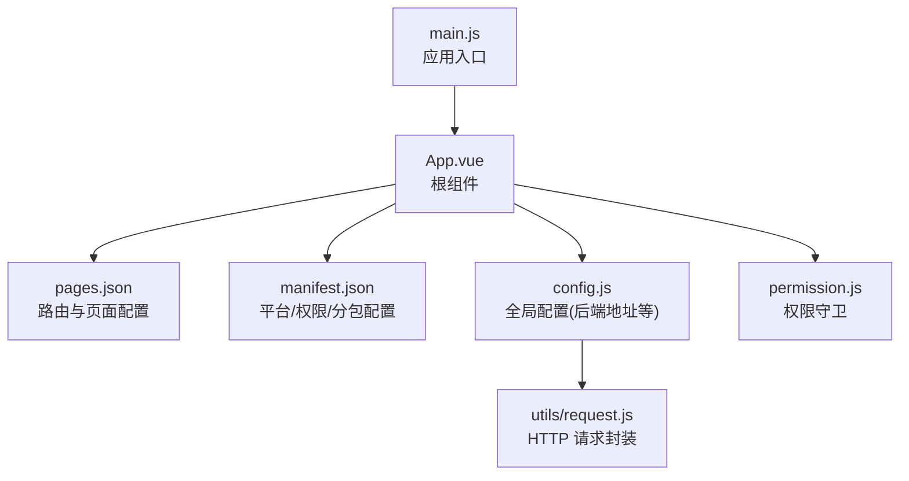
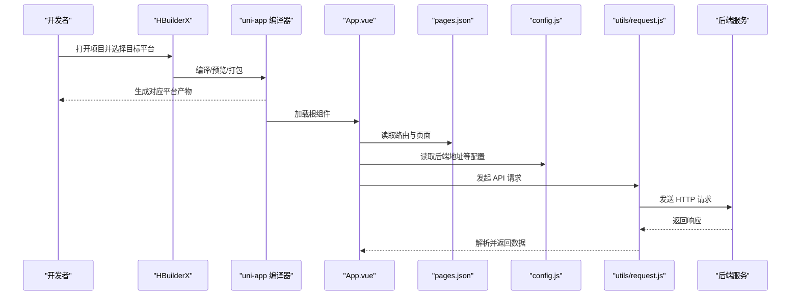
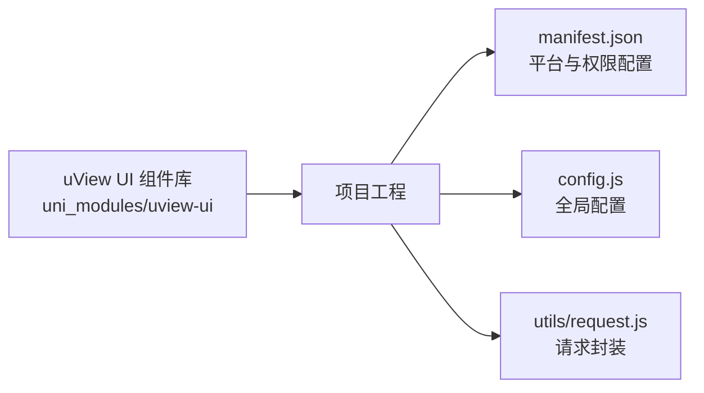

# 快速开始

<cite>
**本文引用的文件**   
- [README.md](file://README.md)
- [config.js](file://config.js)
- [manifest.json](file://manifest.json)
- [pages.json](file://pages.json)
- [.gitignore](file://.gitignore)
- [main.js](file://main.js)
- [App.vue](file://App.vue)
- [permission.js](file://permission.js)
- [utils/request.js](file://utils/request.js)
- [uni_modules/uview-ui/package.json](file://uni_modules/uview-ui/package.json)
</cite>

## 目录
1. [简介](#简介)
2. [项目结构](#项目结构)
3. [核心组件](#核心组件)
4. [架构总览](#架构总览)
5. [详细组件分析](#详细组件分析)
6. [依赖分析](#依赖分析)
7. [性能考虑](#性能考虑)
8. [故障排除指南](#故障排除指南)
9. [结论](#结论)
10. [附录](#附录)

## 简介
RuoYi-App 是基于 uni-app 的移动端解决方案，支持小程序、H5、Android/iOS 等多端。本项目与 RuoYi-Vue/RuoYi-Cloud 后端无缝对接，提供登录、工作台、个人中心等基础能力。本“快速开始”文档面向初学者，帮助你从零搭建开发环境、完成配置并成功运行项目。

## 项目结构
- 前端框架：基于 uni-app（Vue2 版本），通过 HBuilderX 进行开发与打包。
- 主要入口与配置：
  - 应用入口：main.js、App.vue
  - 路由与页面：pages.json
  - 平台与权限：manifest.json
  - 全局配置（后端地址等）：config.js
  - 网络请求封装：utils/request.js
  - 权限控制：permission.js
  - 忽略构建产物：.gitignore

图表来源
- [main.js:1-200](file://main.js#L1-L200)
- [App.vue:1-200](file://App.vue#L1-L200)
- [pages.json:1-235](file://pages.json#L1-L235)
- [manifest.json:1-77](file://manifest.json#L1-L77)
- [config.js:1-38](file://config.js#L1-L38)
- [utils/request.js:1-200](file://utils/request.js#L1-L200)
- [permission.js:1-200](file://permission.js#L1-L200)

章节来源
- [README.md:12-20](file://README.md#L12-L20)
- [pages.json:1-235](file://pages.json#L1-L235)
- [manifest.json:1-77](file://manifest.json#L1-L77)
- [config.js:1-38](file://config.js#L1-L38)
- [.gitignore:1-16](file://.gitignore#L1-L16)

## 核心组件
- 应用入口与初始化
  - main.js：创建 uni-app 实例并挂载 App.vue。
  - App.vue：应用根组件，通常用于引入全局样式、插件与生命周期钩子。
- 路由与页面
  - pages.json：定义主包与分包页面、tabBar、全局导航栏样式等。
- 平台与权限
  - manifest.json：声明应用名称、appid、各平台配置（微信小程序、H5、App）、权限与分包优化等。
- 全局配置
  - config.js：集中管理后端协议、主机、端口、API 前缀与应用信息。
- 网络请求
  - utils/request.js：封装 HTTP 请求，统一 baseUrl、拦截器、错误处理等。
- 权限控制
  - permission.js：实现路由级权限校验与跳转逻辑。

章节来源
- [main.js:1-200](file://main.js#L1-L200)
- [App.vue:1-200](file://App.vue#L1-L200)
- [pages.json:1-235](file://pages.json#L1-L235)
- [manifest.json:1-77](file://manifest.json#L1-L77)
- [config.js:1-38](file://config.js#L1-L38)
- [utils/request.js:1-200](file://utils/request.js#L1-L200)
- [permission.js:1-200](file://permission.js#L1-L200)

## 架构总览
下图展示了从启动到发起一次 API 请求的关键路径，以及配置文件的作用位置。

图表来源
- [App.vue:1-200](file://App.vue#L1-L200)
- [pages.json:1-235](file://pages.json#L1-L235)
- [config.js:1-38](file://config.js#L1-L38)
- [utils/request.js:1-200](file://utils/request.js#L1-L200)

## 详细组件分析

### 开发环境与工具要求
- 编辑器与 IDE
  - 推荐使用 HBuilderX（官方推荐，内置 uni-app 编译与调试）。
  - 参考 uni_modules 中 uView 对 HBuilderX 的版本约束。
- Node.js
  - 本项目为 uni-app 工程，使用 HBuilderX 进行编译与打包，无需本地安装 Node.js 或 npm/yarn。
- 其他
  - 如需在浏览器调试 H5，可使用任意现代浏览器；小程序调试请使用微信开发者工具（由 HBuilderX 集成调用）。

章节来源
- [uni_modules/uview-ui/package.json:17-19](file://uni_modules/uview-ui/package.json#L17-L19)
- [.gitignore:1-16](file://.gitignore#L1-L16)

### 克隆与导入项目
- 将代码仓库克隆至本地。
- 使用 HBuilderX 打开项目根目录。
- 首次打开后，HBuilderX 会自动识别 uni-app 项目结构。

章节来源
- [.gitignore:1-16](file://.gitignore#L1-L16)

### 环境配置说明
- 后端 API 地址配置
  - 修改 config.js 中的协议、主机、端口与 API 前缀，以匹配你的后端部署地址。
  - 注意：baseUrl 会根据上述字段自动拼接，确保与 Nginx 代理路径一致。
- 小程序 AppId 设置
  - 在 manifest.json 的 mp-weixin 节点下配置微信小程序 appid。
- H5 开发服务器
  - 在 manifest.json 的 h5.devServer 中可调整端口与是否启用 https。
- 应用信息与权限
  - manifest.json 中可配置应用名、版本号、分包优化、权限申请等。

章节来源
- [config.js:1-38](file://config.js#L1-L38)
- [manifest.json:1-77](file://manifest.json#L1-L77)

### 首次运行与调试
- 在 HBuilderX 顶部菜单选择目标平台（如 微信小程序/H5/App）。
- 点击“运行”，选择模拟器或真机调试。
- 若为 H5，可在浏览器中访问 devServer 配置的端口进行调试。
- 若为小程序，请在微信开发者工具中查看日志与接口调用。

章节来源
- [manifest.json:64-75](file://manifest.json#L64-L75)

### 多端打包与发布
- 微信小程序
  - 在 HBuilderX 中选择“发行 -> 小程序-微信”，按提示填写 AppId 并生成包。
- H5
  - 选择“发行 -> 网站-H5”，按需配置域名与资源路径。
- App（Android/iOS）
  - 选择“发行 -> 原生App-云打包/本地打包”，根据平台要求准备证书与签名。

章节来源
- [manifest.json:1-77](file://manifest.json#L1-L77)

## 依赖分析
- 组件库
  - 项目使用了 uView UI 组件库（uni_modules 方式引入），其 package.json 指定了 HBuilderX 最低版本要求。
- 构建与产物
  - .gitignore 排除了 unpackage 与 node_modules，表明不提交构建产物与依赖缓存。

图表来源
- [uni_modules/uview-ui/package.json:1-85](file://uni_modules/uview-ui/package.json#L1-L85)
- [manifest.json:1-77](file://manifest.json#L1-L77)
- [config.js:1-38](file://config.js#L1-L38)
- [utils/request.js:1-200](file://utils/request.js#L1-L200)

章节来源
- [uni_modules/uview-ui/package.json:17-19](file://uni_modules/uview-ui/package.json#L17-L19)
- [.gitignore:1-16](file://.gitignore#L1-L16)

## 性能考虑
- 分包加载
  - 已在 manifest.json 中开启 subPackages 优化，有助于减少首屏体积。
- 懒加载
  - 小程序侧启用了 requiredComponents 懒加载策略，按需加载组件以提升性能。
- 静态资源
  - 合理组织 static 目录，避免过大图片与冗余文件进入包体。

章节来源
- [manifest.json:51-55](file://manifest.json#L51-L55)

## 故障排除指南
- 无法连接后端接口
  - 检查 config.js 中的协议、host、port、apiPrefix 是否与后端一致。
  - 确认 Nginx 代理路径与 apiPrefix 匹配。
  - 若为 HTTPS，请确保证书有效且域名正确。
- 小程序 AppId 无效
  - 核对 manifest.json 中 mp-weixin.appid 是否正确，并在微信公众平台绑定域名与业务域名。
- H5 端口冲突
  - 修改 manifest.json 中 h5.devServer.port 为未被占用的端口。
- 权限相关报错
  - 在 manifest.json 的 permission 与 requiredPrivateInfos 中补充必要权限描述与接口白名单。
- 构建产物过大
  - 清理 unpackage 目录，重新打包；检查静态资源大小与分包策略。

章节来源
- [config.js:1-38](file://config.js#L1-L38)
- [manifest.json:43-62](file://manifest.json#L43-L62)
- [manifest.json:64-75](file://manifest.json#L64-L75)

## 结论
通过以上步骤，你可以在 HBuilderX 中快速完成 RuoYi-App 的环境搭建、配置与运行。建议优先在微信小程序与 H5 两个平台验证功能，再根据需要打包 App。遇到环境问题，可对照“故障排除指南”逐项排查。

## 附录
- 常用操作速查
  - 打开项目：HBuilderX -> 文件 -> 打开目录 -> 选择项目根目录
  - 切换平台：顶部菜单选择“微信小程序/H5/App”
  - 运行调试：点击“运行”按钮，选择目标设备或模拟器
  - 打包发布：顶部菜单“发行” -> 选择目标平台 -> 按向导完成

[本节为通用指引，不涉及具体源码文件]