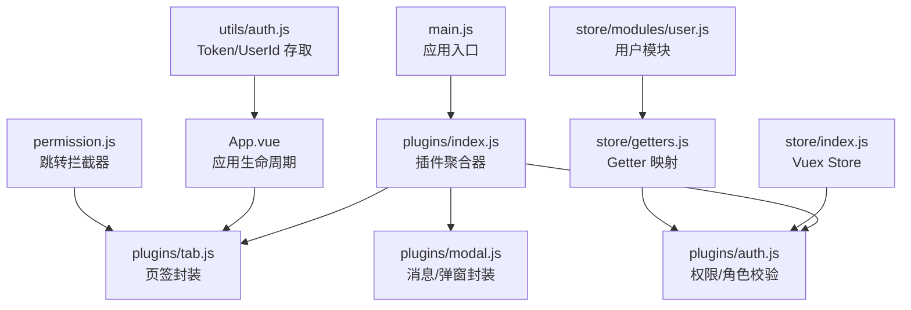
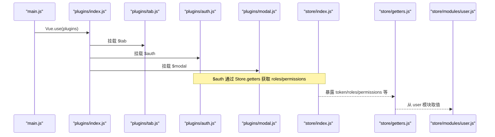
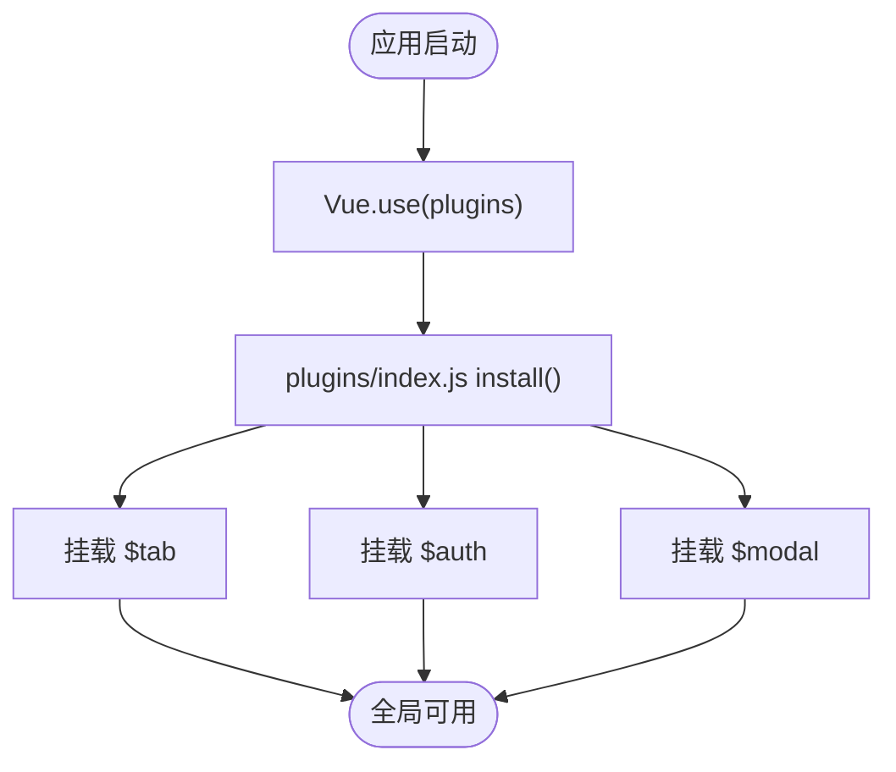
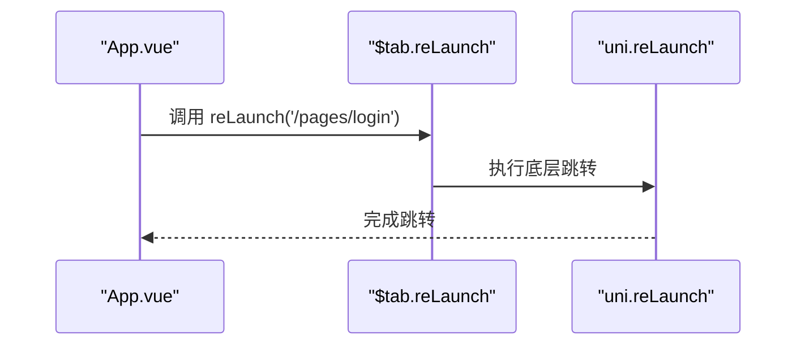
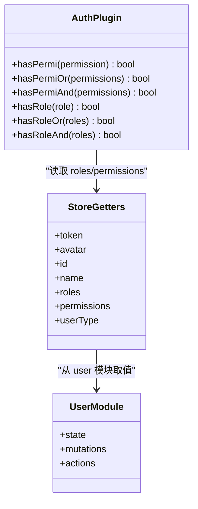
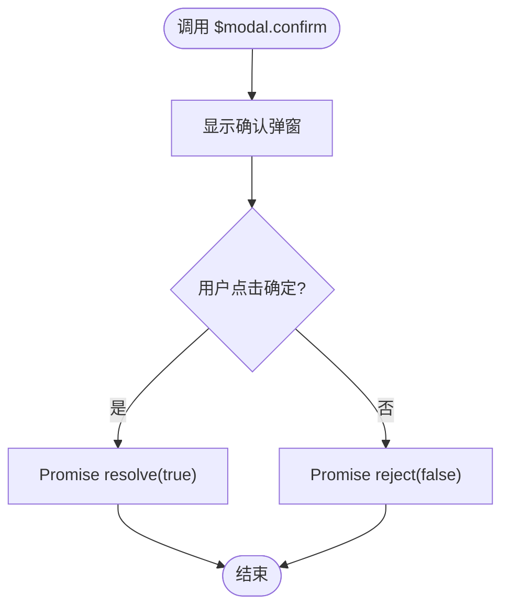
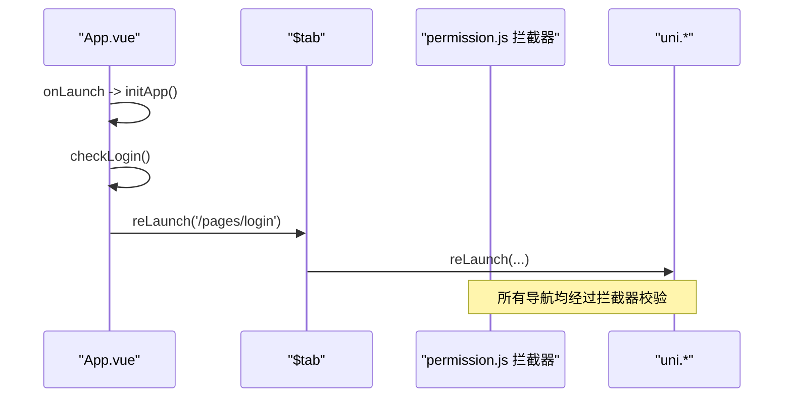
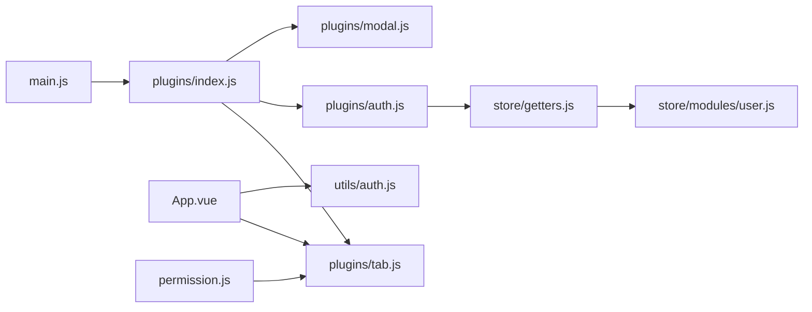

# 插件架构设计

<cite>
**本文引用的文件**   
- [main.js](file://main.js)
- [plugins/index.js](file://plugins/index.js)
- [plugins/tab.js](file://plugins/tab.js)
- [plugins/auth.js](file://plugins/auth.js)
- [plugins/modal.js](file://plugins/modal.js)
- [App.vue](file://App.vue)
- [permission.js](file://permission.js)
- [store/index.js](file://store/index.js)
- [store/getters.js](file://store/getters.js)
- [store/modules/user.js](file://store/modules/user.js)
- [utils/auth.js](file://utils/auth.js)
</cite>

## 目录
1. [引言](#引言)
2. [项目结构](#项目结构)
3. [核心组件](#核心组件)
4. [架构总览](#架构总览)
5. [详细组件分析](#详细组件分析)
6. [依赖关系与初始化顺序](#依赖关系与初始化顺序)
7. [配置与参数传递机制](#配置与参数传递机制)
8. [插件开发规范](#插件开发规范)
9. [性能与健壮性建议](#性能与健壮性建议)
10. [故障排查指南](#故障排查指南)
11. [结论](#结论)

## 引言
本文件面向 RuoYi-App 的插件化能力，系统性阐述插件系统的整体架构、设计理念与实现细节。重点覆盖：
- 插件注册机制与 Vue 原型扩展模式
- 全局对象挂载方式（$tab、$auth、$modal）
- 插件安装流程与生命周期管理
- 插件间依赖关系与初始化顺序控制
- 插件配置选项与参数传递机制
- 插件开发规范、API 设计原则与最佳实践
- 架构图与扩展点说明，帮助开发者扩展现有功能或开发新插件

## 项目结构
RuoYi-App 采用“集中式插件入口 + 模块化插件实现”的组织方式：
- 应用入口 main.js 负责引入并安装统一插件包
- plugins/index.js 作为插件聚合器，将各子插件挂载到 Vue.prototype
- 具体插件按职责拆分：路由封装 tab、权限校验 auth、交互提示 modal
- App.vue 在应用启动阶段使用 $tab 进行登录态检查与跳转
- permission.js 通过 uni.addInterceptor 对页面跳转进行全局拦截与鉴权
- store 提供用户状态与权限数据，供插件 auth 读取

图表来源
- [main.js:1-31](file://main.js#L1-L31)
- [plugins/index.js:1-15](file://plugins/index.js#L1-L15)
- [plugins/tab.js:1-31](file://plugins/tab.js#L1-L31)
- [plugins/auth.js:1-61](file://plugins/auth.js#L1-L61)
- [plugins/modal.js:1-79](file://plugins/modal.js#L1-L79)
- [App.vue:1-48](file://App.vue#L1-L48)
- [permission.js:1-133](file://permission.js#L1-L133)
- [store/index.js:1-16](file://store/index.js#L1-L16)
- [store/getters.js:1-11](file://store/getters.js#L1-L11)
- [store/modules/user.js:1-283](file://store/modules/user.js#L1-L283)
- [utils/auth.js:1-47](file://utils/auth.js#L1-L47)

章节来源
- [main.js:1-31](file://main.js#L1-L31)
- [plugins/index.js:1-15](file://plugins/index.js#L1-L15)
- [plugins/tab.js:1-31](file://plugins/tab.js#L1-L31)
- [plugins/auth.js:1-61](file://plugins/auth.js#L1-L61)
- [plugins/modal.js:1-79](file://plugins/modal.js#L1-L79)
- [App.vue:1-48](file://App.vue#L1-L48)
- [permission.js:1-133](file://permission.js#L1-L133)
- [store/index.js:1-16](file://store/index.js#L1-L16)
- [store/getters.js:1-11](file://store/getters.js#L1-L11)
- [store/modules/user.js:1-283](file://store/modules/user.js#L1-L283)
- [utils/auth.js:1-47](file://utils/auth.js#L1-L47)

## 核心组件
- 插件聚合器（plugins/index.js）
  - 职责：统一导出 install 方法，将各子插件挂载至 Vue.prototype
  - 挂载对象：$tab、$auth、$modal
- 页签封装（plugins/tab.js）
  - 职责：对 uni.navigateTo/redirectTo/reLaunch/switchTab/navigateBack 进行统一封装，返回 Promise
- 权限/角色校验（plugins/auth.js）
  - 职责：基于 Vuex getters 提供的 roles/permissions 做权限与角色判断，支持单值、OR、AND 组合
- 交互提示（plugins/modal.js）
  - 职责：封装 uni.showToast/showModal/showLoading/hideLoading 等，提供 msgSuccess/msgError/alert/confirm/loading/closeLoading 等方法

章节来源
- [plugins/index.js:1-15](file://plugins/index.js#L1-L15)
- [plugins/tab.js:1-31](file://plugins/tab.js#L1-L31)
- [plugins/auth.js:1-61](file://plugins/auth.js#L1-L61)
- [plugins/modal.js:1-79](file://plugins/modal.js#L1-L79)

## 架构总览
插件系统遵循“集中注册、按需挂载、低耦合、可替换”的设计原则：
- 集中注册：所有插件在 plugins/index.js 中集中安装，避免分散导入
- 按需挂载：通过 Vue.prototype 暴露全局 API，任何组件均可直接调用
- 低耦合：插件之间不互相引用，仅通过平台 API 与共享状态（Vuex）交互
- 可替换：可通过替换对应模块实现不同行为（如自定义 modal 样式）

图表来源
- [main.js:1-31](file://main.js#L1-L31)
- [plugins/index.js:1-15](file://plugins/index.js#L1-L15)
- [plugins/tab.js:1-31](file://plugins/tab.js#L1-L31)
- [plugins/auth.js:1-61](file://plugins/auth.js#L1-L61)
- [plugins/modal.js:1-79](file://plugins/modal.js#L1-L79)
- [store/index.js:1-16](file://store/index.js#L1-L16)
- [store/getters.js:1-11](file://store/getters.js#L1-L11)
- [store/modules/user.js:1-283](file://store/modules/user.js#L1-L283)

## 详细组件分析

### 插件聚合器与安装流程
- 安装时机：在 main.js 中通过 Vue.use(plugins) 触发
- 安装动作：在 plugins/index.js 的 install 中将三个插件对象挂载到 Vue.prototype
- 结果：任意组件内可通过 this.$tab、this.$auth、this.$modal 访问

图表来源
- [main.js:1-31](file://main.js#L1-L31)
- [plugins/index.js:1-15](file://plugins/index.js#L1-L15)

章节来源
- [main.js:1-31](file://main.js#L1-L31)
- [plugins/index.js:1-15](file://plugins/index.js#L1-L15)

### 页签封装（$tab）
- 能力：统一封装 uni 导航 API，返回 Promise，便于 await 使用
- 典型用法：在 App.vue 的 checkLogin 中使用 this.$tab.reLaunch 进行未登录重定向
- 与权限系统配合：permission.js 通过 uni.addInterceptor 对原生导航进行全局拦截，结合本地 Token 与白名单完成鉴权

图表来源
- [plugins/tab.js:1-31](file://plugins/tab.js#L1-L31)
- [App.vue:1-48](file://App.vue#L1-L48)

章节来源
- [plugins/tab.js:1-31](file://plugins/tab.js#L1-L31)
- [App.vue:1-48](file://App.vue#L1-L48)
- [permission.js:1-133](file://permission.js#L1-L133)

### 权限/角色校验（$auth）
- 数据来源：store/getters.js 暴露 roles/permissions；store/modules/user.js 维护用户信息
- 校验逻辑：
  - hasPermi / hasPermiOr / hasPermiAnd：基于 permissions 列表匹配
  - hasRole / hasRoleOr / hasRoleAnd：基于 roles 列表匹配
- 特殊规则：
  - 权限包含通配符时视为全量授权
  - 角色包含超级管理员时视为全量授权

图表来源
- [plugins/auth.js:1-61](file://plugins/auth.js#L1-L61)
- [store/getters.js:1-11](file://store/getters.js#L1-L11)
- [store/modules/user.js:1-283](file://store/modules/user.js#L1-L283)

章节来源
- [plugins/auth.js:1-61](file://plugins/auth.js#L1-L61)
- [store/getters.js:1-11](file://store/getters.js#L1-L11)
- [store/modules/user.js:1-283](file://store/modules/user.js#L1-L283)

### 交互提示（$modal）
- 能力：消息提示、错误/成功提示、确认弹窗、加载遮罩等
- 返回值：confirm 返回 Promise，便于异步处理用户选择
- 健壮性：closeLoading 内部 try/catch 防止 hideLoading 异常导致崩溃

图表来源
- [plugins/modal.js:1-79](file://plugins/modal.js#L1-L79)

章节来源
- [plugins/modal.js:1-79](file://plugins/modal.js#L1-L79)

### 应用生命周期与插件协作
- App.vue 在 onLaunch 中初始化配置与环境差异处理
- H5 环境下，checkLogin 通过 this.$tab.reLaunch 在未登录时跳转到登录页
- permission.js 通过 uni.addInterceptor 对 navigateTo/redirectTo/reLaunch/switchTab 进行拦截，结合 Token 与白名单完成鉴权

图表来源
- [App.vue:1-48](file://App.vue#L1-L48)
- [plugins/tab.js:1-31](file://plugins/tab.js#L1-L31)
- [permission.js:1-133](file://permission.js#L1-L133)

章节来源
- [App.vue:1-48](file://App.vue#L1-L48)
- [plugins/tab.js:1-31](file://plugins/tab.js#L1-L31)
- [permission.js:1-133](file://permission.js#L1-L133)

## 依赖关系与初始化顺序
- 初始化顺序
  1. main.js 引入并安装插件（Vue.use(plugins)）
  2. plugins/index.js 将 $tab/$auth/$modal 挂载到 Vue.prototype
  3. App.vue 在 onLaunch 中执行初始化逻辑，必要时调用 $tab
  4. permission.js 在应用启动后为 uni 导航添加拦截器
- 依赖关系
  - $auth 依赖 store/getters 与 store/modules/user
  - $tab 与 $modal 不依赖其他插件，仅依赖 uni 平台 API
  - App.vue 依赖 $tab 与 utils/auth（用于 getToken）
  - permission.js 依赖 utils/auth 与后端接口（角色配置、实名状态）

图表来源
- [main.js:1-31](file://main.js#L1-L31)
- [plugins/index.js:1-15](file://plugins/index.js#L1-L15)
- [plugins/tab.js:1-31](file://plugins/tab.js#L1-L31)
- [plugins/auth.js:1-61](file://plugins/auth.js#L1-L61)
- [plugins/modal.js:1-79](file://plugins/modal.js#L1-L79)
- [App.vue:1-48](file://App.vue#L1-L48)
- [permission.js:1-133](file://permission.js#L1-L133)
- [store/getters.js:1-11](file://store/getters.js#L1-L11)
- [store/modules/user.js:1-283](file://store/modules/user.js#L1-L283)
- [utils/auth.js:1-47](file://utils/auth.js#L1-L47)

章节来源
- [main.js:1-31](file://main.js#L1-L31)
- [plugins/index.js:1-15](file://plugins/index.js#L1-L15)
- [plugins/tab.js:1-31](file://plugins/tab.js#L1-L31)
- [plugins/auth.js:1-61](file://plugins/auth.js#L1-L61)
- [plugins/modal.js:1-79](file://plugins/modal.js#L1-L79)
- [App.vue:1-48](file://App.vue#L1-L48)
- [permission.js:1-133](file://permission.js#L1-L133)
- [store/getters.js:1-11](file://store/getters.js#L1-L11)
- [store/modules/user.js:1-283](file://store/modules/user.js#L1-L283)
- [utils/auth.js:1-47](file://utils/auth.js#L1-L47)

## 配置与参数传递机制
- 插件配置
  - 当前插件未内置配置项，如需扩展可在 plugins/index.js 的 install 中接收外部配置对象，再分发到各子插件
- 参数传递
  - $tab 方法接受 url 字符串参数
  - $modal.confirm 接受 content 与 title 两个参数，并返回 Promise
  - $auth 方法接受权限/角色标识，支持单值或数组
- 运行时上下文
  - $auth 通过 store.getters 读取 roles/permissions，无需显式传参
  - App.vue 通过 utils/auth.getToken 判断登录态

章节来源
- [plugins/index.js:1-15](file://plugins/index.js#L1-L15)
- [plugins/tab.js:1-31](file://plugins/tab.js#L1-L31)
- [plugins/modal.js:1-79](file://plugins/modal.js#L1-L79)
- [plugins/auth.js:1-61](file://plugins/auth.js#L1-L61)
- [store/getters.js:1-11](file://store/getters.js#L1-L11)
- [utils/auth.js:1-47](file://utils/auth.js#L1-L47)

## 插件开发规范
- 插件结构标准
  - 每个插件为一个独立模块，默认导出一个对象
  - 若需要安装钩子，提供 install(Vue, options?) 方法
  - 在 plugins/index.js 中统一 import 并挂载到 Vue.prototype
- API 设计原则
  - 命名清晰：以动词+名词形式表达意图（如 reLaunch、confirm、hasPermi）
  - 返回值一致：尽量返回 Promise，便于 async/await 使用
  - 参数校验：对外部传入参数进行必要校验与容错
  - 副作用最小：避免在插件内部修改全局不可控状态
- 最佳实践
  - 与平台 API 解耦：对 uni.* 进行二次封装，便于后续替换或增强
  - 错误处理：对可能抛出的异常进行捕获与降级处理（如 closeLoading 的 try/catch）
  - 可观测性：关键路径增加日志输出，便于问题定位
  - 可测试性：纯函数逻辑与 UI 操作分离，便于单元测试

章节来源
- [plugins/index.js:1-15](file://plugins/index.js#L1-L15)
- [plugins/tab.js:1-31](file://plugins/tab.js#L1-L31)
- [plugins/modal.js:1-79](file://plugins/modal.js#L1-L79)
- [plugins/auth.js:1-61](file://plugins/auth.js#L1-L61)

## 性能与健壮性建议
- 减少重复调用：对高频调用的 uni API 可进行缓存或节流（例如 loading 状态合并）
- 懒加载：非必要的插件可在首次使用时再引入与挂载
- 错误边界：对可能失败的 UI 操作（如 hideLoading）进行 try/catch 保护
- 状态一致性：确保 store 中的 roles/permissions 与后端同步，避免权限误判

[本节为通用建议，不直接分析具体文件]

## 故障排查指南
- 现象：$tab 或 $modal 未定义
  - 排查：确认 main.js 是否已执行 Vue.use(plugins)，且 plugins/index.js 正确挂载
- 现象：权限判断异常
  - 排查：检查 store/modules/user.js 是否正确设置 roles/permissions；确认 store/getters.js 映射是否生效
- 现象：登录后仍被重定向到登录页
  - 排查：检查 utils/auth.getToken 返回值；确认 permission.js 的白名单与拦截逻辑
- 现象：关闭 loading 报错
  - 排查：确认 closeLoading 的 try/catch 是否捕获异常；检查是否在无 loading 的情况下调用 hideLoading

章节来源
- [main.js:1-31](file://main.js#L1-L31)
- [plugins/index.js:1-15](file://plugins/index.js#L1-L15)
- [plugins/modal.js:1-79](file://plugins/modal.js#L1-L79)
- [plugins/auth.js:1-61](file://plugins/auth.js#L1-L61)
- [store/getters.js:1-11](file://store/getters.js#L1-L11)
- [store/modules/user.js:1-283](file://store/modules/user.js#L1-L283)
- [utils/auth.js:1-47](file://utils/auth.js#L1-L47)
- [permission.js:1-133](file://permission.js#L1-L133)

## 结论
RuoYi-App 的插件系统通过集中式安装与 Vue.prototype 挂载，实现了低耦合、易扩展的全局能力注入。$tab、$auth、$modal 三大插件分别承担导航封装、权限校验与交互提示职责，配合 permission.js 的跳转拦截与 store 的用户状态，形成完整的运行期支撑体系。遵循本文的开发规范与最佳实践，可快速扩展新的插件能力并保持系统稳定与可维护性。