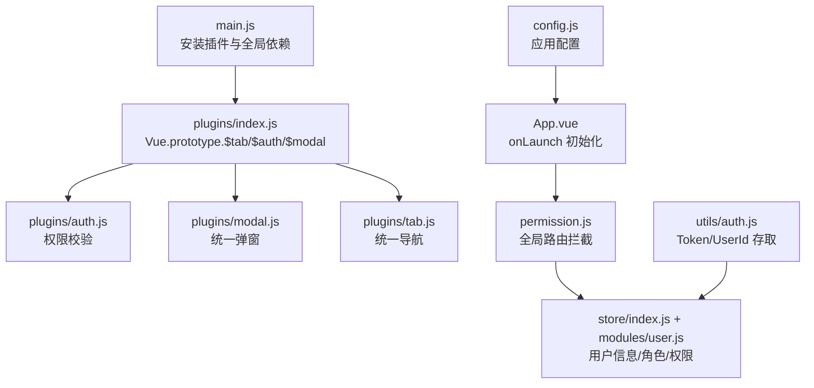
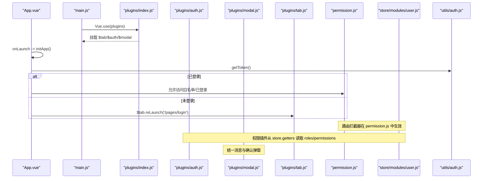
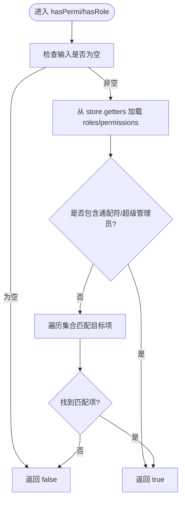
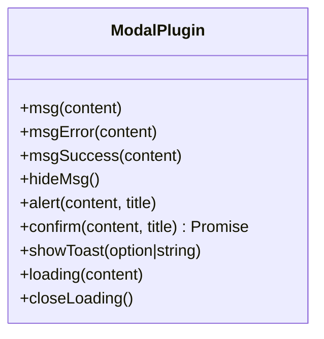
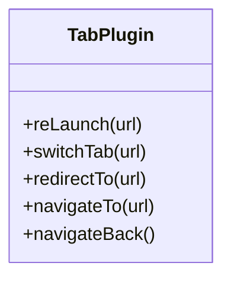
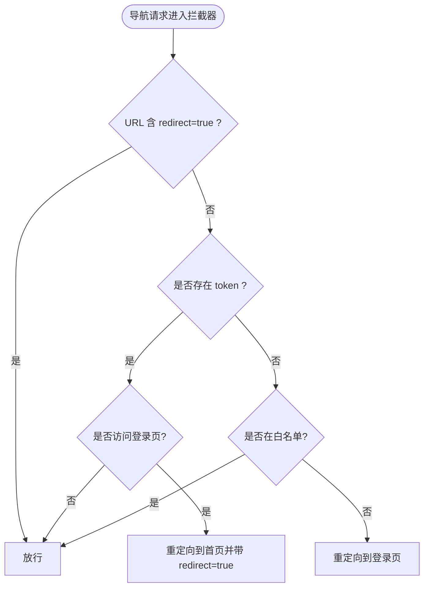
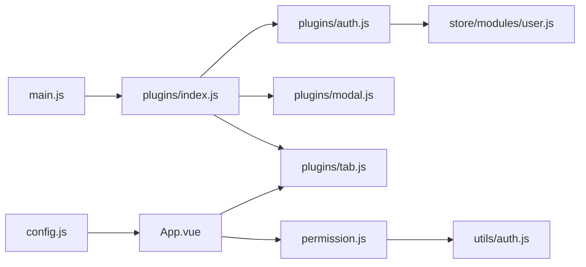

# 插件系统设计

<cite>
**本文引用的文件**   
- [plugins/index.js](file://plugins/index.js)
- [plugins/auth.js](file://plugins/auth.js)
- [plugins/modal.js](file://plugins/modal.js)
- [plugins/tab.js](file://plugins/tab.js)
- [main.js](file://main.js)
- [App.vue](file://App.vue)
- [permission.js](file://permission.js)
- [store/index.js](file://store/index.js)
- [store/modules/user.js](file://store/modules/user.js)
- [utils/permission.js](file://utils/permission.js)
- [utils/auth.js](file://utils/auth.js)
- [config.js](file://config.js)
</cite>

## 目录
1. [引言](#引言)
2. [项目结构](#项目结构)
3. [核心组件](#核心组件)
4. [架构总览](#架构总览)
5. [详细组件分析](#详细组件分析)
6. [依赖关系分析](#依赖关系分析)
7. [性能考量](#性能考量)
8. [故障排查指南](#故障排查指南)
9. [结论](#结论)
10. [附录：插件开发指南与扩展点](#附录插件开发指南与扩展点)

## 引言
本设计文档围绕 RuoYi-App 的插件系统，系统性阐述自定义插件的注册、初始化与生命周期管理机制；深入解析三大核心插件：权限插件（auth.js）、模态框插件（modal.js）、标签页插件（tab.js）的实现与使用方式；说明插件间通信机制与全局事件总线的设计思路；给出第三方插件（如 uView UI、uni-app 官方插件）的集成方式；并提供插件开发模板、API 规范与测试方法。文末包含架构图与扩展点说明，帮助开发者理解并扩展现有功能。

## 项目结构
RuoYi-App 采用“集中式插件入口 + 多能力插件”的组织方式：
- 插件统一入口位于 plugins/index.js，通过 Vue.use(plugins) 安装到 Vue 原型上，提供 $tab、$auth、$modal 等全局对象。
- 核心插件按能力拆分：
  - 权限插件 auth.js：基于 Vuex store 中的 roles/permissions 进行细粒度权限判断。
  - 模态框插件 modal.js：封装 uni.showToast/showModal/showLoading 等交互能力，统一消息提示与确认弹窗。
  - 标签页插件 tab.js：对 uni.navigateTo/redirectTo/switchTab/reLaunch/navigateBack 进行统一封装，简化页面跳转逻辑。
- 应用启动流程在 main.js 中完成插件安装与全局依赖注入；App.vue 在 onLaunch 阶段进行登录态检查与路由重定向；permission.js 实现全局路由拦截器，结合 token 与白名单控制访问。

图示来源
- [main.js:1-31](file://main.js#L1-L31)
- [plugins/index.js:1-15](file://plugins/index.js#L1-L15)
- [plugins/auth.js:1-61](file://plugins/auth.js#L1-L61)
- [plugins/modal.js:1-79](file://plugins/modal.js#L1-L79)
- [plugins/tab.js:1-31](file://plugins/tab.js#L1-L31)
- [App.vue:1-48](file://App.vue#L1-L48)
- [permission.js:1-133](file://permission.js#L1-L133)
- [store/index.js:1-16](file://store/index.js#L1-L16)
- [store/modules/user.js:1-283](file://store/modules/user.js#L1-L283)
- [utils/auth.js:1-47](file://utils/auth.js#L1-L47)
- [config.js:1-38](file://config.js#L1-L38)

章节来源
- [main.js:1-31](file://main.js#L1-L31)
- [plugins/index.js:1-15](file://plugins/index.js#L1-L15)
- [App.vue:1-48](file://App.vue#L1-L48)
- [permission.js:1-133](file://permission.js#L1-L133)

## 核心组件
本节聚焦三大核心插件的职责与 API 边界：
- 权限插件（auth.js）
  - 职责：基于 store.getters.roles 与 store.getters.permissions 进行角色与权限判定，支持单值、或集、与集三种组合模式。
  - 关键 API：hasPermi、hasPermiOr、hasPermiAnd、hasRole、hasRoleOr、hasRoleAnd。
- 模态框插件（modal.js）
  - 职责：统一消息提示、错误提示、成功提示、隐藏提示、alert 提示、confirm 确认、toast 通用提示、loading 遮罩与关闭。
  - 关键 API：msg、msgError、msgSuccess、hideMsg、alert、confirm、showToast、loading、closeLoading。
- 标签页插件（tab.js）
  - 职责：统一封装 uni 导航 API，提供 reLaunch、switchTab、redirectTo、navigateTo、navigateBack。
  - 关键 API：reLaunch、switchTab、redirectTo、navigateTo、navigateBack。

章节来源
- [plugins/auth.js:1-61](file://plugins/auth.js#L1-L61)
- [plugins/modal.js:1-79](file://plugins/modal.js#L1-L79)
- [plugins/tab.js:1-31](file://plugins/tab.js#L1-L31)

## 架构总览
插件系统的整体运行时序如下：
- 应用启动：main.js 引入并安装插件，挂载 $tab/$auth/$modal 到 Vue 原型；同时引入 uView UI 与字典接口等全局依赖。
- 应用初始化：App.vue 的 onLaunch 执行 initApp，根据平台差异触发微信自动登录或 H5 登录态检查；未登录时通过 $tab.reLaunch 跳转到登录页。
- 路由守卫：permission.js 为 navigateTo/redirectTo/reLaunch/switchTab 添加拦截器，依据 token 与白名单决定是否放行或重定向。
- 状态管理：store/modules/user.js 负责登录、获取用户信息、角色与权限持久化；utils/auth.js 提供 Token/UserId 的存取工具。

图示来源
- [main.js:1-31](file://main.js#L1-L31)
- [plugins/index.js:1-15](file://plugins/index.js#L1-L15)
- [plugins/auth.js:1-61](file://plugins/auth.js#L1-L61)
- [plugins/modal.js:1-79](file://plugins/modal.js#L1-L79)
- [plugins/tab.js:1-31](file://plugins/tab.js#L1-L31)
- [App.vue:1-48](file://App.vue#L1-L48)
- [permission.js:1-133](file://permission.js#L1-L133)
- [store/modules/user.js:1-283](file://store/modules/user.js#L1-L283)
- [utils/auth.js:1-47](file://utils/auth.js#L1-L47)

## 详细组件分析

### 权限插件（auth.js）
- 设计理念
  - 以 store.getters.roles 与 store.getters.permissions 作为唯一可信源，避免分散的本地判断逻辑。
  - 提供“单值/或集/与集”三类组合判断，满足复杂业务场景下的灵活授权需求。
- 关键实现要点
  - hasPermi/hasPermiOr/hasPermiAnd：内部调用 authPermission，匹配通配符 "*:*:*" 或具体权限字符串。
  - hasRole/hasRoleOr/hasRoleAnd：内部调用 authRole，匹配超级管理员 "admin" 或具体角色。
- 复杂度分析
  - 时间复杂度：O(n)，n 为 roles/permissions 数组长度。
  - 空间复杂度：O(1)。
- 优化建议
  - 若 roles/permissions 规模较大，可考虑缓存结果或使用 Set 提升查找效率。
  - 将通配符与超级管理员的判断提前短路，减少遍历次数。

图示来源
- [plugins/auth.js:1-61](file://plugins/auth.js#L1-L61)
- [store/index.js:1-16](file://store/index.js#L1-L16)
- [store/modules/user.js:1-283](file://store/modules/user.js#L1-L283)

章节来源
- [plugins/auth.js:1-61](file://plugins/auth.js#L1-L61)
- [store/modules/user.js:1-283](file://store/modules/user.js#L1-L283)

### 模态框插件（modal.js）
- 设计理念
  - 统一消息提示与确认弹窗，屏蔽各端差异，提供 Promise 化的 confirm 能力，便于异步处理。
- 关键实现要点
  - msg/msgError/msgSuccess/hideMsg：封装 uni.showToast 与 uni.hideToast。
  - alert/confirm：封装 uni.showModal，其中 confirm 返回 Promise，resolve 仅在用户点击确定时触发。
  - showToast：兼容字符串与选项对象两种调用方式。
  - loading/closeLoading：封装 uni.showLoading/uni.hideLoading，并对异常进行捕获。
- 复杂度分析
  - 时间复杂度：O(1)。
  - 空间复杂度：O(1)。
- 优化建议
  - 可在 closeLoading 中增加重试或降级策略，确保在不同平台下稳定关闭。
  - 对于频繁调用的 showToast，可增加节流以避免重复显示。

图示来源
- [plugins/modal.js:1-79](file://plugins/modal.js#L1-L79)

章节来源
- [plugins/modal.js:1-79](file://plugins/modal.js#L1-L79)

### 标签页插件（tab.js）
- 设计理念
  - 统一封装 uni 导航 API，降低页面跳转逻辑的耦合度，提高可维护性。
- 关键实现要点
  - reLaunch：关闭所有页面并打开新页面。
  - switchTab：跳转到 tabBar 页面并关闭其他非 tabBar 页面。
  - redirectTo：关闭当前页面并跳转。
  - navigateTo：保留当前页面并跳转。
  - navigateBack：返回上一级或多级页面。
- 复杂度分析
  - 时间复杂度：O(1)。
  - 空间复杂度：O(1)。
- 优化建议
  - 可在插件层增加参数校验与日志记录，便于问题定位。
  - 针对 switchTab 与 reLaunch 的使用场景，建议在业务侧明确语义，避免滥用导致栈过深。

图示来源
- [plugins/tab.js:1-31](file://plugins/tab.js#L1-L31)

章节来源
- [plugins/tab.js:1-31](file://plugins/tab.js#L1-L31)

### 路由守卫与登录态检查（permission.js 与 App.vue）
- 设计理念
  - 通过 uni.addInterceptor 对常用导航方法进行拦截，结合 token 与白名单实现统一的访问控制。
  - App.vue 在 onLaunch 阶段进行登录态检查，未登录时直接重定向至登录页。
- 关键实现要点
  - 白名单：login/register/webview 等页面无需登录即可访问。
  - 已登录访问登录页：重定向到首页，并附带 redirect=true 参数以便登录后回跳。
  - 未登录访问非白名单：强制跳转到登录页。
  - 动态角色配置：initRoleConfig 可从后端加载角色视图配置，设置 tabBar 与特性开关。
- 复杂度分析
  - 时间复杂度：O(1)（白名单查找为常量时间）。
  - 空间复杂度：O(1)。

图示来源
- [permission.js:1-133](file://permission.js#L1-L133)
- [App.vue:1-48](file://App.vue#L1-L48)
- [utils/auth.js:1-47](file://utils/auth.js#L1-L47)

章节来源
- [permission.js:1-133](file://permission.js#L1-L133)
- [App.vue:1-48](file://App.vue#L1-L48)
- [utils/auth.js:1-47](file://utils/auth.js#L1-L47)

## 依赖关系分析
- 插件入口依赖
  - plugins/index.js 导入并导出 install，main.js 通过 Vue.use(plugins) 将其挂载到 Vue 原型。
- 权限插件依赖
  - plugins/auth.js 依赖 store.getters.roles 与 store.getters.permissions，数据来源于 store/modules/user.js。
- 路由守卫依赖
  - permission.js 依赖 utils/auth.js 的 getToken 与 uni.addInterceptor 实现拦截。
- 应用初始化依赖
  - App.vue 在 onLaunch 中调用 $tab.reLaunch 进行登录态检查；依赖 config.js 的全局配置。

图示来源
- [main.js:1-31](file://main.js#L1-L31)
- [plugins/index.js:1-15](file://plugins/index.js#L1-L15)
- [plugins/auth.js:1-61](file://plugins/auth.js#L1-L61)
- [plugins/modal.js:1-79](file://plugins/modal.js#L1-L79)
- [plugins/tab.js:1-31](file://plugins/tab.js#L1-L31)
- [permission.js:1-133](file://permission.js#L1-L133)
- [store/modules/user.js:1-283](file://store/modules/user.js#L1-L283)
- [utils/auth.js:1-47](file://utils/auth.js#L1-L47)
- [config.js:1-38](file://config.js#L1-L38)

章节来源
- [main.js:1-31](file://main.js#L1-L31)
- [plugins/index.js:1-15](file://plugins/index.js#L1-L15)
- [permission.js:1-133](file://permission.js#L1-L133)
- [store/modules/user.js:1-283](file://store/modules/user.js#L1-L283)
- [utils/auth.js:1-47](file://utils/auth.js#L1-L47)
- [config.js:1-38](file://config.js#L1-L38)

## 性能考量
- 权限判断
  - 当前实现为线性扫描，适合中小规模 roles/permissions。若数据量增长，建议使用 Set 或预计算缓存，将单次判断降至 O(1)。
- 路由拦截
  - 白名单查找为常量时间，但频繁导航会触发多次拦截逻辑。可对高频路径进行缓存或合并判断。
- 模态框
  - 频繁的 showToast 可能引发 UI 抖动，建议增加节流或队列化处理。
- 存储读写
  - utils/auth.js 与 store/modules/user.js 涉及大量 uni.setStorageSync/getStorageSync 操作，建议批量写入与按需读取，减少 IO 次数。

[本节为通用性能建议，不直接分析具体文件]

## 故障排查指南
- 权限判断无效
  - 检查 store.modules.user 是否正确设置 roles/permissions；确认 hasPermi/hasRole 的参数是否与后端返回一致。
  - 参考路径：[plugins/auth.js:1-61](file://plugins/auth.js#L1-L61)、[store/modules/user.js:1-283](file://store/modules/user.js#L1-L283)
- 路由拦截异常
  - 确认白名单列表是否包含目标页面；检查 token 是否存在；验证 redirect=true 参数传递是否正确。
  - 参考路径：[permission.js:1-133](file://permission.js#L1-L133)、[utils/auth.js:1-47](file://utils/auth.js#L1-L47)
- 登录态检查失败
  - 检查 App.vue 的 onLaunch 流程与 $tab.reLaunch 调用；确认 H5 与小程序平台的条件编译分支。
  - 参考路径：[App.vue:1-48](file://App.vue#L1-L48)
- 模态框无法关闭
  - 检查 closeLoading 的异常捕获与平台兼容性；必要时增加重试或降级策略。
  - 参考路径：[plugins/modal.js:1-79](file://plugins/modal.js#L1-L79)

章节来源
- [plugins/auth.js:1-61](file://plugins/auth.js#L1-L61)
- [permission.js:1-133](file://permission.js#L1-L133)
- [App.vue:1-48](file://App.vue#L1-L48)
- [plugins/modal.js:1-79](file://plugins/modal.js#L1-L79)
- [utils/auth.js:1-47](file://utils/auth.js#L1-L47)

## 结论
RuoYi-App 的插件系统以集中式入口与清晰的能力边界为核心，实现了权限、模态框与标签页的统一抽象。配合全局路由拦截与状态管理，形成了完整的访问控制与用户体验保障体系。通过模块化设计与可扩展的 install 模式，后续可便捷地新增更多插件能力，并保持代码的可维护性与一致性。

[本节为总结性内容，不直接分析具体文件]

## 附录：插件开发指南与扩展点

### 插件注册与生命周期
- 注册方式
  - 在 plugins/index.js 中导入新插件模块，并在 install 中将实例挂载到 Vue.prototype 上，供全局使用。
  - 参考路径：[plugins/index.js:1-15](file://plugins/index.js#L1-L15)
- 生命周期
  - 插件无独立生命周期，其初始化时机与 Vue.use(plugins) 一致，通常在 main.js 中完成。
  - 参考路径：[main.js:1-31](file://main.js#L1-L31)

### 插件间通信机制与全局事件总线
- 现状
  - 当前仓库未实现显式的事件总线或插件间通信机制。
- 推荐方案
  - 轻量方案：使用 uni.$emit/uni.$on 进行跨页面/跨组件通信。
  - 集中方案：在 plugins 目录下新增 eventBus.js，暴露 emit/on/off 方法，并通过 plugins/index.js 挂载到 Vue.prototype 上。
  - 注意：避免过度使用全局事件，优先通过 props/events 与 store 进行数据驱动。

[本节为概念性指导，不直接分析具体文件]

### 第三方插件集成方式
- uView UI 组件库
  - 在 main.js 中引入并按需使用 Vue.use(uView)。
  - 参考路径：[main.js:1-31](file://main.js#L1-L31)
- uni-app 官方插件
  - 通过 uni_modules 引入，遵循各自 README 的配置与使用方法。
  - 示例：uni-icons、uni-popup 等。
  - 参考路径：[uni_modules/uni-icons/readme.md](file://uni_modules/uni-icons/readme.md)

### 插件开发模板与 API 规范
- 模板结构
  - 新建 plugins/your-plugin.js，默认导出一个对象，包含若干方法。
  - 在 plugins/index.js 的 install 中挂载到 Vue.prototype。
- API 规范
  - 命名：动词+名词（如 showLoading、closeLoading）。
  - 参数：尽量保持简单，支持对象与字符串两种调用方式以提升易用性。
  - 返回值：同步方法返回布尔或 void；异步方法返回 Promise。
- 测试方法
  - 单元测试：对纯函数（如权限判断）进行断言。
  - 集成测试：模拟 uni API 与 store 状态，验证插件行为是否符合预期。
  - 端到端测试：在小程序/H5 环境下验证路由拦截与登录态流程。

[本节为通用开发指导，不直接分析具体文件]

### 扩展点说明
- 权限扩展点
  - 在 plugins/auth.js 中新增 hasFeature 等方法，结合 permission.js 的动态角色配置 features 字段，实现功能开关控制。
  - 参考路径：[plugins/auth.js:1-61](file://plugins/auth.js#L1-L61)、[permission.js:1-133](file://permission.js#L1-L133)
- 路由扩展点
  - 在 permission.js 的拦截器中增加新的规则（如设备类型、环境标识），实现更精细的访问控制。
  - 参考路径：[permission.js:1-133](file://permission.js#L1-L133)
- 交互扩展点
  - 在 plugins/modal.js 中新增更多交互类型（如底部动作面板、富文本提示），统一样式与行为。
  - 参考路径：[plugins/modal.js:1-79](file://plugins/modal.js#L1-L79)

章节来源
- [plugins/index.js:1-15](file://plugins/index.js#L1-L15)
- [plugins/auth.js:1-61](file://plugins/auth.js#L1-L61)
- [plugins/modal.js:1-79](file://plugins/modal.js#L1-L79)
- [permission.js:1-133](file://permission.js#L1-L133)
- [main.js:1-31](file://main.js#L1-L31)