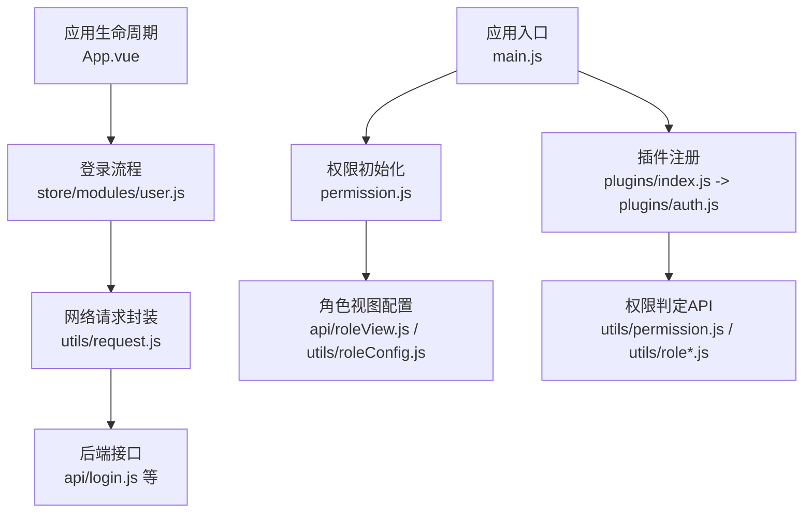
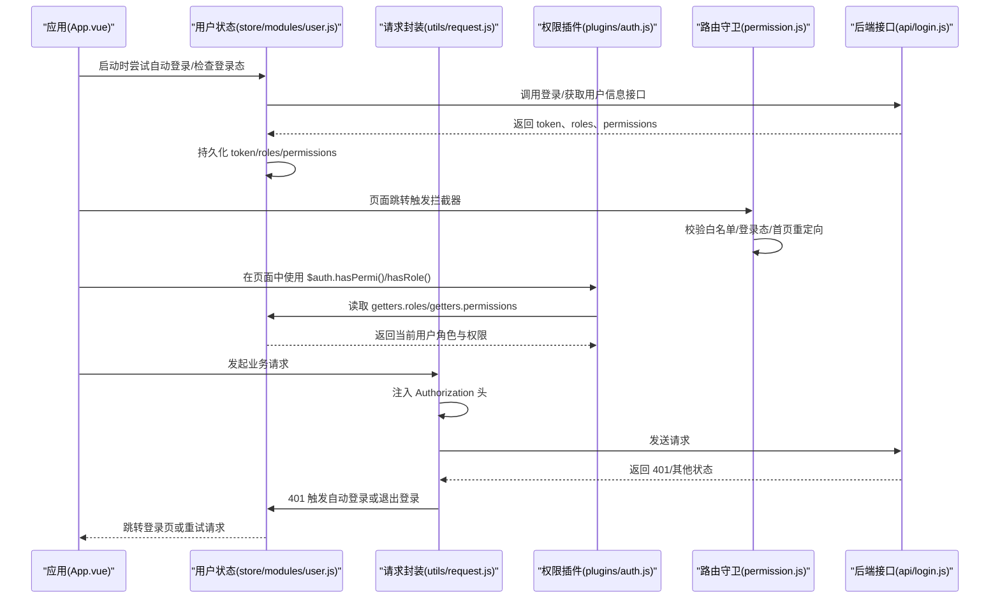
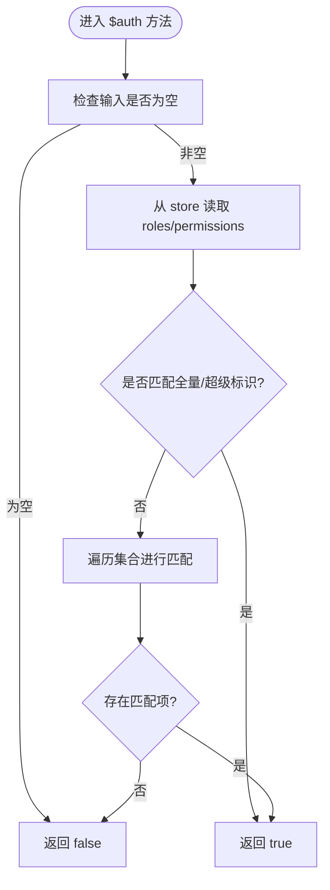
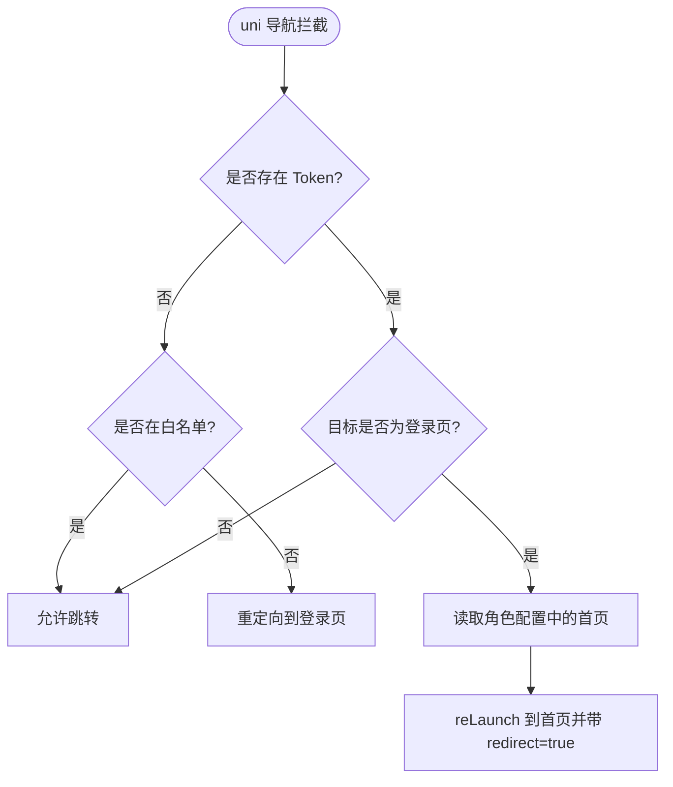
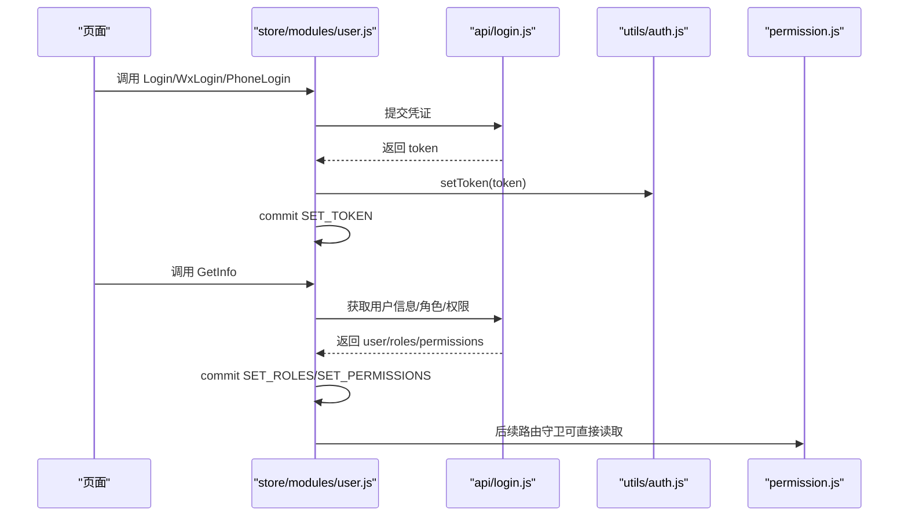
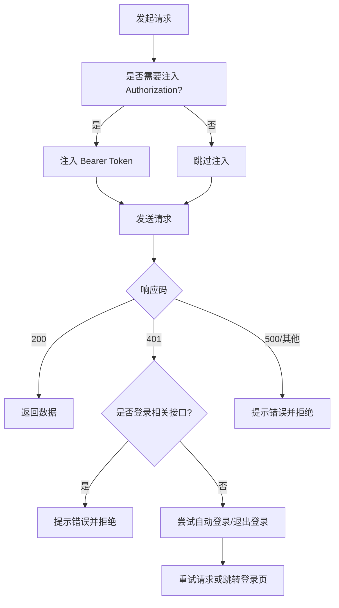
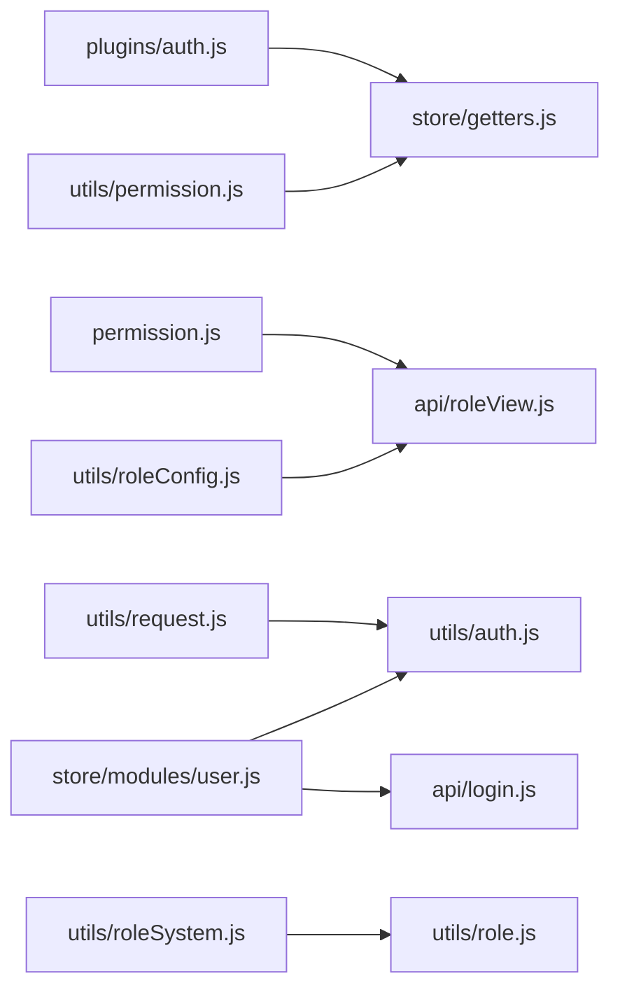

# 权限认证插件

<cite>
**本文引用的文件**   
- [plugins/auth.js](file://plugins/auth.js)
- [utils/permission.js](file://utils/permission.js)
- [utils/auth.js](file://utils/auth.js)
- [permission.js](file://permission.js)
- [store/modules/user.js](file://store/modules/user.js)
- [api/login.js](file://api/login.js)
- [utils/request.js](file://utils/request.js)
- [main.js](file://main.js)
- [App.vue](file://App.vue)
- [store/getters.js](file://store/getters.js)
- [api/roleView.js](file://api/roleView.js)
- [utils/roleConfig.js](file://utils/roleConfig.js)
- [utils/roleSystem.js](file://utils/roleSystem.js)
- [utils/role.js](file://utils/role.js)
</cite>

## 目录
1. [简介](#简介)
2. [项目结构](#项目结构)
3. [核心组件](#核心组件)
4. [架构总览](#架构总览)
5. [详细组件分析](#详细组件分析)
6. [依赖关系分析](#依赖关系分析)
7. [性能与缓存策略](#性能与缓存策略)
8. [故障排查指南](#故障排查指南)
9. [结论](#结论)
10. [附录：使用示例与最佳实践](#附录使用示例与最佳实践)

## 简介
本文件面向 RuoYi-App 的权限认证插件，系统性阐述前端侧的权限验证机制、$auth 对象 API、角色与权限数据获取/缓存/更新策略、与后端权限系统的集成方式以及 Token 管理机制。文档同时提供流程图、错误处理策略和常见使用场景的实现指引，帮助开发者正确、高效地使用权限控制功能。

## 项目结构
权限相关代码主要分布在以下位置：
- 插件层：plugins/auth.js（全局 $auth 能力）
- 工具层：utils/permission.js（指令级权限校验）、utils/auth.js（Token 存取）、utils/role*.js（角色判断与视图配置）
- 路由守卫：permission.js（页面跳转拦截、动态 TabBar、白名单）
- 状态管理：store/modules/user.js（登录、用户信息、角色与权限持久化）、store/getters.js（统一读取）
- 网络请求：utils/request.js（自动注入 Authorization、401 处理与重试）
- 应用入口：main.js（注册插件与权限模块）、App.vue（启动时自动登录与登录态检查）
- 角色视图配置：api/roleView.js、utils/roleConfig.js、utils/roleSystem.js、utils/role.js

图表来源
- [main.js:1-31](file://main.js#L1-L31)
- [plugins/auth.js:1-61](file://plugins/auth.js#L1-L61)
- [permission.js:1-133](file://permission.js#L1-L133)
- [App.vue:1-48](file://App.vue#L1-L48)
- [store/modules/user.js:1-283](file://store/modules/user.js#L1-L283)
- [utils/request.js:1-117](file://utils/request.js#L1-L117)
- [api/login.js:1-168](file://api/login.js#L1-L168)
- [api/roleView.js:1-23](file://api/roleView.js#L1-L23)
- [utils/roleConfig.js:1-149](file://utils/roleConfig.js#L1-L149)

章节来源
- [main.js:1-31](file://main.js#L1-L31)
- [App.vue:1-48](file://App.vue#L1-L48)

## 核心组件
- 全局权限插件 $auth（plugins/auth.js）
  - 提供 hasPermi、hasPermiOr、hasPermiAnd、hasRole、hasRoleOr、hasRoleAnd 等方法，基于 store.getters.roles 与 store.getters.permissions 进行判定。
- 指令级权限工具（utils/permission.js）
  - checkPermi、checkRole 用于模板或自定义指令中快速校验。
- 路由守卫与动态路由（permission.js）
  - 对 navigateTo/redirectTo/reLaunch/switchTab 进行拦截，实现未登录重定向、已登录访问登录页重定向到首页、白名单放行、动态设置 TabBar 等。
- Token 与用户信息（utils/auth.js、store/modules/user.js、store/getters.js）
  - Token 存取、用户ID存取、登录/登出、GetInfo 拉取 roles/permissions 并持久化。
- 网络请求与鉴权（utils/request.js、api/login.js）
  - 自动注入 Authorization；401 时触发微信自动登录重试或退出登录并重定向。

章节来源
- [plugins/auth.js:1-61](file://plugins/auth.js#L1-L61)
- [utils/permission.js:1-49](file://utils/permission.js#L1-L49)
- [permission.js:1-133](file://permission.js#L1-L133)
- [utils/auth.js:1-47](file://utils/auth.js#L1-L47)
- [store/modules/user.js:1-283](file://store/modules/user.js#L1-L283)
- [store/getters.js:1-11](file://store/getters.js#L1-L11)
- [utils/request.js:1-117](file://utils/request.js#L1-L117)
- [api/login.js:1-168](file://api/login.js#L1-L168)

## 架构总览
下图展示从应用启动到页面访问的完整权限链路，包括登录、获取用户信息与权限、路由守卫拦截、请求头注入与 401 处理。

图表来源
- [App.vue:1-48](file://App.vue#L1-L48)
- [store/modules/user.js:1-283](file://store/modules/user.js#L1-L283)
- [utils/request.js:1-117](file://utils/request.js#L1-L117)
- [plugins/auth.js:1-61](file://plugins/auth.js#L1-L61)
- [permission.js:1-133](file://permission.js#L1-L133)
- [api/login.js:1-168](file://api/login.js#L1-L168)

## 详细组件分析

### 全局权限插件 $auth（plugins/auth.js）
- 设计要点
  - 通过 store.getters.roles 与 store.getters.permissions 进行判定。
  - 支持“包含任一”和“必须全部拥有”的组合式校验。
  - 超级管理员与全量权限常量内置支持。
- API 说明
  - hasPermi(permission): 校验是否具备某权限码。参数为字符串，返回布尔值。
  - hasPermiOr(permissions): 数组形式传入多个权限码，满足其一即可，返回布尔值。
  - hasPermiAnd(permissions): 数组形式传入多个权限码，必须全部具备，返回布尔值。
  - hasRole(role): 校验是否具备某角色。参数为字符串，返回布尔值。
  - hasRoleOr(roles): 数组形式传入多个角色，满足其一即可，返回布尔值。
  - hasRoleAnd(roles): 数组形式传入多个角色，必须全部具备，返回布尔值。
- 复杂度
  - 单次判定时间复杂度 O(n)，n 为 roles/permissions 长度。
- 错误处理
  - 当 permissions/roles 为空或未加载时，默认返回 false，避免越权。

图表来源
- [plugins/auth.js:1-61](file://plugins/auth.js#L1-L61)
- [store/getters.js:1-11](file://store/getters.js#L1-L11)

章节来源
- [plugins/auth.js:1-61](file://plugins/auth.js#L1-L61)
- [store/getters.js:1-11](file://store/getters.js#L1-L11)

### 指令级权限工具（utils/permission.js）
- 设计要点
  - checkPermi(value)、checkRole(value) 接收数组形式的权限/角色列表，结合 store.getters 进行判定。
  - 适合在模板表达式或自定义指令中使用。
- 复杂度
  - 单次判定 O(n)。

章节来源
- [utils/permission.js:1-49](file://utils/permission.js#L1-L49)
- [store/getters.js:1-11](file://store/getters.js#L1-L11)

### 路由守卫与动态路由（permission.js）
- 功能概览
  - 白名单放行：如登录、注册、通用 webview。
  - 未登录拦截：非白名单页面跳转登录页。
  - 已登录访问登录页：重定向到首页（根据角色配置）。
  - 动态 TabBar：仅小程序平台生效，按角色配置设置底部导航。
  - 全局角色配置缓存：首次拉取后落盘，后续同步读取。
- 关键流程
  - 初始化角色配置：调用后端接口获取角色视图配置，失败回退默认教师配置。
  - 检查实名认证状态：可单独调用以更新本地认证状态。
  - 监听 uni 导航拦截器：统一处理跳转逻辑。

图表来源
- [permission.js:1-133](file://permission.js#L1-L133)
- [api/roleView.js:1-23](file://api/roleView.js#L1-L23)

章节来源
- [permission.js:1-133](file://permission.js#L1-L133)
- [api/roleView.js:1-23](file://api/roleView.js#L1-L23)

### Token 与用户信息管理（utils/auth.js、store/modules/user.js、store/getters.js）
- Token 管理
  - getToken/setToken/removeToken/isLogin 提供统一的本地存储读写与登录态判断。
- 用户信息
  - Login/WxLogin/PhoneLogin 等 action 负责登录并保存 token。
  - GetInfo 拉取用户详情、角色与权限，并进行账号类型校验（教师账号），失败则清理本地状态并拒绝。
  - LogOut/Unbind 负责退出与解绑，清理本地状态。
- 持久化
  - 通过 storage 与 auth.js 的 key 双重持久化，确保跨模块一致性。

图表来源
- [store/modules/user.js:1-283](file://store/modules/user.js#L1-L283)
- [api/login.js:1-168](file://api/login.js#L1-L168)
- [utils/auth.js:1-47](file://utils/auth.js#L1-L47)
- [permission.js:1-133](file://permission.js#L1-L133)

章节来源
- [utils/auth.js:1-47](file://utils/auth.js#L1-L47)
- [store/modules/user.js:1-283](file://store/modules/user.js#L1-L283)
- [store/getters.js:1-11](file://store/getters.js#L1-L11)

### 网络请求与鉴权（utils/request.js、api/login.js）
- 自动注入 Authorization
  - 若存在 token 且请求未显式关闭 isToken，则自动添加 Authorization 头。
- 401 处理
  - 登录相关接口直接提示错误，不触发自动登录。
  - 非登录接口 401：微信小程序环境尝试自动登录并重试原请求；其他环境执行退出登录并跳转登录页。
- 错误消息映射
  - 将后端 code 映射为用户友好提示，并对网络异常、超时等进行兜底处理。

图表来源
- [utils/request.js:1-117](file://utils/request.js#L1-L117)
- [api/login.js:1-168](file://api/login.js#L1-L168)

章节来源
- [utils/request.js:1-117](file://utils/request.js#L1-L117)
- [api/login.js:1-168](file://api/login.js#L1-L168)

### 角色与视图配置（utils/role*.js、api/roleView.js）
- 角色判断工具（utils/role.js、utils/roleSystem.js）
  - 提供 isSecretary/isAdmin/isCounselor/isTeacher 等函数，支持字符串与对象两种角色格式。
  - 提供 createRoleComputed、roleMixin、createRoleGuard 等便捷能力，便于在页面中复用。
- 角色视图配置（utils/roleConfig.js、utils/roleView.js）
  - 定义不同角色的 TabBar、功能开关与首页路径。
  - 支持从后端动态加载角色视图配置，并提供本地缓存与预加载能力。
- 与路由守卫联动
  - permission.js 在初始化时拉取角色配置，设置全局缓存与本地存储，并在小程序端动态设置 TabBar。

章节来源
- [utils/role.js:1-165](file://utils/role.js#L1-L165)
- [utils/roleSystem.js:1-297](file://utils/roleSystem.js#L1-L297)
- [utils/roleConfig.js:1-149](file://utils/roleConfig.js#L1-L149)
- [api/roleView.js:1-23](file://api/roleView.js#L1-L23)
- [permission.js:1-133](file://permission.js#L1-L133)

## 依赖关系分析
- 低耦合高内聚
  - $auth 仅依赖 store.getters，不关心数据来源，便于替换与扩展。
  - 路由守卫独立于业务页面，集中处理登录态与白名单。
  - 网络层统一处理 401，避免在各页面重复处理。
- 外部依赖
  - uni.request 作为底层通信。
  - uni.setStorageSync/uni.getStorageSync 做本地持久化。
  - 微信小程序条件编译用于自动登录与 TabBar 动态设置。

图表来源
- [plugins/auth.js:1-61](file://plugins/auth.js#L1-L61)
- [utils/permission.js:1-49](file://utils/permission.js#L1-L49)
- [permission.js:1-133](file://permission.js#L1-L133)
- [utils/request.js:1-117](file://utils/request.js#L1-L117)
- [utils/auth.js:1-47](file://utils/auth.js#L1-L47)
- [store/modules/user.js:1-283](file://store/modules/user.js#L1-L283)
- [api/login.js:1-168](file://api/login.js#L1-L168)
- [utils/roleSystem.js:1-297](file://utils/roleSystem.js#L1-L297)
- [utils/role.js:1-165](file://utils/role.js#L1-L165)
- [utils/roleConfig.js:1-149](file://utils/roleConfig.js#L1-L149)
- [api/roleView.js:1-23](file://api/roleView.js#L1-L23)

章节来源
- [plugins/auth.js:1-61](file://plugins/auth.js#L1-L61)
- [utils/permission.js:1-49](file://utils/permission.js#L1-L49)
- [permission.js:1-133](file://permission.js#L1-L133)
- [utils/request.js:1-117](file://utils/request.js#L1-L117)
- [utils/auth.js:1-47](file://utils/auth.js#L1-L47)
- [store/modules/user.js:1-283](file://store/modules/user.js#L1-L283)
- [api/login.js:1-168](file://api/login.js#L1-L168)
- [utils/roleSystem.js:1-297](file://utils/roleSystem.js#L1-L297)
- [utils/role.js:1-165](file://utils/role.js#L1-L165)
- [utils/roleConfig.js:1-149](file://utils/roleConfig.js#L1-L149)
- [api/roleView.js:1-23](file://api/roleView.js#L1-L23)

## 性能与缓存策略
- 角色与视图配置缓存
  - permission.js 维护全局角色配置内存缓存，并写入本地存储；getRoleConfigSync 优先读内存，其次读本地。
  - utils/roleViewConfig.js 提供按页面维度的配置缓存与预加载能力。
- 权限判定性能
  - $auth 与指令级工具均为线性扫描，建议保持 roles/permissions 规模合理，必要时可在后端聚合或在前端建立索引。
- 网络请求优化
  - 401 自动登录重试仅在必要场景触发，避免频繁重发。
  - 登录相关接口明确标记 isToken=false，避免不必要的鉴权分支。

[本节为通用指导，无需列出具体文件来源]

## 故障排查指南
- 常见问题
  - 登录后仍被重定向到登录页：检查 getToken 是否正确持久化、路由守卫白名单是否覆盖目标页面。
  - 权限按钮可见但点击无权限：确认后端返回的 permissions 是否包含所需权限码，注意大小写与分隔符。
  - 401 循环重试：确认登录相关接口是否设置了 isToken=false，避免自动登录死循环。
  - 角色配置未生效：检查 getRoleConfig 是否成功返回，permission.js 是否已将配置写入本地存储。
- 定位步骤
  - 在 App.vue 的 onLaunch 打印 token 与用户信息。
  - 在 permission.js 的拦截器中打印 to.url 与白名单匹配结果。
  - 在 request.js 的 401 分支打印触发原因与重试结果。
  - 在 $auth 调用处打印 store.getters.roles/permissions 的值。

章节来源
- [App.vue:1-48](file://App.vue#L1-L48)
- [permission.js:1-133](file://permission.js#L1-L133)
- [utils/request.js:1-117](file://utils/request.js#L1-L117)
- [plugins/auth.js:1-61](file://plugins/auth.js#L1-L61)

## 结论
RuoYi-App 的权限体系以 store 为中心，结合插件化的 $auth、指令级工具与路由守卫，形成“声明式 + 拦截式”的前端权限控制方案。配合网络层的 401 处理与角色视图配置的动态加载，既保证了安全性，也提升了用户体验与可维护性。建议在新增权限点时遵循最小权限原则，并通过组合式 API 提升可读性与复用性。

[本节为总结性内容，无需列出具体文件来源]

## 附录：使用示例与最佳实践
- 在页面中使用 $auth
  - 使用 hasPermi/hasRole 控制按钮显示或操作权限。
  - 使用 hasPermiOr/hasPermiAnd 表达复杂权限组合。
- 在模板中使用指令级工具
  - 使用 checkPermi/checkRole 进行快速判断。
- 路由级保护
  - 利用 permission.js 的拦截器完成登录态与白名单控制。
  - 需要按角色隐藏 TabBar 或切换首页时，参考 initRoleConfig 的流程。
- 角色视图配置
  - 通过 api/roleView.js 与 utils/roleConfig.js 管理不同角色的界面与功能开关。
  - 使用 preloadConfigs 预加载常用页面配置以提升首屏体验。
- Token 管理最佳实践
  - 所有需要鉴权的请求保持默认 isToken=true；登录、验证码等接口显式设置 isToken=false。
  - 401 时由 request.js 统一处理，不要在业务层重复处理。

[本节为概念性指导，无需列出具体文件来源]