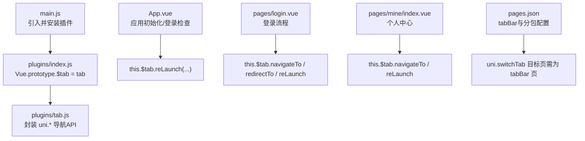
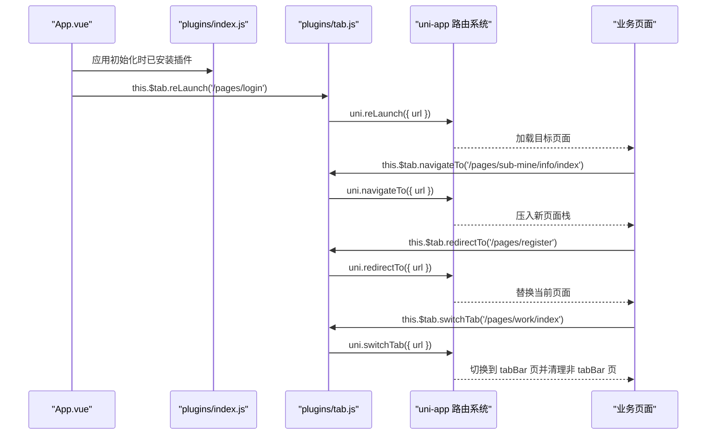
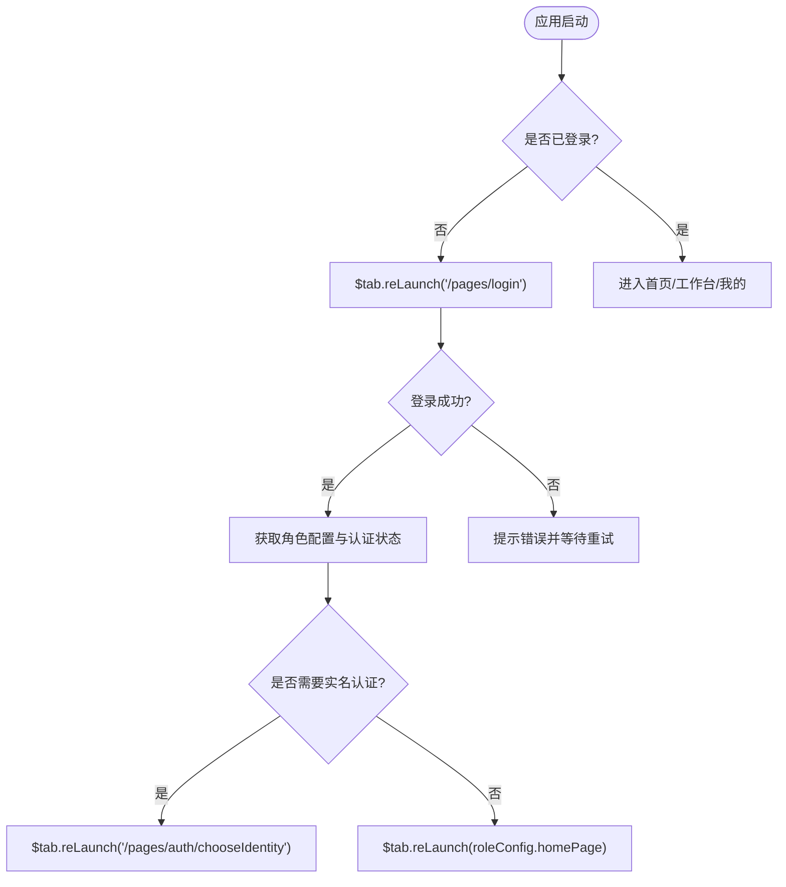
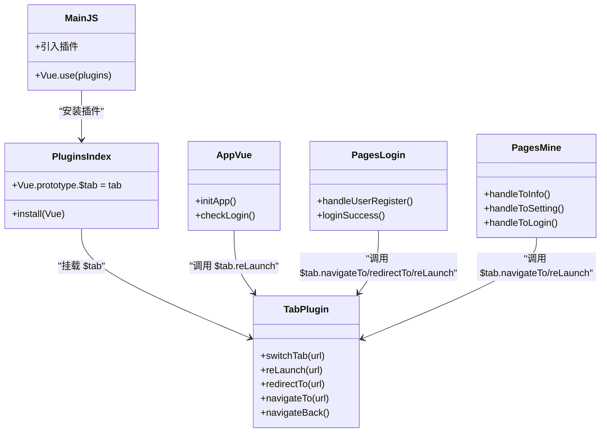
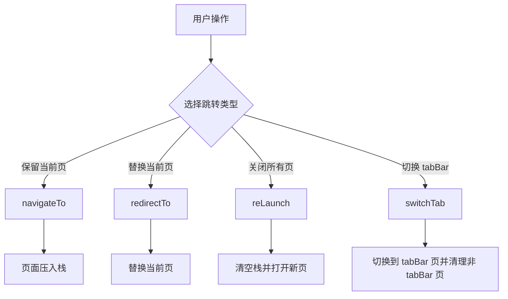

# 标签页插件

<cite>
**本文引用的文件**
- [plugins/tab.js](file://plugins/tab.js)
- [plugins/index.js](file://plugins/index.js)
- [main.js](file://main.js)
- [App.vue](file://App.vue)
- [pages.json](file://pages.json)
- [pages/login.vue](file://pages/login.vue)
- [pages/mine/index.vue](file://pages/mine/index.vue)
</cite>

## 目录
1. [简介](#简介)
2. [项目结构](#项目结构)
3. [核心组件](#核心组件)
4. [架构总览](#架构总览)
5. [详细组件分析](#详细组件分析)
6. [依赖关系分析](#依赖关系分析)
7. [性能与缓存策略](#性能与缓存策略)
8. [常见问题与排错](#常见问题与排错)
9. [结论](#结论)
10. [附录：最佳实践与流程图](#附录最佳实践与流程图)

## 简介
本文件围绕 RuoYi-App 的“标签页插件”进行系统化文档说明，聚焦页面切换控制机制、$tab 对象 API 使用方式、与 uni-app 路由系统的集成与兼容性处理、页面状态保持与缓存策略、以及导航最佳实践和用户体验优化建议。目标是帮助开发者在项目中实现流畅、可维护且高性能的页面导航体验。

## 项目结构
RuoYi-App 将全局导航能力以插件形式提供，统一挂载到 Vue 实例原型上，供任意页面或组件通过 this.$tab 调用。关键入口与注册位置如下：
- 插件定义：plugins/tab.js
- 插件聚合与安装：plugins/index.js
- 应用启动与插件安装：main.js
- 应用生命周期中的登录态检查与跳转：App.vue
- 路由与 tabBar 配置：pages.json
- 典型使用示例：pages/login.vue、pages/mine/index.vue

图表来源
- [main.js:18-18](file://main.js#L18-L18)
- [plugins/index.js:6-13](file://plugins/index.js#L6-L13)
- [plugins/tab.js:1-30](file://plugins/tab.js#L1-L30)
- [App.vue:36-40](file://App.vue#L36-L40)
- [pages/login.vue:129-141](file://pages/login.vue#L129-L141)
- [pages/mine/index.vue:187-207](file://pages/mine/index.vue#L187-L207)
- [pages.json:206-228](file://pages.json#L206-L228)

章节来源
- [main.js:1-31](file://main.js#L1-L31)
- [plugins/index.js:1-15](file://plugins/index.js#L1-L15)
- [plugins/tab.js:1-31](file://plugins/tab.js#L1-L31)
- [App.vue:1-48](file://App.vue#L1-L48)
- [pages.json:1-235](file://pages.json#L1-L235)
- [pages/login.vue:129-141](file://pages/login.vue#L129-L141)
- [pages/mine/index.vue:187-207](file://pages/mine/index.vue#L187-L207)

## 核心组件
- $tab 对象
  - 作用：对 uni-app 原生导航 API 进行轻量封装，统一入口，便于后续扩展（如埋点、拦截、错误处理）。
  - 暴露方法：
    - switchTab(url)：跳转到 tabBar 页面，并关闭其他非 tabBar 页面
    - reLaunch(url)：关闭所有页面，打开到应用内的某个页面
    - redirectTo(url)：关闭当前页面，跳转到应用内的某个页面
    - navigateTo(url)：保留当前页面，跳转到应用内的某个页面
    - navigateBack()：返回上一页面或多级页面
  - 参数约定：url 为 pages.json 中声明的路径字符串，支持查询参数拼接。

- 插件安装
  - 在 plugins/index.js 中将 $tab 挂载到 Vue.prototype，使所有页面/组件可通过 this.$tab 访问。
  - main.js 中通过 Vue.use(plugins) 完成安装。

章节来源
- [plugins/tab.js:1-31](file://plugins/tab.js#L1-L31)
- [plugins/index.js:6-13](file://plugins/index.js#L6-L13)
- [main.js:18-18](file://main.js#L18-L18)

## 架构总览
下图展示了从应用启动到页面跳转的关键路径，以及 $tab 与 uni-app 路由系统的协作关系。

图表来源
- [App.vue:36-40](file://App.vue#L36-L40)
- [plugins/tab.js:1-31](file://plugins/tab.js#L1-L31)
- [plugins/index.js:6-13](file://plugins/index.js#L6-L13)
- [pages/login.vue:129-141](file://pages/login.vue#L129-L141)
- [pages/mine/index.vue:187-207](file://pages/mine/index.vue#L187-L207)

## 详细组件分析

### $tab 对象 API 详解
- switchTab(url)
  - 行为：跳转到 tabBar 页面，并关闭其他所有非 tabBar 页面。
  - 适用场景：底部导航切换、回到主模块首页。
  - 注意：目标页必须在 pages.json 的 tabBar.list 中声明，否则跳转失败。
- reLaunch(url)
  - 行为：关闭所有页面，打开到指定页面。
  - 适用场景：登录后重定向、退出后重置、强制刷新应用根页面。
- redirectTo(url)
  - 行为：关闭当前页面，跳转到新页面。
  - 适用场景：单向流程（如注册→登录），避免用户误返回。
- navigateTo(url)
  - 行为：保留当前页面，跳转到新页面。
  - 适用场景：详情页、表单填写等需要返回的场景。
- navigateBack()
  - 行为：返回上一页面或多级页面。
  - 适用场景：通用返回按钮逻辑。

章节来源
- [plugins/tab.js:1-31](file://plugins/tab.js#L1-L31)

### 与 uni-app 路由系统集成与兼容性
- 路由注册与 tabBar 配置
  - 所有可跳转页面需在 pages.json 中声明；tabBar 页面需在 tabBar.list 中配置。
  - 分包页面通过 subPackages 配置，路径前缀需与 root 一致。
- 兼容性要点
  - switchTab 仅能跳转至 tabBar 页面，若目标不在 tabBar 列表会报错。
  - navigateTo 有最大页面栈限制（平台相关），应避免无限嵌套。
  - reLaunch 会清空页面栈，适合“重置型”跳转。
  - redirectTo 会替换当前页，无法再返回上一页。

章节来源
- [pages.json:1-235](file://pages.json#L1-L235)

### 页面状态保持与缓存策略
- 页面栈与状态
  - navigateTo 会保留页面实例与数据，返回时恢复状态。
  - reLaunch 会销毁所有页面实例，状态丢失。
  - redirectTo 替换当前页，原页面被销毁。
- 跨页面数据共享
  - 推荐使用 store（Vuex）保存用户信息、权限、角色配置等全局状态。
  - 临时数据可使用 uni.setStorageSync/uni.getStorageSync 做本地持久化。
- 页面级缓存建议
  - 列表类页面：结合 onShow 拉取增量数据，onHide 清理定时器/监听器。
  - 表单类页面：利用 navigateTo 的页面栈特性，返回时保留输入内容。
  - 大资源页面：按需懒加载图片/视频，减少首屏压力。

章节来源
- [plugins/tab.js:1-31](file://plugins/tab.js#L1-L31)
- [pages.json:1-235](file://pages.json#L1-L235)

### 典型使用示例与调用链
- 应用启动时的登录态检查
  - App.vue 在初始化时判断 token，未登录则通过 $tab.reLaunch 进入登录页。
- 登录成功后的路由分发
  - pages/login.vue 根据认证结果与角色配置，选择 reLaunch 到首页或认证页。
- 个人中心导航
  - pages/mine/index.vue 使用 $tab.navigateTo 进入子页面，使用 $tab.reLaunch 回到登录页。

图表来源
- [App.vue:36-40](file://App.vue#L36-L40)
- [pages/login.vue:191-225](file://pages/login.vue#L191-L225)

章节来源
- [App.vue:1-48](file://App.vue#L1-L48)
- [pages/login.vue:129-141](file://pages/login.vue#L129-L141)
- [pages/login.vue:191-225](file://pages/login.vue#L191-L225)
- [pages/mine/index.vue:187-207](file://pages/mine/index.vue#L187-L207)

## 依赖关系分析
- 插件安装链路
  - main.js 引入 plugins 并通过 Vue.use 安装，plugins/index.js 将 $tab/$auth/$modal 挂载到 Vue.prototype。
- 运行时调用链路
  - 业务页面通过 this.$tab 调用，内部转发到 uni.* 导航 API。
- 路由与 tabBar
  - pages.json 定义了所有页面与 tabBar 列表，switchTab 的目标必须在此列表中。

图表来源
- [main.js:18-18](file://main.js#L18-L18)
- [plugins/index.js:6-13](file://plugins/index.js#L6-L13)
- [plugins/tab.js:1-31](file://plugins/tab.js#L1-L31)
- [App.vue:36-40](file://App.vue#L36-L40)
- [pages/login.vue:129-141](file://pages/login.vue#L129-L141)
- [pages/mine/index.vue:187-207](file://pages/mine/index.vue#L187-L207)

章节来源
- [main.js:1-31](file://main.js#L1-L31)
- [plugins/index.js:1-15](file://plugins/index.js#L1-L15)
- [plugins/tab.js:1-31](file://plugins/tab.js#L1-L31)
- [App.vue:1-48](file://App.vue#L1-L48)
- [pages/login.vue:129-141](file://pages/login.vue#L129-L141)
- [pages/mine/index.vue:187-207](file://pages/mine/index.vue#L187-L207)

## 性能与缓存策略
- 页面栈管理
  - 合理使用 navigateTo 与 navigateBack，避免过深页面栈导致内存占用过高。
  - 对于一次性流程（如注册→登录），优先使用 redirectTo 替代 navigateTo，减少栈深度。
- 缓存与预加载
  - 列表页采用分页+虚拟滚动，减少渲染压力。
  - 常用页面可在后台静默预加载（如首页、工作台），提升切换速度。
- 资源与网络
  - 图片资源启用压缩与 CDN，按需加载。
  - 接口请求合并与去抖，避免重复请求。
- 事件与定时器
  - 在 onHide/onUnload 中及时移除事件监听与定时器，防止内存泄漏。

[本节为通用性能建议，不直接分析具体文件]

## 常见问题与排错
- switchTab 跳转失败
  - 现象：控制台报错或无响应。
  - 原因：目标页未在 pages.json 的 tabBar.list 中声明。
  - 解决：将目标页加入 tabBar 配置，或使用 navigateTo/redirectTo。
- 页面栈过深导致卡顿
  - 现象：返回缓慢、内存占用高。
  - 解决：使用 redirectTo 替换当前页；必要时使用 reLaunch 重置。
- 登录后循环跳转
  - 现象：登录成功后反复跳转。
  - 解决：确保仅在未登录时触发 reLaunch；登录成功后清除中间态。
- 页面状态丢失
  - 现象：返回列表页数据为空。
  - 解决：使用 navigateTo 保留页面；或在 onShow 中重新拉取数据。

章节来源
- [plugins/tab.js:1-31](file://plugins/tab.js#L1-L31)
- [pages.json:206-228](file://pages.json#L206-L228)

## 结论
RuoYi-App 的标签页插件通过对 uni-app 导航 API 的统一封装，提供了简洁一致的页面切换能力。配合 pages.json 的路由与 tabBar 配置，可实现清晰的页面结构与可控的状态保持。遵循本文的最佳实践与性能建议，可显著提升导航流畅度与用户体验。

[本节为总结性内容，不直接分析具体文件]

## 附录：最佳实践与流程图

### 导航最佳实践
- 明确跳转语义
  - 需要返回：navigateTo
  - 不可返回：redirectTo
  - 重置应用：reLaunch
  - 切换主模块：switchTab
- 统一入口
  - 始终通过 this.$tab 调用，便于后续扩展（埋点、拦截、错误上报）。
- 路由一致性
  - 所有跳转路径以 pages.json 为准，避免硬编码不一致。
- 状态管理
  - 全局状态放 store，局部状态放页面 data，避免跨页面污染。
- 资源与网络
  - 图片懒加载、接口去抖、分页加载，降低首屏与切换开销。

### 页面切换流程图（概念图）

[此图为概念流程，不对应具体源码文件]