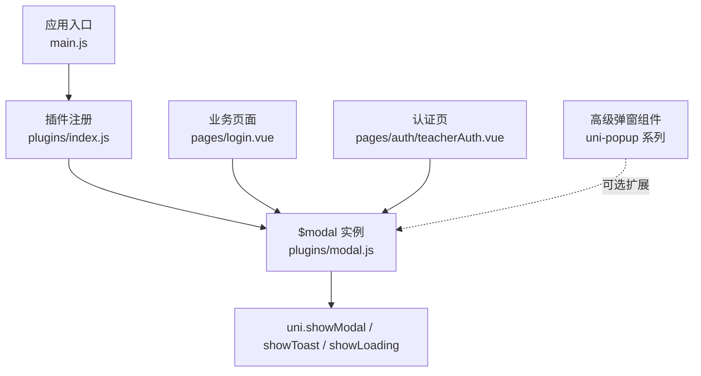
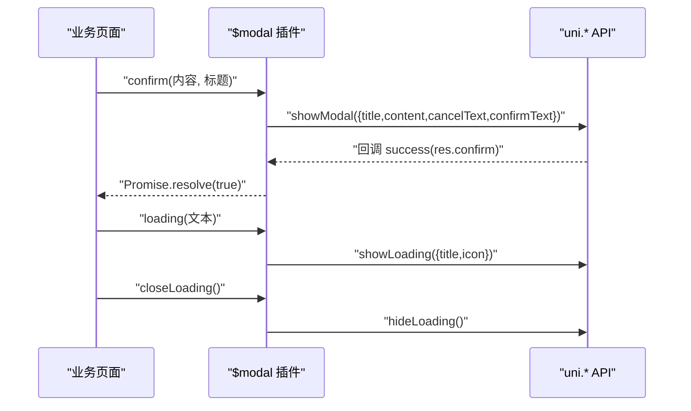
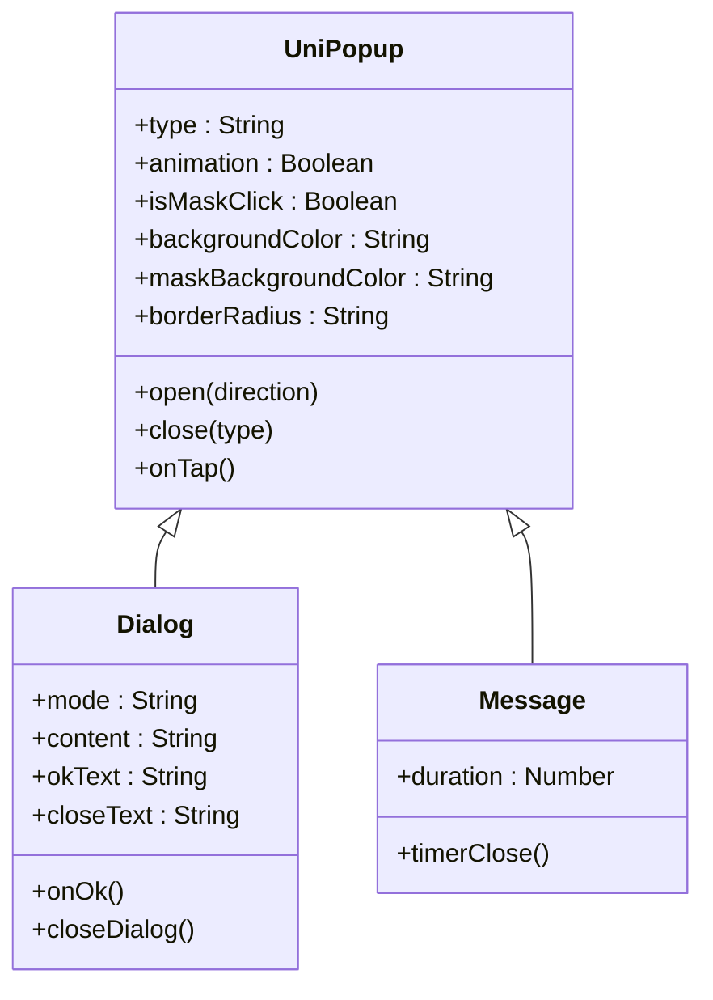
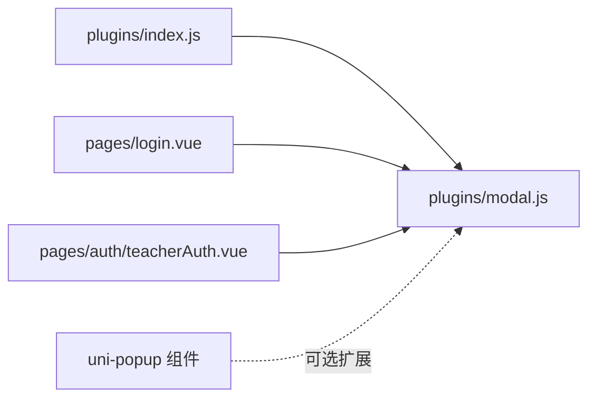

# 模态框插件

<cite>
**本文引用的文件**
- [plugins/modal.js](file://plugins/modal.js)
- [plugins/index.js](file://plugins/index.js)
- [pages/login.vue](file://pages/login.vue)
- [pages/auth/teacherAuth.vue](file://pages/auth/teacherAuth.vue)
- [uni_modules/uni-popup/components/uni-popup/uni-popup.vue](file://uni_modules/uni-popup/components/uni-popup/uni-popup.vue)
- [uni_modules/uni-popup/components/uni-popup-dialog/uni-popup-dialog.vue](file://uni_modules/uni-popup/components/uni-popup-dialog/uni-popup-dialog.vue)
- [uni_modules/uni-popup/components/uni-popup-message/uni-popup-message.vue](file://uni_modules/uni-popup/components/uni-popup-message/uni-popup-message.vue)
</cite>

## 目录
1. [简介](#简介)
2. [项目结构](#项目结构)
3. [核心组件](#核心组件)
4. [架构总览](#架构总览)
5. [详细组件分析](#详细组件分析)
6. [依赖关系分析](#依赖关系分析)
7. [性能与内存优化](#性能与内存优化)
8. [常见问题排查](#常见问题排查)
9. [结论](#结论)
10. [附录：常用场景与最佳实践](#附录常用场景与最佳实践)

## 简介
本文件为 RuoYi-App 的“模态框插件”提供系统化文档，聚焦统一弹窗管理、API 使用、生命周期与内存优化、自定义集成与样式定制，以及常见交互场景的实现建议。该插件通过全局 $modal 对象封装 uni.showModal、uni.showToast、uni.showLoading 等原生能力，并提供 Promise 化的确认对话框，帮助开发者在页面中快速实现一致的提示、确认与加载体验。

## 项目结构
RuoYi-App 将模态框能力以插件形式注入到 Vue 原型上，便于在任何页面或组件中以 this.$modal 调用。相关核心文件如下：
- 插件定义与安装：plugins/modal.js、plugins/index.js
- 典型使用示例：pages/login.vue、pages/auth/teacherAuth.vue
- 扩展弹窗能力（可选）：uni-popup 系列组件（用于更复杂的自定义弹窗）

图表来源
- [plugins/index.js:1-15](file://plugins/index.js#L1-L15)
- [plugins/modal.js:1-79](file://plugins/modal.js#L1-L79)
- [pages/login.vue:118-224](file://pages/login.vue#L118-L224)
- [pages/auth/teacherAuth.vue:40-58](file://pages/auth/teacherAuth.vue#L40-L58)

章节来源
- [plugins/index.js:1-15](file://plugins/index.js#L1-L15)
- [plugins/modal.js:1-79](file://plugins/modal.js#L1-L79)

## 核心组件
$modal 是统一的弹窗管理对象，暴露以下方法：
- msg(content)：无图标提示
- msgError(content)：错误提示
- msgSuccess(content)：成功提示
- hideMsg()：隐藏当前 toast
- alert(content, title)：仅展示信息的提示框（无取消按钮）
- confirm(content, title)：返回 Promise 的确认框
- showToast(option|string)：通用 toast，支持直接传字符串或完整配置对象
- loading(content)：显示加载中遮罩
- closeLoading()：关闭加载中遮罩

这些方法内部基于 uni.* API 实现，确保跨端一致行为。

章节来源
- [plugins/modal.js:1-79](file://plugins/modal.js#L1-L79)

## 架构总览
下图展示了从页面调用 $modal 到 uni 原生能力的调用链，以及 Promise 化确认流程。

图表来源
- [plugins/modal.js:36-50](file://plugins/modal.js#L36-L50)
- [plugins/modal.js:64-77](file://plugins/modal.js#L64-L77)

## 详细组件分析

### $modal 对象 API 详解
- 消息提示类
  - msg(content)：无图标提示
  - msgError(content)：错误图标提示
  - msgSuccess(content)：成功图标提示
  - hideMsg()：主动隐藏 toast
  - showToast(option|string)：当传入字符串时，默认 icon=none、duration=2500；传入对象则透传给 uni.showToast
- 提示框类
  - alert(content, title)：仅信息展示，不显示取消按钮
  - confirm(content, title)：返回 Promise，点击确定 resolve，点击取消或关闭不触发 resolve（可结合 await 使用）
- 加载类
  - loading(content)：显示遮罩层
  - closeLoading()：关闭遮罩层，包含 try/catch 保护

使用要点
- 确认框建议使用 async/await 模式，避免嵌套回调
- 加载提示应在请求前打开，在 finally 分支中关闭，防止异常路径遗漏关闭
- 多次连续调用 showToast 会覆盖上一次提示，注意控制频率

章节来源
- [plugins/modal.js:1-79](file://plugins/modal.js#L1-L79)

### 插件安装与全局注入
插件通过 install 钩子将 $tab、$auth、$modal 挂载到 Vue.prototype，从而在所有页面和组件中可直接使用。

章节来源
- [plugins/index.js:1-15](file://plugins/index.js#L1-L15)

### 典型使用示例（来自业务页面）
- 登录页
  - 自动登录与登录流程中使用 loading/closeLoading
  - 表单校验失败时使用 msgError
  - 登录成功后跳转
- 教师认证页
  - 提交前校验工号，失败使用 msgError
  - 提交成功后使用 msgSuccess 并返回上一页

章节来源
- [pages/login.vue:118-224](file://pages/login.vue#L118-L224)
- [pages/auth/teacherAuth.vue:40-58](file://pages/auth/teacherAuth.vue#L40-L58)

### 自定义弹窗与样式定制
若需更丰富的弹窗形态（如输入、分享、消息条等），可引入 uni-popup 系列组件进行扩展。其特点包括：
- 类型丰富：top/bottom/center/left/right/message/dialog/share
- 动画可控：内置多种过渡效果，支持开关
- 遮罩可配：背景色、圆角、安全区适配
- 事件完善：change、maskClick 等

图表来源
- [uni_modules/uni-popup/components/uni-popup/uni-popup.vue:1-519](file://uni_modules/uni-popup/components/uni-popup/uni-popup.vue#L1-L519)
- [uni_modules/uni-popup/components/uni-popup-dialog/uni-popup-dialog.vue:1-224](file://uni_modules/uni-popup/components/uni-popup-dialog/uni-popup-dialog.vue#L1-L224)
- [uni_modules/uni-popup/components/uni-popup-message/uni-popup-message.vue:50-143](file://uni_modules/uni-popup/components/uni-popup-message/uni-popup-message.vue#L50-L143)

章节来源
- [uni_modules/uni-popup/components/uni-popup/uni-popup.vue:1-519](file://uni_modules/uni-popup/components/uni-popup/uni-popup.vue#L1-L519)
- [uni_modules/uni-popup/components/uni-popup-dialog/uni-popup-dialog.vue:1-224](file://uni_modules/uni-popup/components/uni-popup-dialog/uni-popup-dialog.vue#L1-L224)
- [uni_modules/uni-popup/components/uni-popup-message/uni-popup-message.vue:50-143](file://uni_modules/uni-popup/components/uni-popup-message/uni-popup-message.vue#L50-L143)

## 依赖关系分析
- $modal 对 uni.* API 存在强依赖，属于薄封装层，职责清晰、耦合度低
- 插件安装位于 plugins/index.js，集中管理全局对象注入
- 业务页面通过 this.$modal 调用，形成松耦合的调用关系
- 如需复杂弹窗，可在页面内直接使用 uni-popup 组件，与 $modal 并行使用

图表来源
- [plugins/index.js:1-15](file://plugins/index.js#L1-L15)
- [plugins/modal.js:1-79](file://plugins/modal.js#L1-L79)
- [pages/login.vue:118-224](file://pages/login.vue#L118-L224)
- [pages/auth/teacherAuth.vue:40-58](file://pages/auth/teacherAuth.vue#L40-L58)

章节来源
- [plugins/index.js:1-15](file://plugins/index.js#L1-L15)
- [plugins/modal.js:1-79](file://plugins/modal.js#L1-L79)

## 性能与内存优化
- 避免重复提示：频繁调用 showToast 会导致提示覆盖，建议在关键路径去抖或合并提示
- 及时关闭加载：所有异步分支（成功、失败、finally）都应确保 closeLoading，避免遮罩残留
- 确认框 Promise 化：使用 async/await 简化逻辑，减少闭包引用导致的内存占用
- 谨慎使用长驻弹窗：长时间存在的自定义弹窗会增加渲染压力，必要时采用懒加载或按需创建
- 合理设置 duration：toast 时长不宜过长，影响用户操作流畅性

[本节为通用指导，无需源码引用]

## 常见问题排查
- 问题：确认框未返回结果
  - 现象：await confirm(...) 后无后续逻辑
  - 原因：仅在 res.confirm 为真时 resolve，取消不会触发 resolve
  - 处理：在调用处自行处理取消分支
- 问题：loading 无法关闭
  - 现象：页面切换后仍显示遮罩
  - 原因：异常路径未调用 closeLoading
  - 处理：在 catch/finally 中统一关闭
- 问题：toast 被覆盖
  - 现象：短时间内多次提示只显示最后一次
  - 原因：uni.showToast 覆盖机制
  - 处理：合并提示或增加间隔

章节来源
- [plugins/modal.js:36-50](file://plugins/modal.js#L36-L50)
- [plugins/modal.js:64-77](file://plugins/modal.js#L64-L77)

## 结论
$modal 插件以最小成本统一了提示、确认与加载三类高频交互，配合 uni-popup 可扩展出更丰富的弹窗形态。遵循本文的最佳实践，可在保证一致体验的同时提升代码可读性与可维护性。

[本节为总结，无需源码引用]

## 附录：常用场景与最佳实践

- 确认对话框
  - 推荐用法：async/await 包裹 confirm，分别处理确定与取消分支
  - 参考路径：[plugins/modal.js:36-50](file://plugins/modal.js#L36-L50)

- 加载提示
  - 推荐用法：请求前 loading，finally 中 closeLoading，避免遗漏
  - 参考路径：[pages/login.vue:118-188](file://pages/login.vue#L118-L188)

- 成功/失败反馈
  - 推荐用法：msgSuccess/msgError 区分状态，保持文案简洁明确
  - 参考路径：[pages/auth/teacherAuth.vue:40-58](file://pages/auth/teacherAuth.vue#L40-L58)

- 自定义弹窗
  - 适用场景：需要输入、列表选择、分享面板等复杂交互
  - 参考路径：
    - [uni_modules/uni-popup/components/uni-popup/uni-popup.vue:1-519](file://uni_modules/uni-popup/components/uni-popup/uni-popup.vue#L1-L519)
    - [uni_modules/uni-popup/components/uni-popup-dialog/uni-popup-dialog.vue:1-224](file://uni_modules/uni-popup/components/uni-popup-dialog/uni-popup-dialog.vue#L1-L224)
    - [uni_modules/uni-popup/components/uni-popup-message/uni-popup-message.vue:50-143](file://uni_modules/uni-popup/components/uni-popup-message/uni-popup-message.vue#L50-L143)

- 动画与用户体验
  - 使用内置动画（如 fade、zoom-out、slide-*）提升感知流畅度
  - 控制遮罩透明度与圆角，保持视觉层级清晰
  - 避免过度动效导致卡顿，必要时关闭 animation

[本节为实践建议，无需源码引用]