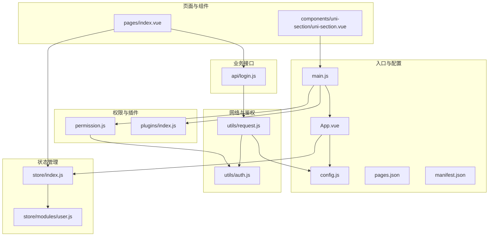
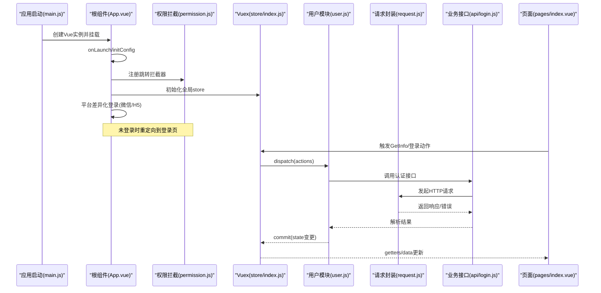
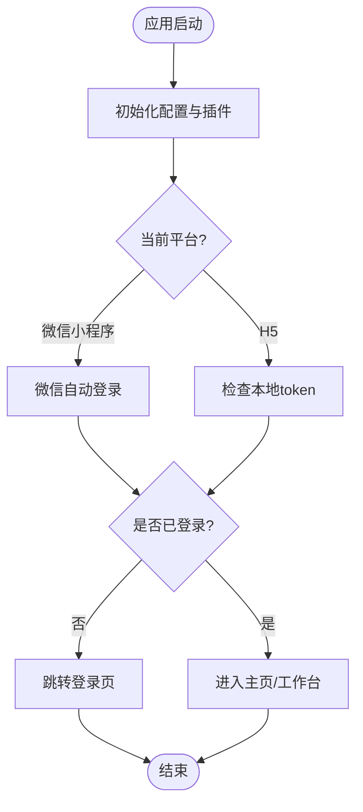
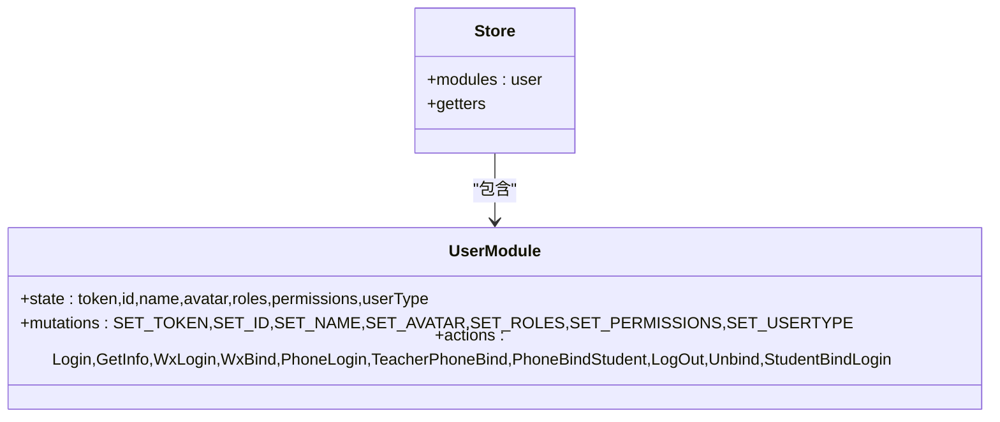
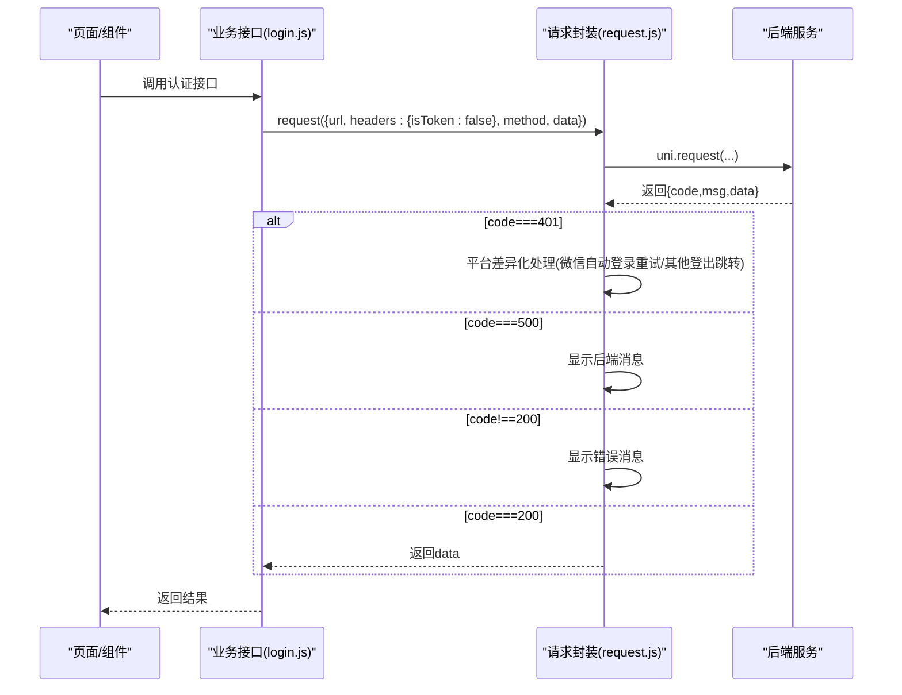
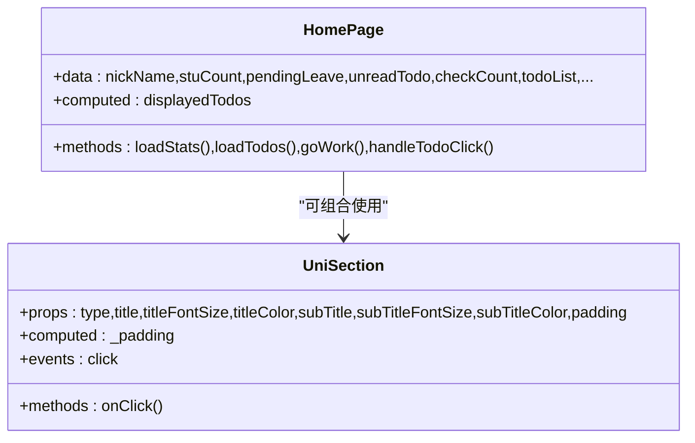
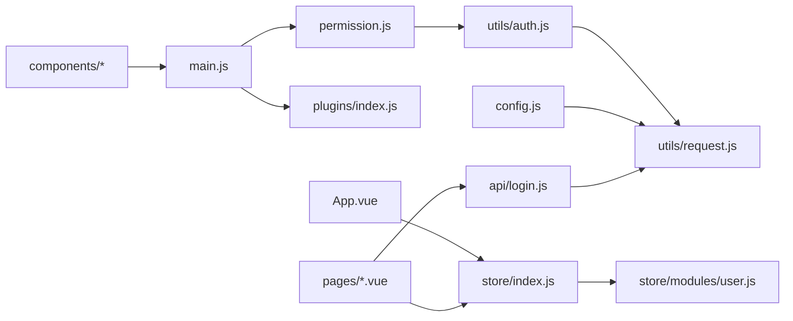

# 整体架构概览

<cite>
**本文引用的文件**   
- [main.js](file://main.js)
- [App.vue](file://App.vue)
- [pages.json](file://pages.json)
- [config.js](file://config.js)
- [permission.js](file://permission.js)
- [store/index.js](file://store/index.js)
- [store/modules/user.js](file://store/modules/user.js)
- [utils/request.js](file://utils/request.js)
- [utils/auth.js](file://utils/auth.js)
- [api/login.js](file://api/login.js)
- [manifest.json](file://manifest.json)
- [plugins/index.js](file://plugins/index.js)
- [components/uni-section/uni-section.vue](file://components/uni-section/uni-section.vue)
- [pages/index.vue](file://pages/index.vue)
</cite>

## 目录
1. [简介](#简介)
2. [项目结构](#项目结构)
3. [核心组件](#核心组件)
4. [架构总览](#架构总览)
5. [详细组件分析](#详细组件分析)
6. [依赖关系分析](#依赖关系分析)
7. [性能与多端适配](#性能与多端适配)
8. [故障排查指南](#故障排查指南)
9. [结论](#结论)

## 简介
本文件为 RuoYi-App 的整体架构概览文档，面向基于 uni-app 的跨平台移动应用。文档从 MVVM 模式、模块化设计原则与分层架构出发，系统阐述应用的启动流程、生命周期管理、核心配置，以及前端表现层（pages）、组件层（components）、业务逻辑层（api/store）、工具层（utils）的职责划分与数据流向。同时说明微信小程序、H5、APP 的统一开发模式与平台差异处理，并提供系统架构图展示各层级间的依赖关系与交互模式。

## 项目结构
RuoYi-App 采用典型的前端分层与模块化组织方式：
- 表现层 pages：页面路由与视图渲染，包含主包与分包
- 组件层 components：通用 UI 与业务复用组件
- 业务逻辑层 api/store：API 接口封装与全局状态管理
- 工具层 utils：请求封装、鉴权、存储、校验等公共能力
- 插件与全局初始化：plugins、permission、main.js、App.vue
- 配置与清单：config.js、pages.json、manifest.json

图表来源
- [main.js:1-31](file://main.js#L1-L31)
- [App.vue:1-48](file://App.vue#L1-L48)
- [config.js:1-38](file://config.js#L1-L38)
- [pages.json:1-235](file://pages.json#L1-L235)
- [manifest.json:1-77](file://manifest.json#L1-L77)
- [permission.js:1-133](file://permission.js#L1-L133)
- [store/index.js:1-16](file://store/index.js#L1-L16)
- [store/modules/user.js:1-283](file://store/modules/user.js#L1-L283)
- [utils/request.js:1-117](file://utils/request.js#L1-L117)
- [utils/auth.js:1-47](file://utils/auth.js#L1-L47)
- [api/login.js:1-168](file://api/login.js#L1-L168)
- [plugins/index.js:1-15](file://plugins/index.js#L1-L15)
- [components/uni-section/uni-section.vue:1-168](file://components/uni-section/uni-section.vue#L1-L168)
- [pages/index.vue:1-711](file://pages/index.vue#L1-L711)

章节来源
- [main.js:1-31](file://main.js#L1-L31)
- [App.vue:1-48](file://App.vue#L1-L48)
- [pages.json:1-235](file://pages.json#L1-L235)
- [config.js:1-38](file://config.js#L1-L38)
- [manifest.json:1-77](file://manifest.json#L1-L77)

## 核心组件
- 应用入口与插件注册：在入口文件中统一引入并注册 uView UI、插件、权限拦截器，挂载全局方法与字典获取函数，创建 Vue 实例并挂载。
- 应用初始化与生命周期：在 App.vue 中完成配置注入、平台差异化自动登录与登录态检查。
- 路由与分包：通过 pages.json 定义主包页面、分包与 tabBar，支持懒加载与按需加载。
- 全局配置：config.js 提供后端协议、主机、端口、API 前缀与应用信息，动态计算 baseUrl。
- 权限与跳转拦截：permission.js 实现白名单、角色配置缓存、动态 TabBar 设置与全局跳转拦截。
- 状态管理：store/index.js 聚合 Vuex 模块；user.js 维护用户令牌、基本信息、角色与权限，并提供登录、登出、微信绑定、手机号快捷登录等动作。
- 网络请求：utils/request.js 统一封装 uni.request，注入 Authorization、错误码处理、超时提示、401 自动重登与重试。
- 鉴权工具：utils/auth.js 提供 Token 与 UserId 的存取与登录态判断。
- 业务接口：api/login.js 封装认证相关 API，明确 isToken 策略避免循环重登。
- 组件与页面：components 提供可复用 UI；pages 承载业务场景，如首页统计与待办。

章节来源
- [main.js:1-31](file://main.js#L1-L31)
- [App.vue:1-48](file://App.vue#L1-L48)
- [pages.json:1-235](file://pages.json#L1-L235)
- [config.js:1-38](file://config.js#L1-L38)
- [permission.js:1-133](file://permission.js#L1-L133)
- [store/index.js:1-16](file://store/index.js#L1-L16)
- [store/modules/user.js:1-283](file://store/modules/user.js#L1-L283)
- [utils/request.js:1-117](file://utils/request.js#L1-L117)
- [utils/auth.js:1-47](file://utils/auth.js#L1-L47)
- [api/login.js:1-168](file://api/login.js#L1-L168)
- [components/uni-section/uni-section.vue:1-168](file://components/uni-section/uni-section.vue#L1-L168)
- [pages/index.vue:1-711](file://pages/index.vue#L1-L711)

## 架构总览
下图展示了 RuoYi-App 的分层架构与关键交互路径，包括入口初始化、权限控制、状态管理与网络请求链路。

图表来源
- [main.js:1-31](file://main.js#L1-L31)
- [App.vue:1-48](file://App.vue#L1-L48)
- [permission.js:1-133](file://permission.js#L1-L133)
- [store/index.js:1-16](file://store/index.js#L1-L16)
- [store/modules/user.js:1-283](file://store/modules/user.js#L1-L283)
- [utils/request.js:1-117](file://utils/request.js#L1-L117)
- [api/login.js:1-168](file://api/login.js#L1-L168)
- [pages/index.vue:1-711](file://pages/index.vue#L1-L711)

## 详细组件分析

### 应用启动与生命周期
- 入口 main.js：引入并注册 uView UI、插件、权限拦截器，挂载全局方法（如字典获取），创建 Vue 实例并挂载。
- 根组件 App.vue：onLaunch 中执行 initApp，注入全局配置，按平台条件进行自动登录或登录态检查，必要时跳转到登录页。
- 权限 permission.js：在应用启动阶段注册 navigateTo/redirectTo/reLaunch/switchTab 的全局拦截器，结合白名单与 token 判断进行访问控制，并在小程序环境动态设置 tabBar。

图表来源
- [main.js:1-31](file://main.js#L1-L31)
- [App.vue:1-48](file://App.vue#L1-L48)
- [permission.js:1-133](file://permission.js#L1-L133)

章节来源
- [main.js:1-31](file://main.js#L1-L31)
- [App.vue:1-48](file://App.vue#L1-L48)
- [permission.js:1-133](file://permission.js#L1-L133)

### 路由与分包
- 主包页面：登录、注册、首页、工作台、我的。
- 分包：sub-mine（个人信息、设置、党务等）、sub-work（学生管理、查课、请假、谈话、活动、党务管理等）、common（webview/textview）。
- tabBar：首页、工作台、我的三个底部导航。
- 分包优化：在 manifest.json 中开启子包优化与懒加载策略，提升首屏性能。

章节来源
- [pages.json:1-235](file://pages.json#L1-L235)
- [manifest.json:1-77](file://manifest.json#L1-L77)

### 全局配置与多端适配
- config.js：集中管理后端协议、主机、端口、API 前缀与应用信息，动态生成 baseUrl，便于部署切换与环境隔离。
- manifest.json：定义应用名称、版本、平台特定配置（Android/iOS 权限、微信小程序权限与私有信息、H5 模板与路由模式等）。

章节来源
- [config.js:1-38](file://config.js#L1-L38)
- [manifest.json:1-77](file://manifest.json#L1-L77)

### 权限与跳转拦截
- 白名单机制：允许登录、注册与通用 webview 无需登录即可访问。
- 角色配置缓存：首次拉取角色配置后缓存至本地，用于动态控制功能与 tabBar。
- 跳转拦截：对 navigateTo/redirectTo/reLaunch/switchTab 进行拦截，未登录且非白名单则重定向登录页；已登录访问登录页则重定向至首页。

章节来源
- [permission.js:1-133](file://permission.js#L1-L133)

### 状态管理（MVVM 中的 Model/ViewModel）
- store/index.js：聚合 Vuex 模块与 getters。
- store/modules/user.js：维护用户令牌、ID、姓名、头像、角色、权限与用户类型；提供登录、获取用户信息、微信自动登录/绑定、手机号快捷登录、退出、解绑等 actions，并通过 mutations 同步 state 与持久化存储。

图表来源
- [store/index.js:1-16](file://store/index.js#L1-L16)
- [store/modules/user.js:1-283](file://store/modules/user.js#L1-L283)

章节来源
- [store/index.js:1-16](file://store/index.js#L1-L16)
- [store/modules/user.js:1-283](file://store/modules/user.js#L1-L283)

### 网络请求与错误处理
- utils/request.js：统一封装 uni.request，注入 Authorization 头、参数序列化、超时与错误码处理；针对 401 进行平台差异化处理（微信小程序尝试自动登录并重试，其他平台直接登出并跳转登录页）。
- api/login.js：封装认证相关接口，显式设置 isToken=false 以避免登录接口被重复触发自动登录。

图表来源
- [utils/request.js:1-117](file://utils/request.js#L1-L117)
- [api/login.js:1-168](file://api/login.js#L1-L168)

章节来源
- [utils/request.js:1-117](file://utils/request.js#L1-L117)
- [api/login.js:1-168](file://api/login.js#L1-L168)

### 鉴权与存储
- utils/auth.js：提供 Token 与 UserId 的存取与登录态判断，供请求封装与权限模块使用。
- 与 store/user.js 配合：登录成功后写入本地存储与 Vuex state，确保跨组件共享与持久化。

章节来源
- [utils/auth.js:1-47](file://utils/auth.js#L1-L47)
- [store/modules/user.js:1-283](file://store/modules/user.js#L1-L283)

### 组件与页面（MVVM 中的 View/ViewModel）
- 组件层 components：以 uni-section 为例，提供标题栏与内容插槽，支持装饰样式与点击事件，体现组件的可复用性与高内聚。
- 页面层 pages：以首页 index.vue 为例，负责统计数据展示、待办事项列表与周日历筛选、快捷入口跳转，通过 store 与 api 协作完成数据获取与交互。

图表来源
- [components/uni-section/uni-section.vue:1-168](file://components/uni-section/uni-section.vue#L1-L168)
- [pages/index.vue:1-711](file://pages/index.vue#L1-L711)

章节来源
- [components/uni-section/uni-section.vue:1-168](file://components/uni-section/uni-section.vue#L1-L168)
- [pages/index.vue:1-711](file://pages/index.vue#L1-L711)

### 插件与全局扩展
- plugins/index.js：将 $tab、$auth、$modal 挂载到 Vue 原型，提供统一的页签操作、认证对象与模态框能力，降低页面耦合度。

章节来源
- [plugins/index.js:1-15](file://plugins/index.js#L1-L15)

## 依赖关系分析
- 低耦合与高内聚：
  - 请求封装独立于业务接口，业务接口仅关注 URL 与参数，不关心鉴权与错误处理细节。
  - 权限拦截与跳转逻辑集中在 permission.js，页面与组件无需重复实现鉴权。
  - 状态管理集中在 store，页面通过 getters/actions 访问与更新，避免分散的本地状态。
- 外部依赖：
  - uni-app 运行时与平台 API（如 uni.login、uni.request、uni.setStorageSync）。
  - uView UI 组件库与 uni-ui 生态组件。
- 潜在风险与改进点：
  - 401 自动重登逻辑仅在微信小程序分支生效，其他平台直接登出跳转，需确保所有平台行为一致。
  - 角色配置缓存与动态 tabBar 仅在小程序可用，H5/APP 需要额外适配。

图表来源
- [utils/auth.js:1-47](file://utils/auth.js#L1-L47)
- [utils/request.js:1-117](file://utils/request.js#L1-L117)
- [config.js:1-38](file://config.js#L1-L38)
- [store/index.js:1-16](file://store/index.js#L1-L16)
- [store/modules/user.js:1-283](file://store/modules/user.js#L1-L283)
- [api/login.js:1-168](file://api/login.js#L1-L168)
- [permission.js:1-133](file://permission.js#L1-L133)
- [main.js:1-31](file://main.js#L1-L31)
- [plugins/index.js:1-15](file://plugins/index.js#L1-L15)
- [App.vue:1-48](file://App.vue#L1-L48)
- [pages/index.vue:1-711](file://pages/index.vue#L1-L711)
- [components/uni-section/uni-section.vue:1-168](file://components/uni-section/uni-section.vue#L1-L168)

章节来源
- [utils/request.js:1-117](file://utils/request.js#L1-L117)
- [permission.js:1-133](file://permission.js#L1-L133)
- [store/modules/user.js:1-283](file://store/modules/user.js#L1-L283)
- [api/login.js:1-168](file://api/login.js#L1-L168)
- [main.js:1-31](file://main.js#L1-L31)

## 性能与多端适配
- 分包与懒加载：通过 pages.json 分包与 manifest.json 的 lazyCodeLoading 策略，减少主包体积与首屏加载时间。
- 静态资源与主题：static 目录集中管理字体、图标、图片与样式，便于统一替换与缓存。
- 多端差异处理：
  - 微信小程序：启用自动登录、动态 tabBar 设置、位置权限声明。
  - H5：hash 路由模式与开发服务器配置。
  - APP：Android 权限声明与 nvue 编译选项。
- 建议：
  - 对长列表与大数据量页面使用虚拟滚动或分页加载。
  - 图片资源使用 CDN 与压缩格式，按需加载。
  - 对频繁调用的接口增加本地缓存与去抖/节流策略。

[本节为通用指导，不涉及具体文件分析]

## 故障排查指南
- 401 会话过期：
  - 现象：请求返回 401，自动重登失败后跳转登录页。
  - 排查：确认 token 是否存在、后端会话是否有效、微信小程序自动登录流程是否成功。
  - 参考：请求封装中对 401 的处理与平台分支。
- 网络异常与超时：
  - 现象：Network Error 或 timeout 提示。
  - 排查：检查 baseUrl 配置、代理路径、网络连通性、后端服务状态。
  - 参考：请求封装的错误映射与提示。
- 权限与跳转问题：
  - 现象：未登录无法访问页面或登录后仍被重定向到登录页。
  - 排查：检查白名单、token 读取、角色配置缓存与动态 tabBar 设置。
  - 参考：权限拦截器的白名单与跳转逻辑。
- 微信绑定与手机号登录：
  - 现象：绑定失败或登录无响应。
  - 排查：确认 wxLogin/wxBind/phoneLogin 接口参数与 isToken 设置，查看后端返回码与错误消息。
  - 参考：认证接口封装与 user 模块 actions。

章节来源
- [utils/request.js:1-117](file://utils/request.js#L1-L117)
- [permission.js:1-133](file://permission.js#L1-L133)
- [api/login.js:1-168](file://api/login.js#L1-L168)
- [store/modules/user.js:1-283](file://store/modules/user.js#L1-L283)

## 结论
RuoYi-App 基于 uni-app 实现了清晰的分层与模块化架构：入口与生命周期管理、权限与路由拦截、状态管理与网络请求封装各司其职，页面与组件专注于视图与交互。通过分包与懒加载、平台差异化配置与权限控制，项目在微信小程序、H5、APP 上具备一致的体验与良好的可维护性。后续可在 401 自动重登一致性、角色配置跨端适配与性能优化方面持续完善。