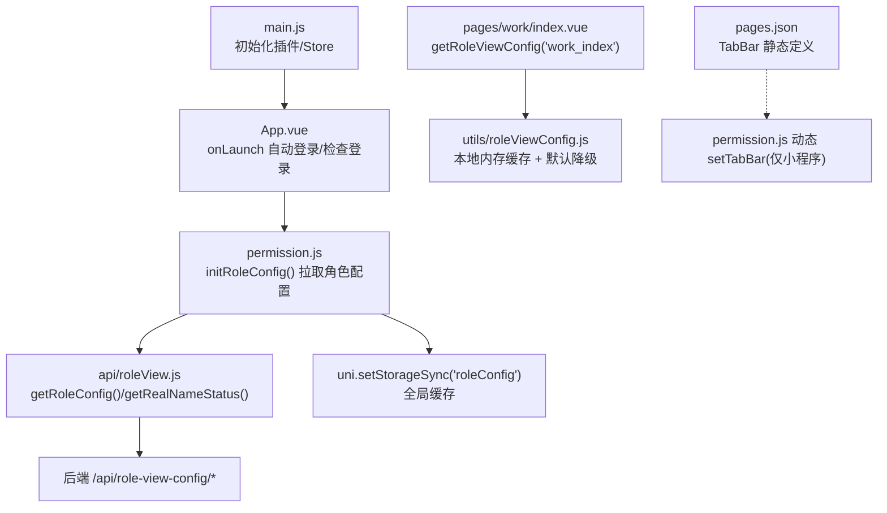
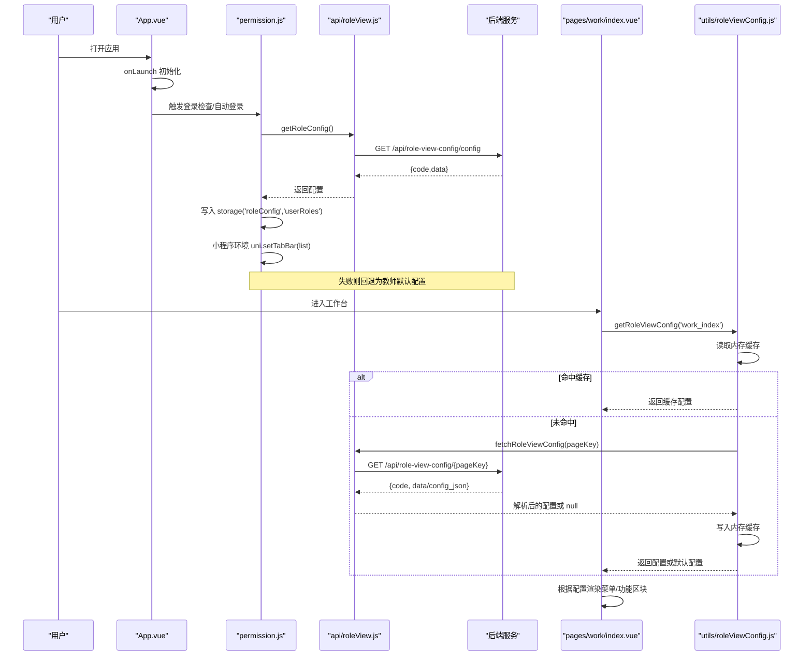
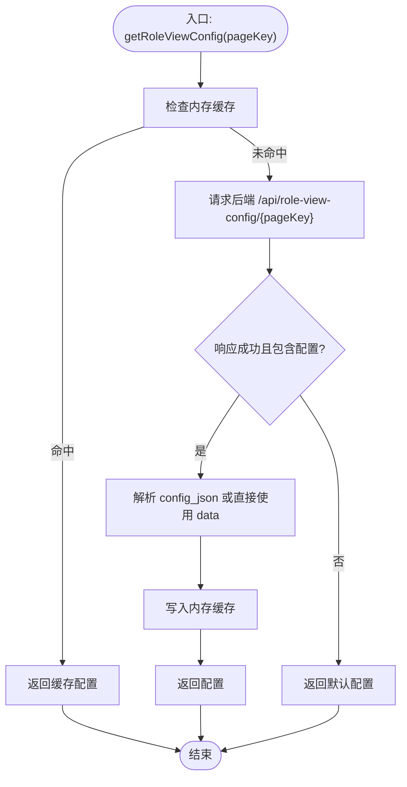
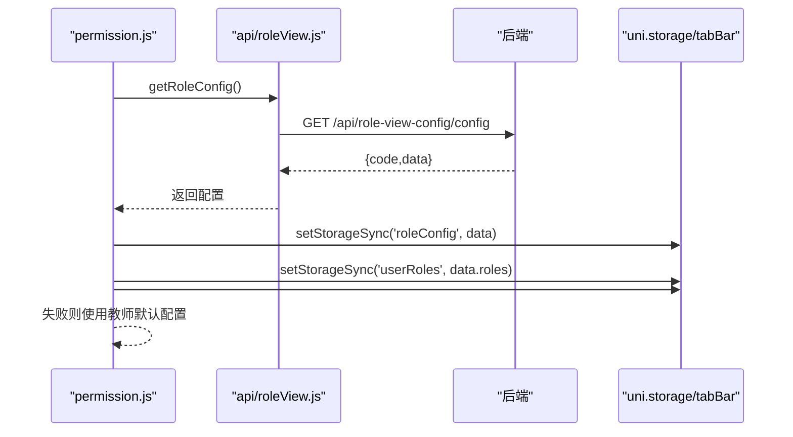
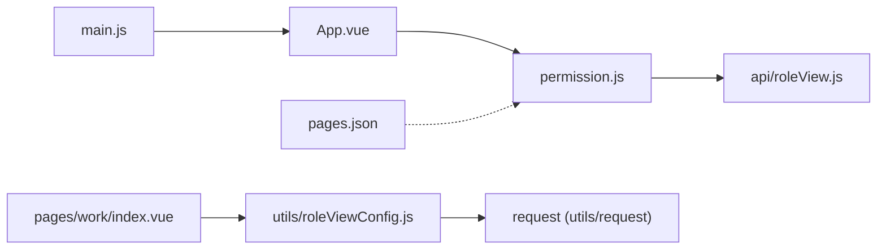

# 动态菜单系统

<cite>
**本文引用的文件**
- [utils/roleViewConfig.js](file://utils/roleViewConfig.js)
- [api/roleView.js](file://api/roleView.js)
- [permission.js](file://permission.js)
- [App.vue](file://App.vue)
- [main.js](file://main.js)
- [pages.json](file://pages.json)
- [store/modules/user.js](file://store/modules/user.js)
- [utils/auth.js](file://utils/auth.js)
- [utils/storage.js](file://utils/storage.js)
- [config.js](file://config.js)
- [pages/work/index.vue](file://pages/work/index.vue)
</cite>

## 目录
1. [简介](#简介)
2. [项目结构](#项目结构)
3. [核心组件](#核心组件)
4. [架构总览](#架构总览)
5. [详细组件分析](#详细组件分析)
6. [依赖关系分析](#依赖关系分析)
7. [性能与缓存策略](#性能与缓存策略)
8. [故障排查指南](#故障排查指南)
9. [结论](#结论)
10. [附录：配置示例与开发指南](#附录配置示例与开发指南)

## 简介
本文件面向 RuoYi-App 的动态菜单系统，聚焦“角色视图配置”的完整实现机制。内容涵盖：
- 从后端动态加载角色视图配置的链路（接口、解析、缓存、降级）
- roleViewConfig 模块的工作原理（数据格式、路由映射、权限过滤）
- 从用户登录到菜单渲染的端到端流程
- 版本管理与更新机制（前端与后端一致性保障）
- 自定义菜单扩展指南
- 关键流程图与错误处理策略

## 项目结构
围绕动态菜单与角色视图配置，相关代码主要分布在以下位置：
- 应用启动与全局拦截：main.js、App.vue、permission.js
- 角色视图配置获取与缓存：utils/roleViewConfig.js、api/roleView.js
- 页面注册与 TabBar 静态声明：pages.json
- 用户信息与登录态：store/modules/user.js、utils/auth.js、utils/storage.js
- 工作台等使用视图配置的页面：pages/work/index.vue
- 基础网络与域名配置：config.js

图表来源
- [main.js:1-31](file://main.js#L1-L31)
- [App.vue:1-48](file://App.vue#L1-L48)
- [permission.js:1-133](file://permission.js#L1-L33)
- [api/roleView.js:1-23](file://api/roleView.js#L1-L23)
- [utils/roleViewConfig.js:1-115](file://utils/roleViewConfig.js#L1-L115)
- [pages.json:206-228](file://pages.json#L206-L228)
- [pages/work/index.vue:146-162](file://pages/work/index.vue#L146-L162)

章节来源
- [main.js:1-31](file://main.js#L1-L31)
- [App.vue:1-48](file://App.vue#L1-L48)
- [permission.js:1-133](file://permission.js#L1-L133)
- [api/roleView.js:1-23](file://api/roleView.js#L1-L23)
- [utils/roleViewConfig.js:1-115](file://utils/roleViewConfig.js#L1-L115)
- [pages.json:206-228](file://pages.json#L206-L228)
- [pages/work/index.vue:146-162](file://pages/work/index.vue#L146-L162)

## 核心组件
- 角色视图配置获取层
  - api/roleView.js：封装角色配置与实名认证状态接口
  - permission.js：应用级 initRoleConfig() 负责首次拉取、全局缓存、动态设置 TabBar
- 页面级视图配置层
  - utils/roleViewConfig.js：按 pageKey 拉取并缓存页面视图配置，提供默认降级
- 页面消费方
  - pages/work/index.vue：在 created 中调用 getRoleViewConfig('work_index') 驱动 UI 渲染
- 路由与导航
  - pages.json：声明所有页面与 TabBar 静态项
  - permission.js：基于 token 与白名单进行跳转拦截，结合 homePage 重定向

章节来源
- [api/roleView.js:1-23](file://api/roleView.js#L1-L23)
- [permission.js:26-60](file://permission.js#L26-L60)
- [utils/roleViewConfig.js:16-37](file://utils/roleViewConfig.js#L16-L37)
- [pages/work/index.vue:146-162](file://pages/work/index.vue#L146-L162)
- [pages.json:1-30](file://pages.json#L1-L30)

## 架构总览
下图展示从应用启动到菜单渲染的关键路径，包括登录态校验、角色配置拉取、TabBar 动态设置、以及页面级视图配置加载。

图表来源
- [App.vue:6-34](file://App.vue#L6-L34)
- [permission.js:26-60](file://permission.js#L26-L60)
- [api/roleView.js:7-12](file://api/roleView.js#L7-L12)
- [utils/roleViewConfig.js:16-65](file://utils/roleViewConfig.js#L16-L65)
- [pages/work/index.vue:146-162](file://pages/work/index.vue#L146-L162)

## 详细组件分析

### 角色视图配置模块（utils/roleViewConfig.js）
职责
- 按 pageKey 获取页面级视图配置
- 优先使用内存缓存，未命中则请求后端
- 兼容两种后端返回结构：data 直接为配置，或 data.config_json 为 JSON 字符串
- 失败时返回默认配置，保证页面可用

关键流程
- getRoleViewConfig(pageKey)：查内存 -> 请求后端 -> 写缓存 -> 返回；异常时走 getDefaultConfig
- fetchRoleViewConfig(pageKey)：请求 /api/role-view-config/${pageKey}，解析 config_json 或直接返回 data
- clearConfigCache()：清空内存缓存
- preloadConfigs()：预加载常用页面配置

图表来源
- [utils/roleViewConfig.js:16-37](file://utils/roleViewConfig.js#L16-L37)
- [utils/roleViewConfig.js:42-65](file://utils/roleViewConfig.js#L42-L65)
- [utils/roleViewConfig.js:70-92](file://utils/roleViewConfig.js#L70-L92)

章节来源
- [utils/roleViewConfig.js:1-115](file://utils/roleViewConfig.js#L1-L115)

### 应用级角色配置（permission.js）
职责
- 应用启动后拉取全局角色配置（roles、homePage、tabBar、features 等）
- 将配置持久化至 storage，供后续同步读取
- 在小程序环境下动态设置 TabBar
- 提供 hasFeature(feature) 判断功能开关
- 对 navigateTo/redirectTo/reLaunch/switchTab 做统一拦截，实现登录态与首页重定向

关键点
- initRoleConfig()：成功后写入 'roleConfig' 与 'userRoles'；失败回退为教师默认配置
- checkRealNameAuth()：拉取实名认证状态并缓存
- 跳转拦截：已登录访问登录页重定向到 homePage；未登录访问非白名单页重定向到登录页

图表来源
- [permission.js:26-60](file://permission.js#L26-L60)
- [api/roleView.js:7-12](file://api/roleView.js#L7-L12)

章节来源
- [permission.js:1-133](file://permission.js#L1-L133)
- [api/roleView.js:1-23](file://api/roleView.js#L1-L23)

### 工作台页面（pages/work/index.vue）
职责
- 在 created 阶段调用 getRoleViewConfig('work_index') 获取页面视图配置
- 根据配置控制常见功能区显隐、布局与交互
- 同时加载统计数据、待办列表、学工金句等

注意
- 当前实现中 ALL_FUNCS 全量显示，实际可按 viewConfig 中的字段进行过滤与排序
- 建议将 commonKeys 与 viewConfig 联动，实现服务端驱动的“常用功能”顺序与可见性

章节来源
- [pages/work/index.vue:146-162](file://pages/work/index.vue#L146-L162)
- [pages/work/index.vue:80-97](file://pages/work/index.vue#L80-L97)

### 路由与 TabBar（pages.json）
- 所有页面与分包均在 pages.json 中声明，TabBar 静态项用于兜底与小程序原生体验
- 运行时可通过 permission.js 的 uni.setTabBar 覆盖，以实现不同角色的差异化导航

章节来源
- [pages.json:1-30](file://pages.json#L1-L30)
- [pages.json:206-228](file://pages.json#L206-L228)
- [permission.js:33-43](file://permission.js#L33-L43)

### 用户信息与登录态（store/modules/user.js、utils/auth.js、utils/storage.js）
- store/modules/user.js：管理 token、用户信息、角色与权限，并在 GetInfo 中校验 userType 与 roles
- utils/auth.js：token 与 userId 的存取工具
- utils/storage.js：通用存储封装，配合 store 持久化用户信息

章节来源
- [store/modules/user.js:72-111](file://store/modules/user.js#L72-L111)
- [utils/auth.js:1-47](file://utils/auth.js#L1-L47)
- [utils/storage.js:1-33](file://utils/storage.js#L1-L33)

## 依赖关系分析
- permission.js 依赖 api/roleView.js 获取全局角色配置
- utils/roleViewConfig.js 依赖 request 发起页面级配置请求
- pages/work/index.vue 依赖 utils/roleViewConfig.js 获取 work_index 视图配置
- App.vue 与 main.js 负责应用初始化与插件注入
- pages.json 提供静态路由与 TabBar 兜底

图表来源
- [main.js:1-31](file://main.js#L1-L31)
- [App.vue:1-48](file://App.vue#L1-L48)
- [permission.js:1-133](file://permission.js#L1-L133)
- [api/roleView.js:1-23](file://api/roleView.js#L1-L23)
- [utils/roleViewConfig.js:1-115](file://utils/roleViewConfig.js#L1-L115)
- [pages.json:1-30](file://pages.json#L1-L30)

章节来源
- [main.js:1-31](file://main.js#L1-L31)
- [App.vue:1-48](file://App.vue#L1-L48)
- [permission.js:1-133](file://permission.js#L1-L133)
- [api/roleView.js:1-23](file://api/roleView.js#L1-L23)
- [utils/roleViewConfig.js:1-115](file://utils/roleViewConfig.js#L1-L115)
- [pages.json:1-30](file://pages.json#L1-L30)

## 性能与缓存策略
- 内存缓存（utils/roleViewConfig.js）
  - 以 pageKey 为键，避免重复请求
  - 提供 clearConfigCache() 主动刷新
- 持久化缓存（permission.js）
  - 全局角色配置写入 'roleConfig' 与 'userRoles'，支持同步读取
- 页面数据缓存（pages/work/index.vue）
  - 统计卡片数据采用 5 分钟有效期的本地缓存，减少频繁请求
- 预加载（utils/roleViewConfig.js）
  - preloadConfigs() 可在工作台或首页启动时并行预取常用页面配置

优化建议
- 为全局角色配置增加版本号字段，配合 ETag/Last-Modified 或版本号比对，减少无效刷新
- 对长尾页面按需预加载，避免一次性拉取过多配置
- 对高频小配置考虑合并接口，降低请求数

[本节为通用指导，不直接分析具体文件]

## 故障排查指南
常见问题与定位要点
- 登录后仍被重定向到登录页
  - 检查 getToken() 是否返回有效值，确认 login 流程是否正确写入 token
  - 检查 permission.js 的白名单与 homePage 配置
- 角色配置为空或回退为教师默认
  - 查看 initRoleConfig() 的 catch 分支，确认后端接口是否返回 code=200 且 data 存在
  - 检查 network 日志，确认 /api/role-view-config/config 可达
- 页面级视图配置不生效
  - 确认 getRoleViewConfig(pageKey) 是否命中内存缓存
  - 检查后端返回结构：若为 config_json，需确保 JSON 可解析
  - 失败时会回退到 getDefaultConfig，确认默认配置是否满足需求
- 小程序 TabBar 未动态更新
  - 确认运行环境为小程序，且 uni.setTabBar 调用未被 try/catch 吞掉异常
  - 检查 globalRoleConfig.tabBar 是否为空数组

章节来源
- [permission.js:26-60](file://permission.js#L26-L60)
- [permission.js:97-132](file://permission.js#L97-L132)
- [utils/roleViewConfig.js:16-37](file://utils/roleViewConfig.js#L16-L37)
- [utils/roleViewConfig.js:42-65](file://utils/roleViewConfig.js#L42-L65)
- [utils/roleViewConfig.js:70-92](file://utils/roleViewConfig.js#L70-L92)

## 结论
RuoYi-App 的动态菜单系统通过“全局角色配置 + 页面级视图配置”的双层设计，实现了灵活的角色化导航与功能呈现。其核心优势在于：
- 分层解耦：全局配置控制导航与特性开关，页面配置控制局部布局与功能可见性
- 高可用：内存缓存 + 默认降级，确保弱网或服务不可用时仍可正常使用
- 可扩展：新增页面只需定义 pageKey 与默认配置，即可接入动态菜单体系

[本节为总结性内容，不直接分析具体文件]

## 附录：配置示例与开发指南

### 全局角色配置（后端返回结构参考）
- 字段说明
  - roles：角色标识数组，如 ["teacher"]
  - homePage：登录后默认首页路径
  - tabBar：TabBar 列表（仅在小程序环境动态设置）
  - features：功能开关字典，如 { classcheck: true }
- 示例（示意）
  - roles: ["teacher"]
  - homePage: "/pages/index"
  - tabBar: [{ pagePath, iconPath, selectedIconPath, text }, ...]
  - features: { classcheck: true, leave: true, talk: true, stuinfo: true }

章节来源
- [permission.js:26-60](file://permission.js#L26-L60)
- [api/roleView.js:7-12](file://api/roleView.js#L7-L12)

### 页面级视图配置（pageKey 维度）
- 获取方式：getRoleViewConfig(pageKey)
- 后端接口：/api/role-view-config/{pageKey}
- 返回结构兼容
  - res.data 直接为配置对象
  - 或 res.data.config_json 为 JSON 字符串，需前端解析
- 默认配置（当后端不可用时）
  - 针对 stuinfo、work_index 等 key 提供默认字段，如 viewType、showSidebar、searchEnabled 等

章节来源
- [utils/roleViewConfig.js:42-65](file://utils/roleViewConfig.js#L42-L65)
- [utils/roleViewConfig.js:70-92](file://utils/roleViewConfig.js#L70-L92)

### 路由映射规则
- 页面必须在 pages.json 中声明，TabBar 项也需在 pages.json 中定义
- 运行时可通过 permission.js 的 uni.setTabBar 覆盖 TabBar 显示
- 跳转拦截遵循：
  - 已登录访问登录页 -> 重定向到 homePage
  - 未登录访问非白名单页 -> 重定向到登录页

章节来源
- [pages.json:1-30](file://pages.json#L1-L30)
- [permission.js:97-132](file://permission.js#L97-L132)

### 权限过滤逻辑
- 全局功能开关：hasFeature(feature) 读取全局配置 features
- 页面级可见性：由页面根据 viewConfig 字段控制（例如 showSidebar、showClassList 等）
- 建议：在页面内将 ALL_FUNCS 与 viewConfig 联动，按服务端配置过滤与排序

章节来源
- [permission.js:91-95](file://permission.js#L91-L95)
- [pages/work/index.vue:80-97](file://pages/work/index.vue#L80-L97)

### 版本管理与更新机制
- 建议在角色配置中引入 version 字段，前端在 initRoleConfig 时对比本地版本
- 若版本不一致，强制刷新全局配置并清除相关缓存
- 页面级配置可在后端维护版本，前端在 getRoleViewConfig 时携带 lastVersion，服务端返回增量或全量

章节来源
- [permission.js:26-60](file://permission.js#L26-L60)
- [utils/roleViewConfig.js:16-37](file://utils/roleViewConfig.js#L16-L37)

### 自定义菜单开发指南
- 新增页面
  - 在 pages.json 中注册页面与样式
  - 在 utils/roleViewConfig.js 的默认配置中补充该 pageKey 的默认字段
  - 在业务页面中调用 getRoleViewConfig(pageKey) 获取配置并渲染
- 新增全局功能开关
  - 在后端角色配置 features 中添加新键
  - 在 hasFeature 的使用处添加对应判断
- 调整 TabBar
  - 在后端角色配置 tabBar 中调整条目
  - 确认小程序环境能正确调用 uni.setTabBar

章节来源
- [pages.json:1-30](file://pages.json#L1-L30)
- [utils/roleViewConfig.js:70-92](file://utils/roleViewConfig.js#L70-L92)
- [permission.js:91-95](file://permission.js#L91-L95)
- [permission.js:33-43](file://permission.js#L33-L43)