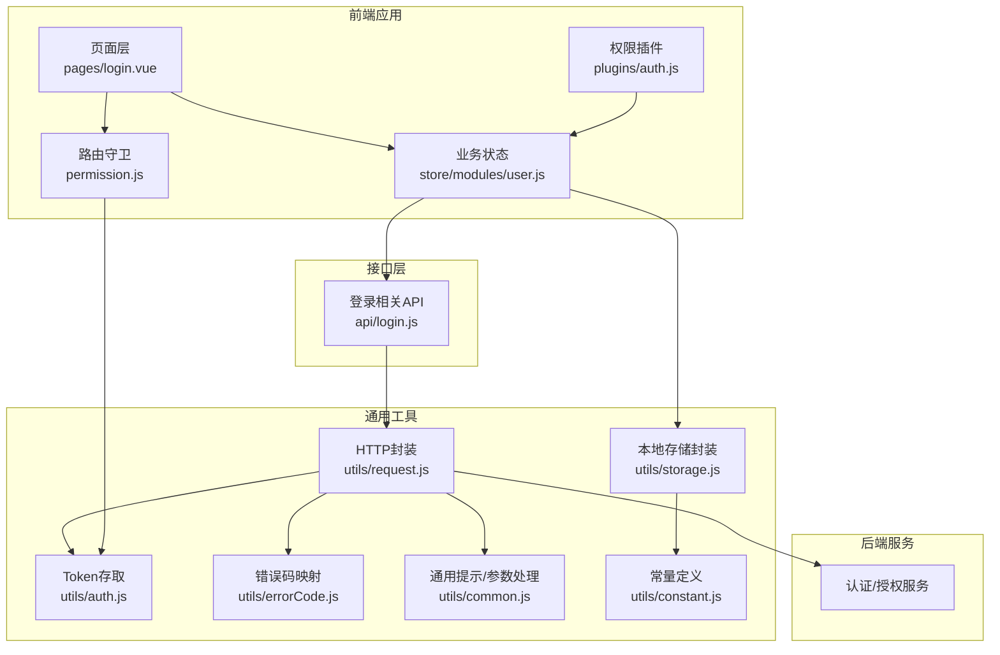
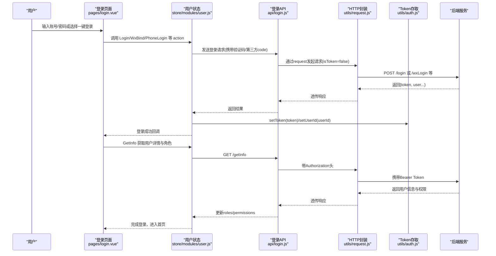
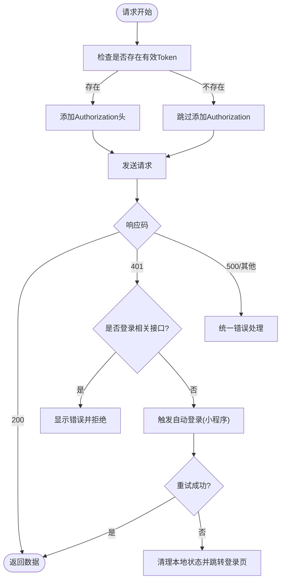
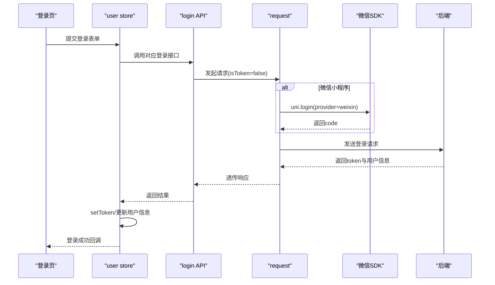
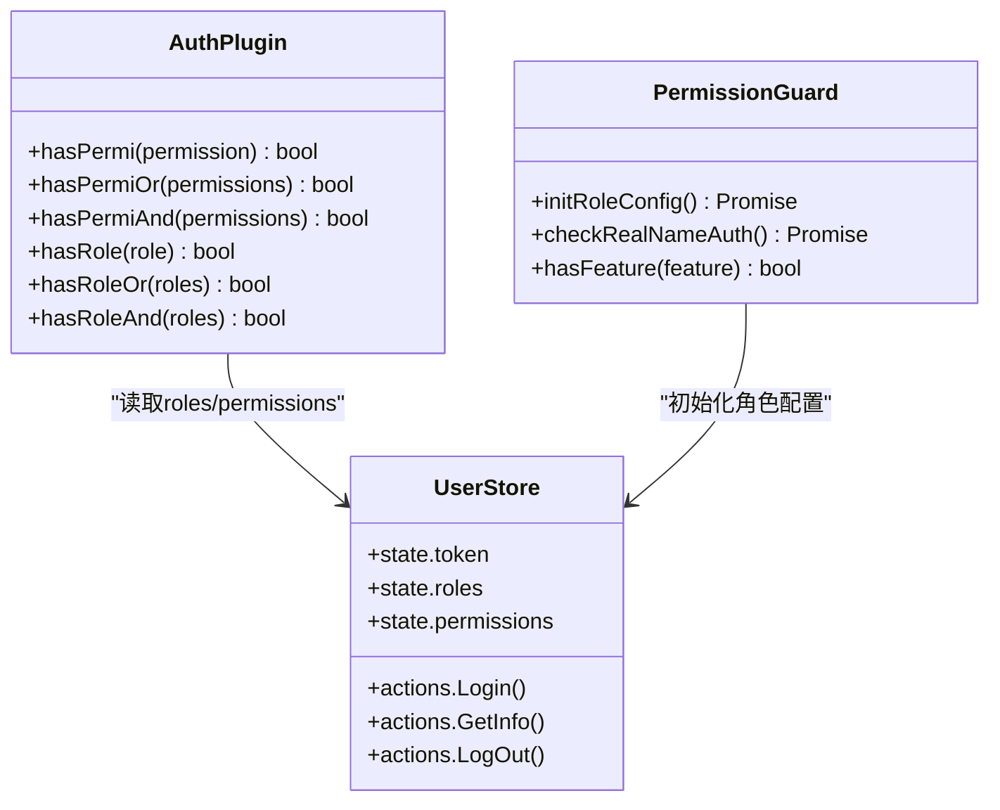
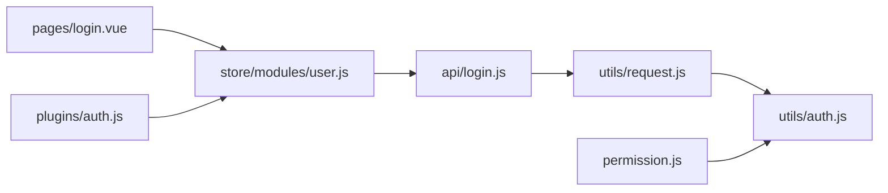

# 安全策略

<cite>
**本文引用的文件**   
- [utils/auth.js](file://utils/auth.js)
- [utils/request.js](file://utils/request.js)
- [api/login.js](file://api/login.js)
- [store/modules/user.js](file://store/modules/user.js)
- [pages/login.vue](file://pages/login.vue)
- [permission.js](file://permission.js)
- [plugins/auth.js](file://plugins/auth.js)
- [config.js](file://config.js)
- [utils/storage.js](file://utils/storage.js)
- [utils/constant.js](file://utils/constant.js)
- [utils/errorCode.js](file://utils/errorCode.js)
- [utils/common.js](file://utils/common.js)
</cite>

## 目录
1. [简介](#简介)
2. [项目结构](#项目结构)
3. [核心组件](#核心组件)
4. [架构总览](#架构总览)
5. [详细组件分析](#详细组件分析)
6. [依赖关系分析](#依赖关系分析)
7. [性能与可用性考虑](#性能与可用性考虑)
8. [故障排查指南](#故障排查指南)
9. [结论](#结论)
10. [附录：安全配置建议与最佳实践](#附录安全配置建议与最佳实践)

## 简介
本安全策略文档面向 RuoYi-App 移动端，围绕 Token 管理、会话保持、多端登录、移动端数据安全与网络通信安全、登录认证流程以及安全防护策略进行系统化说明。文档基于仓库现有实现进行分析，并给出可落地的安全配置建议与最佳实践，帮助读者在理解当前机制的同时，进一步完善整体安全体系。

## 项目结构
与安全相关的核心代码主要分布在以下模块：
- 认证与鉴权：utils/auth.js、plugins/auth.js、permission.js
- 网络请求与拦截：utils/request.js、utils/errorCode.js、utils/common.js
- 登录与用户状态：api/login.js、store/modules/user.js、pages/login.vue
- 存储与常量：utils/storage.js、utils/constant.js、config.js

图表来源
- [pages/login.vue:1-462](file://pages/login.vue#L1-L462)
- [store/modules/user.js:1-283](file://store/modules/user.js#L1-L283)
- [api/login.js:1-168](file://api/login.js#L1-L168)
- [utils/request.js:1-117](file://utils/request.js#L1-L117)
- [utils/auth.js:1-47](file://utils/auth.js#L1-L47)
- [plugins/auth.js:1-61](file://plugins/auth.js#L1-L61)
- [permission.js:1-133](file://permission.js#L1-L133)
- [utils/storage.js:1-33](file://utils/storage.js#L1-L33)
- [utils/constant.js:1-10](file://utils/constant.js#L1-L10)
- [utils/errorCode.js:1-7](file://utils/errorCode.js#L1-L7)
- [utils/common.js:1-121](file://utils/common.js#L1-L121)

章节来源
- [pages/login.vue:1-462](file://pages/login.vue#L1-L462)
- [store/modules/user.js:1-283](file://store/modules/user.js#L1-L283)
- [api/login.js:1-168](file://api/login.js#L1-L168)
- [utils/request.js:1-117](file://utils/request.js#L1-L117)
- [utils/auth.js:1-47](file://utils/auth.js#L1-L47)
- [plugins/auth.js:1-61](file://plugins/auth.js#L1-L61)
- [permission.js:1-133](file://permission.js#L1-L133)
- [utils/storage.js:1-33](file://utils/storage.js#L1-L33)
- [utils/constant.js:1-10](file://utils/constant.js#L1-L10)
- [utils/errorCode.js:1-7](file://utils/errorCode.js#L1-L7)
- [utils/common.js:1-121](file://utils/common.js#L1-L121)

## 核心组件
- Token 存取与登录态判断
  - 提供统一的 Token 获取、设置、移除与登录态判断方法，统一使用 uni.getStorageSync/setStorageSync/removeStorageSync 进行持久化。
  - 同时维护 App-UserId 键值，便于后续业务快速识别用户标识。
- HTTP 请求拦截与自动刷新
  - 所有请求通过统一 request 封装，默认注入 Authorization 头；对 401 响应进行差异化处理：非登录接口触发自动登录（小程序环境）或强制登出跳转；登录相关接口直接返回错误信息。
- 登录与用户状态管理
  - store/modules/user.js 集中管理 token、用户信息、角色与权限，并提供多种登录方式（账号密码、微信绑定、手机号快捷登录等）。
- 路由与页面级鉴权
  - permission.js 注册全局导航拦截器，未登录访问受保护页面时重定向至登录页；已登录访问登录页则重定向到首页。
- 权限与角色校验插件
  - plugins/auth.js 暴露 hasPermi/hasRole 等方法，供页面或组件进行细粒度权限控制。

章节来源
- [utils/auth.js:1-47](file://utils/auth.js#L1-L47)
- [utils/request.js:1-117](file://utils/request.js#L1-L117)
- [store/modules/user.js:1-283](file://store/modules/user.js#L1-L283)
- [permission.js:1-133](file://permission.js#L1-L133)
- [plugins/auth.js:1-61](file://plugins/auth.js#L1-L61)

## 架构总览
下图展示了从页面发起登录到服务端验证、令牌下发与本地持久化的完整链路，以及后续请求的鉴权流程。

图表来源
- [pages/login.vue:1-462](file://pages/login.vue#L1-L462)
- [store/modules/user.js:1-283](file://store/modules/user.js#L1-L283)
- [api/login.js:1-168](file://api/login.js#L1-L168)
- [utils/request.js:1-117](file://utils/request.js#L1-L117)
- [utils/auth.js:1-47](file://utils/auth.js#L1-L47)

## 详细组件分析

### Token 管理机制
- 生成与下发
  - 登录成功后由后端返回 token，前端通过 setToken 持久化到本地存储，并在 Vuex state 中同步。
- 存储与读取
  - 使用 utils/auth.js 提供的 getToken/setToken/removeToken 统一读写，避免散落的存储逻辑。
- 附加与会话关联
  - 同时保存 App-UserId，便于后续业务快速定位用户身份。
- 过期与刷新
  - 当请求返回 401 时，非登录接口在小程序环境下尝试 WxLogin 自动登录并重试原请求；其他环境直接登出并跳转登录页。
  - 注意：当前未实现“无感刷新”的双令牌机制，仅做“失效后自动重新登录”。

图表来源
- [utils/request.js:1-117](file://utils/request.js#L1-L117)
- [utils/auth.js:1-47](file://utils/auth.js#L1-L47)
- [store/modules/user.js:1-283](file://store/modules/user.js#L1-L283)

章节来源
- [utils/auth.js:1-47](file://utils/auth.js#L1-L47)
- [utils/request.js:1-117](file://utils/request.js#L1-L117)
- [store/modules/user.js:1-283](file://store/modules/user.js#L1-L283)

### 会话保持策略
- 自动登录
  - 小程序环境下，若检测到 401，将调用 WxLogin 静默获取 code 并换取新 token，成功后重试原请求。
- 会话超时处理
  - 非登录接口 401 且自动登录失败时，执行 LogOut 清理本地状态并跳转到登录页。
- 多设备登录管理
  - 当前实现未包含“同账号多设备互踢”或“设备列表管理”的前端逻辑；如需支持，可在后端增加设备管理与互踢策略，前端配合展示设备列表与退出指定设备。

章节来源
- [utils/request.js:1-117](file://utils/request.js#L1-L117)
- [store/modules/user.js:1-283](file://store/modules/user.js#L1-L283)

### 移动端特有安全措施
- 本地数据安全
  - Token 与用户信息通过 uni.getStorageSync 系列方法持久化，属于平台沙箱存储，具备基础隔离能力。
  - 敏感字段（如 userId）与业务缓存分离存放，降低单点泄露风险。
- 网络通信安全
  - config.js 默认使用 https 协议与域名访问，减少中间人攻击风险。
  - 所有业务请求均通过 request 封装，统一注入 Authorization 头，避免遗漏。
- 敏感信息保护
  - 登录表单不打印日志，错误消息统一收敛，避免泄露内部细节。
  - 验证码图片以 data URL 渲染，避免额外跨域风险。

章节来源
- [config.js:1-38](file://config.js#L1-L38)
- [utils/request.js:1-117](file://utils/request.js#L1-L117)
- [pages/login.vue:1-462](file://pages/login.vue#L1-L462)

### 登录认证流程
- 账号密码登录
  - 页面收集用户名、密码与验证码，调用 store Login action，最终通过 api/login.js 的 login 接口完成认证。
- 微信绑定登录
  - 小程序环境下，先通过 uni.login 获取 code，再调用 wxBind 接口完成绑定与登录。
- 手机号快捷登录
  - 通过 getPhoneNumber 获取 phoneCode，结合 uni.login 的 loginCode 调用 teacherPhoneBind/studentPhoneBind 完成登录。
- 学生绑定登录
  - 使用 studentBindLogin 接口，传入 code 与学生编号完成绑定登录。

图表来源
- [pages/login.vue:1-462](file://pages/login.vue#L1-L462)
- [store/modules/user.js:1-283](file://store/modules/user.js#L1-L283)
- [api/login.js:1-168](file://api/login.js#L1-L168)
- [utils/request.js:1-117](file://utils/request.js#L1-L117)

章节来源
- [pages/login.vue:1-462](file://pages/login.vue#L1-L462)
- [store/modules/user.js:1-283](file://store/modules/user.js#L1-L283)
- [api/login.js:1-168](file://api/login.js#L1-L168)

### 权限与角色控制
- 页面级鉴权
  - permission.js 注册 navigateTo/redirectTo/reLaunch/switchTab 拦截器，未登录访问非白名单页面时重定向至登录页；已登录访问登录页时重定向到首页。
- 功能级权限
  - plugins/auth.js 提供 hasPermi/hasRole 等方法，用于按钮或菜单级别的权限控制。
- 角色配置与动态首页
  - 登录后通过 initRoleConfig 拉取角色配置，动态设置 TabBar 与首页路径，提升不同角色的体验一致性。

图表来源
- [plugins/auth.js:1-61](file://plugins/auth.js#L1-L61)
- [permission.js:1-133](file://permission.js#L1-L133)
- [store/modules/user.js:1-283](file://store/modules/user.js#L1-L283)

章节来源
- [plugins/auth.js:1-61](file://plugins/auth.js#L1-L61)
- [permission.js:1-133](file://permission.js#L1-L133)
- [store/modules/user.js:1-283](file://store/modules/user.js#L1-L283)

### 数据存储与清理
- 存储结构
  - utils/storage.js 将头像、ID、姓名、角色、权限等关键信息聚合到一个 storage_data 节点中，便于统一清理。
- 清理策略
  - 登出、解绑微信等操作会调用 storage.clean() 清空本地缓存，确保状态一致性。

章节来源
- [utils/storage.js:1-33](file://utils/storage.js#L1-L33)
- [utils/constant.js:1-10](file://utils/constant.js#L1-L10)
- [store/modules/user.js:1-283](file://store/modules/user.js#L1-L283)

## 依赖关系分析
- 低耦合高内聚
  - Token 存取集中在 utils/auth.js，HTTP 封装集中在 utils/request.js，登录流程集中在 store/modules/user.js，职责清晰。
- 关键依赖链
  - pages/login.vue -> store/modules/user.js -> api/login.js -> utils/request.js -> utils/auth.js
  - permission.js -> utils/auth.js
  - plugins/auth.js -> store/modules/user.js
- 潜在风险点
  - 401 自动登录仅在小程序环境生效，H5/APP 环境直接登出，需根据业务需求评估是否需要一致的无感刷新策略。
  - 未实现双令牌机制，长会话场景下用户体验可能受影响。

图表来源
- [pages/login.vue:1-462](file://pages/login.vue#L1-L462)
- [store/modules/user.js:1-283](file://store/modules/user.js#L1-L283)
- [api/login.js:1-168](file://api/login.js#L1-L168)
- [utils/request.js:1-117](file://utils/request.js#L1-L117)
- [utils/auth.js:1-47](file://utils/auth.js#L1-L47)
- [permission.js:1-133](file://permission.js#L1-L133)
- [plugins/auth.js:1-61](file://plugins/auth.js#L1-L61)

章节来源
- [pages/login.vue:1-462](file://pages/login.vue#L1-L462)
- [store/modules/user.js:1-283](file://store/modules/user.js#L1-L283)
- [api/login.js:1-168](file://api/login.js#L1-L168)
- [utils/request.js:1-117](file://utils/request.js#L1-L117)
- [utils/auth.js:1-47](file://utils/auth.js#L1-L47)
- [permission.js:1-133](file://permission.js#L1-L133)
- [plugins/auth.js:1-61](file://plugins/auth.js#L1-L61)

## 性能与可用性考虑
- 请求超时与错误提示
  - 统一超时时间与错误消息映射，避免长时间阻塞与模糊提示。
- 自动重试
  - 401 自动登录成功后立即重试原请求，减少用户感知中断。
- 资源加载优化
  - 验证码图片采用 data URL 直出，减少一次额外请求。

[本节为通用指导，无需列出具体文件来源]

## 故障排查指南
- 常见问题
  - 401 无效会话：检查网络连通性与后端 Token 校验；确认是否在小程序环境触发了自动登录。
  - 登录失败：核对验证码是否正确、微信授权是否允许、手机号授权是否拒绝。
  - 无法进入首页：检查角色配置与实名认证状态，确认路由白名单与重定向逻辑。
- 定位步骤
  - 查看请求是否携带 Authorization 头。
  - 检查本地存储是否包含 App-Token 与 App-UserId。
  - 观察错误码映射与 toast 提示，定位具体错误原因。

章节来源
- [utils/request.js:1-117](file://utils/request.js#L1-L117)
- [utils/errorCode.js:1-7](file://utils/errorCode.js#L1-L7)
- [utils/common.js:1-121](file://utils/common.js#L1-L121)
- [pages/login.vue:1-462](file://pages/login.vue#L1-L462)

## 结论
当前 RuoYi-App 的安全策略在 Token 管理、会话保持与登录流程方面具备良好基础：统一封装的请求层、清晰的登录态判断、完善的权限与角色控制，以及针对小程序环境的自动登录能力。建议在后续迭代中引入双令牌机制、完善多设备登录管理、增强本地敏感数据加密与传输完整性校验，进一步提升整体安全性与用户体验。

[本节为总结性内容，无需列出具体文件来源]

## 附录：安全配置建议与最佳实践
- 密码策略
  - 建议后端实施复杂度校验、历史密码复用限制与多次失败锁定策略；前端仅做必要长度与格式校验，避免泄露过多规则。
- 会话管理
  - 引入 Access Token + Refresh Token 双令牌机制，短时效 Access Token 提升安全性，Refresh Token 负责无感续期。
  - 在请求前检测 Token 即将过期时间，提前触发刷新。
- 网络安全
  - 强制 HTTPS，启用 HSTS；对敏感接口增加签名与防重放机制。
  - 严格校验 CORS 与 Referer，防止跨站请求伪造。
- 本地数据安全
  - 对本地存储的敏感信息进行加密（如使用平台提供的安全存储或加解密库），避免明文存储。
  - 定期清理临时数据与调试日志。
- 多设备登录
  - 后端记录设备指纹与在线会话，支持用户查看与管理设备列表，支持远程下线。
- 防护策略
  - 接口限流与风控：对登录、验证码、短信等高风险接口实施频率限制与异常行为检测。
  - 输入校验与输出编码：防止注入与 XSS。
  - 最小权限原则：按角色与功能点精细化授权，避免过度授权。

[本节为通用指导，无需列出具体文件来源]