# 权限体系设计

<cite>
**本文引用的文件**   
- [main.js](file://main.js)
- [permission.js](file://permission.js)
- [utils/auth.js](file://utils/auth.js)
- [utils/permission.js](file://utils/permission.js)
- [utils/role.js](file://utils/role.js)
- [utils/roleConfig.js](file://utils/roleConfig.js)
- [utils/roleSystem.js](file://utils/roleSystem.js)
- [utils/roleViewConfig.js](file://utils/roleViewConfig.js)
- [api/roleView.js](file://api/roleView.js)
- [store/modules/user.js](file://store/modules/user.js)
- [api/login.js](file://api/login.js)
- [utils/request.js](file://utils/request.js)
- [plugins/auth.js](file://plugins/auth.js)
- [pages.json](file://pages.json)
- [store/getters.js](file://store/getters.js)
</cite>

## 目录
1. [引言](#引言)
2. [项目结构](#项目结构)
3. [核心组件](#核心组件)
4. [架构总览](#架构总览)
5. [详细组件分析](#详细组件分析)
6. [依赖关系分析](#依赖关系分析)
7. [性能与可用性考虑](#性能与可用性考虑)
8. [故障排查指南](#故障排查指南)
9. [结论](#结论)
10. [附录：流程图与状态图](#附录流程图与状态图)

## 引言
本文件面向 RuoYi-App 移动端，系统化阐述基于角色的访问控制（RBAC）在 uni-app 环境中的落地方案。文档覆盖以下关键点：
- 用户角色管理、权限验证机制与动态菜单生成
- 多层级权限控制：页面级路由守卫、组件级权限控制、按钮级操作权限
- 角色视图配置系统：后端动态加载、本地缓存与降级策略
- Token 管理机制、会话保持与安全策略
- 登录、鉴权、菜单渲染的完整流程时序图与状态转换图
- 最佳实践建议与常见问题排查

## 项目结构
本项目采用模块化组织方式，围绕“认证—鉴权—视图配置”三条主线展开：
- 认证与会话：Token 存取、请求拦截、自动重登与退出清理
- 鉴权与角色：全局路由守卫、角色判断工具、插件式权限校验
- 视图与菜单：角色视图配置、TabBar 动态设置、功能开关

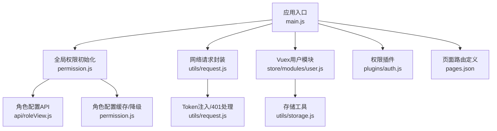

图表来源
- [main.js:1-31](file://main.js#L1-L31)
- [permission.js:1-133](file://permission.js#L1-L133)
- [api/roleView.js:1-23](file://api/roleView.js#L1-L23)
- [utils/request.js:1-117](file://utils/request.js#L1-L117)
- [store/modules/user.js:1-283](file://store/modules/user.js#L1-L283)
- [utils/storage.js:1-33](file://utils/storage.js#L1-L33)
- [plugins/auth.js:1-61](file://plugins/auth.js#L1-L61)
- [pages.json:1-235](file://pages.json#L1-L235)

章节来源
- [main.js:1-31](file://main.js#L1-L31)
- [permission.js:1-133](file://permission.js#L1-L133)
- [pages.json:1-235](file://pages.json#L1-L235)

## 核心组件
- 全局路由守卫与角色配置初始化
  - 负责拦截跳转、白名单校验、未登录重定向、已登录访问登录页重定向至首页
  - 从后端拉取角色视图配置并写入本地缓存，支持失败降级为默认教师角色
- Token 管理与请求拦截
  - 统一在请求头注入 Authorization，401 时触发自动重登或退出并重定向登录页
- 角色与权限工具
  - 提供字符权限与角色校验函数、Vue 插件方法、角色类型识别与多角色合并
- 角色视图配置系统
  - 按页面维度动态加载视图配置，具备内存缓存与默认降级能力

章节来源
- [permission.js:1-133](file://permission.js#L1-L133)
- [utils/request.js:1-117](file://utils/request.js#L1-L117)
- [utils/permission.js:1-49](file://utils/permission.js#L1-L49)
- [plugins/auth.js:1-61](file://plugins/auth.js#L1-L61)
- [utils/role.js:1-165](file://utils/role.js#L1-L165)
- [utils/roleSystem.js:1-297](file://utils/roleSystem.js#L1-L297)
- [utils/roleConfig.js:1-149](file://utils/roleConfig.js#L1-L149)
- [utils/roleViewConfig.js:1-115](file://utils/roleViewConfig.js#L1-L115)
- [api/roleView.js:1-23](file://api/roleView.js#L1-L23)

## 架构总览
下图展示登录、鉴权、菜单渲染的关键交互路径，以及各层职责边界。

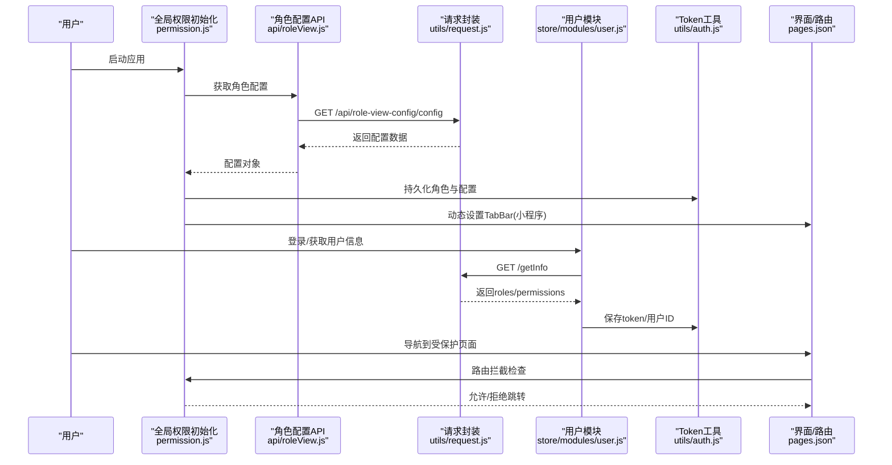

图表来源
- [permission.js:1-133](file://permission.js#L1-L133)
- [api/roleView.js:1-23](file://api/roleView.js#L1-L23)
- [utils/request.js:1-117](file://utils/request.js#L1-L117)
- [store/modules/user.js:1-283](file://store/modules/user.js#L1-L283)
- [utils/auth.js:1-47](file://utils/auth.js#L1-L47)
- [pages.json:1-235](file://pages.json#L1-L235)

## 详细组件分析

### 全局路由守卫与角色配置初始化
- 白名单与跳转拦截
  - 对 navigateTo/redirectTo/reLaunch/switchTab 进行拦截，未登录访问非白名单则重定向登录页；已登录访问登录页则重定向至 homePage
- 角色配置加载与降级
  - 调用 getRoleConfig 获取 roles/homePage/tabBar/features，成功则写入本地缓存；失败回退为默认教师角色配置
- 动态 TabBar
  - 在微信小程序环境下通过 uni.setTabBar 动态更新底部导航

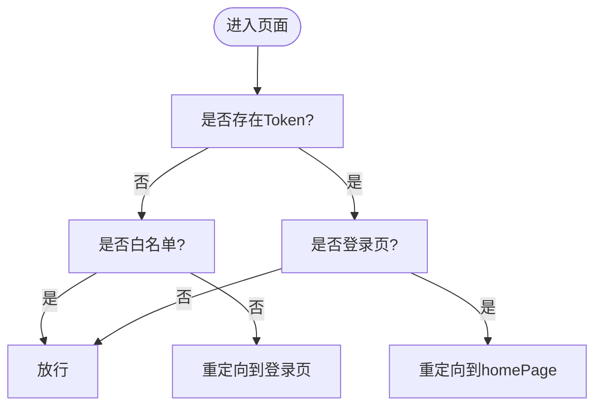

图表来源
- [permission.js:1-133](file://permission.js#L1-L133)

章节来源
- [permission.js:1-133](file://permission.js#L1-L133)

### Token 管理与请求拦截
- Token 存取
  - 使用独立 Key 持久化 token 与 userId，并提供 isLogin 便捷判断
- 请求拦截
  - 自动注入 Authorization 头；401 时区分登录相关接口，避免循环重登；在非微信端直接退出并跳转登录页
- 退出清理
  - 清除 token、用户信息与本地存储

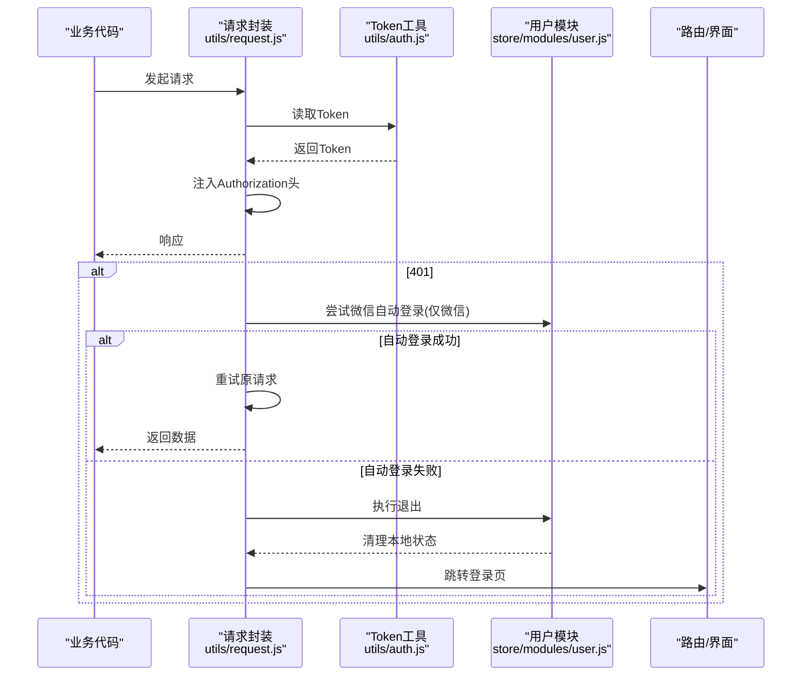

图表来源
- [utils/request.js:1-117](file://utils/request.js#L1-L117)
- [utils/auth.js:1-47](file://utils/auth.js#L1-L47)
- [store/modules/user.js:1-283](file://store/modules/user.js#L1-L283)

章节来源
- [utils/auth.js:1-47](file://utils/auth.js#L1-L47)
- [utils/request.js:1-117](file://utils/request.js#L1-L117)
- [store/modules/user.js:1-283](file://store/modules/user.js#L1-L283)

### 角色与权限校验（组件/按钮级）
- 字符权限与角色校验
  - checkPermi/checkRole 基于 store.getters.permissions/roles 进行匹配，支持通配符与超级管理员
- Vue 插件式权限
  - plugins/auth.js 暴露 hasPermi/hasRole 等便捷方法，便于在模板或逻辑中直接使用
- 角色类型识别
  - utils/role.js 提供书记/管理员/辅导员/教师等多角色识别与显示名称，支持字符串与对象数组两种角色格式

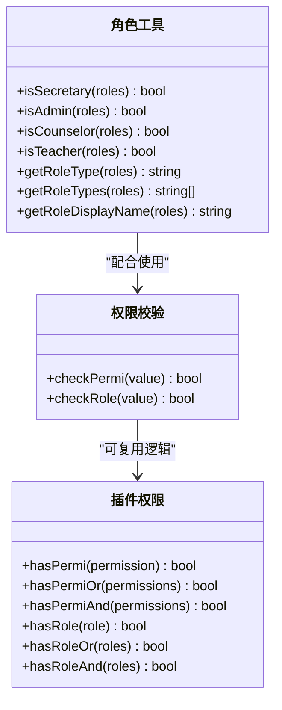

图表来源
- [utils/permission.js:1-49](file://utils/permission.js#L1-L49)
- [plugins/auth.js:1-61](file://plugins/auth.js#L1-L61)
- [utils/role.js:1-165](file://utils/role.js#L1-L165)

章节来源
- [utils/permission.js:1-49](file://utils/permission.js#L1-L49)
- [plugins/auth.js:1-61](file://plugins/auth.js#L1-L61)
- [utils/role.js:1-165](file://utils/role.js#L1-L165)

### 统一角色系统与 Mixin/Computed
- 统一角色系统
  - roleSystem.js 聚合角色判断、Mixin、Computed、全局守卫创建器，简化页面集成
- 使用方式
  - 页面混入 roleMixin 后获得 isSecretaryRole/isAdminRole 等计算属性
  - 通过 createRoleGuard 快速实现页面级角色守卫
  - 通过 createRoleComputed 将角色判断暴露为响应式属性

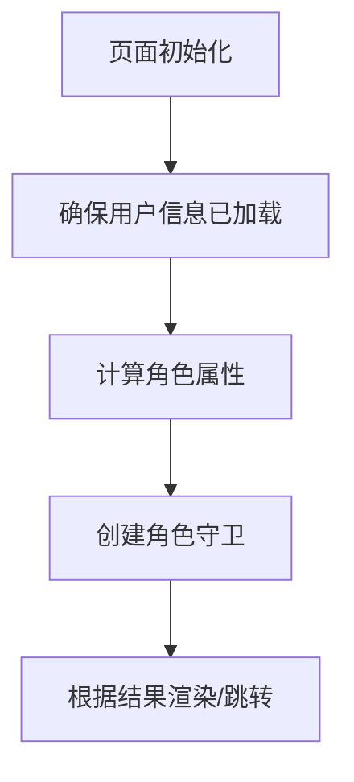

图表来源
- [utils/roleSystem.js:1-297](file://utils/roleSystem.js#L1-L297)

章节来源
- [utils/roleSystem.js:1-297](file://utils/roleSystem.js#L1-L297)

### 角色视图配置系统（动态菜单与页面布局）
- 动态配置加载
  - permission.js 调用 api/roleView.js 的 getRoleConfig 获取 roles/homePage/tabBar/features
- 本地缓存与降级
  - 成功写入本地缓存；失败回退为默认教师角色配置
- 页面级视图配置
  - utils/roleViewConfig.js 提供按 pageKey 获取视图配置的封装，具备内存缓存与默认降级

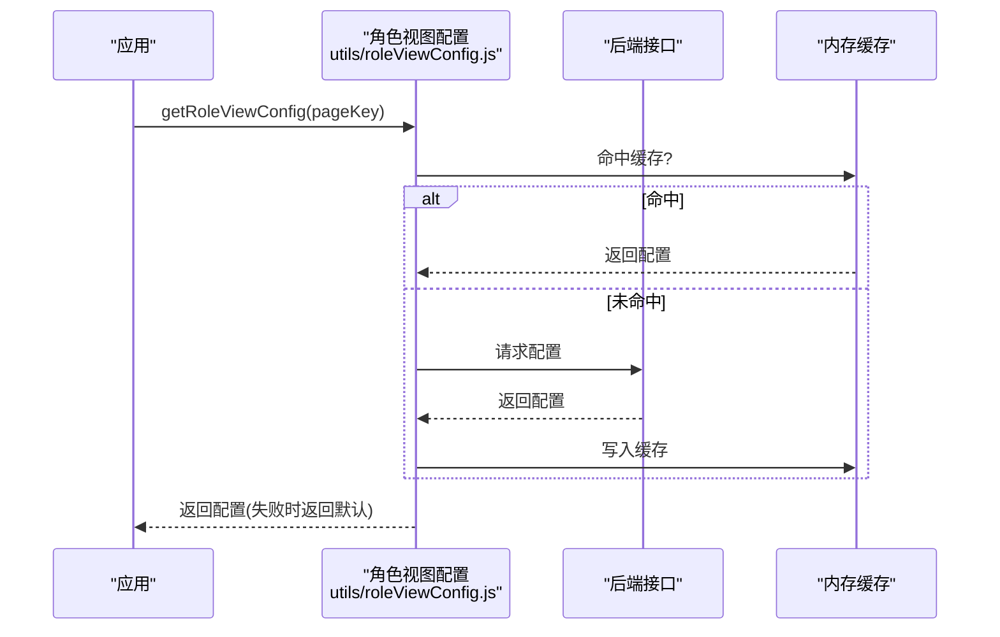

图表来源
- [permission.js:1-133](file://permission.js#L1-L133)
- [api/roleView.js:1-23](file://api/roleView.js#L1-L23)
- [utils/roleViewConfig.js:1-115](file://utils/roleViewConfig.js#L1-L115)

章节来源
- [permission.js:1-133](file://permission.js#L1-L133)
- [api/roleView.js:1-23](file://api/roleView.js#L1-L23)
- [utils/roleViewConfig.js:1-115](file://utils/roleViewConfig.js#L1-L115)

### 用户信息与角色加载流程
- 登录成功后获取用户信息
  - store/modules/user.js 的 GetInfo 动作调用 /getInfo，回填 roles/permissions/头像/用户名等
- 账号校验
  - 若 userType 非教师或包含学生角色，则拒绝登录并清理本地状态

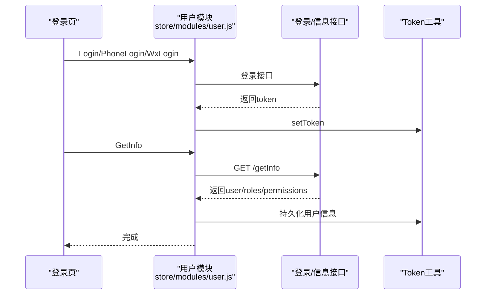

图表来源
- [store/modules/user.js:1-283](file://store/modules/user.js#L1-L283)
- [api/login.js:1-168](file://api/login.js#L1-L168)
- [utils/auth.js:1-47](file://utils/auth.js#L1-L47)

章节来源
- [store/modules/user.js:1-283](file://store/modules/user.js#L1-L283)
- [api/login.js:1-168](file://api/login.js#L1-L168)
- [utils/auth.js:1-47](file://utils/auth.js#L1-L47)

## 依赖关系分析
- 低耦合高内聚
  - 认证与鉴权分离：Token 管理集中在 utils/auth.js，请求拦截在 utils/request.js，路由守卫在 permission.js
  - 角色与权限解耦：角色判断在 utils/role.js，权限校验在 utils/permission.js 与 plugins/auth.js
- 外部依赖
  - uni.request 作为底层网络库
  - Vuex store 集中管理用户状态
- 潜在风险
  - 多处角色来源（store.state.user.roles、store.getters.roles、本地存储），需保持一致性
  - 角色配置与静态配置并存，应明确优先级与刷新策略

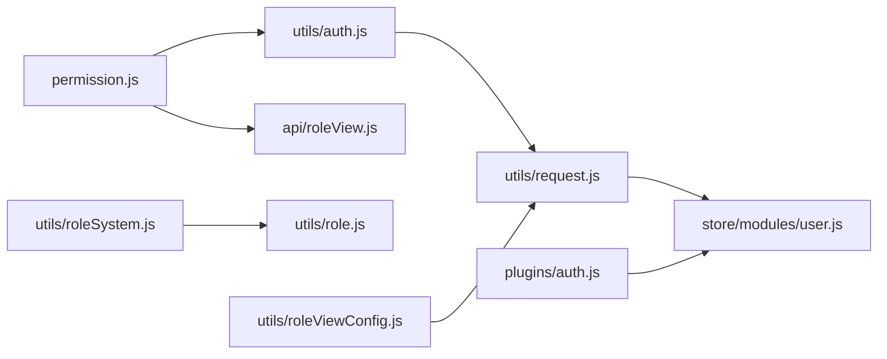

图表来源
- [utils/auth.js:1-47](file://utils/auth.js#L1-L47)
- [utils/request.js:1-117](file://utils/request.js#L1-L117)
- [store/modules/user.js:1-283](file://store/modules/user.js#L1-L283)
- [permission.js:1-133](file://permission.js#L1-L133)
- [api/roleView.js:1-23](file://api/roleView.js#L1-L23)
- [utils/roleSystem.js:1-297](file://utils/roleSystem.js#L1-L297)
- [utils/role.js:1-165](file://utils/role.js#L1-L165)
- [plugins/auth.js:1-61](file://plugins/auth.js#L1-L61)
- [utils/roleViewConfig.js:1-115](file://utils/roleViewConfig.js#L1-L115)

章节来源
- [utils/auth.js:1-47](file://utils/auth.js#L1-L47)
- [utils/request.js:1-117](file://utils/request.js#L1-L117)
- [store/modules/user.js:1-283](file://store/modules/user.js#L1-L283)
- [permission.js:1-133](file://permission.js#L1-L133)
- [api/roleView.js:1-23](file://api/roleView.js#L1-L23)
- [utils/roleSystem.js:1-297](file://utils/roleSystem.js#L1-L297)
- [utils/role.js:1-165](file://utils/role.js#L1-L165)
- [plugins/auth.js:1-61](file://plugins/auth.js#L1-L61)
- [utils/roleViewConfig.js:1-115](file://utils/roleViewConfig.js#L1-L115)

## 性能与可用性考虑
- 减少重复请求
  - 角色视图配置使用内存缓存，必要时结合持久化与失效策略
- 降级保障
  - 角色配置与视图配置均提供默认值，保证弱网或服务异常时的可用体验
- 路由拦截优化
  - 白名单最小化，避免不必要的判断分支
- 请求重试与超时
  - 合理设置超时时间，避免频繁重试造成雪崩

[本节为通用指导，不直接分析具体文件]

## 故障排查指南
- 登录后仍被重定向到登录页
  - 检查 Token 是否正确写入与读取
  - 确认请求拦截是否因 401 触发了退出逻辑
- 角色配置未生效
  - 检查 getRoleConfig 是否成功返回，查看本地缓存是否写入
  - 确认 TabBar 动态设置是否在小程序环境执行
- 按钮权限无效
  - 确认 store.getters.permissions/roles 是否已正确填充
  - 检查模板中使用的是否为正确的权限/角色判断方法

章节来源
- [utils/auth.js:1-47](file://utils/auth.js#L1-L47)
- [utils/request.js:1-117](file://utils/request.js#L1-L117)
- [permission.js:1-133](file://permission.js#L1-L133)
- [store/modules/user.js:1-283](file://store/modules/user.js#L1-L283)
- [plugins/auth.js:1-61](file://plugins/auth.js#L1-L61)

## 结论
RuoYi-App 的权限体系以“认证—鉴权—视图配置”为核心，形成清晰的分层与职责边界：
- 认证层负责 Token 生命周期与会话恢复
- 鉴权层提供路由守卫、组件/按钮级权限校验与角色识别
- 视图层通过角色配置驱动菜单与页面布局
该体系具备良好的可扩展性与容错能力，适合在多角色、多租户场景下持续演进。

[本节为总结性内容，不直接分析具体文件]

## 附录：流程图与状态图

### 登录与鉴权状态转换
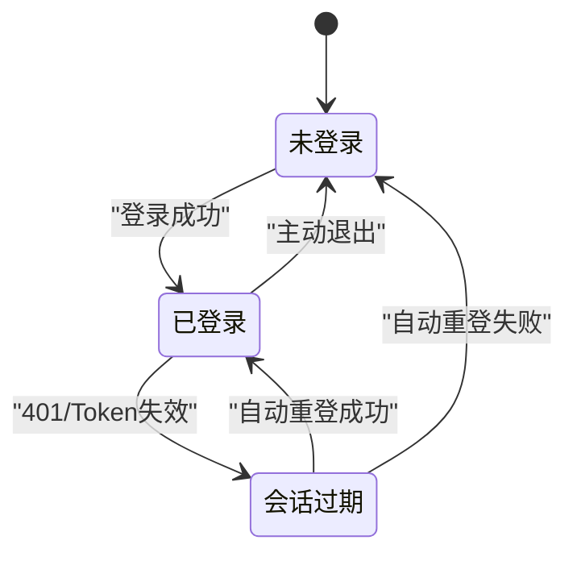

[此图为概念性状态图，无需源码映射]

### 页面级路由守卫流程
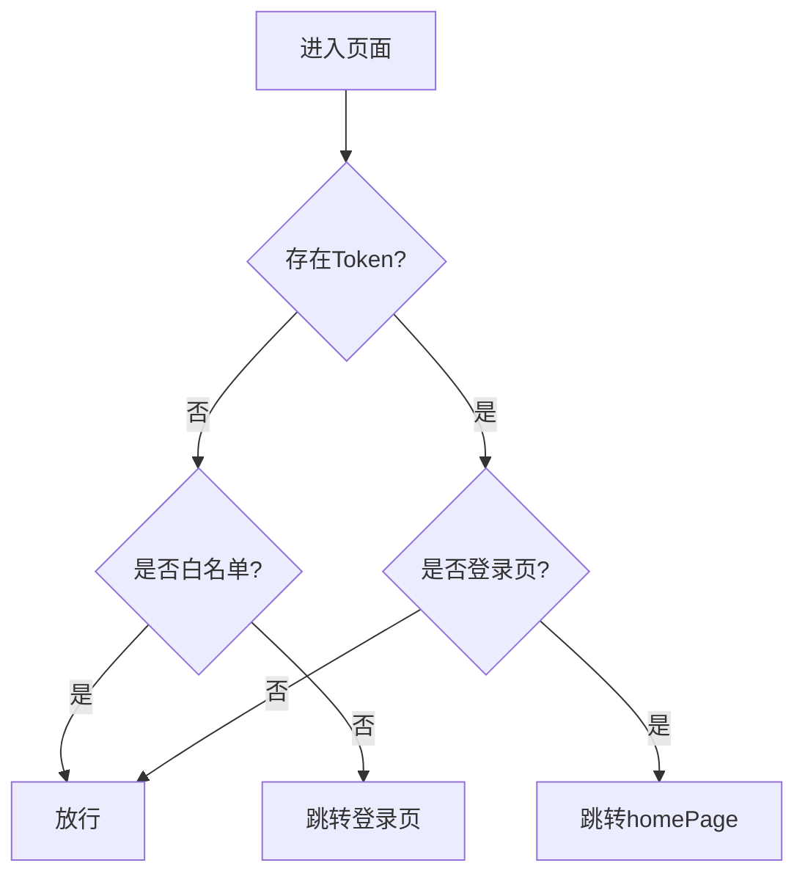

图表来源
- [permission.js:1-133](file://permission.js#L1-L133)

### 角色视图配置加载流程
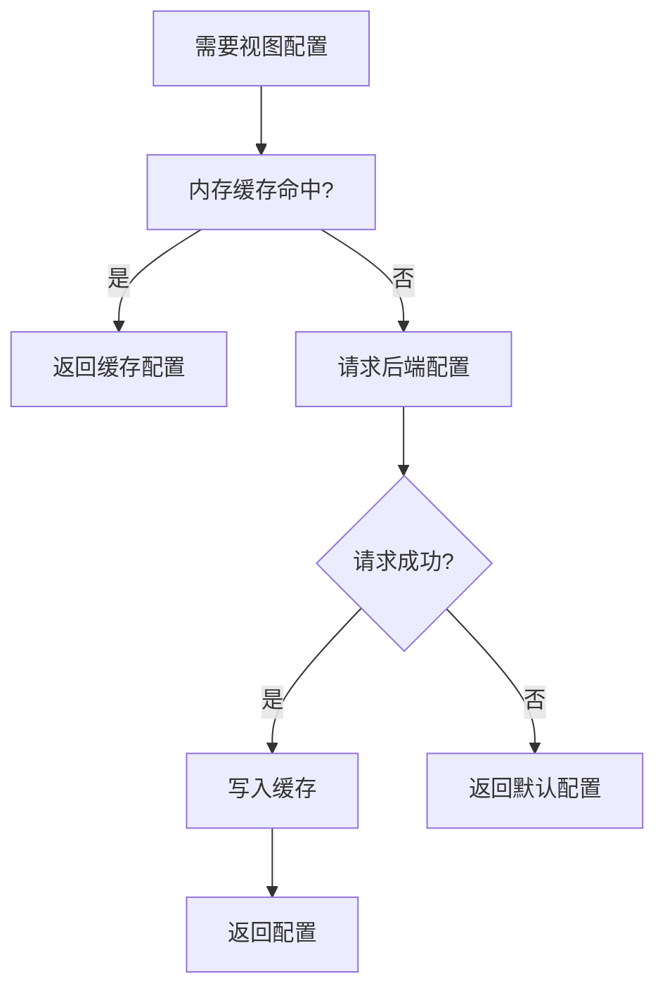

图表来源
- [utils/roleViewConfig.js:1-115](file://utils/roleViewConfig.js#L1-L115)