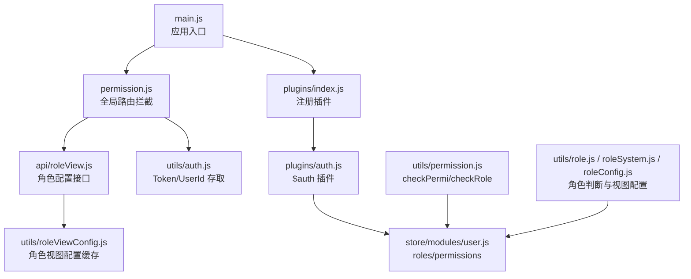
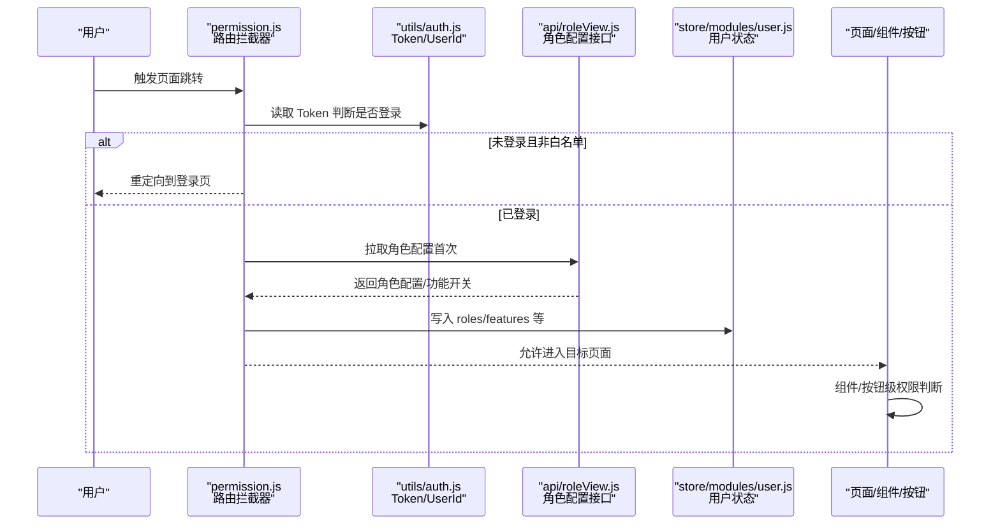
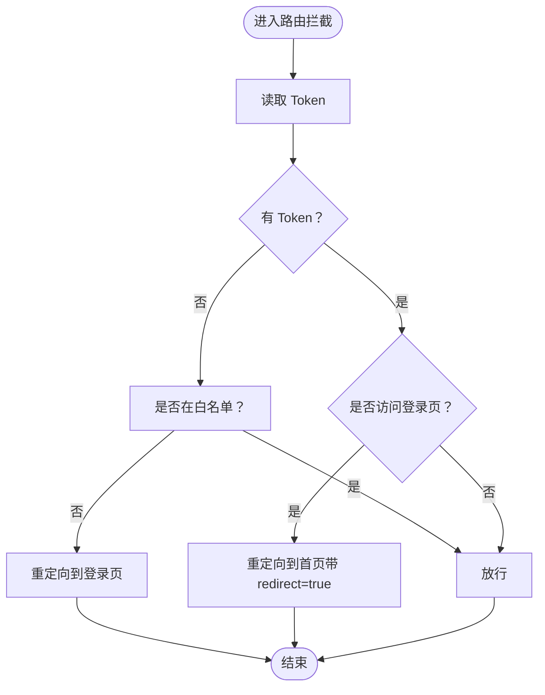
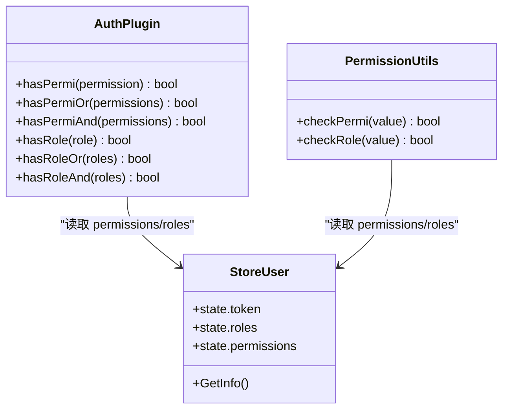
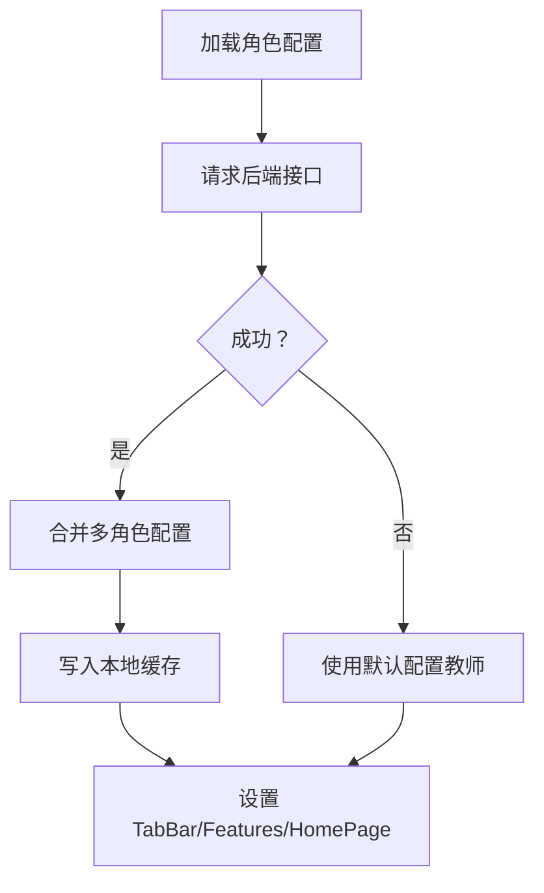
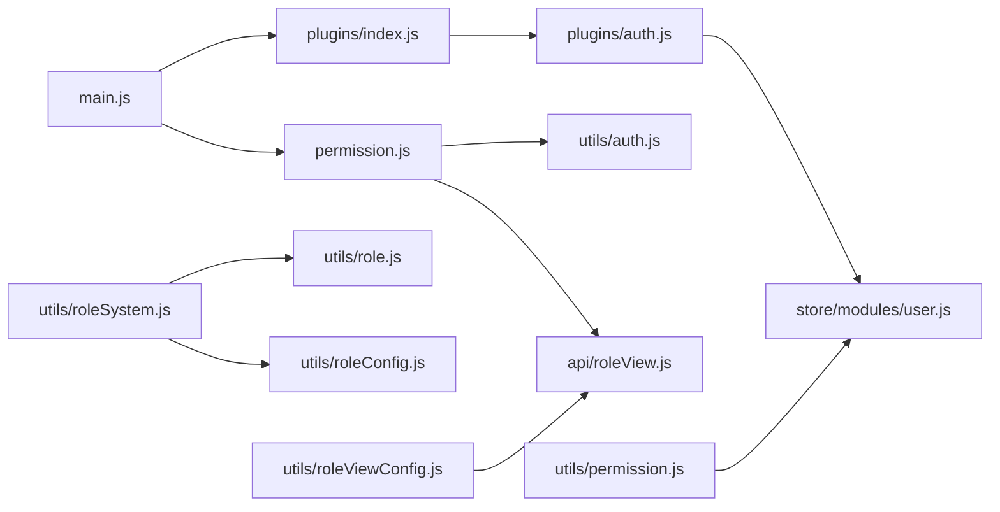

# 权限验证机制

<cite>
**本文引用的文件**
- [plugins/auth.js](file://plugins/auth.js)
- [utils/permission.js](file://utils/permission.js)
- [utils/auth.js](file://utils/auth.js)
- [permission.js](file://permission.js)
- [store/modules/user.js](file://store/modules/user.js)
- [utils/role.js](file://utils/role.js)
- [utils/roleConfig.js](file://utils/roleConfig.js)
- [utils/roleSystem.js](file://utils/roleSystem.js)
- [utils/roleViewConfig.js](file://utils/roleViewConfig.js)
- [api/roleView.js](file://api/roleView.js)
- [main.js](file://main.js)
</cite>

## 目录
1. [简介](#简介)
2. [项目结构](#项目结构)
3. [核心组件](#核心组件)
4. [架构总览](#架构总览)
5. [详细组件分析](#详细组件分析)
6. [依赖关系分析](#依赖关系分析)
7. [性能与可扩展性](#性能与可扩展性)
8. [故障排查指南](#故障排查指南)
9. [结论](#结论)
10. [附录：使用模式与示例路径](#附录使用模式与示例路径)

## 简介
本文件系统化阐述 RuoYi-App 的多层级权限验证机制，覆盖页面级路由守卫、组件级权限控制与按钮级操作权限。重点说明 auth 插件的工作流程（路由拦截、权限检查、跳转逻辑），并给出错误处理与用户反馈策略。文档同时提供流程图与各层次的使用模式与代码片段路径，便于快速落地。

## 项目结构
权限相关能力分布在以下模块：
- 全局路由拦截与登录态校验：permission.js
- 认证与鉴权工具：plugins/auth.js、utils/permission.js、utils/auth.js
- 用户状态与角色/权限数据源：store/modules/user.js
- 角色判断与视图配置：utils/role.js、utils/roleConfig.js、utils/roleSystem.js、utils/roleViewConfig.js、api/roleView.js
- 应用初始化与插件挂载：main.js

图表来源
- [main.js:1-31](file://main.js#L1-L31)
- [permission.js:1-133](file://permission.js#L1-L133)
- [plugins/auth.js:1-61](file://plugins/auth.js#L1-L61)
- [store/modules/user.js:1-283](file://store/modules/user.js#L1-L283)
- [utils/auth.js:1-47](file://utils/auth.js#L1-L47)
- [utils/permission.js:1-49](file://utils/permission.js#L1-L49)
- [utils/role.js:1-165](file://utils/role.js#L1-L165)
- [utils/roleConfig.js:1-149](file://utils/roleConfig.js#L1-L149)
- [utils/roleSystem.js:1-297](file://utils/roleSystem.js#L1-L297)
- [utils/roleViewConfig.js:1-115](file://utils/roleViewConfig.js#L1-L115)
- [api/roleView.js:1-23](file://api/roleView.js#L1-L23)

章节来源
- [main.js:1-31](file://main.js#L1-L31)
- [permission.js:1-133](file://permission.js#L1-L133)
- [plugins/auth.js:1-61](file://plugins/auth.js#L1-L61)
- [store/modules/user.js:1-283](file://store/modules/user.js#L1-L283)
- [utils/auth.js:1-47](file://utils/auth.js#L1-L47)
- [utils/permission.js:1-49](file://utils/permission.js#L1-L49)
- [utils/role.js:1-165](file://utils/role.js#L1-L165)
- [utils/roleConfig.js:1-149](file://utils/roleConfig.js#L1-L149)
- [utils/roleSystem.js:1-297](file://utils/roleSystem.js#L1-L297)
- [utils/roleViewConfig.js:1-115](file://utils/roleViewConfig.js#L1-L115)
- [api/roleView.js:1-23](file://api/roleView.js#L1-L23)

## 核心组件
- 全局路由拦截器（permission.js）
  - 基于 uni.addInterceptor 对 navigateTo/redirectTo/reLaunch/switchTab 进行统一拦截
  - 未登录访问非白名单页面时重定向到登录页；已登录访问登录页时重定向至首页
  - 支持从后端动态加载角色配置，设置 TabBar 与功能开关
- 认证插件（plugins/auth.js）
  - 暴露 $auth.hasPermi/hasPermiOr/hasPermiAnd 与 hasRole/hasRoleOr/hasRoleAnd
  - 读取 store.getters.permissions/roles 进行匹配，支持通配符与超级管理员
- 权限校验工具（utils/permission.js）
  - checkPermi(value)、checkRole(value) 用于模板或逻辑中按数组条件判定
- 登录态与用户信息（utils/auth.js、store/modules/user.js）
  - Token/UserId 的本地存取与 isLogin 判断
  - GetInfo 获取 roles/permissions 并持久化
- 角色判断与视图配置（utils/role*.js、utils/roleViewConfig.js、api/roleView.js）
  - 角色识别（书记/管理员/辅导员/教师）、多角色类型合并
  - 根据角色动态渲染 TabBar 与功能特性
  - 角色视图配置缓存与预加载

章节来源
- [permission.js:1-133](file://permission.js#L1-L133)
- [plugins/auth.js:1-61](file://plugins/auth.js#L1-L61)
- [utils/permission.js:1-49](file://utils/permission.js#L1-L49)
- [utils/auth.js:1-47](file://utils/auth.js#L1-L47)
- [store/modules/user.js:1-283](file://store/modules/user.js#L1-L283)
- [utils/role.js:1-165](file://utils/role.js#L1-L165)
- [utils/roleConfig.js:1-149](file://utils/roleConfig.js#L1-L149)
- [utils/roleSystem.js:1-297](file://utils/roleSystem.js#L1-L297)
- [utils/roleViewConfig.js:1-115](file://utils/roleViewConfig.js#L1-L115)
- [api/roleView.js:1-23](file://api/roleView.js#L1-L23)

## 架构总览
下图展示“路由拦截 → 登录态/白名单 → 角色配置 → 页面/组件/按钮”三层权限控制的整体链路。

图表来源
- [permission.js:1-133](file://permission.js#L1-L133)
- [utils/auth.js:1-47](file://utils/auth.js#L1-L47)
- [api/roleView.js:1-23](file://api/roleView.js#L1-L23)
- [store/modules/user.js:1-283](file://store/modules/user.js#L1-L283)

## 详细组件分析

### 路由级访问控制（页面级路由守卫）
- 拦截范围：navigateTo、redirectTo、reLaunch、switchTab
- 白名单策略：login/register/webview 等免登页面
- 登录态校验：无 Token 则强制跳转登录页；已登录访问登录页则跳转到首页
- 角色配置：首次拉取角色配置后，写入本地存储并可用于后续判断；小程序端可动态设置 TabBar
- 跳转参数：通过 redirect=true 避免循环跳转

图表来源
- [permission.js:1-133](file://permission.js#L1-L133)
- [utils/auth.js:1-47](file://utils/auth.js#L1-L47)

章节来源
- [permission.js:1-133](file://permission.js#L1-L133)
- [utils/auth.js:1-47](file://utils/auth.js#L1-L47)

### 组件级权限控制（显示控制）
- 插件方式：在模板中使用 $auth.hasPermi/hasPermiOr/hasPermiAnd 与 hasRole/hasRoleOr/hasRoleAnd
- 工具函数方式：使用 checkPermi/checkRole 传入权限/角色数组进行判定
- 数据来源：store.getters.permissions 与 store.getters.roles（由登录成功后 GetInfo 写入）

图表来源
- [plugins/auth.js:1-61](file://plugins/auth.js#L1-L61)
- [utils/permission.js:1-49](file://utils/permission.js#L1-L49)
- [store/modules/user.js:1-283](file://store/modules/user.js#L1-L283)

章节来源
- [plugins/auth.js:1-61](file://plugins/auth.js#L1-L61)
- [utils/permission.js:1-49](file://utils/permission.js#L1-L49)
- [store/modules/user.js:1-283](file://store/modules/user.js#L1-L283)

### 按钮级操作权限（执行控制）
- 推荐做法：在点击事件前调用 $auth 或 checkPermi/checkRole 进行二次校验，再执行业务逻辑
- 结合角色视图配置：对于复杂页面内的区块/按钮，可结合角色视图配置（features）进行显隐与禁用
- 多角色兼容：当存在多个角色时，优先采用“任一满足即可”的策略（OR），必要时用 AND 组合

章节来源
- [plugins/auth.js:1-61](file://plugins/auth.js#L1-L61)
- [utils/permission.js:1-49](file://utils/permission.js#L1-L49)
- [utils/roleConfig.js:1-149](file://utils/roleConfig.js#L1-L149)

### 角色系统与视图配置
- 角色识别：支持字符串与对象两种角色格式，统一识别书记/管理员/辅导员/教师，并提供多角色类型集合
- 视图配置：根据角色合并 TabBar、功能开关与首页路径；失败时回退默认配置
- 动态加载：首次进入时拉取角色配置，缓存并写入本地存储；可按页面维度预加载配置

图表来源
- [permission.js:1-133](file://permission.js#L1-L133)
- [utils/roleConfig.js:1-149](file://utils/roleConfig.js#L1-L149)
- [utils/roleSystem.js:1-297](file://utils/roleSystem.js#L1-L297)
- [utils/roleViewConfig.js:1-115](file://utils/roleViewConfig.js#L1-L115)
- [api/roleView.js:1-23](file://api/roleView.js#L1-L23)

章节来源
- [utils/role.js:1-165](file://utils/role.js#L1-L165)
- [utils/roleConfig.js:1-149](file://utils/roleConfig.js#L1-L149)
- [utils/roleSystem.js:1-297](file://utils/roleSystem.js#L1-L297)
- [utils/roleViewConfig.js:1-115](file://utils/roleViewConfig.js#L1-L115)
- [api/roleView.js:1-23](file://api/roleView.js#L1-L23)

## 依赖关系分析
- 插件与全局挂载
  - main.js 引入 plugins 并安装，将 $auth/$tab/$modal 挂载到 Vue 原型
- 路由拦截依赖
  - permission.js 依赖 utils/auth.js 的 getToken/isLogin 与 api/roleView.js 的角色配置接口
- 权限判断依赖
  - plugins/auth.js 与 utils/permission.js 均依赖 store.modules.user 中的 roles/permissions
- 角色系统依赖
  - utils/roleSystem.js 聚合 utils/role.js 的判断函数，并配合 utils/roleConfig.js 与 utils/roleViewConfig.js 完成视图层控制

图表来源
- [main.js:1-31](file://main.js#L1-L31)
- [plugins/auth.js:1-61](file://plugins/auth.js#L1-L61)
- [permission.js:1-133](file://permission.js#L1-L133)
- [utils/auth.js:1-47](file://utils/auth.js#L1-L47)
- [utils/permission.js:1-49](file://utils/permission.js#L1-L49)
- [store/modules/user.js:1-283](file://store/modules/user.js#L1-L283)
- [utils/role.js:1-165](file://utils/role.js#L1-L165)
- [utils/roleConfig.js:1-149](file://utils/roleConfig.js#L1-L149)
- [utils/roleSystem.js:1-297](file://utils/roleSystem.js#L1-L297)
- [utils/roleViewConfig.js:1-115](file://utils/roleViewConfig.js#L1-L115)
- [api/roleView.js:1-23](file://api/roleView.js#L1-L23)

章节来源
- [main.js:1-31](file://main.js#L1-L31)
- [plugins/auth.js:1-61](file://plugins/auth.js#L1-L61)
- [permission.js:1-133](file://permission.js#L1-L133)
- [utils/auth.js:1-47](file://utils/auth.js#L1-L47)
- [utils/permission.js:1-49](file://utils/permission.js#L1-L49)
- [store/modules/user.js:1-283](file://store/modules/user.js#L1-L283)
- [utils/role.js:1-165](file://utils/role.js#L1-L165)
- [utils/roleConfig.js:1-149](file://utils/roleConfig.js#L1-L149)
- [utils/roleSystem.js:1-297](file://utils/roleSystem.js#L1-L297)
- [utils/roleViewConfig.js:1-115](file://utils/roleViewConfig.js#L1-L115)
- [api/roleView.js:1-23](file://api/roleView.js#L1-L23)

## 性能与可扩展性
- 路由拦截开销极低：仅做本地 Token 与白名单判断，避免重复网络请求
- 角色配置缓存：首次拉取后落盘，后续直接读取；可按需预加载常用页面配置
- 权限判断复杂度：均为 O(n) 列表遍历，n 为权限/角色数量，通常很小；若规模增长可考虑哈希索引
- 扩展建议：
  - 新增权限点只需在 store 的 permissions 中维护，并在模板/逻辑中引用
  - 新增角色类型可在 roleConfig 与 roleSystem 中扩展关键词与视图映射

[本节为通用指导，不直接分析具体文件]

## 故障排查指南
- 登录后仍被重定向到登录页
  - 检查 Token 是否正确写入与读取（utils/auth.js）
  - 确认路由拦截器是否误判白名单（permission.js）
- 页面能打开但按钮不可见
  - 确认 $auth 或 checkPermi/checkRole 使用的权限标识是否与后端一致
  - 检查 store 中 permissions 是否包含对应值或通配符
- 角色配置未生效
  - 检查角色配置接口返回结构与缓存逻辑（api/roleView.js、utils/roleViewConfig.js）
  - 确认小程序端 setTabBar 是否可用（permission.js 的条件编译）
- 多角色冲突
  - 明确 OR/AND 语义，优先使用 OR；需要严格场景时使用 AND 组合
  - 使用 getRoleTypes 获取所有角色类型，再做精细化控制

章节来源
- [utils/auth.js:1-47](file://utils/auth.js#L1-L47)
- [permission.js:1-133](file://permission.js#L1-L133)
- [plugins/auth.js:1-61](file://plugins/auth.js#L1-L61)
- [utils/permission.js:1-49](file://utils/permission.js#L1-L49)
- [utils/roleViewConfig.js:1-115](file://utils/roleViewConfig.js#L1-L115)
- [api/roleView.js:1-23](file://api/roleView.js#L1-L23)

## 结论
本项目实现了“路由级—组件级—按钮级”的三层权限控制体系：
- 路由级保障基础访问安全与用户体验
- 组件级实现细粒度 UI 控制
- 按钮级确保关键操作的最终防线
配合角色系统与视图配置，既能灵活适配不同角色，又能保证前后端一致的权限语义。

[本节为总结性内容，不直接分析具体文件]

## 附录：使用模式与示例路径
- 路由级
  - 参考：[permission.js:1-133](file://permission.js#L1-L133)
- 组件级（插件）
  - 参考：[plugins/auth.js:1-61](file://plugins/auth.js#L1-L61)
- 组件级（工具函数）
  - 参考：[utils/permission.js:1-49](file://utils/permission.js#L1-L49)
- 登录态与用户信息
  - 参考：[utils/auth.js:1-47](file://utils/auth.js#L1-L47)、[store/modules/user.js:1-283](file://store/modules/user.js#L1-L283)
- 角色判断与视图配置
  - 参考：[utils/role.js:1-165](file://utils/role.js#L1-L165)、[utils/roleConfig.js:1-149](file://utils/roleConfig.js#L1-L149)、[utils/roleSystem.js:1-297](file://utils/roleSystem.js#L1-L297)、[utils/roleViewConfig.js:1-115](file://utils/roleViewConfig.js#L1-L115)、[api/roleView.js:1-23](file://api/roleView.js#L1-L23)
- 插件挂载
  - 参考：[main.js:1-31](file://main.js#L1-L31)