# 角色与权限模型

<cite>
**本文引用的文件**
- [utils/permission.js](file://utils/permission.js)
- [plugins/auth.js](file://plugins/auth.js)
- [store/modules/user.js](file://store/modules/user.js)
- [store/getters.js](file://store/getters.js)
- [utils/constant.js](file://utils/constant.js)
- [utils/role.js](file://utils/role.js)
- [utils/roleSystem.js](file://utils/roleSystem.js)
- [utils/roleConfig.js](file://utils/roleConfig.js)
- [utils/roleViewConfig.js](file://utils/roleViewConfig.js)
- [pages/sub-work/classcheck/index.vue](file://pages/sub-work/classcheck/index.vue)
- [pages/sub-work/classcheck/add.vue](file://pages/sub-work/classcheck/add.vue)
</cite>

## 目录
1. [引言](#引言)
2. [项目结构](#项目结构)
3. [核心组件](#核心组件)
4. [架构总览](#架构总览)
5. [详细组件分析](#详细组件分析)
6. [依赖关系分析](#依赖关系分析)
7. [性能考虑](#性能考虑)
8. [故障排查指南](#故障排查指南)
9. [结论](#结论)
10. [附录](#附录)

## 引言
本文件面向 RuoYi-App 前端，系统化阐述基于角色的访问控制（RBAC）模型在小程序端的设计与实现。重点覆盖：
- 用户角色定义、权限标识符规范与“超级管理员”特权处理
- checkPermi 与 checkRole 的匹配算法与行为
- 用户信息在 Vuex 中的存储结构与字段语义（roles、permissions、userType）
- 视图级功能开关与页面配置（角色视图配置）
- 权限验证流程图与状态转换图
- 为新功能添加权限控制的实践建议

## 项目结构
与权限相关的前端代码主要分布在以下位置：
- 权限校验工具：utils/permission.js、plugins/auth.js
- 用户状态与持久化：store/modules/user.js、store/getters.js、utils/constant.js
- 角色判断与系统封装：utils/role.js、utils/roleSystem.js
- 角色视图配置：utils/roleConfig.js、utils/roleViewConfig.js
- 典型使用示例：pages/sub-work/classcheck/*.vue

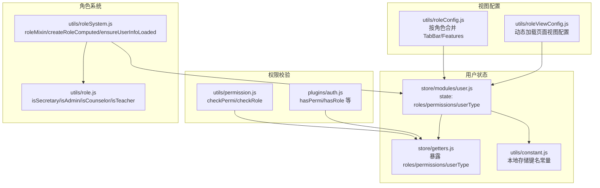

图表来源
- [utils/permission.js:1-49](file://utils/permission.js#L1-L49)
- [plugins/auth.js:1-61](file://plugins/auth.js#L1-L61)
- [store/modules/user.js:1-283](file://store/modules/user.js#L1-L283)
- [store/getters.js:1-11](file://store/getters.js#L1-L11)
- [utils/constant.js:1-10](file://utils/constant.js#L1-L10)
- [utils/role.js:1-165](file://utils/role.js#L1-L165)
- [utils/roleSystem.js:1-297](file://utils/roleSystem.js#L1-L297)
- [utils/roleConfig.js:1-149](file://utils/roleConfig.js#L1-L149)
- [utils/roleViewConfig.js:1-115](file://utils/roleViewConfig.js#L1-L115)

章节来源
- [utils/permission.js:1-49](file://utils/permission.js#L1-L49)
- [plugins/auth.js:1-61](file://plugins/auth.js#L1-L61)
- [store/modules/user.js:1-283](file://store/modules/user.js#L1-L283)
- [store/getters.js:1-11](file://store/getters.js#L1-L11)
- [utils/constant.js:1-10](file://utils/constant.js#L1-L10)
- [utils/role.js:1-165](file://utils/role.js#L1-L165)
- [utils/roleSystem.js:1-297](file://utils/roleSystem.js#L1-L297)
- [utils/roleConfig.js:1-149](file://utils/roleConfig.js#L1-L149)
- [utils/roleViewConfig.js:1-115](file://utils/roleViewConfig.js#L1-L115)

## 核心组件
本节聚焦 RBAC 在前端的落地方式，包括权限字符串匹配、角色判定、超级管理员特权、Vuex 数据模型与缓存策略。

- 权限字符串匹配与超级管理员
  - 权限标识符采用三段式风格，支持一个全局通配符标识作为“超级权限”。当后端返回该标识时，任何权限检查均通过。
  - 普通权限为精确匹配：只要用户拥有的权限集合中包含请求的权限标识即通过。
  - 参考路径：[utils/permission.js:8-25](file://utils/permission.js#L8-L25)、[plugins/auth.js:3-13](file://plugins/auth.js#L3-L13)

- 角色判定与超级管理员
  - 角色列表来自用户信息接口，若包含特定超级角色标识，则视为拥有所有受控角色。
  - 普通角色为精确匹配：只要用户角色集合中包含任一被允许的角色即通过。
  - 参考路径：[utils/permission.js:32-49](file://utils/permission.js#L32-L49)、[plugins/auth.js:15-25](file://plugins/auth.js#L15-L25)

- 用户信息在 Vuex 中的存储结构
  - state.user.roles：角色数组，来源于登录后的用户信息接口；同时持久化到本地存储。
  - state.user.permissions：权限标识数组，来源于登录后的用户信息接口；同时持久化到本地存储。
  - state.user.userType：用户类型标识，用于区分教师/非教师等场景，默认值由接口或逻辑兜底。
  - getters 提供统一读取入口，便于权限工具直接消费。
  - 参考路径：[store/modules/user.js:12-52](file://store/modules/user.js#L12-L52)、[store/getters.js:1-11](file://store/getters.js#L1-L11)、[utils/constant.js:1-10](file://utils/constant.js#L1-L10)

- 角色判断工具与多角色支持
  - utils/role.js 提供书记、管理员、辅导员、普通教师的判定函数，兼容字符串数组与对象数组两种角色格式。
  - utils/roleSystem.js 在此基础上封装了 Mixin、计算属性工厂、守卫与自动加载用户信息的辅助方法。
  - 参考路径：[utils/role.js:16-165](file://utils/role.js#L16-L165)、[utils/roleSystem.js:110-245](file://utils/roleSystem.js#L110-L245)

- 视图级功能开关与页面配置
  - utils/roleConfig.js 以“角色 -> TabBar/Features/HomePage”的配置形式，支持多角色合并与去重。
  - utils/roleViewConfig.js 支持从后端动态拉取页面视图配置并做内存缓存，失败回退到默认配置。
  - 参考路径：[utils/roleConfig.js:6-149](file://utils/roleConfig.js#L6-L149)、[utils/roleViewConfig.js:16-115](file://utils/roleViewConfig.js#L16-L115)

章节来源
- [utils/permission.js:8-49](file://utils/permission.js#L8-L49)
- [plugins/auth.js:3-25](file://plugins/auth.js#L3-L25)
- [store/modules/user.js:12-52](file://store/modules/user.js#L12-L52)
- [store/getters.js:1-11](file://store/getters.js#L1-L11)
- [utils/constant.js:1-10](file://utils/constant.js#L1-L10)
- [utils/role.js:16-165](file://utils/role.js#L16-L165)
- [utils/roleSystem.js:110-245](file://utils/roleSystem.js#L110-L245)
- [utils/roleConfig.js:6-149](file://utils/roleConfig.js#L6-L149)
- [utils/roleViewConfig.js:16-115](file://utils/roleViewConfig.js#L16-L115)

## 架构总览
下图展示了权限校验与用户信息获取的整体流程，以及各模块之间的依赖关系。

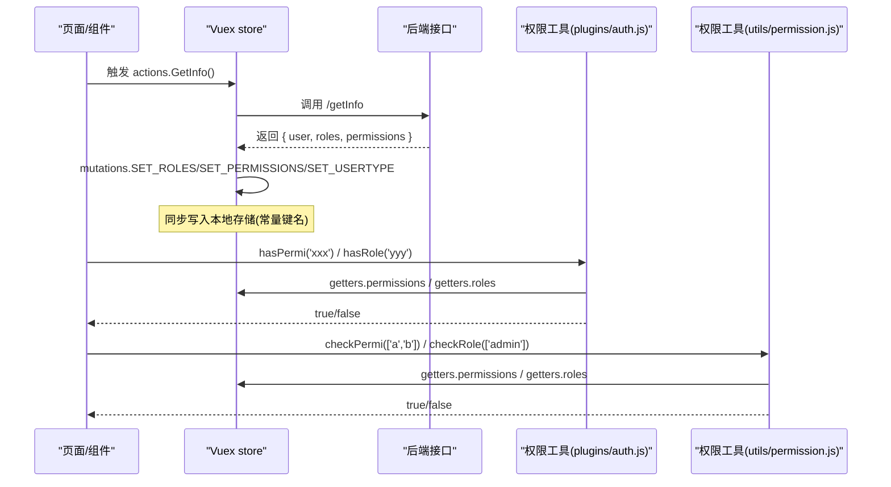

图表来源
- [store/modules/user.js:73-111](file://store/modules/user.js#L73-L111)
- [plugins/auth.js:27-60](file://plugins/auth.js#L27-L60)
- [utils/permission.js:8-49](file://utils/permission.js#L8-L49)
- [store/getters.js:1-11](file://store/getters.js#L1-L11)

## 详细组件分析

### 权限校验工具：checkPermi 与 checkRole
- 设计要点
  - 输入参数为数组，表示“需要满足的权限/角色集合”，采用“存在即通过”的策略（OR）。
  - 权限匹配支持“超级权限”标识，一旦命中则直接放行。
  - 角色匹配支持“超级管理员”标识，一旦命中则直接放行。
- 复杂度
  - 时间复杂度 O(n)，n 为用户当前拥有的权限/角色数量。
- 错误处理
  - 若传入非数组或空数组，直接返回 false，避免误判。
- 参考路径
  - [utils/permission.js:8-25](file://utils/permission.js#L8-L25)
  - [utils/permission.js:32-49](file://utils/permission.js#L32-L49)

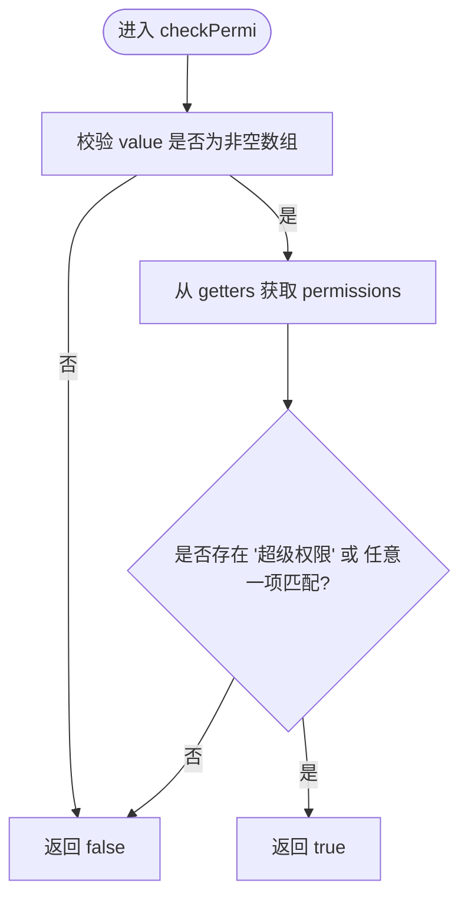

图表来源
- [utils/permission.js:8-25](file://utils/permission.js#L8-L25)

章节来源
- [utils/permission.js:8-49](file://utils/permission.js#L8-L49)

### 插件式权限工具：plugins/auth.js
- 设计要点
  - 提供 hasPermi/hasPermiOr/hasPermiAnd 与 hasRole/hasRoleOr/hasRoleAnd 六类便捷方法。
  - 内部同样支持“超级权限”和“超级管理员”标识。
- 适用场景
  - 在模板中通过 this.$auth.xxx 进行条件渲染或按钮显隐控制。
- 参考路径
  - [plugins/auth.js:3-25](file://plugins/auth.js#L3-L25)
  - [plugins/auth.js:27-60](file://plugins/auth.js#L27-L60)

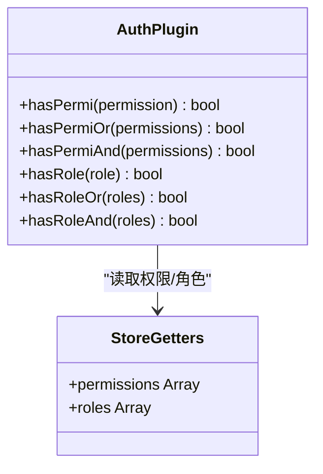

图表来源
- [plugins/auth.js:27-60](file://plugins/auth.js#L27-L60)
- [store/getters.js:1-11](file://store/getters.js#L1-L11)

章节来源
- [plugins/auth.js:1-61](file://plugins/auth.js#L1-L61)
- [store/getters.js:1-11](file://store/getters.js#L1-L11)

### 用户信息与持久化：store/modules/user.js
- 关键状态
  - token、id、name、avatar、roles、permissions、userType
- 关键动作
  - Login/WxLogin/PhoneLogin 等设置 token
  - GetInfo 拉取用户信息，校验 userType 与角色，设置 roles/permissions/userType，并持久化
  - LogOut/Unbind 清理本地与状态
- 持久化
  - 使用 utils/constant.js 定义的键名将 roles/permissions 等写入本地存储
- 参考路径
  - [store/modules/user.js:12-52](file://store/modules/user.js#L12-L52)
  - [store/modules/user.js:73-111](file://store/modules/user.js#L73-L111)
  - [store/modules/user.js:215-228](file://store/modules/user.js#L215-L228)
  - [utils/constant.js:1-10](file://utils/constant.js#L1-L10)

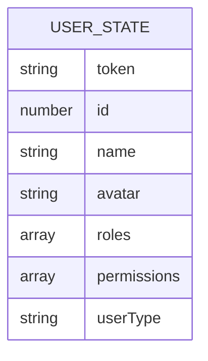

图表来源
- [store/modules/user.js:12-52](file://store/modules/user.js#L12-L52)

章节来源
- [store/modules/user.js:12-111](file://store/modules/user.js#L12-L111)
- [utils/constant.js:1-10](file://utils/constant.js#L1-L10)

### 角色判断与系统封装：utils/role.js 与 utils/roleSystem.js
- utils/role.js
  - 提供 isSecretary/isAdmin/isCounselor/isTeacher 等判定函数，兼容字符串与对象两种角色格式。
  - 提供 getRoleType/getRoleTypes/getRoleDisplayName 等聚合工具。
- utils/roleSystem.js
  - getUserRoles：从 store.state.user.roles 或 store.getters.roles 或本地存储获取角色。
  - ensureUserInfoLoaded：有 token 但无 roles 时自动触发 GetInfo。
  - roleMixin/createRoleComputed：在页面中快速获得响应式角色属性。
  - createRoleGuard：页面级角色守卫，支持多角色 OR 与通配符。
- 参考路径
  - [utils/role.js:16-165](file://utils/role.js#L16-L165)
  - [utils/roleSystem.js:39-96](file://utils/roleSystem.js#L39-L96)
  - [utils/roleSystem.js:110-245](file://utils/roleSystem.js#L110-L245)

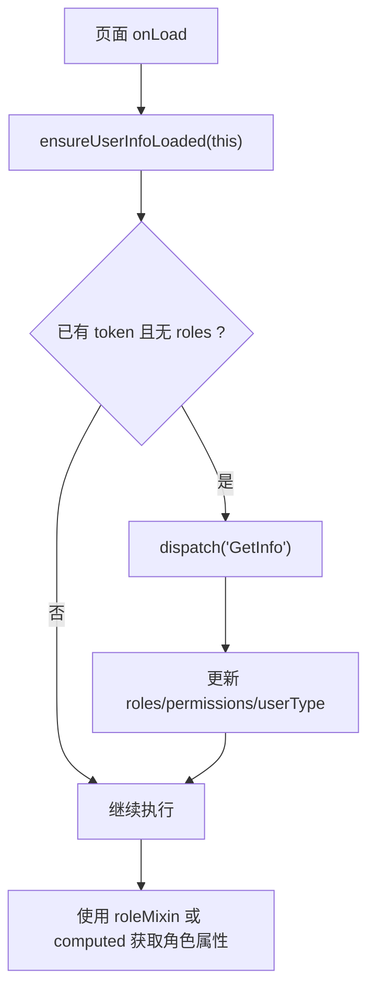

图表来源
- [utils/roleSystem.js:73-96](file://utils/roleSystem.js#L73-L96)
- [store/modules/user.js:73-111](file://store/modules/user.js#L73-L111)

章节来源
- [utils/role.js:16-165](file://utils/role.js#L16-L165)
- [utils/roleSystem.js:39-245](file://utils/roleSystem.js#L39-L245)

### 角色视图配置：utils/roleConfig.js 与 utils/roleViewConfig.js
- 静态配置（角色 -> TabBar/Features/HomePage）
  - 支持多角色合并、TabBar 去重、features 布尔开关。
- 动态配置（页面维度）
  - 根据 pageKey 从后端拉取视图配置，内存缓存，失败回退默认。
- 参考路径
  - [utils/roleConfig.js:6-149](file://utils/roleConfig.js#L6-L149)
  - [utils/roleViewConfig.js:16-115](file://utils/roleViewConfig.js#L16-L115)

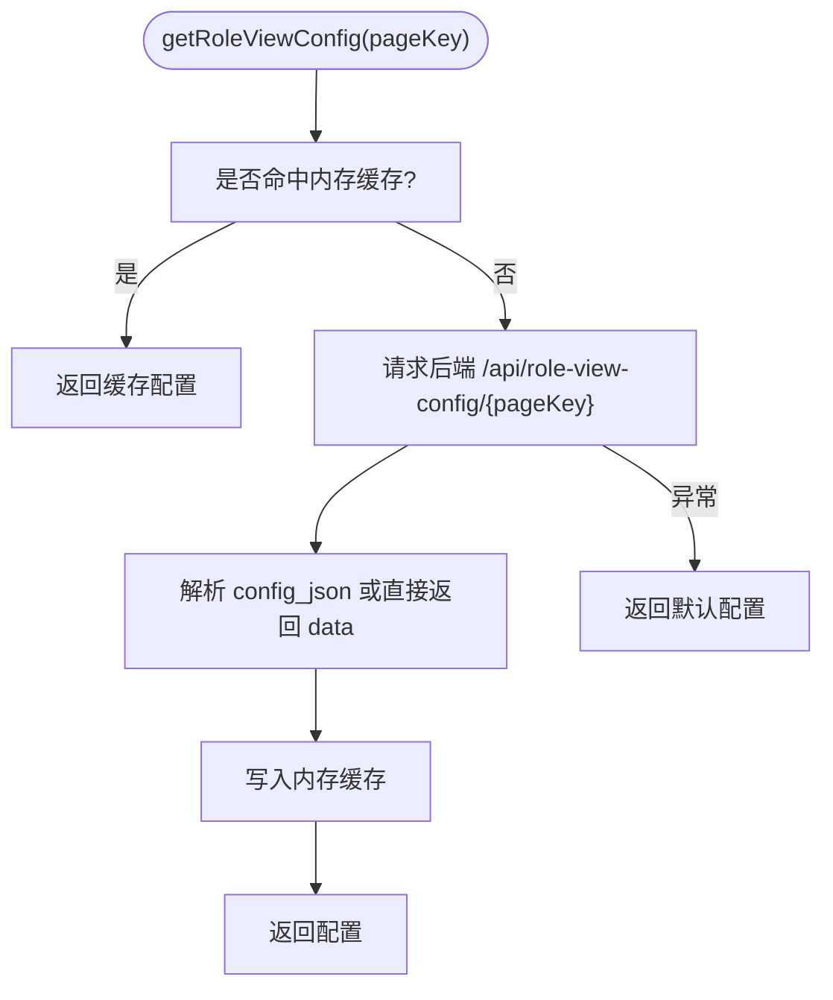

图表来源
- [utils/roleViewConfig.js:16-92](file://utils/roleViewConfig.js#L16-L92)

章节来源
- [utils/roleConfig.js:6-149](file://utils/roleConfig.js#L6-L149)
- [utils/roleViewConfig.js:16-115](file://utils/roleViewConfig.js#L16-L115)

### 页面侧使用示例：查课模块
- 在页面生命周期中确保用户信息已加载，再基于角色决定 UI 与数据加载范围。
- 参考路径
  - [pages/sub-work/classcheck/index.vue:670-725](file://pages/sub-work/classcheck/index.vue#L670-L725)
  - [pages/sub-work/classcheck/add.vue:309-322](file://pages/sub-work/classcheck/add.vue#L309-L322)

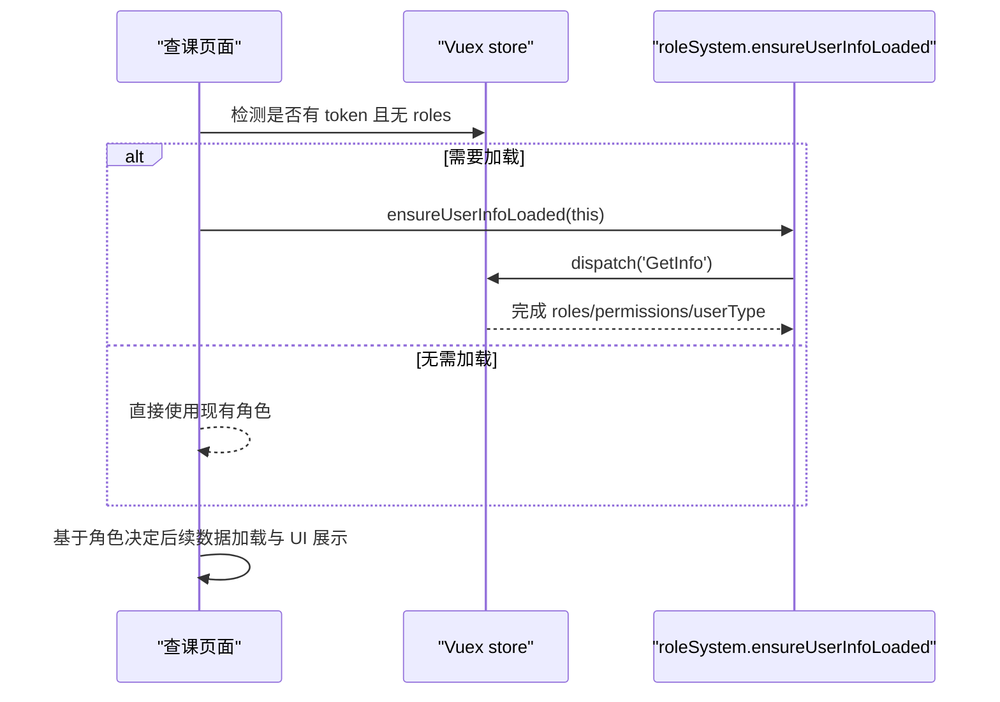

图表来源
- [pages/sub-work/classcheck/index.vue:670-725](file://pages/sub-work/classcheck/index.vue#L670-L725)
- [utils/roleSystem.js:73-96](file://utils/roleSystem.js#L73-L96)
- [store/modules/user.js:73-111](file://store/modules/user.js#L73-L111)

章节来源
- [pages/sub-work/classcheck/index.vue:670-725](file://pages/sub-work/classcheck/index.vue#L670-L725)
- [pages/sub-work/classcheck/add.vue:309-322](file://pages/sub-work/classcheck/add.vue#L309-L322)

## 依赖关系分析
- 低耦合高内聚
  - 权限校验工具仅依赖 getters，不关心具体数据来源，便于替换与测试。
  - 用户状态集中在 store/modules/user.js，mutations 负责同步本地存储，职责清晰。
- 可能的循环依赖
  - 当前未见循环导入；权限工具通过 getters 间接访问 state，避免了直接耦合。
- 外部依赖
  - uni.* 系列用于本地存储与登录能力；request 用于动态视图配置。

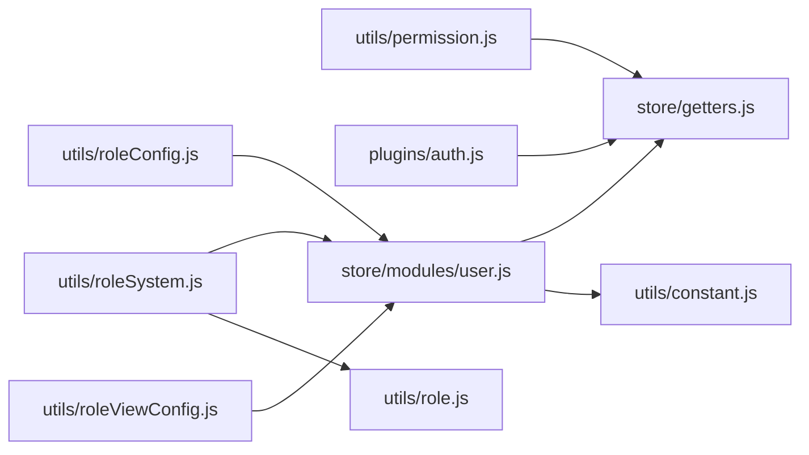

图表来源
- [utils/permission.js:1-49](file://utils/permission.js#L1-L49)
- [plugins/auth.js:1-61](file://plugins/auth.js#L1-L61)
- [store/modules/user.js:1-283](file://store/modules/user.js#L1-L283)
- [store/getters.js:1-11](file://store/getters.js#L1-L11)
- [utils/constant.js:1-10](file://utils/constant.js#L1-L10)
- [utils/roleSystem.js:1-297](file://utils/roleSystem.js#L1-L297)
- [utils/role.js:1-165](file://utils/role.js#L1-L165)
- [utils/roleConfig.js:1-149](file://utils/roleConfig.js#L1-L149)
- [utils/roleViewConfig.js:1-115](file://utils/roleViewConfig.js#L1-L115)

章节来源
- [utils/permission.js:1-49](file://utils/permission.js#L1-L49)
- [plugins/auth.js:1-61](file://plugins/auth.js#L1-L61)
- [store/modules/user.js:1-283](file://store/modules/user.js#L1-L283)
- [store/getters.js:1-11](file://store/getters.js#L1-L11)
- [utils/constant.js:1-10](file://utils/constant.js#L1-L10)
- [utils/roleSystem.js:1-297](file://utils/roleSystem.js#L1-L297)
- [utils/role.js:1-165](file://utils/role.js#L1-L165)
- [utils/roleConfig.js:1-149](file://utils/roleConfig.js#L1-L149)
- [utils/roleViewConfig.js:1-115](file://utils/roleViewConfig.js#L1-L115)

## 性能考虑
- 权限/角色匹配均为线性扫描，O(n) 复杂度，n 通常为几十以内，开销可忽略。
- 视图配置采用内存缓存，避免重复网络请求；可在必要时主动清空缓存以刷新。
- 建议在首次登录后集中预加载常用页面的视图配置，减少首屏等待。

## 故障排查指南
- 现象：权限/角色始终为 false
  - 检查 store.state.user.roles/permissions 是否正确填充
  - 确认后端返回的权限/角色数据格式是否符合预期
  - 确认是否触发了 GetInfo 并在成功后设置了 roles/permissions
  - 参考路径：[store/modules/user.js:73-111](file://store/modules/user.js#L73-L111)
- 现象：超级管理员未生效
  - 确认后端返回的角色中是否包含超级管理员标识
  - 确认 checkRole/hasRole 使用的标识一致
  - 参考路径：[utils/permission.js:32-49](file://utils/permission.js#L32-L49)、[plugins/auth.js:15-25](file://plugins/auth.js#L15-L25)
- 现象：超级权限未生效
  - 确认后端返回的权限集合中是否包含“超级权限”标识
  - 参考路径：[utils/permission.js:8-25](file://utils/permission.js#L8-L25)、[plugins/auth.js:3-13](file://plugins/auth.js#L3-L13)
- 现象：页面未显示期望的功能
  - 检查角色视图配置是否从后端正确返回，或是否命中默认配置
  - 尝试清除配置缓存后重试
  - 参考路径：[utils/roleViewConfig.js:16-115](file://utils/roleViewConfig.js#L16-L115)

章节来源
- [store/modules/user.js:73-111](file://store/modules/user.js#L73-L111)
- [utils/permission.js:8-49](file://utils/permission.js#L8-L49)
- [plugins/auth.js:3-25](file://plugins/auth.js#L3-L25)
- [utils/roleViewConfig.js:16-115](file://utils/roleViewConfig.js#L16-L115)

## 结论
RuoYi-App 前端的 RBAC 模型以“角色+权限标识”为核心，结合 Vuex 状态管理与本地持久化，实现了灵活可控的访问控制。通过统一的权限校验工具、角色判断系统与视图配置机制，既能满足细粒度权限控制，又能支撑不同角色的差异化界面体验。建议在新增功能时遵循本文的最佳实践，确保前后端权限协议一致、UI 与接口双重校验，保障安全性与一致性。

## 附录

### 权限字符串匹配算法说明
- 规则
  - 若用户拥有“超级权限”标识，则任何权限检查均通过。
  - 否则，只要用户权限集合中包含任一所需权限标识即通过。
- 复杂度
  - O(n)，n 为用户权限数量
- 参考路径
  - [utils/permission.js:8-25](file://utils/permission.js#L8-L25)

### 角色匹配算法说明
- 规则
  - 若用户拥有“超级管理员”角色标识，则任何角色检查均通过。
  - 否则，只要用户角色集合中包含任一所需角色即通过。
- 复杂度
  - O(n)，n 为用户角色数量
- 参考路径
  - [utils/permission.js:32-49](file://utils/permission.js#L32-L49)

### 用户信息在 Vuex 中的存储结构
- roles：角色数组，来源于后端用户信息接口，用于角色判定
- permissions：权限标识数组，来源于后端用户信息接口，用于权限判定
- userType：用户类型标识，用于业务分支（如教师/非教师）
- 参考路径
  - [store/modules/user.js:12-52](file://store/modules/user.js#L12-L52)
  - [store/getters.js:1-11](file://store/getters.js#L1-L11)

### 权限配置示例与最佳实践
- 在页面中使用插件式权限工具
  - 模板层：v-if="this.$auth.hasPermi('xxx')" 或 v-if="this.$auth.hasRole('yyy')"
  - 逻辑层：在方法中调用 this.$auth.hasPermiOr([...]) 或 this.$auth.hasRoleAnd([...])
  - 参考路径：[plugins/auth.js:27-60](file://plugins/auth.js#L27-L60)
- 在页面中使用工具函数
  - 使用 checkPermi(['a','b']) 或 checkRole(['admin']) 进行批量权限/角色判定
  - 参考路径：[utils/permission.js:8-49](file://utils/permission.js#L8-L49)
- 使用角色系统简化开发
  - 混入 roleMixin 或在 computed 中展开 createRoleComputed，快速获得 isSecretaryRole 等属性
  - 使用 createRoleGuard 进行页面级访问控制
  - 参考路径：[utils/roleSystem.js:110-245](file://utils/roleSystem.js#L110-L245)
- 视图级功能开关
  - 使用 ROLE_CONFIG 定义角色对应的 TabBar/Features/HomePage
  - 使用 getRoleViewConfig 动态加载页面视图配置，失败回退默认
  - 参考路径：[utils/roleConfig.js:6-149](file://utils/roleConfig.js#L6-L149)、[utils/roleViewConfig.js:16-115](file://utils/roleViewConfig.js#L16-L115)

### 权限验证流程图
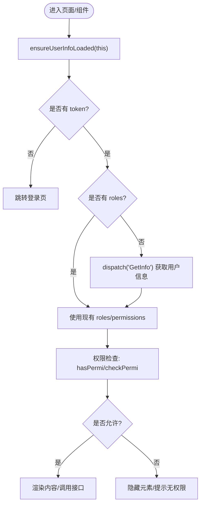

图表来源
- [utils/roleSystem.js:73-96](file://utils/roleSystem.js#L73-L96)
- [store/modules/user.js:73-111](file://store/modules/user.js#L73-L111)
- [plugins/auth.js:27-60](file://plugins/auth.js#L27-L60)
- [utils/permission.js:8-49](file://utils/permission.js#L8-L49)

### 状态转换图（用户信息加载）
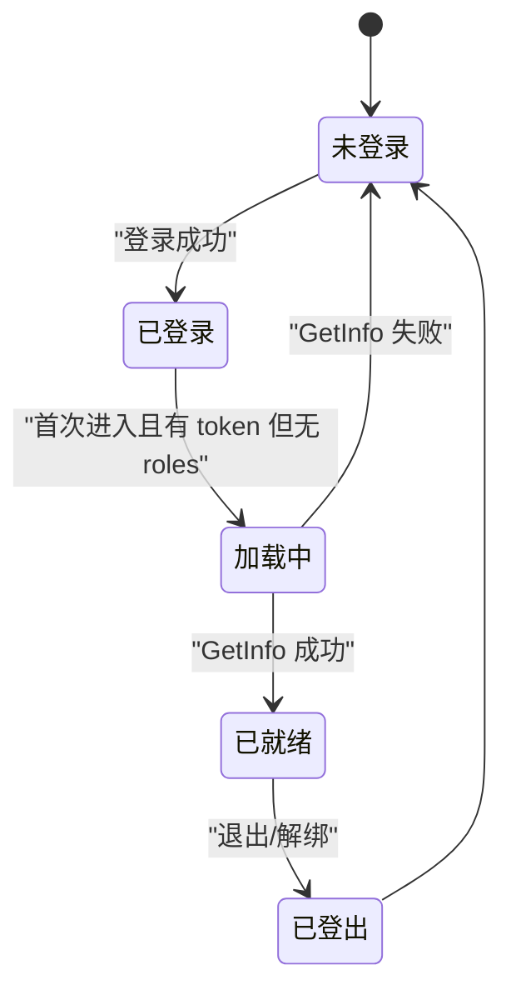

图表来源
- [store/modules/user.js:73-111](file://store/modules/user.js#L73-L111)
- [store/modules/user.js:215-228](file://store/modules/user.js#L215-L228)