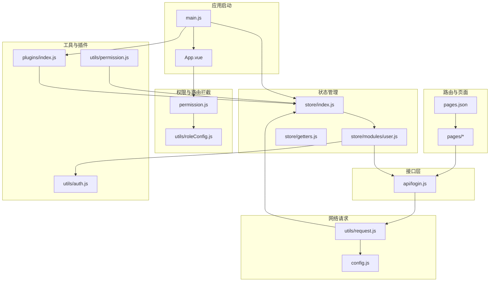
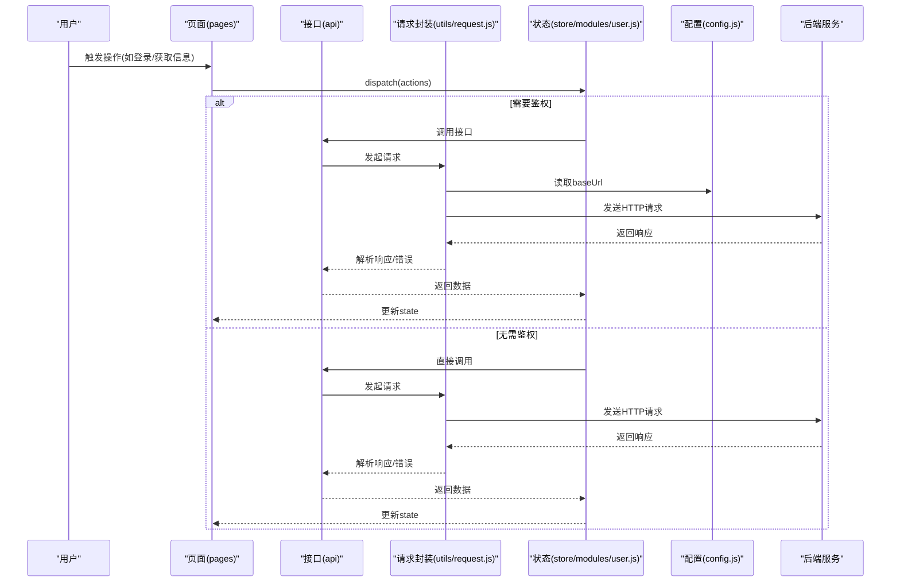
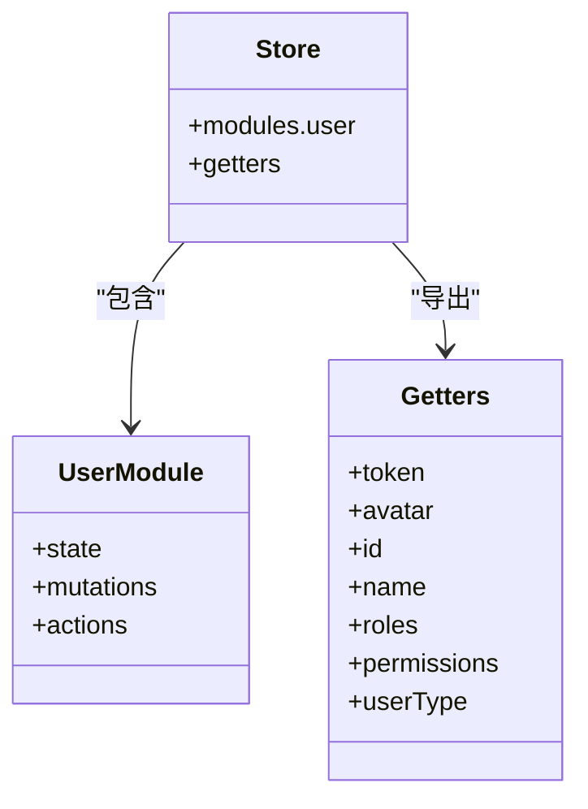
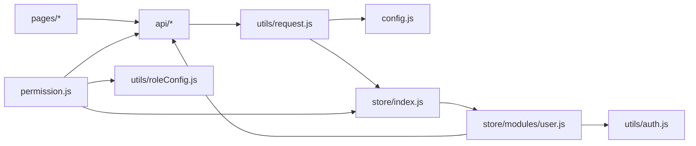
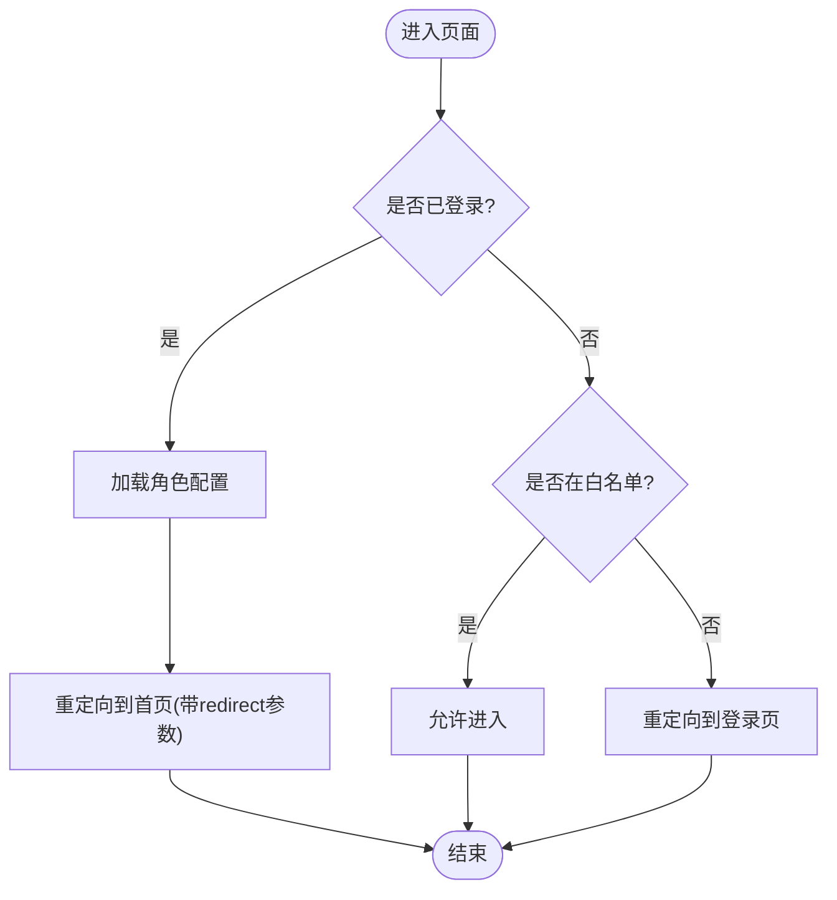
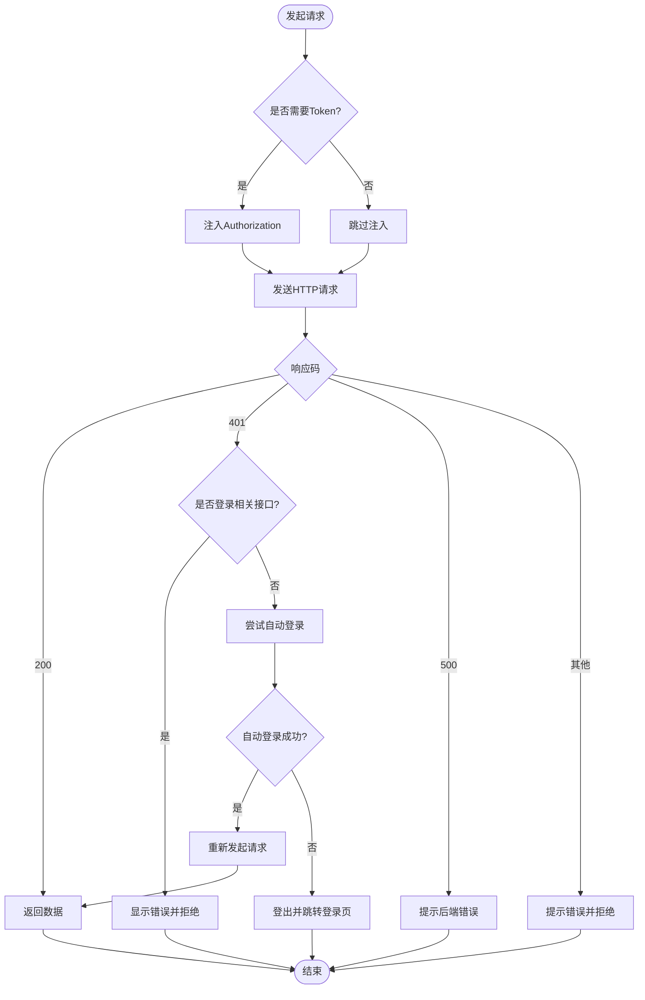

# 架构设计

<cite>
**本文引用的文件**   
- [main.js](file://main.js)
- [App.vue](file://App.vue)
- [permission.js](file://permission.js)
- [config.js](file://config.js)
- [pages.json](file://pages.json)
- [utils/request.js](file://utils/request.js)
- [store/index.js](file://store/index.js)
- [store/modules/user.js](file://store/modules/user.js)
- [utils/auth.js](file://utils/auth.js)
- [plugins/index.js](file://plugins/index.js)
- [api/login.js](file://api/login.js)
- [utils/permission.js](file://utils/permission.js)
- [plugins/auth.js](file://plugins/auth.js)
- [utils/roleConfig.js](file://utils/roleConfig.js)
- [store/getters.js](file://store/getters.js)
</cite>

## 目录
1. [引言](#引言)
2. [项目结构](#项目结构)
3. [核心组件](#核心组件)
4. [架构总览](#架构总览)
5. [详细组件分析](#详细组件分析)
6. [依赖关系分析](#依赖关系分析)
7. [性能考虑](#性能考虑)
8. [故障排查指南](#故障排查指南)
9. [结论](#结论)
10. [附录](#附录)

## 引言
本文件面向RuoYi-App的前端架构设计与实现，重点阐述：
- MVVM模式与分层架构在UniApp/Vue中的落地方式
- 模块化组织原则（页面层、组件层、接口层、状态管理层、工具层）
- 权限控制体系（RBAC、动态菜单、页面级守卫）
- 网络请求封装（统一错误处理、Token自动注入、重试机制）
- 模块交互的数据流图与架构图

## 项目结构
整体采用“按功能域+分层”的混合组织方式：
- 页面层 pages：路由与视图入口，承载业务页面与子包
- 组件层 components：通用UI与业务组件
- 接口层 api：按领域划分的API函数集合
- 状态管理层 store：Vuex全局状态与用户域模块
- 工具层 utils：认证、权限、网络请求、存储、校验等
- 插件层 plugins：挂载到Vue原型的全局能力（页签、模态框、权限辅助）
- 配置 config：应用基础配置（协议、主机、前缀、应用信息）
- 权限拦截 permission：全局跳转拦截、角色配置初始化、白名单控制

图表来源
- [main.js:1-31](file://main.js#L1-L31)
- [App.vue:1-48](file://App.vue#L1-L48)
- [permission.js:1-133](file://permission.js#L1-L133)
- [utils/roleConfig.js:1-149](file://utils/roleConfig.js#L1-L149)
- [pages.json:1-235](file://pages.json#L1-L235)
- [store/index.js:1-16](file://store/index.js#L1-L16)
- [store/modules/user.js:1-283](file://store/modules/user.js#L1-L283)
- [store/getters.js:1-11](file://store/getters.js#L1-L11)
- [utils/request.js:1-117](file://utils/request.js#L1-L117)
- [config.js:1-38](file://config.js#L1-L38)
- [api/login.js:1-168](file://api/login.js#L1-L168)
- [utils/auth.js:1-47](file://utils/auth.js#L1-L47)
- [utils/permission.js:1-49](file://utils/permission.js#L1-L49)
- [plugins/index.js:1-15](file://plugins/index.js#L1-L15)

章节来源
- [main.js:1-31](file://main.js#L1-L31)
- [App.vue:1-48](file://App.vue#L1-L48)
- [pages.json:1-235](file://pages.json#L1-L235)
- [config.js:1-38](file://config.js#L1-L38)

## 核心组件
- 应用入口与初始化
  - main.js负责注册uView UI、插件、全局方法、字典获取方法，并挂载Vuex实例。
  - App.vue在onLaunch中初始化配置，并按平台执行自动登录或登录检查。
- 路由与页面
  - pages.json定义主包与分包页面、TabBar及全局样式。
- 权限与路由拦截
  - permission.js提供全局跳转拦截、白名单判断、角色配置初始化与缓存、实名认证状态读取。
  - utils/roleConfig.js维护角色视图配置（TabBar、功能开关、首页路径）。
- 状态管理
  - store/index.js聚合Vuex模块与getters。
  - store/modules/user.js维护token、用户信息、角色与权限，并提供登录、获取信息、微信/手机号绑定、退出等actions。
  - store/getters.js暴露token、avatar、id、name、roles、permissions、userType。
- 网络请求
  - utils/request.js封装uni.request，统一注入Authorization、参数序列化、错误码映射、401自动登录/登出流程。
  - config.js集中管理协议、主机、端口、API前缀与baseUrl计算。
- 接口层
  - api/login.js封装登录、注册、获取用户信息、退出、验证码、微信/手机号绑定等接口调用。
- 工具与插件
  - utils/auth.js提供Token与UserId存取。
  - utils/permission.js提供字符权限与角色校验工具。
  - plugins/auth.js提供$auth.hasPermi/hasRole等便捷方法。
  - plugins/index.js将$tab/$auth/$modal挂载到Vue原型。

章节来源
- [main.js:1-31](file://main.js#L1-L31)
- [App.vue:1-48](file://App.vue#L1-L48)
- [permission.js:1-133](file://permission.js#L1-L133)
- [utils/roleConfig.js:1-149](file://utils/roleConfig.js#L1-L149)
- [store/index.js:1-16](file://store/index.js#L1-L16)
- [store/modules/user.js:1-283](file://store/modules/user.js#L1-L283)
- [store/getters.js:1-11](file://store/getters.js#L1-L11)
- [utils/request.js:1-117](file://utils/request.js#L1-L117)
- [config.js:1-38](file://config.js#L1-L38)
- [api/login.js:1-168](file://api/login.js#L1-L168)
- [utils/auth.js:1-47](file://utils/auth.js#L1-L47)
- [utils/permission.js:1-49](file://utils/permission.js#L1-L49)
- [plugins/auth.js:1-61](file://plugins/auth.js#L1-L61)
- [plugins/index.js:1-15](file://plugins/index.js#L1-L15)

## 架构总览
系统遵循MVVM与分层架构：
- 视图层（pages/components）通过事件触发actions或直接调用API
- 状态层（store）集中管理用户会话、角色与权限
- 数据访问层（api + request）统一网络通信与错误处理
- 基础设施层（config、utils、plugins）提供配置、工具与全局能力

图表来源
- [api/login.js:1-168](file://api/login.js#L1-L168)
- [utils/request.js:1-117](file://utils/request.js#L1-L117)
- [config.js:1-38](file://config.js#L1-L38)
- [store/modules/user.js:1-283](file://store/modules/user.js#L1-L283)

## 详细组件分析

### 页面层(pages)与路由
- 职责
  - 承载业务视图与交互逻辑，按需加载分包页面
  - 通过路由跳转受permission.js拦截器控制
- 关键要点
  - 主包包含登录、注册、首页、工作台、我的
  - 子包按业务域划分（sub-mine、sub-work、common），减少首屏体积
  - TabBar默认配置可在运行时根据角色覆盖

章节来源
- [pages.json:1-235](file://pages.json#L1-L235)
- [permission.js:1-133](file://permission.js#L1-L133)

### 组件层(components)
- 职责
  - 提供可复用的UI与业务片段，降低页面复杂度
- 设计建议
  - 保持无副作用的展示型组件
  - 复杂交互下沉至页面或store/actions

[本节为概念性说明，不直接分析具体文件]

### 接口层(api)
- 职责
  - 按领域组织API函数，屏蔽底层请求细节
  - 对需免鉴权的接口显式设置isToken=false
- 典型示例
  - 登录、注册、获取用户信息、退出、验证码、微信/手机号绑定等

章节来源
- [api/login.js:1-168](file://api/login.js#L1-L168)

### 状态管理层(store)
- 职责
  - 集中管理用户会话、角色与权限
  - 提供登录、获取信息、微信/手机号绑定、退出等动作
- 关键流程
  - GetInfo会校验用户类型与角色，必要时清理本地状态并拒绝
  - WxLogin/PhoneLogin等动作完成登录后持久化token并更新state

图表来源
- [store/index.js:1-16](file://store/index.js#L1-L16)
- [store/modules/user.js:1-283](file://store/modules/user.js#L1-L283)
- [store/getters.js:1-11](file://store/getters.js#L1-L11)

章节来源
- [store/index.js:1-16](file://store/index.js#L1-L16)
- [store/modules/user.js:1-283](file://store/modules/user.js#L1-L283)
- [store/getters.js:1-11](file://store/getters.js#L1-L11)

### 工具层(utils)
- 职责
  - 提供认证、权限、网络请求、存储、校验等通用能力
- 关键点
  - utils/auth.js：Token与UserId存取
  - utils/permission.js：字符权限与角色校验
  - utils/request.js：统一请求封装、错误处理、401自动登录/登出
  - utils/roleConfig.js：角色视图配置与合并策略

章节来源
- [utils/auth.js:1-47](file://utils/auth.js#L1-L47)
- [utils/permission.js:1-49](file://utils/permission.js#L1-L49)
- [utils/request.js:1-117](file://utils/request.js#L1-L117)
- [utils/roleConfig.js:1-149](file://utils/roleConfig.js#L1-L149)

### 插件层(plugins)
- 职责
  - 将$tab/$auth/$modal挂载到Vue原型，提供全局方法
- 关键点
  - plugins/auth.js提供hasPermi/hasRole等便捷方法
  - plugins/index.js统一安装

章节来源
- [plugins/index.js:1-15](file://plugins/index.js#L1-L15)
- [plugins/auth.js:1-61](file://plugins/auth.js#L1-L61)

### 配置层(config)
- 职责
  - 集中管理协议、主机、端口、API前缀与baseUrl
- 关键点
  - baseUrl由protocol/host/apiPrefix组合生成，便于多环境切换

章节来源
- [config.js:1-38](file://config.js#L1-L38)

## 依赖关系分析
- 低耦合高内聚
  - 页面仅依赖api与store，不直接操作网络
  - api仅依赖request与config，屏蔽网络细节
  - request依赖store与auth，但避免反向依赖
- 可能的循环依赖风险
  - request导入store用于登出；确保仅在401分支使用，避免模块初始化阶段强依赖
- 外部依赖
  - UniApp API（uni.request、uni.login、uni.reLaunch等）
  - uView UI组件库

图表来源
- [api/login.js:1-168](file://api/login.js#L1-L168)
- [utils/request.js:1-117](file://utils/request.js#L1-L117)
- [config.js:1-38](file://config.js#L1-L38)
- [store/index.js:1-16](file://store/index.js#L1-L16)
- [store/modules/user.js:1-283](file://store/modules/user.js#L1-L283)
- [utils/auth.js:1-47](file://utils/auth.js#L1-L47)
- [permission.js:1-133](file://permission.js#L1-L133)
- [utils/roleConfig.js:1-149](file://utils/roleConfig.js#L1-L149)

章节来源
- [api/login.js:1-168](file://api/login.js#L1-L168)
- [utils/request.js:1-117](file://utils/request.js#L1-L117)
- [config.js:1-38](file://config.js#L1-L38)
- [store/index.js:1-16](file://store/index.js#L1-L16)
- [store/modules/user.js:1-283](file://store/modules/user.js#L1-L283)
- [utils/auth.js:1-47](file://utils/auth.js#L1-L47)
- [permission.js:1-133](file://permission.js#L1-L133)
- [utils/roleConfig.js:1-149](file://utils/roleConfig.js#L1-L149)

## 性能考虑
- 首屏优化
  - 使用分包加载（subPackages）减少主包体积
  - 按需引入第三方库（如uView）
- 网络优化
  - 合理设置超时时间，避免长连接阻塞
  - 利用GET参数序列化减少URL拼接开销
- 渲染优化
  - 列表分页与虚拟滚动（结合现有分页mixin）
  - 图片懒加载与CDN加速
- 状态优化
  - 避免频繁dispatch导致重渲染，合并相关状态更新

[本节为通用指导，不直接分析具体文件]

## 故障排查指南
- 401未授权
  - 非登录接口触发时，尝试自动登录（小程序）或强制登出并跳转登录页（H5）
  - 若自动登录失败，清除本地状态并重定向
- 网络异常
  - 捕获Network Error、timeout、HTTP状态码并给出友好提示
- 权限不足
  - 使用$auth或checkPermi/checkRole进行前端按钮/路由级控制
- 角色配置异常
  - 初始化失败回退到教师默认配置，检查后端返回结构与缓存

章节来源
- [utils/request.js:1-117](file://utils/request.js#L1-L117)
- [permission.js:1-133](file://permission.js#L1-L133)
- [utils/permission.js:1-49](file://utils/permission.js#L1-L49)
- [plugins/auth.js:1-61](file://plugins/auth.js#L1-L61)
- [utils/roleConfig.js:1-149](file://utils/roleConfig.js#L1-L149)

## 结论
RuoYi-App以MVVM为核心，结合分层与模块化设计，实现了清晰的职责边界与良好的扩展性。权限体系基于RBAC与角色视图配置，配合全局路由拦截与动态TabBar，满足多角色场景。网络层统一封装保障一致的错误处理与鉴权体验。建议在后续迭代中持续完善错误上报、监控与性能指标采集，进一步提升稳定性与可观测性。

[本节为总结性内容，不直接分析具体文件]

## 附录

### 权限控制体系设计
- RBAC模型
  - 角色与权限从后端获取并持久化到store与本地存储
  - 提供字符权限与角色校验工具
- 动态菜单
  - 通过角色配置合并TabBar与功能开关，支持运行时覆盖
- 页面级守卫
  - 全局拦截navigateTo/redirectTo/reLaunch/switchTab，结合白名单与登录态控制跳转

图表来源
- [permission.js:1-133](file://permission.js#L1-L133)
- [utils/roleConfig.js:1-149](file://utils/roleConfig.js#L1-L149)

章节来源
- [permission.js:1-133](file://permission.js#L1-L133)
- [utils/roleConfig.js:1-149](file://utils/roleConfig.js#L1-L149)
- [utils/permission.js:1-49](file://utils/permission.js#L1-L49)
- [plugins/auth.js:1-61](file://plugins/auth.js#L1-L61)

### 网络请求封装设计
- Token自动注入
  - 除明确isToken=false外，自动附加Authorization头
- 统一错误处理
  - 错误码映射、网络异常、超时、HTTP状态码分类提示
- 401自动登录/重试
  - 小程序环境下尝试自动登录并重试原请求；否则登出并跳转登录页
- 参数序列化
  - GET请求params自动拼接为查询字符串

图表来源
- [utils/request.js:1-117](file://utils/request.js#L1-L117)
- [api/login.js:1-168](file://api/login.js#L1-L168)
- [store/modules/user.js:1-283](file://store/modules/user.js#L1-L283)

章节来源
- [utils/request.js:1-117](file://utils/request.js#L1-L117)
- [api/login.js:1-168](file://api/login.js#L1-L168)
- [store/modules/user.js:1-283](file://store/modules/user.js#L1-L283)