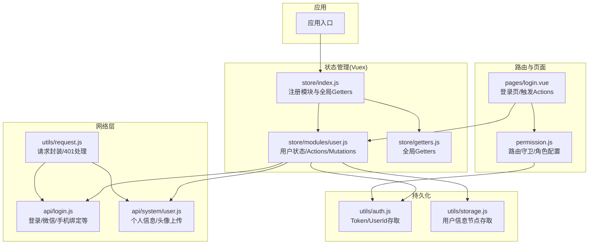
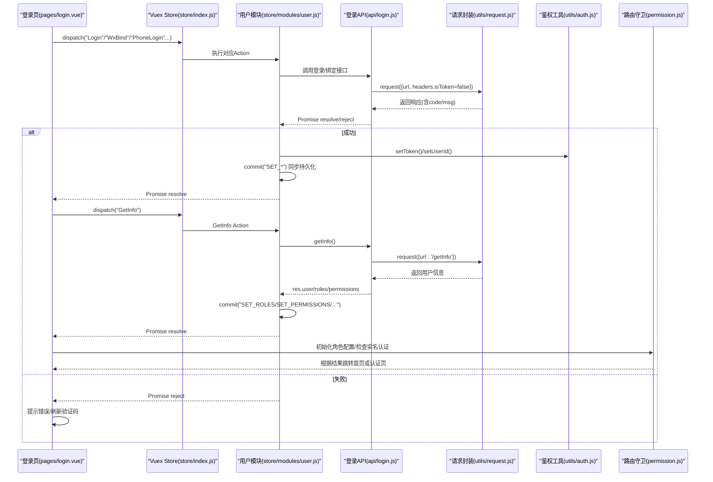
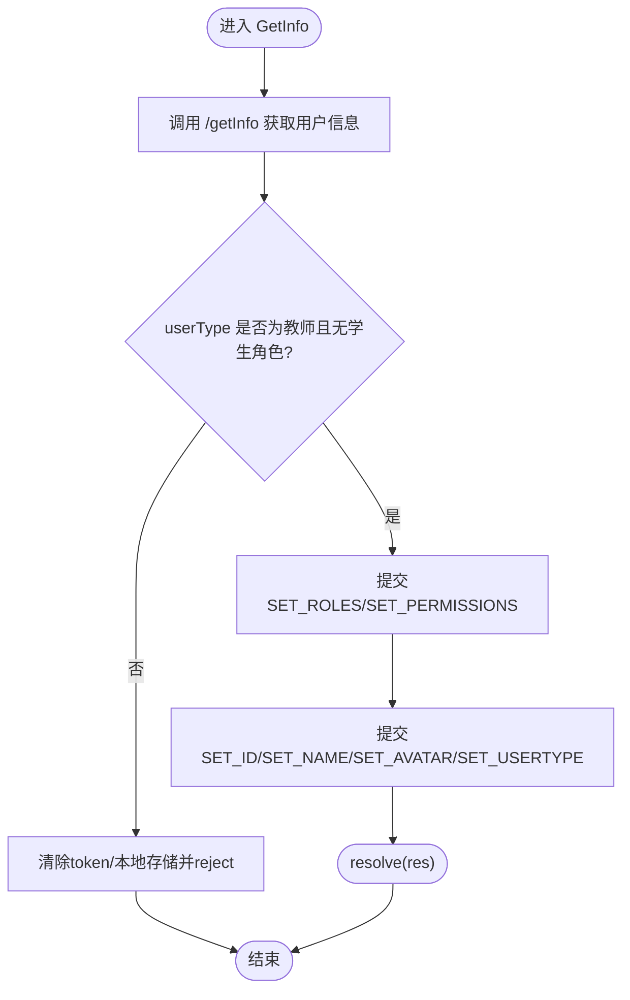
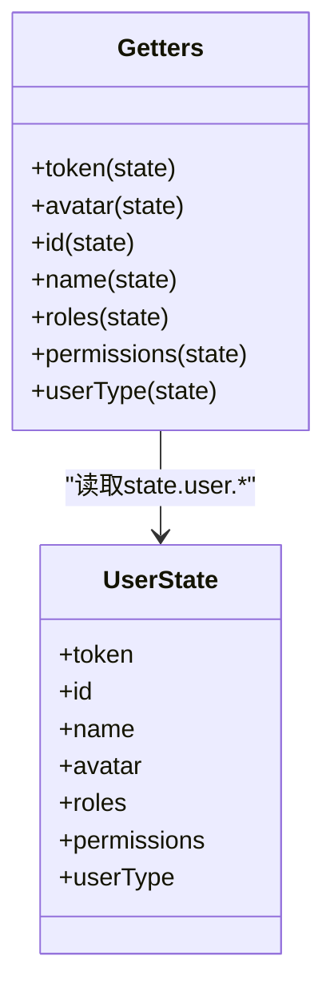
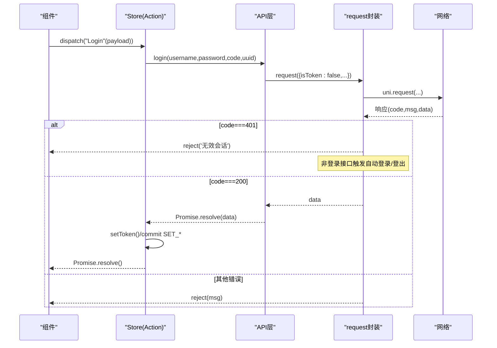
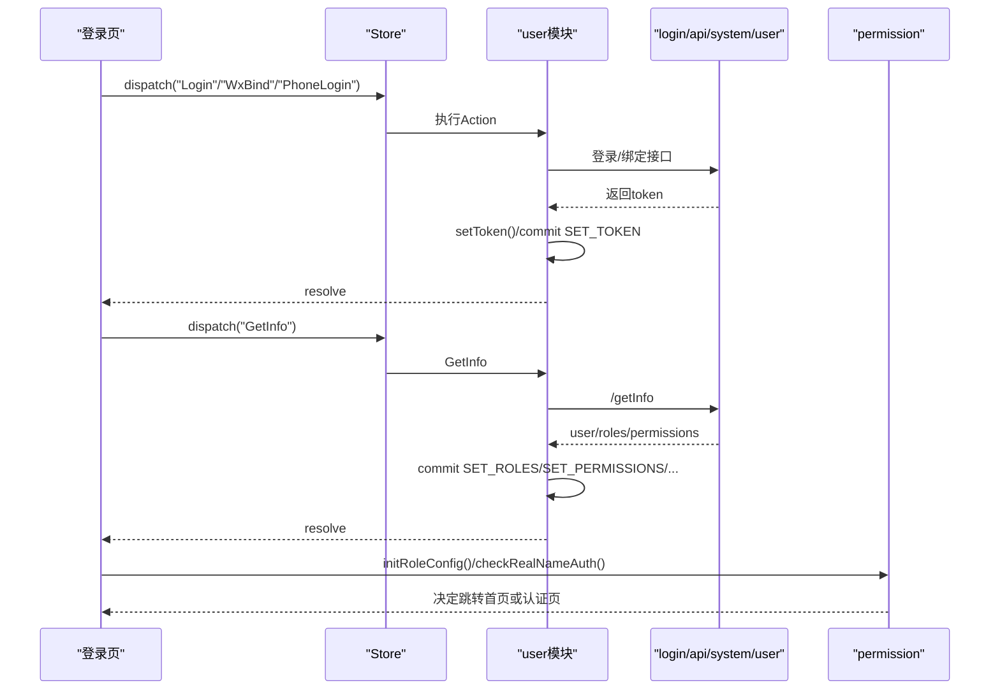
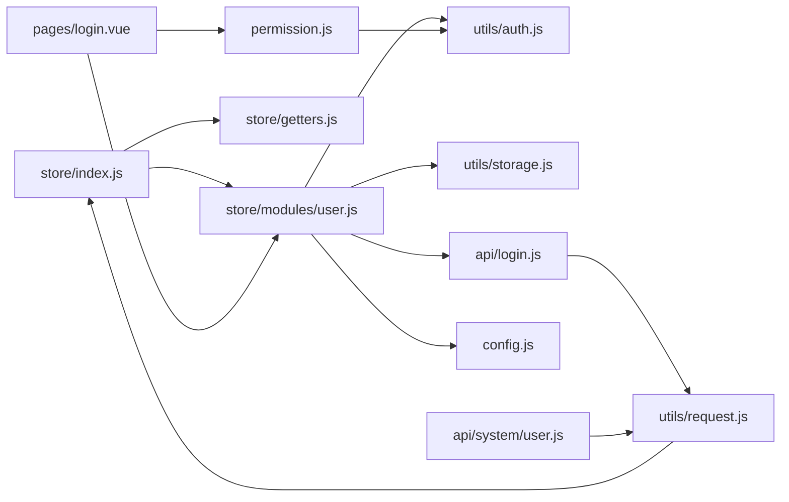

# 状态管理设计

<cite>
**本文引用的文件**   
- [store/index.js](file://store/index.js)
- [store/modules/user.js](file://store/modules/user.js)
- [store/getters.js](file://store/getters.js)
- [utils/auth.js](file://utils/auth.js)
- [utils/storage.js](file://utils/storage.js)
- [api/login.js](file://api/login.js)
- [api/system/user.js](file://api/system/user.js)
- [pages/login.vue](file://pages/login.vue)
- [permission.js](file://permission.js)
- [config.js](file://config.js)
- [utils/request.js](file://utils/request.js)
</cite>

## 目录
1. [引言](#引言)
2. [项目结构](#项目结构)
3. [核心组件](#核心组件)
4. [架构总览](#架构总览)
5. [详细组件分析](#详细组件分析)
6. [依赖关系分析](#依赖关系分析)
7. [性能与优化建议](#性能与优化建议)
8. [故障排查指南](#故障排查指南)
9. [结论](#结论)

## 引言
本设计文档围绕 RuoYi-App 的集中式状态管理展开，重点说明基于 Vuex 的 Store 结构设计、模块化组织与数据流。文档深入解析用户状态模块（登录、信息获取、权限同步）、Getters 计算属性模式、状态持久化策略（本地存储集成、恢复与迁移思路），以及异步 Action 的处理模式（API 封装、状态更新与错误处理）。文末提供状态流转图与模块依赖图，并给出最佳实践与性能优化建议。

## 项目结构
RuoYi-App 的状态管理位于 store 目录，采用“根 Store + 模块”的组织方式：
- 根 Store：注册模块与全局 Getters
- 模块 user：负责用户相关状态（token、id、name、avatar、roles、permissions、userType）及其变更
- Getters：暴露派生状态供组件使用
- 持久化：通过 utils/auth.js 与 utils/storage.js 将关键状态落盘
- API 层：api/login.js 与 api/system/user.js 封装后端接口
- 请求拦截：utils/request.js 统一注入 Authorization、处理 401 等异常
- 路由守卫：permission.js 结合 token 与角色配置进行访问控制
- 页面交互：pages/login.vue 触发登录流程并调用 Store Actions

图表来源
- [store/index.js:1-16](file://store/index.js#L1-L16)
- [store/modules/user.js:1-283](file://store/modules/user.js#L1-L283)
- [store/getters.js:1-11](file://store/getters.js#L1-L11)
- [utils/auth.js:1-47](file://utils/auth.js#L1-L47)
- [utils/storage.js:1-33](file://utils/storage.js#L1-L33)
- [api/login.js:1-168](file://api/login.js#L1-L168)
- [api/system/user.js:1-42](file://api/system/user.js#L1-L42)
- [utils/request.js:1-117](file://utils/request.js#L1-L117)
- [permission.js:1-133](file://permission.js#L1-L133)
- [pages/login.vue:1-462](file://pages/login.vue#L1-L462)

章节来源
- [store/index.js:1-16](file://store/index.js#L1-L16)
- [store/modules/user.js:1-283](file://store/modules/user.js#L1-L283)
- [store/getters.js:1-11](file://store/getters.js#L1-L11)
- [utils/auth.js:1-47](file://utils/auth.js#L1-L47)
- [utils/storage.js:1-33](file://utils/storage.js#L1-L33)
- [api/login.js:1-168](file://api/login.js#L1-L168)
- [api/system/user.js:1-42](file://api/system/user.js#L1-L42)
- [utils/request.js:1-117](file://utils/request.js#L1-L117)
- [permission.js:1-133](file://permission.js#L1-L133)
- [pages/login.vue:1-462](file://pages/login.vue#L1-L462)

## 核心组件
- Store 根实例
  - 注册 user 模块与全局 getters
  - 作为唯一状态源，被组件通过 this.$store 访问
- 用户模块 user
  - state：token、id、name、avatar、roles、permissions、userType
  - mutations：SET_TOKEN/SET_ID/SET_NAME/SET_AVATAR/SET_ROLES/SET_PERMISSIONS/SET_USERTYPE，并在写入时同步持久化
  - actions：登录、获取用户信息、微信自动登录/绑定、手机号快捷登录/绑定、退出、解除微信绑定、学生绑定登录等
- 全局 Getters
  - 以 state.user.* 为输入，返回扁平化的 token、avatar、id、name、roles、permissions、userType
- 持久化工具
  - utils/auth.js：Token 与 UserId 的存取与 isLogin 判断
  - utils/storage.js：按 key 聚合存储用户信息节点（avatar/id/name/roles/permissions），并提供 clean 清理
- API 层
  - api/login.js：登录、注册、获取用户信息、退出、验证码、微信/手机/学生绑定等
  - api/system/user.js：个人信息查询/修改、密码重置、头像上传
- 请求封装
  - utils/request.js：统一注入 Authorization、参数拼接、错误码处理、401 自动重试或登出跳转
- 路由与页面
  - permission.js：白名单校验、未登录重定向、已登录访问登录页重定向到首页
  - pages/login.vue：触发登录流程、成功后调用 GetInfo 初始化角色配置与认证状态

章节来源
- [store/index.js:1-16](file://store/index.js#L1-L16)
- [store/modules/user.js:1-283](file://store/modules/user.js#L1-L283)
- [store/getters.js:1-11](file://store/getters.js#L1-L11)
- [utils/auth.js:1-47](file://utils/auth.js#L1-L47)
- [utils/storage.js:1-33](file://utils/storage.js#L1-L33)
- [api/login.js:1-168](file://api/login.js#L1-L168)
- [api/system/user.js:1-42](file://api/system/user.js#L1-L42)
- [utils/request.js:1-117](file://utils/request.js#L1-L117)
- [permission.js:1-133](file://permission.js#L1-L133)
- [pages/login.vue:1-462](file://pages/login.vue#L1-L462)

## 架构总览
下图展示了从页面到 Store、再到 API 与持久化的完整数据流，以及 401 场景下的自动处理路径。

图表来源
- [pages/login.vue:170-225](file://pages/login.vue#L170-L225)
- [store/modules/user.js:54-111](file://store/modules/user.js#L54-L111)
- [api/login.js:4-39](file://api/login.js#L4-L39)
- [utils/request.js:10-117](file://utils/request.js#L10-L117)
- [utils/auth.js:1-47](file://utils/auth.js#L1-L47)
- [permission.js:26-76](file://permission.js#L26-L76)

## 详细组件分析

### 用户状态模块（user）
- 状态字段
  - token：当前会话令牌
  - id/name/avatar：用户标识与展示信息
  - roles/permissions：角色与权限集合
  - userType：用户类型（教师/非教师）
- 变更器（Mutations）
  - SET_TOKEN/SET_ID/SET_NAME/SET_AVATAR/SET_ROLES/SET_PERMISSIONS/SET_USERTYPE
  - 在设置 id/name/avatar/roles/permissions 的同时，调用 storage.set 持久化；设置 id 时同时调用 auth.setUserId
- 动作（Actions）
  - Login：用户名+密码+验证码登录，成功后 setToken 并 commit SET_TOKEN
  - GetInfo：拉取用户详情，校验 userType 与角色，设置 roles/permissions，补全 avatar 绝对地址，提交各 SET_*
  - WxLogin/WxBind：微信小程序自动登录与账号绑定，成功后 setToken 并可选提交用户基础信息
  - PhoneLogin/TeacherPhoneBind/StudentBindLogin：手机号一键登录/绑定
  - LogOut：调用后端退出，清空 token、roles、permissions，清理本地存储
  - Unbind：解除微信绑定，无论后端是否成功均清理本地状态
  - StudentBindLogin：学生绑定登录
- 错误处理
  - 登录失败：保持本地状态不变，向上抛出错误由页面处理
  - GetInfo 校验失败：清除 token 与本地存储，reject 错误
  - 退出/解绑：即使后端失败也确保本地状态一致

图表来源
- [store/modules/user.js:72-111](file://store/modules/user.js#L72-L111)

章节来源
- [store/modules/user.js:11-283](file://store/modules/user.js#L11-L283)

### Getters 计算属性设计
- 设计目标
  - 提供只读的派生状态，避免组件直接读取深层嵌套
  - 便于后续扩展（如格式化、过滤、组合）
- 实现要点
  - 所有 getter 均以 state.user.* 为输入，返回扁平字段
  - 当前实现为直传，未来可在此处增加默认值、格式化处理（如头像 URL 补全、权限集合去重等）

图表来源
- [store/getters.js:1-11](file://store/getters.js#L1-L11)
- [store/modules/user.js:12-20](file://store/modules/user.js#L12-L20)

章节来源
- [store/getters.js:1-11](file://store/getters.js#L1-L11)

### 状态持久化策略
- Token 与 UserId
  - 通过 utils/auth.js 的 getToken/setToken/removeToken 与 getUserId/setUserId/removeUserId 管理
  - 登录成功后立即写入，退出/解绑时移除
- 用户信息节点
  - 通过 utils/storage.js 的 set/get/remove/clean 管理
  - 受控键名来自 constant（avatar/id/name/roles/permissions），mutations 中写入时同步持久化
- 启动恢复
  - user 模块初始化时从 auth 与 storage 恢复 token、id、name、avatar、roles、permissions、userType
- 版本迁移（建议）
  - 可在应用启动时读取一个 version 标记，对比当前 schema 版本，对旧数据进行清洗或转换后写入新结构
  - 迁移完成后更新 version 标记，避免重复迁移

章节来源
- [utils/auth.js:1-47](file://utils/auth.js#L1-L47)
- [utils/storage.js:1-33](file://utils/storage.js#L1-L33)
- [store/modules/user.js:12-20](file://store/modules/user.js#L12-L20)
- [utils/constant.js:1-10](file://utils/constant.js#L1-L10)

### 异步 Action 处理模式
- API 封装
  - api/login.js 与 api/system/user.js 仅做参数组装与 request 调用
  - utils/request.js 统一注入 Authorization、处理 401 自动重试或登出跳转、统一错误提示
- 状态更新流程
  - Action 调用 API -> 成功则 setToken/commit SET_* -> 持久化 -> resolve
  - 失败则 reject，由页面捕获并提示
- 错误处理
  - 401：非登录接口触发自动重试（小程序环境）或直接登出跳转
  - 500/其他：toast 提示并 reject
  - 网络异常/超时：转换为友好消息并 reject

图表来源
- [api/login.js:4-19](file://api/login.js#L4-L19)
- [utils/request.js:10-117](file://utils/request.js#L10-L117)
- [store/modules/user.js:54-70](file://store/modules/user.js#L54-L70)

章节来源
- [api/login.js:1-168](file://api/login.js#L1-L168)
- [api/system/user.js:1-42](file://api/system/user.js#L1-L42)
- [utils/request.js:1-117](file://utils/request.js#L1-L117)
- [store/modules/user.js:54-278](file://store/modules/user.js#L54-L278)

### 登录流程与权限同步
- 登录页触发
  - 普通账号：dispatch("Login")
  - 微信环境：先尝试自动登录（WxLogin），否则引导绑定（WxBind）
  - 手机号一键登录：TeacherPhoneBind/StudentBindLogin
- 登录后初始化
  - 调用 GetInfo 获取用户信息与权限
  - 清理旧角色缓存，初始化角色配置与实名认证状态
  - 根据认证状态跳转到身份选择或首页

图表来源
- [pages/login.vue:170-225](file://pages/login.vue#L170-L225)
- [store/modules/user.js:72-111](file://store/modules/user.js#L72-L111)
- [api/login.js:34-39](file://api/login.js#L34-L39)
- [permission.js:26-76](file://permission.js#L26-L76)

章节来源
- [pages/login.vue:170-225](file://pages/login.vue#L170-L225)
- [store/modules/user.js:72-111](file://store/modules/user.js#L72-L111)
- [permission.js:26-76](file://permission.js#L26-L76)

## 依赖关系分析
- 模块耦合
  - user 模块依赖 auth、storage、validate、api/login、config
  - 请求层 request 依赖 store（用于 401 自动处理）、auth、config、errorCode、common
  - 路由守卫 permission 依赖 auth 与 roleView API
- 外部依赖
  - uni.request 网络请求
  - uni.getStorageSync/setStorageSync 本地存储
  - Vue/Vuex 状态管理
- 潜在循环依赖
  - request 引入 store，store 不反向引入 request，无循环
  - 注意在新增模块时避免引入 request 导致循环

图表来源
- [store/index.js:1-16](file://store/index.js#L1-L16)
- [store/modules/user.js:1-283](file://store/modules/user.js#L1-L283)
- [store/getters.js:1-11](file://store/getters.js#L1-L11)
- [utils/auth.js:1-47](file://utils/auth.js#L1-L47)
- [utils/storage.js:1-33](file://utils/storage.js#L1-L33)
- [api/login.js:1-168](file://api/login.js#L1-L168)
- [api/system/user.js:1-42](file://api/system/user.js#L1-L42)
- [utils/request.js:1-117](file://utils/request.js#L1-L117)
- [pages/login.vue:1-462](file://pages/login.vue#L1-L462)
- [permission.js:1-133](file://permission.js#L1-L133)
- [config.js:1-38](file://config.js#L1-L38)

章节来源
- [store/index.js:1-16](file://store/index.js#L1-L16)
- [store/modules/user.js:1-283](file://store/modules/user.js#L1-L283)
- [store/getters.js:1-11](file://store/getters.js#L1-L11)
- [utils/auth.js:1-47](file://utils/auth.js#L1-L47)
- [utils/storage.js:1-33](file://utils/storage.js#L1-L33)
- [api/login.js:1-168](file://api/login.js#L1-L168)
- [api/system/user.js:1-42](file://api/system/user.js#L1-L42)
- [utils/request.js:1-117](file://utils/request.js#L1-L117)
- [pages/login.vue:1-462](file://pages/login.vue#L1-L462)
- [permission.js:1-133](file://permission.js#L1-L133)
- [config.js:1-38](file://config.js#L1-L38)

## 性能与优化建议
- 减少不必要的持久化写入
  - 仅在必要字段变化时写入 storage，避免频繁 I/O
- 合并多次 mutation
  - 对于批量更新（如 GetInfo 后一次性提交多个 SET_*），可考虑封装复合 mutation 减少中间渲染
- Getter 懒加载与缓存
  - 当前为直传，若后续有复杂计算，建议在 Getter 内做简单缓存或拆分更细粒度 Getter
- 请求层优化
  - 合理设置 timeout，避免长耗时阻塞
  - 对高频接口考虑前端缓存（如字典、配置类数据）
- 路由守卫优化
  - 角色配置与认证状态已在登录成功后缓存，避免重复请求
- 图片资源
  - 头像 URL 在 GetInfo 中补全为绝对路径，可减少渲染阶段计算

[本节为通用建议，无需源码引用]

## 故障排查指南
- 401 无效会话
  - 现象：请求返回 401，非登录接口自动重试或登出跳转
  - 排查：确认 token 是否存在、是否过期；检查 request 的 isToken 标志位
  - 参考
    - [utils/request.js:41-88](file://utils/request.js#L41-L88)
- 登录失败
  - 现象：Login/WxBind/PhoneLogin 等 action reject
  - 排查：检查验证码 uuid 是否正确、网络连通性、后端返回 msg
  - 参考
    - [pages/login.vue:170-189](file://pages/login.vue#L170-L189)
    - [api/login.js:4-19](file://api/login.js#L4-L19)
- 用户信息不一致
  - 现象：roles/permissions 未更新或头像显示异常
  - 排查：确认 GetInfo 是否成功执行、avatar 是否为空或相对路径
  - 参考
    - [store/modules/user.js:72-111](file://store/modules/user.js#L72-L111)
- 退出/解绑后仍保留数据
  - 现象：本地仍有 token 或用户信息
  - 排查：确认 LogOut/Unbind 是否执行了 removeToken 与 storage.clean
  - 参考
    - [store/modules/user.js:214-258](file://store/modules/user.js#L214-L258)
    - [utils/auth.js:12-14](file://utils/auth.js#L12-L14)
    - [utils/storage.js:27-29](file://utils/storage.js#L27-L29)

章节来源
- [utils/request.js:41-88](file://utils/request.js#L41-L88)
- [pages/login.vue:170-189](file://pages/login.vue#L170-L189)
- [api/login.js:4-19](file://api/login.js#L4-L19)
- [store/modules/user.js:72-111](file://store/modules/user.js#L72-L111)
- [store/modules/user.js:214-258](file://store/modules/user.js#L214-L258)
- [utils/auth.js:12-14](file://utils/auth.js#L12-L14)
- [utils/storage.js:27-29](file://utils/storage.js#L27-L29)

## 结论
RuoYi-App 的状态管理采用清晰的“Store 根实例 + user 模块”结构，配合统一的请求封装与路由守卫，实现了登录、信息获取、权限同步与持久化的闭环。Getters 提供了简洁的派生状态访问点，便于后续扩展。整体数据流单向明确，错误处理完善，具备较好的可维护性与可扩展性。建议在后续迭代中持续优化持久化写入频率、Getter 计算复杂度与请求缓存策略，以提升用户体验与系统性能。