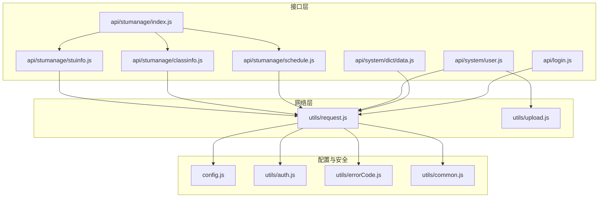
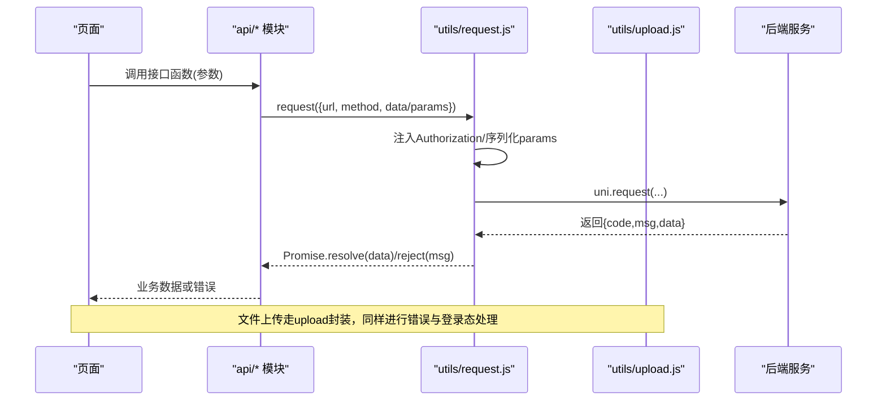
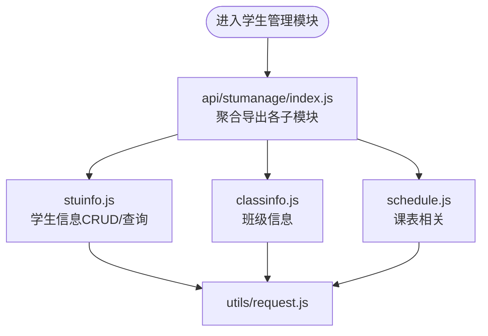
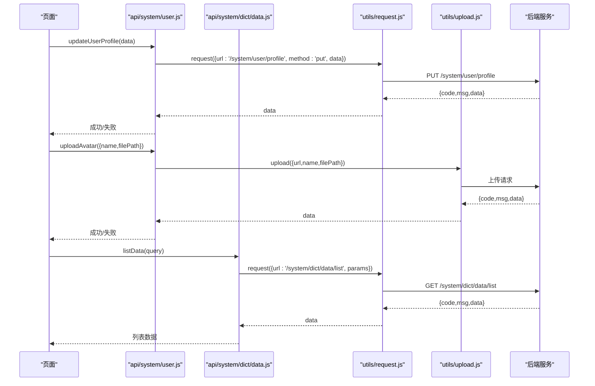
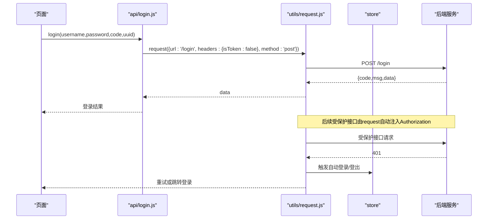
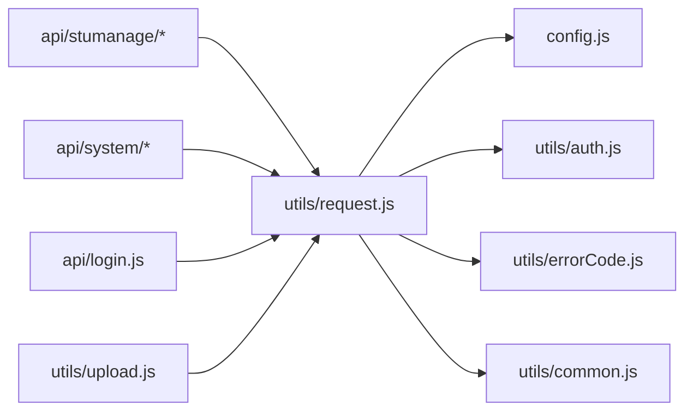

# API接口组织规范

<cite>
**本文引用的文件**   
- [api/stumanage/index.js](file://api/stumanage/index.js)
- [api/stumanage/stuinfo.js](file://api/stumanage/stuinfo.js)
- [api/stumanage/classinfo.js](file://api/stumanage/classinfo.js)
- [api/stumanage/schedule.js](file://api/stumanage/schedule.js)
- [api/system/user.js](file://api/system/user.js)
- [api/system/dict/data.js](file://api/system/dict/data.js)
- [utils/request.js](file://utils/request.js)
- [utils/upload.js](file://utils/upload.js)
- [config.js](file://config.js)
- [utils/auth.js](file://utils/auth.js)
- [utils/errorCode.js](file://utils/errorCode.js)
- [utils/common.js](file://utils/common.js)
- [api/login.js](file://api/login.js)
</cite>

## 目录
1. [引言](#引言)
2. [项目结构](#项目结构)
3. [核心组件](#核心组件)
4. [架构总览](#架构总览)
5. [详细组件分析](#详细组件分析)
6. [依赖关系分析](#依赖关系分析)
7. [性能与稳定性](#性能与稳定性)
8. [测试与Mock策略](#测试与mock策略)
9. [安全与权限控制](#安全与权限控制)
10. [接口版本管理](#接口版本管理)
11. [文档自动生成与Swagger集成](#文档自动生成与swagger集成)
12. [最佳实践与示例](#最佳实践与示例)
13. [故障排查指南](#故障排查指南)
14. [结论](#结论)

## 引言
本规范面向RuoYi-App前端，统一API接口的组织方式、命名约定、参数与返回值格式、异步处理模式、版本管理与安全策略，确保多业务域（如学生管理stumanage、系统管理system等）的接口具备高内聚、低耦合、可维护、可扩展的特性。

## 项目结构
- 按功能模块划分接口文件：
  - api/stumanage：学生管理相关接口，包含活动、附件、班级树、查课、请假、课程表、统计、学生信息、谈话、待办、教师信息等子模块。
  - api/system：系统管理相关接口，包含用户信息与字典数据等。
  - api根目录：登录、广告、角色视图、游客、用户信息等通用接口。
- 统一的HTTP请求封装位于 utils/request.js，上传封装位于 utils/upload.js。
- 全局配置（协议、主机、端口、API前缀）位于 config.js。
- 认证与错误码工具位于 utils/auth.js 与 utils/errorCode.js。

图示来源
- [api/stumanage/index.js:1-32](file://api/stumanage/index.js#L1-L32)
- [api/stumanage/stuinfo.js:1-85](file://api/stumanage/stuinfo.js#L1-L85)
- [api/stumanage/classinfo.js:1-19](file://api/stumanage/classinfo.js#L1-L19)
- [api/stumanage/schedule.js:1-46](file://api/stumanage/schedule.js#L1-L46)
- [api/system/user.js:1-42](file://api/system/user.js#L1-L42)
- [api/system/dict/data.js:1-53](file://api/system/dict/data.js#L1-L53)
- [utils/request.js:1-117](file://utils/request.js#L1-L117)
- [utils/upload.js:38-70](file://utils/upload.js#L38-L70)
- [config.js:1-38](file://config.js#L1-L38)
- [utils/auth.js:1-47](file://utils/auth.js#L1-L47)
- [utils/errorCode.js:1-7](file://utils/errorCode.js#L1-L7)
- [utils/common.js:1-121](file://utils/common.js#L1-L121)

章节来源
- [api/stumanage/index.js:1-32](file://api/stumanage/index.js#L1-L32)
- [config.js:1-38](file://config.js#L1-L38)

## 核心组件
- 统一请求封装（utils/request.js）
  - 自动注入Authorization头（Bearer Token），支持按需关闭（isToken: false）。
  - GET请求自动将params序列化为查询字符串。
  - 统一响应处理：code=200成功；401触发自动登录或跳转登录页；500/其他错误提示并拒绝Promise。
  - 超时与网络异常统一提示。
- 统一上传封装（utils/upload.js）
  - 复用错误处理逻辑，支持登录态过期处理。
- 全局配置（config.js）
  - 提供baseUrl（protocol + host + apiPrefix），便于统一切换环境。
- 认证工具（utils/auth.js）
  - 提供token与userId存取方法，以及是否已登录判断。
- 错误码映射（utils/errorCode.js）
  - 将后端返回的code映射为中文消息。
- 公共工具（utils/common.js）
  - 提供toast、showConfirm、tansParams等通用能力。

章节来源
- [utils/request.js:1-117](file://utils/request.js#L1-L117)
- [utils/upload.js:38-70](file://utils/upload.js#L38-L70)
- [config.js:1-38](file://config.js#L1-L38)
- [utils/auth.js:1-47](file://utils/auth.js#L1-L47)
- [utils/errorCode.js:1-7](file://utils/errorCode.js#L1-L7)
- [utils/common.js:1-121](file://utils/common.js#L1-L121)

## 架构总览
从页面到后端的调用链路如下：
- 页面调用api模块中的函数
- 函数通过request封装发起HTTP请求
- request根据配置拼接完整URL，附加鉴权头，处理GET参数序列化
- 统一处理响应状态码与错误提示
- 上传场景使用upload封装

图示来源
- [api/stumanage/stuinfo.js:1-85](file://api/stumanage/stuinfo.js#L1-L85)
- [api/system/user.js:1-42](file://api/system/user.js#L1-L42)
- [utils/request.js:1-117](file://utils/request.js#L1-L117)
- [utils/upload.js:38-70](file://utils/upload.js#L38-L70)

## 详细组件分析

### 学生管理（stumanage）
- 入口聚合（api/stumanage/index.js）
  - 以模块为单位导出各子模块接口，便于统一引入与同步PC端功能。
- 学生信息（stuinfo.js）
  - 列表、详情、搜索、树形结构、我的信息等接口，统一使用get/post，分页参数通过params传递。
- 班级信息（classinfo.js）
  - 列表与详情接口，遵循REST风格路径。
- 课表（schedule.js）
  - 列表、今日课表、我的课表、学期信息等接口，部分来自integration网关路径。

图示来源
- [api/stumanage/index.js:1-32](file://api/stumanage/index.js#L1-L32)
- [api/stumanage/stuinfo.js:1-85](file://api/stumanage/stuinfo.js#L1-L85)
- [api/stumanage/classinfo.js:1-19](file://api/stumanage/classinfo.js#L1-L19)
- [api/stumanage/schedule.js:1-46](file://api/stumanage/schedule.js#L1-L46)
- [utils/request.js:1-117](file://utils/request.js#L1-L117)

章节来源
- [api/stumanage/index.js:1-32](file://api/stumanage/index.js#L1-L32)
- [api/stumanage/stuinfo.js:1-85](file://api/stumanage/stuinfo.js#L1-L85)
- [api/stumanage/classinfo.js:1-19](file://api/stumanage/classinfo.js#L1-L19)
- [api/stumanage/schedule.js:1-46](file://api/stumanage/schedule.js#L1-L46)

### 系统管理（system）
- 用户信息（user.js）
  - 修改密码、获取/更新个人信息、头像上传等。
  - 上传接口使用upload封装，其余使用request。
- 字典数据（dict/data.js）
  - 字典类型与数据的增删改查，遵循REST风格。

图示来源
- [api/system/user.js:1-42](file://api/system/user.js#L1-L42)
- [api/system/dict/data.js:1-53](file://api/system/dict/data.js#L1-L53)
- [utils/request.js:1-117](file://utils/request.js#L1-L117)
- [utils/upload.js:38-70](file://utils/upload.js#L38-L70)

章节来源
- [api/system/user.js:1-42](file://api/system/user.js#L1-L42)
- [api/system/dict/data.js:1-53](file://api/system/dict/data.js#L1-L53)

### 登录与认证流程
- 登录、注册、验证码、微信自动登录等接口在api/login.js中定义。
- 非登录类接口默认携带Authorization头；登录相关接口显式设置isToken: false避免循环鉴权。
- 401时，request内部尝试微信自动登录并重试原请求，失败则跳转登录页。

图示来源
- [api/login.js:1-79](file://api/login.js#L1-L79)
- [utils/request.js:1-117](file://utils/request.js#L1-L117)

章节来源
- [api/login.js:1-79](file://api/login.js#L1-L79)
- [utils/request.js:1-117](file://utils/request.js#L1-L117)

## 依赖关系分析
- 模块耦合
  - api/stumanage/* 与 api/system/* 均依赖 utils/request.js，上传依赖 utils/upload.js。
  - request.js 依赖 config.js、utils/auth.js、utils/errorCode.js、utils/common.js。
- 外部依赖
  - uni.request 作为底层网络请求。
  - store（Vuex/Pinia）用于登录态与自动登录流程。

图示来源
- [api/stumanage/index.js:1-32](file://api/stumanage/index.js#L1-L32)
- [api/system/user.js:1-42](file://api/system/user.js#L1-L42)
- [api/login.js:1-79](file://api/login.js#L1-L79)
- [utils/request.js:1-117](file://utils/request.js#L1-L117)
- [utils/upload.js:38-70](file://utils/upload.js#L38-L70)
- [config.js:1-38](file://config.js#L1-L38)
- [utils/auth.js:1-47](file://utils/auth.js#L1-L47)
- [utils/errorCode.js:1-7](file://utils/errorCode.js#L1-L7)
- [utils/common.js:1-121](file://utils/common.js#L1-L121)

章节来源
- [utils/request.js:1-117](file://utils/request.js#L1-L117)
- [config.js:1-38](file://config.js#L1-L38)

## 性能与稳定性
- 请求超时：默认10秒，可通过config.timeout覆盖。
- 参数序列化：GET请求使用tansParams将对象参数转为查询串，避免复杂嵌套导致解析问题。
- 错误提示：统一toast提示，减少重复代码。
- 自动重试：401时尝试自动登录并重试一次，降低因令牌过期导致的失败率。
- 上传优化：独立封装上传流程，复用错误处理与登录态检查。

[本节为通用建议，不直接分析具体文件]

## 测试与Mock策略
- 单元测试
  - 对request封装进行断言：包括headers注入、params序列化、错误分支（401/500/网络异常）。
- 集成测试
  - 使用开发环境baseUrl指向本地或测试服务器，验证关键接口（登录、学生信息、字典数据）。
- Mock数据
  - 在开发阶段通过代理或Mock Server返回固定JSON，保证前后端并行开发。
- 自动化脚本
  - 可在控制台执行简单脚本校验baseUrl与基础接口连通性（参考仓库中的测试脚本思路）。

[本节为通用建议，不直接分析具体文件]

## 安全与权限控制
- 鉴权
  - 所有受保护接口默认携带Authorization: Bearer <token>。
  - 登录相关接口显式设置isToken: false，避免循环鉴权。
- 会话管理
  - 401时自动尝试微信登录并重试；失败则清空登录态并跳转登录页。
- 输入校验
  - 表单侧可使用uni-forms等组件进行前端校验，服务端仍需二次校验。
- 频率限制
  - 建议在网关层实现限流（如IP/用户维度），前端配合防抖与节流避免重复提交。
- 传输安全
  - 生产环境使用HTTPS，并在config.js中正确配置protocol/host/apiPrefix。

章节来源
- [utils/request.js:1-117](file://utils/request.js#L1-L117)
- [api/login.js:1-79](file://api/login.js#L1-L79)
- [config.js:1-38](file://config.js#L1-L38)

## 接口版本管理
- URL路径版本化
  - 当前多数接口未显式带版本号，建议新增或变更较大时使用/v1、/v2等前缀区分。
  - 对于已有稳定接口，保持向后兼容，新增字段采用可选策略。
- 兼容性保证
  - 新增字段不应破坏旧客户端解析；删除字段需保留一段时间并提供迁移说明。
- 灰度发布
  - 结合网关路由与特征开关，逐步放量新版本接口。

[本节为通用建议，不直接分析具体文件]

## 文档自动生成与Swagger集成
- 方案建议
  - 在后端基于SpringDoc/Swagger生成OpenAPI规范，前端仅消费文档。
  - 前端通过docgen或第三方工具将OpenAPI转换为Markdown或在线文档站点。
- 前端职责
  - 保持接口命名与注释一致，便于后端生成准确文档。
  - 在api模块中补充JSDoc注释（方法名、参数、返回值），辅助IDE与文档生成。

[本节为通用建议，不直接分析具体文件]

## 最佳实践与示例
- 接口组织
  - 按业务域分目录（stumanage、system），每个模块一个文件，入口index.js聚合导出。
- 命名规范
  - 函数名采用动词+名词形式（listXxx、getXxx、addXxx、updateXxx、delXxx）。
  - URL遵循REST风格，资源复数形式，路径清晰。
- 参数传递
  - GET使用params，POST/PUT使用data，避免混用。
- 返回值格式
  - 统一{code, msg, data}，前端只处理data分支，错误通过msg提示。
- 异步处理
  - 全部返回Promise，页面使用async/await或.then/.catch处理。
- 示例（路径引用）
  - 学生信息列表：[api/stumanage/stuinfo.js:4-10](file://api/stumanage/stuinfo.js#L4-L10)
  - 用户信息更新：[api/system/user.js:26-32](file://api/system/user.js#L26-L32)
  - 字典数据列表：[api/system/dict/data.js:4-10](file://api/system/dict/data.js#L4-L10)

章节来源
- [api/stumanage/stuinfo.js:1-85](file://api/stumanage/stuinfo.js#L1-L85)
- [api/system/user.js:1-42](file://api/system/user.js#L1-L42)
- [api/system/dict/data.js:1-53](file://api/system/dict/data.js#L1-L53)

## 故障排查指南
- 常见问题
  - 401未跳转：检查isToken设置与登录接口路径匹配。
  - 请求超时：调整timeout或检查网络与后端负载。
  - 域名校验失败：确认config.baseUrl与小程序合法域名配置一致。
- 定位步骤
  - 查看network日志，确认请求URL与方法是否正确。
  - 检查Authorization头是否存在且有效。
  - 核对后端返回code与msg，对照errorCode映射。
- 快速修复
  - 临时在request中打印调试信息，确认params序列化结果。
  - 在登录成功后重新获取用户信息，刷新store状态。

章节来源
- [utils/request.js:1-117](file://utils/request.js#L1-L117)
- [utils/errorCode.js:1-7](file://utils/errorCode.js#L1-L7)
- [config.js:1-38](file://config.js#L1-L38)

## 结论
通过按业务域组织接口、统一请求封装与错误处理、明确参数与返回值规范、完善鉴权与版本管理策略，RuoYi-App的API层具备良好的可维护性与扩展性。建议持续完善文档与测试，保障前后端协作效率与交付质量。