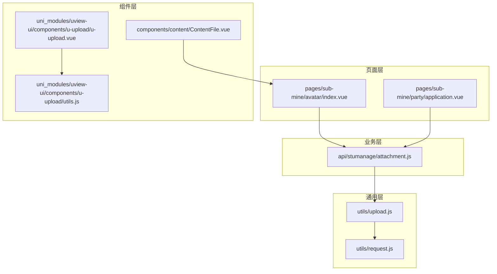
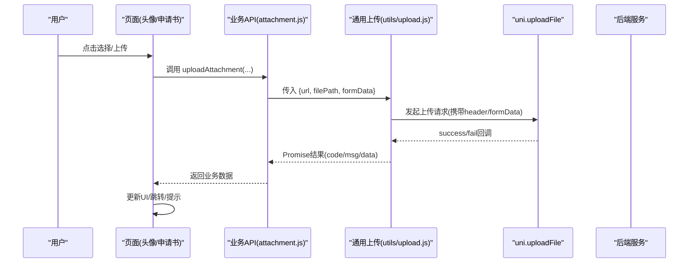
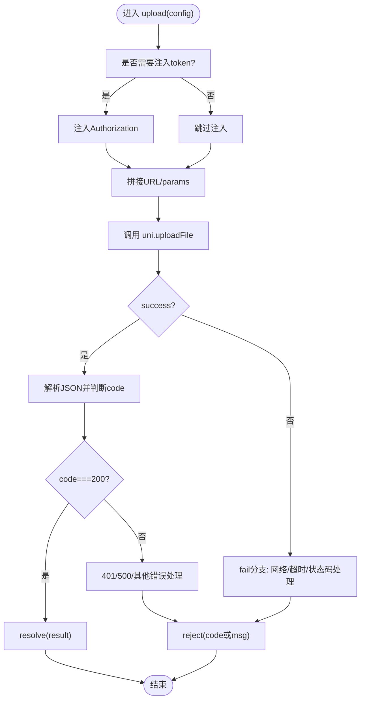
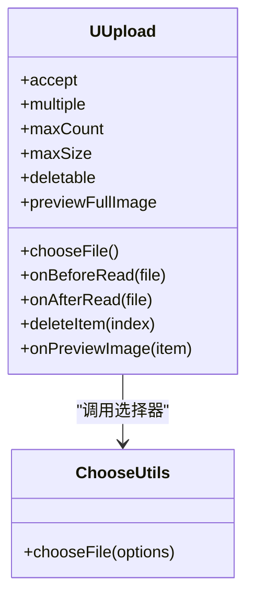
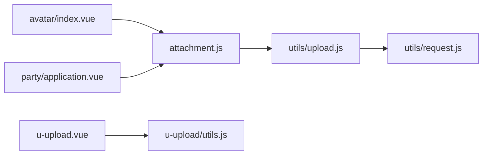

# 文件上传功能

<cite>
**本文引用的文件**   
- [utils/upload.js](file://utils/upload.js)
- [api/stumanage/attachment.js](file://api/stumanage/attachment.js)
- [pages/sub-mine/avatar/index.vue](file://pages/sub-mine/avatar/index.vue)
- [uni_modules/uview-ui/components/u-upload/u-upload.vue](file://uni_modules/uview-ui/components/u-upload/u-upload.vue)
- [uni_modules/uview-ui/components/u-upload/utils.js](file://uni_modules/uview-ui/components/u-upload/utils.js)
- [components/content/ContentFile.vue](file://components/content/ContentFile.vue)
- [pages/sub-mine/party/application.vue](file://pages/sub-mine/party/application.vue)
- [utils/request.js](file://utils/request.js)
</cite>

## 目录
1. [简介](#简介)
2. [项目结构](#项目结构)
3. [核心组件](#核心组件)
4. [架构总览](#架构总览)
5. [详细组件分析](#详细组件分析)
6. [依赖关系分析](#依赖关系分析)
7. [性能与体验优化](#性能与体验优化)
8. [故障排查指南](#故障排查指南)
9. [结论](#结论)
10. [附录：API 调用示例与错误处理](#附录api-调用示例与错误处理)

## 简介
本文件为 RuoYi-App 的文件上传能力提供系统化文档，覆盖单文件与多文件上传、进度监控、断点续传（分片上传、MD5 校验、续传标识）、前端校验（类型、大小、格式转换）、图片压缩与预览删除、队列管理与并发控制、失败重试机制、移动端适配注意事项等。文档基于仓库现有实现进行梳理，并给出可扩展方案建议。

## 项目结构
当前仓库已具备通用上传封装、业务 API 封装、页面级上传场景以及可复用的上传 UI 组件。整体组织方式如下：
- 通用层：统一上传封装与请求封装
- 业务层：按业务域划分 API（如附件上传）
- 页面层：具体业务场景的上传交互（头像、申请书附件等）
- 组件层：可复用的上传 UI 组件（u-upload）与内容展示组件（ContentFile）

图表来源
- [utils/upload.js:1-71](file://utils/upload.js#L1-L71)
- [api/stumanage/attachment.js:1-43](file://api/stumanage/attachment.js#L1-L43)
- [pages/sub-mine/avatar/index.vue:1-231](file://pages/sub-mine/avatar/index.vue#L1-L231)
- [uni_modules/uview-ui/components/u-upload/u-upload.vue:1-559](file://uni_modules/uview-ui/components/u-upload/u-upload.vue#L1-L559)
- [uni_modules/uview-ui/components/u-upload/utils.js:1-152](file://uni_modules/uview-ui/components/u-upload/utils.js#L1-L152)
- [components/content/ContentFile.vue:1-83](file://components/content/ContentFile.vue#L1-L83)
- [utils/request.js:1-117](file://utils/request.js#L1-L117)

章节来源
- [utils/upload.js:1-71](file://utils/upload.js#L1-L71)
- [api/stumanage/attachment.js:1-43](file://api/stumanage/attachment.js#L1-L43)
- [pages/sub-mine/avatar/index.vue:1-231](file://pages/sub-mine/avatar/index.vue#L1-L231)
- [uni_modules/uview-ui/components/u-upload/u-upload.vue:1-559](file://uni_modules/uview-ui/components/u-upload/u-upload.vue#L1-L559)
- [uni_modules/uview-ui/components/u-upload/utils.js:1-152](file://uni_modules/uview-ui/components/u-upload/utils.js#L1-L152)
- [components/content/ContentFile.vue:1-83](file://components/content/ContentFile.vue#L1-L83)
- [utils/request.js:1-117](file://utils/request.js#L1-L117)

## 核心组件
- 通用上传封装（utils/upload.js）
  - 职责：统一拼接 URL、注入 Authorization、参数序列化、调用 uni.uploadFile、统一成功/失败处理、登录态过期引导。
  - 关键点：支持 header.isToken=false 跳过鉴权；支持 formData 透传；对网络异常、超时、HTTP 状态码进行友好提示。
- 业务附件 API（api/stumanage/attachment.js）
  - 职责：面向业务的上传入口，封装 businessType、fileName 等业务字段，复用通用 upload。
  - 典型方法：uploadAttachment、uploadTeacherPhoto、uploadStudentPhoto。
- 页面级上传（pages/sub-mine/avatar/index.vue）
  - 职责：选择照片、显示预览、触发上传、更新教师信息、返回刷新。
  - 特点：使用 sizeType: ['compressed'] 进行前端压缩；上传成功后更新本地显示并通知其他页面刷新。
- 上传 UI 组件（uni_modules/uview-ui/components/u-upload/u-upload.vue）
  - 职责：提供统一的图片/视频/文件选择与预览、删除、数量限制、尺寸限制、beforeRead/afterRead 钩子。
  - 关键流程：chooseFile -> onBeforeRead -> onAfterRead -> 外层自定义上传逻辑。
- 选择工具（uni_modules/uview-ui/components/u-upload/utils.js）
  - 职责：封装 chooseImage/chooseVideo/chooseMessageFile/chooseFile，统一格式化返回对象（含 url、thumb、size、type 等）。
- 内容展示（components/content/ContentFile.vue）
  - 职责：根据 contentType 渲染图片/视频，支持多图预览。

章节来源
- [utils/upload.js:1-71](file://utils/upload.js#L1-L71)
- [api/stumanage/attachment.js:1-43](file://api/stumanage/attachment.js#L1-L43)
- [pages/sub-mine/avatar/index.vue:1-231](file://pages/sub-mine/avatar/index.vue#L1-L231)
- [uni_modules/uview-ui/components/u-upload/u-upload.vue:1-559](file://uni_modules/uview-ui/components/u-upload/u-upload.vue#L1-L559)
- [uni_modules/uview-ui/components/u-upload/utils.js:1-152](file://uni_modules/uview-ui/components/u-upload/utils.js#L1-L152)
- [components/content/ContentFile.vue:1-83](file://components/content/ContentFile.vue#L1-L83)

## 架构总览
从“用户操作”到“后端接口”的端到端路径如下：

图表来源
- [pages/sub-mine/avatar/index.vue:84-143](file://pages/sub-mine/avatar/index.vue#L84-L143)
- [api/stumanage/attachment.js:10-31](file://api/stumanage/attachment.js#L10-L31)
- [utils/upload.js:10-68](file://utils/upload.js#L10-L68)

## 详细组件分析

### 通用上传封装 utils/upload.js
- 设计要点
  - 自动注入 Authorization（可通过 isToken=false 关闭）
  - GET 参数序列化（tansParams）
  - 统一错误处理：401 会话过期、500 服务端错误、网络异常、超时
- 扩展点
  - 增加 progress 回调：可在 uni.uploadFile 中监听上传进度，结合外部状态驱动 UI
  - 增加 retry 策略：在 fail 分支内实现指数退避重试
- 复杂度
  - 时间 O(1)，空间 O(1)

图表来源
- [utils/upload.js:10-68](file://utils/upload.js#L10-L68)

章节来源
- [utils/upload.js:1-71](file://utils/upload.js#L1-L71)

### 业务附件 API api/stumanage/attachment.js
- 设计要点
  - 将业务语义（businessType、fileName）与底层上传解耦
  - 提供 teacher/student 专用方法，便于后续差异化处理
- 使用方式
  - 页面直接调用 uploadAttachment 或专用方法，传入 filePath 与业务字段

章节来源
- [api/stumanage/attachment.js:1-43](file://api/stumanage/attachment.js#L1-L43)

### 页面级上传 pages/sub-mine/avatar/index.vue
- 功能要点
  - 选择图片：count=1，sizeType=['compressed']，sourceType=['album','camera']
  - 上传流程：showLoading -> uploadTeacherPhoto -> 更新教师信息 -> 刷新本地显示 -> 返回
  - 错误处理：catch 分支隐藏 loading 并 toast
- 与通用封装的关系
  - 通过 attachment.js 间接使用 utils/upload.js

章节来源
- [pages/sub-mine/avatar/index.vue:70-143](file://pages/sub-mine/avatar/index.vue#L70-L143)
- [api/stumanage/attachment.js:26-31](file://api/stumanage/attachment.js#L26-L31)

### 上传 UI 组件 uni_modules/uview-ui/components/u-upload/u-upload.vue
- 能力概览
  - 接受 image/video/file/media 多种类型
  - 支持多选、最大数量、最大大小、禁用、删除、预览
  - beforeRead/afterRead 钩子，oversize 事件
- 内部流程
  - chooseFile -> onBeforeRead -> onAfterRead -> 外层自定义上传
- 与 utils.js 的关系
  - 通过 chooseFile 统一选择媒体并格式化返回对象

图表来源
- [uni_modules/uview-ui/components/u-upload/u-upload.vue:167-353](file://uni_modules/uview-ui/components/u-upload/u-upload.vue#L167-L353)
- [uni_modules/uview-ui/components/u-upload/utils.js:63-151](file://uni_modules/uview-ui/components/u-upload/utils.js#L63-L151)

章节来源
- [uni_modules/uview-ui/components/u-upload/u-upload.vue:1-559](file://uni_modules/uview-ui/components/u-upload/u-upload.vue#L1-L559)
- [uni_modules/uview-ui/components/u-upload/utils.js:1-152](file://uni_modules/uview-ui/components/u-upload/utils.js#L1-L152)

### 内容展示 components/content/ContentFile.vue
- 功能要点
  - 根据 contentType 渲染图片/视频
  - 多图预览：uni.previewImage
  - 自动补全 host 前缀

章节来源
- [components/content/ContentFile.vue:1-83](file://components/content/ContentFile.vue#L1-L83)

### 多文件上传示例 pages/sub-mine/party/application.vue
- 功能要点
  - 选择多张图片（最多5张），逐张上传
  - 上传成功后加入列表，提交时以逗号分隔上传路径
- 注意
  - 未使用通用 upload 封装，直接调用 uni.uploadFile，需自行处理 token 与错误

章节来源
- [pages/sub-mine/party/application.vue:88-138](file://pages/sub-mine/party/application.vue#L88-L138)

## 依赖关系分析
- 耦合关系
  - 页面层依赖业务 API（attachment.js）
  - 业务 API 依赖通用上传（utils/upload.js）
  - 通用上传依赖全局配置（config.baseUrl）与鉴权（getToken）
  - u-upload 组件依赖选择工具（utils.js）
- 潜在循环
  - 当前未见循环依赖
- 外部依赖
  - uni.* 系列 API（chooseImage/chooseVideo/previewImage/uploadFile）
  - store（登出/微信自动登录）

图表来源
- [pages/sub-mine/avatar/index.vue:84-143](file://pages/sub-mine/avatar/index.vue#L84-L143)
- [pages/sub-mine/party/application.vue:100-116](file://pages/sub-mine/party/application.vue#L100-L116)
- [api/stumanage/attachment.js:10-31](file://api/stumanage/attachment.js#L10-L31)
- [utils/upload.js:10-68](file://utils/upload.js#L10-L68)
- [utils/request.js:10-113](file://utils/request.js#L10-L113)
- [uni_modules/uview-ui/components/u-upload/u-upload.vue:204-238](file://uni_modules/uview-ui/components/u-upload/u-upload.vue#L204-L238)
- [uni_modules/uview-ui/components/u-upload/utils.js:63-151](file://uni_modules/uview-ui/components/u-upload/utils.js#L63-L151)

章节来源
- [utils/upload.js:1-71](file://utils/upload.js#L1-L71)
- [utils/request.js:1-117](file://utils/request.js#L1-L117)
- [api/stumanage/attachment.js:1-43](file://api/stumanage/attachment.js#L1-L43)
- [uni_modules/uview-ui/components/u-upload/u-upload.vue:1-559](file://uni_modules/uview-ui/components/u-upload/u-upload.vue#L1-L559)
- [uni_modules/uview-ui/components/u-upload/utils.js:1-152](file://uni_modules/uview-ui/components/u-upload/utils.js#L1-L152)

## 性能与体验优化
- 进度监控
  - 现状：通用上传封装未暴露 progress 回调
  - 建议：在 utils/upload.js 中监听 uni.uploadFile 的 progressUpdate，计算百分比并通过回调或事件上报给页面，驱动进度条 UI
- 并发与队列
  - 现状：多文件上传由页面层串行或并行调用
  - 建议：引入任务队列与并发上限（例如同时最多3个），失败项入队重试
- 失败重试
  - 现状：无内置重试
  - 建议：在 fail 分支实现指数退避重试（如 1s/2s/4s），区分可重试错误（网络/超时）与不可重试错误（401/500）
- 图片压缩与预览
  - 现状：头像页使用 sizeType=['compressed'] 压缩；ContentFile 支持预览
  - 建议：在 u-upload 的 afterRead 中统一执行压缩/转格式（如 webp），减少体积
- 断点续传（分片上传、MD5、续传标识）
  - 现状：未实现
  - 建议：前端分片（如 5MB/片），计算 MD5 作为文件指纹，先查询续传标识，再仅上传缺失分片，最后合并

[本节为通用指导，不直接分析具体文件]

## 故障排查指南
- 常见错误分类
  - 401 会话过期：通用上传会提示并引导重新登录
  - 500 服务端错误：统一 toast 提示
  - 网络异常/超时：统一友好文案
- 定位步骤
  - 检查 baseUrl 与接口路径是否正确
  - 确认 Authorization 是否注入
  - 查看 formData 是否包含必要业务字段
  - 针对多文件上传，逐一排查单个文件的响应
- 日志与调试
  - 在 fail 分支打印 error.message 与 HTTP 状态码片段
  - 在 beforeRead/afterRead 中记录文件大小与类型

章节来源
- [utils/upload.js:31-66](file://utils/upload.js#L31-L66)
- [utils/request.js:39-112](file://utils/request.js#L39-L112)

## 结论
RuoYi-App 已具备完善的上传基础能力：通用封装、业务 API、页面级实践与可复用组件。建议在现有基础上补充进度回调、队列与重试、断点续传等高级特性，以提升大文件与弱网环境下的稳定性与用户体验。

[本节为总结性内容，不直接分析具体文件]

## 附录：API 调用示例与错误处理

- 单文件上传（头像）
  - 选择图片后调用 uploadTeacherPhoto(filePath)
  - 成功后更新教师信息与本地预览
  - 参考路径：[pages/sub-mine/avatar/index.vue:84-143](file://pages/sub-mine/avatar/index.vue#L84-L143)、[api/stumanage/attachment.js:26-31](file://api/stumanage/attachment.js#L26-L31)
- 多文件上传（申请书附件）
  - 选择多张图片，逐张调用 uni.uploadFile 至 /party/upload/image
  - 成功后加入列表，提交时以逗号拼接
  - 参考路径：[pages/sub-mine/party/application.vue:88-138](file://pages/sub-mine/party/application.vue#L88-L138)
- 通用上传封装
  - 通过 uploadAttachment({ businessType, filePath, fileName }) 调用
  - 参考路径：[api/stumanage/attachment.js:10-20](file://api/stumanage/attachment.js#L10-L20)、[utils/upload.js:10-68](file://utils/upload.js#L10-L68)
- 错误处理
  - 401：提示并引导重新登录
  - 500：toast 后端消息
  - 网络/超时：统一提示
  - 参考路径：[utils/upload.js:31-66](file://utils/upload.js#L31-L66)、[utils/request.js:39-112](file://utils/request.js#L39-L112)

章节来源
- [pages/sub-mine/avatar/index.vue:84-143](file://pages/sub-mine/avatar/index.vue#L84-L143)
- [pages/sub-mine/party/application.vue:88-138](file://pages/sub-mine/party/application.vue#L88-L138)
- [api/stumanage/attachment.js:10-31](file://api/stumanage/attachment.js#L10-L31)
- [utils/upload.js:31-66](file://utils/upload.js#L31-L66)
- [utils/request.js:39-112](file://utils/request.js#L39-L112)