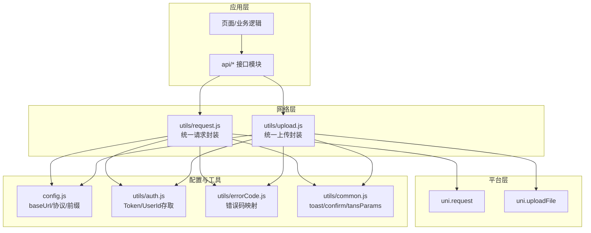
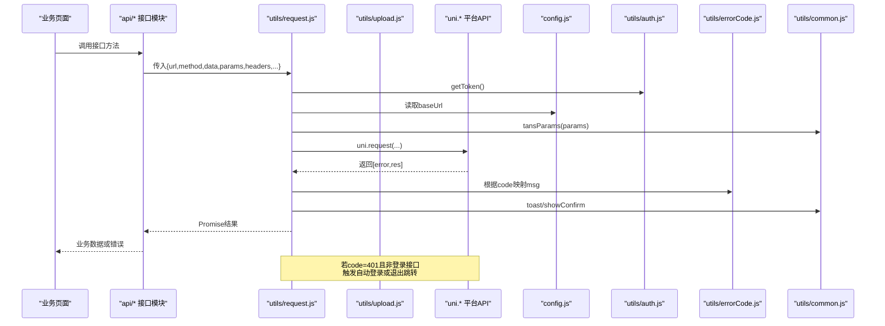
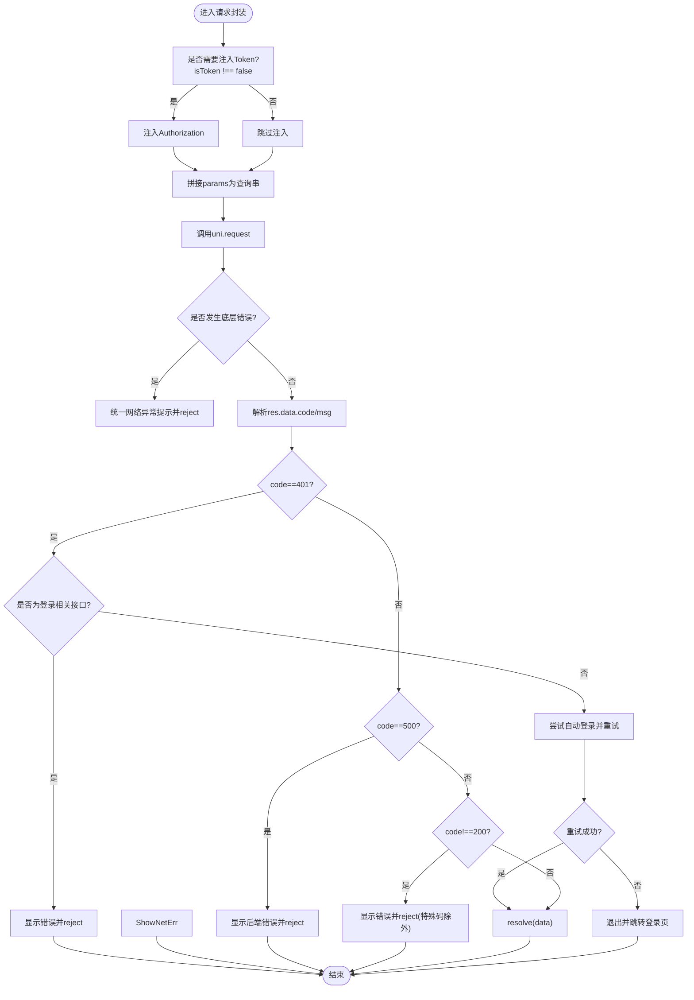
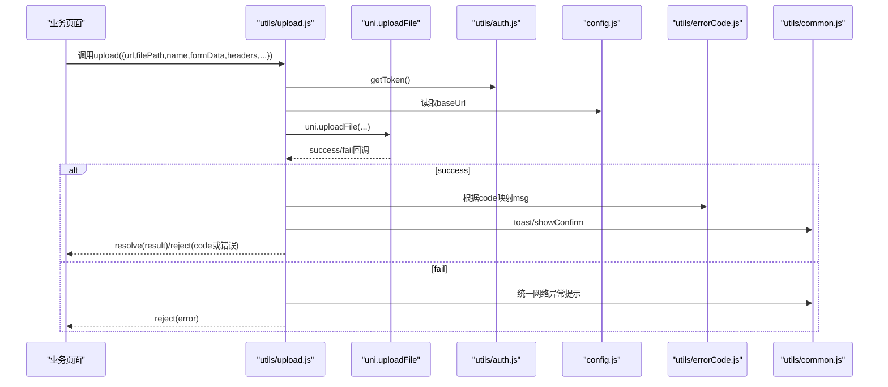
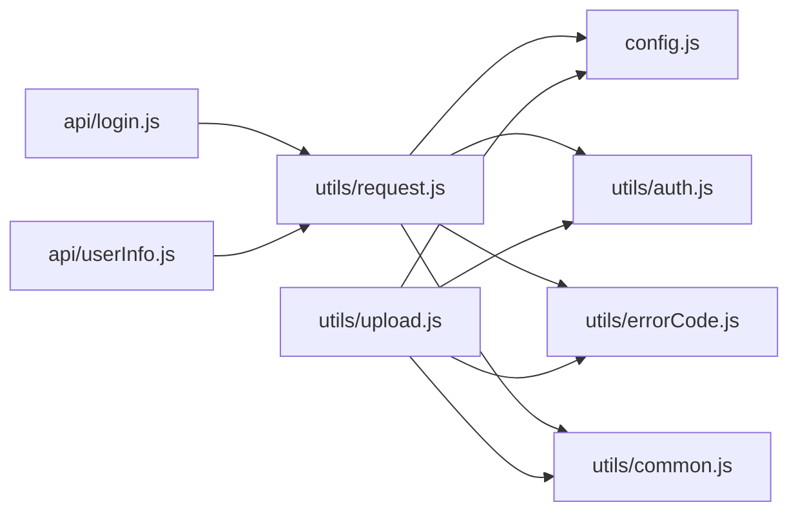

# 网络请求架构

<cite>
**本文引用的文件**   
- [utils/request.js](file://utils/request.js)
- [utils/upload.js](file://utils/upload.js)
- [utils/errorCode.js](file://utils/errorCode.js)
- [config.js](file://config.js)
- [utils/auth.js](file://utils/auth.js)
- [api/login.js](file://api/login.js)
- [api/userInfo.js](file://api/userInfo.js)
- [utils/common.js](file://utils/common.js)
</cite>

## 目录
1. [简介](#简介)
2. [项目结构](#项目结构)
3. [核心组件](#核心组件)
4. [架构总览](#架构总览)
5. [详细组件分析](#详细组件分析)
6. [依赖关系分析](#依赖关系分析)
7. [性能与并发优化](#性能与并发优化)
8. [错误处理机制](#错误处理机制)
9. [API接口组织规范](#api接口组织规范)
10. [调试技巧](#调试技巧)
11. [结论](#结论)

## 简介
本文件面向 RuoYi-App 的网络层，系统化梳理基于 uni.request 的统一 HTTP 请求封装、上传封装、拦截器式处理、统一错误码、Token 自动注入、超时控制、登录态失效处理等能力；并给出 API 接口组织规范、流程图示与性能优化建议。文档内容严格来源于仓库源码实现，便于读者快速理解与扩展。

## 项目结构
网络相关代码主要分布在 utils 与 api 两个目录：
- utils/request.js：统一的 GET/POST/PUT/DELETE 请求封装，包含 Token 注入、参数拼接、超时、错误码映射、登录态失效处理等。
- utils/upload.js：统一的文件上传封装，包含 Token 注入、错误码映射与用户交互提示。
- utils/errorCode.js：统一业务错误码到用户可读消息的映射。
- config.js：全局后端地址、协议、前缀等配置，提供 baseUrl 计算属性。
- utils/auth.js：本地存储中的 Token 与 UserId 存取工具。
- api/*：按功能模块划分的接口定义文件，统一通过 request 调用。
- utils/common.js：通用 UI 提示与参数序列化等工具。

图表来源
- [utils/request.js:1-117](file://utils/request.js#L1-L117)
- [utils/upload.js:1-71](file://utils/upload.js#L1-L71)
- [config.js:1-38](file://config.js#L1-L38)
- [utils/auth.js:1-47](file://utils/auth.js#L1-L47)
- [utils/errorCode.js:1-7](file://utils/errorCode.js#L1-L7)
- [utils/common.js:1-121](file://utils/common.js#L1-L121)

章节来源
- [utils/request.js:1-117](file://utils/request.js#L1-L117)
- [utils/upload.js:1-71](file://utils/upload.js#L1-L71)
- [config.js:1-38](file://config.js#L1-L38)
- [utils/auth.js:1-47](file://utils/auth.js#L1-L47)
- [utils/errorCode.js:1-7](file://utils/errorCode.js#L1-L7)
- [utils/common.js:1-121](file://utils/common.js#L1-L121)

## 核心组件
- 统一请求封装（request）
  - 职责：组装请求头、注入 Token、拼接 URL 查询参数、设置超时、发起 uni.request、统一解析响应与错误、处理 401 登录态失效。
  - 关键特性：
    - Token 自动注入：默认在 header 中携带 Authorization，可通过 headers.isToken=false 关闭。
    - 参数拼接：支持 params 对象，内部使用 tansParams 序列化为查询串。
    - 超时控制：支持全局默认超时与单请求覆盖。
    - 错误处理：统一将后端 code 映射为友好提示，区分 401/500/其他非 200 分支。
    - 登录态失效：非登录接口返回 401 时触发自动登录或退出跳转；登录接口直接展示错误不触发自动登录。
- 统一上传封装（upload）
  - 职责：封装 uni.uploadFile，注入 Token、错误码映射、失败提示。
  - 关键特性：
    - Token 注入策略与 request 不同：仅在 headers.isToken===false 时注入（注意该判断条件与 request 相反）。
    - 错误处理：对 401/500/其他非 200 分支进行提示与拒绝。
- 错误码映射（errorCode）
  - 职责：将后端返回的业务码映射为用户可读消息，如认证失败、无权限、资源不存在、未知错误等。
- 全局配置（config）
  - 职责：集中管理协议、主机、端口、API 前缀，并提供 baseUrl 计算属性供网络层使用。
- 认证工具（auth）
  - 职责：从本地存储读取/写入 Token 与 UserId，提供 isLogin 判断。
- 通用工具（common）
  - 职责：toast 提示、showConfirm 弹窗、tansParams 参数序列化等。

章节来源
- [utils/request.js:1-117](file://utils/request.js#L1-L117)
- [utils/upload.js:1-71](file://utils/upload.js#L1-L71)
- [utils/errorCode.js:1-7](file://utils/errorCode.js#L1-L7)
- [config.js:1-38](file://config.js#L1-L38)
- [utils/auth.js:1-47](file://utils/auth.js#L1-L47)
- [utils/common.js:1-121](file://utils/common.js#L1-L121)

## 架构总览
下图展示了从业务模块到平台层的完整调用链路，以及配置与工具模块的参与点。

图表来源
- [utils/request.js:1-117](file://utils/request.js#L1-L117)
- [utils/upload.js:1-71](file://utils/upload.js#L1-L71)
- [config.js:1-38](file://config.js#L1-L38)
- [utils/auth.js:1-47](file://utils/auth.js#L1-L47)
- [utils/errorCode.js:1-7](file://utils/errorCode.js#L1-L7)
- [utils/common.js:1-121](file://utils/common.js#L1-L121)

## 详细组件分析

### 统一请求封装（request）
- 设计要点
  - Token 注入：当 headers.isToken !== false 且存在 Token 时，自动在请求头添加 Authorization。
  - 参数拼接：当传入 params 时，将其序列化为查询字符串并拼接到 url 末尾。
  - 超时控制：支持全局默认超时与单次请求覆盖。
  - 响应处理：
    - 优先取 res.data.code，若无则默认 200。
    - 根据 errorCode 映射获取 msg，再结合后端返回的 msg 决定最终提示。
    - 分支处理：
      - 401：若非登录相关接口，尝试微信自动登录并重试原请求；否则退出并跳转登录页。
      - 500：弹出后端具体错误消息并拒绝。
      - 其他非 200：除特定业务码外，弹出错误消息并拒绝。
  - 异常捕获：对 Network Error、timeout、HTTP 状态码异常进行友好提示。
- 适用场景
  - 所有需要鉴权的业务接口；无需鉴权接口通过 headers.isToken=false 显式关闭。

图表来源
- [utils/request.js:1-117](file://utils/request.js#L1-L117)
- [utils/common.js:1-121](file://utils/common.js#L1-L121)
- [utils/errorCode.js:1-7](file://utils/errorCode.js#L1-L7)

章节来源
- [utils/request.js:1-117](file://utils/request.js#L1-L117)
- [utils/common.js:1-121](file://utils/common.js#L1-L121)
- [utils/errorCode.js:1-7](file://utils/errorCode.js#L1-L7)

### 统一上传封装（upload）
- 设计要点
  - Token 注入：仅在 headers.isToken===false 时注入 Authorization（注意与 request 的判断条件相反）。
  - 参数拼接：同 request，支持 params 拼接。
  - 调用 uni.uploadFile，success/fail 回调中统一解析与提示。
  - 错误处理：对 401/500/其他非 200 分支分别处理，必要时弹出确认框引导重新登录。
- 注意事项
  - 当前未实现进度回调与断点续传；如需增强可在 upload 基础上扩展。

图表来源
- [utils/upload.js:1-71](file://utils/upload.js#L1-L71)
- [utils/auth.js:1-47](file://utils/auth.js#L1-L47)
- [config.js:1-38](file://config.js#L1-L38)
- [utils/errorCode.js:1-7](file://utils/errorCode.js#L1-L7)
- [utils/common.js:1-121](file://utils/common.js#L1-L121)

章节来源
- [utils/upload.js:1-71](file://utils/upload.js#L1-L71)
- [utils/common.js:1-121](file://utils/common.js#L1-L121)
- [utils/errorCode.js:1-7](file://utils/errorCode.js#L1-L7)

### 错误码与提示
- 统一错误码映射位于 errorCode.js，用于将后端返回的 code 转换为友好的中文提示。
- 在 request 与 upload 中，均会依据 code 选择不同处理分支，并通过 common.toast 或 showConfirm 进行用户提示。

章节来源
- [utils/errorCode.js:1-7](file://utils/errorCode.js#L1-L7)
- [utils/request.js:1-117](file://utils/request.js#L1-L117)
- [utils/upload.js:1-71](file://utils/upload.js#L1-L71)
- [utils/common.js:1-121](file://utils/common.js#L1-L121)

### 配置与基础URL
- config.js 提供协议、主机、端口、API 前缀，并通过 getter 计算 baseUrl，供 request 与 upload 直接使用。
- 部署 HTTPS 时需确保 protocol 与 host 正确配置。

章节来源
- [config.js:1-38](file://config.js#L1-L38)

### 认证与Token注入
- auth.js 提供 getToken/setToken/removeToken/isLogin 等方法，基于本地存储读写 Token 与 UserId。
- request 默认注入 Authorization；login 等无需鉴权的接口通过 headers.isToken=false 关闭注入。

章节来源
- [utils/auth.js:1-47](file://utils/auth.js#L1-L47)
- [utils/request.js:1-117](file://utils/request.js#L1-L117)
- [api/login.js:1-168](file://api/login.js#L1-L168)

## 依赖关系分析
- 模块耦合
  - request 依赖 config、auth、errorCode、common。
  - upload 依赖 config、auth、errorCode、common。
  - api/* 仅依赖 request，保持低耦合。
- 外部依赖
  - 平台层 uni.request 与 uni.uploadFile。
- 潜在风险
  - upload 的 Token 注入条件与 request 不一致，可能导致某些接口误判是否需要 Token。建议在后续版本统一注入策略。

图表来源
- [utils/request.js:1-117](file://utils/request.js#L1-L117)
- [utils/upload.js:1-71](file://utils/upload.js#L1-L71)
- [config.js:1-38](file://config.js#L1-L38)
- [utils/auth.js:1-47](file://utils/auth.js#L1-L47)
- [utils/errorCode.js:1-7](file://utils/errorCode.js#L1-L7)
- [utils/common.js:1-121](file://utils/common.js#L1-L121)
- [api/login.js:1-168](file://api/login.js#L1-L168)
- [api/userInfo.js:1-61](file://api/userInfo.js#L1-L61)

章节来源
- [utils/request.js:1-117](file://utils/request.js#L1-L117)
- [utils/upload.js:1-71](file://utils/upload.js#L1-L71)
- [api/login.js:1-168](file://api/login.js#L1-L168)
- [api/userInfo.js:1-61](file://api/userInfo.js#L1-L61)

## 性能与并发优化
- 当前实现说明
  - 未发现请求去重、重试策略、并发限制的实现。
  - 超时控制已支持，可按需为单个请求设置 timeout。
- 建议与最佳实践
  - 请求去重：可引入基于 URL+参数的唯一键缓存，避免短时间内重复请求。
  - 重试策略：针对网络抖动或瞬时错误，可增加指数退避重试，但需谨慎处理幂等性。
  - 并发控制：对批量操作可引入队列或信号量限制并发数，避免阻塞主线程或触发平台限流。
  - 图片/文件上传：如需进度反馈，可接入 uni.uploadFile 的 onProgressUpdate；断点续传需服务端配合分片与校验。
  - 缓存策略：对静态或低频变更的数据，可结合本地存储或内存缓存减少请求次数。

[本节为通用性能建议，不直接分析具体文件]

## 错误处理机制
- 统一错误码
  - 401：认证失败，无法访问系统资源。
  - 403：当前操作没有权限。
  - 404：访问资源不存在。
  - default：系统未知错误，请反馈给管理员。
- 网络异常
  - Network Error：统一提示“后端接口连接异常”。
  - timeout：统一提示“系统接口请求超时”。
  - HTTP 状态码异常：统一提示“系统接口xxx异常”。
- 业务错误
  - 500：弹出后端具体错误消息并拒绝。
  - 其他非 200：弹出错误消息并拒绝（部分业务码如 20001 静默拒绝）。
- 登录态失效
  - 非登录接口返回 401：尝试自动登录并重试；失败则退出并跳转登录页。
  - 登录接口返回 401：直接展示错误信息，不触发自动登录。

章节来源
- [utils/errorCode.js:1-7](file://utils/errorCode.js#L1-L7)
- [utils/request.js:1-117](file://utils/request.js#L1-L117)
- [utils/upload.js:1-71](file://utils/upload.js#L1-L71)
- [utils/common.js:1-121](file://utils/common.js#L1-L121)

## API接口组织规范
- 文件结构
  - 按功能模块划分接口文件，例如：
    - api/login.js：登录、注册、验证码、微信绑定等。
    - api/userInfo.js：用户信息、头像上传、密码修改等。
    - api/stumanage/*：学生管理相关接口。
    - api/system/*：系统级接口。
- 请求参数规范
  - 路径参数：直接拼接至 url。
  - 查询参数：通过 params 对象传递，由 tansParams 序列化为查询串。
  - 请求体：通过 data 传递 JSON 对象。
  - 头部：通过 header 传递自定义字段；无需鉴权时设置 headers.isToken=false。
- 响应数据格式
  - 统一返回结构包含 code 与 msg，业务数据通常在 data 字段中。
  - 成功：code=200。
  - 失败：code!=200，message 由 errorCode 映射或后端 msg 提供。
- 示例参考
  - 登录接口：api/login.js 中的 login、getCodeImg、wxLogin 等。
  - 用户信息接口：api/userInfo.js 中的 getUserProfile、updateUserProfile 等。

章节来源
- [api/login.js:1-168](file://api/login.js#L1-L168)
- [api/userInfo.js:1-61](file://api/userInfo.js#L1-L61)
- [utils/common.js:1-121](file://utils/common.js#L1-L121)

## 调试技巧
- 打印请求上下文
  - 在 request 与 upload 中增加日志输出，记录 method、url、data、header、timeout 等。
- 观察错误分支
  - 关注 401/500/其他非 200 分支，验证 errorCode 映射是否正确。
- 检查 Token 注入
  - 确认 headers.isToken 的设置是否符合预期，避免误注入或缺失。
- 超时与网络异常
  - 调整 timeout 值以复现超时场景，验证提示信息是否友好。
- 上传进度与失败
  - 如需进度反馈，可在 upload 中接入 onProgressUpdate；失败时记录错误详情以便定位。

[本节为通用调试建议，不直接分析具体文件]

## 结论
RuoYi-App 的网络层通过 utils/request.js 与 utils/upload.js 实现了统一的请求与上传封装，具备 Token 自动注入、参数拼接、超时控制、统一错误码映射与登录态失效处理等能力。API 接口按功能模块组织，调用方式清晰一致。当前未实现请求去重、重试策略与并发控制，可根据业务需求逐步增强。上传功能暂未提供进度监控与断点续传，可在现有基础上扩展。整体架构简洁实用，易于维护与扩展。