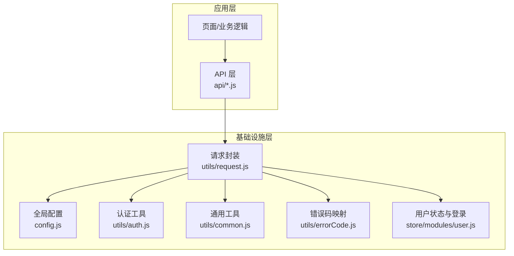
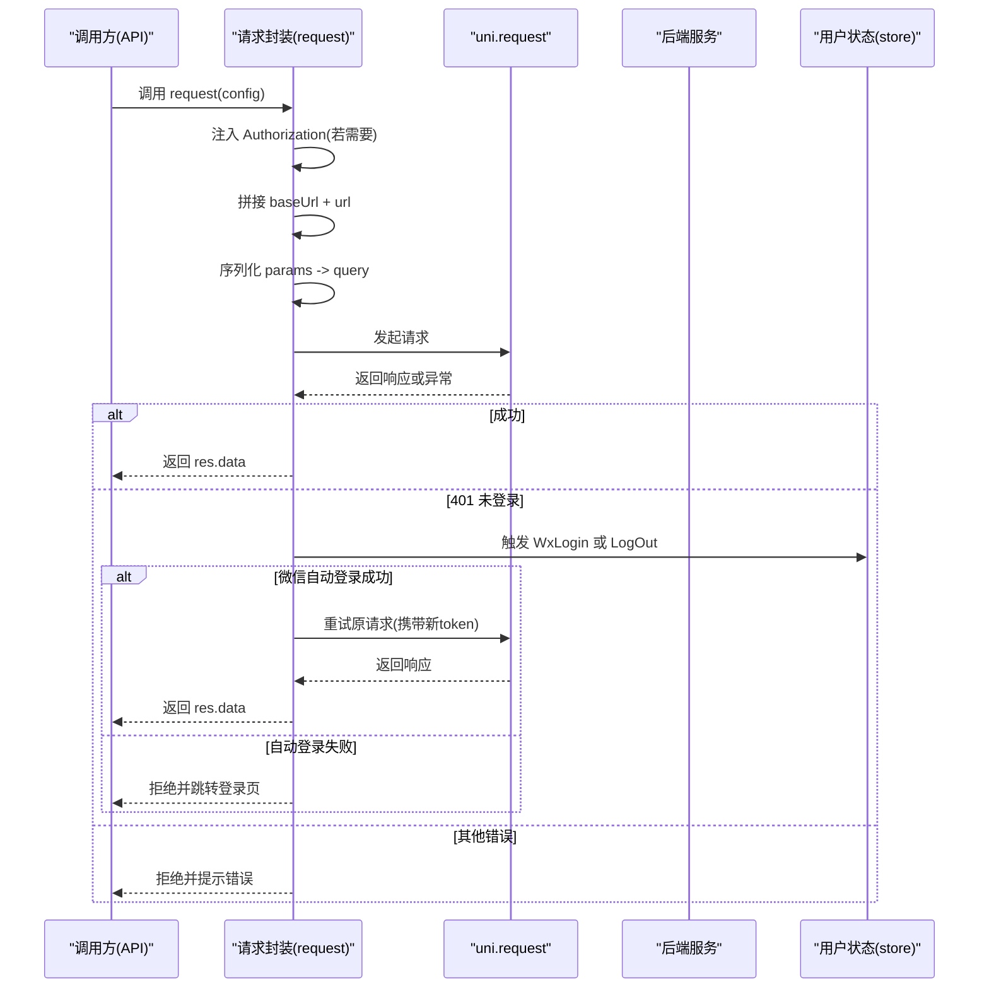
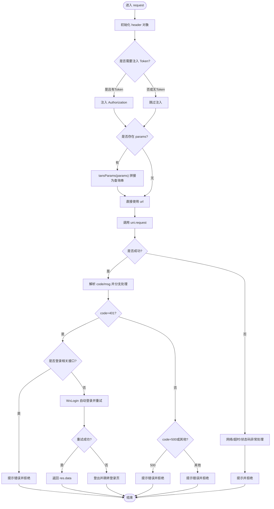
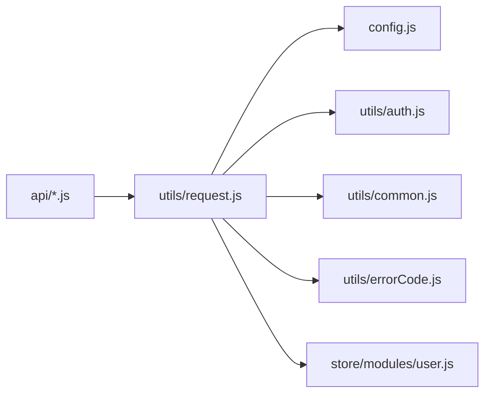

# 请求封装设计

<cite>
**本文引用的文件**   
- [utils/request.js](file://utils/request.js)
- [config.js](file://config.js)
- [utils/auth.js](file://utils/auth.js)
- [utils/common.js](file://utils/common.js)
- [utils/errorCode.js](file://utils/errorCode.js)
- [store/modules/user.js](file://store/modules/user.js)
- [api/login.js](file://api/login.js)
- [api/stumanage/leave.js](file://api/stumanage/leave.js)
</cite>

## 目录
1. [引言](#引言)
2. [项目结构](#项目结构)
3. [核心组件](#核心组件)
4. [架构总览](#架构总览)
5. [详细组件分析](#详细组件分析)
6. [依赖关系分析](#依赖关系分析)
7. [性能考虑](#性能考虑)
8. [故障排查指南](#故障排查指南)
9. [结论](#结论)
10. [附录：使用示例与最佳实践](#附录使用示例与最佳实践)

## 引言
本设计文档围绕 RuoYi-App 中基于 uni.request 的统一 HTTP 请求封装展开，系统性说明以下要点：
- 请求配置对象的结构定义、默认参数设置与配置合并策略
- Token 自动注入机制（Authorization 头处理与 isToken 控制）
- GET 请求参数映射机制（params 对象的 URL 编码与特殊字符转义）
- 跨域请求处理、请求头自定义与基础 URL 拼接规则
- 请求拦截器的扩展点设计与中间件模式实现思路
- 完整的使用模式与代码片段路径
- 性能优化建议（请求缓存与去重机制）

## 项目结构
RuoYi-App 的请求相关能力集中在 utils 层与 store 模块，API 层通过统一 request 发起网络请求。关键文件如下：
- 请求封装：utils/request.js
- 全局配置：config.js
- 认证工具：utils/auth.js
- 通用工具：utils/common.js（含 tansParams）
- 错误码映射：utils/errorCode.js
- 用户状态与登录流程：store/modules/user.js
- API 调用示例：api/login.js、api/stumanage/leave.js

图表来源
- [utils/request.js:1-117](file://utils/request.js#L1-L117)
- [config.js:1-38](file://config.js#L1-L38)
- [utils/auth.js:1-47](file://utils/auth.js#L1-L47)
- [utils/common.js:1-121](file://utils/common.js#L1-L121)
- [utils/errorCode.js:1-7](file://utils/errorCode.js#L1-L7)
- [store/modules/user.js:1-283](file://store/modules/user.js#L1-L283)

章节来源
- [utils/request.js:1-117](file://utils/request.js#L1-L117)
- [config.js:1-38](file://config.js#L1-L38)
- [utils/auth.js:1-47](file://utils/auth.js#L1-L47)
- [utils/common.js:1-121](file://utils/common.js#L1-L121)
- [utils/errorCode.js:1-7](file://utils/errorCode.js#L1-L7)
- [store/modules/user.js:1-283](file://store/modules/user.js#L1-L283)

## 核心组件
- 请求封装器（request）
  - 职责：统一封装 uni.request，完成鉴权注入、URL 拼接、GET 参数序列化、错误处理、会话失效处理等。
  - 入口：utils/request.js
- 全局配置（config）
  - 职责：集中管理协议、主机、端口、API 前缀与 baseUrl 计算。
  - 入口：config.js
- 认证工具（auth）
  - 职责：提供 Token 的读取、写入、删除与登录态判断。
  - 入口：utils/auth.js
- 通用工具（common）
  - 职责：消息提示、确认弹窗、参数序列化（tansParams）。
  - 入口：utils/common.js
- 错误码映射（errorCode）
  - 职责：将后端返回 code 映射为可读消息。
  - 入口：utils/errorCode.js
- 用户状态与登录（store/modules/user.js）
  - 职责：维护 token、用户信息、权限；提供微信自动登录、退出等 action。
  - 入口：store/modules/user.js

章节来源
- [utils/request.js:1-117](file://utils/request.js#L1-L117)
- [config.js:1-38](file://config.js#L1-L38)
- [utils/auth.js:1-47](file://utils/auth.js#L1-L47)
- [utils/common.js:1-121](file://utils/common.js#L1-L121)
- [utils/errorCode.js:1-7](file://utils/errorCode.js#L1-L7)
- [store/modules/user.js:1-283](file://store/modules/user.js#L1-L283)

## 架构总览
下图展示了从 API 层到请求封装再到 uni.request 的调用链路，以及 Token 注入、参数序列化、错误处理与登录态恢复的关键节点。

图表来源
- [utils/request.js:10-114](file://utils/request.js#L10-L114)
- [store/modules/user.js:113-132](file://store/modules/user.js#L113-L132)

## 详细组件分析

### 请求封装器（utils/request.js）
- 配置对象结构与默认值
  - method：默认 'get'
  - timeout：默认 10000ms
  - url：相对路径，最终由 config.baseUrl + url 拼接
  - data：POST/PUT 请求体
  - header：自定义请求头，支持 headers.isToken 控制是否注入 Authorization
  - params：GET 查询参数对象，将被序列化为 URL 查询串
  - baseUrl：可选覆盖全局 baseUrl
- 默认参数与合并策略
  - 若传入 config.header 不存在则初始化为空对象
  - 若传入 config.method 不存在则默认为 'get'
  - 若传入 config.timeout 不存在则使用默认超时
  - 最终 URL 采用 config.baseUrl 优先，否则使用全局 baseUrl + config.url
- Token 自动注入机制
  - 当 config.headers?.isToken !== false 且本地存在 Token 时，自动在 header 中注入 Authorization: Bearer <token>
  - isToken=false 可显式关闭自动注入（如登录接口）
- GET 参数映射机制
  - 若传入 params，则通过 tansParams 进行 URL 编码并拼接到 url 后
  - 对 value 为对象的情况，会生成形如 name[key]=value 的键名
- 错误处理与会话失效
  - 网络异常、超时、HTTP 状态码异常均转换为友好提示并 reject
  - 401 时区分登录相关接口与非登录接口：
    - 登录相关接口直接提示错误，不触发自动登录
    - 非登录接口在微信小程序环境下尝试 WxLogin 自动登录并重试一次；其他环境执行 LogOut 并跳转登录页
- 返回值约定
  - 成功：resolve(res.data)
  - 失败：reject 具体错误消息或错误码

图表来源
- [utils/request.js:10-114](file://utils/request.js#L10-L114)
- [utils/common.js:75-95](file://utils/common.js#L75-L95)
- [store/modules/user.js:113-132](file://store/modules/user.js#L113-L132)

章节来源
- [utils/request.js:10-114](file://utils/request.js#L10-L114)
- [utils/common.js:75-95](file://utils/common.js#L75-L95)
- [store/modules/user.js:113-132](file://store/modules/user.js#L113-L132)

### 全局配置（config.js）
- 字段说明
  - protocol：协议（http/https）
  - host：后端主机（IP 或域名）
  - port：端口号（HTTPS 默认 443）
  - apiPrefix：Nginx 代理前缀
  - baseUrl：动态计算，值为 ${protocol}://${host}${apiPrefix}
- 使用方式
  - 请求封装内部通过 config.baseUrl 作为基础地址
  - 可在单次请求中通过 config.baseUrl 覆盖全局 baseUrl

章节来源
- [config.js:1-38](file://config.js#L1-L38)

### 认证工具（utils/auth.js）
- 功能
  - getToken/setToken/removeToken：读写本地存储中的 App-Token
  - getUserId/setUserId/removeUserId：读写本地存储中的 App-UserId
  - isLogin：判断是否已登录
- 与请求封装的关系
  - 请求封装在注入 Authorization 前通过 getToken 获取当前令牌

章节来源
- [utils/auth.js:1-47](file://utils/auth.js#L1-L47)

### 通用工具（utils/common.js）
- tansParams 参数序列化
  - 遍历 params 的 key/value
  - 对 key 和 value 分别进行 encodeURIComponent
  - 若 value 为对象，则生成 name[key]=value 形式的键名
  - 返回以 & 分隔的查询串片段
- 其他工具
  - toast：统一提示
  - showConfirm：统一确认弹窗

章节来源
- [utils/common.js:75-95](file://utils/common.js#L75-L95)
- [utils/common.js:5-10](file://utils/common.js#L5-L10)
- [utils/common.js:57-69](file://utils/common.js#L57-L69)

### 错误码映射（utils/errorCode.js）
- 作用
  - 将后端返回的 code 映射为中文提示信息
  - 包含 401、403、404 及 default 兜底
- 使用位置
  - 请求封装根据 code 选择 msg 展示

章节来源
- [utils/errorCode.js:1-7](file://utils/errorCode.js#L1-L7)

### 用户状态与登录（store/modules/user.js）
- 关键 Action
  - WxLogin：微信小程序自动登录，成功后更新 token 并返回
  - LogOut：清除本地状态并清理存储
- 与请求封装的协作
  - 401 场景下，非登录接口触发 WxLogin 自动登录并重试；失败则执行 LogOut 并跳转登录页

章节来源
- [store/modules/user.js:113-132](file://store/modules/user.js#L113-L132)
- [store/modules/user.js:214-228](file://store/modules/user.js#L214-L228)

### API 层使用示例
- 无需 Token 的接口（如微信登录）
  - 通过 headers: { isToken: false } 关闭自动注入
  - 参考：[api/login.js:77-86](file://api/login.js#L77-L86)
- 常规 GET 接口（带 params）
  - 通过 params 传递查询参数，请求封装会自动拼接为 URL 查询串
  - 参考：[api/stumanage/leave.js:9-15](file://api/stumanage/leave.js#L9-L15)

章节来源
- [api/login.js:77-86](file://api/login.js#L77-L86)
- [api/stumanage/leave.js:9-15](file://api/stumanage/leave.js#L9-L15)

## 依赖关系分析
- 低耦合高内聚
  - request 仅依赖配置、认证、通用工具与错误码，职责单一
  - API 层只关心业务语义，屏蔽底层网络细节
- 外部依赖
  - uni.request：平台原生网络请求
  - Vuex store：用户状态与登录流程
- 潜在循环依赖
  - 当前未发现循环引用；request 依赖 store 的 action，但 store 不反向依赖 request

图表来源
- [utils/request.js:1-117](file://utils/request.js#L1-L117)
- [config.js:1-38](file://config.js#L1-L38)
- [utils/auth.js:1-47](file://utils/auth.js#L1-L47)
- [utils/common.js:1-121](file://utils/common.js#L1-L121)
- [utils/errorCode.js:1-7](file://utils/errorCode.js#L1-L7)
- [store/modules/user.js:1-283](file://store/modules/user.js#L1-L283)

## 性能考虑
- 请求缓存
  - 针对幂等的 GET 请求，可在 request 外层增加缓存层（内存 Map），按 URL+params 哈希作为键，设置过期时间，命中则直接返回缓存数据
- 请求去重
  - 并发相同请求时，使用 Promise 队列或 In-flight 集合避免重复发送
- 超时与重试
  - 合理设置 timeout；对瞬时失败的幂等请求可引入指数退避重试
- 资源复用
  - 保持 baseUrl 与公共 header 集中配置，减少重复构建成本
- 注意
  - 当前实现未内置缓存与去重，可按需在上层封装或扩展 request 实现

[本节为通用性能建议，不涉及具体文件分析]

## 故障排查指南
- 常见问题定位
  - 401 未登录：检查是否误将 isToken 设为 true 导致携带无效 token；确认 WxLogin 流程是否成功
  - 网络异常/超时：检查 baseUrl 是否正确、网络连通性与超时阈值
  - 参数乱码：确认 params 是否包含复杂对象或特殊字符，确保通过 tansParams 序列化
- 日志与提示
  - 统一通过 toast 提示错误信息，便于快速定位
- 典型路径参考
  - 401 处理与自动登录：[utils/request.js:41-88](file://utils/request.js#L41-L88)
  - 网络异常处理：[utils/request.js:101-112](file://utils/request.js#L101-L112)
  - 参数序列化：[utils/common.js:75-95](file://utils/common.js#L75-L95)

章节来源
- [utils/request.js:41-88](file://utils/request.js#L41-L88)
- [utils/request.js:101-112](file://utils/request.js#L101-L112)
- [utils/common.js:75-95](file://utils/common.js#L75-L95)

## 结论
该请求封装以最小侵入的方式统一了鉴权注入、参数序列化、错误处理与会话恢复等横切关注点，使 API 层专注于业务语义。通过 isToken 开关与 baseUrl 覆盖，兼顾灵活性与一致性。后续可在上层按需引入缓存与去重机制，进一步提升性能与用户体验。

[本节为总结性内容，不涉及具体文件分析]

## 附录：使用示例与最佳实践

- 基本用法（GET 带 params）
  - 参考：[api/stumanage/leave.js:9-15](file://api/stumanage/leave.js#L9-L15)
- 无需 Token 的接口
  - 参考：[api/login.js:77-86](file://api/login.js#L77-L86)
- 自定义请求头
  - 通过 config.header 传入额外头部，例如 Content-Type 或追踪 ID
- 覆盖基础 URL
  - 在单次请求中传入 config.baseUrl 覆盖全局 baseUrl
- 最佳实践
  - 所有业务 API 统一通过 request 发起
  - 明确标注 isToken=false 的公开接口
  - 对敏感操作添加必要的业务校验与幂等设计
  - 结合缓存与去重提升性能

[本节为使用指导，不涉及具体文件分析]