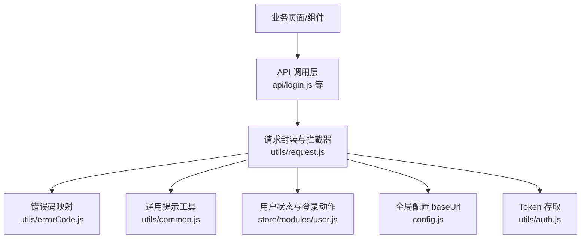
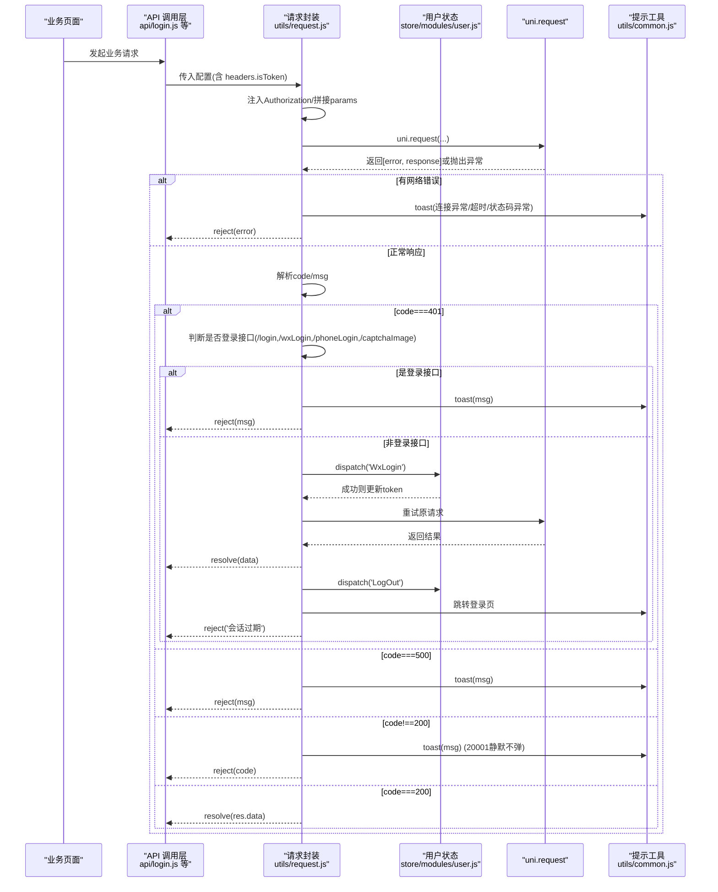
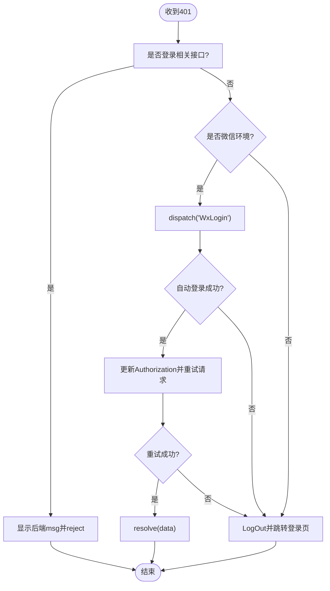
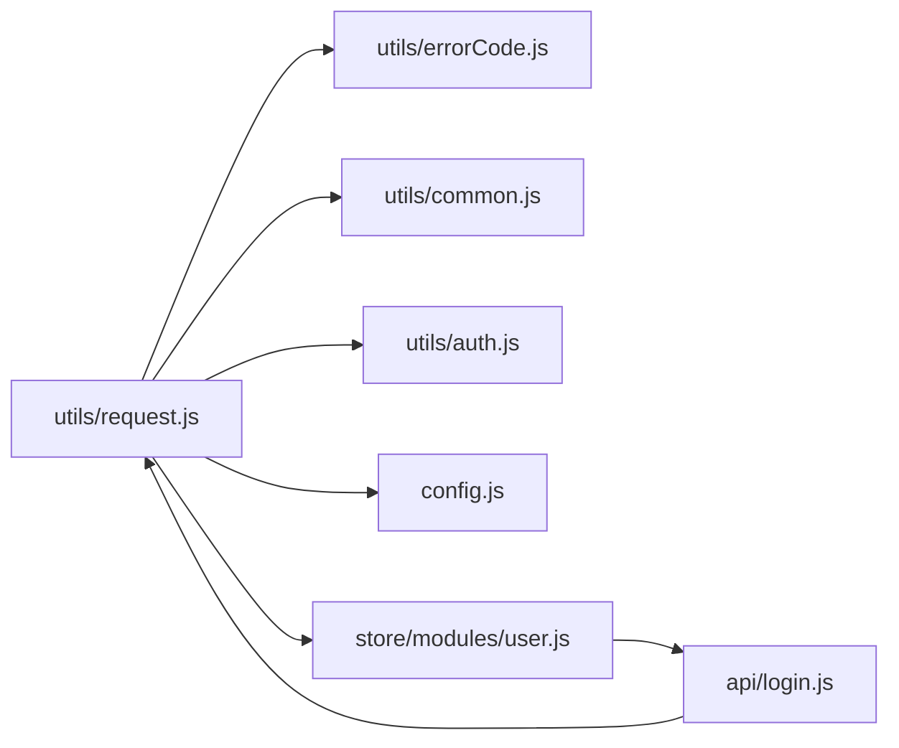

# 错误处理机制

<cite>
**本文引用的文件**   
- [utils/request.js](file://utils/request.js)
- [utils/errorCode.js](file://utils/errorCode.js)
- [utils/common.js](file://utils/common.js)
- [store/modules/user.js](file://store/modules/user.js)
- [api/login.js](file://api/login.js)
- [config.js](file://config.js)
- [utils/auth.js](file://utils/auth.js)
</cite>

## 目录
1. [简介](#简介)
2. [项目结构](#项目结构)
3. [核心组件](#核心组件)
4. [架构总览](#架构总览)
5. [详细组件分析](#详细组件分析)
6. [依赖关系分析](#依赖关系分析)
7. [性能与可靠性考虑](#性能与可靠性考虑)
8. [故障排查指南](#故障排查指南)
9. [结论](#结论)
10. [附录：常见错误场景与最佳实践](#附录常见错误场景与最佳实践)

## 简介
本文件面向 RuoYi-App 的前端错误处理机制，聚焦统一错误码体系、响应拦截器的错误处理流程、401 未授权的特殊处理（登录接口识别、微信环境自动登录与非微信环境的登出跳转）、网络异常分类处理、错误日志记录与调试信息收集方案，以及常见错误场景的处理示例与最佳实践。目标是帮助开发者快速理解并扩展统一的错误处理策略，提升用户体验与可维护性。

## 项目结构
错误处理相关代码主要分布在以下模块：
- 请求封装与拦截器：utils/request.js
- 错误码映射：utils/errorCode.js
- 通用提示工具：utils/common.js
- 用户状态与登录动作：store/modules/user.js
- 登录相关 API：api/login.js
- 全局配置（baseUrl）：config.js
- Token 存取：utils/auth.js

图表来源
- [utils/request.js:1-117](file://utils/request.js#L1-L117)
- [utils/errorCode.js:1-7](file://utils/errorCode.js#L1-L7)
- [utils/common.js:1-121](file://utils/common.js#L1-L121)
- [store/modules/user.js:1-283](file://store/modules/user.js#L1-L283)
- [api/login.js:1-168](file://api/login.js#L1-L168)
- [config.js:1-38](file://config.js#L1-L38)
- [utils/auth.js:1-47](file://utils/auth.js#L1-L47)

章节来源
- [utils/request.js:1-117](file://utils/request.js#L1-L117)
- [utils/errorCode.js:1-7](file://utils/errorCode.js#L1-L7)
- [utils/common.js:1-121](file://utils/common.js#L1-L121)
- [store/modules/user.js:1-283](file://store/modules/user.js#L1-L283)
- [api/login.js:1-168](file://api/login.js#L1-L168)
- [config.js:1-38](file://config.js#L1-L38)
- [utils/auth.js:1-47](file://utils/auth.js#L1-L47)

## 核心组件
- 统一错误码定义体系
  - 位置：utils/errorCode.js
  - 作用：集中管理 HTTP 状态码对应的用户友好消息，并提供默认兜底文案。
  - 覆盖范围：认证失败、权限不足、资源不存在、未知错误等。
- 请求封装与响应拦截器
  - 位置：utils/request.js
  - 职责：
    - 注入 Authorization 头（基于 Token）。
    - GET 参数序列化拼接。
    - 统一解析后端返回的 code/msg，进行业务状态判断。
    - 401 特殊处理：区分登录接口与受保护接口；在微信环境下尝试自动登录并重试；非微信环境直接登出跳转。
    - 网络异常捕获与分类：连接异常、超时、HTTP 状态码异常。
    - 统一提示：通过 utils/common.js 的 toast 展示用户可读消息。
- 通用提示工具
  - 位置：utils/common.js
  - 提供 toast、showConfirm、tansParams 等基础能力。
- 用户状态与登录动作
  - 位置：store/modules/user.js
  - 提供 WxLogin、LogOut 等动作，供拦截器在 401 时调用。
- 登录相关 API
  - 位置：api/login.js
  - 所有登录类接口均设置 isToken: false，避免循环触发 401 自动登录。
- 全局配置
  - 位置：config.js
  - 提供 baseUrl 计算逻辑，request 中用于拼接完整 URL。
- Token 存取
  - 位置：utils/auth.js
  - 提供 getToken/setToken/removeToken/isLogin 等能力。

章节来源
- [utils/errorCode.js:1-7](file://utils/errorCode.js#L1-L7)
- [utils/request.js:1-117](file://utils/request.js#L1-L117)
- [utils/common.js:1-121](file://utils/common.js#L1-L121)
- [store/modules/user.js:1-283](file://store/modules/user.js#L1-L283)
- [api/login.js:1-168](file://api/login.js#L1-L168)
- [config.js:1-38](file://config.js#L1-L38)
- [utils/auth.js:1-47](file://utils/auth.js#L1-L47)

## 架构总览
下图展示了从业务调用到错误处理的端到端流程，包括 401 分支与网络异常分支。

图表来源
- [utils/request.js:1-117](file://utils/request.js#L1-L117)
- [store/modules/user.js:114-132](file://store/modules/user.js#L114-L132)
- [utils/common.js:5-10](file://utils/common.js#L5-L10)
- [api/login.js:1-168](file://api/login.js#L1-L168)

## 详细组件分析

### 统一错误码定义体系
- 设计目标
  - 将 HTTP 状态码与用户可读消息解耦，便于统一管理与本地化扩展。
  - 为业务状态码（如 20001）预留扩展空间，支持“静默拒绝”等策略。
- 当前覆盖
  - 401：认证失败
  - 403：无权限
  - 404：资源不存在
  - default：未知错误兜底
- 使用方式
  - 在请求拦截器中根据后端返回的 code 查找对应文案，若未命中则回退到 res.data.msg 或默认文案。

章节来源
- [utils/errorCode.js:1-7](file://utils/errorCode.js#L1-L7)
- [utils/request.js:39-41](file://utils/request.js#L39-L41)

### 响应拦截器中的错误处理流程
- 入口与前置处理
  - 注入 Authorization 头（当存在 token 且 headers.isToken !== false）。
  - GET 参数序列化拼接。
- 成功响应处理
  - 解析 code/msg，按如下分支处理：
    - 401：见下一节“401 未授权特殊处理”。
    - 500：toast 后端 msg，reject 具体消息。
    - 其他非 200：toast 后端 msg（20001 静默不弹），reject code。
    - 200：resolve 数据。
- 网络异常处理
  - catch 分支对 message 进行分类：
    - Network Error：后端接口连接异常
    - 包含 timeout：系统接口请求超时
    - 包含 Request failed with status code：提取三位状态码并提示
  - 统一 toast 后 reject。

章节来源
- [utils/request.js:10-23](file://utils/request.js#L10-L23)
- [utils/request.js:32-100](file://utils/request.js#L32-L100)
- [utils/request.js:101-112](file://utils/request.js#L101-L112)
- [utils/common.js:5-10](file://utils/common.js#L5-L10)

### 401 未授权处理的特殊逻辑
- 登录接口识别
  - 规则：当 config.url 包含 /login、/phoneLogin、/wxLogin、/captchaImage 之一时，视为登录相关接口。
  - 行为：直接 toast 后端 msg 并 reject，不再触发自动登录，避免死循环。
- 微信环境自动登录
  - 条件：编译期宏 MP-WEIXIN。
  - 流程：
    - 调用 store.dispatch('WxLogin') 获取新 token。
    - 成功后更新 Authorization 头并重试原请求。
    - 若重试成功，resolve 数据；否则 reject 重试失败。
    - 若自动登录失败，执行 LogOut 并跳转登录页。
- 非微信环境登出跳转
  - 条件：非 MP-WEIXIN。
  - 流程：
    - 调用 store.dispatch('LogOut') 清理状态。
    - 跳转登录页。
    - reject 会话过期提示。

图表来源
- [utils/request.js:41-88](file://utils/request.js#L41-L88)
- [store/modules/user.js:114-132](file://store/modules/user.js#L114-L132)
- [store/modules/user.js:215-228](file://store/modules/user.js#L215-L228)

章节来源
- [utils/request.js:41-88](file://utils/request.js#L41-L88)
- [store/modules/user.js:114-132](file://store/modules/user.js#L114-L132)
- [store/modules/user.js:215-228](file://store/modules/user.js#L215-L228)

### 网络异常处理
- 分类与提示
  - 连接异常：Network Error -> “后端接口连接异常”
  - 超时：message 包含 timeout -> “系统接口请求超时”
  - 状态码异常：message 包含 Request failed with status code -> 提取最后三位状态码并提示
- 统一交互
  - 通过 toast 展示用户可读消息，并在 catch 分支 reject 原始 error，以便上层按需处理。

章节来源
- [utils/request.js:101-112](file://utils/request.js#L101-L112)
- [utils/common.js:5-10](file://utils/common.js#L5-L10)

### 错误日志记录机制与调试信息收集方案
- 现状说明
  - 当前请求封装未内置持久化日志记录。建议在关键路径增加结构化日志输出，便于问题定位。
- 建议方案
  - 在 request 的 then/catch 分支追加日志记录：
    - 记录请求方法、URL、入参、时间戳、平台信息、设备信息。
    - 记录响应状态码、业务 code、后端 msg、耗时。
    - 记录异常类型与堆栈（注意脱敏敏感字段）。
  - 日志存储：
    - 开发环境：console.log + 内存队列。
    - 生产环境：可选本地缓存（限制条数与大小）+ 定期上报。
  - 上报时机：
    - 应用启动、页面切换、退出前、网络恢复后。
  - 隐私合规：
    - 过滤 Token、密码、手机号等敏感信息。
- 参考接入点
  - 请求开始与结束：utils/request.js 的 Promise 包装处。
  - 401 分支：自动登录与重试前后。
  - 网络异常分支：catch 内。

章节来源
- [utils/request.js:24-113](file://utils/request.js#L24-L113)

### 登录接口与 isToken 控制
- 目的
  - 防止登录相关接口携带旧 token 导致 401 死循环。
- 实现
  - api/login.js 中登录类接口显式设置 headers.isToken: false。
  - request 仅在 isToken !== false 时注入 Authorization。

章节来源
- [api/login.js:4-18](file://api/login.js#L4-L18)
- [api/login.js:50-58](file://api/login.js#L50-L58)
- [api/login.js:77-86](file://api/login.js#L77-L86)
- [api/login.js:109-121](file://api/login.js#L109-L121)
- [utils/request.js:11-17](file://utils/request.js#L11-L17)

## 依赖关系分析
- 耦合关系
  - request 依赖 errorCode、common、auth、config、store。
  - user store 依赖 login API、auth、storage、validate。
  - login API 依赖 request。
- 潜在风险
  - 401 分支中重试逻辑直接复用 uni.request，需确保 header 与 baseURL 一致。
  - 登录接口识别基于字符串匹配，新增登录接口需同步维护白名单。

图表来源
- [utils/request.js:1-117](file://utils/request.js#L1-L117)
- [utils/errorCode.js:1-7](file://utils/errorCode.js#L1-L7)
- [utils/common.js:1-121](file://utils/common.js#L1-L121)
- [utils/auth.js:1-47](file://utils/auth.js#L1-L47)
- [config.js:1-38](file://config.js#L1-L38)
- [store/modules/user.js:1-283](file://store/modules/user.js#L1-L283)
- [api/login.js:1-168](file://api/login.js#L1-L168)

章节来源
- [utils/request.js:1-117](file://utils/request.js#L1-L117)
- [store/modules/user.js:1-283](file://store/modules/user.js#L1-L283)
- [api/login.js:1-168](file://api/login.js#L1-L168)

## 性能与可靠性考虑
- 超时配置
  - 默认超时 10s，部分接口（如验证码）可单独提高超时阈值。
- 重试策略
  - 仅针对 401 且非登录接口的情况在微信环境自动重试一次，避免无限重试。
- 提示去抖
  - 高频错误建议在上层做去抖，避免重复弹窗影响体验。
- 降级策略
  - 网络不可用时，优先展示离线态或缓存数据，引导用户检查网络。

章节来源
- [utils/request.js:7-8](file://utils/request.js#L7-L8)
- [api/login.js:50-58](file://api/login.js#L50-L58)

## 故障排查指南
- 常见问题
  - 登录后仍频繁 401：检查 Token 是否正确写入与读取；确认请求是否携带 Authorization。
  - 登录接口报 401 却跳转登录页：确认接口 URL 是否在登录白名单内；检查 isToken 是否为 false。
  - 微信环境自动登录失败：查看 wxLogin 返回值与错误信息；确认后端 openid 绑定状态。
  - 网络异常提示不准确：检查 message 分类逻辑是否覆盖当前异常类型。
- 定位步骤
  - 在 request 的 then/catch 分支打印请求上下文与响应体（脱敏）。
  - 在 401 分支打印是否命中登录白名单、是否进入微信自动登录分支。
  - 在 store 的 WxLogin/LogOut 动作中打印关键状态变更。

章节来源
- [utils/request.js:32-112](file://utils/request.js#L32-L112)
- [store/modules/user.js:114-132](file://store/modules/user.js#L114-L132)
- [store/modules/user.js:215-228](file://store/modules/user.js#L215-L228)

## 结论
RuoYi-App 的错误处理以请求封装为中心，结合统一错误码与通用提示工具，实现了清晰的错误分类与用户友好的反馈。401 分支针对不同环境与接口类型做了差异化处理，兼顾了用户体验与安全性。建议在此基础上完善错误日志与上报机制，进一步提升可观测性与排障效率。

## 附录：常见错误场景与最佳实践
- 场景一：后端服务不可用
  - 现象：Network Error
  - 处理：toast 连接异常，上层可引导用户检查网络或稍后重试。
- 场景二：请求超时
  - 现象：message 包含 timeout
  - 处理：toast 超时提示，必要时提供重试按钮。
- 场景三：服务端内部错误
  - 现象：code=500
  - 处理：toast 后端 msg，记录错误日志，必要时上报。
- 场景四：会话过期
  - 现象：code=401
  - 处理：非登录接口在微信环境自动登录并重试；非微信环境登出跳转登录页。
- 场景五：业务静默拒绝
  - 现象：code=20001
  - 处理：不弹出提示，由上层根据业务逻辑处理。
- 最佳实践
  - 新增登录接口时，务必在 API 层设置 isToken: false，并在 401 白名单中补充 URL 片段。
  - 统一错误文案集中在 errorCode.js 管理，保持多端一致。
  - 对关键路径增加结构化日志，注意脱敏。
  - 对高频操作增加防抖与幂等处理，避免重复提交与重复提示。

章节来源
- [utils/request.js:39-98](file://utils/request.js#L39-L98)
- [utils/errorCode.js:1-7](file://utils/errorCode.js#L1-L7)
- [api/login.js:1-168](file://api/login.js#L1-L168)