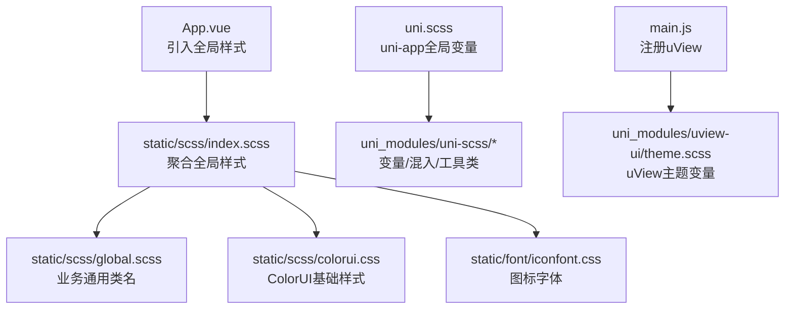
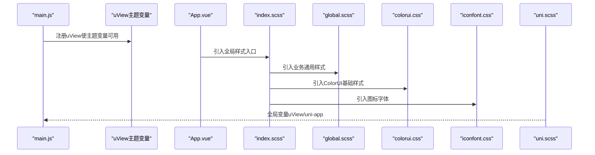
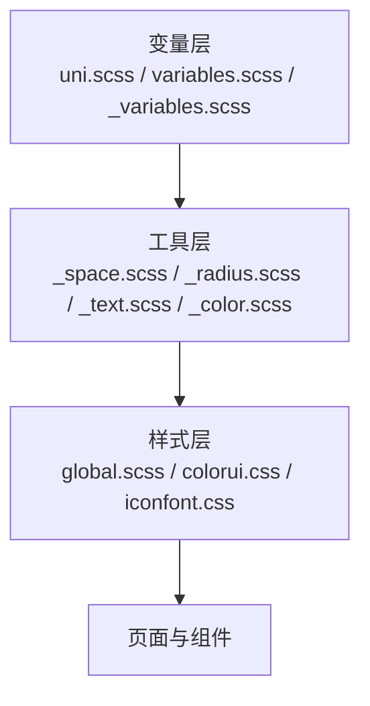
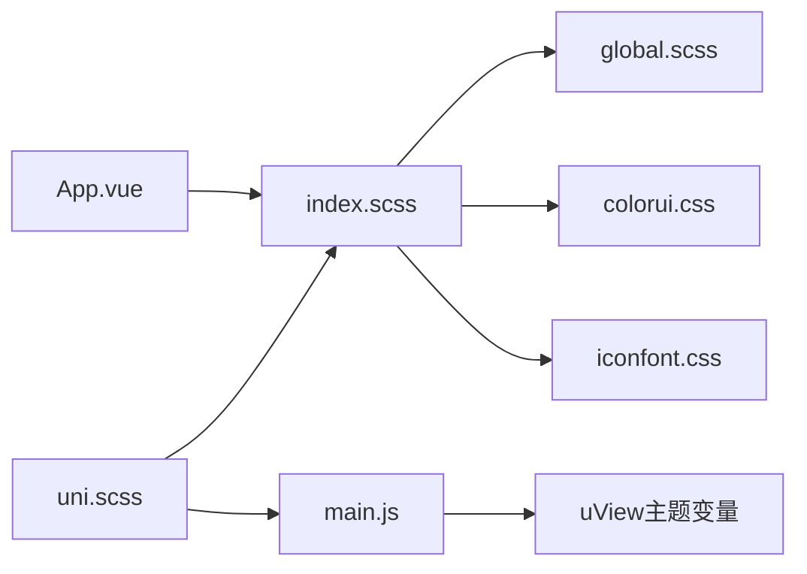

# 样式与主题

<cite>
**本文引用的文件**   
- [App.vue](file://App.vue)
- [main.js](file://main.js)
- [uni.scss](file://uni.scss)
- [index.scss](file://static/scss/index.scss)
- [global.scss](file://static/scss/global.scss)
- [colorui.css](file://static/scss/colorui.css)
- [iconfont.css](file://static/font/iconfont.css)
- [variables.scss](file://uni_modules/uni-scss/variables.scss)
- [_variables.scss](file://uni_modules/uni-scss/styles/setting/_variables.scss)
- [_color.scss](file://uni_modules/uni-scss/styles/setting/_color.scss)
- [_radius.scss](file://uni_modules/uni-scss/styles/setting/_radius.scss)
- [_space.scss](file://uni_modules/uni-scss/styles/setting/_space.scss)
- [_text.scss](file://uni_modules/uni-scss/styles/setting/_text.scss)
- [theme.scss（uView）](file://uni_modules/uview-ui/theme.scss)
</cite>

## 目录
1. [简介](#简介)
2. [项目结构](#项目结构)
3. [核心组件](#核心组件)
4. [架构总览](#架构总览)
5. [详细组件分析](#详细组件分析)
6. [依赖关系分析](#依赖关系分析)
7. [性能考虑](#性能考虑)
8. [故障排查指南](#故障排查指南)
9. [结论](#结论)
10. [附录](#附录)

## 简介
本章节面向RuoYi-App的样式与主题体系，系统化梳理颜色、字体、间距、圆角等设计规范；说明SCSS组织结构与变量、混合器、函数的使用方式；阐述主题定制方法（含深色模式思路）、响应式与移动端适配实践；总结CSS架构模式与命名约定，并提供样式性能优化技巧与调试方法。

## 项目结构
样式资源按“全局入口 → 第三方样式 → 业务通用样式”分层组织：
- 应用级入口引入全局样式
- uni-app全局变量集中定义于统一文件
- 第三方UI库（uView、uni-scss、ColorUI）通过独立主题或样式文件引入
- 业务通用样式集中于静态资源目录

图表来源
- [App.vue:45-47](file://App.vue#L45-L47)
- [index.scss:1-6](file://static/scss/index.scss#L1-L6)
- [global.scss:1-91](file://static/scss/global.scss#L1-L91)
- [colorui.css:1-800](file://static/scss/colorui.css#L1-L800)
- [iconfont.css:1-91](file://static/font/iconfont.css#L1-L91)
- [uni.scss:1-67](file://uni.scss#L1-L67)
- [variables.scss:1-63](file://uni_modules/uni-scss/variables.scss#L1-L63)
- [theme.scss（uView）:1-45](file://uni_modules/uview-ui/theme.scss#L1-L45)
- [main.js:8-10](file://main.js#L8-L10)

章节来源
- [App.vue:45-47](file://App.vue#L45-L47)
- [index.scss:1-6](file://static/scss/index.scss#L1-L6)
- [uni.scss:1-67](file://uni.scss#L1-L67)
- [main.js:8-10](file://main.js#L8-L10)

## 核心组件
本节聚焦样式体系的“设计令牌”与“工具能力”，包括颜色、字体、间距、圆角、阴影、蒙版等。

- 颜色体系
  - uni-app内置变量：行为色、文字色、背景色、边框色、尺寸与透明度等，便于在页面中直接使用。
  - uView主题变量：主色、成功、警告、错误、信息、中性色、背景与禁用态等，覆盖组件默认外观。
  - uni-scss变量：主色、辅助色、中性色、边框层级、阴影、蒙版等，提供统一的视觉语义。
  - ColorUI：提供大量现成类名（如按钮、标签、开关、阴影等），适合快速构建界面。

- 字体规范
  - uni-scss文本排版变量定义了标题、正文、副标题、说明等字号、字重与行高，保证层次清晰。
  - 项目内也提供了若干常用字号类名，便于直接复用。

- 间距标准
  - uni-scss提供基于根倍数的间距系统，自动生成m/p的t/r/b/l/x/y/a方向类名，支持正负值。
  - 项目内也有少量业务级间距类名，用于特定场景。

- 圆角规则
  - uni-scss提供半径变量与混合器，支持整体与单侧圆角，并生成对应类名。
  - 项目内对列表项等常见元素定义了圆角组合。

- 阴影与蒙版
  - uni-scss提供多级阴影与遮罩变量，配合类名可直接使用。

章节来源
- [uni.scss:1-67](file://uni.scss#L1-L67)
- [theme.scss（uView）:1-45](file://uni_modules/uview-ui/theme.scss#L1-L45)
- [variables.scss:1-63](file://uni_modules/uni-scss/variables.scss#L1-L63)
- [_variables.scss:1-147](file://uni_modules/uni-scss/styles/setting/_variables.scss#L1-L147)
- [_color.scss:1-67](file://uni_modules/uni-scss/styles/setting/_color.scss#L1-L67)
- [_radius.scss:1-56](file://uni_modules/uni-scss/styles/setting/_radius.scss#L1-L56)
- [_space.scss:1-56](file://uni_modules/uni-scss/styles/setting/_space.scss#L1-L56)
- [_text.scss:1-25](file://uni_modules/uni-scss/styles/setting/_text.scss#L1-L25)
- [global.scss:1-91](file://static/scss/global.scss#L1-L91)

## 架构总览
样式加载顺序与依赖关系如下：
- main.js注册uView，使其主题变量生效
- App.vue引入全局样式入口
- index.scss聚合业务通用样式、ColorUI与图标字体
- uni.scss作为uni-app全局变量入口，优先引入uView主题变量，再覆盖uni-app内置变量

图表来源
- [main.js:8-10](file://main.js#L8-L10)
- [App.vue:45-47](file://App.vue#L45-L47)
- [index.scss:1-6](file://static/scss/index.scss#L1-L6)
- [global.scss:1-91](file://static/scss/global.scss#L1-L91)
- [colorui.css:1-800](file://static/scss/colorui.css#L1-L800)
- [iconfont.css:1-91](file://static/font/iconfont.css#L1-L91)
- [uni.scss:1-67](file://uni.scss#L1-L67)

## 详细组件分析

### SCSS组织结构与使用方法
- 变量层
  - uni.scss：集中定义uni-app内置变量，并在最前引入uView主题变量，确保覆盖顺序正确。
  - uni-scss/variables.scss：扩展uni-scss变量，包含主色、辅助色、中性色、边框、阴影、蒙版等。
  - uni-scss/styles/setting/_variables.scss：更细粒度的变量定义，包含字体族、标题层级、间距根倍数、圆角根值等。
- 工具层
  - _space.scss：基于$uni-space-root生成m/p的t/r/b/l/x/y/a方向类名，支持正负值。
  - _radius.scss：提供半径变量与混合器，支持整体与单侧圆角，并生成类名。
  - _text.scss：根据标题层级变量生成对应类名。
  - _color.scss：将颜色变量映射为颜色与背景色类名，并提供阴影与遮罩类名。
- 样式层
  - global.scss：业务通用类名（如文本对齐、字号、列表单元格、菜单项等）。
  - colorui.css：ColorUI基础样式与组件样式。
  - iconfont.css：自定义图标字体及类名。

图表来源
- [uni.scss:1-67](file://uni.scss#L1-L67)
- [variables.scss:1-63](file://uni_modules/uni-scss/variables.scss#L1-L63)
- [_variables.scss:1-147](file://uni_modules/uni-scss/styles/setting/_variables.scss#L1-L147)
- [_space.scss:1-56](file://uni_modules/uni-scss/styles/setting/_space.scss#L1-L56)
- [_radius.scss:1-56](file://uni_modules/uni-scss/styles/setting/_radius.scss#L1-L56)
- [_text.scss:1-25](file://uni_modules/uni-scss/styles/setting/_text.scss#L1-L25)
- [_color.scss:1-67](file://uni_modules/uni-scss/styles/setting/_color.scss#L1-L67)
- [global.scss:1-91](file://static/scss/global.scss#L1-L91)
- [colorui.css:1-800](file://static/scss/colorui.css#L1-L800)
- [iconfont.css:1-91](file://static/font/iconfont.css#L1-L91)

章节来源
- [uni.scss:1-67](file://uni.scss#L1-L67)
- [variables.scss:1-63](file://uni_modules/uni-scss/variables.scss#L1-L63)
- [_variables.scss:1-147](file://uni_modules/uni-scss/styles/setting/_variables.scss#L1-L147)
- [_space.scss:1-56](file://uni_modules/uni-scss/styles/setting/_space.scss#L1-L56)
- [_radius.scss:1-56](file://uni_modules/uni-scss/styles/setting/_radius.scss#L1-L56)
- [_text.scss:1-25](file://uni_modules/uni-scss/styles/setting/_text.scss#L1-L25)
- [_color.scss:1-67](file://uni_modules/uni-scss/styles/setting/_color.scss#L1-L67)
- [global.scss:1-91](file://static/scss/global.scss#L1-L91)
- [colorui.css:1-800](file://static/scss/colorui.css#L1-L800)
- [iconfont.css:1-91](file://static/font/iconfont.css#L1-L91)

### 主题定制方法与配置选项
- 颜色主题切换
  - 通过修改uni.scss中的uni-app内置变量与uView主题变量，实现全局主题替换。
  - 借助uni-scss的颜色变量与生成的颜色类名，可快速调整文本、背景、边框等。
- 深色模式支持（建议方案）
  - 在应用启动时检测系统或用户偏好，动态切换根节点class或data属性。
  - 利用CSS变量或SCSS变量结合媒体查询/条件编译，分别定义浅色与深色两套变量集。
  - 针对uView与uni-scss变量，分别在各自主题文件中维护深浅两套值，按需引入。
- 主题配置项（示例）
  - 主色、辅助色、中性色、背景色、边框色、阴影强度、圆角根值、间距根倍数等均可作为配置项暴露。

章节来源
- [uni.scss:1-67](file://uni.scss#L1-L67)
- [theme.scss（uView）:1-45](file://uni_modules/uview-ui/theme.scss#L1-L45)
- [_variables.scss:1-147](file://uni_modules/uni-scss/styles/setting/_variables.scss#L1-L147)
- [_color.scss:1-67](file://uni_modules/uni-scss/styles/setting/_color.scss#L1-L67)

### 响应式设计与移动端适配最佳实践
- 单位选择
  - 优先使用rpx进行布局，以适配不同屏幕宽度；在需要精确像素时使用px。
- 弹性布局
  - 使用flex布局处理多端兼容，避免复杂定位导致的错位。
- 安全区域
  - 结合平台差异与状态栏高度，合理设置底部安全区与顶部留白。
- 图片与媒体
  - 使用响应式图片与自适应容器，避免溢出与拉伸。
- 交互反馈
  - 为按钮、卡片等关键元素添加点击态与过渡动画，提升体验一致性。

[本节为通用指导，不直接分析具体文件]

### CSS架构模式与命名约定
- 分层策略
  - 变量层：集中管理设计令牌（颜色、字体、间距、圆角等）。
  - 工具层：提供可复用的混入与函数，生成通用类名。
  - 样式层：业务通用样式与第三方样式分离，避免耦合。
- 命名约定
  - 变量：采用语义化前缀（如$uni-、$u-），明确归属与用途。
  - 类名：遵循BEM或原子化风格，保持可读性与可维护性。
  - 文件：按职责拆分，单一职责原则，避免大文件。

章节来源
- [variables.scss:1-63](file://uni_modules/uni-scss/variables.scss#L1-L63)
- [_variables.scss:1-147](file://uni_modules/uni-scss/styles/setting/_variables.scss#L1-L147)
- [_space.scss:1-56](file://uni_modules/uni-scss/styles/setting/_space.scss#L1-L56)
- [_radius.scss:1-56](file://uni_modules/uni-scss/styles/setting/_radius.scss#L1-L56)
- [_text.scss:1-25](file://uni_modules/uni-scss/styles/setting/_text.scss#L1-L25)
- [_color.scss:1-67](file://uni_modules/uni-scss/styles/setting/_color.scss#L1-L67)
- [global.scss:1-91](file://static/scss/global.scss#L1-L91)

### 样式性能优化技巧与调试方法
- 性能优化
  - 减少重复样式，尽量复用变量与工具类。
  - 控制第三方样式体积，按需引入，避免全量导入。
  - 合理使用伪元素与transform，避免触发重排。
  - 图片与图标使用矢量或雪碧图，减少请求次数。
- 调试方法
  - 使用浏览器开发者工具检查计算后的样式与层叠顺序。
  - 通过控制台输出变量值，验证主题覆盖是否生效。
  - 逐步注释引入文件，定位冲突来源。

[本节为通用指导，不直接分析具体文件]

### 自定义主题开发指南与示例
- 步骤概览
  - 在uni.scss中引入uView主题变量，随后覆盖所需变量。
  - 在uni-scss变量文件中调整主色、辅助色、中性色、背景、边框、阴影等。
  - 在global.scss中补充业务通用类名，确保与设计令牌一致。
  - 在ColorUI基础上，通过类名组合快速实现页面布局。
- 示例路径
  - 主题变量覆盖：[uni.scss:1-67](file://uni.scss#L1-L67)
  - uView主题变量：[theme.scss（uView）:1-45](file://uni_modules/uview-ui/theme.scss#L1-L45)
  - uni-scss变量与工具：[_variables.scss:1-147](file://uni_modules/uni-scss/styles/setting/_variables.scss#L1-L147)、[_space.scss:1-56](file://uni_modules/uni-scss/styles/setting/_space.scss#L1-L56)、[_radius.scss:1-56](file://uni_modules/uni-scss/styles/setting/_radius.scss#L1-L56)、[_text.scss:1-25](file://uni_modules/uni-scss/styles/setting/_text.scss#L1-L25)、[_color.scss:1-67](file://uni_modules/uni-scss/styles/setting/_color.scss#L1-L67)
  - 业务通用样式：[global.scss:1-91](file://static/scss/global.scss#L1-L91)
  - 第三方样式集成：[colorui.css:1-800](file://static/scss/colorui.css#L1-L800)、[iconfont.css:1-91](file://static/font/iconfont.css#L1-L91)

章节来源
- [uni.scss:1-67](file://uni.scss#L1-L67)
- [theme.scss（uView）:1-45](file://uni_modules/uview-ui/theme.scss#L1-L45)
- [_variables.scss:1-147](file://uni_modules/uni-scss/styles/setting/_variables.scss#L1-L147)
- [_space.scss:1-56](file://uni_modules/uni-scss/styles/setting/_space.scss#L1-L56)
- [_radius.scss:1-56](file://uni_modules/uni-scss/styles/setting/_radius.scss#L1-L56)
- [_text.scss:1-25](file://uni_modules/uni-scss/styles/setting/_text.scss#L1-L25)
- [_color.scss:1-67](file://uni_modules/uni-scss/styles/setting/_color.scss#L1-L67)
- [global.scss:1-91](file://static/scss/global.scss#L1-L91)
- [colorui.css:1-800](file://static/scss/colorui.css#L1-L800)
- [iconfont.css:1-91](file://static/font/iconfont.css#L1-L91)

## 依赖关系分析
样式依赖关系如下：
- main.js负责注册uView，使uView主题变量生效
- App.vue引入全局样式入口
- index.scss聚合业务通用样式、ColorUI与图标字体
- uni.scss作为全局变量入口，优先引入uView主题变量，再覆盖uni-app内置变量

图表来源
- [main.js:8-10](file://main.js#L8-L10)
- [App.vue:45-47](file://App.vue#L45-L47)
- [index.scss:1-6](file://static/scss/index.scss#L1-L6)
- [global.scss:1-91](file://static/scss/global.scss#L1-L91)
- [colorui.css:1-800](file://static/scss/colorui.css#L1-L800)
- [iconfont.css:1-91](file://static/font/iconfont.css#L1-L91)
- [uni.scss:1-67](file://uni.scss#L1-L67)

章节来源
- [main.js:8-10](file://main.js#L8-L10)
- [App.vue:45-47](file://App.vue#L45-L47)
- [index.scss:1-6](file://static/scss/index.scss#L1-L6)
- [uni.scss:1-67](file://uni.scss#L1-L67)

## 性能考虑
- 控制样式体积：仅引入必要的第三方样式与工具类，避免全量导入。
- 复用设计令牌：通过变量与工具类减少重复代码，降低编译产物大小。
- 优化渲染路径：减少不必要的重排与重绘，使用transform与opacity做动画。
- 资源优化：图标使用字体或SVG，图片压缩与懒加载。

[本节为通用指导，不直接分析具体文件]

## 故障排查指南
- 主题未生效
  - 确认uView已在main.js中注册，且uni.scss在最前引入uView主题变量。
  - 检查变量覆盖顺序，确保目标变量未被后续样式覆盖。
- 样式冲突
  - 使用开发者工具检查最终计算样式，定位优先级问题。
  - 逐步注释引入文件，缩小冲突范围。
- 图标不显示
  - 确认图标字体文件路径与引用是否正确。
  - 检查类名是否与图标字体定义一致。

章节来源
- [main.js:8-10](file://main.js#L8-L10)
- [uni.scss:1-67](file://uni.scss#L1-L67)
- [iconfont.css:1-91](file://static/font/iconfont.css#L1-L91)

## 结论
RuoYi-App的样式与主题体系以变量为核心，结合工具层与样式层，形成清晰的架构。通过统一的设计令牌与工具类，可实现高效的主题定制与一致的视觉体验。建议在项目中严格遵循分层与命名约定，持续优化样式性能，并结合深色模式与响应式实践，提升多端适配质量。

[本节为总结性内容，不直接分析具体文件]

## 附录
- 常用类名参考
  - 颜色与背景：参见uni-scss颜色变量与生成的类名。
  - 间距与圆角：参见uni-scss空间与圆角工具类。
  - 文本排版：参见uni-scss文本层级类名。
  - 第三方样式：参见ColorUI按钮、标签、开关等类名。

章节来源
- [_color.scss:1-67](file://uni_modules/uni-scss/styles/setting/_color.scss#L1-L67)
- [_space.scss:1-56](file://uni_modules/uni-scss/styles/setting/_space.scss#L1-L56)
- [_radius.scss:1-56](file://uni_modules/uni-scss/styles/setting/_radius.scss#L1-L56)
- [_text.scss:1-25](file://uni_modules/uni-scss/styles/setting/_text.scss#L1-L25)
- [colorui.css:1-800](file://static/scss/colorui.css#L1-L800)