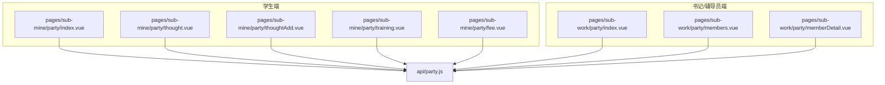
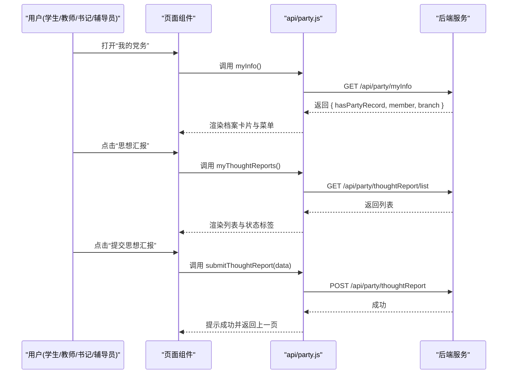
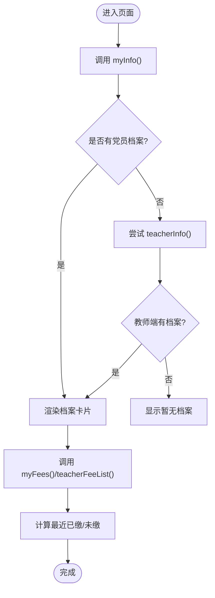
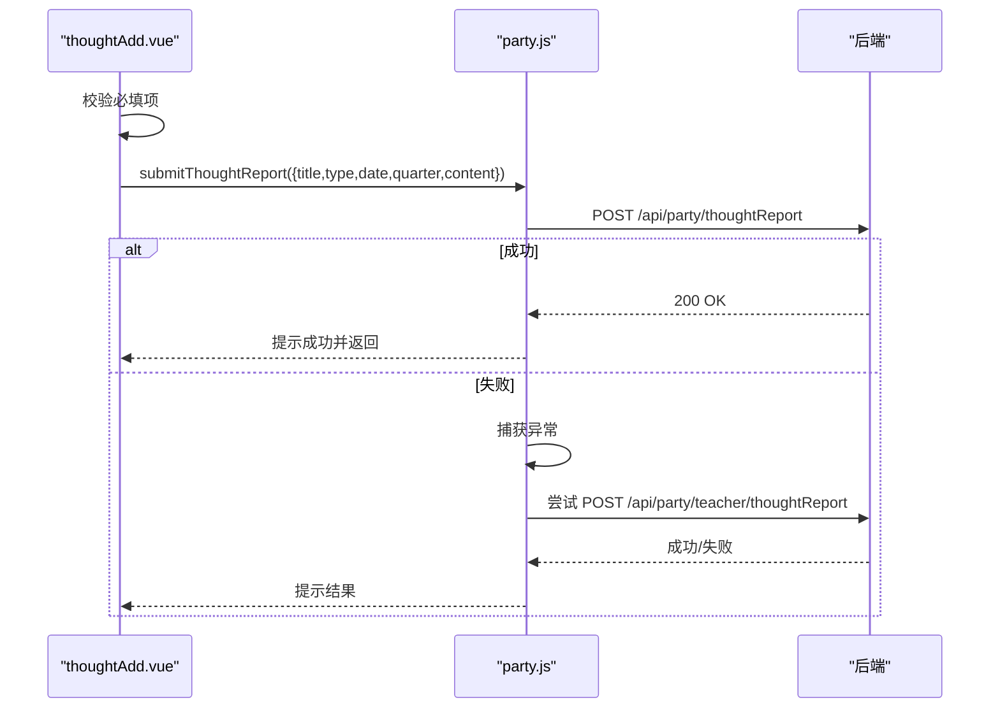
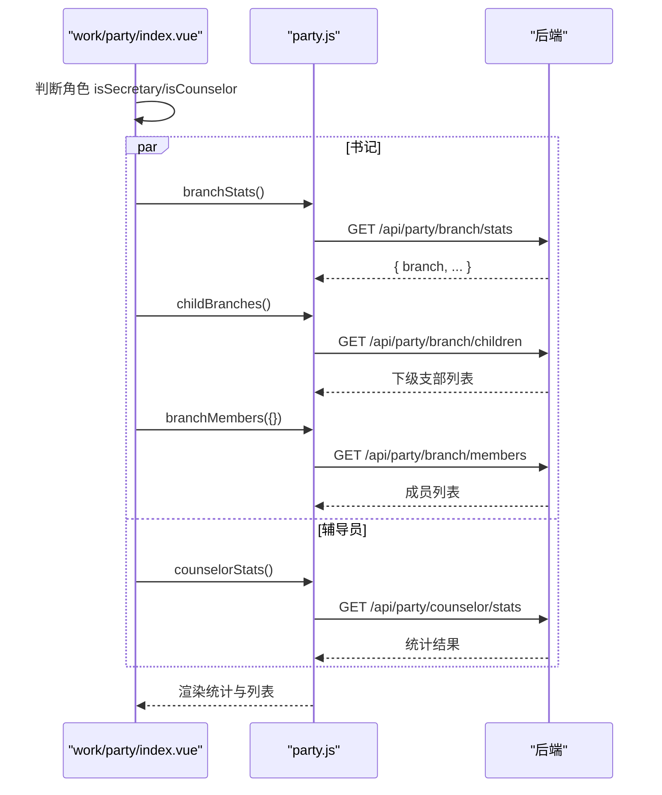
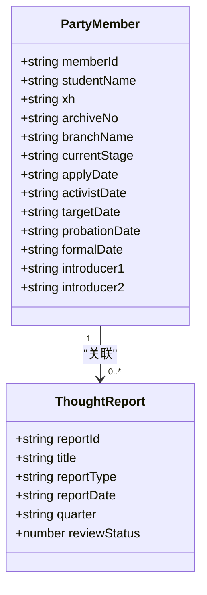
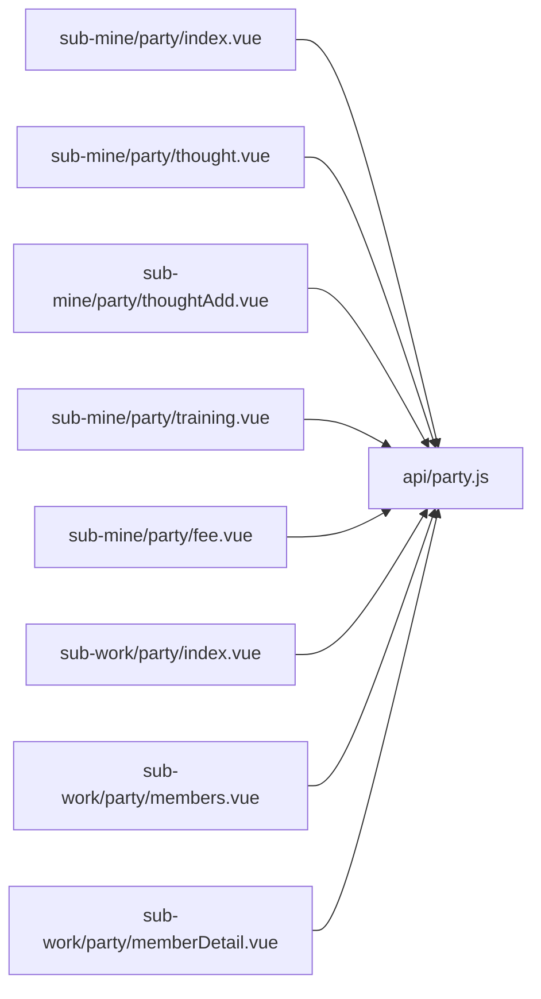

# 党务管理模块

<cite>
**本文引用的文件列表**
- [api/party.js](file://api/party.js)
- [pages/sub-mine/party/index.vue](file://pages/sub-mine/party/index.vue)
- [pages/sub-mine/party/thought.vue](file://pages/sub-mine/party/thought.vue)
- [pages/sub-mine/party/thoughtAdd.vue](file://pages/sub-mine/party/thoughtAdd.vue)
- [pages/sub-mine/party/training.vue](file://pages/sub-mine/party/training.vue)
- [pages/sub-mine/party/fee.vue](file://pages/sub-mine/party/fee.vue)
- [pages/sub-work/party/index.vue](file://pages/sub-work/party/index.vue)
- [pages/sub-work/party/members.vue](file://pages/sub-work/party/members.vue)
- [pages/sub-work/party/memberDetail.vue](file://pages/sub-work/party/memberDetail.vue)
</cite>

## 目录
1. [简介](#简介)
2. [项目结构](#项目结构)
3. [核心组件](#核心组件)
4. [架构总览](#架构总览)
5. [详细组件分析](#详细组件分析)
6. [依赖关系分析](#依赖关系分析)
7. [性能与可用性建议](#性能与可用性建议)
8. [故障排查指南](#故障排查指南)
9. [结论](#结论)
10. [附录：API 接口与调用示例](#附录api-接口与调用示例)

## 简介
本模块面向高校党务工作，提供党员信息管理、思想汇报管理、培训记录、党费收缴等核心能力。前端基于 uni-app 构建，通过统一的 API 层访问后端服务，支持学生端、教师端以及书记/辅导员端的差异化视图与权限控制。文档将围绕数据模型、业务流程与管理规范展开，并给出扩展与报表定制的开发指引。

## 项目结构
党务相关的前端实现主要分布在以下位置：
- 统一 API 封装：api/party.js
- 学生端“我的党务”入口与子页面：pages/sub-mine/party/*
- 书记/辅导员端“党务工作台”与成员管理：pages/sub-work/party/*

图表来源
- [api/party.js:1-88](file://api/party.js#L1-L88)
- [pages/sub-mine/party/index.vue:71-166](file://pages/sub-mine/party/index.vue#L71-L166)
- [pages/sub-mine/party/thought.vue:23-42](file://pages/sub-mine/party/thought.vue#L23-L42)
- [pages/sub-mine/party/thoughtAdd.vue:30-65](file://pages/sub-mine/party/thoughtAdd.vue#L30-L65)
- [pages/sub-mine/party/training.vue:32-39](file://pages/sub-mine/party/training.vue#L32-L39)
- [pages/sub-mine/party/fee.vue:20-35](file://pages/sub-mine/party/fee.vue#L20-L35)
- [pages/sub-work/party/index.vue:227-456](file://pages/sub-work/party/index.vue#L227-L456)
- [pages/sub-work/party/members.vue:58-155](file://pages/sub-work/party/members.vue#L58-L155)
- [pages/sub-work/party/memberDetail.vue:63-111](file://pages/sub-work/party/memberDetail.vue#L63-L111)

章节来源
- [api/party.js:1-88](file://api/party.js#L1-L88)
- [pages/sub-mine/party/index.vue:1-206](file://pages/sub-mine/party/index.vue#L1-L206)
- [pages/sub-work/party/index.vue:1-533](file://pages/sub-work/party/index.vue#L1-L533)

## 核心组件
- 统一 API 层（party.js）
  - 暴露学生端、书记/辅导员端、教师个人端三类接口方法，统一使用 request 工具发起网络请求。
- 学生端“我的党务”
  - 档案首页：展示基本信息、组织信息、发展进度、培训与党费概览。
  - 思想汇报：列表查看与新增提交。
  - 培训记录：课程名称、学时、成绩、证书编号等。
  - 党费记录：周期、金额、支付方式、状态。
- 书记/辅导员端“党务工作台”
  - 支部统计概览、组织树选择、阶段筛选、搜索、成员列表与详情。
  - 辅导员专属的学生入党情况统计与快捷入口。

章节来源
- [api/party.js:1-88](file://api/party.js#L1-L88)
- [pages/sub-mine/party/index.vue:71-166](file://pages/sub-mine/party/index.vue#L71-L166)
- [pages/sub-mine/party/thought.vue:23-42](file://pages/sub-mine/party/thought.vue#L23-L42)
- [pages/sub-mine/party/training.vue:32-39](file://pages/sub-mine/party/training.vue#L32-L39)
- [pages/sub-mine/party/fee.vue:20-35](file://pages/sub-mine/party/fee.vue#L20-L35)
- [pages/sub-work/party/index.vue:227-456](file://pages/sub-work/party/index.vue#L227-L456)
- [pages/sub-work/party/members.vue:58-155](file://pages/sub-work/party/members.vue#L58-L155)
- [pages/sub-work/party/memberDetail.vue:63-111](file://pages/sub-work/party/memberDetail.vue#L63-L111)

## 架构总览
整体采用“前端页面 -> API 层 -> 后端服务”的三层结构。前端按角色划分不同页面，但共享同一套 API 封装；后端根据当前登录用户身份返回对应数据。

图表来源
- [api/party.js:6-24](file://api/party.js#L6-L24)
- [pages/sub-mine/party/index.vue:96-134](file://pages/sub-mine/party/index.vue#L96-L134)
- [pages/sub-mine/party/thought.vue:28-41](file://pages/sub-mine/party/thought.vue#L28-L41)
- [pages/sub-mine/party/thoughtAdd.vue:40-57](file://pages/sub-mine/party/thoughtAdd.vue#L40-L57)

## 详细组件分析

### 党员档案管理（学生端）
- 功能要点
  - 加载个人档案：优先调用学生端接口，失败或无记录时回退到教师端接口。
  - 展示字段：姓名/学号、政治面貌映射、所属支部、申请日期、当前状态、最近一次党费缴纳情况。
  - 介绍人信息：第一、第二介绍人展示。
  - 导航入口：组织信息、发展过程、培训记录、党费记录。
- 关键逻辑
  - 状态映射：currentStage 映射为“入党申请人/积极分子/发展对象/预备党员/正式党员”。
  - 党费状态：从最近一条已缴记录计算“最近已缴 X年X月”，否则显示“未缴”。
- 交互流程
  - 进入页面即触发 loadInfo，成功后再加载 fee 信息，最终更新 UI。

图表来源
- [pages/sub-mine/party/index.vue:96-163](file://pages/sub-mine/party/index.vue#L96-L163)
- [api/party.js:6-8](file://api/party.js#L6-L8)
- [api/party.js:34-40](file://api/party.js#L34-L40)
- [api/party.js:72-86](file://api/party.js#L72-L86)

章节来源
- [pages/sub-mine/party/index.vue:1-206](file://pages/sub-mine/party/index.vue#L1-L206)
- [api/party.js:6-8](file://api/party.js#L6-L8)
- [api/party.js:34-40](file://api/party.js#L34-L40)
- [api/party.js:72-86](file://api/party.js#L72-L86)

### 思想汇报管理（学生端）
- 功能要点
  - 列表页：展示标题、类型、日期、季度、审核状态（待审/已通过/需修改/已退回）。
  - 新增页：表单包含标题、类型（季度/半年/年度/专题）、日期、季度、内容。
  - 提交策略：先调用学生端提交接口，失败则回退到教师端提交接口。
- 数据处理
  - 日期格式化：提交前将时间戳格式化为字符串。
  - 状态映射：reviewStatus 数字映射为中文状态。

图表来源
- [pages/sub-mine/party/thoughtAdd.vue:40-57](file://pages/sub-mine/party/thoughtAdd.vue#L40-L57)
- [api/party.js:22-24](file://api/party.js#L22-L24)
- [api/party.js:79-82](file://api/party.js#L79-L82)

章节来源
- [pages/sub-mine/party/thought.vue:23-42](file://pages/sub-mine/party/thought.vue#L23-L42)
- [pages/sub-mine/party/thoughtAdd.vue:1-74](file://pages/sub-mine/party/thoughtAdd.vue#L1-L74)
- [api/party.js:18-24](file://api/party.js#L18-L24)
- [api/party.js:76-82](file://api/party.js#L76-L82)

### 培训记录（学生端）
- 功能要点
  - 展示课程名、实际学时、考试成绩、通过状态（未考/通过/未通过）、证书编号。
  - 数据来源：myTraining()，失败或空数据时可考虑扩展教师端接口。
- 业务规则
  - passStatus 映射：0=未考，1=通过，2=未通过。
  - 证书编号可选，存在时展示。

章节来源
- [pages/sub-mine/party/training.vue:1-53](file://pages/sub-mine/party/training.vue#L1-L53)
- [api/party.js:34-36](file://api/party.js#L34-L36)

### 党费收缴（学生端）
- 功能要点
  - 列表展示：年月、金额、支付方式（现金/转账/线上）、状态（已缴/减免/未缴）。
  - 首页“最近已缴”计算：过滤 payStatus=1 的记录，按年份和月份倒序取最新一条。
- 数据来源
  - 优先 myFees()，若为空或失败则回退 teacherFeeList()。

章节来源
- [pages/sub-mine/party/fee.vue:1-52](file://pages/sub-mine/party/fee.vue#L1-L52)
- [pages/sub-mine/party/index.vue:135-163](file://pages/sub-mine/party/index.vue#L135-L163)
- [api/party.js:38-40](file://api/party.js#L38-L40)
- [api/party.js:84-86](file://api/party.js#L84-L86)

### 书记/辅导员端工作台
- 功能要点
  - 角色判断：isSecretary/isCounselor 决定展示分支。
  - 书记模式：
    - 获取支部统计与下级支部树，支持多选与展开/折叠。
    - 全量拉取支部成员，前端进行阶段筛选、关键词搜索、支部范围筛选。
    - 统计面板：总人数、正式/预备/发展中人数。
  - 辅导员模式：
    - 获取所带学生入党情况统计，提供按阶段跳转的快捷入口。
- 数据流
  - 并行加载：branchStats + childBranches + branchMembers（或 counselorStats + counselorMembers）。
  - 本地计算：computedStats、filteredList、studentCount/teacherCount。

图表来源
- [pages/sub-work/party/index.vue:305-356](file://pages/sub-work/party/index.vue#L305-L356)
- [api/party.js:44-54](file://api/party.js#L44-L54)
- [api/party.js:62-68](file://api/party.js#L62-L68)

章节来源
- [pages/sub-work/party/index.vue:1-533](file://pages/sub-work/party/index.vue#L1-L533)
- [api/party.js:44-68](file://api/party.js#L44-L68)

### 成员列表与详情（书记/辅导员端）
- 成员列表
  - 支持支部筛选（仅书记且多支部时）、阶段筛选、关键词搜索。
  - 统计栏实时显示总数、学生/教师人数。
- 成员详情
  - 基本信息：学号/工号、档案号、支部、申请日期。
  - 发展阶段时间线：递交申请、确定为积极分子、确定为发展对象、接收为预备党员、转为正式党员。
  - 介绍人信息、思想汇报列表及状态。

图表来源
- [pages/sub-work/party/memberDetail.vue:82-109](file://pages/sub-work/party/memberDetail.vue#L82-L109)
- [api/party.js:56-58](file://api/party.js#L56-L58)

章节来源
- [pages/sub-work/party/members.vue:1-192](file://pages/sub-work/party/members.vue#L1-L192)
- [pages/sub-work/party/memberDetail.vue:1-160](file://pages/sub-work/party/memberDetail.vue#L1-L160)
- [api/party.js:52-58](file://api/party.js#L52-L58)

## 依赖关系分析
- 页面与 API 的耦合
  - 所有党务页面均通过 api/party.js 调用后端，避免直接拼接 URL，便于统一鉴权与错误处理。
- 角色与权限
  - 书记/辅导员端通过 isSecretary/isCounselor 判断是否展示相应区块。
- 数据流向
  - 列表类页面普遍采用“全量拉取 + 前端筛选”的模式，适合中小规模数据；当数据量增大时应改为服务端分页与筛选。

图表来源
- [api/party.js:1-88](file://api/party.js#L1-L88)
- [pages/sub-mine/party/index.vue:71-166](file://pages/sub-mine/party/index.vue#L71-L166)
- [pages/sub-mine/party/thought.vue:23-42](file://pages/sub-mine/party/thought.vue#L23-L42)
- [pages/sub-mine/party/thoughtAdd.vue:30-65](file://pages/sub-mine/party/thoughtAdd.vue#L30-L65)
- [pages/sub-mine/party/training.vue:32-39](file://pages/sub-mine/party/training.vue#L32-L39)
- [pages/sub-mine/party/fee.vue:20-35](file://pages/sub-mine/party/fee.vue#L20-L35)
- [pages/sub-work/party/index.vue:227-456](file://pages/sub-work/party/index.vue#L227-L456)
- [pages/sub-work/party/members.vue:58-155](file://pages/sub-work/party/members.vue#L58-L155)
- [pages/sub-work/party/memberDetail.vue:63-111](file://pages/sub-work/party/memberDetail.vue#L63-L111)

章节来源
- [api/party.js:1-88](file://api/party.js#L1-L88)

## 性能与可用性建议
- 列表分页与筛选下沉至服务端
  - 当前 members.vue 与 index.vue 采用前端筛选，建议在大数据量场景下增加分页参数与服务端过滤。
- 并发请求优化
  - 书记端在 onShow 中并行加载多个接口，可结合 Promise.all 与超时重试机制提升稳定性。
- 缓存策略
  - 对不频繁变化的静态数据（如支部树）可做短期缓存，减少重复请求。
- 用户体验
  - 统一 Loading 与错误提示，避免多次 loading 叠加。
  - 对空数据提供明确引导（如“请联系所在党支部录入档案”）。

[本节为通用建议，无需代码来源]

## 故障排查指南
- 常见现象
  - “暂无党员档案”：可能因未录入档案或当前用户非学生身份导致。
  - 思想汇报提交失败：检查网络与权限，确认学生端接口失败后是否正确回退教师端接口。
  - 党费记录为空：确认 myFees 与 teacherFeeList 是否均有数据。
- 定位步骤
  - 打开浏览器开发者工具或小程序调试器，查看对应 API 的请求与响应。
  - 核对 party.js 中的接口路径与方法是否与后端一致。
  - 检查页面中 try/catch 与 fallback 逻辑是否生效。

章节来源
- [pages/sub-mine/party/index.vue:96-134](file://pages/sub-mine/party/index.vue#L96-L134)
- [pages/sub-mine/party/thoughtAdd.vue:40-57](file://pages/sub-mine/party/thoughtAdd.vue#L40-L57)
- [pages/sub-mine/party/fee.vue:20-35](file://pages/sub-mine/party/fee.vue#L20-L35)

## 结论
本模块以清晰的职责分层与统一的 API 封装实现了党务管理的核心能力，覆盖学生端与书记/辅导员端的主要场景。后续可在数据量增长时引入服务端分页与更完善的权限控制，同时增强报表导出与可视化能力，以满足更广泛的党务管理与决策需求。

[本节为总结性内容，无需代码来源]

## 附录：API 接口与调用示例
以下为前端已使用的党务相关接口清单与调用方式说明（均为 GET/POST，具体参数见各页面调用处）：

- 学生端
  - 我的档案：GET /api/party/myInfo
  - 我的发展进度：GET /api/party/progress
  - 我的支部/组织信息：GET /api/party/myBranch
  - 思想汇报列表：GET /api/party/thoughtReport/list
  - 提交思想汇报：POST /api/party/thoughtReport
  - 我的入党申请书：GET /api/party/application
  - 我的培训记录：GET /api/party/training/my
  - 我的党费记录：GET /api/party/fee/my

- 书记/辅导员端
  - 下级支部列表：GET /api/party/branch/children
  - 支部统计概览：GET /api/party/branch/stats?branchId=...
  - 支部党员列表：GET /api/party/branch/members?currentStage=...
  - 党员详情：GET /api/party/member/{memberId}
  - 辅导员统计：GET /api/party/counselor/stats
  - 辅导员成员列表：GET /api/party/counselor/members?currentStage=...

- 教师个人端
  - 教师个人档案：GET /api/party/teacher/info
  - 教师思想汇报列表：GET /api/party/teacher/thoughtReport/list
  - 教师提交思想汇报：POST /api/party/teacher/thoughtReport
  - 教师党费记录：GET /api/party/teacher/fee/my

调用示例（路径参考）
- 获取我的档案
  - 页面：pages/sub-mine/party/index.vue
  - 方法：loadInfo -> partyApi.myInfo()
  - 参考行：[pages/sub-mine/party/index.vue:96-134](file://pages/sub-mine/party/index.vue#L96-L134), [api/party.js:6-8](file://api/party.js#L6-L8)

- 提交思想汇报
  - 页面：pages/sub-mine/party/thoughtAdd.vue
  - 方法：submit -> partyApi.submitThoughtReport(data)
  - 参考行：[pages/sub-mine/party/thoughtAdd.vue:40-57](file://pages/sub-mine/party/thoughtAdd.vue#L40-L57), [api/party.js:22-24](file://api/party.js#L22-L24)

- 获取支部成员列表（书记）
  - 页面：pages/sub-work/party/index.vue
  - 方法：loadAllMembers -> partyApi.branchMembers({})
  - 参考行：[pages/sub-work/party/index.vue:344-349](file://pages/sub-work/party/index.vue#L344-L349), [api/party.js:52-54](file://api/party.js#L52-L54)

- 获取党员详情
  - 页面：pages/sub-work/party/memberDetail.vue
  - 方法：loadDetail -> partyApi.memberDetail(memberId)
  - 参考行：[pages/sub-work/party/memberDetail.vue:82-109](file://pages/sub-work/party/memberDetail.vue#L82-L109), [api/party.js:56-58](file://api/party.js#L56-L58)

章节来源
- [api/party.js:1-88](file://api/party.js#L1-L88)
- [pages/sub-mine/party/index.vue:96-134](file://pages/sub-mine/party/index.vue#L96-L134)
- [pages/sub-mine/party/thoughtAdd.vue:40-57](file://pages/sub-mine/party/thoughtAdd.vue#L40-L57)
- [pages/sub-work/party/index.vue:344-349](file://pages/sub-work/party/index.vue#L344-L349)
- [pages/sub-work/party/memberDetail.vue:82-109](file://pages/sub-work/party/memberDetail.vue#L82-L109)