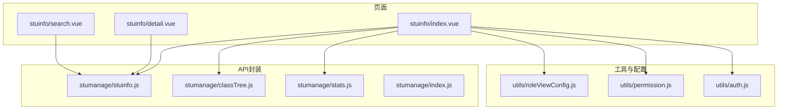
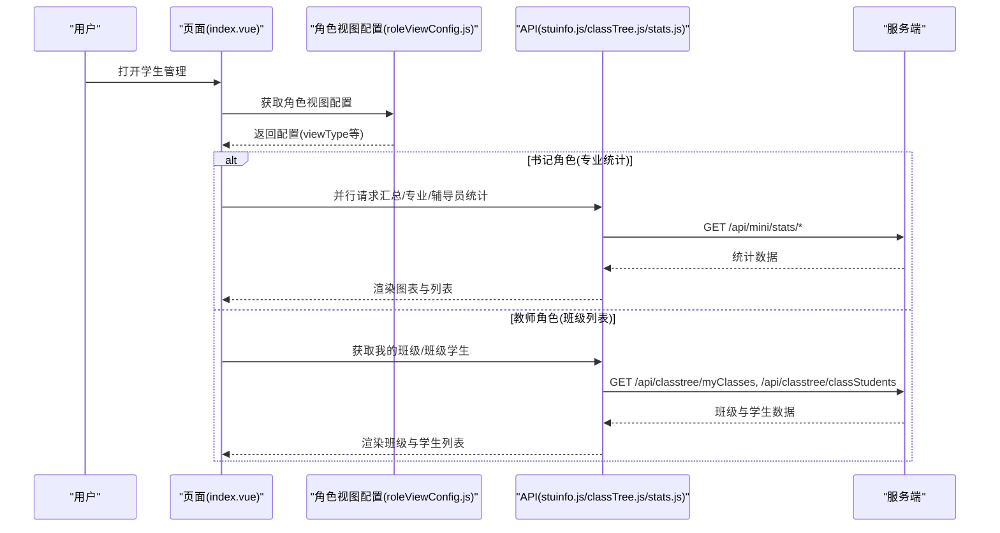
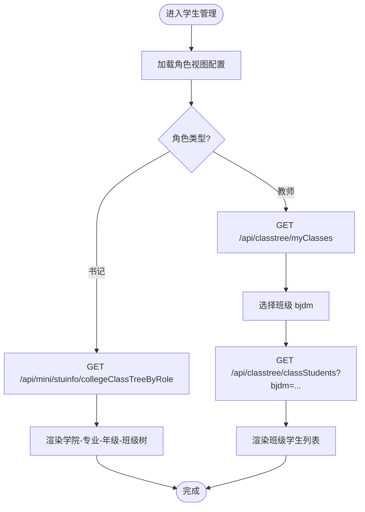
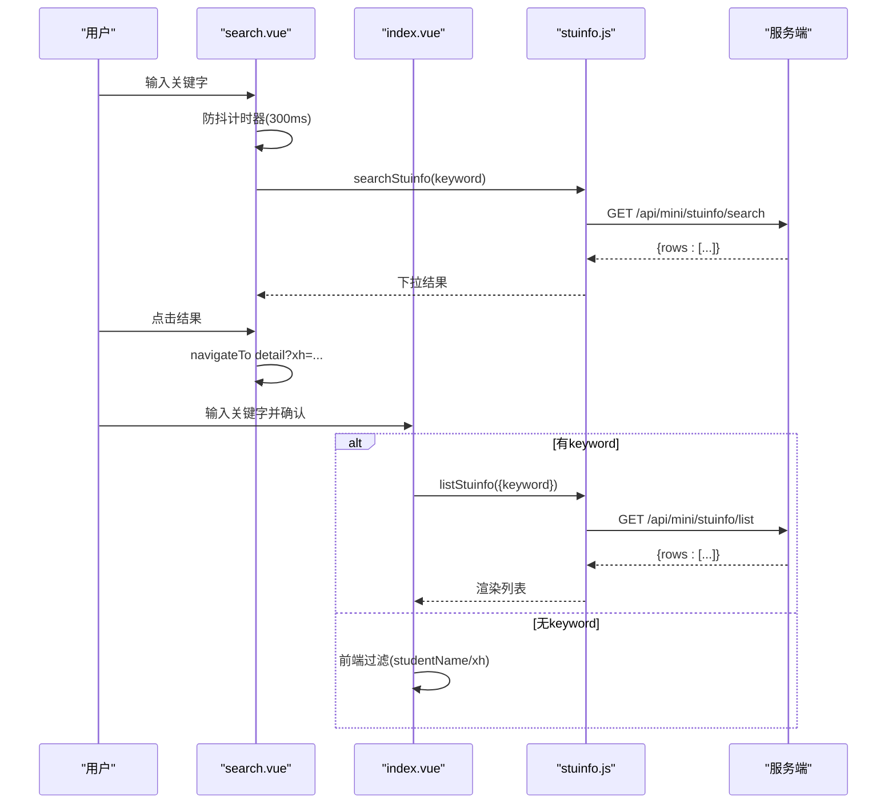
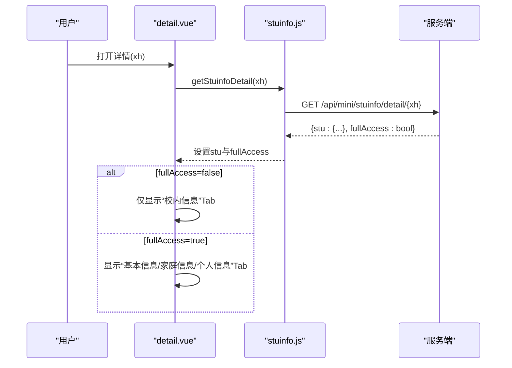
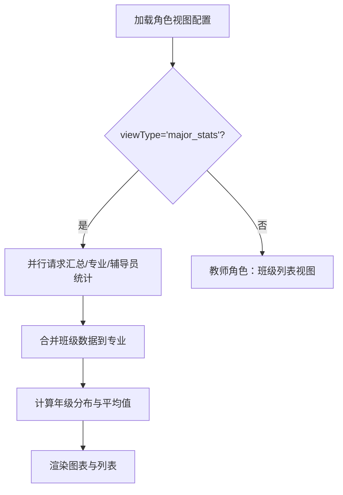
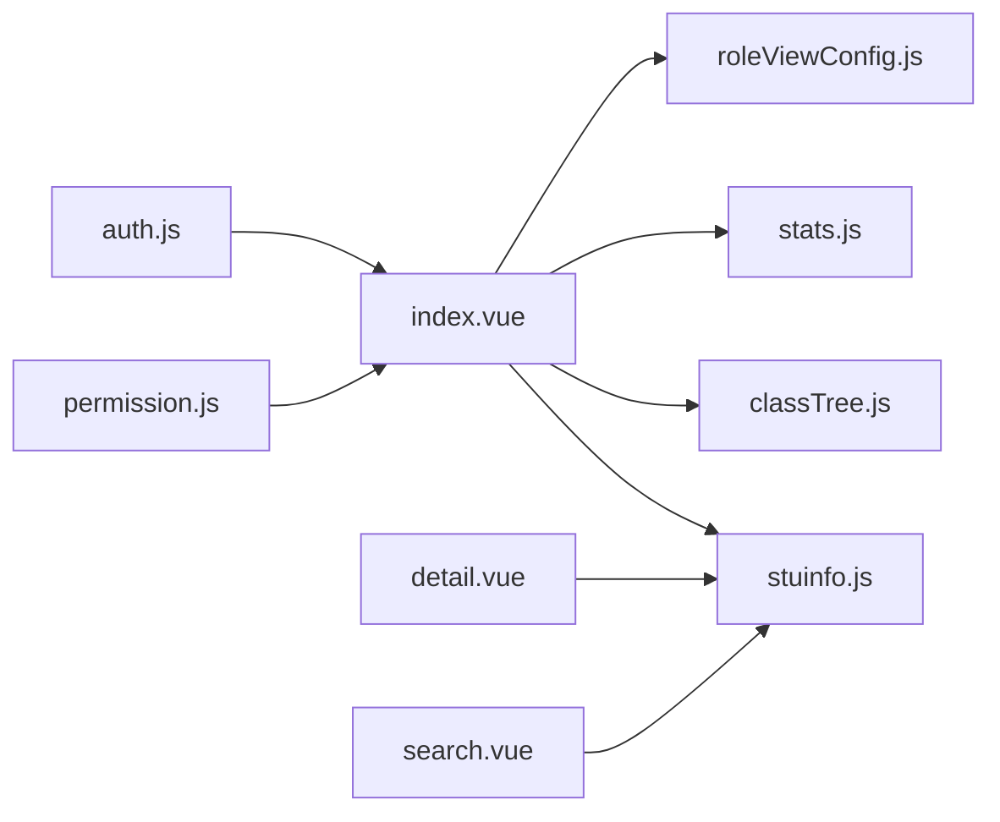

# 学生管理模块

<cite>
**本文引用的文件**
- [api/stumanage/index.js](file://api/stumanage/index.js)
- [api/stumanage/stuinfo.js](file://api/stumanage/stuinfo.js)
- [api/stumanage/classTree.js](file://api/stumanage/classTree.js)
- [api/stumanage/stats.js](file://api/stumanage/stats.js)
- [pages/sub-work/stuinfo/index.vue](file://pages/sub-work/stuinfo/index.vue)
- [pages/sub-work/stuinfo/detail.vue](file://pages/sub-work/stuinfo/detail.vue)
- [pages/sub-work/stuinfo/search.vue](file://pages/sub-work/stuinfo/search.vue)
- [utils/permission.js](file://utils/permission.js)
- [utils/auth.js](file://utils/auth.js)
- [utils/roleViewConfig.js](file://utils/roleViewConfig.js)
</cite>

## 目录
1. [简介](#简介)
2. [项目结构](#项目结构)
3. [核心组件](#核心组件)
4. [架构总览](#架构总览)
5. [详细组件分析](#详细组件分析)
6. [依赖关系分析](#依赖关系分析)
7. [性能与可用性](#性能与可用性)
8. [故障排查指南](#故障排查指南)
9. [结论](#结论)
10. [附录：API参考与扩展指南](#附录api参考与扩展指南)

## 简介
本模块面向移动端（小程序/H5）的学生信息管理，提供以下能力：
- 学生信息查询与搜索（支持按学号、姓名等关键字检索）
- 学生档案管理（基本信息、家庭信息、个人信息等分Tab展示）
- 班级树形结构（学院-专业-年级-班级层级）
- 角色化视图（普通教师“班级列表”视图；书记“专业统计”视图）
- 权限控制（基于角色与数据范围限制详情可见字段）

## 项目结构
学生管理相关的前端代码主要分布在以下位置：
- API封装层：api/stumanage/*
- 页面层：pages/sub-work/stuinfo/*
- 工具与配置：utils/roleViewConfig.js、utils/permission.js、utils/auth.js

图表来源
- [pages/sub-work/stuinfo/index.vue:477-576](file://pages/sub-work/stuinfo/index.vue#L477-L576)
- [api/stumanage/stuinfo.js:1-85](file://api/stumanage/stuinfo.js#L1-L85)
- [api/stumanage/classTree.js:1-32](file://api/stumanage/classTree.js#L1-L32)
- [api/stumanage/stats.js:1-52](file://api/stumanage/stats.js#L1-L52)
- [utils/roleViewConfig.js:1-115](file://utils/roleViewConfig.js#L1-L115)
- [utils/permission.js:1-49](file://utils/permission.js#L1-L49)
- [utils/auth.js:1-47](file://utils/auth.js#L1-L47)

章节来源
- [api/stumanage/index.js:1-32](file://api/stumanage/index.js#L1-L32)
- [pages/sub-work/stuinfo/index.vue:477-576](file://pages/sub-work/stuinfo/index.vue#L477-L576)

## 核心组件
- 学生信息API封装：统一封装查询、详情、搜索、树结构等接口调用。
- 班级树公共API：提供按角色获取学院-班级树、我的班级、班级学生列表等。
- 统计API：提供学院汇总、按专业统计、按辅导员统计等聚合数据。
- 角色视图配置：从后端动态加载页面视图配置，决定渲染模式（班级列表或专业统计）。
- 页面组件：
  - 列表页：根据角色切换“班级列表视图”和“专业统计视图”，并提供搜索、筛选、弹窗详情。
  - 详情页：按权限显示不同Tab（校内信息 vs 完整档案），并处理敏感字段展示。
  - 搜索页：输入防抖、下拉结果、跳转详情。

章节来源
- [api/stumanage/stuinfo.js:1-85](file://api/stumanage/stuinfo.js#L1-L85)
- [api/stumanage/classTree.js:1-32](file://api/stumanage/classTree.js#L1-L32)
- [api/stumanage/stats.js:1-52](file://api/stumanage/stats.js#L1-L52)
- [utils/roleViewConfig.js:1-115](file://utils/roleViewConfig.js#L1-L115)
- [pages/sub-work/stuinfo/index.vue:477-576](file://pages/sub-work/stuinfo/index.vue#L477-L576)
- [pages/sub-work/stuinfo/detail.vue:175-229](file://pages/sub-work/stuinfo/detail.vue#L175-L229)
- [pages/sub-work/stuinfo/search.vue:58-143](file://pages/sub-work/stuinfo/search.vue#L58-L143)

## 架构总览
前端通过统一的请求工具发起HTTP请求，调用后端REST接口。页面根据角色与视图配置决定渲染逻辑，并在需要时进行本地过滤与计算。

图表来源
- [pages/sub-work/stuinfo/index.vue:560-576](file://pages/sub-work/stuinfo/index.vue#L560-L576)
- [utils/roleViewConfig.js:16-37](file://utils/roleViewConfig.js#L16-L37)
- [api/stumanage/stats.js:21-51](file://api/stumanage/stats.js#L21-L51)
- [api/stumanage/classTree.js:9-31](file://api/stumanage/classTree.js#L9-L31)

## 详细组件分析

### 学生信息数据模型与业务规则
- 数据来源
  - 列表与详情：通过学生信息API获取，包含学号、姓名、性别、政治面貌、学籍状态、学院、专业、班级、年级、校区、手机号、宿舍、银行卡等字段。
  - 详情权限：详情接口返回是否允许查看完整信息的标记，用于控制Tab与敏感字段展示。
- 字段说明（示例字段，具体以接口返回为准）
  - 基础信息：xh、studentName、gender、zzmmName、xjzt、collegeName、majorName、className、grade、campus、phone
  - 家庭信息：jtlxr、jtdh、jtdz
  - 个人信息：csrq、nz、sysf、sg、ssh、sssh、yhkkh、khh、yhkBz
- 业务规则
  - 非本人所带学生仅展示“校内信息”Tab，隐藏家庭与个人信息Tab。
  - 性别采用数字编码，前端转换为“男/女/未知”。
  - 手机号、银行卡号等敏感字段仅在具备权限时展示，且支持长按复制。

章节来源
- [pages/sub-work/stuinfo/detail.vue:175-229](file://pages/sub-work/stuinfo/detail.vue#L175-L229)
- [api/stumanage/stuinfo.js:29-68](file://api/stumanage/stuinfo.js#L29-L68)

### 班级树形结构与数据获取
- 树结构维度
  - 学院 -> 专业 -> 年级 -> 班级
- 数据获取方式
  - 按角色获取学院-班级树：/api/mini/stuinfo/collegeClassTreeByRole
  - 通用树接口：/api/classtree/treeByRole
  - 我的班级列表：/api/classtree/myClasses
  - 班级学生列表：/api/classtree/classStudents?bjdm=...
- 使用场景
  - 教师角色：侧边栏展示“我的班级”，点击后加载该班学生名单。
  - 书记角色：在专业卡片中展示所属班级预览，并可展开查看全部班级。

图表来源
- [api/stumanage/stuinfo.js:70-84](file://api/stumanage/stuinfo.js#L70-L84)
- [api/stumanage/classTree.js:9-31](file://api/stumanage/classTree.js#L9-L31)
- [pages/sub-work/stuinfo/index.vue:477-576](file://pages/sub-work/stuinfo/index.vue#L477-L576)

章节来源
- [api/stumanage/stuinfo.js:70-84](file://api/stumanage/stuinfo.js#L70-L84)
- [api/stumanage/classTree.js:1-32](file://api/stumanage/classTree.js#L1-L32)
- [pages/sub-work/stuinfo/index.vue:477-576](file://pages/sub-work/stuinfo/index.vue#L477-L576)

### 学生搜索功能（多条件与防抖）
- 入口与交互
  - 列表页顶部搜索框：支持回车确认与清空；书记视图下支持“全部/学生/专业/班级”筛选标签。
  - 独立搜索页：输入即触发防抖搜索，下拉展示结果，点击跳转详情。
- 实现要点
  - 列表页：当有关键词时，优先调用后端搜索接口；若无关键词则使用前端本地过滤（姓名/学号）。
  - 搜索页：300ms防抖，避免频繁请求；空结果提示；聚焦时自动显示下拉。
- 后端接口
  - 搜索：GET /api/mini/stuinfo/search?keyword=...
  - 列表：GET /api/mini/stuinfo/list?query...

图表来源
- [pages/sub-work/stuinfo/search.vue:72-143](file://pages/sub-work/stuinfo/search.vue#L72-L143)
- [pages/sub-work/stuinfo/index.vue:304-392](file://pages/sub-work/stuinfo/index.vue#L304-L392)
- [api/stumanage/stuinfo.js:4-60](file://api/stumanage/stuinfo.js#L4-L60)

章节来源
- [pages/sub-work/stuinfo/search.vue:58-143](file://pages/sub-work/stuinfo/search.vue#L58-L143)
- [pages/sub-work/stuinfo/index.vue:304-392](file://pages/sub-work/stuinfo/index.vue#L304-L392)
- [api/stumanage/stuinfo.js:4-60](file://api/stumanage/stuinfo.js#L4-L60)

### 学生详情页面（数据展示与交互）
- 数据加载
  - 通过详情接口获取学生信息与是否可完整访问的标记。
  - 根据fullAccess动态切换Tab：仅校内信息 vs 基本信息/家庭信息/个人信息。
- 交互逻辑
  - Tab切换、性别格式化、图片占位与错误回退。
  - 敏感字段支持长按复制（如手机号、银行卡号）。
- 权限控制
  - 非本人所带学生仅展示“校内信息”Tab，并给出提示条。

图表来源
- [pages/sub-work/stuinfo/detail.vue:175-229](file://pages/sub-work/stuinfo/detail.vue#L175-L229)
- [api/stumanage/stuinfo.js:62-68](file://api/stumanage/stuinfo.js#L62-L68)

章节来源
- [pages/sub-work/stuinfo/detail.vue:175-229](file://pages/sub-work/stuinfo/detail.vue#L175-L229)
- [api/stumanage/stuinfo.js:62-68](file://api/stumanage/stuinfo.js#L62-L68)

### 书记角色“专业统计”视图
- 视图来源
  - 通过角色视图配置判断是否为“专业统计”视图。
- 数据加载
  - 并行请求：学院汇总、按专业统计、按辅导员统计。
  - 将班级数据按专业分组附加到专业卡片，计算年级分布与平均班额。
- 可视化
  - 横向柱状图（按专业）、辅导员条形图、饼图（Canvas绘制）。

图表来源
- [pages/sub-work/stuinfo/index.vue:560-576](file://pages/sub-work/stuinfo/index.vue#L560-L576)
- [pages/sub-work/stuinfo/index.vue:598-739](file://pages/sub-work/stuinfo/index.vue#L598-L739)
- [api/stumanage/stats.js:21-51](file://api/stumanage/stats.js#L21-L51)

章节来源
- [pages/sub-work/stuinfo/index.vue:560-576](file://pages/sub-work/stuinfo/index.vue#L560-L576)
- [pages/sub-work/stuinfo/index.vue:598-739](file://pages/sub-work/stuinfo/index.vue#L598-L739)
- [api/stumanage/stats.js:1-52](file://api/stumanage/stats.js#L1-L52)

## 依赖关系分析
- 页面与API
  - index.vue 依赖 stuinfo.js、classTree.js、stats.js、roleViewConfig.js
  - detail.vue 依赖 stuinfo.js
  - search.vue 依赖 stuinfo.js
- 权限与认证
  - permission.js 提供角色与字符权限校验
  - auth.js 提供Token与UserId存取
- 视图配置
  - roleViewConfig.js 负责从后端拉取并缓存角色视图配置，失败回退默认值

图表来源
- [pages/sub-work/stuinfo/index.vue:477-576](file://pages/sub-work/stuinfo/index.vue#L477-L576)
- [pages/sub-work/stuinfo/detail.vue:175-229](file://pages/sub-work/stuinfo/detail.vue#L175-L229)
- [pages/sub-work/stuinfo/search.vue:58-143](file://pages/sub-work/stuinfo/search.vue#L58-L143)
- [utils/permission.js:1-49](file://utils/permission.js#L1-L49)
- [utils/auth.js:1-47](file://utils/auth.js#L1-L47)

章节来源
- [utils/permission.js:1-49](file://utils/permission.js#L1-L49)
- [utils/auth.js:1-47](file://utils/auth.js#L1-L47)
- [utils/roleViewConfig.js:1-115](file://utils/roleViewConfig.js#L1-L115)

## 性能与可用性
- 并发请求
  - 书记视图下并行请求汇总、专业、辅导员统计，减少首屏等待时间。
- 防抖搜索
  - 搜索页采用300ms防抖，降低网络压力。
- 本地过滤
  - 列表页在无关键词时使用前端过滤，避免不必要的后端请求。
- 降级策略
  - 角色视图配置加载失败时回退默认配置，保证基本可用。
- 渲染优化
  - 专业卡片默认只展示前6个班级，其余通过弹窗展开，减少DOM节点数量。

[本节为通用建议，不直接分析具体文件]

## 故障排查指南
- 常见问题
  - 搜索无结果：检查keyword是否为空、后端接口是否返回rows数组、网络是否正常。
  - 详情无法加载：确认xh参数是否正确传递、接口是否返回stu对象与fullAccess标记。
  - 权限不足：确认当前用户角色与数据范围，非本人所带学生仅能查看校内信息。
  - 视图异常：检查角色视图配置是否成功加载，必要时清除缓存重试。
- 定位方法
  - 在对应页面打印接口返回数据结构，核对字段名与期望一致。
  - 使用浏览器控制台或小程序开发者工具查看网络请求与响应。
  - 对关键分支（如fullAccess、viewType）添加日志输出。

章节来源
- [pages/sub-work/stuinfo/search.vue:72-143](file://pages/sub-work/stuinfo/search.vue#L72-L143)
- [pages/sub-work/stuinfo/detail.vue:175-229](file://pages/sub-work/stuinfo/detail.vue#L175-L229)
- [utils/roleViewConfig.js:16-37](file://utils/roleViewConfig.js#L16-L37)

## 结论
学生管理模块通过清晰的API分层、角色化视图与权限控制，实现了灵活的学生信息查询与档案管理。班级树与统计视图满足教师与书记的不同使用场景。建议在后续迭代中继续完善错误提示、数据缓存与可视化组件复用，以提升用户体验与可维护性。

[本节为总结，不直接分析具体文件]

## 附录：API参考与扩展指南

### API定义与调用示例
- 学生信息
  - 列表：GET /api/mini/stuinfo/list?query...
  - 详情：GET /api/mini/stuinfo/{xh}
  - 详情（含权限标记）：GET /api/mini/stuinfo/detail/{xh}
  - 搜索：GET /api/mini/stuinfo/search?keyword=...
  - 我的学生：GET /api/mini/stuinfo/myStudents
  - 按用户ID获取：GET /api/mini/stuinfo/byUserId/{userId}
  - 更新本人电话：POST /api/stuinfo/updatePhone {phone}
- 班级树
  - 按角色获取树：GET /api/mini/stuinfo/collegeClassTreeByRole
  - 通用树：GET /api/classtree/treeByRole
  - 我的班级：GET /api/classtree/myClasses
  - 班级学生：GET /api/classtree/classStudents?bjdm=...
- 统计
  - 学院汇总：GET /api/mini/stats/summary?xydm=...
  - 按专业统计：GET /api/mini/stats/byMajor?xydm=...
  - 按辅导员统计：GET /api/mini/stats/byCounselor?xydm=...

章节来源
- [api/stumanage/stuinfo.js:1-85](file://api/stumanage/stuinfo.js#L1-L85)
- [api/stumanage/classTree.js:1-32](file://api/stumanage/classTree.js#L1-L32)
- [api/stumanage/stats.js:1-52](file://api/stumanage/stats.js#L1-L52)

### 权限控制与访问限制
- 角色视图
  - 通过角色视图配置决定页面渲染模式（班级列表或专业统计）。
- 详情权限
  - 非本人所带学生仅展示“校内信息”Tab，隐藏家庭与个人信息。
- 权限校验工具
  - checkPermi：字符权限校验
  - checkRole：角色权限校验
  - getToken/isLogin：登录态判断

章节来源
- [utils/roleViewConfig.js:1-115](file://utils/roleViewConfig.js#L1-L115)
- [pages/sub-work/stuinfo/detail.vue:175-229](file://pages/sub-work/stuinfo/detail.vue#L175-L229)
- [utils/permission.js:1-49](file://utils/permission.js#L1-L49)
- [utils/auth.js:1-47](file://utils/auth.js#L1-L47)

### 开发扩展指南
- 新增学生字段
  - 在后端接口返回新字段，前端在详情与列表相应位置展示。
  - 注意敏感字段的权限控制与脱敏展示。
- 新增搜索条件
  - 在列表页增加筛选项，构造query参数传递给listStuinfo。
  - 若需复杂组合查询，可在后端提供专用搜索接口。
- 扩展班级树维度
  - 若需新增“系/教研室”等层级，调整treeByRole与collegeClassTreeByRole返回结构，并在前端适配渲染。
- 增强统计视图
  - 新增统计指标时，在stats.js中新增API封装，并在index.vue中并行请求与渲染。
- 错误处理与体验优化
  - 统一错误提示与重试机制，提升容错能力。
  - 对长列表启用虚拟滚动或分页加载，改善性能。

[本节为通用指导，不直接分析具体文件]