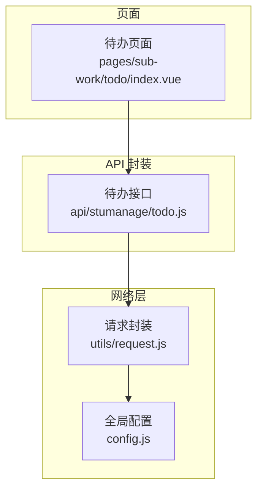
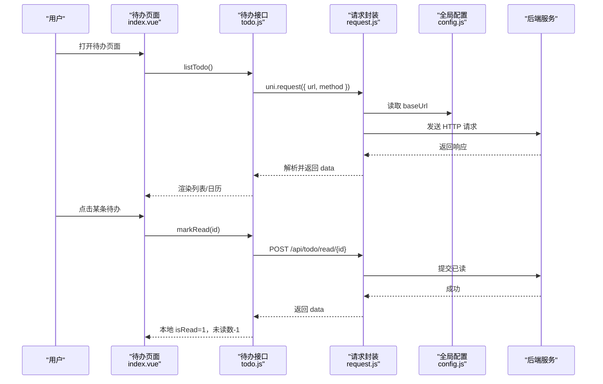
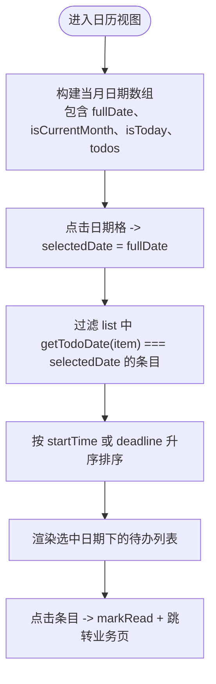
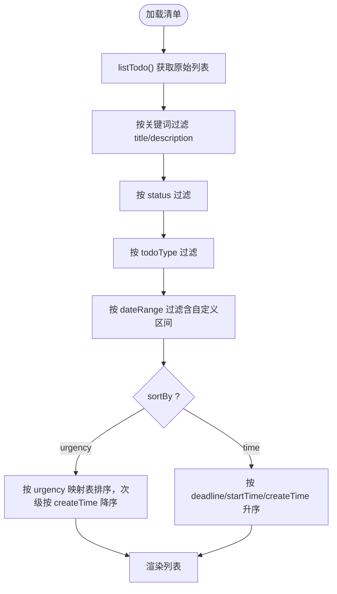
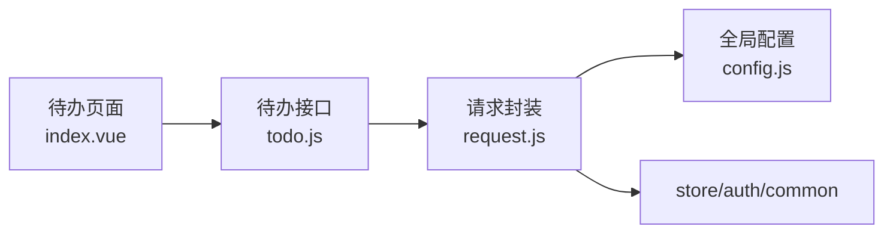

# 智能待办系统

<cite>
**本文引用的文件**   
- [api/stumanage/todo.js](file://api/stumanage/todo.js)
- [pages/sub-work/todo/index.vue](file://pages/sub-work/todo/index.vue)
- [utils/request.js](file://utils/request.js)
- [config.js](file://config.js)
</cite>

## 目录
1. [简介](#简介)
2. [项目结构](#项目结构)
3. [核心组件](#核心组件)
4. [架构总览](#架构总览)
5. [详细组件分析](#详细组件分析)
6. [依赖关系分析](#依赖关系分析)
7. [性能与体验优化](#性能与体验优化)
8. [故障排查指南](#故障排查指南)
9. [结论](#结论)
10. [附录：API 参考与扩展指南](#附录api-参考与扩展指南)

## 简介
本文件面向“智能待办系统”的前端实现，围绕以下目标展开：
- 待办事项管理：列表、日历视图、筛选排序、搜索、已读标记、跳转业务页。
- 数据模型与状态：字段约定、状态流转、生命周期。
- 周/月日历视图：数据绑定、交互逻辑、日期计算。
- 优先级与自动排序：紧急度映射、时间优先策略。
- 提醒机制：未读数展示、点击标记已读；定时任务与推送在现有前端中未直接实现，提供扩展建议。
- API 调用示例与事件处理：基于现有接口封装的调用方式与页面事件。
- 跨页面同步与实时更新：当前为拉取刷新模式，给出增量更新方案建议。
- 定制与扩展：如何新增类型、调整排序、接入通知与定时任务。

## 项目结构
待办功能主要涉及两个层面：
- API 层：统一封装后端接口，供页面调用。
- 页面层：提供“清单视图”和“日历视图”，承载筛选、排序、搜索、已读标记等交互。

图表来源
- [pages/sub-work/todo/index.vue:1-120](file://pages/sub-work/todo/index.vue#L1-L120)
- [api/stumanage/todo.js:1-43](file://api/stumanage/todo.js#L1-L43)
- [utils/request.js:1-117](file://utils/request.js#L1-L117)
- [config.js:1-38](file://config.js#L1-L38)

章节来源
- [pages/sub-work/todo/index.vue:1-120](file://pages/sub-work/todo/index.vue#L1-L120)
- [api/stumanage/todo.js:1-43](file://api/stumanage/todo.js#L1-L43)
- [utils/request.js:1-117](file://utils/request.js#L1-L117)
- [config.js:1-38](file://config.js#L1-L38)

## 核心组件
- 待办 API 模块
  - 列出待办、获取未读数、新增、删除、标记已读。
- 待办页面
  - 双视图（清单/日历）、筛选、排序、搜索、已读标记、按日聚合展示。
- 网络请求封装
  - 统一鉴权、错误码处理、超时与异常提示、微信环境自动登录重试。
- 全局配置
  - 协议、主机、端口、API 前缀与 baseUrl 拼接。

章节来源
- [api/stumanage/todo.js:1-43](file://api/stumanage/todo.js#L1-L43)
- [pages/sub-work/todo/index.vue:220-510](file://pages/sub-work/todo/index.vue#L220-L510)
- [utils/request.js:1-117](file://utils/request.js#L1-L117)
- [config.js:1-38](file://config.js#L1-L38)

## 架构总览
从用户操作到数据落库的整体流程如下：

图表来源
- [pages/sub-work/todo/index.vue:353-440](file://pages/sub-work/todo/index.vue#L353-L440)
- [api/stumanage/todo.js:4-42](file://api/stumanage/todo.js#L4-L42)
- [utils/request.js:24-100](file://utils/request.js#L24-L100)
- [config.js:12-15](file://config.js#L12-L15)

## 详细组件分析

### 待办数据模型与状态
- 关键字段（由页面使用推导）
  - id：唯一标识
  - title：标题
  - description：描述
  - todoType：类型（如 schedule、meeting、leave、talk_disciplinary、classcheck_talk、classcheck_confirm 等）
  - deadline：截止时间（YYYY-MM-DD HH:mm:ss）
  - startTime：开始时间（可选，用于全天或具体时段）
  - allDay：是否全天（'1' 表示全天）
  - status：状态（'0' 未完成，'1' 已完成）
  - isRead：是否已读（'1' 已读）
  - urgency：紧急度（overdue/today/tomorrow/normal）
  - createTime：创建时间
  - businessId：关联业务 ID（用于跳转到对应业务页）
- 状态与生命周期
  - 新增：通过 addTodo 写入后端，进入“未完成”状态。
  - 查看：首次点击时触发 markRead，将 isRead 置为 '1'，同时减少未读数。
  - 完成：status 由 '0' 变为 '1'（当前页面未提供直接完成入口，可在后续扩展）。
  - 删除：delTodo 移除条目。
  - 过期：根据 deadline 与当前时间计算 urgency，影响排序与标签显示。

章节来源
- [pages/sub-work/todo/index.vue:284-351](file://pages/sub-work/todo/index.vue#L284-L351)
- [pages/sub-work/todo/index.vue:403-474](file://pages/sub-work/todo/index.vue#L403-L474)
- [api/stumanage/todo.js:19-42](file://api/stumanage/todo.js#L19-L42)

### 周/月日历视图与数据绑定
- 视图切换
  - 顶部按钮在“日历”和“清单”间切换。
- 月份导航
  - 左右箭头切换上/下月，计算当月第一天与起始周日，生成 42 个格子覆盖四周至六周。
- 日期聚合
  - 每个日期格子的 todos 来源于 list 中 deadline/startTime/createTime 的日期部分匹配。
- 选中日期详情
  - 底部滚动区域展示选中日期的待办，按 startTime 或 deadline 升序排列。
- 交互
  - 点击日期格选择该日；点击条目执行 handleTodo（标记已读 + 路由跳转）。

图表来源
- [pages/sub-work/todo/index.vue:381-407](file://pages/sub-work/todo/index.vue#L381-L407)
- [pages/sub-work/todo/index.vue:284-292](file://pages/sub-work/todo/index.vue#L284-L292)
- [pages/sub-work/todo/index.vue:433-451](file://pages/sub-work/todo/index.vue#L433-L451)

章节来源
- [pages/sub-work/todo/index.vue:28-78](file://pages/sub-work/todo/index.vue#L28-L78)
- [pages/sub-work/todo/index.vue:381-407](file://pages/sub-work/todo/index.vue#L381-L407)
- [pages/sub-work/todo/index.vue:284-292](file://pages/sub-work/todo/index.vue#L284-L292)
- [pages/sub-work/todo/index.vue:433-451](file://pages/sub-work/todo/index.vue#L433-L451)

### 清单视图：搜索、筛选与排序
- 搜索
  - 输入框对 title 与 description 进行大小写不敏感模糊匹配，带防抖。
- 筛选
  - 时间段：今天/本周/本月/自定义区间/全部。
  - 状态：未完成/已完成。
  - 类型：多种业务类型。
- 排序
  - 按时间：deadline > startTime > createTime 升序。
  - 按紧急程度：overdue > today > tomorrow > normal，同级别按 createTime 降序。

图表来源
- [pages/sub-work/todo/index.vue:293-351](file://pages/sub-work/todo/index.vue#L293-L351)

章节来源
- [pages/sub-work/todo/index.vue:81-153](file://pages/sub-work/todo/index.vue#L81-L153)
- [pages/sub-work/todo/index.vue:293-351](file://pages/sub-work/todo/index.vue#L293-L351)

### 优先级算法与自动排序
- 紧急度映射
  - overdue：已逾期
  - today：今日截止
  - tomorrow：明日截止
  - normal：常规
- 排序规则
  - 紧急度优先：overdue < today < tomorrow < normal。
  - 同紧急度：按 createTime 降序（新创建的更靠前）。
  - 时间优先：当 sortBy=time 时，按 deadline > startTime > createTime 升序。

章节来源
- [pages/sub-work/todo/index.vue:335-351](file://pages/sub-work/todo/index.vue#L335-L351)

### 提醒机制与通知推送
- 已读计数与提示
  - 页面顶部展示未读数量，点击条目后调用 markRead 标记已读并减少未读数。
- 定时任务与系统通知
  - 当前前端未实现后台定时任务与系统级推送。建议在服务端增加定时扫描任务，依据 deadline 与当前时间计算 urgency，并通过消息中心或平台通知能力推送提醒。
- 可扩展点
  - 在 handleTodo 或 onShow 中可加入轮询或 WebSocket 监听，实现实时提醒。

章节来源
- [pages/sub-work/todo/index.vue:353-374](file://pages/sub-work/todo/index.vue#L353-L374)
- [pages/sub-work/todo/index.vue:433-440](file://pages/sub-work/todo/index.vue#L433-L440)

### 跨页面同步与实时更新
- 当前实现
  - 页面 onShow 时主动拉取 listTodo 与 getUnreadCount，属于“拉取式”同步。
- 建议增强
  - 引入 uni.onSocketMessage 或 uni.connectSocket 建立长连接，服务端变更时推送增量更新。
  - 或使用 uni.getSystemInfoSync().platform 结合平台能力（如小程序订阅消息）提升触达率。

章节来源
- [pages/sub-work/todo/index.vue:353-356](file://pages/sub-work/todo/index.vue#L353-L356)

## 依赖关系分析
- 页面依赖 API 模块
- API 模块依赖请求封装
- 请求封装依赖全局配置与 store、auth、common 工具

图表来源
- [pages/sub-work/todo/index.vue:224](file://pages/sub-work/todo/index.vue#L224-L224)
- [api/stumanage/todo.js:1](file://api/stumanage/todo.js#L1-L1)
- [utils/request.js:1-6](file://utils/request.js#L1-L6)
- [config.js:12-15](file://config.js#L12-L15)

章节来源
- [pages/sub-work/todo/index.vue:224](file://pages/sub-work/todo/index.vue#L224-L224)
- [api/stumanage/todo.js:1-43](file://api/stumanage/todo.js#L1-L43)
- [utils/request.js:1-117](file://utils/request.js#L1-L117)
- [config.js:1-38](file://config.js#L1-L38)

## 性能与体验优化
- 列表渲染
  - 大数据量场景建议使用虚拟列表或分页加载（当前 loadMore 为空实现，可接入后端分页）。
- 计算优化
  - calendarDays 与 filteredList 均为 computed，避免重复计算；如需进一步优化可将 list 缓存并按需重建。
- 网络优化
  - 合并请求：例如将 listTodo 与 getUnreadCount 合并为一次批量接口。
  - 缓存策略：对只读数据做短期内存缓存，配合版本号失效。
- 交互优化
  - 搜索防抖已实现；筛选弹窗可考虑懒加载日期选择器以减少首屏开销。

[本节为通用建议，无需源码引用]

## 故障排查指南
- 常见错误码与处理
  - 401：会话过期，非登录接口会尝试自动登录并重试，失败则跳转登录页。
  - 500：服务端异常，弹出后端返回的消息。
  - 其他非 200：除特定码外均弹出错误提示。
- 网络异常
  - 超时、网络错误、HTTP 状态码异常均会被捕获并友好提示。
- 定位步骤
  - 检查 config.baseUrl 是否正确拼接。
  - 确认 Authorization 头是否携带。
  - 查看后端返回的 code/msg 是否与 errorCode 映射一致。

章节来源
- [utils/request.js:39-112](file://utils/request.js#L39-L112)
- [config.js:12-15](file://config.js#L12-L15)

## 结论
本系统在前端实现了完整的待办管理闭环：数据拉取、双视图呈现、筛选排序、已读标记与业务跳转。优先级与时间排序清晰明确，便于用户聚焦重要事项。提醒机制目前以未读数与点击标记为主，建议在后端引入定时任务与推送通道，并在前端引入长连接或订阅消息以实现实时提醒与跨页面同步。

[本节为总结性内容，无需源码引用]

## 附录：API 参考与扩展指南

### API 接口一览
- 查询待办列表
  - 方法：GET
  - 路径：/api/todo/list
  - 说明：返回待办集合，用于渲染清单与日历。
- 获取未读待办数量
  - 方法：GET
  - 路径：/api/todo/unreadCount
  - 说明：返回未读总数，用于顶部提示。
- 新增待办
  - 方法：POST
  - 路径：/api/todo
  - 说明：传入待办对象，成功后插入列表。
- 删除待办
  - 方法：POST
  - 路径：/api/todo/delete/{id}
  - 说明：根据 id 删除指定待办。
- 标记已读
  - 方法：POST
  - 路径：/api/todo/read/{id}
  - 说明：将 isRead 置为 '1'，并减少未读数。

章节来源
- [api/stumanage/todo.js:4-42](file://api/stumanage/todo.js#L4-L42)

### 调用示例（基于现有封装）
- 获取列表
  - 调用：listTodo()
  - 返回值：res.data 为待办数组
- 获取未读数
  - 调用：getUnreadCount()
  - 返回值：res.data 为未读数量
- 标记已读
  - 调用：markRead(id)
  - 返回值：成功后更新本地 isRead 与未读数

章节来源
- [pages/sub-work/todo/index.vue:358-374](file://pages/sub-work/todo/index.vue#L358-L374)
- [pages/sub-work/todo/index.vue:433-440](file://pages/sub-work/todo/index.vue#L433-L440)

### 事件处理要点
- 页面加载
  - onShow 中调用 getList 与 getUnread，确保数据最新。
- 点击条目
  - 若未读则先 markRead，再根据 todoType 跳转到对应业务页。
- 筛选与排序
  - 通过 computed 组合 filterForm 与 sortBy 动态生成 filteredList。

章节来源
- [pages/sub-work/todo/index.vue:353-356](file://pages/sub-work/todo/index.vue#L353-L356)
- [pages/sub-work/todo/index.vue:433-451](file://pages/sub-work/todo/index.vue#L433-L451)
- [pages/sub-work/todo/index.vue:293-351](file://pages/sub-work/todo/index.vue#L293-L351)

### 开发扩展指南
- 新增待办类型
  - 在 typeOptions 中添加选项，并在 formatTodoType 与颜色映射中补充样式。
- 调整优先级算法
  - 修改 urgencyOrder 映射与排序比较逻辑，支持更多维度（如重要性、负责人等）。
- 接入定时任务与推送
  - 服务端：定时扫描 deadline，计算 urgency，触发推送。
  - 前端：在 onShow 或应用前台时轮询 getUnreadCount，或通过 WebSocket 接收增量更新。
- 跨页面同步
  - 使用 uni.$emit/uni.$on 或全局 store 共享待办状态，或在多 Tab 间通过 storage 同步。

[本节为扩展建议，无需源码引用]