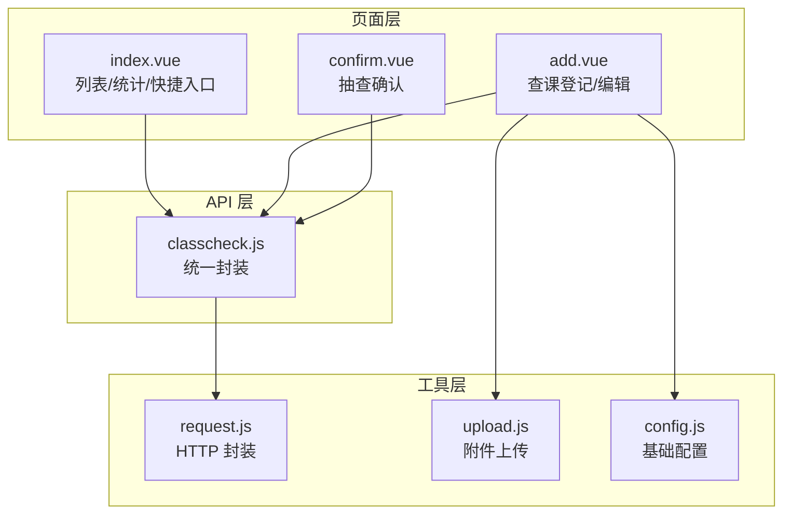
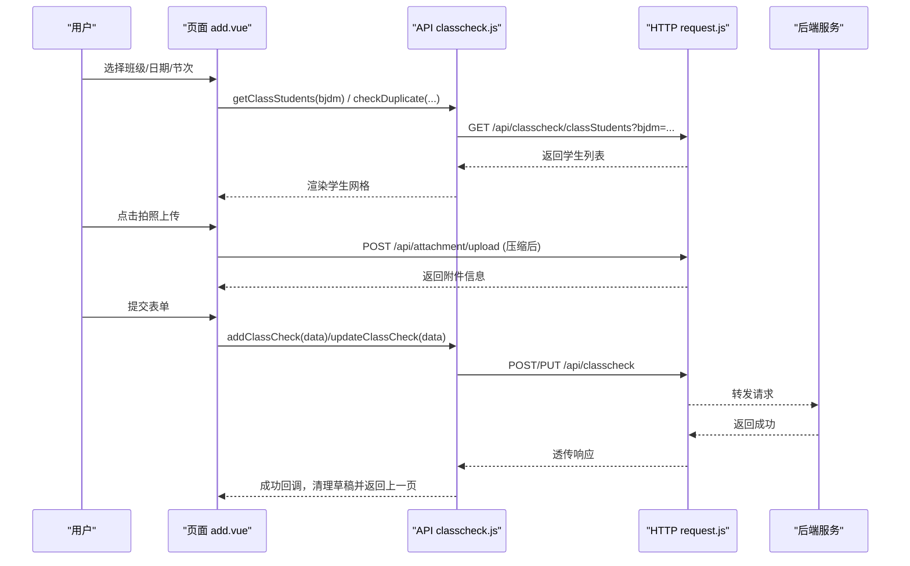
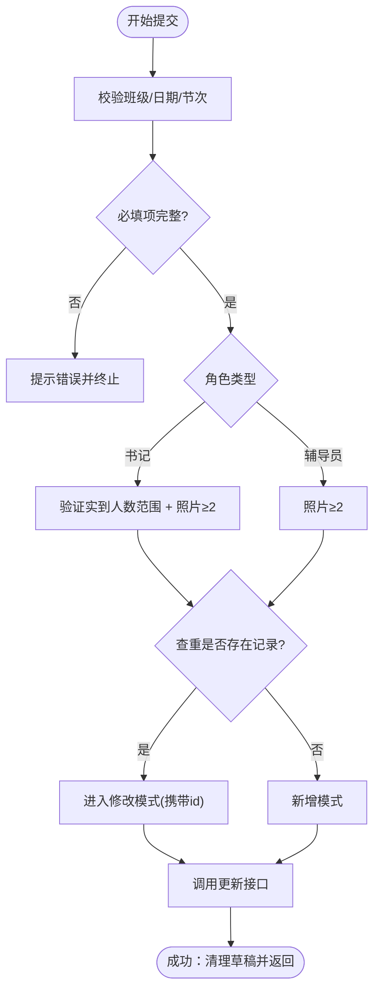
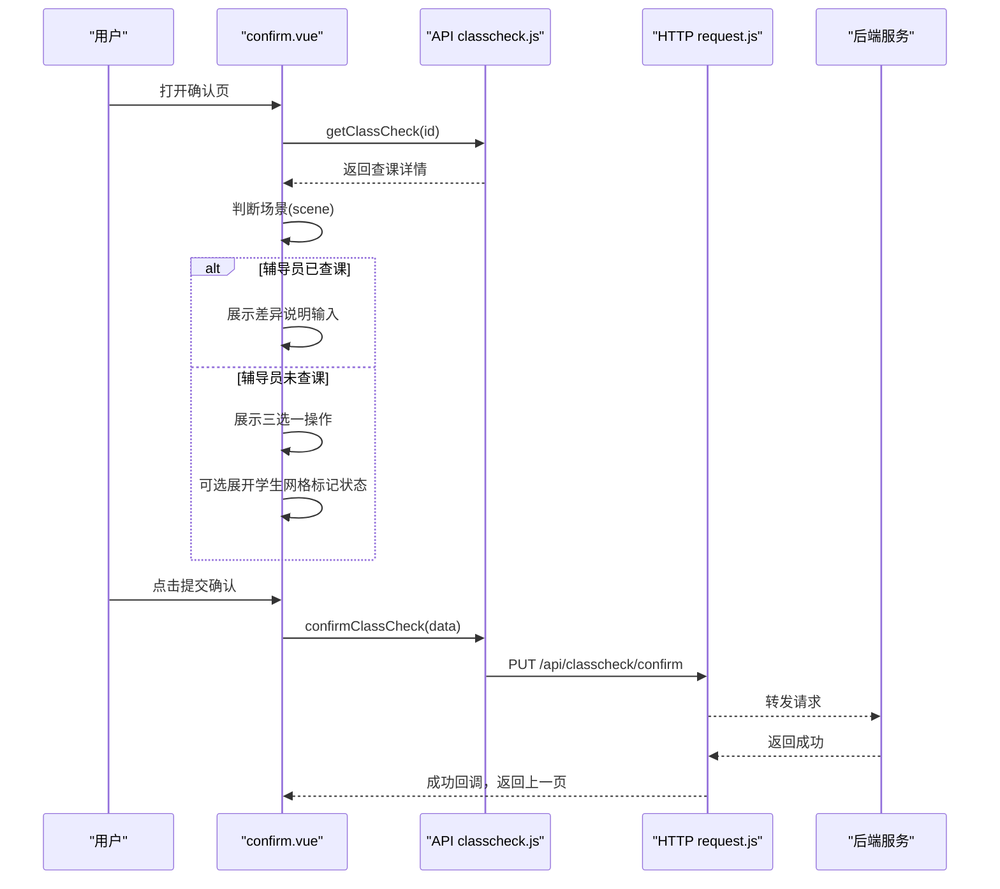
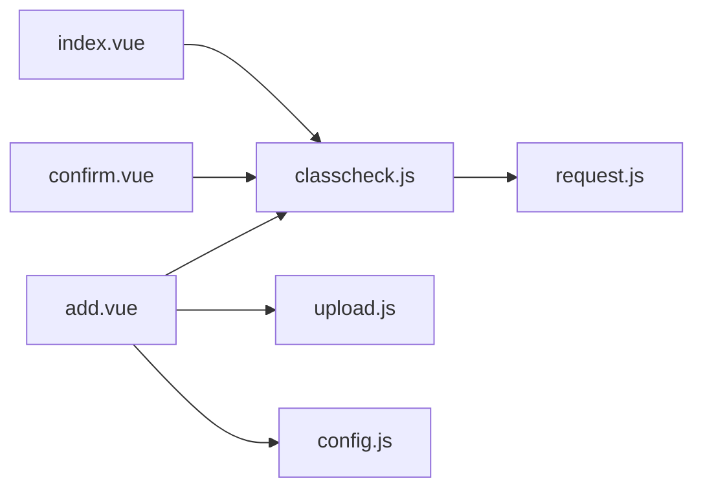

# 查课管理模块

<cite>
**本文引用的文件**   
- [api/stumanage/classcheck.js](file://api/stumanage/classcheck.js)
- [pages/sub-work/classcheck/index.vue](file://pages/sub-work/classcheck/index.vue)
- [pages/sub-work/classcheck/add.vue](file://pages/sub-work/classcheck/add.vue)
- [pages/sub-work/classcheck/confirm.vue](file://pages/sub-work/classcheck/confirm.vue)
- [utils/request.js](file://utils/request.js)
- [utils/upload.js](file://utils/upload.js)
- [config.js](file://config.js)
</cite>

## 目录
1. [简介](#简介)
2. [项目结构](#项目结构)
3. [核心组件](#核心组件)
4. [架构总览](#架构总览)
5. [详细组件分析](#详细组件分析)
6. [依赖关系分析](#依赖关系分析)
7. [性能与实时性](#性能与实时性)
8. [故障排查指南](#故障排查指南)
9. [结论](#结论)
10. [附录：API 接口说明与示例](#附录api-接口说明与示例)

## 简介
本模块面向移动端，提供“课堂检查登记、抽查确认、记录管理”的完整流程。支持辅导员与学生视角（按学生逐人标记状态）和书记视角（输入实到人数并上传现场照片）。包含查询、统计、导出扩展点、数据校验、草稿缓存、附件上传等能力。

## 项目结构
查课相关的前端实现集中在 pages/sub-work/classcheck 目录下，API 封装在 api/stumanage/classcheck.js，通用请求与上传工具位于 utils 目录。

图表来源
- [pages/sub-work/classcheck/index.vue:1-120](file://pages/sub-work/classcheck/index.vue#L1-L120)
- [pages/sub-work/classcheck/add.vue:150-220](file://pages/sub-work/classcheck/add.vue#L150-L220)
- [pages/sub-work/classcheck/confirm.vue:190-260](file://pages/sub-work/classcheck/confirm.vue#L190-L260)
- [api/stumanage/classcheck.js:1-67](file://api/stumanage/classcheck.js#L1-L67)
- [utils/request.js](file://utils/request.js)
- [utils/upload.js](file://utils/upload.js)
- [config.js](file://config.js)

章节来源
- [pages/sub-work/classcheck/index.vue:1-120](file://pages/sub-work/classcheck/index.vue#L1-L120)
- [api/stumanage/classcheck.js:1-67](file://api/stumanage/classcheck.js#L1-L67)

## 核心组件
- 列表与统计页（index.vue）
  - 展示当日/指定日期查课次数、出勤率、缺勤人数；显示今日班级课表并按节次过滤；可快速跳转新增；展示分页的查课记录列表；书记角色下展示辅导员排名/热力图统计。
- 查课登记页（add.vue）
  - 辅导员模式：选择班级后加载学生名单，点击切换“迟到/早退/旷课”，自动计算应到/实到/请假/异常人数；书记模式：输入实到人数，展示请假明细；均要求至少两张现场照片；支持查重自动进入修改模式；本地草稿保存与恢复；提交时附带附件信息与人员明细。
- 抽查确认页（confirm.vue）
  - 根据是否已有辅导员该节查课结果，分支为“已查课需填写差异说明”或“未查课可选择提交缺勤名单/补登请假/情况说明”；内置人数校验与提示；最终调用确认接口完成闭环。

章节来源
- [pages/sub-work/classcheck/index.vue:227-350](file://pages/sub-work/classcheck/index.vue#L227-L350)
- [pages/sub-work/classcheck/add.vue:154-220](file://pages/sub-work/classcheck/add.vue#L154-L220)
- [pages/sub-work/classcheck/confirm.vue:193-260](file://pages/sub-work/classcheck/confirm.vue#L193-L260)

## 架构总览
前端通过 classcheck.js 封装的 API 调用后端 REST 接口，使用 request.js 进行网络请求，add.vue 中的拍照上传走 upload.js 与通用附件接口。页面间通过路由参数传递上下文（如 bjdm、lessonNo、checkDate），并在 onShow/onLoad 中刷新数据。

图表来源
- [pages/sub-work/classcheck/add.vue:889-949](file://pages/sub-work/classcheck/add.vue#L889-L949)
- [api/stumanage/classcheck.js:25-41](file://api/stumanage/classcheck.js#L25-L41)
- [utils/request.js](file://utils/request.js)

## 详细组件分析

### 数据模型与业务规则
- 查课主记录字段（由页面组装并提交）
  - 基本信息：bjdm、bjmc、checkDate、lessonNo、courseName、classRoom、classTeacher、remark
  - 统计字段：totalStudents、presentCount、leaveCount、absentCount、checkStatus
  - 人员明细：detailList（xh、studentName、absentType）
  - 查课人信息：checkerId、checkerName、checkerRole（counselor/secretary）
  - 是否需要辅导员补充：needCounselorConfirm（书记查课时置为需要）
  - 附件：attachmentList（filePath、fileName、fileSize、fileType、mediaType、exifData、sortOrder）
- 业务规则
  - 重复检测：同一班级+日期+节次仅允许一条有效记录，新增前会调用查重接口，若存在则自动进入修改模式。
  - 辅导员模式：以“学生点击状态”为准，迟到/早退/旷课循环切换；请假学生不可点击；异常人数=迟到+早退+旷课；实到=应到-请假-异常。
  - 书记模式：直接输入实到人数，系统自动计算未到人数；必须上传至少两张现场照片。
  - 抽查确认：若辅导员已查课，需填写差异说明；若未查课，可选择提交缺勤名单/补登请假/情况说明，并进行人数一致性校验。

章节来源
- [pages/sub-work/classcheck/add.vue:786-867](file://pages/sub-work/classcheck/add.vue#L786-L867)
- [pages/sub-work/classcheck/add.vue:586-608](file://pages/sub-work/classcheck/add.vue#L586-L608)
- [pages/sub-work/classcheck/confirm.vue:377-452](file://pages/sub-work/classcheck/confirm.vue#L377-L452)

### 查课登记表单设计与验证
- 表单元素
  - 专业/年级筛选（书记）、班级下拉、日期、节次、课程/教室/教师（可选预填）
  - 辅导员：学生网格按钮（到/迟/退/旷），顶部汇总（请假/异常计数）
  - 书记：实到人数输入框、请假明细列表
  - 现场拍照：最多四张，至少两张，标签顺序固定
- 验证逻辑
  - 必填：班级、日期、节次
  - 书记：实到人数非空且在合理区间；照片≥2
  - 辅导员：照片≥2
  - 提交前查重，若存在则自动切换到修改模式
  - 提交成功后清理本地草稿并通知首页刷新

图表来源
- [pages/sub-work/classcheck/add.vue:712-785](file://pages/sub-work/classcheck/add.vue#L712-L785)
- [pages/sub-work/classcheck/add.vue:886-949](file://pages/sub-work/classcheck/add.vue#L886-L949)

章节来源
- [pages/sub-work/classcheck/add.vue:219-265](file://pages/sub-work/classcheck/add.vue#L219-L265)
- [pages/sub-work/classcheck/add.vue:712-785](file://pages/sub-work/classcheck/add.vue#L712-L785)
- [pages/sub-work/classcheck/add.vue:886-949](file://pages/sub-work/classcheck/add.vue#L886-L949)

### 抽查确认流程与状态管理
- 场景判断
  - 若辅导员已查课：展示“数据比对”卡片（抽查统计未到 vs 我的统计未到）及差异值，要求填写差异说明。
  - 若辅导员未查课：提供三个操作入口（提交缺勤名单/补登请假/情况说明），并可展开学生网格进行状态标记。
- 状态管理
  - scene：counselor_checked / counselor_not_checked
  - clickMap：{ xh: 1=迟到, 2=早退, 3=旷课 }
  - confirmType：absent / remark
  - canProceed：是否满足继续提交条件
- 提交校验
  - 已查课：必须填写差异说明
  - 未查课：选择提交方式后进行相应校验；人数校验保证“实到+请假+缺勤≥应到”

图表来源
- [pages/sub-work/classcheck/confirm.vue:241-316](file://pages/sub-work/classcheck/confirm.vue#L241-L316)
- [pages/sub-work/classcheck/confirm.vue:377-452](file://pages/sub-work/classcheck/confirm.vue#L377-L452)
- [api/stumanage/classcheck.js:17-23](file://api/stumanage/classcheck.js#L17-L23)

章节来源
- [pages/sub-work/classcheck/confirm.vue:193-260](file://pages/sub-work/classcheck/confirm.vue#L193-L260)
- [pages/sub-work/classcheck/confirm.vue:377-452](file://pages/sub-work/classcheck/confirm.vue#L377-L452)

### 记录管理与查询统计
- 列表查询
  - 分页加载，支持按日期、节次等条件过滤；第一页替换，后续追加；无更多数据时停止加载。
- 统计面板
  - 顶部统计卡片：查课次数、出勤率、缺勤人数；支持日期左右切换与回到今天。
  - 书记视图：辅导员查课统计，支持条形图与热力图两种视图，按次数排序。
- 图片预览
  - 列表项内嵌缩略图，点击使用 uni.previewImage 预览。

章节来源
- [pages/sub-work/classcheck/index.vue:555-620](file://pages/sub-work/classcheck/index.vue#L555-L620)
- [pages/sub-work/classcheck/index.vue:597-614](file://pages/sub-work/classcheck/index.vue#L597-L614)
- [pages/sub-work/classcheck/index.vue:644-651](file://pages/sub-work/classcheck/index.vue#L644-L651)

## 依赖关系分析
- 页面依赖
  - index.vue 依赖 classcheck.js 的 listClassCheck、getClassCheckStats、getMyClasses；依赖 schedule 与 stats 接口用于课表与统计。
  - add.vue 依赖 classcheck.js 的 getClassStudents、addClassCheck、updateClassCheck、getClassCheck、checkDuplicate；依赖 classinfo、leave、stats、teacherinfo 等辅助接口；依赖 upload.js 与 config.js。
  - confirm.vue 依赖 classcheck.js 的 getClassCheck、confirmClassCheck；依赖 leave 接口获取请假数据。
- 工具依赖
  - request.js 负责 HTTP 请求封装；upload.js 负责文件上传；config.js 提供 baseUrl 等配置。

图表来源
- [pages/sub-work/classcheck/index.vue:227-235](file://pages/sub-work/classcheck/index.vue#L227-L235)
- [pages/sub-work/classcheck/add.vue:154-164](file://pages/sub-work/classcheck/add.vue#L154-L164)
- [pages/sub-work/classcheck/confirm.vue:193-197](file://pages/sub-work/classcheck/confirm.vue#L193-L197)
- [api/stumanage/classcheck.js:1-67](file://api/stumanage/classcheck.js#L1-L67)
- [utils/request.js](file://utils/request.js)
- [utils/upload.js](file://utils/upload.js)
- [config.js](file://config.js)

章节来源
- [pages/sub-work/classcheck/index.vue:227-235](file://pages/sub-work/classcheck/index.vue#L227-L235)
- [pages/sub-work/classcheck/add.vue:154-164](file://pages/sub-work/classcheck/add.vue#L154-L164)
- [pages/sub-work/classcheck/confirm.vue:193-197](file://pages/sub-work/classcheck/confirm.vue#L193-L197)

## 性能与实时性
- 列表分页与增量加载：避免一次性拉取大量数据，提升首屏性能。
- 并行加载：书记模式下并行获取专业列表、班级列表与统计数据，减少等待时间。
- 图片压缩上传：先压缩再上传，降低带宽占用与上传耗时。
- 本地草稿：退出或切换时自动保存草稿，恢复时复用，提高用户体验。
- 实时同步：当前实现以主动刷新为主（onShow 刷新列表与统计），如需强实时可在关键节点增加轮询或事件推送机制。

[本节为通用建议，不直接分析具体文件]

## 故障排查指南
- 列表加载失败
  - 检查 listClassCheck 请求参数是否正确；查看 request.js 的错误拦截与提示。
- 查重冲突导致无法新增
  - 确认 checkDuplicate 返回的已有记录 id 是否与当前编辑一致；必要时重新加载详情。
- 照片上传失败
  - 检查 compressAndUpload 与 uploadPhoto 的返回值；确认 /api/attachment/upload 的 businessType 与 bjdm 参数。
- 书记实到人数校验失败
  - 确保实际输入在 0 至 totalStudents 范围内，且大于等于 totalStudents - leaveCount。
- 抽查确认人数不一致
  - 核对 presentCount + leaveCount + absentCount 与 totalStudents 的关系，必要时修正缺勤标记。

章节来源
- [pages/sub-work/classcheck/add.vue:712-785](file://pages/sub-work/classcheck/add.vue#L712-L785)
- [pages/sub-work/classcheck/add.vue:886-949](file://pages/sub-work/classcheck/add.vue#L886-L949)
- [pages/sub-work/classcheck/confirm.vue:377-452](file://pages/sub-work/classcheck/confirm.vue#L377-L452)

## 结论
查课管理模块围绕“登记—确认—记录”的主线，结合角色差异化交互与严格的表单校验，实现了从数据采集到审核闭环的完整流程。通过分页加载、并行请求、图片压缩与草稿缓存等手段，兼顾了性能与体验。后续可按需扩展报表导出与实时同步能力。

[本节为总结，不直接分析具体文件]

## 附录：API 接口说明与示例

- 获取查课列表
  - 方法：GET
  - 路径：/api/classcheck/list
  - 参数：pageNum、pageSize、checkDate、lessonNo 等（由页面 queryParam 传入）
  - 返回：rows、total
  - 示例：listClassCheck({ pageNum: 1, pageSize: 20, checkDate: '2025-01-01' })

- 获取查课详情
  - 方法：GET
  - 路径：/api/classcheck/:id
  - 返回：data（含 detailList、attachmentList 等）
  - 示例：getClassCheck('xxx')

- 新增查课记录
  - 方法：POST
  - 路径：/api/classcheck
  - 请求体：form 基础信息 + 统计字段 + detailList + checkerInfo + attachmentList
  - 示例：addClassCheck({ bjdm, checkDate, lessonNo, ... })

- 修改查课记录
  - 方法：PUT
  - 路径：/api/classcheck
  - 请求体：同新增，需包含 id
  - 示例：updateClassCheck({ id, ... })

- 获取班级学生列表
  - 方法：GET
  - 路径：/api/classcheck/classStudents
  - 参数：bjdm
  - 返回：data/rows（学生数组）
  - 示例：getClassStudents('BJ001')

- 获取我的班级列表
  - 方法：GET
  - 路径：/api/classtree/myClasses
  - 返回：data（班级数组）
  - 示例：getMyClasses()

- 获取查课统计数据
  - 方法：GET
  - 路径：/api/classcheck/stats
  - 参数：endDate（YYYY-MM-DD）
  - 返回：todayStats（含 checkCount、attendanceRate、absentCount 等）
  - 示例：getClassCheckStats({ endDate: '2025-01-01' })

- 查重接口（新增前校验）
  - 方法：GET
  - 路径：/api/classcheck/checkDuplicate
  - 参数：bjdm、checkDate、lessonNo
  - 返回：data（若存在记录则返回 id 等信息）
  - 示例：checkDuplicate('BJ001', '2025-01-01', 3)

- 抽查确认接口
  - 方法：PUT
  - 路径：/api/classcheck/confirm
  - 请求体：id、remark、detailList、confirmType
  - 示例：confirmClassCheck({ id, remark, detailList, confirmType: 'absent' })

章节来源
- [api/stumanage/classcheck.js:8-66](file://api/stumanage/classcheck.js#L8-L66)
- [pages/sub-work/classcheck/add.vue:586-608](file://pages/sub-work/classcheck/add.vue#L586-L608)
- [pages/sub-work/classcheck/confirm.vue:377-452](file://pages/sub-work/classcheck/confirm.vue#L377-L452)