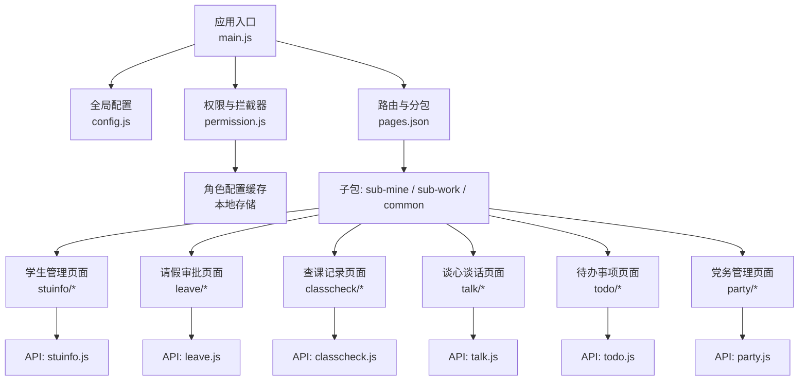
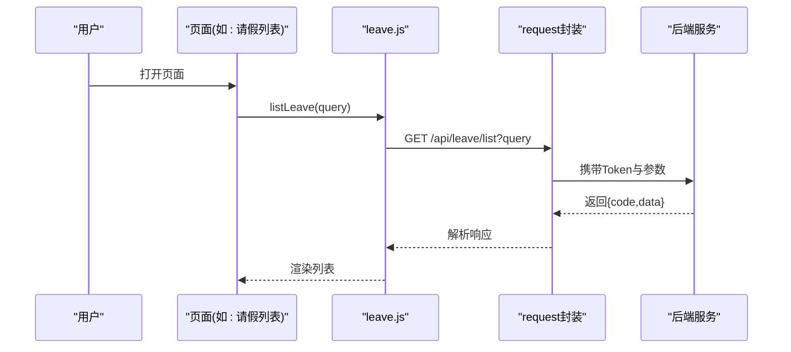
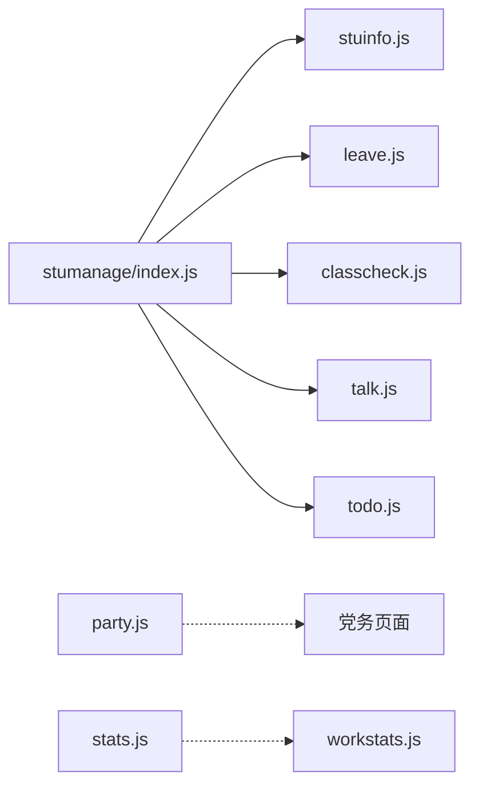
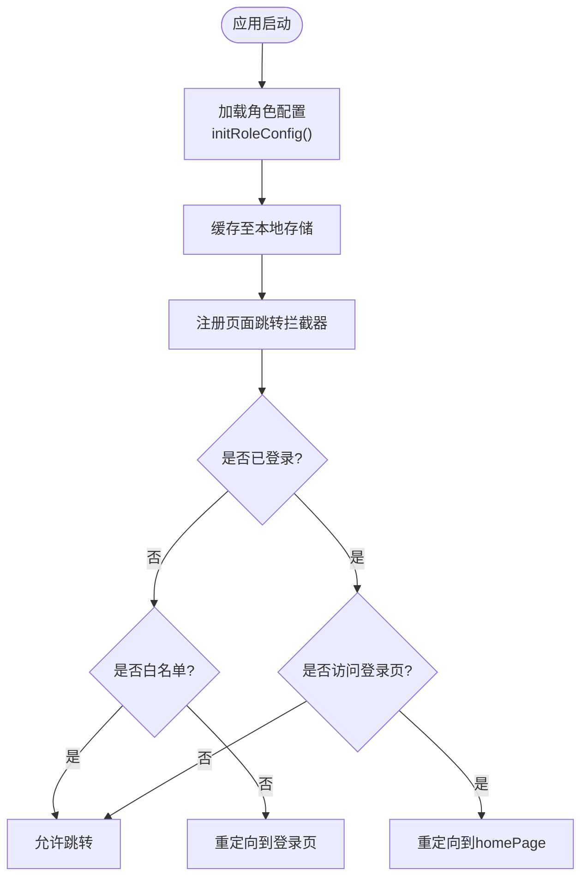

# 核心功能模块

<cite>
**本文引用的文件**   
- [README.md](file://README.md)
- [config.js](file://config.js)
- [main.js](file://main.js)
- [pages.json](file://pages.json)
- [permission.js](file://permission.js)
- [api/stumanage/index.js](file://api/stumanage/index.js)
- [api/stumanage/leave.js](file://api/stumanage/leave.js)
- [api/stumanage/classcheck.js](file://api/stumanage/classcheck.js)
- [api/stumanage/talk.js](file://api/stumanage/talk.js)
- [api/stumanage/todo.js](file://api/stumanage/todo.js)
- [api/stumanage/stuinfo.js](file://api/stumanage/stuinfo.js)
- [api/party.js](file://api/party.js)
- [api/stumanage/stats.js](file://api/stumanage/stats.js)
- [api/stumanage/workstats.js](file://api/stumanage/workstats.js)
- [utils/permission.js](file://utils/permission.js)
</cite>

## 目录
1. [简介](#简介)
2. [项目结构](#项目结构)
3. [核心组件](#核心组件)
4. [架构总览](#架构总览)
5. [详细组件分析](#详细组件分析)
6. [依赖分析](#依赖分析)
7. [性能考虑](#性能考虑)
8. [故障排查指南](#故障排查指南)
9. [结论](#结论)
10. [附录](#附录)

## 简介
本文件面向RuoYi-App的核心业务模块，聚焦学生管理、请假管理、查课管理、谈话记录、智能待办、党务管理、统计分析等模块。文档从系统架构、数据流、业务流程、界面组织、权限控制与角色适配、API接口说明与使用示例、扩展开发指南等方面进行全面阐述，帮助开发者快速理解并高效扩展各模块。

## 项目结构
- 应用入口与全局初始化：main.js负责插件注册、全局方法挂载、字典加载等；config.js提供后端协议、主机、端口、API前缀与应用信息；pages.json定义页面路由、分包与TabBar。
- 权限与路由拦截：permission.js实现登录态校验、白名单放行、动态首页与TabBar配置注入。
- API层：api/stumanage下按功能域拆分（学生、请假、查课、谈话、待办、统计等），统一通过utils/request发起请求；party.js封装党务相关接口。
- 页面组织：pages为顶层页面，subPackages为分包页面，包含“我的”“工作台”“学生管理”“请假审批”“查课记录”“谈心谈话”“待办事项”“活动管理”“党务管理”等。

图表来源
- [main.js:1-31](file://main.js#L1-L31)
- [config.js:1-38](file://config.js#L1-L38)
- [pages.json:1-235](file://pages.json#L1-L235)
- [permission.js:1-133](file://permission.js#L1-L133)
- [api/stumanage/stuinfo.js:1-85](file://api/stumanage/stuinfo.js#L1-L85)
- [api/stumanage/leave.js:1-51](file://api/stumanage/leave.js#L1-L51)
- [api/stumanage/classcheck.js:1-67](file://api/stumanage/classcheck.js#L1-L67)
- [api/stumanage/talk.js:1-90](file://api/stumanage/talk.js#L1-L90)
- [api/stumanage/todo.js:1-43](file://api/stumanage/todo.js#L1-L43)
- [api/party.js:1-88](file://api/party.js#L1-L88)

章节来源
- [README.md:1-52](file://README.md#L1-L52)
- [main.js:1-31](file://main.js#L1-L31)
- [config.js:1-38](file://config.js#L1-L38)
- [pages.json:1-235](file://pages.json#L1-L235)
- [permission.js:1-133](file://permission.js#L1-L133)

## 核心组件
- 统一API聚合：api/stumanage/index.js作为移动端学生端API的统一入口，按模块导出，便于维护与同步PC端能力。
- 请求基座：所有模块API均基于request封装，统一处理baseUrl、鉴权头、错误码等。
- 权限与角色：permission.js提供登录态检查、白名单放行、动态首页与TabBar设置；utils/permission.js提供字符权限与角色校验工具。
- 页面路由：pages.json集中管理主包与分包页面，TabBar固定三个入口：首页、工作台、我的。

章节来源
- [api/stumanage/index.js:1-32](file://api/stumanage/index.js#L1-L32)
- [utils/permission.js:1-49](file://utils/permission.js#L1-L49)
- [permission.js:1-133](file://permission.js#L1-L133)
- [pages.json:1-235](file://pages.json#L1-L235)

## 架构总览
整体采用“前端页面 + 模块化API + 统一请求封装 + 权限拦截”的分层架构。页面通过对应模块的API文件调用后端服务，权限拦截在路由跳转时进行登录态与白名单校验，同时支持根据后端返回的角色配置动态渲染TabBar与首页。

图表来源
- [api/stumanage/leave.js:1-51](file://api/stumanage/leave.js#L1-L51)

## 详细组件分析

### 学生管理模块
- 功能特性
  - 学生信息列表查询、详情查看、搜索、按学院-班级树筛选、当前教师所带学生列表、学生端更新本人电话等。
- 业务流程
  - 进入“我的学生”页面后，先获取学院-班级树或按角色过滤的树结构，再根据选择条件分页查询学生列表；点击详情可展示完整信息。
- 数据模型（字段以接口为准）
  - 学生基本信息、所属学院/专业/班级、联系方式、是否可查看完整信息等。
- 界面设计
  - 列表页支持关键词搜索与学院-班级树筛选；详情页展示学生档案与操作入口。
- 协作关系
  - 与查课、谈话、待办联动：例如违纪学生可从查课结果导入到谈话任务；待办中可能包含需跟进的学生事务。
- API接口说明
  - 列表查询：GET /api/mini/stuinfo/list
  - 详情查询：GET /api/mini/stuinfo/{xh}
  - 按用户ID查询：GET /api/mini/stuinfo/byUserId/{userId}
  - 我的学生：GET /api/mini/stuinfo/myStudents
  - 搜索：GET /api/mini/stuinfo/search?keyword=...
  - 详情（含可见性标记）：GET /api/mini/stuinfo/detail/{xh}
  - 学院-班级树：GET /api/mini/stuinfo/collegeClassTree
  - 按角色树：GET /api/mini/stuinfo/collegeClassTreeByRole
  - 学生端更新电话：POST /api/stuinfo/updatePhone
- 使用示例
  - 在页面中引入stuinfo.js中的函数，传入分页与筛选参数，将返回的数据绑定至列表组件。

章节来源
- [api/stumanage/stuinfo.js:1-85](file://api/stumanage/stuinfo.js#L1-L85)
- [pages.json:112-125](file://pages.json#L112-L125)

### 请假管理模块
- 功能特性
  - 请假列表、详情查看、审批流程、学生端查看我的请假、教师端查看待审批列表。
- 业务流程
  - 教师端：拉取待审批列表 -> 查看详情 -> 执行审批（同意/驳回）-> 刷新列表。
  - 学生端：查看个人请假历史与状态。
- 数据模型（字段以接口为准）
  - 请假单号、申请人、时间范围、事由、附件、审批意见、状态等。
- 界面设计
  - 列表页显示关键信息与状态标签；详情页展示完整表单与审批轨迹。
- 协作关系
  - 与待办联动：新增待审批项自动入待办；审批完成后更新待办状态。
- API接口说明
  - 列表：GET /api/leave/list
  - 详情：GET /api/leave/{id}
  - 审批：PUT /api/leave/approval
  - 我的请假（学生端）：GET /api/leave/myLeaves
  - 待审批（教师端）：GET /api/leave/pending
- 使用示例
  - 在审批动作中调用approvalLeave(data)，成功后提示并刷新列表。

章节来源
- [api/stumanage/leave.js:1-51](file://api/stumanage/leave.js#L1-L51)
- [pages.json:152-160](file://pages.json#L152-L160)

### 查课管理模块
- 功能特性
  - 查课记录增删改查、班级学生列表、我的班级列表、查课统计。
- 业务流程
  - 选择我的班级 -> 拉取班级学生 -> 填写查课结果 -> 提交保存 -> 查看统计概览。
- 数据模型（字段以接口为准）
  - 查课日期、课程、班级、学生出勤情况、备注、统计指标等。
- 界面设计
  - 新增查课页支持批量勾选学生；确认页汇总结果；统计页展示趋势与异常。
- 协作关系
  - 与谈话联动：违纪学生可一键转入谈话任务；与待办联动：未完成的查课提醒。
- API接口说明
  - 列表：GET /api/classcheck/list
  - 详情：GET /api/classcheck/{id}
  - 新增：POST /api/classcheck
  - 修改：PUT /api/classcheck
  - 班级学生：GET /api/classcheck/classStudents?bjdm=...
  - 我的班级：GET /api/classtree/myClasses
  - 统计：GET /api/classcheck/stats
- 使用示例
  - 在新增页组装学生出勤数组，调用addClassCheck(data)提交。

章节来源
- [api/stumanage/classcheck.js:1-67](file://api/stumanage/classcheck.js#L1-L67)
- [pages.json:137-150](file://pages.json#L137-L150)

### 谈话记录模块
- 功能特性
  - 谈话记录CRUD、我的学生模糊搜索（学号/姓名）、待跟进记录、违纪学生列表、限时谈话配置。
- 业务流程
  - 搜索目标学生 -> 新建/编辑谈话记录 -> 设置跟进期限 -> 待办提醒 -> 归档完成。
- 数据模型（字段以接口为准）
  - 谈话主题、对象、时间、内容、跟进计划、状态、截止时间等。
- 界面设计
  - 列表按状态分组；新增页支持富文本内容与附件；详情页展示历史记录与跟进节点。
- 协作关系
  - 与查课联动：违纪学生可直接创建谈话任务；与待办联动：超时预警。
- API接口说明
  - 列表：GET /api/talk/list
  - 详情：GET /api/talk/{id}
  - 新增：POST /api/talk
  - 修改：PUT /api/talk
  - 删除：DELETE /api/talk/{ids}
  - 我的学生（支持学号/姓名）：GET /api/mini/stuinfo/list?pageNum=1&pageSize=20&xh=... 或 studentName=...
  - 待跟进：GET /api/talk/pending
  - 违纪学生：GET /api/talk/violationStudents?checkDate=...&bjdm=...
  - 限时配置：GET /api/talk/deadlineConfig
- 使用示例
  - 根据getDeadlineConfig()返回的阈值计算是否需要高亮提醒。

章节来源
- [api/stumanage/talk.js:1-90](file://api/stumanage/talk.js#L1-L90)
- [pages.json:127-135](file://pages.json#L127-L135)

### 智能待办模块
- 功能特性
  - 待办列表、未读数量、新增、删除、标记已读。
- 业务流程
  - 系统事件触发生成待办 -> 用户查看与处理 -> 标记已读 -> 列表刷新。
- 数据模型（字段以接口为准）
  - 标题、类型、关联对象、状态、创建时间、处理人等。
- 界面设计
  - 顶部显示未读数；列表支持按类型筛选；点击跳转至对应业务详情。
- 协作关系
  - 与请假、查课、谈话等业务强耦合：审批、跟进、截止提醒等场景自动生成待办。
- API接口说明
  - 列表：GET /api/todo/list
  - 未读数：GET /api/todo/unreadCount
  - 新增：POST /api/todo
  - 删除：POST /api/todo/delete/{id}
  - 标记已读：POST /api/todo/read/{id}
- 使用示例
  - 在审批完成后调用markRead(id)更新状态。

章节来源
- [api/stumanage/todo.js:1-43](file://api/stumanage/todo.js#L1-L43)
- [pages.json:162-165](file://pages.json#L162-L165)

### 党务管理模块
- 功能特性
  - 学生端：党员档案、发展进度、支部信息、思想汇报、入党申请书、培训记录、党费记录。
  - 书记/辅导员端：下级支部、支部统计、党员列表与详情、辅导员所带学生统计与列表。
  - 教师个人：教师党员档案、教师思想汇报、教师党费记录。
- 业务流程
  - 学生端：查看个人党务信息 -> 提交思想汇报/申请书 -> 查看培训与党费。
  - 管理端：选择支部 -> 查看成员与统计 -> 跟踪发展进度。
- 数据模型（字段以接口为准）
  - 政治面貌、支部、培养人、介绍人、阶段、时间节点、费用明细等。
- 界面设计
  - 学生端“我的党务”聚合入口；管理端“党务管理”提供支部与成员视图。
- API接口说明
  - 学生端
    - 我的档案：GET /api/party/myInfo
    - 发展进度：GET /api/party/progress
    - 我的支部：GET /api/party/myBranch
    - 思想汇报列表：GET /api/party/thoughtReport/list
    - 提交思想汇报：POST /api/party/thoughtReport
    - 提交入党申请书：POST /api/party/application
    - 我的申请书：GET /api/party/application
    - 我的培训：GET /api/party/training/my
    - 我的党费：GET /api/party/fee/my
  - 书记/辅导员端
    - 下级支部：GET /api/party/branch/children
    - 支部统计：GET /api/party/branch/stats?branchId=...
    - 支部成员：GET /api/party/branch/members
    - 党员详情：GET /api/party/member/{memberId}
    - 辅导员统计：GET /api/party/counselor/stats
    - 辅导员成员：GET /api/party/counselor/members
  - 教师个人
    - 教师档案：GET /api/party/teacher/info
    - 教师思想汇报列表：GET /api/party/teacher/thoughtReport/list
    - 教师提交思想汇报：POST /api/party/teacher/thoughtReport
    - 教师党费记录：GET /api/party/teacher/fee/my
- 使用示例
  - 在学生端“思想汇报”页调用submitThoughtReport(data)提交。

章节来源
- [api/party.js:1-88](file://api/party.js#L1-L88)
- [pages.json:69-108](file://pages.json#L69-L108)
- [pages.json:177-190](file://pages.json#L177-L190)

### 统计分析模块
- 功能特性
  - 按学院+年级获取招生计划专业列表、学院汇总统计、按专业统计、按辅导员统计、工作台汇总统计。
- 业务流程
  - 选择学院/年级 -> 拉取统计数据 -> 可视化呈现（柱状图/饼图等）。
- 数据模型（字段以接口为准）
  - 专业代码/名称、人数、比例、完成率、趋势指标等。
- 界面设计
  - 统计看板页，支持维度切换与时间筛选。
- API接口说明
  - 专业列表：GET /api/college/majorList?xydm=...&nj=...
  - 学院汇总：GET /api/mini/stats/summary?xydm=...
  - 按专业统计：GET /api/mini/stats/byMajor?xydm=...
  - 按辅导员统计：GET /api/mini/stats/byCounselor?xydm=...
  - 工作台汇总：GET /api/work-stats/summary
- 使用示例
  - 在首页或工作台卡片中调用getWorkStats()展示关键指标。

章节来源
- [api/stumanage/stats.js:1-52](file://api/stumanage/stats.js#L1-L52)
- [api/stumanage/workstats.js:1-10](file://api/stumanage/workstats.js#L1-L10)
- [pages.json:19-23](file://pages.json#L19-L23)

## 依赖分析
- 模块内聚与耦合
  - 各业务模块API独立文件，职责清晰；通过index.js聚合导出，降低页面引用复杂度。
  - 页面与API解耦，通过函数式调用，便于单元测试与替换实现。
- 外部依赖
  - uni-app生态组件（uView UI）用于表单、弹窗、上传等通用交互。
  - 统一请求封装（utils/request）处理网络层。
- 潜在循环依赖
  - 当前结构未见循环引用；建议保持API与页面单向依赖。

图表来源
- [api/stumanage/index.js:1-32](file://api/stumanage/index.js#L1-L32)
- [api/stumanage/stuinfo.js:1-85](file://api/stumanage/stuinfo.js#L1-L85)
- [api/stumanage/leave.js:1-51](file://api/stumanage/leave.js#L1-L51)
- [api/stumanage/classcheck.js:1-67](file://api/stumanage/classcheck.js#L1-L67)
- [api/stumanage/talk.js:1-90](file://api/stumanage/talk.js#L1-L90)
- [api/stumanage/todo.js:1-43](file://api/stumanage/todo.js#L1-L43)
- [api/party.js:1-88](file://api/party.js#L1-L88)
- [api/stumanage/stats.js:1-52](file://api/stumanage/stats.js#L1-L52)
- [api/stumanage/workstats.js:1-10](file://api/stumanage/workstats.js#L1-L10)

章节来源
- [api/stumanage/index.js:1-32](file://api/stumanage/index.js#L1-L32)

## 性能考虑
- 分包加载：将非首屏页面放入subPackages，减少初始包体积，提升启动速度。
- 列表分页：所有列表接口均支持分页参数，避免一次性加载大量数据。
- 缓存策略：角色配置与用户信息可落本地存储，减少重复请求。
- 图片与资源：静态资源按需加载，避免阻塞首屏渲染。
- 网络优化：合理合并请求，避免频繁短连接；对热点数据做短时缓存。

[本节为通用指导，不直接分析具体文件]

## 故障排查指南
- 登录与权限问题
  - 现象：登录后仍跳转到登录页或无法访问页面。
  - 排查：检查permission.js中的白名单与重定向逻辑；确认getToken()返回值与roleConfig是否正确写入本地存储。
- TabBar不生效
  - 现象：动态TabBar未更新。
  - 排查：仅在小程序平台生效；确认globalRoleConfig.tabBar存在且uni.setTabBar可用。
- 接口报错
  - 现象：请求失败或返回非200。
  - 排查：检查config.js的baseUrl拼接是否正确；确认后端路径与请求方法一致；查看错误码映射。
- 数据不同步
  - 现象：审批后列表未刷新。
  - 排查：确保在成功回调中刷新数据源；检查待办与业务状态的一致性。

章节来源
- [permission.js:1-133](file://permission.js#L1-L133)
- [config.js:1-38](file://config.js#L1-L38)

## 结论
RuoYi-App通过清晰的模块化API与页面组织、统一的权限拦截与角色配置机制，实现了学生管理、请假、查课、谈话、待办、党务与统计等核心业务的移动端落地。建议在后续迭代中持续完善数据缓存、错误重试与埋点监控，进一步提升用户体验与可观测性。

[本节为总结，不直接分析具体文件]

## 附录

### 权限控制与角色适配
- 角色配置初始化
  - 应用启动时调用initRoleConfig()，从后端获取角色配置并缓存，支持动态设置TabBar与首页。
- 实名认证状态
  - checkRealNameAuth()获取认证状态并缓存，供页面判断是否引导认证。
- 页面跳转拦截
  - 对navigateTo/redirectTo/reLaunch/switchTab添加拦截器，未登录访问非白名单页面则跳转登录页；已登录访问登录页则重定向至homePage。
- 字符权限与角色校验
  - utils/permission.js提供checkPermi与checkRole工具，可在按钮级控制显隐。

图表来源
- [permission.js:1-133](file://permission.js#L1-L133)
- [utils/permission.js:1-49](file://utils/permission.js#L1-L49)

章节来源
- [permission.js:1-133](file://permission.js#L1-L133)
- [utils/permission.js:1-49](file://utils/permission.js#L1-L49)

### 模块扩展与集成方案
- 新增业务模块步骤
  - 在api/stumanage下新建模块文件，封装接口函数；在index.js中导出。
  - 在pages.json中添加页面路由与分包配置；必要时新增TabBar项（受角色配置控制）。
  - 在页面中引入对应API函数，完成数据绑定与交互逻辑。
  - 如需权限控制，结合checkPermi/checkRole与hasFeature进行按钮级或页面级控制。
- 最佳实践
  - 单一职责：每个API文件只暴露与本模块相关的接口。
  - 幂等与容错：对写操作增加二次确认与错误提示；对读操作支持分页与空状态。
  - 一致性：跨模块共享数据（如学生ID、班级代码）通过统一常量或上下文传递。
  - 可测试：为关键流程编写用例，覆盖正常与异常分支。

[本节为通用指导，不直接分析具体文件]