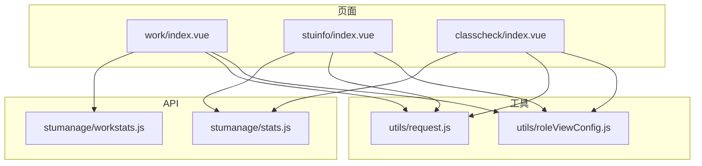
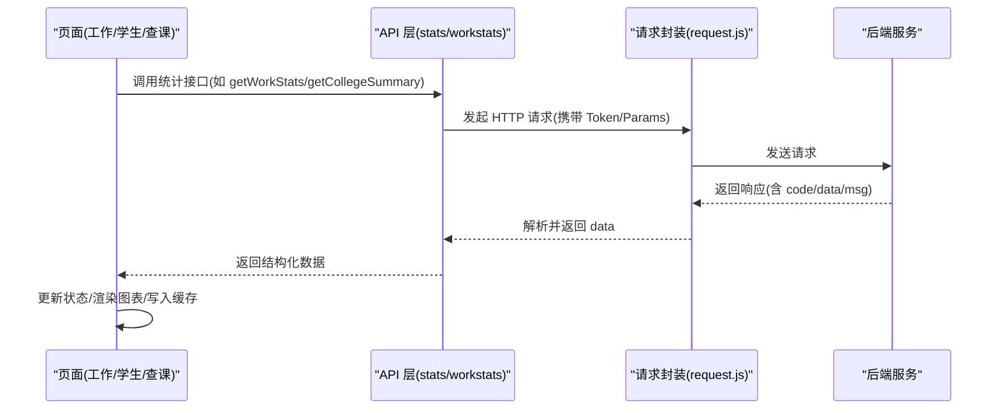
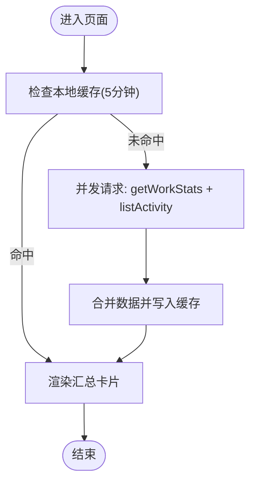
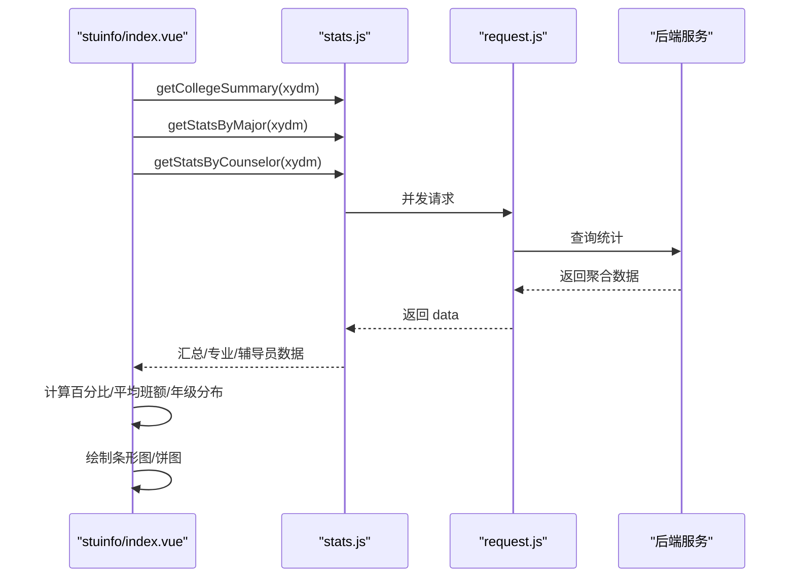
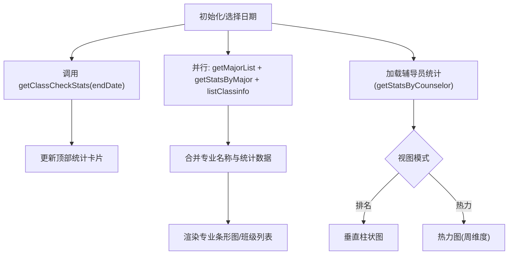
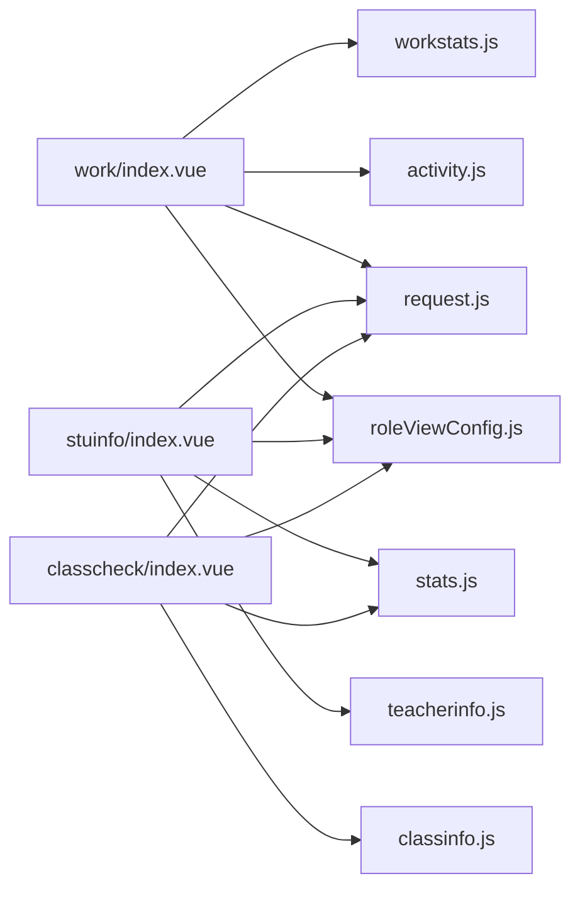

# 统计分析模块

<cite>
**本文引用的文件**
- [api/stumanage/stats.js](file://api/stumanage/stats.js)
- [api/stumanage/workstats.js](file://api/stumanage/workstats.js)
- [pages/work/index.vue](file://pages/work/index.vue)
- [pages/sub-work/stuinfo/index.vue](file://pages/sub-work/stuinfo/index.vue)
- [pages/sub-work/classcheck/index.vue](file://pages/sub-work/classcheck/index.vue)
- [utils/request.js](file://utils/request.js)
- [utils/roleViewConfig.js](file://utils/roleViewConfig.js)
</cite>

## 目录
1. [简介](#简介)
2. [项目结构](#项目结构)
3. [核心组件](#核心组件)
4. [架构总览](#架构总览)
5. [详细组件分析](#详细组件分析)
6. [依赖关系分析](#依赖关系分析)
7. [性能与缓存策略](#性能与缓存策略)
8. [故障排查指南](#故障排查指南)
9. [结论](#结论)
10. [附录：API 参考与开发指南](#附录api-参考与开发指南)

## 简介
本模块聚焦于“统计分析”能力，覆盖数据汇总、图表展示、报表生成与导出等关键场景。前端通过统一的请求封装调用后端统计接口，完成学院维度、专业维度、辅导员维度的聚合统计；在工作台页面提供当日到课率、请假待批/在假、谈话次数、活动总数等概览卡片；在学生管理页面提供按专业与辅导员的可视化统计；在查课管理页面提供按日期与辅导员的查课统计视图（排名与热力图）。同时，模块内置本地缓存与并发加载策略，保障首屏体验与交互流畅性。

## 项目结构
统计分析相关的前端代码主要分布在以下位置：
- API 层：统一封装统计类接口
  - api/stumanage/stats.js：学院汇总、按专业统计、按辅导员统计、招生计划专业列表
  - api/stumanage/workstats.js：工作台统计数据
- 页面层：承载统计数据的采集、渲染与交互
  - pages/work/index.vue：工作台统计概览（到课率、请假、谈话、活动等）
  - pages/sub-work/stuinfo/index.vue：学生管理统计（学院汇总、专业分布、辅导员分布、班级年级分布）
  - pages/sub-work/classcheck/index.vue：查课统计（按日统计、辅导员排名/热力图）
- 工具层：网络请求封装与配置缓存
  - utils/request.js：统一请求封装、鉴权、错误处理
  - utils/roleViewConfig.js：角色视图配置缓存与预加载

图示来源
- [pages/work/index.vue:80-170](file://pages/work/index.vue#L80-L170)
- [pages/sub-work/stuinfo/index.vue:600-799](file://pages/sub-work/stuinfo/index.vue#L600-L799)
- [pages/sub-work/classcheck/index.vue:490-689](file://pages/sub-work/classcheck/index.vue#L490-L689)
- [api/stumanage/stats.js:1-52](file://api/stumanage/stats.js#L1-L52)
- [api/stumanage/workstats.js:1-10](file://api/stumanage/workstats.js#L1-L10)
- [utils/request.js:1-117](file://utils/request.js#L1-L117)
- [utils/roleViewConfig.js:94-114](file://utils/roleViewConfig.js#L94-L114)

章节来源
- [pages/work/index.vue:80-170](file://pages/work/index.vue#L80-L170)
- [pages/sub-work/stuinfo/index.vue:600-799](file://pages/sub-work/stuinfo/index.vue#L600-L799)
- [pages/sub-work/classcheck/index.vue:490-689](file://pages/sub-work/classcheck/index.vue#L490-L689)
- [api/stumanage/stats.js:1-52](file://api/stumanage/stats.js#L1-L52)
- [api/stumanage/workstats.js:1-10](file://api/stumanage/workstats.js#L1-L10)
- [utils/request.js:1-117](file://utils/request.js#L1-L117)
- [utils/roleViewConfig.js:94-114](file://utils/roleViewConfig.js#L94-L114)

## 核心组件
- 工作台统计（work/index.vue）
  - 数据来源：getWorkStats 汇总接口 + listActivity 活动计数
  - 指标：当天到课率、待审批/在假人数、谈话次数、活动总数
  - 缓存：本地存储 5 分钟有效期，减少重复请求
- 学生管理统计（stuinfo/index.vue）
  - 数据来源：getCollegeSummary、getStatsByMajor、getStatsByCounselor
  - 指标：总人数、男女生、党员/团员/群众、班级总数、年级分布
  - 图表：按专业横向条形图、按辅导员条形图、自定义 Canvas 饼图
- 查课统计（classcheck/index.vue）
  - 数据来源：getClassCheckStats（按日）、getStatsByCounselor（辅导员统计）
  - 指标：查课次数、出勤率、缺勤人数
  - 视图：辅导员排名（垂直柱状图）、热力图（周维度）

章节来源
- [pages/work/index.vue:205-250](file://pages/work/index.vue#L205-L250)
- [pages/sub-work/stuinfo/index.vue:612-784](file://pages/sub-work/stuinfo/index.vue#L612-L784)
- [pages/sub-work/classcheck/index.vue:597-614](file://pages/sub-work/classcheck/index.vue#L597-L614)

## 架构总览
统计分析模块采用“页面驱动 + API 聚合 + 工具封装”的三层结构：
- 页面层负责用户交互、数据绑定与图表渲染
- API 层定义统计接口契约，统一参数与返回结构
- 工具层提供请求封装、鉴权、错误处理与配置缓存

图示来源
- [pages/work/index.vue:223-250](file://pages/work/index.vue#L223-L250)
- [pages/sub-work/stuinfo/index.vue:612-675](file://pages/sub-work/stuinfo/index.vue#L612-L675)
- [pages/sub-work/classcheck/index.vue:597-614](file://pages/sub-work/classcheck/index.vue#L597-L614)
- [api/stumanage/stats.js:17-52](file://api/stumanage/stats.js#L17-L52)
- [api/stumanage/workstats.js:3-9](file://api/stumanage/workstats.js#L3-L9)
- [utils/request.js:10-114](file://utils/request.js#L10-L114)

## 详细组件分析

### 工作台统计（work/index.vue）
- 数据采集流程
  - onShow 触发时优先读取本地缓存，命中则直接渲染
  - 未命中则并发调用 getWorkStats 与 listActivity，合并结果后写入缓存
- 指标说明
  - attendanceRate：当天到课率
  - pendingLeave/onLeave：待审批/在假人数
  - talkCount：谈话次数
  - activityCount：活动总数
- 金句刷新
  - 点击区域随机获取金句，成功后同步更新缓存中的 workQuote

图示来源
- [pages/work/index.vue:205-250](file://pages/work/index.vue#L205-L250)
- [pages/work/index.vue:251-275](file://pages/work/index.vue#L251-L275)

章节来源
- [pages/work/index.vue:146-170](file://pages/work/index.vue#L146-L170)
- [pages/work/index.vue:205-250](file://pages/work/index.vue#L205-L250)
- [pages/work/index.vue:251-275](file://pages/work/index.vue#L251-L275)

### 学生管理统计（stuinfo/index.vue）
- 数据源与计算逻辑
  - 并行请求 getCollegeSummary、getStatsByMajor、getStatsByCounselor
  - 汇总数据：totalStudents、maleCount、femaleCount、partyMemberCount、leagueMemberCount、massCount、totalClasses
  - 专业统计：majorName、studentCount、maleCount、femaleCount、classCount，前端计算 malePercent/femalePercent/avgClassSize
  - 辅导员统计：counselorName/counselorId、studentCount、percent
- 图表渲染机制
  - 按专业横向条形图：以 studentCount 为基准，男生/女生分段填充
  - 按辅导员条形图：显示 percent 进度条
  - 自定义饼图：Canvas 绘制，中心显示总人数
- 班级与年级分布
  - 拉取 collegeClasses，按 zydm 分组关联至专业
  - 根据当前月份判断是否包含新生，计算年级班级数与学生数

图示来源
- [pages/sub-work/stuinfo/index.vue:612-784](file://pages/sub-work/stuinfo/index.vue#L612-L784)
- [api/stumanage/stats.js:17-52](file://api/stumanage/stats.js#L17-L52)

章节来源
- [pages/sub-work/stuinfo/index.vue:600-799](file://pages/sub-work/stuinfo/index.vue#L600-L799)
- [api/stumanage/stats.js:17-52](file://api/stumanage/stats.js#L17-L52)

### 查课统计（classcheck/index.vue）
- 按日统计
  - 使用 getClassCheckStats 传入 endDate，得到 todayStats（查课次数、出勤率、缺勤人数）
  - 支持左右切换日期与“回到今天”
- 辅导员统计视图
  - 排名视图：垂直柱状图，按 checkCount 排序，颜色分级
  - 热力图视图：按周维度展示活跃度（示例中用占位数值演示）
- 专业与班级联动
  - 并行加载 getMajorList（权威专业名）、getStatsByMajor（数量数据）、listClassinfo（班级列表）
  - 以招生计划专业列表为准，合并统计数据，构建 majorStats 与 classList

图示来源
- [pages/sub-work/classcheck/index.vue:490-689](file://pages/sub-work/classcheck/index.vue#L490-L689)
- [pages/sub-work/classcheck/index.vue:597-614](file://pages/sub-work/classcheck/index.vue#L597-L614)

章节来源
- [pages/sub-work/classcheck/index.vue:490-689](file://pages/sub-work/classcheck/index.vue#L490-L689)
- [pages/sub-work/classcheck/index.vue:597-614](file://pages/sub-work/classcheck/index.vue#L597-L614)

## 依赖关系分析
- 页面与 API 的耦合
  - work/index.vue 依赖 workstats.js 与 activity.js
  - stuinfo/index.vue 依赖 stats.js 与 teacherinfo.js
  - classcheck/index.vue 依赖 stats.js 与 classinfo.js
- 工具依赖
  - 所有页面均通过 request.js 进行网络请求，统一处理鉴权与错误
  - roleViewConfig.js 提供角色视图配置的缓存与预加载，提升首屏性能

图示来源
- [pages/work/index.vue:80-170](file://pages/work/index.vue#L80-L170)
- [pages/sub-work/stuinfo/index.vue:600-799](file://pages/sub-work/stuinfo/index.vue#L600-L799)
- [pages/sub-work/classcheck/index.vue:490-689](file://pages/sub-work/classcheck/index.vue#L490-L689)
- [utils/request.js:1-117](file://utils/request.js#L1-117)
- [utils/roleViewConfig.js:94-114](file://utils/roleViewConfig.js#L94-L114)

章节来源
- [pages/work/index.vue:80-170](file://pages/work/index.vue#L80-L170)
- [pages/sub-work/stuinfo/index.vue:600-799](file://pages/sub-work/stuinfo/index.vue#L600-L799)
- [pages/sub-work/classcheck/index.vue:490-689](file://pages/sub-work/classcheck/index.vue#L490-L689)
- [utils/request.js:1-117](file://utils/request.js#L1-117)
- [utils/roleViewConfig.js:94-114](file://utils/roleViewConfig.js#L94-L114)

## 性能与缓存策略
- 本地缓存
  - 工作台统计缓存键：work_stats_cache，有效期 5 分钟
  - 金句缓存：与统计缓存同键，附带 workQuote 字段
- 并发加载
  - 学生管理统计使用 Promise.all 并行请求三个接口，降低首屏等待时间
- 配置缓存
  - roleViewConfig.js 提供内存级缓存与预加载，避免重复请求
- 降级与容错
  - 请求失败静默处理，保持界面可用
  - 登录态过期自动重试或跳转登录页

章节来源
- [pages/work/index.vue:103-105](file://pages/work/index.vue#L103-L105)
- [pages/work/index.vue:205-250](file://pages/work/index.vue#L205-L250)
- [pages/sub-work/stuinfo/index.vue:612-675](file://pages/sub-work/stuinfo/index.vue#L612-L675)
- [utils/roleViewConfig.js:94-114](file://utils/roleViewConfig.js#L94-L114)
- [utils/request.js:40-114](file://utils/request.js#L40-L114)

## 故障排查指南
- 常见错误码与提示
  - 401：会话无效或过期，自动重试或跳转登录
  - 500：服务端异常，弹出具体消息
  - 其他非 200：统一 toast 提示，部分业务码（如 20001）静默拒绝
- 网络异常
  - Network Error：提示“后端接口连接异常”
  - timeout：提示“系统接口请求超时”
  - status code 异常：拼接提示信息
- 调试建议
  - 确认 baseUrl 与 token 注入是否正确
  - 检查 params 序列化与 URL 拼接
  - 查看 roleViewConfig 缓存是否被正确清除与预加载

章节来源
- [utils/request.js:40-114](file://utils/request.js#L40-L114)
- [utils/roleViewConfig.js:94-114](file://utils/roleViewConfig.js#L94-L114)

## 结论
统计分析模块通过清晰的职责分层与可靠的请求封装，实现了多角色、多维度统计数据的采集、聚合与可视化。结合本地缓存与并发加载策略，有效提升了用户体验。后续可在后端进一步扩展更丰富的统计维度与导出能力，并在前端引入更完善的图表库以提升可维护性与表现力。

## 附录：API 参考与开发指南

### API 接口清单与参数
- 学院汇总
  - 方法：GET
  - 路径：/api/mini/stats/summary
  - 参数：xydm（学院代码）
  - 用途：返回 totalStudents、maleCount、femaleCount、partyMemberCount、leagueMemberCount、massCount、totalClasses 等
- 按专业统计
  - 方法：GET
  - 路径：/api/mini/stats/byMajor
  - 参数：xydm（学院代码）
  - 用途：返回各专业的 studentCount、maleCount、femaleCount、classCount 等
- 按辅导员统计
  - 方法：GET
  - 路径：/api/mini/stats/byCounselor
  - 参数：xydm（学院代码）
  - 用途：返回辅导员姓名、学生数、占比等
- 招生计划专业列表
  - 方法：GET
  - 路径：/api/college/majorList
  - 参数：xydm（可选）、nj（可选，如 '2023'）
  - 用途：返回权威的专业名称列表（zydm、zyname），用于名称对齐
- 工作台统计
  - 方法：GET
  - 路径：/api/work-stats/summary
  - 参数：无
  - 用途：返回 attendanceRate、talkCount、onLeave、pendingLeave 等

章节来源
- [api/stumanage/stats.js:17-52](file://api/stumanage/stats.js#L17-L52)
- [api/stumanage/workstats.js:3-9](file://api/stumanage/workstats.js#L3-L9)

### 数据绑定与渲染机制
- 数据绑定
  - 页面将 API 返回的数据映射到 state，并通过模板 v-for/v-if 渲染
  - 对缺失字段提供兜底逻辑（如 majorName 的多字段兼容）
- 图表渲染
  - 条形图：基于 CSS 宽度百分比实现，按男/女比例分段填充
  - 饼图：使用 uni.createCanvasContext 绘制扇形与中心文字
  - 热力图：按周维度单元格着色，图例说明等级

章节来源
- [pages/sub-work/stuinfo/index.vue:634-675](file://pages/sub-work/stuinfo/index.vue#L634-L675)
- [pages/sub-work/stuinfo/index.vue:742-784](file://pages/sub-work/stuinfo/index.vue#L742-L784)
- [pages/sub-work/classcheck/index.vue:125-175](file://pages/sub-work/classcheck/index.vue#L125-L175)

### 工作统计的数据采集与处理流程
- 采集入口
  - 工作台 onShow 触发加载
- 处理步骤
  - 读取本地缓存，命中则跳过网络请求
  - 未命中则并发请求 getWorkStats 与 listActivity
  - 合并结果并写入缓存，供后续 5 分钟内复用

章节来源
- [pages/work/index.vue:163-170](file://pages/work/index.vue#L163-L170)
- [pages/work/index.vue:205-250](file://pages/work/index.vue#L205-L250)

### 统计报表模板设计与格式化输出
- 模板设计
  - 卡片式布局：汇总指标以卡片网格呈现，突出关键数字
  - 分栏与折叠：专业详情支持展开/折叠，便于信息层次化
- 格式化输出
  - 百分比与平均值：前端计算 malePercent/femalePercent/avgClassSize
  - 时间格式化：相对时间（今天/昨天/前N天）与月/日格式

章节来源
- [pages/sub-work/stuinfo/index.vue:634-675](file://pages/sub-work/stuinfo/index.vue#L634-L675)
- [pages/work/index.vue:276-290](file://pages/work/index.vue#L276-L290)

### 自定义统计指标与报表模板开发指南
- 新增统计指标
  - 在后端新增聚合字段，确保前端能稳定消费
  - 在前端 state 中补充字段，并提供默认值与兜底逻辑
- 新增报表模板
  - 在页面模板中新增卡片/图表区块
  - 在 methods 中增加数据加载与渲染逻辑，必要时加入缓存键
- 最佳实践
  - 使用并发请求减少首屏等待
  - 对缺失字段做兼容处理，保证 UI 稳定性
  - 合理设置缓存有效期，平衡实时性与性能

章节来源
- [pages/sub-work/stuinfo/index.vue:612-784](file://pages/sub-work/stuinfo/index.vue#L612-L784)
- [pages/work/index.vue:205-250](file://pages/work/index.vue#L205-L250)