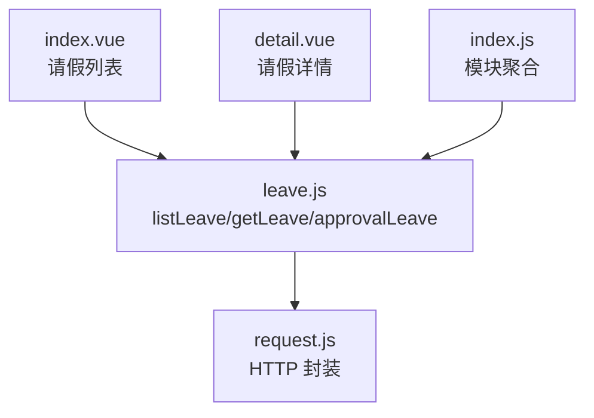
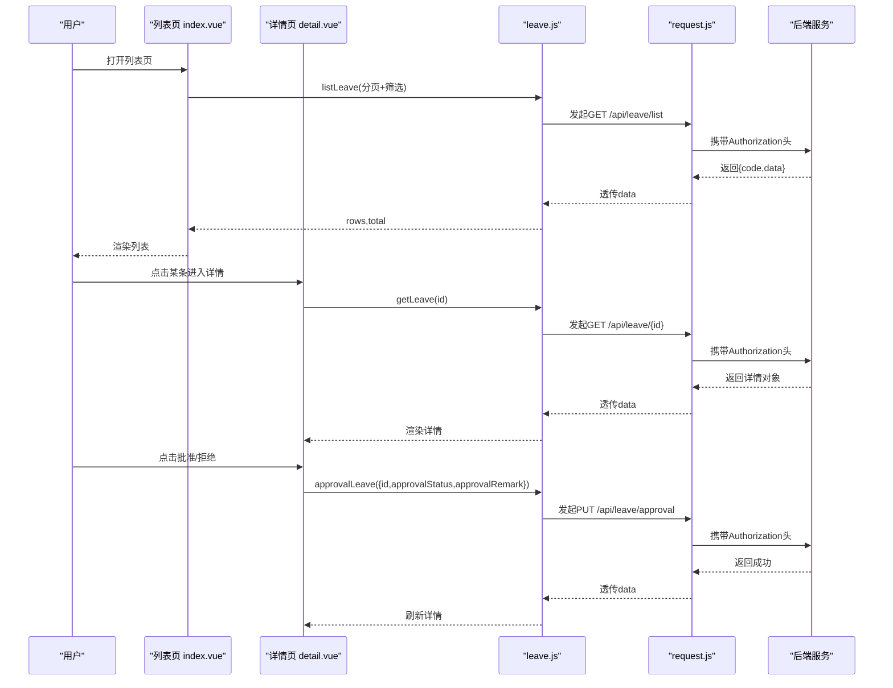
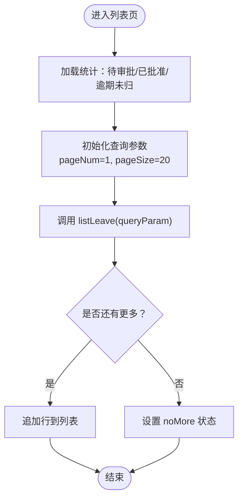
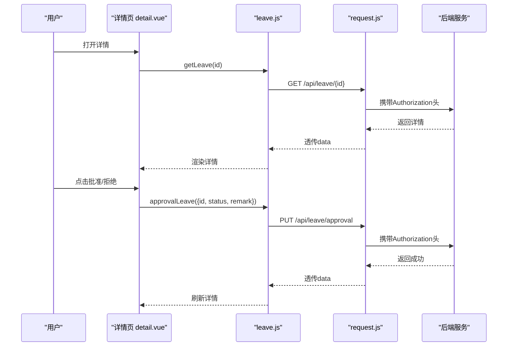
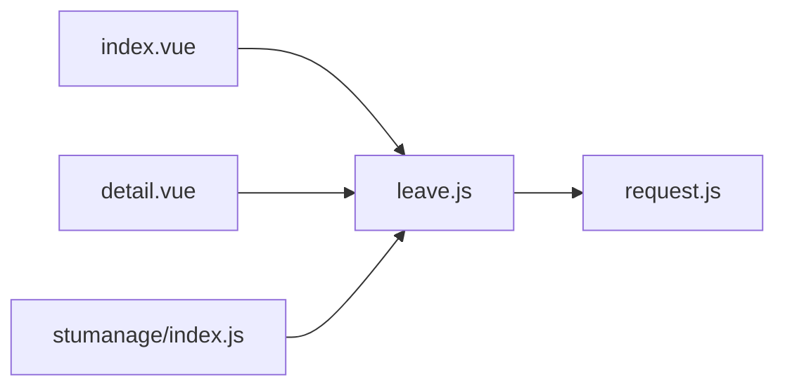

# 请假管理模块

<cite>
**本文引用的文件**   
- [api/stumanage/leave.js](file://api/stumanage/leave.js)
- [pages/sub-work/leave/index.vue](file://pages/sub-work/leave/index.vue)
- [pages/sub-work/leave/detail.vue](file://pages/sub-work/leave/detail.vue)
- [utils/request.js](file://utils/request.js)
- [api/stumanage/index.js](file://api/stumanage/index.js)
</cite>

## 目录
1. [简介](#简介)
2. [项目结构](#项目结构)
3. [核心组件](#核心组件)
4. [架构总览](#架构总览)
5. [详细组件分析](#详细组件分析)
6. [依赖关系分析](#依赖关系分析)
7. [性能与体验优化](#性能与体验优化)
8. [故障排查指南](#故障排查指南)
9. [结论](#结论)
10. [附录：API 接口说明与调用示例](#附录api-接口说明与调用示例)

## 简介
本模块为移动端“请假管理”功能，面向辅导员/学工人员，提供请假申请列表、筛选、分页、详情查看、快捷审批（批准/拒绝）、附件预览等能力。后端通过统一 REST 接口暴露数据与操作，前端基于 uni-app 实现页面交互与请求封装。

## 项目结构
请假相关的前端代码主要分布在以下位置：
- API 层：api/stumanage/leave.js
- 页面层：pages/sub-work/leave/index.vue（列表页）、pages/sub-work/leave/detail.vue（详情页）
- 网络请求封装：utils/request.js
- 模块聚合入口：api/stumanage/index.js

图表来源
- [pages/sub-work/leave/index.vue:145-147](file://pages/sub-work/leave/index.vue#L145-L147)
- [pages/sub-work/leave/detail.vue:181-183](file://pages/sub-work/leave/detail.vue#L181-L183)
- [api/stumanage/leave.js:1-51](file://api/stumanage/leave.js#L1-L51)
- [utils/request.js:1-117](file://utils/request.js#L1-L117)
- [api/stumanage/index.js:1-32](file://api/stumanage/index.js#L1-L32)

章节来源
- [api/stumanage/leave.js:1-51](file://api/stumanage/leave.js#L1-L51)
- [pages/sub-work/leave/index.vue:145-147](file://pages/sub-work/leave/index.vue#L145-L147)
- [pages/sub-work/leave/detail.vue:181-183](file://pages/sub-work/leave/detail.vue#L181-L183)
- [utils/request.js:1-117](file://utils/request.js#L1-L117)
- [api/stumanage/index.js:1-32](file://api/stumanage/index.js#L1-L32)

## 核心组件
- 请假列表页（index.vue）
  - 顶部统计：待审批、已批准、逾期未归数量
  - 搜索栏：支持按姓名或学号模糊查询，并下拉选择学生后过滤其请假记录
  - 筛选栏：全部/待审批/已批准/已拒绝/转上级
  - 列表展示：学生信息、类型、天数、时间、目的地、交通方式、事由、销假状态、佐证材料缩略图
  - 快捷审批：仅当“待审批且审批级别为辅导员”时显示批准/拒绝按钮
  - 分页加载：滚动到底部自动加载更多
- 请假详情页（detail.vue）
  - 状态横幅：根据审批状态动态展示图标与文案
  - 信息区块：学生信息、请假信息（含时间轴）、审批信息、销假信息
  - 佐证材料：分别展示“请假佐证”和“销假佐证”，支持图片预览
  - 底部操作栏：仅当“待审批且审批级别为辅导员”时显示批准/拒绝/关闭
- API 层（leave.js）
  - listLeave：获取请假列表（支持分页与筛选）
  - getLeave：获取请假详情
  - approvalLeave：提交审批结果（批准/拒绝/转上级）
  - getMyLeaves：我的请假（学生端）
  - getPendingLeaves：待审批列表（管理员/辅导员）
- 网络请求封装（request.js）
  - 统一注入 Authorization 头
  - GET 参数拼接
  - 统一错误处理与登录态失效自动重试/跳转

章节来源
- [pages/sub-work/leave/index.vue:145-446](file://pages/sub-work/leave/index.vue#L145-L446)
- [pages/sub-work/leave/detail.vue:181-292](file://pages/sub-work/leave/detail.vue#L181-L292)
- [api/stumanage/leave.js:1-51](file://api/stumanage/leave.js#L1-L51)
- [utils/request.js:1-117](file://utils/request.js#L1-L117)

## 架构总览
前端采用“页面 + API 层 + 请求封装”的分层结构，页面只负责 UI 与交互，业务逻辑集中在方法中，数据访问通过 leave.js 统一转发至 request.js，再由 request.js 完成鉴权、错误处理与重试。

图表来源
- [pages/sub-work/leave/index.vue:299-333](file://pages/sub-work/leave/index.vue#L299-L333)
- [pages/sub-work/leave/detail.vue:205-234](file://pages/sub-work/leave/detail.vue#L205-L234)
- [api/stumanage/leave.js:9-32](file://api/stumanage/leave.js#L9-L32)
- [utils/request.js:10-114](file://utils/request.js#L10-L114)

## 详细组件分析

### 请假列表页（index.vue）
- 数据模型与字段映射
  - 列表项包含：学生姓名、学号、班级、请假类型、天数、起止时间、目的地、交通方式、事由、审批状态、审批级别、销假状态、佐证材料数组等
  - 状态枚举：
    - 审批状态：pending（待审批）、approved（已批准）、rejected（已拒绝）、forward（转上级）
    - 销假状态：not_returned（未销假）、returned（已销假）、overdue（逾期未归）
    - 请假类型：sick（病假）、personal（事假）、other（其他）
    - 交通方式：train（火车）、plane（飞机）、bus（汽车）、other（其他）
- 筛选与排序
  - 筛选：通过 activeTab 控制 approvalStatus；搜索框同时设置 studentName/xh 进行模糊匹配
  - 排序：当前未实现显式排序，后端可支持扩展
- 分页机制
  - 使用 pageNum/pageSize 分页，第一页替换，后续追加；loadStatus 控制“加载中/无更多/更多”
- 快捷审批
  - 条件：approvalStatus === 'pending' 且 approvalLevel === 'counselor'
  - 动作：调用 approvalLeave 提交 approved/rejected，并附带 remark
- 附件展示
  - 优先使用 thumbnailBase64 作为缩略图，否则拼接 baseUrl + '/profile' + filePath
  - 预览使用 uni.previewImage

图表来源
- [pages/sub-work/leave/index.vue:255-333](file://pages/sub-work/leave/index.vue#L255-L333)

章节来源
- [pages/sub-work/leave/index.vue:145-446](file://pages/sub-work/leave/index.vue#L145-L446)

### 请假详情页（detail.vue）
- 信息展示
  - 状态横幅：根据 approvalStatus 渲染不同样式与提示
  - 学生信息：姓名、学号、班级、辅导员、联系电话
  - 请假信息：类型、天数、目的地、交通方式、时间轴（离校/返校）、事由
  - 审批信息：审批人、审批时间、审批意见（非 pending 时显示）
  - 销假信息：销假状态、实际返校时间、备注（已批准时显示）
- 佐证材料
  - 分别展示 leaveAttachmentList 与 returnAttachmentList
  - 图片源解析：优先 base64，其次拼接 baseUrl + '/profile' + filePath
- 审批操作
  - 条件：approvalStatus === 'pending' 且 approvalLevel === 'counselor'
  - 动作：弹窗确认后调用 approvalLeave，成功后刷新详情

图表来源
- [pages/sub-work/leave/detail.vue:205-234](file://pages/sub-work/leave/detail.vue#L205-L234)
- [api/stumanage/leave.js:18-32](file://api/stumanage/leave.js#L18-L32)
- [utils/request.js:10-114](file://utils/request.js#L10-L114)

章节来源
- [pages/sub-work/leave/detail.vue:181-292](file://pages/sub-work/leave/detail.vue#L181-L292)

### API 层（leave.js）
- 接口清单
  - listLeave(query)：GET /api/leave/list
  - getLeave(id)：GET /api/leave/{id}
  - approvalLeave(data)：PUT /api/leave/approval
  - getMyLeaves(query)：GET /api/leave/myLeaves
  - getPendingLeaves()：GET /api/leave/pending
- 参数约定
  - 列表查询支持分页参数 pageNum/pageSize，以及筛选参数如 approvalStatus、studentName、xh、returnStatus 等
  - 审批提交包含 id、approvalStatus、approvalRemark

章节来源
- [api/stumanage/leave.js:1-51](file://api/stumanage/leave.js#L1-L51)

### 网络请求封装（request.js）
- 鉴权
  - 自动注入 Authorization: Bearer {token}
- 参数处理
  - GET 请求将 params 拼接为 URL 查询串
- 错误处理
  - 401：尝试微信自动登录并重试，失败则登出并跳转登录页
  - 500：弹出后端消息
  - 其他非 200：统一 toast 提示
  - 网络异常/超时：友好提示

章节来源
- [utils/request.js:1-117](file://utils/request.js#L1-L117)

## 依赖关系分析
- 页面依赖 API 层
  - index.vue 与 detail.vue 均从 api/stumanage/leave.js 导入函数
- API 层依赖请求封装
  - leave.js 内部使用 utils/request.js 发起 HTTP 请求
- 模块聚合
  - api/stumanage/index.js 统一导出各子模块，便于集中引用

图表来源
- [pages/sub-work/leave/index.vue:145-147](file://pages/sub-work/leave/index.vue#L145-L147)
- [pages/sub-work/leave/detail.vue:181-183](file://pages/sub-work/leave/detail.vue#L181-L183)
- [api/stumanage/leave.js:1-51](file://api/stumanage/leave.js#L1-L51)
- [utils/request.js:1-117](file://utils/request.js#L1-L117)
- [api/stumanage/index.js:1-32](file://api/stumanage/index.js#L1-L32)

章节来源
- [api/stumanage/index.js:1-32](file://api/stumanage/index.js#L1-L32)

## 性能与体验优化
- 列表分页与增量渲染
  - 首屏快速加载，滚动触底再拉取下一页，避免一次性加载大量数据
- 防抖搜索
  - 输入框 onSearchInput 使用定时器延迟触发，减少频繁请求
- 图片优化
  - 优先使用 thumbnailBase64 缩略图，降低网络开销与跨域问题
- 错误与空态
  - 统一的错误提示与空列表占位，提升用户体验

[本节为通用建议，不直接分析具体文件]

## 故障排查指南
- 无法加载列表或详情
  - 检查网络连通性与 baseUrl 配置
  - 确认 token 是否有效，必要时重新登录
- 审批失败
  - 确认当前用户具备审批权限（辅导员）
  - 检查传入的 id、approvalStatus、approvalRemark 是否正确
- 图片无法显示
  - 若后端未返回 thumbnailBase64，检查 filePath 是否为相对路径或完整 URL
  - 确认 baseUrl 拼接正确

章节来源
- [utils/request.js:40-114](file://utils/request.js#L40-L114)
- [pages/sub-work/leave/index.vue:427-444](file://pages/sub-work/leave/index.vue#L427-L444)
- [pages/sub-work/leave/detail.vue:273-290](file://pages/sub-work/leave/detail.vue#L273-L290)

## 结论
本模块以清晰的页面-API-请求分层实现了请假管理的核心流程：列表查询、筛选分页、详情查看、快捷审批与佐证材料展示。通过统一的请求封装与错误处理，提升了稳定性与可维护性。后续可在后端扩展更丰富的筛选维度与审批工作流，在前端增加更多可视化反馈与离线缓存策略。

[本节为总结性内容，不直接分析具体文件]

## 附录：API 接口说明与调用示例

- 接口清单
  - 获取请假列表
    - 方法：GET
    - 路径：/api/leave/list
    - 参数：pageNum、pageSize、approvalStatus、studentName、xh、returnStatus 等
    - 返回：rows、total
  - 获取请假详情
    - 方法：GET
    - 路径：/api/leave/{id}
    - 返回：详情对象（包含学生信息、请假信息、审批信息、销假信息、佐证材料等）
  - 审批请假
    - 方法：PUT
    - 路径：/api/leave/approval
    - 参数：id、approvalStatus（approved/rejected/forward）、approvalRemark
  - 我的请假（学生端）
    - 方法：GET
    - 路径：/api/leave/myLeaves
    - 参数：分页与筛选同列表
  - 待审批列表
    - 方法：GET
    - 路径：/api/leave/pending

- 调用示例（概念性描述）
  - 列表查询
    - 前端调用 listLeave({ pageNum: 1, pageSize: 20, approvalStatus: 'pending' })
    - 请求经 request.js 注入 Authorization 后发送至后端
  - 查看详情
    - 前端调用 getLeave(id)
    - 返回详情后渲染页面
  - 快捷审批
    - 前端调用 approvalLeave({ id, approvalStatus: 'approved', approvalRemark: '同意' })
    - 成功后刷新列表或详情

章节来源
- [api/stumanage/leave.js:9-49](file://api/stumanage/leave.js#L9-L49)
- [pages/sub-work/leave/index.vue:299-333](file://pages/sub-work/leave/index.vue#L299-L333)
- [pages/sub-work/leave/detail.vue:205-234](file://pages/sub-work/leave/detail.vue#L205-L234)
- [utils/request.js:10-114](file://utils/request.js#L10-L114)