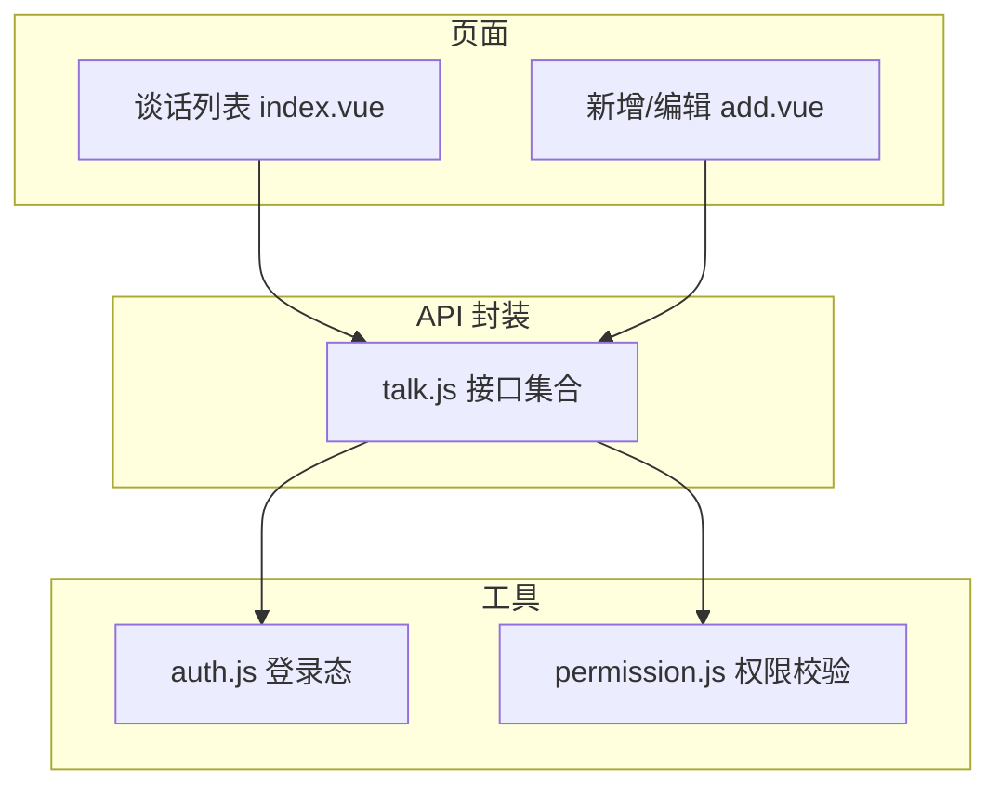
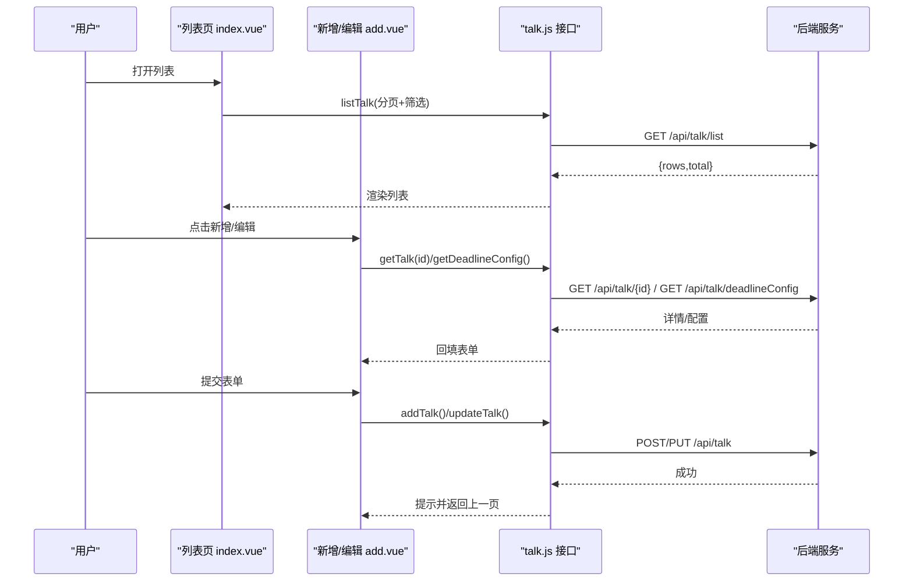
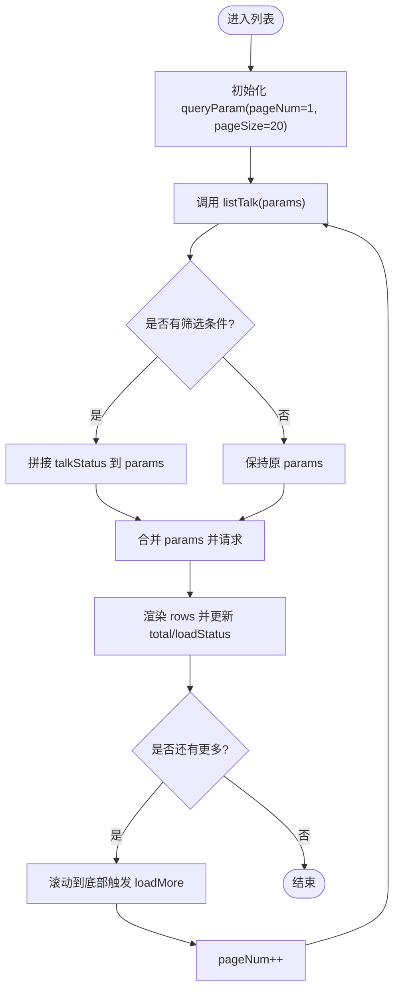
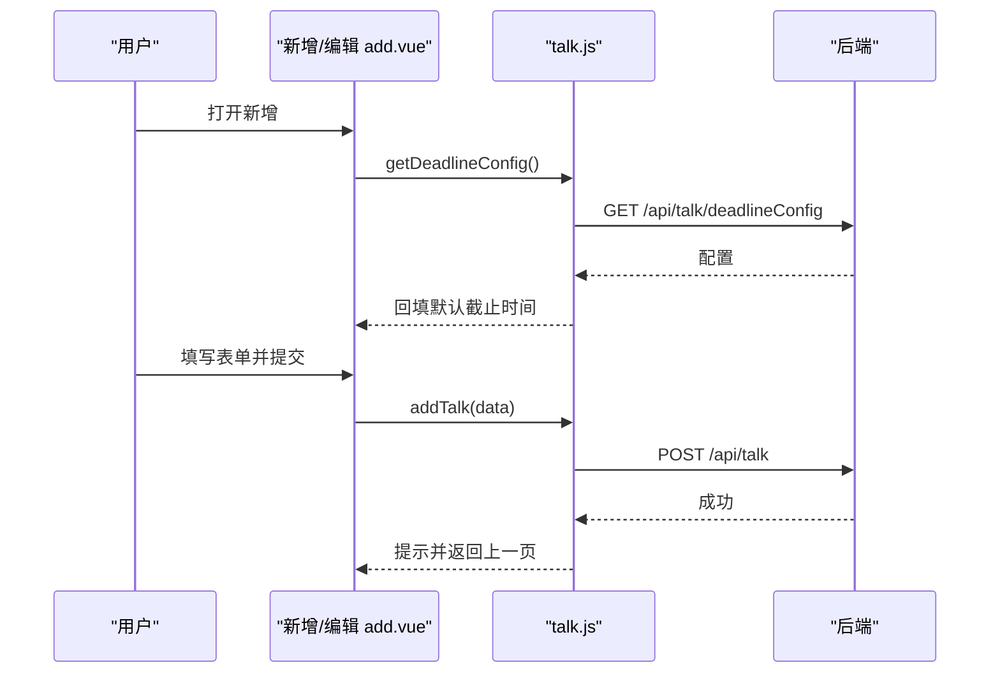
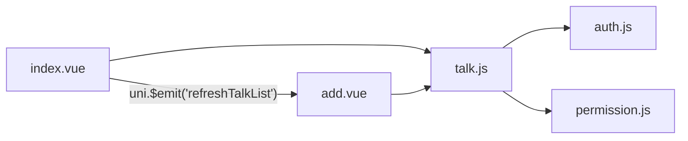

# 谈话记录模块

<cite>
**本文引用的文件**   
- [api/stumanage/talk.js](file://api/stumanage/talk.js)
- [pages/sub-work/talk/index.vue](file://pages/sub-work/talk/index.vue)
- [pages/sub-work/talk/add.vue](file://pages/sub-work/talk/add.vue)
- [utils/permission.js](file://utils/permission.js)
- [utils/auth.js](file://utils/auth.js)
</cite>

## 目录
1. [简介](#简介)
2. [项目结构](#项目结构)
3. [核心组件](#核心组件)
4. [架构总览](#架构总览)
5. [详细组件分析](#详细组件分析)
6. [依赖关系分析](#依赖关系分析)
7. [性能与体验优化](#性能与体验优化)
8. [故障排查指南](#故障排查指南)
9. [结论](#结论)
10. [附录：API 接口与数据结构说明](#附录api-接口与数据结构说明)

## 简介
本模块为“师生谈话记录”移动端功能，覆盖谈话记录的创建、分类管理、历史记录查询、附件佐证、待跟进提醒、违纪学生快速添加、限时配置等能力。前端通过统一的 API 封装调用后端 REST 接口，提供列表分页、筛选、统计概览、新增/编辑、删除等完整流程。

## 项目结构
- 前端页面
  - 列表页：展示统计卡片、筛选栏、分页列表、附件缩略图预览
  - 新增/编辑页：表单填写（类型标签、时间地点、截止时间）、对象选择（搜索+违纪批量）、内容追加、附件上传、提交
- API 封装
  - 统一导出 talk 相关接口，包括列表、详情、增删改、待跟进、违纪学生、限时配置等
- 权限与认证
  - 通用 token 与用户 ID 存取
  - 角色与字符权限校验工具

图表来源
- [pages/sub-work/talk/index.vue:118-149](file://pages/sub-work/talk/index.vue#L118-L149)
- [pages/sub-work/talk/add.vue:171-176](file://pages/sub-work/talk/add.vue#L171-L176)
- [api/stumanage/talk.js:1-90](file://api/stumanage/talk.js#L1-L90)
- [utils/auth.js:1-47](file://utils/auth.js#L1-L47)
- [utils/permission.js:1-49](file://utils/permission.js#L1-L49)

章节来源
- [pages/sub-work/talk/index.vue:1-116](file://pages/sub-work/talk/index.vue#L1-L116)
- [pages/sub-work/talk/add.vue:1-169](file://pages/sub-work/talk/add.vue#L1-L169)
- [api/stumanage/talk.js:1-90](file://api/stumanage/talk.js#L1-L90)

## 核心组件
- 列表页（index.vue）
  - 顶部统计卡片：全部、待谈话、进行中、已完成
  - 筛选栏：按状态过滤（全部/待谈话/进行中/已完成）
  - 列表项：显示学生名、类别、人数、时间、地点、类型标签、截止、附件数量与图片缩略图
  - 分页加载：滚动到底部自动加载更多
  - 跳转新增/编辑：复用同一页面，带 id 参数进入编辑
- 新增/编辑页（add.vue）
  - 基本信息：谈话类型多选标签、时间地点、截止时间（违纪类）
  - 谈话对象：支持学号/姓名模糊搜索；支持从违纪学生列表批量勾选；支持从查课记录导入违纪对象
  - 谈话内容：历史内容时间线展示，支持追加新内容
  - 佐证材料：拍照/相册/文档/录音，最多5个，支持预览与打开
  - 提交：根据是否编辑决定新增或修改，携带学生列表、内容、附件等
- API 封装（talk.js）
  - 列表、详情、新增、修改、删除
  - 我的学生列表（支持学号/姓名）
  - 待跟进谈话、违纪学生列表、限时配置

章节来源
- [pages/sub-work/talk/index.vue:118-248](file://pages/sub-work/talk/index.vue#L118-L248)
- [pages/sub-work/talk/add.vue:171-697](file://pages/sub-work/talk/add.vue#L171-L697)
- [api/stumanage/talk.js:1-90](file://api/stumanage/talk.js#L1-L90)

## 架构总览
前后端交互采用 RESTful 风格，移动端通过 request 封装发起请求，统一处理鉴权与错误。列表与统计分离：列表接口返回分页数据，统计由独立接口返回，便于缓存与刷新。

图表来源
- [pages/sub-work/talk/index.vue:162-188](file://pages/sub-work/talk/index.vue#L162-L188)
- [pages/sub-work/talk/add.vue:266-319](file://pages/sub-work/talk/add.vue#L266-L319)
- [api/stumanage/talk.js:8-49](file://api/stumanage/talk.js#L8-L49)

## 详细组件分析

### 数据模型与分类体系
- 分类（类别）
  - daily：日常谈心
  - disciplinary：违纪谈话
- 类型（标签，可多选）
  - ideological：思想动态
  - psychological：心理健康
  - academic：学业指导
  - career：就业指导
  - life：生活关怀
  - discipline：纪律教育
  - other：其他
- 状态
  - pending：待谈话
  - ongoing：进行中
  - completed：已完成
- 关键属性（示例字段，来源于前端使用）
  - talkCategory：类别
  - talkType：类型（逗号分隔字符串）
  - talkStatus：状态
  - talkTime：谈话时间
  - deadline：截止时间（违纪类必填）
  - talkPlace：地点
  - isEnded：是否已结束
  - studentList：对象数组（含 xh、studentName、bjdm、violationType、checkDetailId、checkId、studentRemark）
  - contentList：历史内容数组（content、contentTime）
  - attachmentList：附件数组（businessType、fileName、filePath、fileSize、fileType、mediaType、exifData、sortOrder）

章节来源
- [pages/sub-work/talk/index.vue:212-228](file://pages/sub-work/talk/index.vue#L212-L228)
- [pages/sub-work/talk/add.vue:178-186](file://pages/sub-work/talk/add.vue#L178-L186)
- [pages/sub-work/talk/add.vue:645-674](file://pages/sub-work/talk/add.vue#L645-L674)

### 列表与筛选、排序
- 筛选：按 talkStatus 过滤（全部/待谈话/进行中/已完成），切换后重置页码并重新拉取
- 分页：pageNum/pageSize，滚动到底部触发 loadMore
- 排序：当前未在前端实现显式排序，可通过后端扩展支持（如按时间倒序）

图表来源
- [pages/sub-work/talk/index.vue:162-205](file://pages/sub-work/talk/index.vue#L162-L205)

章节来源
- [pages/sub-work/talk/index.vue:162-205](file://pages/sub-work/talk/index.vue#L162-L205)

### 新增与编辑流程
- 新增
  - 默认状态 pending，必填：至少一个对象、至少一个类型标签
  - 违纪类需设置 deadline，默认按限时配置计算
  - 提交时组装 studentList、contentList、attachmentList
- 编辑
  - 通过 id 获取详情回填，支持追加内容与附件
  - 修改不改变 talkStatus（由业务侧控制）

图表来源
- [pages/sub-work/talk/add.vue:244-254](file://pages/sub-work/talk/add.vue#L244-L254)
- [pages/sub-work/talk/add.vue:631-695](file://pages/sub-work/talk/add.vue#L631-L695)
- [api/stumanage/talk.js:25-41](file://api/stumanage/talk.js#L25-L41)

章节来源
- [pages/sub-work/talk/add.vue:266-319](file://pages/sub-work/talk/add.vue#L266-L319)
- [pages/sub-work/talk/add.vue:631-695](file://pages/sub-work/talk/add.vue#L631-L695)
- [api/stumanage/talk.js:25-41](file://api/stumanage/talk.js#L25-L41)

### 历史记录与附件
- 历史内容：以时间线形式展示，支持追加新内容
- 附件：
  - 支持图片、文档、录音，最多5个
  - 图片支持预览，文档/录音支持下载后打开
  - 提交时将附件信息随 record 一并提交

章节来源
- [pages/sub-work/talk/add.vue:112-160](file://pages/sub-work/talk/add.vue#L112-L160)
- [pages/sub-work/talk/add.vue:508-629](file://pages/sub-work/talk/add.vue#L508-L629)

### 搜索、筛选与排序
- 搜索
  - 学生搜索：支持学号或姓名模糊匹配，自动识别数字走学号分支
  - 违纪学生列表：支持全选/单选，自动过滤已谈次数≥违纪次数的学生
- 筛选
  - 列表按 talkStatus 筛选
- 排序
  - 前端未实现，建议后端按 talkTime 倒序

章节来源
- [api/stumanage/talk.js:51-81](file://api/stumanage/talk.js#L51-L81)
- [pages/sub-work/talk/add.vue:349-496](file://pages/sub-work/talk/add.vue#L349-L496)
- [pages/sub-work/talk/index.vue:201-205](file://pages/sub-work/talk/index.vue#L201-L205)

### 统计分析
- 列表页顶部统计卡片：全部、待谈话、进行中、已完成
- 数据来源：调用 getTalkStats 接口（在列表加载完成后触发）

章节来源
- [pages/sub-work/talk/index.vue:181-188](file://pages/sub-work/talk/index.vue#L181-L188)

### 权限控制与隐私保护
- 登录态
  - 通过 token 与 userId 本地存储判断登录状态
- 权限校验
  - 提供 checkPermi/checkRole 工具，用于按钮级或路由级权限控制
- 隐私
  - 仅展示必要字段，敏感信息不在前端明文展示
  - 附件访问通过后端受控地址，避免直接暴露路径

章节来源
- [utils/auth.js:1-47](file://utils/auth.js#L1-L47)
- [utils/permission.js:1-49](file://utils/permission.js#L1-L49)

## 依赖关系分析
- 页面依赖 API 封装
- API 封装依赖 request 与全局配置
- 页面间通过 uni.$emit/uni.$on 进行轻量事件通信（刷新列表/首页数据）

图表来源
- [pages/sub-work/talk/index.vue:148-154](file://pages/sub-work/talk/index.vue#L148-L154)
- [pages/sub-work/talk/add.vue:685-690](file://pages/sub-work/talk/add.vue#L685-L690)
- [api/stumanage/talk.js:1-90](file://api/stumanage/talk.js#L1-L90)

章节来源
- [pages/sub-work/talk/index.vue:148-154](file://pages/sub-work/talk/index.vue#L148-L154)
- [pages/sub-work/talk/add.vue:685-690](file://pages/sub-work/talk/add.vue#L685-L690)
- [api/stumanage/talk.js:1-90](file://api/stumanage/talk.js#L1-L90)

## 性能与体验优化
- 列表分页与懒加载：减少首屏数据量，提升滚动流畅度
- 防抖搜索：学生搜索增加延迟，降低频繁请求
- 附件压缩：图片上传前压缩，减小带宽占用
- 统计异步加载：统计接口在列表加载后触发，避免阻塞主流程
- 建议
  - 列表接口增加服务端排序与索引优化
  - 对高频字典（类型、类别、状态）做本地缓存
  - 附件列表分页或按需加载大图

[本节为通用建议，无需代码来源]

## 故障排查指南
- 列表无数据
  - 检查网络与鉴权（token 是否存在）
  - 确认筛选条件是否正确传递
- 新增失败
  - 检查必填项：对象、类型标签
  - 违纪类是否设置截止时间
- 附件无法打开
  - 检查 filePath 是否为空
  - 确认后端文件服务可用
- 待跟进列表为空
  - 检查 getPendingTalks 接口返回
  - 确认后端任务生成逻辑

章节来源
- [pages/sub-work/talk/add.vue:631-695](file://pages/sub-work/talk/add.vue#L631-L695)
- [pages/sub-work/talk/index.vue:162-188](file://pages/sub-work/talk/index.vue#L162-L188)

## 结论
本模块围绕“师生谈话记录”的核心场景，提供了完整的创建、分类、标签、对象选择、附件佐证、待跟进与统计能力。前端以清晰的页面职责与 API 分层组织，具备良好的可扩展性。后续可在后端增强排序、高级筛选与更丰富的统计维度，以满足更复杂的业务需求。

[本节为总结，无需代码来源]

## 附录：API 接口与数据结构说明

### 接口清单
- 列表
  - GET /api/talk/list
  - 入参：pageNum、pageSize、talkStatus（可选）
  - 出参：rows、total
- 详情
  - GET /api/talk/{id}
  - 出参：记录详情（含 studentList、contentList、attachmentList 等）
- 新增
  - POST /api/talk
  - 入参：记录主体 + studentList + contentList + attachmentList
- 修改
  - PUT /api/talk
  - 入参：同新增，包含 id
- 删除
  - DELETE /api/talk/{ids}
- 待跟进
  - GET /api/talk/pending
- 违纪学生
  - GET /api/talk/violationStudents?checkDate=&bjdm=
- 限时配置
  - GET /api/talk/deadlineConfig
- 我的学生
  - GET /api/mini/stuinfo/list?pageNum=1&pageSize=20&xh=... 或 &studentName=...

章节来源
- [api/stumanage/talk.js:8-90](file://api/stumanage/talk.js#L8-L90)

### 关键字段说明（节选）
- talkCategory：daily | disciplinary
- talkType：逗号分隔的多个值（ideological, psychological, academic, career, life, discipline, other）
- talkStatus：pending | ongoing | completed
- talkTime：YYYY-MM-DD HH:mm:ss
- deadline：YYYY-MM-DD HH:mm:ss（违纪类必填）
- studentList[]：xh、studentName、bjdm、violationType、checkDetailId、checkId、studentRemark
- contentList[]：content、contentTime
- attachmentList[]：businessType、fileName、filePath、fileSize、fileType、mediaType、exifData、sortOrder

章节来源
- [pages/sub-work/talk/add.vue:645-674](file://pages/sub-work/talk/add.vue#L645-L674)
- [pages/sub-work/talk/index.vue:212-228](file://pages/sub-work/talk/index.vue#L212-L228)