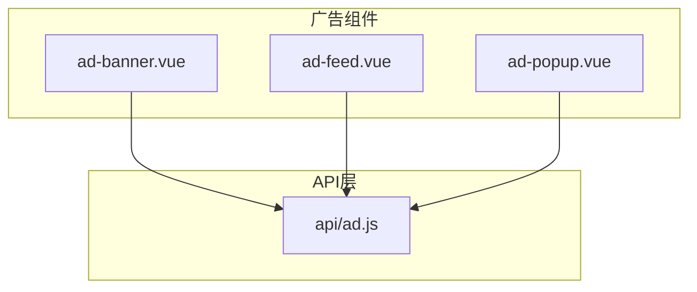
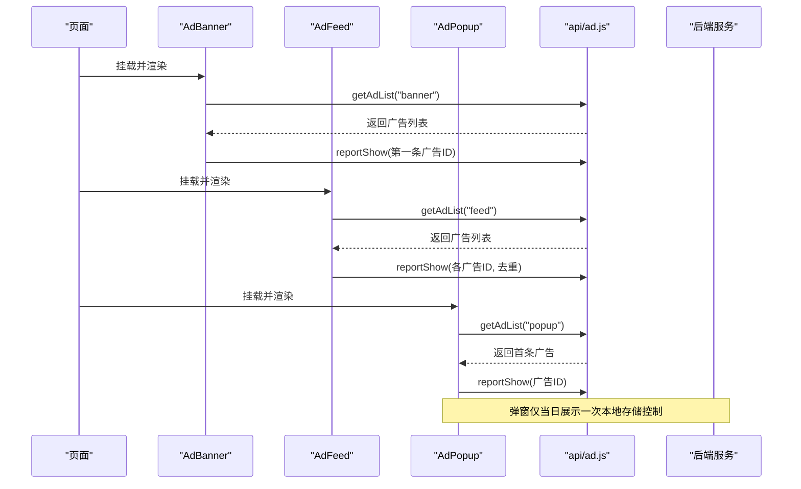
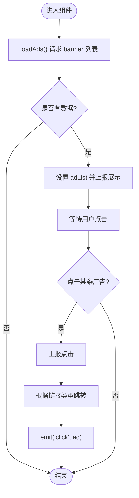
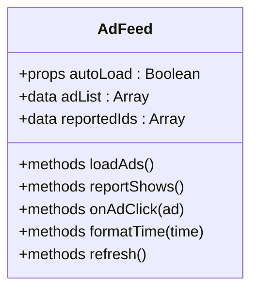
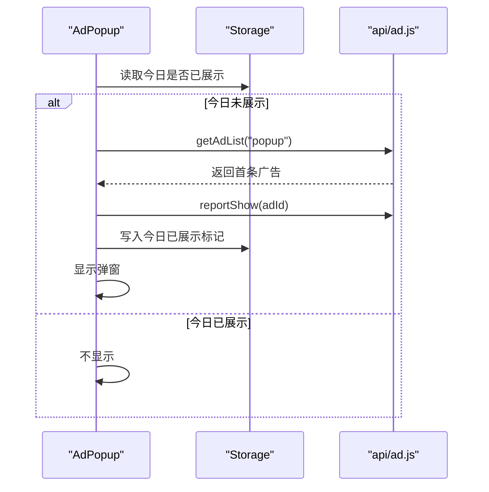
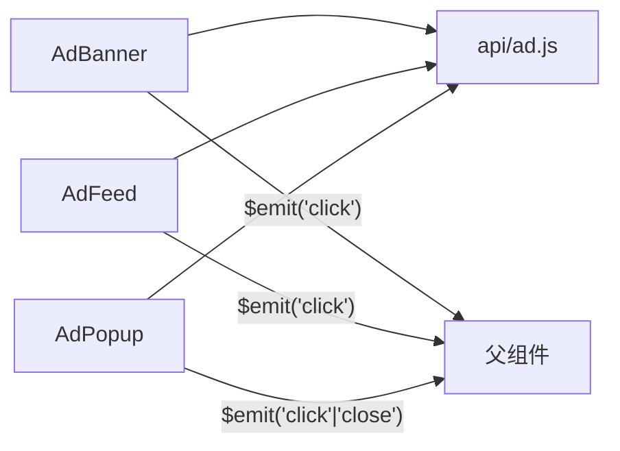

# 广告组件

<cite>
**本文引用的文件**   
- [components/ad-banner/ad-banner.vue](file://components/ad-banner/ad-banner.vue)
- [components/ad-feed/ad-feed.vue](file://components/ad-feed/ad-feed.vue)
- [components/ad-popup/ad-popup.vue](file://components/ad-popup/ad-popup.vue)
- [api/ad.js](file://api/ad.js)
</cite>

## 目录
1. [简介](#简介)
2. [项目结构](#项目结构)
3. [核心组件](#核心组件)
4. [架构总览](#架构总览)
5. [详细组件分析](#详细组件分析)
6. [依赖关系分析](#依赖关系分析)
7. [性能与优化](#性能与优化)
8. [样式定制与响应式适配](#样式定制与响应式适配)
9. [第三方广告集成与管理](#第三方广告集成与管理)
10. [故障排查指南](#故障排查指南)
11. [结论](#结论)

## 简介
本章节面向 RuoYi-App 中的广告展示能力，系统梳理三类自研广告组件：广告横幅（轮播）、信息流广告、弹窗广告。文档覆盖属性配置、显示逻辑、点击事件处理、生命周期管理、数据结构、渲染机制、性能优化策略、第三方广告集成方式以及样式定制与响应式适配方案，帮助开发者快速上手并高效扩展。

## 项目结构
广告相关代码集中在 components 与 api 两个目录：
- components/ad-banner：广告横幅组件
- components/ad-feed：信息流广告组件
- components/ad-popup：弹窗广告组件
- api/ad.js：广告数据获取与曝光/点击上报接口封装

图表来源
- [components/ad-banner/ad-banner.vue:1-140](file://components/ad-banner/ad-banner.vue#L1-L140)
- [components/ad-feed/ad-feed.vue:1-199](file://components/ad-feed/ad-feed.vue#L1-L199)
- [components/ad-popup/ad-popup.vue:1-200](file://components/ad-popup/ad-popup.vue#L1-L200)
- [api/ad.js:1-50](file://api/ad.js#L1-L50)

章节来源
- [components/ad-banner/ad-banner.vue:1-140](file://components/ad-banner/ad-banner.vue#L1-L140)
- [components/ad-feed/ad-feed.vue:1-199](file://components/ad-feed/ad-feed.vue#L1-L199)
- [components/ad-popup/ad-popup.vue:1-200](file://components/ad-popup/ad-popup.vue#L1-L200)
- [api/ad.js:1-50](file://api/ad.js#L1-L50)

## 核心组件
- 广告横幅（AdBanner）
  - 功能：轮播展示多张广告图，支持自动播放、切换时长、是否显示“广告”标识等。
  - 关键属性：autoplay、interval、duration、showMark。
  - 数据来源：通过 getAdList('banner') 获取列表。
  - 交互：点击单条广告上报点击并跳转；整体容器点击可透传至子项。
  - 生命周期：mounted 时加载广告并上报首次展示。

- 信息流广告（AdFeed）
  - 功能：以卡片形式在内容流中插入广告条目，支持文本+图片组合展示。
  - 关键属性：autoLoad（默认 true）。
  - 数据来源：getAdList('feed')。
  - 交互：点击整条广告上报点击并跳转；提供 refresh() 手动刷新方法。
  - 生命周期：mounted 根据 autoLoad 决定是否加载；内部维护 reportedIds 避免重复上报展示。

- 弹窗广告（AdPopup）
  - 功能：全屏遮罩弹窗，支持图片、视频、纯文本三种类型。
  - 状态：visible、currentAd、shownToday（今日是否已展示过）。
  - 数据来源：getAdList('popup')。
  - 交互：点击内容区域上报点击并跳转；关闭按钮触发 close 事件。
  - 生命周期：mounted 检查本地存储决定当日是否展示；若展示则记录时间戳。

章节来源
- [components/ad-banner/ad-banner.vue:20-108](file://components/ad-banner/ad-banner.vue#L20-L108)
- [components/ad-feed/ad-feed.vue:37-125](file://components/ad-feed/ad-feed.vue#L37-L125)
- [components/ad-popup/ad-popup.vue:35-117](file://components/ad-popup/ad-popup.vue#L35-L117)

## 架构总览
广告组件统一通过 api/ad.js 提供的三个接口完成数据拉取与埋点上报：
- 获取广告列表：getAdList(position)，position 取值 banner/feed/popup/footer
- 上报展示：reportShow(adId)
- 上报点击：reportClick(adId)
- 批量上报展示：batchReportShow(adIds)（当前未在各组件内使用，但已预留）

图表来源
- [components/ad-banner/ad-banner.vue:49-75](file://components/ad-banner/ad-banner.vue#L49-L75)
- [components/ad-feed/ad-feed.vue:52-84](file://components/ad-feed/ad-feed.vue#L52-L84)
- [components/ad-popup/ad-popup.vue:44-77](file://components/ad-popup/ad-popup.vue#L44-L77)
- [api/ad.js:7-49](file://api/ad.js#L7-L49)

## 详细组件分析

### 广告横幅（AdBanner）
- 属性配置
  - autoplay：是否自动播放
  - interval：自动播放间隔（毫秒）
  - duration：切换动画时长（毫秒）
  - showMark：是否显示“广告”标识
- 显示逻辑
  - mounted 调用 loadAds 拉取 banner 位置广告列表
  - 成功且非空时设置 adList 并上报展示（仅对首条进行上报）
- 点击事件处理
  - onItemClick 上报点击后，按链接类型跳转：
    - 内部路由：/pages 开头的路径使用 uni.navigateTo
    - H5：window.open
    - 微信小程序：尝试跳转到外部小程序（需 appId），失败提示
  - 同时向父级 emit('click', ad)
- 生命周期管理
  - mounted 初始化数据
  - 无显式销毁逻辑，建议父组件按需卸载或隐藏以减少资源占用

图表来源
- [components/ad-banner/ad-banner.vue:54-107](file://components/ad-banner/ad-banner.vue#L54-L107)

章节来源
- [components/ad-banner/ad-banner.vue:20-108](file://components/ad-banner/ad-banner.vue#L20-L108)

### 信息流广告（AdFeed）
- 属性配置
  - autoLoad：是否自动加载（默认 true）
- 显示逻辑
  - mounted 根据 autoLoad 决定是否加载 feed 位置广告
  - 成功后设置 adList 并遍历上报展示，使用 reportedIds 去重
- 点击事件处理
  - onAdClick 上报点击后，按链接类型跳转（内部路由/H5/小程序提示）
  - 向父级 emit('click', ad)
- 生命周期管理
  - 提供 refresh() 清空 reportedIds 并重新加载，便于父组件主动刷新
- 数据结构
  - 每条广告包含 id、adContent、adImage、adLink、createTime 等字段用于渲染与时间格式化

图表来源
- [components/ad-feed/ad-feed.vue:37-125](file://components/ad-feed/ad-feed.vue#L37-L125)

章节来源
- [components/ad-feed/ad-feed.vue:37-125](file://components/ad-feed/ad-feed.vue#L37-L125)

### 弹窗广告（AdPopup）
- 属性配置
  - 无 props，内部通过 visible/currentAd/shownToday 控制显示与内容
- 显示逻辑
  - mounted 检查本地存储是否今日已展示过
  - 若未展示则拉取 popup 位置广告，取首条并显示
  - 显示后上报展示并写入本地存储标记
- 点击事件处理
  - onAdClick 上报点击后，按链接类型跳转
  - 关闭弹窗并 emit('close')
- 生命周期管理
  - 每日仅展示一次（基于本地存储日期判断）
  - 提供 show() 手动触发检查与展示

图表来源
- [components/ad-popup/ad-popup.vue:44-77](file://components/ad-popup/ad-popup.vue#L44-L77)

章节来源
- [components/ad-popup/ad-popup.vue:35-117](file://components/ad-popup/ad-popup.vue#L35-L117)

## 依赖关系分析
- 组件到 API 的依赖
  - 三个广告组件均依赖 api/ad.js 的 getAdList/reportShow/reportClick
- 平台差异
  - 横幅与弹窗在 H5 环境下使用 window.open 打开外链
  - 微信小程序环境对外链采用特定处理（如跳转到外部小程序或提示）
- 事件通信
  - 组件通过 $emit 将 click/close 事件暴露给父组件，便于业务侧统计与联动

图表来源
- [components/ad-banner/ad-banner.vue:18-107](file://components/ad-banner/ad-banner.vue#L18-L107)
- [components/ad-feed/ad-feed.vue:35-108](file://components/ad-feed/ad-feed.vue#L35-L108)
- [components/ad-popup/ad-popup.vue:33-116](file://components/ad-popup/ad-popup.vue#L33-L116)
- [api/ad.js:7-37](file://api/ad.js#L7-L37)

章节来源
- [components/ad-banner/ad-banner.vue:18-107](file://components/ad-banner/ad-banner.vue#L18-L107)
- [components/ad-feed/ad-feed.vue:35-108](file://components/ad-feed/ad-feed.vue#L35-L108)
- [components/ad-popup/ad-popup.vue:33-116](file://components/ad-popup/ad-popup.vue#L33-L116)
- [api/ad.js:7-37](file://api/ad.js#L7-L37)

## 性能与优化
- 减少重复上报
  - 信息流广告使用 reportedIds 去重，避免多次滚动导致重复上报展示
- 条件渲染与懒加载
  - 信息流广告仅在 adList.length > 0 时渲染，降低空数据开销
  - 弹窗广告每日仅展示一次，避免频繁请求与渲染
- 网络请求优化
  - 建议在父组件层面做缓存或防抖，例如对同一 position 的请求结果进行短时缓存
  - 可使用 batchReportShow 聚合上报（当前未使用，可在后续迭代中引入）
- 媒体资源优化
  - 图片建议使用合适尺寸与压缩格式，必要时启用懒加载
  - 视频广告应限制最大体积与预加载策略，避免阻塞主线程

[本节为通用指导，无需源码引用]

## 样式定制与响应式适配
- 横幅
  - 高度与圆角可通过 .banner-swiper 与 .banner-image 调整
  - “广告”标识位置与样式由 .ad-mark 控制
- 信息流
  - 卡片背景、阴影、间距由 .ad-feed-item 控制
  - 标题、正文、图片、底部链接分别对应相应类名，可按需覆盖
- 弹窗
  - 遮罩透明度、弹窗宽度、最大高度由 .ad-popup-mask 与 .ad-popup-content 控制
  - 关闭按钮位置与图标大小由 .close-btn 与 .close-icon 控制
- 响应式建议
  - 使用 rpx 单位适配不同屏幕
  - 图片 mode 使用 aspectFill/aspectFit 保证比例
  - 弹窗宽度可结合设备宽度动态计算，避免在小屏设备上溢出

章节来源
- [components/ad-banner/ad-banner.vue:112-139](file://components/ad-banner/ad-banner.vue#L112-L139)
- [components/ad-feed/ad-feed.vue:128-198](file://components/ad-feed/ad-feed.vue#L128-L198)
- [components/ad-popup/ad-popup.vue:120-199](file://components/ad-popup/ad-popup.vue#L120-L199)

## 第三方广告集成与管理
- 现有实现
  - 当前广告数据来源于后端 /api/ad/getList，并通过 /api/ad/reportShow 与 /api/ad/reportClick 上报
- 接入第三方 SDK 的思路
  - 在组件中引入第三方 SDK（如 uni-app 官方广告组件或平台原生插件）
  - 将第三方返回的广告对象映射到统一的数据结构（id、adType、adImage、adVideo、adContent、adLink）
  - 保留统一的曝光/点击上报接口，以便后台统一统计
- 管理广告内容
  - 后端提供 position 维度（banner/feed/popup/footer）的分发能力
  - 前端通过 getAdList(position) 拉取对应位置的广告列表
  - 可根据业务需要增加优先级、投放时段、人群定向等字段在后端管理

章节来源
- [api/ad.js:7-49](file://api/ad.js#L7-L49)

## 故障排查指南
- 常见问题
  - 广告未显示：检查 getAdList 返回值是否为空或 code 非 200
  - 点击无效：确认 adLink 是否存在及跳转分支是否正确
  - 重复上报展示：信息流广告已通过 reportedIds 去重，若仍出现请检查刷新逻辑
  - 弹窗重复弹出：确认本地存储键值是否写入成功
- 定位建议
  - 在浏览器控制台查看 console.error 输出（上报失败会打印错误）
  - 检查 uni.navigateTo 与 window.open 在不同平台的兼容性
  - 对于小程序外链跳转，确保 appId 配置正确

章节来源
- [components/ad-banner/ad-banner.vue:62-107](file://components/ad-banner/ad-banner.vue#L62-L107)
- [components/ad-feed/ad-feed.vue:67-108](file://components/ad-feed/ad-feed.vue#L67-L108)
- [components/ad-popup/ad-popup.vue:74-116](file://components/ad-popup/ad-popup.vue#L74-L116)

## 结论
RuoYi-App 的广告组件体系以统一的 API 层为核心，提供横幅、信息流、弹窗三类常用广告形态。组件具备完善的属性配置、清晰的显示与点击流程、合理的生命周期管理与基础的性能优化策略。在此基础上，可进一步扩展第三方广告 SDK 接入、完善批量上报与缓存策略，并结合业务需求增强投放策略与样式定制能力。