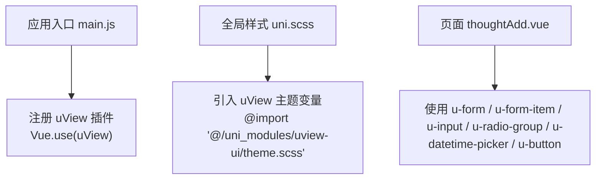
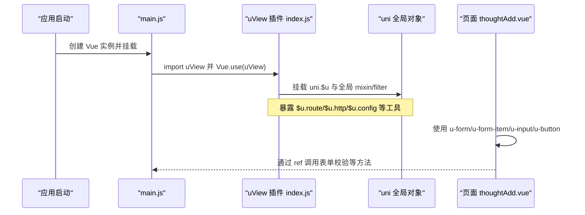
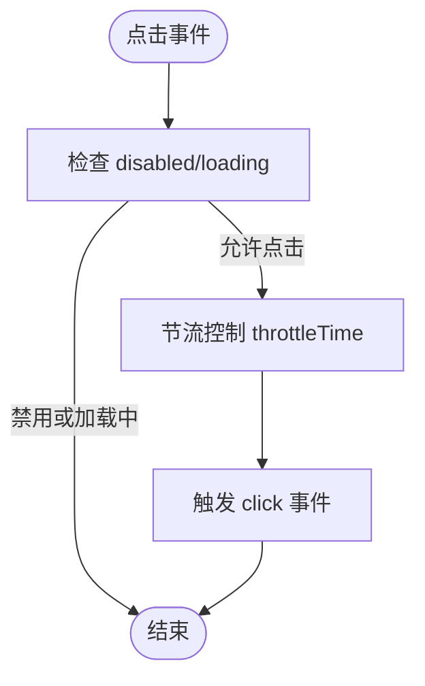
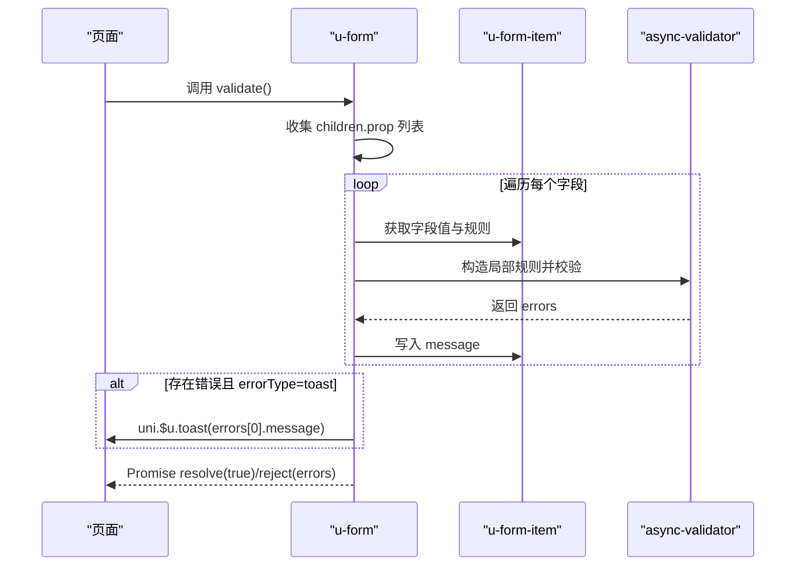
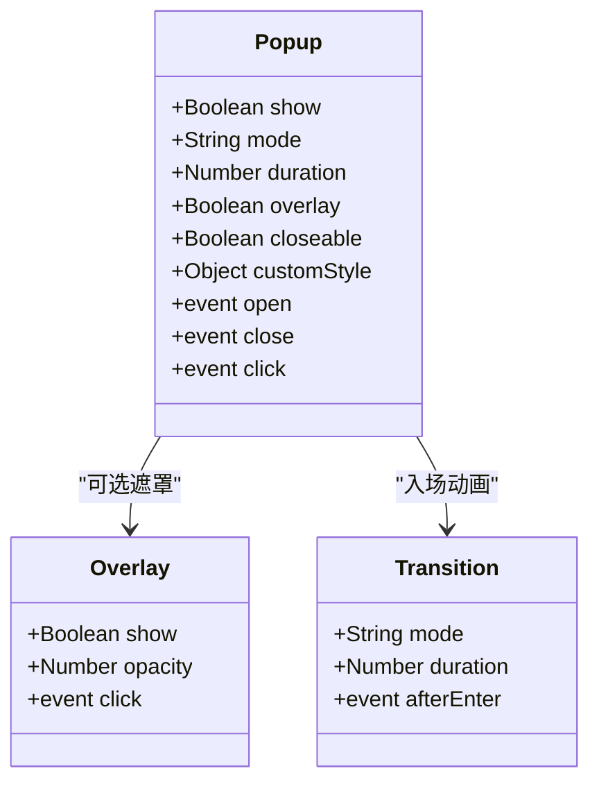
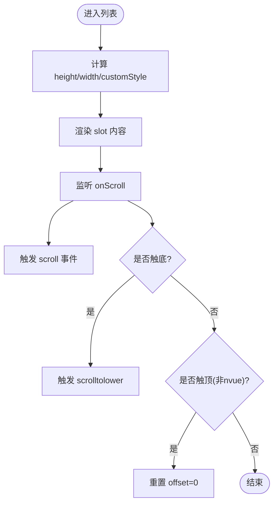
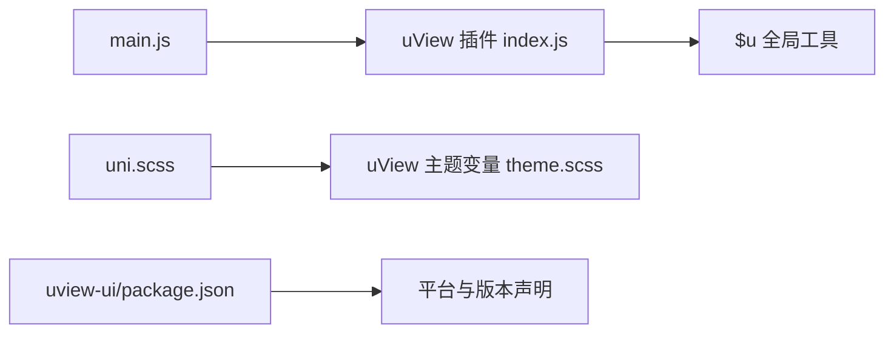

# uView UI组件库

<cite>
**本文引用的文件**   
- [main.js](file://main.js)
- [App.vue](file://App.vue)
- [uni.scss](file://uni.scss)
- [uview-ui/package.json](file://uni_modules/uview-ui/package.json)
- [uview-ui/index.js](file://uni_modules/uview-ui/index.js)
- [uview-ui/theme.scss](file://uni_modules/uview-ui/theme.scss)
- [u-button.vue](file://uni_modules/uview-ui/components/u-button/u-button.vue)
- [u-form.vue](file://uni_modules/uview-ui/components/u-form/u-form.vue)
- [u-popup.vue](file://uni_modules/uview-ui/components/u-popup/u-popup.vue)
- [u-list.vue](file://uni_modules/uview-ui/components/u-list/u-list.vue)
- [thoughtAdd.vue](file://pages/sub-mine/party/thoughtAdd.vue)
</cite>

## 目录
1. [简介](#简介)
2. [项目结构](#项目结构)
3. [核心组件](#核心组件)
4. [架构总览](#架构总览)
5. [详细组件分析](#详细组件分析)
6. [依赖关系分析](#依赖关系分析)
7. [性能与优化](#性能与优化)
8. [主题定制指南](#主题定制指南)
9. [最佳实践](#最佳实践)
10. [常见问题排查](#常见问题排查)
11. [结论](#结论)

## 简介
本文件面向在 uni-app 项目中集成和使用 uView UI 的开发者，结合仓库实际代码，系统说明安装配置、主题定制、常用组件（按钮 u-button、表单 u-form、弹窗 u-popup、列表 u-list）的使用方法与关键属性/事件/插槽，并给出版本兼容性、依赖关系与性能优化建议。文档中的示例以“源码路径”形式标注，便于快速定位实现细节。

## 项目结构
本项目通过 uni_modules 方式引入 uView UI，并在应用入口注册插件，同时在全局样式中引入 uView 的主题变量，以便统一主题风格。

图表来源
- [main.js:8-10](file://main.js#L8-L10)
- [uni.scss:5-6](file://uni.scss#L5-L6)
- [thoughtAdd.vue:1-27](file://pages/sub-mine/party/thoughtAdd.vue#L1-L27)

章节来源
- [main.js:8-10](file://main.js#L8-L10)
- [uni.scss:5-6](file://uni.scss#L5-L6)

## 核心组件
本节聚焦四个高频组件：u-button、u-form、u-popup、u-list。每个组件均从用途、关键 props、事件、插槽与注意事项进行说明，并提供源码路径供深入阅读。

- 按钮 u-button
  - 用途：提供多种尺寸、形状、颜色与加载态的按钮，支持图标与自定义样式。
  - 关键 props：type、size、shape、plain、disabled、loading、loadingText、loadingMode、loadingSize、icon、color、customStyle、throttleTime、hoverStartTime、hoverStayTime 等。
  - 事件：click、getphonenumber、getuserinfo、error、opensetting、launchapp。
  - 插槽：默认插槽用于自定义内容；nvue 下建议使用 text 包裹文本以获得一致样式。
  - 注意：当设置 color 为渐变色时，边框会被移除并通过 backgroundImage 渲染。
  - 源码路径：[u-button.vue](file://uni_modules/uview-ui/components/u-button/u-button.vue)

- 表单 u-form
  - 用途：表单容器，配合 u-form-item 完成数据绑定与校验。
  - 关键 props：model、rules、errorType、borderBottom、labelPosition、labelWidth、labelAlign、labelStyle。
  - 方法：validate、validateField、resetFields、clearValidate、setRules。
  - 事件：无直接事件，通常由父组件调用方法触发校验。
  - 注意：开发环境会提示未设置 rules 或未设置 model 的情况；内部使用 async-validator 进行规则校验。
  - 源码路径：[u-form.vue](file://uni_modules/uview-ui/components/u-form/u-form.vue)

- 弹窗 u-popup
  - 用途：弹出层容器，支持上/下/左/右/中部弹出，可叠加遮罩与安全区域适配。
  - 关键 props：show、overlay、mode、duration、overlayDuration、closeable、overlayStyle、overlayOpacity、closeOnClickOverlay、zIndex、safeAreaInsetTop、safeAreaInsetBottom、round、zoom、customStyle。
  - 事件：open、close、click。
  - 插槽：默认插槽承载弹窗内容。
  - 注意：center 模式下点击遮罩关闭逻辑特殊处理；微信小程序平台对部分子组件有初始化重试逻辑。
  - 源码路径：[u-popup.vue](file://uni_modules/uview-ui/components/u-popup/u-popup.vue)

- 列表 u-list
  - 用途：高性能列表容器，封装 scroll-view/list 滚动能力，支持上下拉阈值与滚动事件。
  - 关键 props：showScrollbar、lowerThreshold、upperThreshold、scrollTop、offsetAccuracy、enableFlex、pagingEnabled、scrollable、scrollIntoView、scrollWithAnimation、enableBackToTop、height、width、preLoadScreen、customStyle。
  - 事件：scroll、scrolltolower、scrolltoupper。
  - 插槽：默认插槽承载列表项。
  - 注意：nvue 与非 nvue 分支分别使用原生 list 与 scroll-view；非 nvue 端在滚动到顶部时会重置偏移以保证置顶效果。
  - 源码路径：[u-list.vue](file://uni_modules/uview-ui/components/u-list/u-list.vue)

章节来源
- [u-button.vue:115-157](file://uni_modules/uview-ui/components/u-button/u-button.vue#L115-L157)
- [u-form.vue:12-25](file://uni_modules/uview-ui/components/u-form/u-form.vue#L12-L25)
- [u-popup.vue:50-73](file://uni_modules/uview-ui/components/u-popup/u-popup.vue#L50-L73)
- [u-list.vue:44-65](file://uni_modules/uview-ui/components/u-list/u-list.vue#L44-L65)

## 架构总览
下图展示 uView 在项目中的安装与主题注入流程，以及典型页面如何组合使用表单与按钮。

图表来源
- [main.js:8-10](file://main.js#L8-L10)
- [uview-ui/index.js:38-75](file://uni_modules/uview-ui/index.js#L38-L75)
- [thoughtAdd.vue:1-27](file://pages/sub-mine/party/thoughtAdd.vue#L1-L27)

## 详细组件分析

### 按钮 u-button
- 交互流程
  - 用户点击 -> 组件判断 disabled/loading -> 节流控制 -> 触发 click 事件。
  - 支持 open-type 相关事件透传（如 getphonenumber、getuserinfo）。
- 样式与主题
  - 通过 type 与 plain/color 组合决定文字与背景色；支持渐变色 background-image。
  - 尺寸 size 影响字体大小与高度；hairline 控制细边框。
- 参考源码路径
  - 点击与事件透传：[u-button.vue:264-289](file://uni_modules/uview-ui/components/u-button/u-button.vue#L264-L289)
  - 样式变量与类名：[u-button.vue:304-489](file://uni_modules/uview-ui/components/u-button/u-button.vue#L304-L489)

图表来源
- [u-button.vue:264-289](file://uni_modules/uview-ui/components/u-button/u-button.vue#L264-L289)

章节来源
- [u-button.vue:115-157](file://uni_modules/uview-ui/components/u-button/u-button.vue#L115-L157)
- [u-button.vue:264-289](file://uni_modules/uview-ui/components/u-button/u-button.vue#L264-L289)
- [u-button.vue:304-489](file://uni_modules/uview-ui/components/u-button/u-button.vue#L304-L489)

### 表单 u-form
- 校验流程
  - 设置 rules 后，内部构建 Schema 校验器。
  - validate() 收集所有字段 prop，逐个调用 validateField() 执行异步校验。
  - errorType='toast' 时自动弹出错误提示。
- 重置与清空
  - resetFields() 基于 originalModel 快照还原 model。
  - clearValidate(props) 清除指定字段校验结果。
- 参考源码路径
  - 规则设置与校验器：[u-form.vue:89-100](file://uni_modules/uview-ui/components/u-form/u-form.vue#L89-L100)
  - 全部校验与 toast 提示：[u-form.vue:184-208](file://uni_modules/uview-ui/components/u-form/u-form.vue#L184-L208)
  - 重置与快照：[u-form.vue:102-113](file://uni_modules/uview-ui/components/u-form/u-form.vue#L102-L113)

图表来源
- [u-form.vue:184-208](file://uni_modules/uview-ui/components/u-form/u-form.vue#L184-L208)
- [u-form.vue:125-182](file://uni_modules/uview-ui/components/u-form/u-form.vue#L125-L182)

章节来源
- [u-form.vue:12-25](file://uni_modules/uview-ui/components/u-form/u-form.vue#L12-L25)
- [u-form.vue:89-100](file://uni_modules/uview-ui/components/u-form/u-form.vue#L89-L100)
- [u-form.vue:102-113](file://uni_modules/uview-ui/components/u-form/u-form.vue#L102-L113)
- [u-form.vue:184-208](file://uni_modules/uview-ui/components/u-form/u-form.vue#L184-L208)

### 弹窗 u-popup
- 显示与动画
  - mode 决定弹出方向与过渡模式（slide-left/right/up/down/fade/fade-zoom）。
  - overlay 遮罩层可配置透明度与点击关闭行为。
- 安全区与圆角
  - safeAreaInsetTop/Bottom 控制状态栏与底部安全距离。
  - round 根据 mode 设置不同圆角。
- 参考源码路径
  - 位置与过渡计算：[u-popup.vue:92-176](file://uni_modules/uview-ui/components/u-popup/u-popup.vue#L92-L176)
  - 遮罩点击与 close/open 事件：[u-popup.vue:177-196](file://uni_modules/uview-ui/components/u-popup/u-popup.vue#L177-L196)

图表来源
- [u-popup.vue:1-44](file://uni_modules/uview-ui/components/u-popup/u-popup.vue#L1-L44)
- [u-popup.vue:92-176](file://uni_modules/uview-ui/components/u-popup/u-popup.vue#L92-L176)

章节来源
- [u-popup.vue:50-73](file://uni_modules/uview-ui/components/u-popup/u-popup.vue#L50-L73)
- [u-popup.vue:92-176](file://uni_modules/uview-ui/components/u-popup/u-popup.vue#L92-L176)
- [u-popup.vue:177-196](file://uni_modules/uview-ui/components/u-popup/u-popup.vue#L177-L196)

### 列表 u-list
- 滚动与阈值
  - lowerThreshold/upperThreshold 控制触底/触顶阈值。
  - scrollIntoView 支持滚动到指定子节点（nvue 通过 dom.scrollToElement）。
- 性能与兼容
  - nvue 使用原生 list，非 nvue 使用 scroll-view。
  - 非 nvue 端在触顶时重置 offset，避免某些 WebView 置顶异常。
- 参考源码路径
  - 滚动事件与阈值：[u-list.vue:109-145](file://uni_modules/uview-ui/components/u-list/u-list.vue#L109-L145)
  - 样式与默认高度：[u-list.vue:83-92](file://uni_modules/uview-ui/components/u-list/u-list.vue#L83-L92)

图表来源
- [u-list.vue:83-92](file://uni_modules/uview-ui/components/u-list/u-list.vue#L83-L92)
- [u-list.vue:109-145](file://uni_modules/uview-ui/components/u-list/u-list.vue#L109-L145)

章节来源
- [u-list.vue:44-65](file://uni_modules/uview-ui/components/u-list/u-list.vue#L44-L65)
- [u-list.vue:83-92](file://uni_modules/uview-ui/components/u-list/u-list.vue#L83-L92)
- [u-list.vue:109-145](file://uni_modules/uview-ui/components/u-list/u-list.vue#L109-L145)

## 依赖关系分析
- 插件安装与全局挂载
  - main.js 引入并注册 uView 插件。
  - uView index.js 将 $u 挂载到 uni 对象，并在 Vue 原型与 mixin 中注入工具与过滤器。
- 主题变量
  - uni.scss 在最前引入 uView 主题变量，确保组件样式优先使用主题色。
- 版本与平台兼容
  - package.json 声明 HBuilderX 引擎要求与多端平台支持情况。

图表来源
- [main.js:8-10](file://main.js#L8-L10)
- [uview-ui/index.js:38-75](file://uni_modules/uview-ui/index.js#L38-L75)
- [uni.scss:5-6](file://uni.scss#L5-L6)
- [uview-ui/package.json:17-83](file://uni_modules/uview-ui/package.json#L17-L83)

章节来源
- [main.js:8-10](file://main.js#L8-L10)
- [uview-ui/index.js:38-75](file://uni_modules/uview-ui/index.js#L38-L75)
- [uni.scss:5-6](file://uni.scss#L5-L6)
- [uview-ui/package.json:17-83](file://uni_modules/uview-ui/package.json#L17-L83)

## 性能与优化
- 列表性能
  - 使用 u-list 的 preLoadScreen 控制前后预渲染屏数，平衡首屏与内存占用。
  - 合理设置 lowerThreshold/upperThreshold，减少频繁触发滚动事件。
- 按钮交互
  - 使用 throttleTime 防止重复提交，降低网络压力。
- 弹窗体验
  - center 模式按需开启 zoom，避免复杂动画带来的重排开销。
- 表单校验
  - 仅在必要时调用 validateField 进行局部校验，减少不必要的异步校验开销。

## 主题定制指南
- 引入位置
  - 在 uni.scss 最前面引入 uView 主题变量，确保覆盖默认样式。
- 可定制变量
  - 主色、成功、警告、错误、信息色及其深浅与浅色变体。
  - 基础色、边框色、背景色、间距与圆角等。
- 修改建议
  - 仅修改 uni.scss 中的变量，避免直接改动组件源码样式。
  - 若需更精细控制，可在页面级样式中覆盖组件类名。

章节来源
- [uni.scss:5-6](file://uni.scss#L5-L6)
- [uview-ui/theme.scss:1-45](file://uni_modules/uview-ui/theme.scss#L1-L45)

## 最佳实践
- 表单
  - 始终为 u-form 设置 model 与 rules，避免开发环境报错。
  - 使用 validateField 做局部校验，提升用户体验。
- 按钮
  - 提交按钮启用 loading 与 throttleTime，避免重复提交。
  - 需要品牌色时使用 color 或 type，渐变背景时注意边框处理。
- 弹窗
  - 使用 v-model 或 show 控制显隐，配合 close 事件清理状态。
  - 长内容弹窗开启 safeAreaInsetBottom，适配全面屏。
- 列表
  - 大数据量场景使用虚拟列表或分页加载，结合 scrolltolower 实现懒加载。
  - 避免在滚动事件中执行重型计算。

## 常见问题排查
- 未设置 rules 导致校验失败
  - 现象：开发环境提示未设置 rules。
  - 解决：为 u-form 传入 rules 对象，并确保 model 已定义。
  - 参考路径：[u-form.vue:184-189](file://uni_modules/uview-ui/components/u-form/u-form.vue#L184-L189)
- 渐变背景边框异常
  - 现象：设置 color 为渐变后出现边框。
  - 解决：组件内部会自动移除边框并使用 backgroundImage，无需额外处理。
  - 参考路径：[u-button.vue:219-235](file://uni_modules/uview-ui/components/u-button/u-button.vue#L219-L235)
- 弹窗遮罩点击无效
  - 现象：center 模式点击遮罩不关闭。
  - 解决：组件内部已处理 center 模式的遮罩点击逻辑，确认 closeOnClickOverlay 为 true。
  - 参考路径：[u-popup.vue:190-196](file://uni_modules/uview-ui/components/u-popup/u-popup.vue#L190-L196)
- 列表触顶无法置顶
  - 现象：某些 WebView 触顶后未回到顶部。
  - 解决：非 nvue 端会在触顶时重置 offset，确保置顶。
  - 参考路径：[u-list.vue:136-145](file://uni_modules/uview-ui/components/u-list/u-list.vue#L136-L145)

章节来源
- [u-form.vue:184-189](file://uni_modules/uview-ui/components/u-form/u-form.vue#L184-L189)
- [u-button.vue:219-235](file://uni_modules/uview-ui/components/u-button/u-button.vue#L219-L235)
- [u-popup.vue:190-196](file://uni_modules/uview-ui/components/u-popup/u-popup.vue#L190-L196)
- [u-list.vue:136-145](file://uni_modules/uview-ui/components/u-list/u-list.vue#L136-L145)

## 结论
通过在 main.js 中注册 uView 插件并在 uni.scss 中引入主题变量，即可在项目内高效使用 uView 提供的丰富组件。结合表单校验、按钮节流、弹窗安全区与列表预渲染等特性，可以在保证用户体验的同时提升性能。建议遵循主题定制与最佳实践，避免直接修改组件源码样式，保持可维护性与跨端一致性。