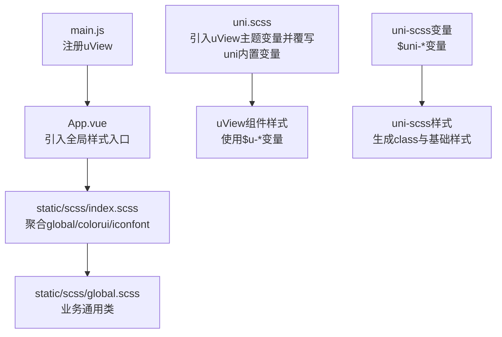
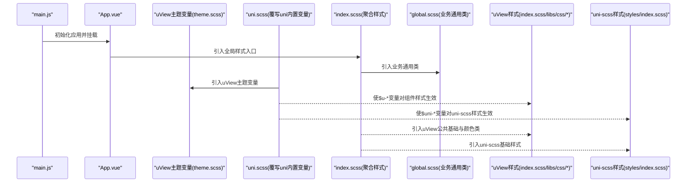
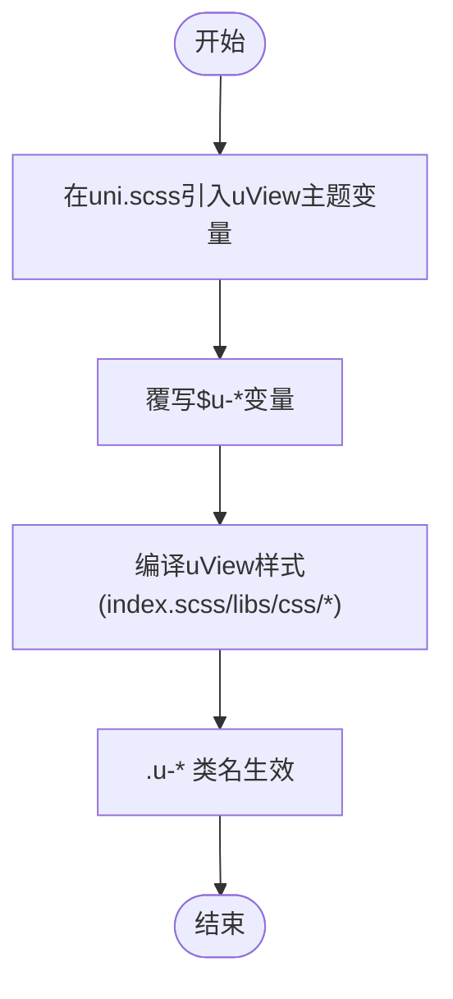
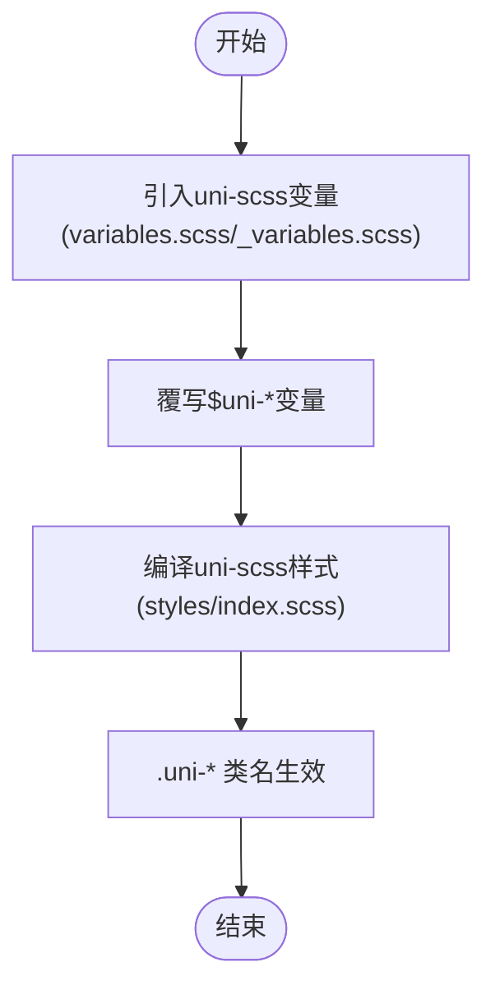
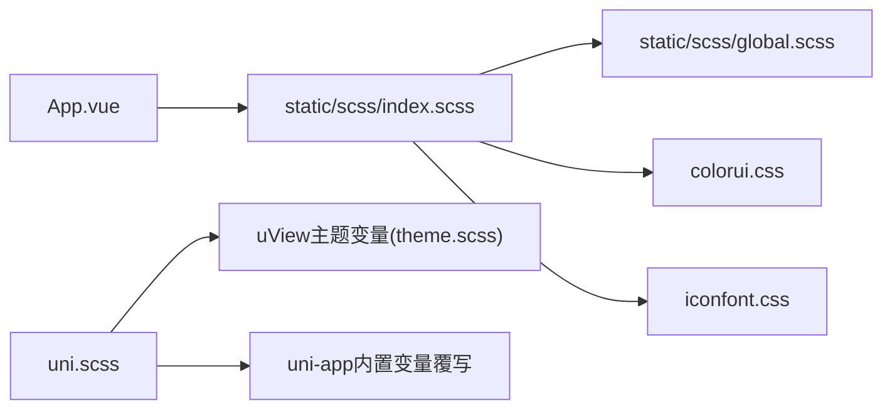
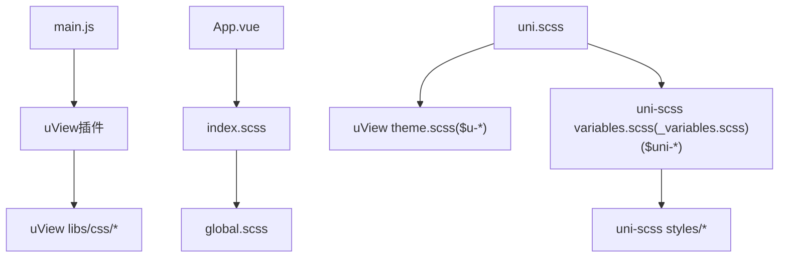

# 主题定制

<cite>
**本文引用的文件**
- [main.js](file://main.js)
- [App.vue](file://App.vue)
- [uni.scss](file://uni.scss)
- [static/scss/index.scss](file://static/scss/index.scss)
- [static/scss/global.scss](file://static/scss/global.scss)
- [uni_modules/uview-ui/theme.scss](file://uni_modules/uview-ui/theme.scss)
- [uni_modules/uview-ui/index.scss](file://uni_modules/uview-ui/index.scss)
- [uni_modules/uview-ui/libs/css/common.scss](file://uni_modules/uview-ui/libs/css/common.scss)
- [uni_modules/uview-ui/libs/css/color.scss](file://uni_modules/uview-ui/libs/css/color.scss)
- [uni_modules/uni-scss/theme.scss](file://uni_modules/uni-scss/theme.scss)
- [uni_modules/uni-scss/variables.scss](file://uni_modules/uni-scss/variables.scss)
- [uni_modules/uni-scss/styles/setting/_variables.scss](file://uni_modules/uni-scss/styles/setting/_variables.scss)
- [uni_modules/uni-scss/styles/setting/_color.scss](file://uni_modules/uni-scss/styles/setting/_color.scss)
- [uni_modules/uni-scss/styles/index.scss](file://uni_modules/uni-scss/styles/index.scss)
</cite>

## 目录
1. [简介](#简介)
2. [项目结构](#项目结构)
3. [核心组件](#核心组件)
4. [架构总览](#架构总览)
5. [详细组件分析](#详细组件分析)
6. [依赖关系分析](#依赖关系分析)
7. [性能考量](#性能考量)
8. [故障排查指南](#故障排查指南)
9. [结论](#结论)
10. [附录](#附录)

## 简介
本指南面向在 uni-app + uView UI 项目中实现“品牌化主题定制”的开发者，围绕以下目标展开：
- 定义与修改主题变量（颜色体系、字体规范、间距标准等设计令牌）
- 覆盖默认样式、创建自定义主题、运行时动态切换主题
- 解释 SCSS 变量的作用域与优先级机制
- 提供响应式设计与多端兼容方案
- 给出主题测试与调试的方法与工具

## 项目结构
本项目采用“入口初始化 → 全局样式引入 → 第三方 UI 主题变量注入 → 业务样式扩展”的分层组织方式。关键路径如下：
- 应用入口 main.js 中注册 uView 插件
- App.vue 中引入全局样式入口 static/scss/index.scss
- static/scss/index.scss 聚合 global.scss、colorui.css、iconfont.css
- uni.scss 作为 SCSS 变量集中地，优先引入 uView 主题变量，再覆写 uni-app 内置变量
- uView 与 uni-scss 两套主题变量体系并存，需明确覆盖顺序与作用域

图示来源
- [main.js:1-31](file://main.js#L1-L31)
- [App.vue:45-47](file://App.vue#L45-L47)
- [static/scss/index.scss:1-6](file://static/scss/index.scss#L1-L6)
- [uni.scss:1-67](file://uni.scss#L1-L67)
- [uni_modules/uview-ui/index.scss:1-23](file://uni_modules/uview-ui/index.scss#L1-L23)
- [uni_modules/uni-scss/styles/index.scss:1-7](file://uni_modules/uni-scss/styles/index.scss#L1-L7)

章节来源
- [main.js:1-31](file://main.js#L1-L31)
- [App.vue:45-47](file://App.vue#L45-L47)
- [static/scss/index.scss:1-6](file://static/scss/index.scss#L1-L6)
- [static/scss/global.scss:1-91](file://static/scss/global.scss#L1-L91)
- [uni.scss:1-67](file://uni.scss#L1-L67)

## 核心组件
- uView 主题变量与样式
  - 主题变量入口：uni_modules/uview-ui/theme.scss，定义 $u-* 系列变量（主色、成功、警告、错误、信息、禁用态、浅色/深色变体等）
  - 样式入口：uni_modules/uview-ui/index.scss，按平台条件引入公共基础类与颜色类
  - 颜色类：uni_modules/uview-ui/libs/css/color.scss，将 $u-* 变量映射为 .u-* 类名
  - 通用类：uni_modules/uview-ui/libs/css/common.scss，包含边框、省略号、按钮重置等跨端兼容样式
- uni-scss 主题变量与样式
  - 变量入口：uni_modules/uni-scss/variables.scss 与 styles/setting/_variables.scss，定义 $uni-* 系列变量（主色、辅助色、中性色、背景、边框、阴影、间距等）
  - 样式入口：uni_modules/uni-scss/styles/index.scss，聚合 setting 下的变量、边框、颜色、间距、圆角、文本、基础样式
  - 颜色映射：uni_modules/uni-scss/styles/setting/_color.scss，基于 $uni-* 生成 .uni-* 类名
- 项目级变量与样式
  - uni.scss：统一引入 uView 主题变量，并覆写 uni-app 内置变量（如 $uni-color-primary、$uni-text-color、$uni-bg-color 等）
  - static/scss/index.scss：聚合 global.scss、colorui.css、iconfont.css
  - static/scss/global.scss：业务常用通用类（字号、颜色、列表项样式等）

章节来源
- [uni_modules/uview-ui/theme.scss:1-45](file://uni_modules/uview-ui/theme.scss#L1-L45)
- [uni_modules/uview-ui/index.scss:1-23](file://uni_modules/uview-ui/index.scss#L1-L23)
- [uni_modules/uview-ui/libs/css/color.scss:1-156](file://uni_modules/uview-ui/libs/css/color.scss#L1-L156)
- [uni_modules/uview-ui/libs/css/common.scss:1-98](file://uni_modules/uview-ui/libs/css/common.scss#L1-L98)
- [uni_modules/uni-scss/variables.scss:1-63](file://uni_modules/uni-scss/variables.scss#L1-L63)
- [uni_modules/uni-scss/styles/setting/_variables.scss:91-130](file://uni_modules/uni-scss/styles/setting/_variables.scss#L91-L130)
- [uni_modules/uni-scss/styles/setting/_color.scss:1-66](file://uni_modules/uni-scss/styles/setting/_color.scss#L1-L66)
- [uni_modules/uni-scss/styles/index.scss:1-7](file://uni_modules/uni-scss/styles/index.scss#L1-L7)
- [uni.scss:1-67](file://uni.scss#L1-L67)
- [static/scss/index.scss:1-6](file://static/scss/index.scss#L1-L6)
- [static/scss/global.scss:1-91](file://static/scss/global.scss#L1-L91)

## 架构总览
下图展示从应用启动到主题变量生效的关键流程与依赖关系。

图示来源
- [main.js:1-31](file://main.js#L1-L31)
- [App.vue:45-47](file://App.vue#L45-L47)
- [static/scss/index.scss:1-6](file://static/scss/index.scss#L1-L6)
- [uni.scss:1-67](file://uni.scss#L1-L67)
- [uni_modules/uview-ui/index.scss:1-23](file://uni_modules/uview-ui/index.scss#L1-L23)
- [uni_modules/uni-scss/styles/index.scss:1-7](file://uni_modules/uni-scss/styles/index.scss#L1-L7)

## 详细组件分析

### uView 主题变量与样式体系
- 变量定义
  - 主题变量入口：uni_modules/uview-ui/theme.scss
  - 变量命名：$u-main-color、$u-content-color、$u-tips-color、$u-light-color、$u-border-color、$u-bg-color、$u-disabled-color
  - 语义色：$u-primary、$u-warning、$u-success、$u-error、$u-info 及其 dark/disabled/light 变体
- 样式输出
  - index.scss 根据平台条件引入 common.scss、vue.scss、nvue.scss、mp.scss、h5.scss
  - color.scss 将 $u-* 变量映射为 .u-* 类名（颜色与背景）
  - common.scss 提供边框、省略行、按钮重置等通用类
- 覆盖策略
  - 在 uni.scss 中通过 @import '@/uni_modules/uview-ui/theme.scss' 先引入 uView 主题变量
  - 随后在 uni.scss 中覆写 $u-* 变量，即可影响所有 uView 组件渲染结果

图示来源
- [uni_modules/uview-ui/theme.scss:1-45](file://uni_modules/uview-ui/theme.scss#L1-L45)
- [uni_modules/uview-ui/index.scss:1-23](file://uni_modules/uview-ui/index.scss#L1-L23)
- [uni_modules/uview-ui/libs/css/color.scss:1-156](file://uni_modules/uview-ui/libs/css/color.scss#L1-L156)
- [uni_modules/uview-ui/libs/css/common.scss:1-98](file://uni_modules/uview-ui/libs/css/common.scss#L1-L98)
- [uni.scss:1-67](file://uni.scss#L1-L67)

章节来源
- [uni_modules/uview-ui/theme.scss:1-45](file://uni_modules/uview-ui/theme.scss#L1-L45)
- [uni_modules/uview-ui/index.scss:1-23](file://uni_modules/uview-ui/index.scss#L1-L23)
- [uni_modules/uview-ui/libs/css/color.scss:1-156](file://uni_modules/uview-ui/libs/css/color.scss#L1-L156)
- [uni_modules/uview-ui/libs/css/common.scss:1-98](file://uni_modules/uview-ui/libs/css/common.scss#L1-L98)

### uni-scss 主题变量与样式体系
- 变量定义
  - variables.scss 与 styles/setting/_variables.scss 共同定义 $uni-* 系列变量（主色、辅助色、中性色、背景、边框、阴影、间距、圆角、字体等）
  - _color.scss 将 $uni-* 映射为 .uni-* 类名
- 样式输出
  - styles/index.scss 聚合 setting 下各模块（variables、border、color、space、radius、text、styles）
- 覆盖策略
  - 在 uni.scss 中覆写 $uni-* 变量，可影响 uni-scss 生成的类名与组件默认样式
  - 注意与 uView 的 $u-* 变量区分，避免混用导致不一致

图示来源
- [uni_modules/uni-scss/variables.scss:1-63](file://uni_modules/uni-scss/variables.scss#L1-L63)
- [uni_modules/uni-scss/styles/setting/_variables.scss:91-130](file://uni_modules/uni-scss/styles/setting/_variables.scss#L91-L130)
- [uni_modules/uni-scss/styles/setting/_color.scss:1-66](file://uni_modules/uni-scss/styles/setting/_color.scss#L1-L66)
- [uni_modules/uni-scss/styles/index.scss:1-7](file://uni_modules/uni-scss/styles/index.scss#L1-L7)
- [uni.scss:1-67](file://uni.scss#L1-L67)

章节来源
- [uni_modules/uni-scss/variables.scss:1-63](file://uni_modules/uni-scss/variables.scss#L1-L63)
- [uni_modules/uni-scss/styles/setting/_variables.scss:91-130](file://uni_modules/uni-scss/styles/setting/_variables.scss#L91-L130)
- [uni_modules/uni-scss/styles/setting/_color.scss:1-66](file://uni_modules/uni-scss/styles/setting/_color.scss#L1-L66)
- [uni_modules/uni-scss/styles/index.scss:1-7](file://uni_modules/uni-scss/styles/index.scss#L1-L7)

### 项目级样式与变量管理
- 全局样式入口
  - App.vue 引入 static/scss/index.scss
  - static/scss/index.scss 聚合 global.scss、colorui.css、iconfont.css
- 业务通用类
  - static/scss/global.scss 提供常用类（字号、颜色、列表项样式等），便于页面快速复用
- uni.scss 的作用
  - 作为 SCSS 变量集中地，优先引入 uView 主题变量，再覆写 uni-app 内置变量（行为色、文字色、背景色、尺寸、圆角、间距、透明度、文章场景相关）

图示来源
- [App.vue:45-47](file://App.vue#L45-L47)
- [static/scss/index.scss:1-6](file://static/scss/index.scss#L1-L6)
- [static/scss/global.scss:1-91](file://static/scss/global.scss#L1-L91)
- [uni.scss:1-67](file://uni.scss#L1-L67)
- [uni_modules/uview-ui/theme.scss:1-45](file://uni_modules/uview-ui/theme.scss#L1-L45)

章节来源
- [App.vue:45-47](file://App.vue#L45-L47)
- [static/scss/index.scss:1-6](file://static/scss/index.scss#L1-L6)
- [static/scss/global.scss:1-91](file://static/scss/global.scss#L1-L91)
- [uni.scss:1-67](file://uni.scss#L1-L67)

## 依赖关系分析
- 入口依赖
  - main.js 注册 uView 插件，确保组件库可用
  - App.vue 引入全局样式入口，保证主题变量与样式在应用范围内生效
- 样式依赖
  - static/scss/index.scss 聚合多个样式源，形成最终的全局样式
  - uni.scss 作为变量中心，决定 uView 与 uni-scss 的最终取值
- 主题变量依赖
  - uView 的 $u-* 变量由 theme.scss 定义，被 libs/css/color.scss 与 common.scss 引用
  - uni-scss 的 $uni-* 变量由 variables.scss 与 _variables.scss 定义，被 styles/index.scss 与 _color.scss 引用

图示来源
- [main.js:1-31](file://main.js#L1-L31)
- [App.vue:45-47](file://App.vue#L45-L47)
- [static/scss/index.scss:1-6](file://static/scss/index.scss#L1-L6)
- [uni.scss:1-67](file://uni.scss#L1-L67)
- [uni_modules/uview-ui/theme.scss:1-45](file://uni_modules/uview-ui/theme.scss#L1-L45)
- [uni_modules/uview-ui/libs/css/color.scss:1-156](file://uni_modules/uview-ui/libs/css/color.scss#L1-L156)
- [uni_modules/uni-scss/variables.scss:1-63](file://uni_modules/uni-scss/variables.scss#L1-L63)
- [uni_modules/uni-scss/styles/index.scss:1-7](file://uni_modules/uni-scss/styles/index.scss#L1-L7)

章节来源
- [main.js:1-31](file://main.js#L1-L31)
- [App.vue:45-47](file://App.vue#L45-L47)
- [static/scss/index.scss:1-6](file://static/scss/index.scss#L1-L6)
- [uni.scss:1-67](file://uni.scss#L1-L67)
- [uni_modules/uview-ui/theme.scss:1-45](file://uni_modules/uview-ui/theme.scss#L1-L45)
- [uni_modules/uview-ui/libs/css/color.scss:1-156](file://uni_modules/uview-ui/libs/css/color.scss#L1-L156)
- [uni_modules/uni-scss/variables.scss:1-63](file://uni_modules/uni-scss/variables.scss#L1-L63)
- [uni_modules/uni-scss/styles/index.scss:1-7](file://uni_modules/uni-scss/styles/index.scss#L1-L7)

## 性能考量
- 变量集中管理
  - 将主题变量集中在 uni.scss，减少重复定义与分散维护成本
- 按需引入
  - 仅在 uni.scss 引入必要的主题变量与基础样式，避免不必要的样式体积膨胀
- 条件编译
  - 利用 uni-app 的条件编译指令（如 #ifndef APP-NVUE、#ifdef MP、#ifdef H5）仅引入目标平台所需样式，降低包体
- 类名复用
  - 通过 .u-* 与 .uni-* 类名复用，减少内联样式与重复 CSS

[本节为通用指导，不直接分析具体文件]

## 故障排查指南
- 主题变量未生效
  - 检查是否在 uni.scss 中优先引入 uView 主题变量，并在其后覆写 $u-* 或 $uni-* 变量
  - 确认 App.vue 已引入 static/scss/index.scss，确保全局样式加载
- 样式冲突
  - 检查 static/scss/global.scss 中的类名是否与 uView/uni-scss 的类名冲突
  - 必要时提高选择器优先级或使用 !important（谨慎使用）
- 多端差异
  - 针对 nvue、小程序、H5 的差异，使用条件编译分别引入对应样式
  - 参考 uView 的 index.scss 与 common.scss 中的条件编译示例
- 构建产物异常
  - 清理缓存后重新构建，确保 SCSS 变量与样式正确编译

章节来源
- [App.vue:45-47](file://App.vue#L45-L47)
- [static/scss/index.scss:1-6](file://static/scss/index.scss#L1-L6)
- [static/scss/global.scss:1-91](file://static/scss/global.scss#L1-L91)
- [uni_modules/uview-ui/index.scss:1-23](file://uni_modules/uview-ui/index.scss#L1-L23)
- [uni_modules/uview-ui/libs/css/common.scss:1-98](file://uni_modules/uview-ui/libs/css/common.scss#L1-L98)

## 结论
通过在 uni.scss 中集中管理 SCSS 变量，并遵循“先引入、后覆写”的顺序，可以稳定地定制 uView 与 uni-scss 的主题。结合条件编译与类名复用，可实现跨端一致的品牌化体验。建议建立统一的设计令牌文档，持续迭代与维护主题变量，确保团队协同与长期可维护性。

[本节为总结性内容，不直接分析具体文件]

## 附录

### 设计令牌清单（建议）
- 颜色体系
  - 主色、辅助色、成功、警告、错误、信息及其深浅与禁用态
  - 中性色（主要文字、常规文字、次要文字、辅助说明）
  - 背景色、边框色、遮罩色
- 字体规范
  - 字号层级（小、基准、大）、标题层级（h1-h6）
  - 字重、行高、字距
- 间距标准
  - 水平/垂直间距（小、基准、大）
  - 圆角（小、基准、大、圆形）
  - 阴影（轻、基准、重）
- 交互状态
  - 禁用态透明度、悬停/点击态颜色

[本节为概念性内容，不直接分析具体文件]

### 覆盖默认样式与创建自定义主题
- 覆盖默认样式
  - 在 uni.scss 中覆写 $u-* 与 $uni-* 变量
  - 在 static/scss/global.scss 中新增或调整业务通用类
- 创建自定义主题
  - 新建主题变量文件（例如 theme-custom.scss），集中定义品牌色与令牌
  - 在 uni.scss 中引入该文件，并按需覆写
- 动态切换主题
  - 在运行时通过 JS 动态插入/替换 <style> 标签或切换根节点 class，配合 CSS 变量或 SCSS 编译后的类名进行切换
  - 注意：SCSS 变量在编译期确定，运行时切换建议使用 CSS 变量或预编译的多套样式文件

[本节为概念性内容，不直接分析具体文件]

### SCSS 变量的作用域与优先级机制
- 作用域
  - uni.scss 作为全局变量中心，其引入顺序决定变量最终值
  - uView 与 uni-scss 的变量各自独立，避免混用
- 优先级
  - 后定义的变量会覆盖先前定义的变量
  - 类名优先级遵循 CSS 规则；必要时可使用 !important（谨慎）
- 最佳实践
  - 将变量定义与样式输出分离，保持清晰职责
  - 使用命名空间（$u-* 与 $uni-*）避免冲突

[本节为概念性内容，不直接分析具体文件]

### 响应式设计适配与多端兼容
- 响应式
  - 使用 rpx 单位适配不同屏幕宽度
  - 借助媒体查询与断点控制布局与字号
- 多端兼容
  - 使用 uni-app 条件编译指令分别处理 nvue、小程序、H5 的差异
  - 参考 uView 的 index.scss 与 common.scss 中的条件编译示例

[本节为概念性内容，不直接分析具体文件]

### 主题测试与调试方法
- 静态检查
  - 在控制台查看编译后的 CSS，确认变量是否按预期生效
  - 使用浏览器开发者工具检查元素计算样式
- 运行时验证
  - 在不同平台（小程序、H5、APP）下验证主题一致性
  - 记录并对比关键页面的视觉差异
- 自动化测试（可选）
  - 编写脚本批量截图并进行像素比对（适用于关键页面）
  - 使用 Lighthouse 或类似工具评估样式性能与可访问性

[本节为概念性内容，不直接分析具体文件]