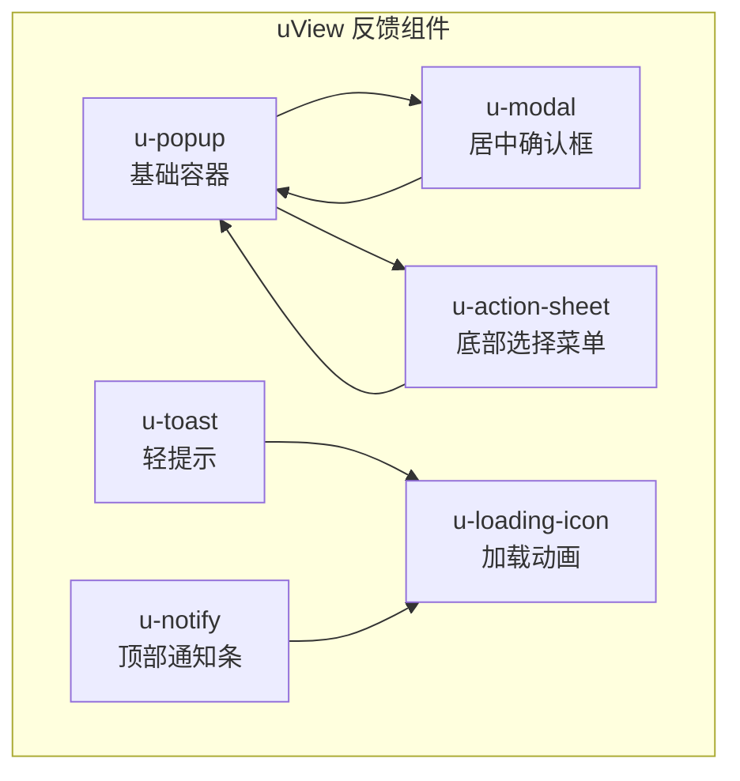
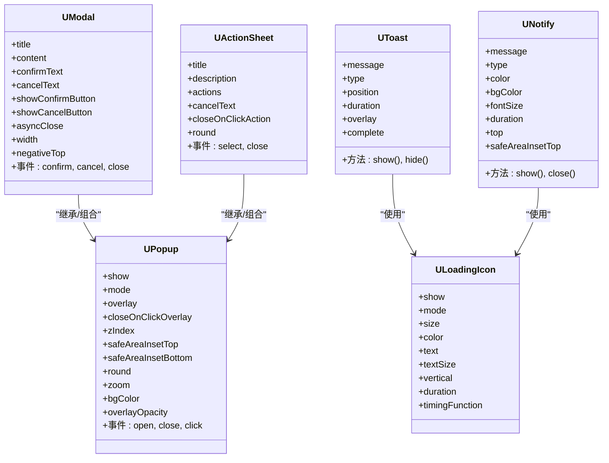
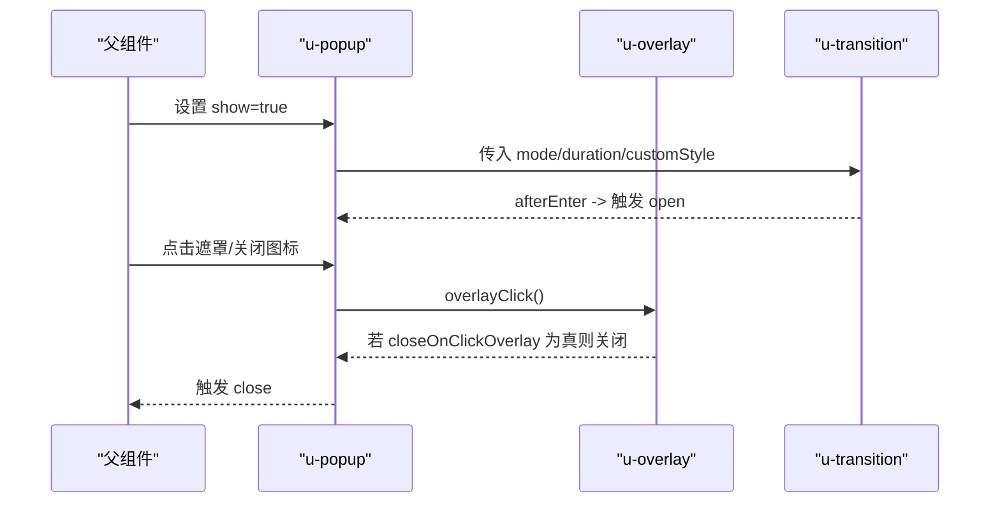
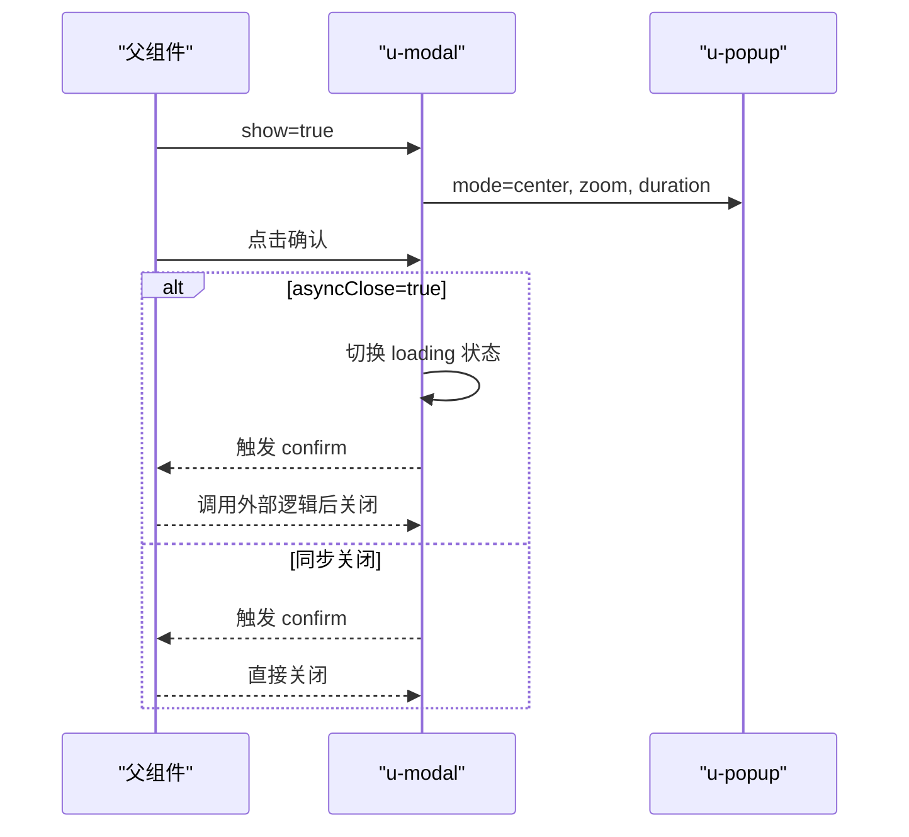
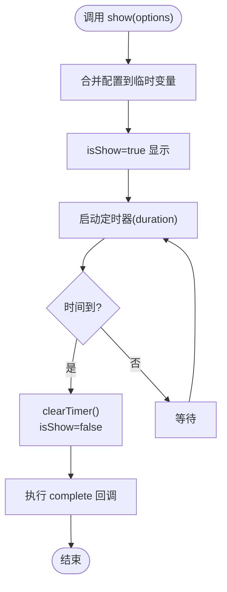
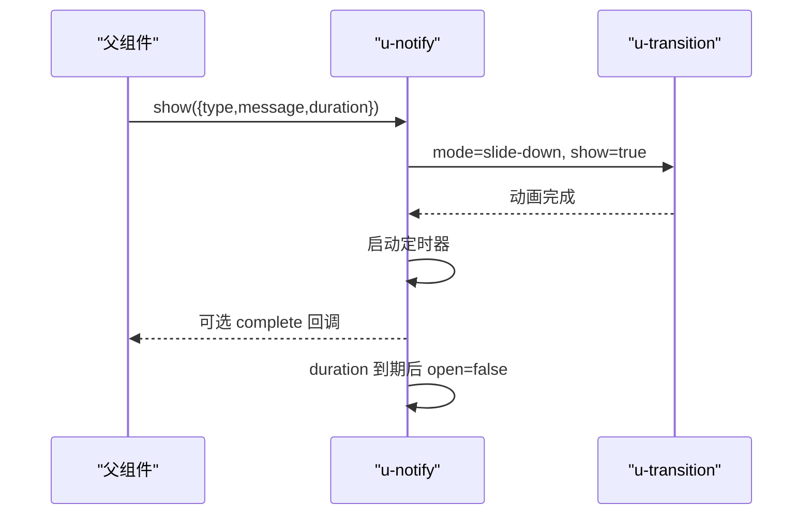
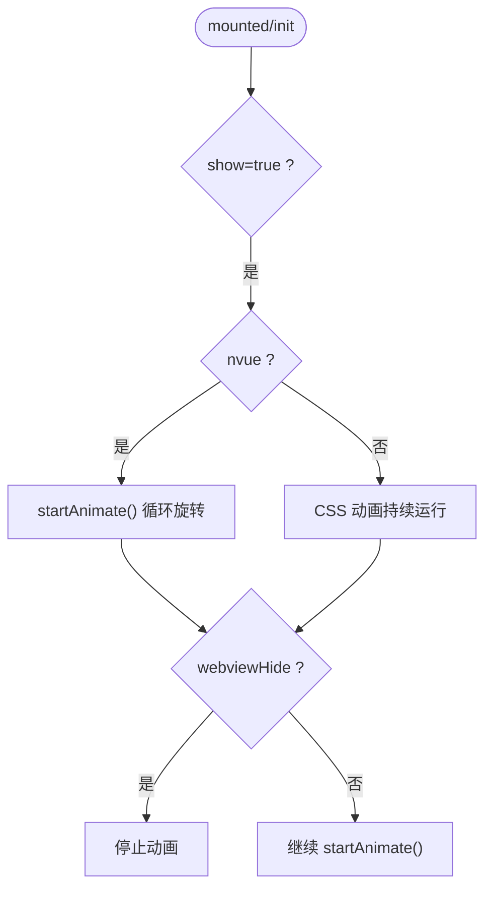
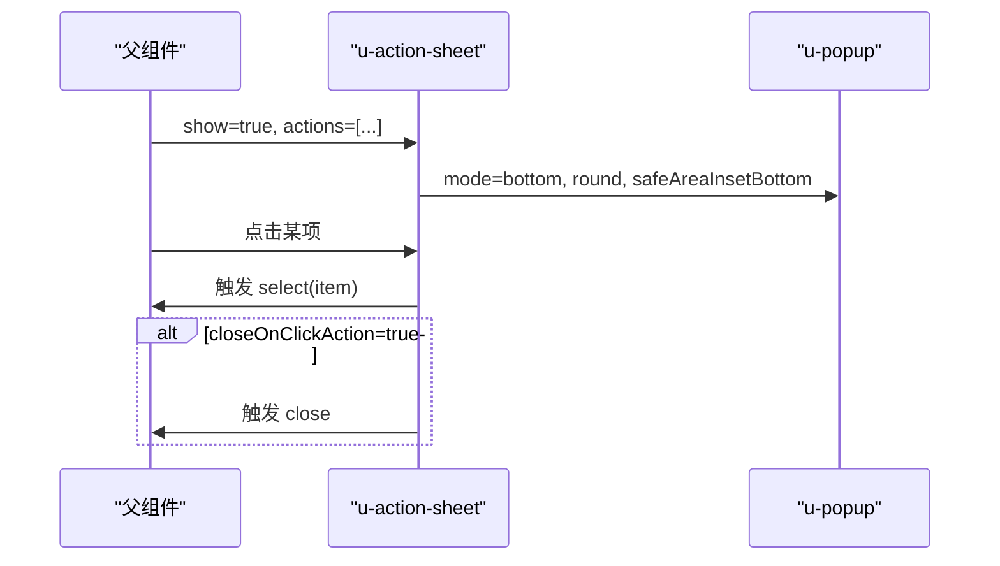
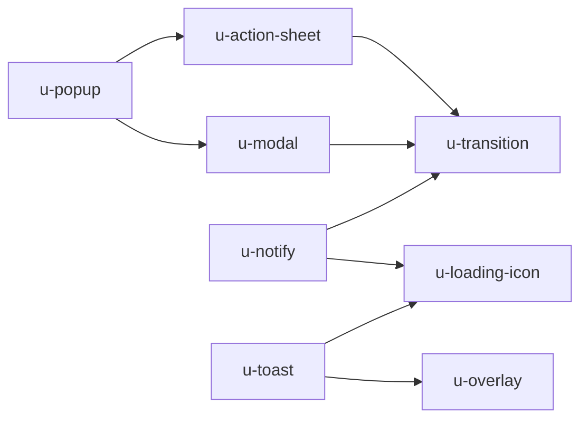

# 反馈组件

<cite>
**本文引用的文件**   
- [u-popup.vue](file://uni_modules/uview-ui/components/u-popup/u-popup.vue)
- [u-popup/props.js](file://uni_modules/uview-ui/components/u-popup/props.js)
- [u-modal.vue](file://uni_modules/uview-ui/components/u-modal/u-modal.vue)
- [u-modal/props.js](file://uni_modules/uview-ui/components/u-modal/props.js)
- [u-toast.vue](file://uni_modules/uview-ui/components/u-toast/u-toast.vue)
- [u-notify.vue](file://uni_modules/uview-ui/components/u-notify/u-notify.vue)
- [u-notify/props.js](file://uni_modules/uview-ui/components/u-notify/props.js)
- [u-loading-icon.vue](file://uni_modules/uview-ui/components/u-loading-icon/u-loading-icon.vue)
- [u-loading-icon/props.js](file://uni_modules/uview-ui/components/u-loading-icon/props.js)
- [u-action-sheet.vue](file://uni_modules/uview-ui/components/u-action-sheet/u-action-sheet.vue)
- [u-action-sheet/props.js](file://uni_modules/uview-ui/components/u-action-sheet/props.js)
</cite>

## 目录
1. [简介](#简介)
2. [项目结构](#项目结构)
3. [核心组件](#核心组件)
4. [架构总览](#架构总览)
5. [详细组件分析](#详细组件分析)
6. [依赖关系分析](#依赖关系分析)
7. [性能与体验优化](#性能与体验优化)
8. [故障排查指南](#故障排查指南)
9. [结论](#结论)
10. [附录：API速查](#附录api速查)

## 简介
本文件面向使用 uView UI 的开发者，聚焦“用户反馈”类组件的使用与最佳实践，覆盖以下组件：
- 弹窗 u-popup
- 模态框 u-modal
- 提示消息 u-toast
- 通知栏 u-notify
- 加载指示器 u-loading-icon
- 操作菜单 u-action-sheet

文档将系统讲解各组件的显示控制、动画效果、层级管理、事件回调，并提供交互体验优化建议、异步处理与错误反馈模式、移动端手势支持与无障碍访问方案。

## 项目结构
反馈相关组件位于 uView 的 components 目录下，采用“组件 + props 定义”的分层组织方式，便于统一维护属性默认值与类型校验。

图表来源
- [u-popup.vue:1-45](file://uni_modules/uview-ui/components/u-popup/u-popup.vue#L1-L45)
- [u-modal.vue:1-90](file://uni_modules/uview-ui/components/u-modal/u-modal.vue#L1-L90)
- [u-action-sheet.vue:1-107](file://uni_modules/uview-ui/components/u-action-sheet/u-action-sheet.vue#L1-L107)
- [u-toast.vue:1-39](file://uni_modules/uview-ui/components/u-toast/u-toast.vue#L1-L39)
- [u-notify.vue:1-33](file://uni_modules/uview-ui/components/u-notify/u-notify.vue#L1-L33)
- [u-loading-icon.vue:1-58](file://uni_modules/uview-ui/components/u-loading-icon/u-loading-icon.vue#L1-L58)

章节来源
- [u-popup.vue:1-45](file://uni_modules/uview-ui/components/u-popup/u-popup.vue#L1-L45)
- [u-modal.vue:1-90](file://uni_modules/uview-ui/components/u-modal/u-modal.vue#L1-L90)
- [u-action-sheet.vue:1-107](file://uni_modules/uview-ui/components/u-action-sheet/u-action-sheet.vue#L1-L107)
- [u-toast.vue:1-39](file://uni_modules/uview-ui/components/u-toast/u-toast.vue#L1-L39)
- [u-notify.vue:1-33](file://uni_modules/uview-ui/components/u-notify/u-notify.vue#L1-L33)
- [u-loading-icon.vue:1-58](file://uni_modules/uview-ui/components/u-loading-icon/u-loading-icon.vue#L1-L58)

## 核心组件
本节从“显示控制、动画、层级、事件”四个维度梳理反馈组件的核心能力。

- 显示控制
  - u-popup：通过 show 控制显隐；支持 overlay 遮罩、closeOnClickOverlay 点击遮罩关闭、safeAreaInsetTop/bottom 安全区适配。
  - u-modal：基于 u-popup 的 center 模式封装，提供 confirm/cancel 按钮与 asyncClose 异步关闭。
  - u-toast：通过 ref.show(options) 或主题方法（如 success()）触发，内部用定时器自动隐藏。
  - u-notify：通过 ref.show(options) 触发，duration=0 可常驻。
  - u-loading-icon：通过 show 控制显隐，支持多种 mode 和尺寸。
  - u-action-sheet：基于 u-popup bottom 模式，actions 列表驱动渲染，支持取消项与 loading 状态。

- 动画效果
  - u-popup：根据 mode 映射到不同过渡模式（slide-left/right/up/down、fade/fade-zoom）。
  - u-modal：center 模式下可选 zoom 缩放动画。
  - u-toast：配合 overlay 居中展示，位置支持 top/center/bottom。
  - u-notify：slide-down 滑入动画。
  - u-loading-icon：CSS 旋转或 nvue animation.transition 循环动画。

- 层级管理
  - u-popup 默认 zIndex 较高，确保浮层置顶；u-notify 固定定位并设置高 z-index。
  - 多层级叠加时，建议通过 zIndex 或组件顺序控制堆叠优先级。

- 事件回调
  - u-popup：open/close/click。
  - u-modal：confirm/cancel/close。
  - u-toast：complete 回调（显示结束后执行）。
  - u-notify：open/close。
  - u-action-sheet：select/close。

章节来源
- [u-popup.vue:74-225](file://uni_modules/uview-ui/components/u-popup/u-popup.vue#L74-L225)
- [u-popup/props.js:1-80](file://uni_modules/uview-ui/components/u-popup/props.js#L1-L80)
- [u-modal.vue:92-158](file://uni_modules/uview-ui/components/u-modal/u-modal.vue#L92-L158)
- [u-modal/props.js:1-85](file://uni_modules/uview-ui/components/u-modal/props.js#L1-L85)
- [u-toast.vue:64-179](file://uni_modules/uview-ui/components/u-toast/u-toast.vue#L64-L179)
- [u-notify.vue:54-166](file://uni_modules/uview-ui/components/u-notify/u-notify.vue#L54-L166)
- [u-notify/props.js:1-50](file://uni_modules/uview-ui/components/u-notify/props.js#L1-L50)
- [u-loading-icon.vue:83-186](file://uni_modules/uview-ui/components/u-loading-icon/u-loading-icon.vue#L83-L186)
- [u-loading-icon/props.js:1-60](file://uni_modules/uview-ui/components/u-loading-icon/props.js#L1-L60)
- [u-action-sheet.vue:146-189](file://uni_modules/uview-ui/components/u-action-sheet/u-action-sheet.vue#L146-L189)
- [u-action-sheet/props.js:1-55](file://uni_modules/uview-ui/components/u-action-sheet/props.js#L1-L55)

## 架构总览
反馈组件整体遵循“容器 + 业务封装 + 动画/遮罩”的分层设计：
- 基础容器：u-popup 提供遮罩、方向、圆角、安全区、zIndex 等通用能力。
- 业务封装：u-modal、u-action-sheet 在 u-popup 之上组合布局与交互逻辑。
- 轻量提示：u-toast、u-notify 独立实现，分别用于轻提示与顶部通知。
- 动画原语：u-loading-icon 提供统一的加载动画能力，被多处复用。

图表来源
- [u-popup.vue:74-225](file://uni_modules/uview-ui/components/u-popup/u-popup.vue#L74-L225)
- [u-modal.vue:1-90](file://uni_modules/uview-ui/components/u-modal/u-modal.vue#L1-L90)
- [u-action-sheet.vue:1-107](file://uni_modules/uview-ui/components/u-action-sheet/u-action-sheet.vue#L1-L107)
- [u-toast.vue:1-39](file://uni_modules/uview-ui/components/u-toast/u-toast.vue#L1-L39)
- [u-notify.vue:1-33](file://uni_modules/uview-ui/components/u-notify/u-notify.vue#L1-L33)
- [u-loading-icon.vue:1-58](file://uni_modules/uview-ui/components/u-loading-icon/u-loading-icon.vue#L1-L58)

## 详细组件分析

### 弹窗 u-popup
- 功能要点
  - 支持上/下/左/右/中五种弹出方向，对应不同过渡动画。
  - 内置遮罩层，支持透明度与自定义样式。
  - 支持关闭图标、圆角、安全区、背景色、缩放等。
- 关键属性
  - show、mode、overlay、closeOnClickOverlay、zIndex、safeAreaInsetTop/bottom、round、zoom、bgColor、overlayOpacity、duration、overlayDuration。
- 事件
  - open：进入动画完成后触发。
  - close：关闭时触发。
  - click：点击内容区域时触发（中心模式会透传遮罩点击行为）。
- 注意事项
  - 微信端打开时会尝试对部分子组件进行二次初始化，避免首次渲染计算异常。

图表来源
- [u-popup.vue:1-45](file://uni_modules/uview-ui/components/u-popup/u-popup.vue#L1-L45)
- [u-popup.vue:177-225](file://uni_modules/uview-ui/components/u-popup/u-popup.vue#L177-L225)
- [u-popup/props.js:1-80](file://uni_modules/uview-ui/components/u-popup/props.js#L1-L80)

章节来源
- [u-popup.vue:74-225](file://uni_modules/uview-ui/components/u-popup/u-popup.vue#L74-L225)
- [u-popup/props.js:1-80](file://uni_modules/uview-ui/components/u-popup/props.js#L1-L80)

### 模态框 u-modal
- 功能要点
  - 基于 u-popup 的 center 模式，提供标题、内容、确认/取消按钮。
  - 支持异步关闭（asyncClose），在确认按钮处显示 loading。
- 关键属性
  - title、content、confirmText、cancelText、showConfirmButton、showCancelButton、confirmColor、cancelColor、buttonReverse、zoom、asyncClose、closeOnClickOverlay、negativeTop、width。
- 事件
  - confirm：点击确认按钮触发。
  - cancel：点击取消按钮触发。
  - close：点击遮罩关闭时触发（需 closeOnClickOverlay=true）。
- 交互细节
  - 中部弹窗的透明遮罩会拦截点击，内部已做 stop 处理，避免误触。

图表来源
- [u-modal.vue:1-90](file://uni_modules/uview-ui/components/u-modal/u-modal.vue#L1-L90)
- [u-modal.vue:119-158](file://uni_modules/uview-ui/components/u-modal/u-modal.vue#L119-L158)
- [u-modal/props.js:1-85](file://uni_modules/uview-ui/components/u-modal/props.js#L1-L85)

章节来源
- [u-modal.vue:92-158](file://uni_modules/uview-ui/components/u-modal/u-modal.vue#L92-L158)
- [u-modal/props.js:1-85](file://uni_modules/uview-ui/components/u-modal/props.js#L1-L85)

### 提示消息 u-toast
- 功能要点
  - 轻提示，支持多种主题（primary/success/error/warning/default/loading）。
  - 支持 position=top/center/bottom，overlay 防穿透。
  - 通过 ref.show(options) 或主题方法（如 this.$refs.toast.success('成功')）调用。
- 关键属性
  - message、type、position、duration、overlay、icon、complete、back/url/isTab 等。
- 生命周期
  - created 阶段批量生成主题方法。
  - show 合并配置、启动定时器，duration 结束后执行 complete 并隐藏。
  - hide/clearTimer 清理定时器与状态。

图表来源
- [u-toast.vue:64-179](file://uni_modules/uview-ui/components/u-toast/u-toast.vue#L64-L179)

章节来源
- [u-toast.vue:64-179](file://uni_modules/uview-ui/components/u-toast/u-toast.vue#L64-L179)

### 通知栏 u-notify
- 功能要点
  - 顶部向下滑出的通知条，支持 type 主题与自定义颜色/背景。
  - 通过 ref.show(options) 触发，duration=0 可常驻。
- 关键属性
  - top、type、color、bgColor、message、fontSize、duration、safeAreaInsetTop。
- 生命周期
  - created 阶段批量生成主题方法。
  - show 合并配置、设置 open=true，并在 duration 结束后关闭。

图表来源
- [u-notify.vue:54-166](file://uni_modules/uview-ui/components/u-notify/u-notify.vue#L54-L166)
- [u-notify/props.js:1-50](file://uni_modules/uview-ui/components/u-notify/props.js#L1-L50)

章节来源
- [u-notify.vue:54-166](file://uni_modules/uview-ui/components/u-notify/u-notify.vue#L54-L166)
- [u-notify/props.js:1-50](file://uni_modules/uview-ui/components/u-notify/props.js#L1-L50)

### 加载指示器 u-loading-icon
- 功能要点
  - 多模式加载动画：circle/spinner/semicircle。
  - 支持文本、垂直排列、尺寸、颜色、时长、缓动函数。
  - nvue 平台使用原生 animation.transition 循环动画，非 spinner 模式需要手动旋转。
- 关键属性
  - show、mode、size、color、text、textSize、vertical、duration、timingFunction、inactiveColor。
- 性能优化
  - 监听 webview 的 hide/show，页面隐藏时停止动画，减少消耗。
  - nvue 下 show 变化时重新启动动画模块。

图表来源
- [u-loading-icon.vue:83-186](file://uni_modules/uview-ui/components/u-loading-icon/u-loading-icon.vue#L83-L186)
- [u-loading-icon/props.js:1-60](file://uni_modules/uview-ui/components/u-loading-icon/props.js#L1-L60)

章节来源
- [u-loading-icon.vue:83-186](file://uni_modules/uview-ui/components/u-loading-icon/u-loading-icon.vue#L83-L186)
- [u-loading-icon/props.js:1-60](file://uni_modules/uview-ui/components/u-loading-icon/props.js#L1-L60)

### 操作菜单 u-action-sheet
- 功能要点
  - 基于 u-popup bottom 模式，支持标题、描述、选项数组 actions、取消文案。
  - 每个 action 支持 disabled/loading/color/fontSize 等个性化样式。
  - 支持小程序开放能力（getUserInfo/getPhoneNumber/launchApp/openSetting 等）。
- 关键属性
  - show、title、description、actions、cancelText、closeOnClickAction、safeAreaInsetBottom、openType、closeOnClickOverlay、round。
- 事件
  - select：选中某一项时触发，返回该项对象。
  - close：点击取消或遮罩关闭时触发。

图表来源
- [u-action-sheet.vue:1-107](file://uni_modules/uview-ui/components/u-action-sheet/u-action-sheet.vue#L1-L107)
- [u-action-sheet.vue:146-189](file://uni_modules/uview-ui/components/u-action-sheet/u-action-sheet.vue#L146-L189)
- [u-action-sheet/props.js:1-55](file://uni_modules/uview-ui/components/u-action-sheet/props.js#L1-L55)

章节来源
- [u-action-sheet.vue:146-189](file://uni_modules/uview-ui/components/u-action-sheet/u-action-sheet.vue#L146-L189)
- [u-action-sheet/props.js:1-55](file://uni_modules/uview-ui/components/u-action-sheet/props.js#L1-L55)

## 依赖关系分析
- 组件耦合
  - u-modal 与 u-action-sheet 强依赖 u-popup，复用其遮罩、方向、安全区与动画能力。
  - u-toast 与 u-notify 均内嵌 u-loading-icon 作为加载态视觉元素。
- 外部依赖
  - 大量使用 u-overlay、u-status-bar、u-safe-bottom、u-icon、u-line、u-gap 等基础组件。
  - 动画由 u-transition 提供，底层结合 CSS 与 nvue animation。
- 潜在环依赖
  - 当前结构无循环依赖；u-popup 不反向依赖上层业务组件。

图表来源
- [u-popup.vue:1-45](file://uni_modules/uview-ui/components/u-popup/u-popup.vue#L1-L45)
- [u-modal.vue:1-90](file://uni_modules/uview-ui/components/u-modal/u-modal.vue#L1-L90)
- [u-action-sheet.vue:1-107](file://uni_modules/uview-ui/components/u-action-sheet/u-action-sheet.vue#L1-L107)
- [u-toast.vue:1-39](file://uni_modules/uview-ui/components/u-toast/u-toast.vue#L1-L39)
- [u-notify.vue:1-33](file://uni_modules/uview-ui/components/u-notify/u-notify.vue#L1-L33)
- [u-loading-icon.vue:1-58](file://uni_modules/uview-ui/components/u-loading-icon/u-loading-icon.vue#L1-L58)

章节来源
- [u-popup.vue:1-45](file://uni_modules/uview-ui/components/u-popup/u-popup.vue#L1-L45)
- [u-modal.vue:1-90](file://uni_modules/uview-ui/components/u-modal/u-modal.vue#L1-L90)
- [u-action-sheet.vue:1-107](file://uni_modules/uview-ui/components/u-action-sheet/u-action-sheet.vue#L1-L107)
- [u-toast.vue:1-39](file://uni_modules/uview-ui/components/u-toast/u-toast.vue#L1-L39)
- [u-notify.vue:1-33](file://uni_modules/uview-ui/components/u-notify/u-notify.vue#L1-L33)
- [u-loading-icon.vue:1-58](file://uni_modules/uview-ui/components/u-loading-icon/u-loading-icon.vue#L1-L58)

## 性能与体验优化
- 动画与渲染
  - 合理设置 duration，避免过长导致卡顿；必要时降低 overlayDuration。
  - 对于复杂弹窗内容，优先使用懒加载与按需渲染，减少首屏开销。
- 层级与遮挡
  - 多个浮层同时出现时，明确 zIndex 策略，避免相互遮挡。
  - 注意 H5 导航栏高度差异，u-notify 已内置兼容处理。
- 内存与定时器
  - 及时清理定时器（组件销毁前），避免重复计时导致的闪烁或泄漏。
  - 页面隐藏时停止动画（u-loading-icon 已实现），降低 CPU/GPU 占用。
- 手势与交互
  - 滑动关闭：可在外层包裹支持滑动的容器，结合 u-popup 的 close 事件联动。
  - 点击遮罩关闭：谨慎开启 closeOnClickOverlay，避免误触。
- 无障碍访问
  - 为关键按钮添加 aria-label/role，提升读屏体验。
  - 弹窗打开时将焦点移至弹窗内首个可交互元素，关闭后恢复焦点。
- 键盘与桌面端
  - ESC 键关闭弹窗/模态框，提升桌面端可用性。
- 移动端适配
  - 启用 safeAreaInsetTop/bottom，避免刘海屏/底部横条遮挡。
  - 输入场景下，使用 negativeTop 调整 modal 位置，避免与软键盘重叠。

[本节为通用指导，无需源码引用]

## 故障排查指南
- 弹窗无法关闭
  - 检查 closeOnClickOverlay 是否开启；确认遮罩层是否被其他元素覆盖。
  - 中心模式点击实际命中透明遮罩，需确保事件未被阻止冒泡。
- Toast/Notify 未消失
  - 确认 duration 是否为 0；检查 clearTimer 是否被正确调用。
  - 多次快速调用 show 时，确保先清除旧定时器再创建新定时器。
- 模态框异步关闭异常
  - asyncClose 模式下，需在外部逻辑完成后主动关闭，避免 loading 一直显示。
- 加载动画不转
  - nvue 平台需确保 show 为 true 且非 spinner 模式；检查 webviewHide 状态。
- 层级错乱
  - 对比 zIndex 与组件挂载顺序；必要时提高目标组件层级。

章节来源
- [u-popup.vue:177-225](file://uni_modules/uview-ui/components/u-popup/u-popup.vue#L177-L225)
- [u-toast.vue:150-179](file://uni_modules/uview-ui/components/u-toast/u-toast.vue#L150-L179)
- [u-notify.vue:135-166](file://uni_modules/uview-ui/components/u-notify/u-notify.vue#L135-L166)
- [u-modal.vue:119-158](file://uni_modules/uview-ui/components/u-modal/u-modal.vue#L119-L158)
- [u-loading-icon.vue:126-186](file://uni_modules/uview-ui/components/u-loading-icon/u-loading-icon.vue#L126-L186)

## 结论
uView 的反馈组件以 u-popup 为核心容器，向上扩展出 u-modal 与 u-action-sheet，向下提供 u-toast、u-notify、u-loading-icon 等轻量能力。通过统一的属性约定与事件模型，开发者可以快速构建一致的反馈体验。建议在项目中建立统一的“反馈策略”，规范异步流程、错误提示与无障碍支持，以获得更稳定、友好的用户体验。

[本节为总结性内容，无需源码引用]

## 附录：API速查
- u-popup
  - 属性：show、mode、overlay、closeOnClickOverlay、zIndex、safeAreaInsetTop/bottom、round、zoom、bgColor、overlayOpacity、duration、overlayDuration、customStyle。
  - 事件：open、close、click。
- u-modal
  - 属性：title、content、confirmText、cancelText、showConfirmButton、showCancelButton、confirmColor、cancelColor、buttonReverse、zoom、asyncClose、closeOnClickOverlay、negativeTop、width。
  - 事件：confirm、cancel、close。
- u-toast
  - 方法：ref.show(options)、ref.hide()；主题方法：success()/error()/warning()/primary()/loading()。
  - 属性：message、type、position、duration、overlay、icon、complete、url/back/isTab。
- u-notify
  - 方法：ref.show(options)、ref.close()；主题方法：success()/error()/warning()/primary()。
  - 属性：top、type、color、bgColor、message、fontSize、duration、safeAreaInsetTop。
- u-loading-icon
  - 属性：show、mode、size、color、text、textSize、vertical、duration、timingFunction、inactiveColor。
- u-action-sheet
  - 属性：show、title、description、actions、cancelText、closeOnClickAction、safeAreaInsetBottom、openType、closeOnClickOverlay、round。
  - 事件：select、close。

章节来源
- [u-popup/props.js:1-80](file://uni_modules/uview-ui/components/u-popup/props.js#L1-L80)
- [u-modal/props.js:1-85](file://uni_modules/uview-ui/components/u-modal/props.js#L1-L85)
- [u-toast.vue:64-179](file://uni_modules/uview-ui/components/u-toast/u-toast.vue#L64-L179)
- [u-notify/props.js:1-50](file://uni_modules/uview-ui/components/u-notify/props.js#L1-L50)
- [u-loading-icon/props.js:1-60](file://uni_modules/uview-ui/components/u-loading-icon/props.js#L1-L60)
- [u-action-sheet/props.js:1-55](file://uni_modules/uview-ui/components/u-action-sheet/props.js#L1-L55)