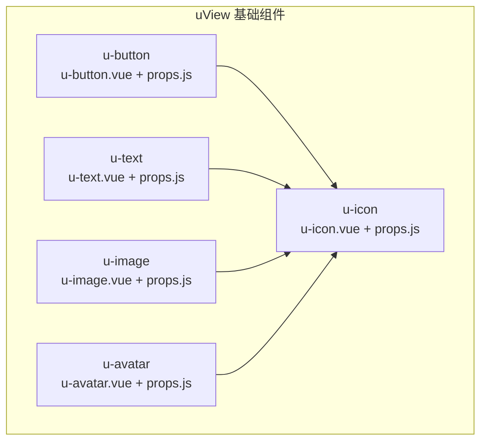
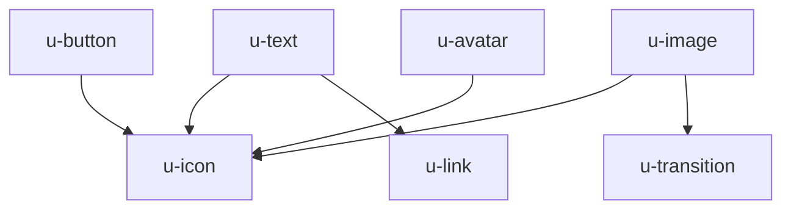
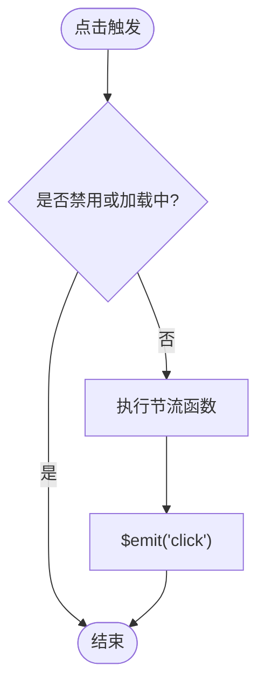
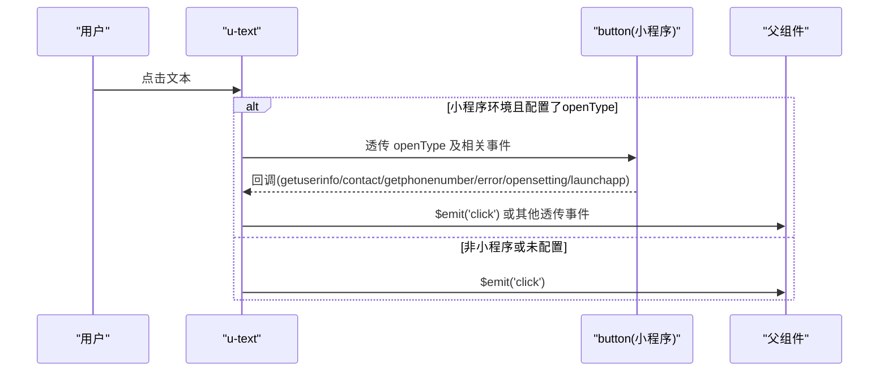
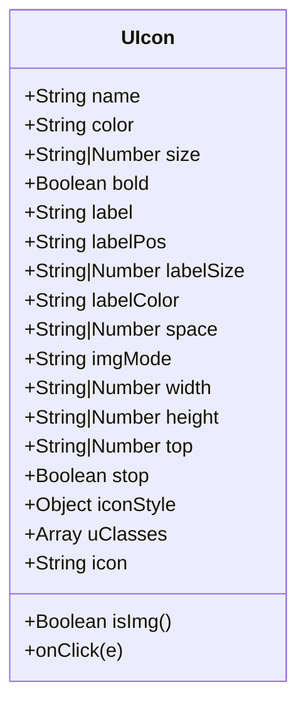
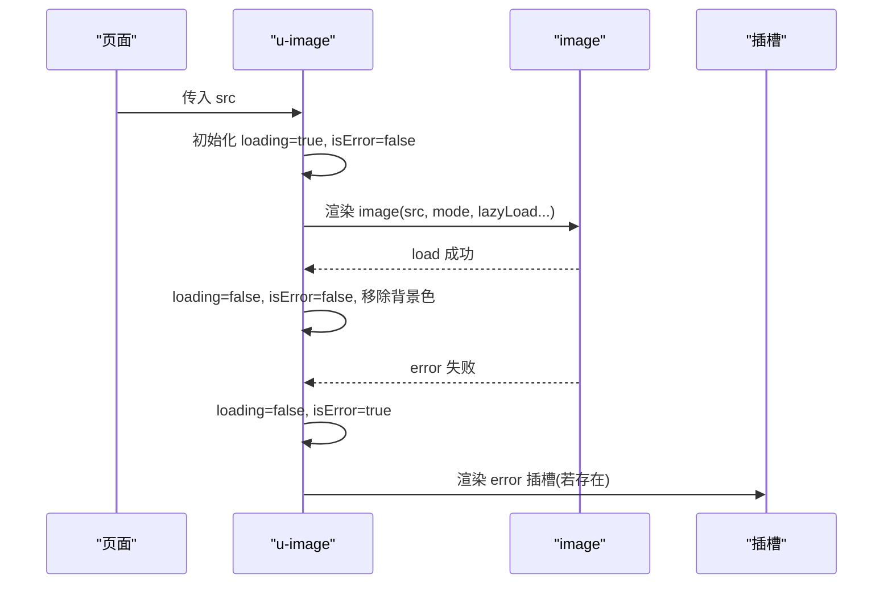
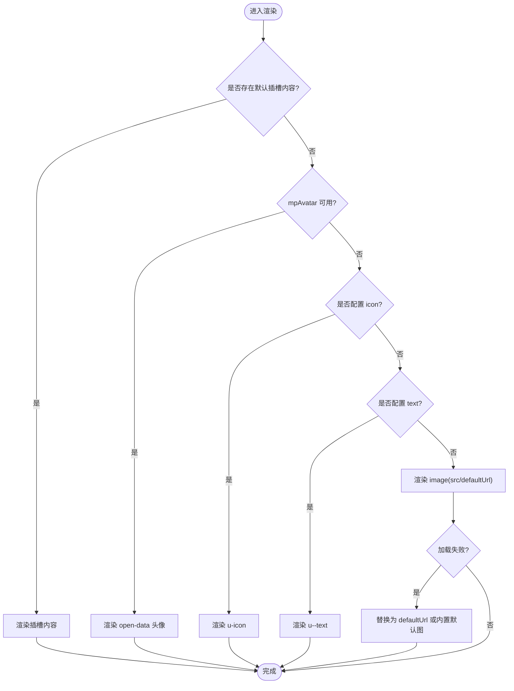

# 基础组件

<cite>
**本文引用的文件**   
- [u-button.vue](file://uni_modules/uview-ui/components/u-button/u-button.vue)
- [u-button/props.js](file://uni_modules/uview-ui/components/u-button/props.js)
- [u-text.vue](file://uni_modules/uview-ui/components/u-text/u-text.vue)
- [u-text/props.js](file://uni_modules/uview-ui/components/u-text/props.js)
- [u-icon.vue](file://uni_modules/uview-ui/components/u-icon/u-icon.vue)
- [u-icon/props.js](file://uni_modules/uview-ui/components/u-icon/props.js)
- [u-image.vue](file://uni_modules/uview-ui/components/u-image/u-image.vue)
- [u-image/props.js](file://uni_modules/uview-ui/components/u-image/props.js)
- [u-avatar.vue](file://uni_modules/uview-ui/components/u-avatar/u-avatar.vue)
- [u-avatar/props.js](file://uni_modules/uview-ui/components/u-avatar/props.js)
</cite>

## 目录
1. [简介](#简介)
2. [项目结构](#项目结构)
3. [核心组件](#核心组件)
4. [架构总览](#架构总览)
5. [详细组件分析](#详细组件分析)
6. [依赖关系分析](#依赖关系分析)
7. [性能与响应式建议](#性能与响应式建议)
8. [故障排查指南](#故障排查指南)
9. [结论](#结论)
10. [附录：常用组合示例路径](#附录常用组合示例路径)

## 简介
本章节面向使用 uView UI 的开发者，聚焦基础展示类组件的使用说明与最佳实践，覆盖以下组件：
- 按钮 u-button
- 文本 u-text
- 图标 u-icon
- 图片 u-image
- 头像 u-avatar

文档将系统讲解每个组件的 props、事件、插槽与样式定制方式，并结合多端兼容（小程序、H5、App/nvue）给出可操作的配置建议与性能优化要点。

## 项目结构
本项目在 uni_modules/uview-ui 下提供 uView 的基础组件实现。本次文档涉及的五个基础组件均位于 components 目录下，每个组件包含主实现文件与独立的 props 定义文件，便于统一管理与复用默认值。

图表来源
- [u-button.vue:1-120](file://uni_modules/uview-ui/components/u-button/u-button.vue#L1-L120)
- [u-text.vue:1-80](file://uni_modules/uview-ui/components/u-text/u-text.vue#L1-L80)
- [u-icon.vue:1-60](file://uni_modules/uview-ui/components/u-icon/u-icon.vue#L1-L60)
- [u-image.vue:1-70](file://uni_modules/uview-ui/components/u-image/u-image.vue#L1-L70)
- [u-avatar.vue:1-60](file://uni_modules/uview-ui/components/u-avatar/u-avatar.vue#L1-L60)

章节来源
- [u-button.vue:1-120](file://uni_modules/uview-ui/components/u-button/u-button.vue#L1-L120)
- [u-text.vue:1-80](file://uni_modules/uview-ui/components/u-text/u-text.vue#L1-L80)
- [u-icon.vue:1-60](file://uni_modules/uview-ui/components/u-icon/u-icon.vue#L1-L60)
- [u-image.vue:1-70](file://uni_modules/uview-ui/components/u-image/u-image.vue#L1-L70)
- [u-avatar.vue:1-60](file://uni_modules/uview-ui/components/u-avatar/u-avatar.vue#L1-L60)

## 核心组件
本节对五个基础组件进行概览性说明，后续章节将逐一深入。

- 按钮 u-button
  - 能力：主题类型、尺寸、形状、镂空、禁用、加载态、图标、自定义颜色、节流点击、小程序开放能力对接等。
  - 事件：click、getphonenumber、getuserinfo、error、opensetting、launchapp。
  - 插槽：默认插槽用于自定义内容；加载态时内部渲染加载图标与文字。
  - 样式：支持通过 customStyle 注入外部样式；nvue 与非 nvue 分支分别处理样式差异。

- 文本 u-text
  - 能力：主题色、显示控制、前后图标、模式（普通/价格/手机号/姓名/日期/链接）、格式化、粗体、块级、行数截断、对齐、换行、行高、外边距等。
  - 事件：click。
  - 插槽：无显式命名插槽，但可通过 prefixIcon/suffixIcon 配合 u-icon 扩展。
  - 样式：valueStyle 计算属性集中管理文本样式，并合并 customStyle。

- 图标 u-icon
  - 能力：字体图标与图片图标双模、主题色、大小、加粗、hoverClass、自定义前缀、右侧/下方 label、间距、图片宽高、垂直定位、阻止冒泡等。
  - 事件：click、touchstart。
  - 插槽：无命名插槽，label 作为内嵌文本节点。
  - 样式：非 nvue 通过 @font-face 引入字体，nvue 通过 dom.addRule 动态注册字体。

- 图片 u-image
  - 能力：src/mode/尺寸/形状/圆角/懒加载/长按菜单/加载中与失败占位/淡入动画/webp/过渡时长/背景色等。
  - 事件：click、error、load。
  - 插槽：loading、error 两个命名插槽用于自定义占位内容。
  - 样式：外层容器 wrapStyle 统一管理尺寸与圆角，错误/加载状态绝对定位覆盖。

- 头像 u-avatar
  - 能力：src/shape/size/mode/text/bgColor/color/fontSize/icon/mpAvatar/randomBgColor/defaultUrl/colorIndex/name 等。
  - 事件：click。
  - 插槽：默认插槽，优先级高于内置渲染逻辑。
  - 样式：圆形/方形圆角，随机背景色数组，小程序 open-data 头像直出。

章节来源
- [u-button.vue:115-157](file://uni_modules/uview-ui/components/u-button/u-button.vue#L115-L157)
- [u-text.vue:77-104](file://uni_modules/uview-ui/components/u-text/u-text.vue#L77-L104)
- [u-icon.vue:54-79](file://uni_modules/uview-ui/components/u-icon/u-icon.vue#L54-L79)
- [u-image.vue:68-93](file://uni_modules/uview-ui/components/u-image/u-image.vue#L68-L93)
- [u-avatar.vue:60-83](file://uni_modules/uview-ui/components/u-avatar/u-avatar.vue#L60-L83)

## 架构总览
下图展示了基础组件之间的依赖与交互关系：u-button、u-text、u-image、u-avatar 均可能组合使用 u-icon 或 u-link 等子组件；u-image 还依赖 u-transition 做淡入效果。

图表来源
- [u-button.vue:28-55](file://uni_modules/uview-ui/components/u-button/u-button.vue#L28-L55)
- [u-text.vue:18-29](file://uni_modules/uview-ui/components/u-text/u-text.vue#L18-L29)
- [u-image.vue:2-63](file://uni_modules/uview-ui/components/u-image/u-image.vue#L2-L63)
- [u-avatar.vue:26-52](file://uni_modules/uview-ui/components/u-avatar/u-avatar.vue#L26-L52)

## 详细组件分析

### 按钮 u-button
- 关键特性
  - 主题与外观：type（info/primary/error/warning/success）、shape（circle/square）、plain（镂空）、hairline（细边框）。
  - 尺寸：size（large/normal/small/mini），对应不同字号与高度。
  - 交互：disabled、loading、throttleTime（防抖/节流）、hoverStartTime/hoverStayTime（点击态时间）。
  - 图标：icon、iconColor，支持与 loading 同时显示。
  - 颜色：color 支持纯色与渐变（linear-gradient），非镂空时自动设置背景与边框。
  - 小程序能力：openType、formType、lang、sessionFrom、sendMessageTitle/Path/Img、showMessageCard、appParameter、dataName 等。
  - 事件：click、getphonenumber、getuserinfo、error、opensetting、launchapp。
  - 插槽：默认插槽用于自定义内容；加载态时内部渲染加载图标与文字。
  - 平台差异：APP-NVUE 分支单独处理 hover-class 与文本样式继承问题。

- 典型用法场景
  - 提交表单：结合 formType=submit/reset 与父级 form 联动。
  - 异步操作：loading=true 时禁用点击，完成后恢复。
  - 主题化：通过 type 或 color 快速切换风格。
  - 图标按钮：icon 搭配 text 或 slot 自定义文案。
  - 小程序客服：openType="contact" 配合会话卡片参数。

- 代码片段路径
  - [u-button.vue:115-157](file://uni_modules/uview-ui/components/u-button/u-button.vue#L115-L157)
  - [u-button/props.js:10-162](file://uni_modules/uview-ui/components/u-button/props.js#L10-L162)

- 流程图：点击处理与节流

图表来源
- [u-button.vue:264-272](file://uni_modules/uview-ui/components/u-button/u-button.vue#L264-L272)

章节来源
- [u-button.vue:1-120](file://uni_modules/uview-ui/components/u-button/u-button.vue#L1-L120)
- [u-button.vue:169-262](file://uni_modules/uview-ui/components/u-button/u-button.vue#L169-L262)
- [u-button.vue:264-289](file://uni_modules/uview-ui/components/u-button/u-button.vue#L264-L289)
- [u-button/props.js:10-162](file://uni_modules/uview-ui/components/u-button/props.js#L10-L162)

### 文本 u-text
- 关键特性
  - 模式：text/price/phone/name/date/link，不同模式驱动不同渲染与行为。
  - 格式化：format 支持字符串模板或函数。
  - 交互：call 在 phone 模式下点击拨号；openType 在小程序环境下以 button 渲染并透传开放能力事件。
  - 样式：bold/block/lines/decoration/margin/lineHeight/align/wordWrap/customStyle 等。
  - 图标：prefixIcon/suffixIcon 通过 u-icon 渲染，支持 iconStyle 定制。
  - 事件：click。

- 典型用法场景
  - 价格展示：mode=price 自动添加货币符号。
  - 手机号：mode=phone + call=true 一键拨号。
  - 超链接：mode=link + href 跳转。
  - 多行省略：lines 指定最大行数。
  - 主题色：type 快速应用主题色。

- 代码片段路径
  - [u-text.vue:77-104](file://uni_modules/uview-ui/components/u-text/u-text.vue#L77-L104)
  - [u-text/props.js:1-111](file://uni_modules/uview-ui/components/u-text/props.js#L1-L111)

- 序列图：小程序 openType 事件透传

图表来源
- [u-text.vue:30-52](file://uni_modules/uview-ui/components/u-text/u-text.vue#L30-L52)
- [u-text.vue:147-156](file://uni_modules/uview-ui/components/u-text/u-text.vue#L147-L156)

章节来源
- [u-text.vue:1-70](file://uni_modules/uview-ui/components/u-text/u-text.vue#L1-L70)
- [u-text.vue:113-156](file://uni_modules/uview-ui/components/u-text/u-text.vue#L113-L156)
- [u-text/props.js:1-111](file://uni_modules/uview-ui/components/u-text/props.js#L1-L111)

### 图标 u-icon
- 关键特性
  - 双模：name 为路径则按图片渲染，否则按字体图标渲染。
  - 主题：color 支持主题色与自定义颜色。
  - 排版：size/bold/top、label/labelPos/labelSize/labelColor/space。
  - 交互：hoverClass、stop 阻止冒泡、index 传递标识。
  - 平台：nvue 通过 dom.addRule 动态注册字体；非 nvue 通过 @font-face 引入。

- 典型用法场景
  - 列表项图标：搭配 label 形成“图标+文字”条目。
  - 工具栏图标：hoverClass 提供按压反馈。
  - 图片小图标：width/height 精确控制尺寸。

- 代码片段路径
  - [u-icon.vue:54-79](file://uni_modules/uview-ui/components/u-icon/u-icon.vue#L54-L79)
  - [u-icon/props.js:1-90](file://uni_modules/uview-ui/components/u-icon/props.js#L1-L90)

- 类图：图标渲染决策

图表来源
- [u-icon.vue:87-145](file://uni_modules/uview-ui/components/u-icon/u-icon.vue#L87-L145)

章节来源
- [u-icon.vue:1-60](file://uni_modules/uview-ui/components/u-icon/u-icon.vue#L1-L60)
- [u-icon.vue:87-145](file://uni_modules/uview-ui/components/u-icon/u-icon.vue#L87-L145)
- [u-icon/props.js:1-90](file://uni_modules/uview-ui/components/u-icon/props.js#L1-L90)

### 图片 u-image
- 关键特性
  - 基础：src/mode/width/height/shape/radius。
  - 体验：lazyLoad、showMenuByLongpress、fade/duration、bgColor。
  - 占位：showLoading/showError、loadingIcon/errorIcon、slot loading/error。
  - 事件：click、error、load。
  - 平台：webp 仅微信小程序有效。

- 典型用法场景
  - 列表封面图：lazyLoad + fade 提升首屏体验。
  - 头像卡片：shape=circle + radius 大圆角。
  - 深色背景：bgColor 与占位图标融合。

- 代码片段路径
  - [u-image.vue:68-93](file://uni_modules/uview-ui/components/u-image/u-image.vue#L68-L93)
  - [u-image/props.js:1-85](file://uni_modules/uview-ui/components/u-image/props.js#L1-L85)

- 时序图：加载流程

图表来源
- [u-image.vue:97-194](file://uni_modules/uview-ui/components/u-image/u-image.vue#L97-L194)

章节来源
- [u-image.vue:1-70](file://uni_modules/uview-ui/components/u-image/u-image.vue#L1-L70)
- [u-image.vue:97-194](file://uni_modules/uview-ui/components/u-image/u-image.vue#L97-L194)
- [u-image/props.js:1-85](file://uni_modules/uview-ui/components/u-image/props.js#L1-L85)

### 头像 u-avatar
- 关键特性
  - 展示：src/shape/size/mode/text/bgColor/color/fontSize/icon/mpAvatar/randomBgColor/defaultUrl/colorIndex/name。
  - 小程序：mpAvatar 在微信/QQ/百度小程序中直接渲染 open-data 头像。
  - 降级：src 为空或加载失败时使用 defaultUrl 或内置 base64 默认图。
  - 交互：click 事件携带 name。
  - 插槽：默认插槽优先级最高，可完全自定义。

- 典型用法场景
  - 个人中心头像：src 指向用户头像，失败回退到默认图。
  - 匿名头像：不传 src，启用 randomBgColor 与 text 生成彩色头像。
  - 小程序原生头像：mpAvatar=true 获取平台头像。

- 代码片段路径
  - [u-avatar.vue:60-83](file://uni_modules/uview-ui/components/u-avatar/u-avatar.vue#L60-L83)
  - [u-avatar/props.js:1-79](file://uni_modules/uview-ui/components/u-avatar/props.js#L1-L79)

- 流程图：头像渲染优先级

图表来源
- [u-avatar.vue:12-52](file://uni_modules/uview-ui/components/u-avatar/u-avatar.vue#L12-L52)
- [u-avatar.vue:136-141](file://uni_modules/uview-ui/components/u-avatar/u-avatar.vue#L136-L141)

章节来源
- [u-avatar.vue:1-60](file://uni_modules/uview-ui/components/u-avatar/u-avatar.vue#L1-L60)
- [u-avatar.vue:84-143](file://uni_modules/uview-ui/components/u-avatar/u-avatar.vue#L84-L143)
- [u-avatar/props.js:1-79](file://uni_modules/uview-ui/components/u-avatar/props.js#L1-L79)

## 依赖关系分析
- 组件间耦合
  - u-button、u-text、u-image、u-avatar 均依赖 u-icon 进行图标渲染。
  - u-image 依赖 u-transition 实现淡入效果。
  - u-text 在小程序环境下依赖 button 组件透传 openType 相关事件。
- 外部依赖
  - 字体资源：u-icon 在非 nvue 通过 @font-face 引入在线字体；nvue 通过 dom.addRule 动态注册。
  - 主题变量：各组件通过 SCSS 变量与主题色保持一致。

```mermaid
graph LR
UButton["u-button"] --> UIcon["u-icon"]
UText["u-text"] --> UIcon["u-icon"]
UImage["u-image"] --> UIcon["u-icon"]
UImage["u-image"] --> UTransition["u-transition"]
UAvatar["u-avatar"] --> UIcon["u-icon"]
UText["u-text"] --> ButtonMP["button(小程序)"]
```

图表来源
- [u-button.vue:28-55](file://uni_modules/uview-ui/components/u-button/u-button.vue#L28-L55)
- [u-text.vue:30-52](file://uni_modules/uview-ui/components/u-text/u-text.vue#L30-L52)
- [u-image.vue:2-63](file://uni_modules/uview-ui/components/u-image/u-image.vue#L2-L63)
- [u-avatar.vue:26-52](file://uni_modules/uview-ui/components/u-avatar/u-avatar.vue#L26-L52)

章节来源
- [u-button.vue:1-120](file://uni_modules/uview-ui/components/u-button/u-button.vue#L1-L120)
- [u-text.vue:1-70](file://uni_modules/uview-ui/components/u-text/u-text.vue#L1-L70)
- [u-image.vue:1-70](file://uni_modules/uview-ui/components/u-image/u-image.vue#L1-L70)
- [u-avatar.vue:1-60](file://uni_modules/uview-ui/components/u-avatar/u-avatar.vue#L1-L60)

## 性能与响应式建议
- 图片与头像
  - 列表中使用 u-image 的 lazyLoad 与 fade，减少首屏压力并提升观感。
  - 头像优先使用 mpAvatar 在小程序端直出头像，避免额外请求与缩放。
  - 合理设置 width/height，避免布局抖动。
- 按钮
  - 异步操作开启 loading 并禁用点击，防止重复提交；必要时设置 throttleTime 进一步保护。
  - 渐变色背景会关闭边框，注意视觉一致性。
- 文本
  - 长文本使用 lines 限制行数，避免重排；合理使用 wordWrap 与 lineHeight。
  - 在小程序环境下如需开放能力，使用 openType 透传，减少自定义封装成本。
- 图标
  - 批量图标建议使用字体图标而非图片，减少网络请求；图片图标尽量提供明确宽高。
  - 在 nvue 平台注意字体加载策略，避免首次渲染闪烁。
- 样式定制
  - 优先使用组件提供的 customStyle 与主题色，避免全局覆盖导致维护困难。
  - 利用 SCSS 变量统一调整尺寸与颜色，保持设计一致性。

[本节为通用指导，无需源码引用]

## 故障排查指南
- 图片无法显示
  - 检查 src 是否为空或无效；确认 lazyLoad 在当前平台生效范围；查看 error 事件输出。
  - 参考路径：[u-image.vue:158-162](file://uni_modules/uview-ui/components/u-image/u-image.vue#L158-L162)
- 头像回退异常
  - 当 src 为空或加载失败，组件会替换为 defaultUrl 或内置默认图；确认 defaultUrl 路径正确。
  - 参考路径：[u-avatar.vue:136-138](file://uni_modules/uview-ui/components/u-avatar/u-avatar.vue#L136-L138)
- 按钮点击未触发
  - 检查 disabled/loading 状态；确认 throttleTime 是否过大导致延迟；查看 click 事件绑定。
  - 参考路径：[u-button.vue:264-272](file://uni_modules/uview-ui/components/u-button/u-button.vue#L264-L272)
- 文本拨号无效
  - 确保 mode=phone 且 call=true；在部分平台需用户交互授权。
  - 参考路径：[u-text.vue:147-155](file://uni_modules/uview-ui/components/u-text/u-text.vue#L147-L155)
- 小程序开放能力无回调
  - 确认 openType 配置正确，并在 u-text 或 u-button 上监听对应事件（如 getphonenumber、getuserinfo）。
  - 参考路径：[u-text.vue:30-52](file://uni_modules/uview-ui/components/u-text/u-text.vue#L30-L52)、[u-button.vue:274-288](file://uni_modules/uview-ui/components/u-button/u-button.vue#L274-L288)

章节来源
- [u-image.vue:158-162](file://uni_modules/uview-ui/components/u-image/u-image.vue#L158-L162)
- [u-avatar.vue:136-138](file://uni_modules/uview-ui/components/u-avatar/u-avatar.vue#L136-L138)
- [u-button.vue:264-272](file://uni_modules/uview-ui/components/u-button/u-button.vue#L264-L272)
- [u-text.vue:147-155](file://uni_modules/uview-ui/components/u-text/u-text.vue#L147-L155)
- [u-text.vue:30-52](file://uni_modules/uview-ui/components/u-text/u-text.vue#L30-L52)
- [u-button.vue:274-288](file://uni_modules/uview-ui/components/u-button/u-button.vue#L274-L288)

## 结论
uView 的基础组件在功能完备性与多端兼容性方面表现良好。通过合理的 props 配置、事件与插槽使用，以及样式定制与性能优化策略，可以在小程序、H5、App 等多端获得一致的用户体验。建议在项目中建立统一的组件使用规范与主题变量体系，以提升可维护性与开发效率。

[本节为总结性内容，无需源码引用]

## 附录：常用组合示例路径
- 按钮 + 图标 + 加载态
  - [u-button.vue:28-55](file://uni_modules/uview-ui/components/u-button/u-button.vue#L28-L55)
- 文本 + 前后图标 + 模式
  - [u-text.vue:18-29](file://uni_modules/uview-ui/components/u-text/u-text.vue#L18-L29)
- 图片 + 占位插槽
  - [u-image.vue:27-61](file://uni_modules/uview-ui/components/u-image/u-image.vue#L27-L61)
- 头像 + 随机背景 + 文字
  - [u-avatar.vue:26-52](file://uni_modules/uview-ui/components/u-avatar/u-avatar.vue#L26-L52)

[本节为示例路径汇总，无需源码引用]