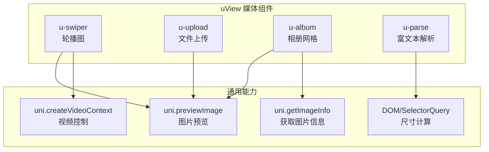
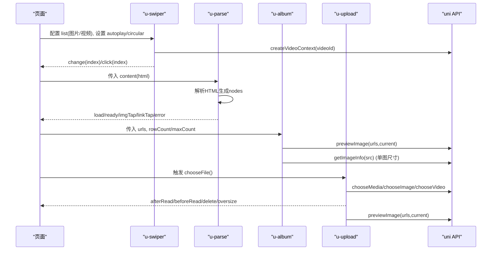
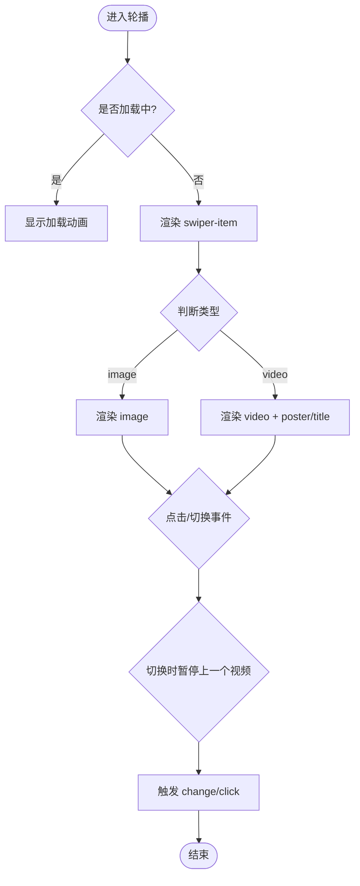
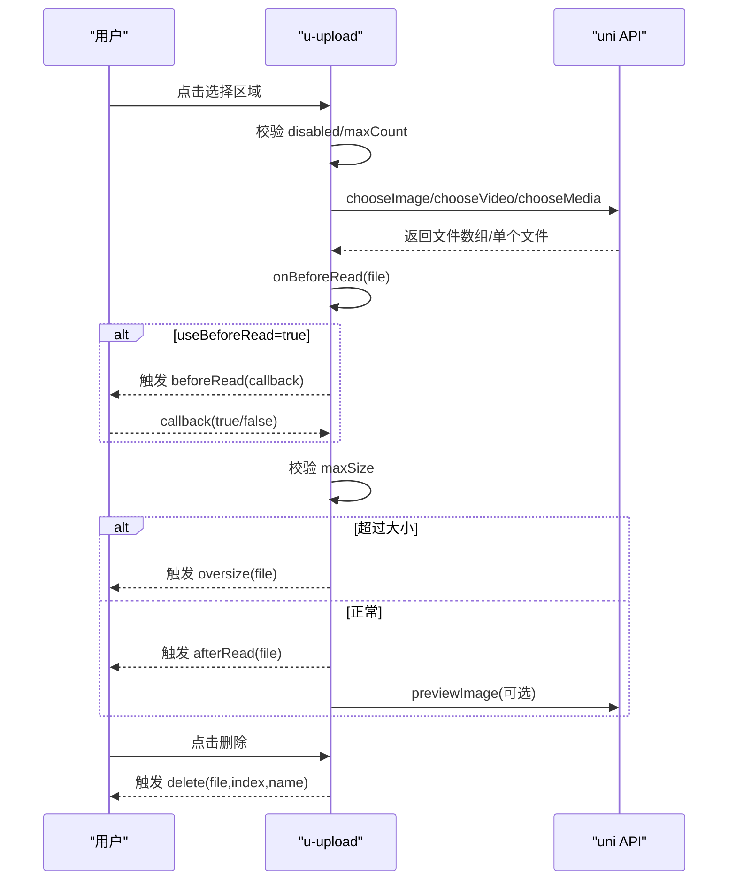
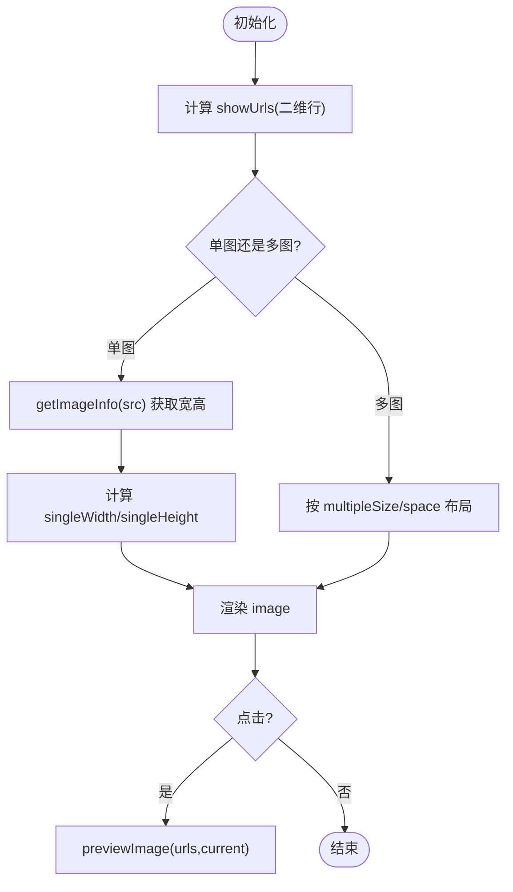
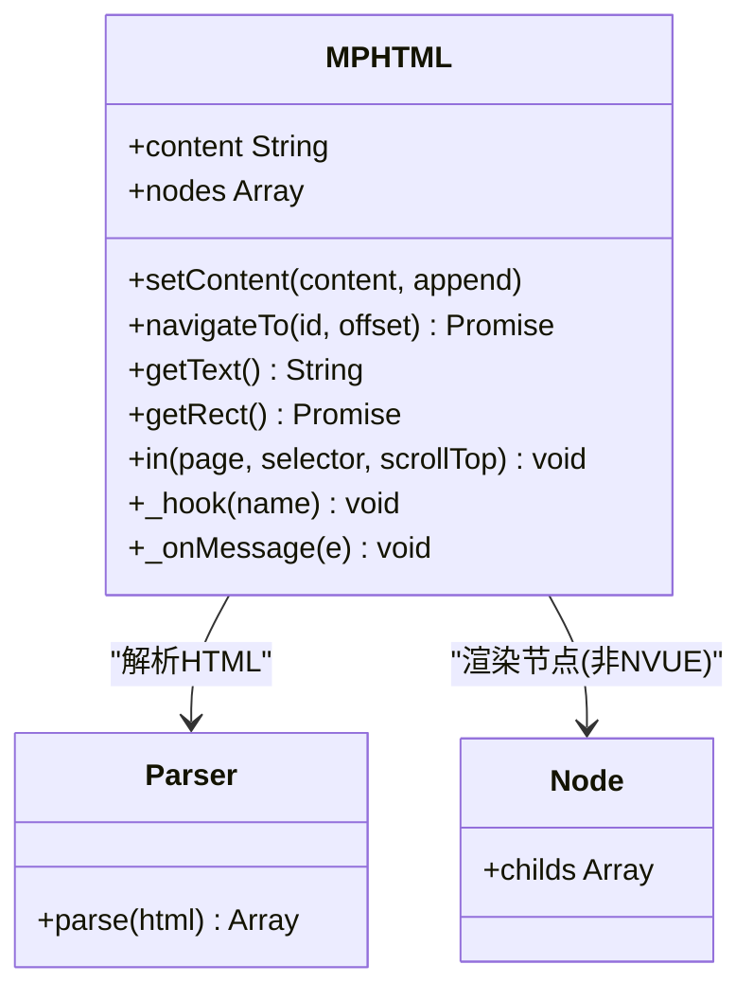
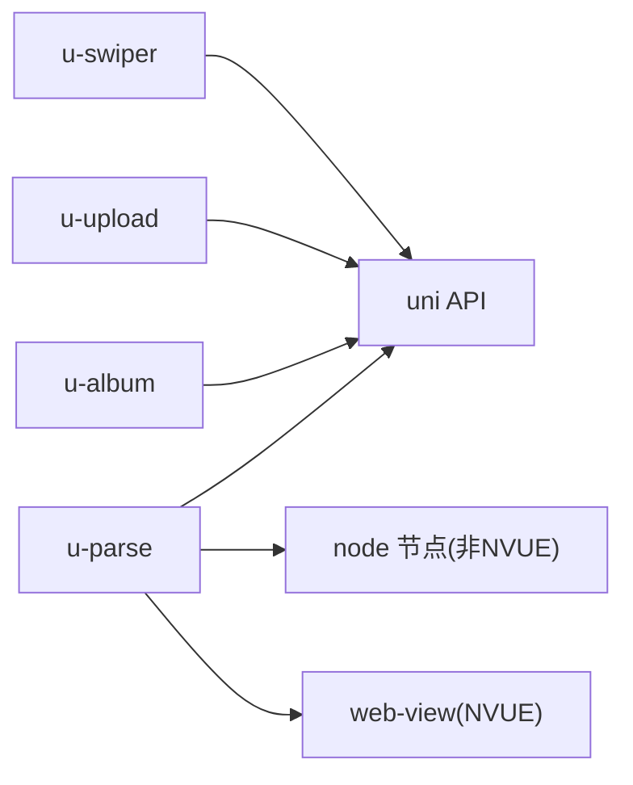

# 媒体组件

<cite>
**本文引用的文件**   
- [u-swiper.vue](file://uni_modules/uview-ui/components/u-swiper/u-swiper.vue)
- [u-swiper props.js](file://uni_modules/uview-ui/components/u-swiper/props.js)
- [u-upload.vue](file://uni_modules/uview-ui/components/u-upload/u-upload.vue)
- [u-upload props.js](file://uni_modules/uview-ui/components/u-upload/props.js)
- [u-album.vue](file://uni_modules/uview-ui/components/u-album/u-album.vue)
- [u-album props.js](file://uni_modules/uview-ui/components/u-album/props.js)
- [u-parse.vue](file://uni_modules/uview-ui/components/u-parse/u-parse.vue)
- [u-parse props.js](file://uni_modules/uview-ui/components/u-parse/props.js)
</cite>

## 目录
1. [简介](#简介)
2. [项目结构](#项目结构)
3. [核心组件](#核心组件)
4. [架构总览](#架构总览)
5. [详细组件分析](#详细组件分析)
6. [依赖关系分析](#依赖关系分析)
7. [性能与优化](#性能与优化)
8. [故障排查指南](#故障排查指南)
9. [结论](#结论)
10. [附录](#附录)

## 简介
本章节聚焦于 uView UI 的媒体相关组件，包括轮播图(u-swiper)、文件上传(u-upload)、相册(u-album)、富文本解析(u-parse)。文档将系统讲解这些组件的使用方法、数据模型、事件机制、跨平台兼容要点，并结合代码实现给出多媒体资源的懒加载、缓存策略、性能优化方案，以及图片压缩、格式转换与预览的实现思路。

## 项目结构
本项目采用 uni_modules 方式集成 uView UI 组件库，媒体相关组件位于以下路径：
- 轮播图: uni_modules/uview-ui/components/u-swiper
- 上传: uni_modules/uview-ui/components/u-upload
- 相册: uni_modules/uview-ui/components/u-album
- 富文本: uni_modules/uview-ui/components/u-parse

图表来源
- [u-swiper.vue:1-256](file://uni_modules/uview-ui/components/u-swiper/u-swiper.vue#L1-L256)
- [u-upload.vue:1-559](file://uni_modules/uview-ui/components/u-upload/u-upload.vue#L1-L559)
- [u-album.vue:1-259](file://uni_modules/uview-ui/components/u-album/u-album.vue#L1-L259)
- [u-parse.vue:1-367](file://uni_modules/uview-ui/components/u-parse/u-parse.vue#L1-L367)

章节来源
- [u-swiper.vue:1-256](file://uni_modules/uview-ui/components/u-swiper/u-swiper.vue#L1-L256)
- [u-upload.vue:1-559](file://uni_modules/uview-ui/components/u-upload/u-upload.vue#L1-L559)
- [u-album.vue:1-259](file://uni_modules/uview-ui/components/u-album/u-album.vue#L1-L259)
- [u-parse.vue:1-367](file://uni_modules/uview-ui/components/u-parse/u-parse.vue#L1-L367)

## 核心组件
本节对四个媒体组件进行概览式说明，后续章节再深入源码级细节。

- u-swiper（轮播图）
  - 支持图片与视频混排；自动播放、循环、指示器、标题展示、圆角背景等
  - 切换时自动暂停上一个视频项，避免后台播放
  - 提供 click/change 事件，便于业务处理

- u-upload（文件上传）
  - 支持图片/视频/文件选择，可多选、限制大小、自定义图标与提示文字
  - 内置预览（图片）、删除状态、上传中/失败状态反馈
  - 提供 beforeRead/afterRead 钩子，方便在读取前后做校验或预处理

- u-album（相册）
  - 多图网格布局，支持单图自适应宽高、多行固定列数、间距控制
  - 点击可调用系统图片预览；支持“查看更多”计数显示
  - 单图场景通过 getImageInfo 计算宽高，保证比例正确

- u-parse（富文本）
  - 将 HTML 字符串渲染为节点树，支持懒加载、占位图、错误图、表格滚动、锚点跳转
  - 非 NVUE 使用 node 节点渲染，NVUE 使用 web-view 桥接
  - 提供 load/ready/imgTap/linkTap/error 等事件

章节来源
- [u-swiper.vue:92-202](file://uni_modules/uview-ui/components/u-swiper/u-swiper.vue#L92-L202)
- [u-upload.vue:127-354](file://uni_modules/uview-ui/components/u-upload/u-upload.vue#L127-L354)
- [u-album.vue:55-229](file://uni_modules/uview-ui/components/u-album/u-album.vue#L55-L229)
- [u-parse.vue:49-350](file://uni_modules/uview-ui/components/u-parse/u-parse.vue#L49-L350)

## 架构总览
下图展示了媒体组件与 uni API 的交互关系，体现预览、懒加载、视频控制等关键流程。

图表来源
- [u-swiper.vue:156-200](file://uni_modules/uview-ui/components/u-swiper/u-swiper.vue#L156-L200)
- [u-parse.vue:211-347](file://uni_modules/uview-ui/components/u-parse/u-parse.vue#L211-L347)
- [u-album.vue:170-228](file://uni_modules/uview-ui/components/u-album/u-album.vue#L170-L228)
- [u-upload.vue:204-353](file://uni_modules/uview-ui/components/u-upload/u-upload.vue#L204-L353)

## 详细组件分析

### u-swiper（轮播图）
- 功能要点
  - 列表支持字符串或对象，对象可通过 keyName 指定目标属性名
  - 自动检测图片/视频类型，视频项支持 poster/title 展示
  - 切换时暂停上一个视频，避免资源占用
  - 指示器样式可定制，支持 line/dot 模式
- 关键方法与事件
  - getItemType/getSource：解析列表项类型与源地址
  - pauseVideo：根据 videoId 创建上下文并暂停
  - change/click：切换与点击回调
- 常用属性（节选）
  - list、indicator、autoplay、interval、duration、circular、imgMode、height、radius、loading、showTitle、keyName

图表来源
- [u-swiper.vue:156-200](file://uni_modules/uview-ui/components/u-swiper/u-swiper.vue#L156-L200)

章节来源
- [u-swiper.vue:1-256](file://uni_modules/uview-ui/components/u-swiper/u-swiper.vue#L1-L256)
- [u-swiper props.js:1-126](file://uni_modules/uview-ui/components/u-swiper/props.js#L1-L126)

### u-upload（文件上传）
- 功能要点
  - 支持 accept=image/video/file 等多类型，capture 控制相机/相册入口
  - 支持 sizeType(original/compressed)、maxSize 大小限制、multiple 多选
  - 内置预览（图片）、删除按钮、上传中/失败状态、成功标记
  - 提供 beforeRead/afterRead 钩子，支持 useBeforeRead 异步确认
- 关键方法与事件
  - chooseFile：选择文件，内部封装 chooseMedia/chooseImage/chooseVideo
  - onBeforeRead/onAfterRead：读取前/后处理，含 oversize 校验
  - deleteItem：删除已选文件
  - onPreviewImage：调用 uni.previewImage 预览图片
- 常用属性（节选）
  - accept、capture、compressed、camera、maxDuration、uploadIcon、useBeforeRead、previewFullImage、maxCount、disabled、imageMode、name、sizeType、multiple、deletable、maxSize、fileList、uploadText、width、height、customStyle

图表来源
- [u-upload.vue:204-353](file://uni_modules/uview-ui/components/u-upload/u-upload.vue#L204-L353)

章节来源
- [u-upload.vue:1-559](file://uni_modules/uview-ui/components/u-upload/u-upload.vue#L1-L559)
- [u-upload props.js:1-125](file://uni_modules/uview-ui/components/u-upload/props.js#L1-L125)

### u-album（相册）
- 功能要点
  - 支持单图与多图两种模式；单图可自适应宽高，多图按 row 均分
  - 支持 maxCount 限制展示数量，超出显示“+N”
  - 点击触发系统图片预览；单图场景通过 getImageInfo 计算尺寸
- 关键方法与事件
  - showUrls：将一维数组切分为二维行数组
  - getSrc：从对象或字符串中提取图片地址
  - onPreviewTap：调用 uni.previewImage
  - getImageRect/getComponentWidth：获取图片尺寸或容器宽度
- 常用属性（节选）
  - urls、keyName、singleSize、multipleSize、space、singleMode、multipleMode、maxCount、previewFullImage、rowCount、showMore

图表来源
- [u-album.vue:128-228](file://uni_modules/uview-ui/components/u-album/u-album.vue#L128-L228)

章节来源
- [u-album.vue:1-259](file://uni_modules/uview-ui/components/u-album/u-album.vue#L1-L259)
- [u-album props.js:1-60](file://uni_modules/uview-ui/components/u-album/props.js#L1-L60)

### u-parse（富文本）
- 功能要点
  - 将 content 解析为 nodes，非 NVUE 使用 node 节点渲染，NVUE 使用 web-view 桥接
  - 支持 lazyLoad、loadingImg、errorImg、pauseVideo、scrollTable、selectable、setTitle、showImgMenu、useAnchor 等
  - 提供 load/ready/imgTap/linkTap/error 事件
- 关键方法与事件
  - setContent：解析 HTML，更新 nodes，并在非 NVUE 下监听 ready
  - navigateTo/in：锚点定位与 scroll-view 内定位
  - _onMessage：NVUE 下与 web-view 通信，处理图片点击、链接点击、高度变化等
- 常用属性（节选）
  - content、copyLink、domain、errorImg、lazyLoad、loadingImg、pauseVideo、previewImg、scrollTable、selectable、setTitle、showImgMenu、tagStyle、useAnchor

图表来源
- [u-parse.vue:49-350](file://uni_modules/uview-ui/components/u-parse/u-parse.vue#L49-L350)

章节来源
- [u-parse.vue:1-367](file://uni_modules/uview-ui/components/u-parse/u-parse.vue#L1-L367)
- [u-parse props.js:1-46](file://uni_modules/uview-ui/components/u-parse/props.js#L1-L46)

## 依赖关系分析
- 组件间耦合度低，主要依赖 uni API 完成媒体操作（预览、选择、视频控制、尺寸测量）
- u-parse 在非 NVUE 环境下依赖 node 节点渲染，在 NVUE 环境通过 web-view 桥接
- u-upload 依赖工具函数与 mixin 完成选择与状态管理（utils/mixin），并通过 props 暴露大量配置项
- u-album 与 u-swiper 都使用 uni.previewImage 进行图片预览，统一体验

图表来源
- [u-swiper.vue:1-256](file://uni_modules/uview-ui/components/u-swiper/u-swiper.vue#L1-L256)
- [u-upload.vue:1-559](file://uni_modules/uview-ui/components/u-upload/u-upload.vue#L1-L559)
- [u-album.vue:1-259](file://uni_modules/uview-ui/components/u-album/u-album.vue#L1-L259)
- [u-parse.vue:1-367](file://uni_modules/uview-ui/components/u-parse/u-parse.vue#L1-L367)

章节来源
- [u-swiper.vue:1-256](file://uni_modules/uview-ui/components/u-swiper/u-swiper.vue#L1-L256)
- [u-upload.vue:1-559](file://uni_modules/uview-ui/components/u-upload/u-upload.vue#L1-L559)
- [u-album.vue:1-259](file://uni_modules/uview-ui/components/u-album/u-album.vue#L1-L259)
- [u-parse.vue:1-367](file://uni_modules/uview-ui/components/u-parse/u-parse.vue#L1-L367)

## 性能与优化
- 懒加载与占位图
  - u-parse 支持 lazyLoad、loadingImg、errorImg，减少首屏压力与提升容错
  - 建议在长图文场景中开启 lazyLoad，并提供合适的 loading/error 占位图
- 图片尺寸与布局
  - u-album 单图场景通过 getImageInfo 计算宽高，避免拉伸变形；多图场景通过 fixed multipleSize 与 space 控制布局
  - 建议合理设置 multipleSize 与 space，避免过多重排
- 视频控制与资源释放
  - u-swiper 在切换时主动暂停上一个视频，降低后台资源占用
  - 对于长列表中的视频轮播，建议结合 displayMultipleItems 与 circular 谨慎使用
- 上传体积与网络
  - u-upload 支持 compressed、sizeType、maxSize，优先选择 compressed 与 smaller sizeType 以降低上传体积
  - 建议配合后端进行图片压缩与转码（如 WebP），减少带宽消耗
- 缓存策略
  - 图片缓存：浏览器/小程序默认会缓存静态资源，可在 CDN 层设置合理的 Cache-Control
  - 富文本内容：可对 content 做本地缓存（如 storage），在网络不可用时降级展示
- 跨端兼容
  - NVUE 与非 NVUE 渲染差异：u-parse 在 NVUE 使用 web-view，注意高度同步与消息通信
  - 部分属性在不同平台存在差异（如 previousMargin/nextMargin 在 nvue/支付宝不支持），需条件编译或降级处理

[本节为通用指导，不直接分析具体文件]

## 故障排查指南
- 轮播图
  - 问题：切换后视频仍在播放
    - 检查是否在 change 事件中调用了 pauseVideo，并确保 videoId 唯一且有效
    - 参考：[u-swiper.vue:174-191](file://uni_modules/uview-ui/components/u-swiper/u-swiper.vue#L174-L191)
  - 问题：指示器不显示或位置异常
    - 检查 indicator 与 indicatorStyle 配置，确保未与 showTitle 同时启用导致覆盖
    - 参考：[u-swiper.vue:77-88](file://uni_modules/uview-ui/components/u-swiper/u-swiper.vue#L77-L88)

- 文件上传
  - 问题：beforeRead 未生效
    - 若 useBeforeRead=false，仅执行同步 beforeRead；如需异步确认，请开启 useBeforeRead 并使用 callback
    - 参考：[u-upload.vue:240-273](file://uni_modules/uview-ui/components/u-upload/u-upload.vue#L240-L273)
  - 问题：文件大小超限无提示
    - 检查 maxSize 配置与 oversize 事件监听
    - 参考：[u-upload.vue:280-300](file://uni_modules/uview-ui/components/u-upload/u-upload.vue#L280-L300)

- 相册
  - 问题：单图比例不正确
    - 检查 getImageInfo 是否成功，失败时会回退到基于容器宽度的百分比估算
    - 参考：[u-album.vue:190-227](file://uni_modules/uview-ui/components/u-album/u-album.vue#L190-L227)
  - 问题：预览失败
    - 检查 urls 是否为空或包含无效地址；确保当前图片地址在 urls 列表中
    - 参考：[u-album.vue:172-180](file://uni_modules/uview-ui/components/u-album/u-album.vue#L172-L180)

- 富文本
  - 问题：图片点击无响应
    - 检查 previewImg 与 imgTap 事件绑定；NVUE 下需确保 _onMessage 正确处理 onImgTap
    - 参考：[u-parse.vue:290-297](file://uni_modules/uview-ui/components/u-parse/u-parse.vue#L290-L297)
  - 问题：锚点跳转无效
    - 检查 useAnchor 是否启用，navigateTo 是否正确传入 id 与 offset
    - 参考：[u-parse.vue:107-159](file://uni_modules/uview-ui/components/u-parse/u-parse.vue#L107-L159)

章节来源
- [u-swiper.vue:174-191](file://uni_modules/uview-ui/components/u-swiper/u-swiper.vue#L174-L191)
- [u-upload.vue:240-300](file://uni_modules/uview-ui/components/u-upload/u-upload.vue#L240-L300)
- [u-album.vue:172-227](file://uni_modules/uview-ui/components/u-album/u-album.vue#L172-L227)
- [u-parse.vue:107-159](file://uni_modules/uview-ui/components/u-parse/u-parse.vue#L107-L159)

## 结论
uView 的媒体组件覆盖了常见的图片、视频、文件与富文本场景，具备完善的属性与事件体系，能够适配多端运行环境。通过合理使用懒加载、占位图、视频控制、上传压缩与预览等功能，可以在保证用户体验的同时显著提升性能与稳定性。针对 NVUE 与非 NVUE 的差异，应关注渲染与通信路径，做好降级与兼容性处理。

[本节为总结性内容，不直接分析具体文件]

## 附录
- 常见属性速查（节选）
  - u-swiper：list、indicator、autoplay、interval、duration、circular、imgMode、height、radius、loading、showTitle、keyName
  - u-upload：accept、capture、compressed、camera、maxDuration、uploadIcon、useBeforeRead、previewFullImage、maxCount、disabled、imageMode、name、sizeType、multiple、deletable、maxSize、fileList、uploadText、width、height、customStyle
  - u-album：urls、keyName、singleSize、multipleSize、space、singleMode、multipleMode、maxCount、previewFullImage、rowCount、showMore
  - u-parse：content、copyLink、domain、errorImg、lazyLoad、loadingImg、pauseVideo、previewImg、scrollTable、selectable、setTitle、showImgMenu、tagStyle、useAnchor

章节来源
- [u-swiper props.js:1-126](file://uni_modules/uview-ui/components/u-swiper/props.js#L1-L126)
- [u-upload props.js:1-125](file://uni_modules/uview-ui/components/u-upload/props.js#L1-L125)
- [u-album props.js:1-60](file://uni_modules/uview-ui/components/u-album/props.js#L1-L60)
- [u-parse props.js:1-46](file://uni_modules/uview-ui/components/u-parse/props.js#L1-L46)