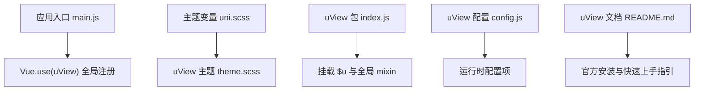
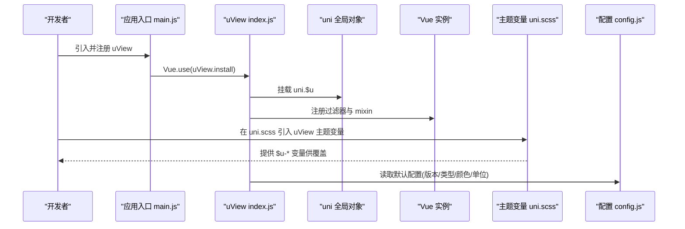
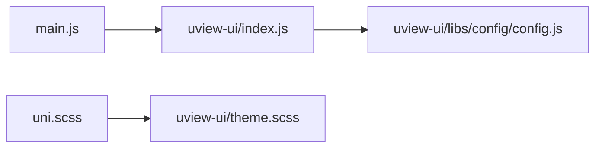

# 安装与配置

<cite>
**本文引用的文件**
- [main.js](file://main.js)
- [uni.scss](file://uni.scss)
- [uview-ui/package.json](file://uni_modules/uview-ui/package.json)
- [uview-ui/index.js](file://uni_modules/uview-ui/index.js)
- [uview-ui/theme.scss](file://uni_modules/uview-ui/theme.scss)
- [uview-ui/libs/config/config.js](file://uni_modules/uview-ui/libs/config/config.js)
- [uview-ui/README.md](file://uni_modules/uview-ui/README.md)
</cite>

## 目录
1. [简介](#简介)
2. [项目结构](#项目结构)
3. [核心组件](#核心组件)
4. [架构总览](#架构总览)
5. [详细组件分析](#详细组件分析)
6. [依赖分析](#依赖分析)
7. [性能考虑](#性能考虑)
8. [故障排查指南](#故障排查指南)
9. [结论](#结论)
10. [附录](#附录)

## 简介
本章节面向在 uni-app 项目中集成 uView UI 的开发者，提供从安装到全局配置的完整说明。内容涵盖：
- 多种安装方式（HBuilderX 插件市场、npm）
- 全局引入与按需引入的配置方法
- 主题变量与样式覆盖策略
- 初始化流程与最佳实践
- 常见问题与版本兼容性说明

## 项目结构
本项目采用 uni_modules 方式集成 uView UI，并在应用入口进行全局注册；同时通过 uni.scss 引入 uView 的主题变量，实现统一主题管理。

图示来源
- [main.js:8-10](file://main.js#L8-L10)
- [uni.scss:5-6](file://uni.scss#L5-L6)
- [uview-ui/index.js:60-75](file://uni_modules/uview-ui/index.js#L60-L75)
- [uview-ui/libs/config/config.js:9-34](file://uni_modules/uview-ui/libs/config/config.js#L9-L34)
- [uview-ui/README.md:45-56](file://uni_modules/uview-ui/README.md#L45-L56)

章节来源
- [main.js:8-10](file://main.js#L8-L10)
- [uni.scss:5-6](file://uni.scss#L5-L6)

## 核心组件
- 应用入口与全局注册
  - 在应用入口中引入并注册 uView，使所有页面可直接使用 uView 组件。
- 主题变量与样式
  - 在 uni.scss 中引入 uView 主题变量，便于统一修改主色、边框、字体等设计令牌。
- uView 运行期对象与工具
  - 通过 index.js 将 $u 挂载至 uni 和 Vue.prototype，并提供路由、颜色转换、请求封装、防抖节流等工具。
- 配置信息
  - 通过 libs/config/config.js 暴露版本号、类型、颜色、单位等默认配置。

章节来源
- [main.js:8-10](file://main.js#L8-L10)
- [uni.scss:5-6](file://uni.scss#L5-L6)
- [uview-ui/index.js:38-75](file://uni_modules/uview-ui/index.js#L38-L75)
- [uview-ui/libs/config/config.js:9-34](file://uni_modules/uview-ui/libs/config/config.js#L9-L34)

## 架构总览
下图展示了 uView 在本项目中的集成路径：从入口注册到主题注入，再到运行时对象挂载与配置读取。

图示来源
- [main.js:8-10](file://main.js#L8-L10)
- [uview-ui/index.js:60-75](file://uni_modules/uview-ui/index.js#L60-L75)
- [uni.scss:5-6](file://uni.scss#L5-L6)
- [uview-ui/libs/config/config.js:9-34](file://uni_modules/uview-ui/libs/config/config.js#L9-L34)

## 详细组件分析

### 安装方式
- HBuilderX 插件市场安装
  - 通过插件市场链接获取 uView 包，放入 uni_modules 后自动生效。
  - 参考：[uview-ui/README.md:45-49](file://uni_modules/uview-ui/README.md#L45-L49)
- npm 安装（CLI 模式）
  - 若使用 CLI 构建，需额外配置 transpileDependencies，避免打包报错。
  - 参考：[uview-ui/index.js:1-2](file://uni_modules/uview-ui/index.js#L1-L2)

章节来源
- [uview-ui/README.md:45-49](file://uni_modules/uview-ui/README.md#L45-L49)
- [uview-ui/index.js:1-2](file://uni_modules/uview-ui/index.js#L1-L2)

### 全局引入与初始化
- 在应用入口引入并注册 uView，完成全局组件与工具挂载。
- 参考：[main.js:8-10](file://main.js#L8-L10)

章节来源
- [main.js:8-10](file://main.js#L8-L10)

### 主题变量配置
- 在 uni.scss 最前位置引入 uView 主题变量，随后可覆盖 $u-* 变量以定制主题。
- 参考：[uni.scss:5-6](file://uni.scss#L5-L6)、[uview-ui/theme.scss:1-45](file://uni_modules/uview-ui/theme.scss#L1-L45)

章节来源
- [uni.scss:5-6](file://uni.scss#L5-L6)
- [uview-ui/theme.scss:1-45](file://uni_modules/uview-ui/theme.scss#L1-L45)

### 按需引入与 easycom
- 官方建议开启 easycom 规则，无需手动 import 组件即可按需加载。
- 参考：[uview-ui/README.md:56-62](file://uni_modules/uview-ui/README.md#L56-L62)

章节来源
- [uview-ui/README.md:56-62](file://uni_modules/uview-ui/README.md#L56-L62)

### 运行时对象与工具
- uView 将 $u 挂载到 uni 与 Vue.prototype，并提供时间格式化、颜色转换、防抖节流、平台判断等工具。
- 参考：[uview-ui/index.js:38-75](file://uni_modules/uview-ui/index.js#L38-L75)

章节来源
- [uview-ui/index.js:38-75](file://uni_modules/uview-ui/index.js#L38-L75)

### 配置信息与常用选项
- 默认配置包含版本号、类型枚举、颜色映射、单位等，可在运行期读取。
- 参考：[uview-ui/libs/config/config.js:9-34](file://uni_modules/uview-ui/libs/config/config.js#L9-L34)

章节来源
- [uview-ui/libs/config/config.js:9-34](file://uni_modules/uview-ui/libs/config/config.js#L9-L34)

### 版本与兼容性
- 当前包版本与支持的 HBuilderX 版本、平台兼容情况由 package.json 声明。
- 参考：[uview-ui/package.json:1-85](file://uni_modules/uview-ui/package.json#L1-L85)

章节来源
- [uview-ui/package.json:1-85](file://uni_modules/uview-ui/package.json#L1-L85)

## 依赖分析
- 入口依赖
  - main.js 依赖 uView 包并完成全局注册。
- 主题依赖
  - uni.scss 依赖 uView 主题变量文件。
- 运行时依赖
  - uView index.js 依赖内部 mixins、工具函数、配置模块，并将 $u 挂载到全局。

图示来源
- [main.js:8-10](file://main.js#L8-L10)
- [uni.scss:5-6](file://uni.scss#L5-L6)
- [uview-ui/index.js:60-75](file://uni_modules/uview-ui/index.js#L60-L75)
- [uview-ui/libs/config/config.js:9-34](file://uni_modules/uview-ui/libs/config/config.js#L9-L34)

章节来源
- [main.js:8-10](file://main.js#L8-L10)
- [uni.scss:5-6](file://uni.scss#L5-L6)
- [uview-ui/index.js:60-75](file://uni_modules/uview-ui/index.js#L60-L75)
- [uview-ui/libs/config/config.js:9-34](file://uni_modules/uview-ui/libs/config/config.js#L9-L34)

## 性能考虑
- 按需引入
  - 启用 easycom 可减少不必要的组件打包体积，提升首屏加载速度。
- 主题变量集中管理
  - 在 uni.scss 中统一定义与覆盖主题变量，避免重复样式与冗余编译产物。
- 工具函数复用
  - 使用 $u 提供的通用工具（如时间格式化、防抖节流），减少重复代码与潜在的性能问题。

## 故障排查指南
- 构建时报错提示未配置 transpileDependencies
  - 现象：CLI 模式下出现关于 transpileDependencies 的提示或错误。
  - 原因：打包器需要显式声明对 uView 包的转译依赖。
  - 解决：在 vue.config.js 中添加对应配置，参考源码注释指向的官方文档。
  - 参考：[uview-ui/index.js:1-2](file://uni_modules/uview-ui/index.js#L1-L2)
- 主题变量未生效
  - 检查是否在 uni.scss 最前位置引入 uView 主题变量，并确保变量覆盖顺序正确。
  - 参考：[uni.scss:5-6](file://uni.scss#L5-L6)、[uview-ui/theme.scss:1-45](file://uni_modules/uview-ui/theme.scss#L1-L45)
- 组件无法识别
  - 确认已启用 easycom 并按官方示例直接使用组件标签，无需手动 import。
  - 参考：[uview-ui/README.md:56-62](file://uni_modules/uview-ui/README.md#L56-L62)
- 版本不兼容
  - 核对 HBuilderX 版本与 uView 包声明的 engines 要求，确保满足最低版本。
  - 参考：[uview-ui/package.json:17-19](file://uni_modules/uview-ui/package.json#L17-L19)

章节来源
- [uview-ui/index.js:1-2](file://uni_modules/uview-ui/index.js#L1-L2)
- [uni.scss:5-6](file://uni.scss#L5-L6)
- [uview-ui/theme.scss:1-45](file://uni_modules/uview-ui/theme.scss#L1-L45)
- [uview-ui/README.md:56-62](file://uni_modules/uview-ui/README.md#L56-L62)
- [uview-ui/package.json:17-19](file://uni_modules/uview-ui/package.json#L17-L19)

## 结论
通过在入口注册 uView、在 uni.scss 引入主题变量、并启用 easycom 按需引入，可以在 uni-app 项目中高效地使用 uView UI。结合 $u 工具与默认配置，既能保证开发体验，也能兼顾多端一致性与可维护性。遇到构建或主题问题时，优先对照上述排查要点定位与修复。

## 附录
- 官方安装与快速上手
  - 参考：[uview-ui/README.md:45-56](file://uni_modules/uview-ui/README.md#L45-L56)
- 包元数据与平台支持
  - 参考：[uview-ui/package.json:1-85](file://uni_modules/uview-ui/package.json#L1-L85)