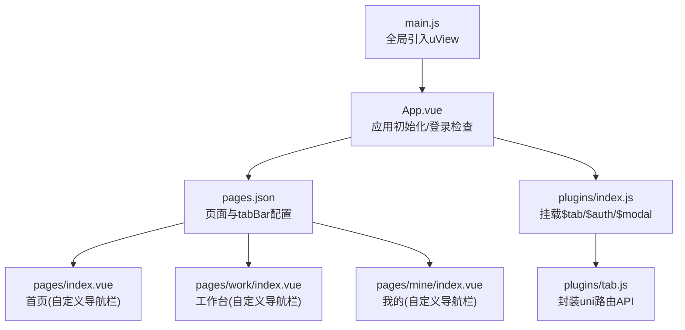
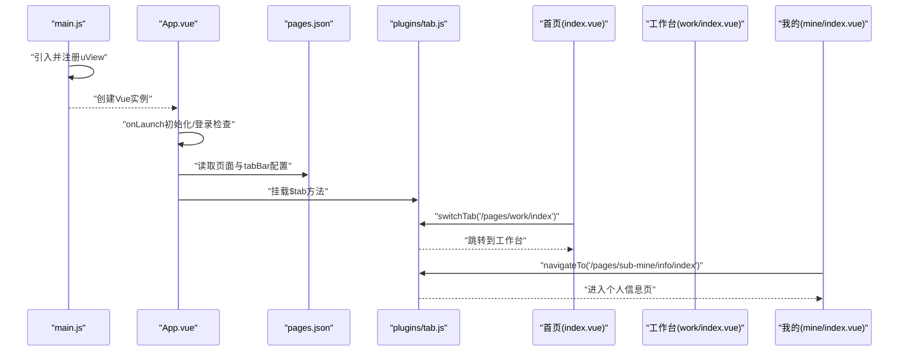
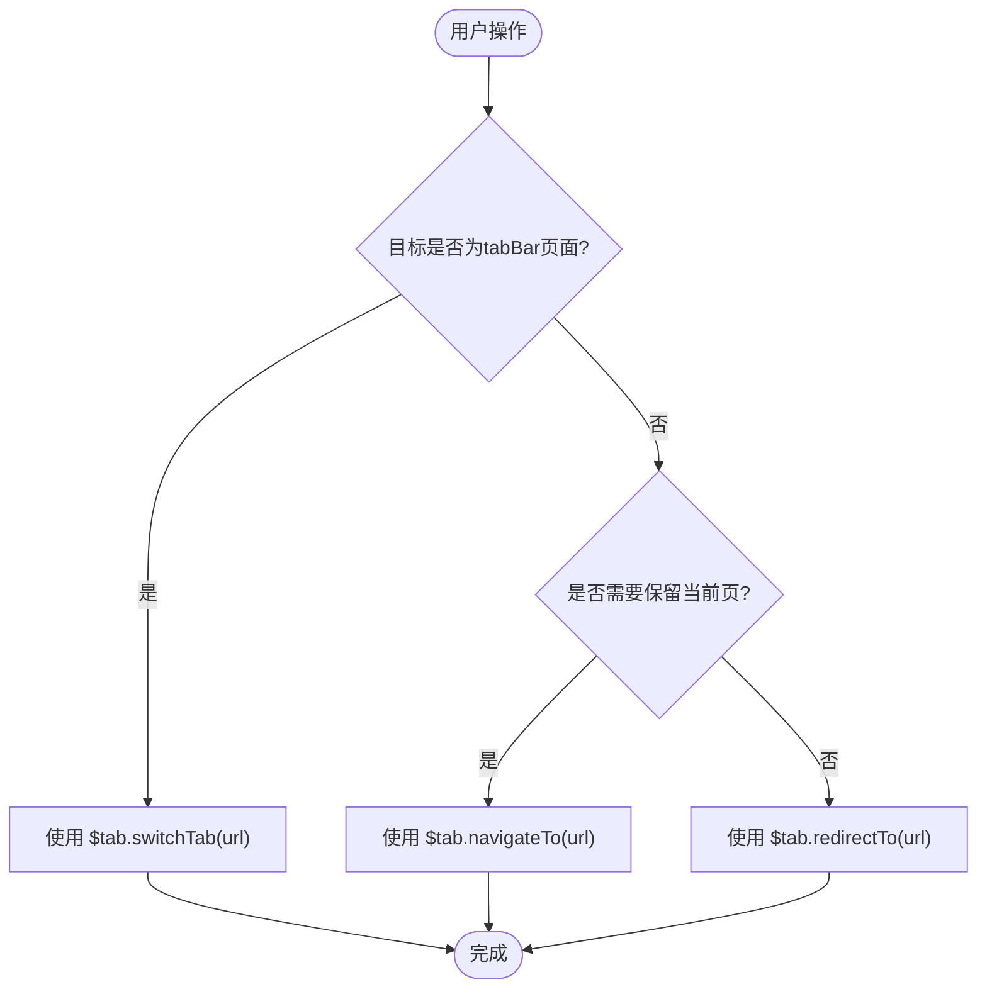
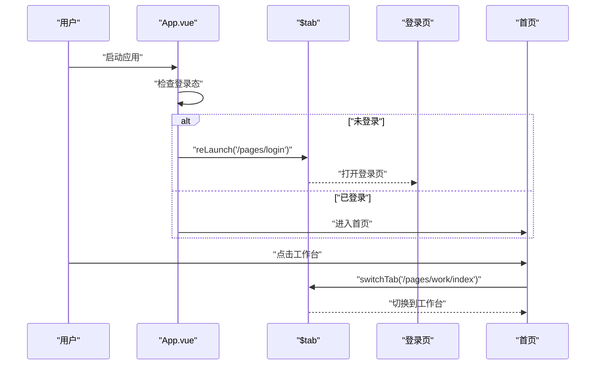
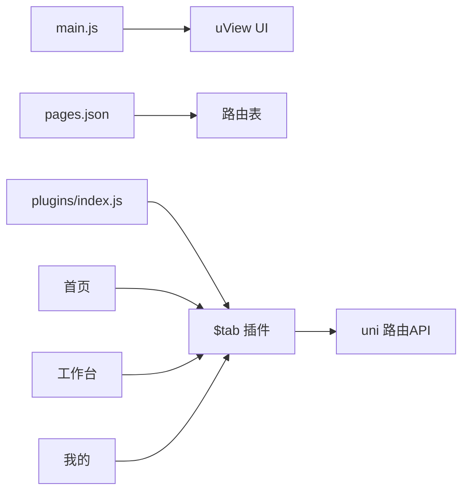

# 导航组件

<cite>
**本文引用的文件**   
- [main.js](file://main.js)
- [App.vue](file://App.vue)
- [pages.json](file://pages.json)
- [plugins/index.js](file://plugins/index.js)
- [plugins/tab.js](file://plugins/tab.js)
- [pages/index.vue](file://pages/index.vue)
- [pages/work/index.vue](file://pages/work/index.vue)
- [pages/mine/index.vue](file://pages/mine/index.vue)
</cite>

## 目录
1. [简介](#简介)
2. [项目结构](#项目结构)
3. [核心组件](#核心组件)
4. [架构总览](#架构总览)
5. [详细组件分析](#详细组件分析)
6. [依赖关系分析](#依赖关系分析)
7. [性能与体验优化](#性能与体验优化)
8. [故障排查指南](#故障排查指南)
9. [结论](#结论)
10. [附录](#附录)

## 简介
本文件围绕 uView UI 的导航相关组件（u-navbar、u-tabbar、u-tabs、u-steps、u-index-list）在本项目中的集成与使用，结合现有路由配置与页面跳转实践，给出系统化的使用说明。文档涵盖：
- 路由注册与 tabBar 配置
- 页面跳转与返回策略
- 状态管理与数据传递
- 复杂导航流程与页面栈管理方案
- 自定义样式与主题适配
- 移动端导航最佳实践与用户体验优化

## 项目结构
本项目采用 uni-app + Vue 2 技术栈，通过 pages.json 集中管理页面与 tabBar；在 main.js 中全局引入并注册 uView UI；应用启动时 App.vue 进行初始化与登录校验；业务页面通过封装的 $tab 插件统一调用 uni 路由 API。

图表来源
- [main.js:1-31](file://main.js#L1-L31)
- [App.vue:1-48](file://App.vue#L1-L48)
- [pages.json:1-235](file://pages.json#L1-L235)
- [plugins/index.js:1-15](file://plugins/index.js#L1-L15)
- [plugins/tab.js:1-31](file://plugins/tab.js#L1-L31)
- [pages/index.vue:1-800](file://pages/index.vue#L1-L800)
- [pages/work/index.vue:1-800](file://pages/work/index.vue#L1-L800)
- [pages/mine/index.vue:1-309](file://pages/mine/index.vue#L1-L309)

章节来源
- [main.js:1-31](file://main.js#L1-L31)
- [App.vue:1-48](file://App.vue#L1-L48)
- [pages.json:1-235](file://pages.json#L1-L235)
- [plugins/index.js:1-15](file://plugins/index.js#L1-L15)
- [plugins/tab.js:1-31](file://plugins/tab.js#L1-L31)

## 核心组件
- u-navbar（顶部导航栏）
  - 作用：提供标题、左侧返回按钮、右侧操作区等能力，适合需要自定义导航样式的页面。
  - 集成方式：已在 main.js 全局引入 uView，可直接在页面模板中使用。
  - 使用要点：设置 title、leftText/rightText、@clickLeft/@clickRight 事件处理返回或动作；如需隐藏原生导航栏，可在 pages.json 对应页面 style 中设置 navigationStyle: "custom"。
  - 参考实现：首页、工作台、我的页均使用 custom 导航栏风格，便于统一定制。

- u-tabbar（底部标签栏）
  - 作用：用于主入口切换，通常与 tabBar 配合使用。
  - 集成方式：全局引入 uView 后可直接使用。
  - 使用要点：若使用 uni-app 原生 tabBar，建议以 pages.json 的 tabBar 为主，避免与 u-tabbar 同时生效导致冲突；若需完全自定义 tabbar，可关闭原生 tabBar 并使用 u-tabbar 管理。
  - 当前项目：使用原生 tabBar，三个主入口分别为首页、工作台、我的。

- u-tabs（选项卡）
  - 作用：在同一页面内按标签切换内容区块，常用于列表筛选、详情分块等场景。
  - 使用要点：绑定 active 索引与 @change 事件；与滚动容器或条件渲染组合使用。

- u-steps（步骤条）
  - 作用：展示多步流程进度，如表单填写、审批流程等。
  - 使用要点：通过 steps 数组定义步骤项，active 控制当前步骤，status 控制完成/失败状态。

- u-index-list（索引列表）
  - 作用：长列表按字母索引快速定位，适合通讯录、城市选择等。
  - 使用要点：数据源需包含 index 字段；支持 sticky 吸顶索引头与滚动联动。

章节来源
- [main.js:1-31](file://main.js#L1-L31)
- [pages.json:206-228](file://pages.json#L206-L228)

## 架构总览
下图展示了从应用启动到页面导航的整体流程，包括 uView 的引入、路由配置、登录校验以及页面间跳转路径。

图表来源
- [main.js:1-31](file://main.js#L1-L31)
- [App.vue:1-48](file://App.vue#L1-L48)
- [pages.json:1-235](file://pages.json#L1-L235)
- [plugins/tab.js:1-31](file://plugins/tab.js#L1-L31)
- [pages/index.vue:337-342](file://pages/index.vue#L337-L342)
- [pages/mine/index.vue:187-207](file://pages/mine/index.vue#L187-L207)

## 详细组件分析

### 顶部导航栏（u-navbar）
- 适用场景：需要自定义标题、返回逻辑、右侧菜单的页面。
- 关键属性与方法：
  - title：标题文本
  - leftText / rightText：左右侧文案
  - @clickLeft / @clickRight：点击事件回调
  - bgColor / textColor：背景色与文字颜色
- 与原生导航栏的关系：
  - 当页面 style 中设置 navigationStyle: "custom" 时，原生导航栏被隐藏，可使用 u-navbar 替代。
  - 未设置 custom 时，原生导航栏仍可见，可与 u-navbar 叠加但需注意布局重叠。
- 推荐实践：
  - 统一在 pages.json 中为需要自定义导航的页面设置 navigationStyle: "custom"。
  - 将返回逻辑集中在 $tab.navigateBack 或 uni.navigateBack 中，保证行为一致。

章节来源
- [pages.json:13-29](file://pages.json#L13-L29)
- [plugins/tab.js:26-29](file://plugins/tab.js#L26-L29)

### 底部标签栏（u-tabbar 与原生 tabBar）
- 现状说明：
  - 项目使用 uni-app 原生 tabBar，配置于 pages.json 的 tabBar.list，包含“首页”、“工作台”、“我的”。
  - 由于已启用原生 tabBar，不建议再使用 u-tabbar 作为主导航，以免产生双重导航冲突。
- 何时使用 u-tabbar：
  - 当需要完全自定义底部导航（图标动画、角标、动态加载等），且不需要原生 tabBar 时，可关闭原生 tabBar 并改用 u-tabbar。
- 切换策略：
  - 切换到 tabBar 页面应使用 switchTab，而非 navigateTo，以保证页面栈正确。

章节来源
- [pages.json:206-228](file://pages.json#L206-L228)
- [plugins/tab.js:8-13](file://plugins/tab.js#L8-L13)

### 选项卡（u-tabs）
- 典型用法：
  - 在单个页面内通过 tabs 切换不同子模块（如“全部/待办/已完成”）。
  - 与列表组件（如 uni-list 或自定义列表）组合，根据 active 索引切换数据源。
- 注意事项：
  - 切换时注意数据缓存与重置，避免旧数据残留。
  - 大数据量场景下，按需懒加载各 tab 的数据。

[本节为通用使用指导，不直接分析具体文件]

### 步骤条（u-steps）
- 典型用法：
  - 表单分步提交、流程审批、向导式操作。
- 关键点：
  - 通过 active 控制当前步骤，status 控制每步状态（默认/完成/失败）。
  - 结合表单校验，在下一步前进行必要验证。

[本节为通用使用指导，不直接分析具体文件]

### 索引列表（u-index-list）
- 典型用法：
  - 联系人、城市、分类等长列表的快速定位。
- 关键点：
  - 数据需包含 index 字段，并按字母排序。
  - 与滚动监听联动，提升交互体验。

[本节为通用使用指导，不直接分析具体文件]

### 页面跳转与路由管理
- 统一入口：
  - 通过 plugins/tab.js 暴露 $tab 方法，封装 uni.navigateTo、redirectTo、switchTab、reLaunch、navigateBack。
  - 业务页面统一使用 this.$tab.xxx(url) 进行跳转，便于集中管理与埋点扩展。
- 常用模式：
  - 非 tabBar 页面：navigateTo（保留当前页）、redirectTo（替换当前页）
  - tabBar 页面：switchTab（仅能跳转到 tabBar 页面）
  - 退出登录/强制刷新：reLaunch（关闭所有页面后打开新页）
- 示例路径：
  - 首页跳转到工作台：this.$tab.switchTab('/pages/work/index')
  - “我的”进入个人信息：this.$tab.navigateTo('/pages/sub-mine/info/index')

图表来源
- [plugins/tab.js:1-31](file://plugins/tab.js#L1-L31)
- [pages/index.vue:337-342](file://pages/index.vue#L337-L342)
- [pages/mine/index.vue:187-207](file://pages/mine/index.vue#L187-L207)

章节来源
- [plugins/index.js:1-15](file://plugins/index.js#L1-L15)
- [plugins/tab.js:1-31](file://plugins/tab.js#L1-L31)
- [pages/index.vue:337-342](file://pages/index.vue#L337-L342)
- [pages/mine/index.vue:187-207](file://pages/mine/index.vue#L187-L207)

### 复杂导航流程与页面栈管理
- 登录态驱动导航：
  - App.vue 在 onLaunch 中进行登录检查，未登录则重定向至登录页。
  - 微信小程序端自动登录失败或未绑定时，使用 reLaunch 回到登录页。
- 页面栈控制建议：
  - 使用 switchTab 切换主入口，避免深层嵌套。
  - 使用 redirectTo 替换当前页，适用于详情页返回列表的场景。
  - 使用 reLaunch 清理页面栈，适用于退出登录、权限变更等强一致性场景。
- 跨页面传参：
  - URL 参数：通过 url 拼接 query 参数，在目标页 onLoad(options) 获取。
  - 全局状态：通过 store 共享用户信息、角色、权限等。
  - 事件总线：使用 uni.$emit/uni.$on 进行轻量级跨页面通信（注意及时 off 释放）。

图表来源
- [App.vue:26-40](file://App.vue#L26-L40)
- [plugins/tab.js:3-6](file://plugins/tab.js#L3-L6)
- [pages/index.vue:337-342](file://pages/index.vue#L337-L342)

章节来源
- [App.vue:1-48](file://App.vue#L1-L48)
- [plugins/tab.js:1-31](file://plugins/tab.js#L1-L31)
- [pages/index.vue:337-342](file://pages/index.vue#L337-L342)

### 自定义样式与主题适配
- 全局样式：
  - uni.scss 与 static/scss/index.scss 提供基础变量与样式导入，便于统一主题。
- 页面级样式：
  - 各页面使用 scoped scss 进行局部样式覆盖，保持组件隔离。
- 导航栏主题：
  - 使用 u-navbar 的 bgColor/textColor 等属性匹配品牌色。
  - 对于 custom 导航栏，确保与状态栏高度、安全区域兼容。
- 深色模式与平台差异：
  - 通过条件编译或运行时判断平台，调整导航栏高度与阴影效果。
  - 使用 CSS 变量统一管理主色调，便于后续扩展主题。

章节来源
- [main.js:1-31](file://main.js#L1-L31)
- [App.vue:45-48](file://App.vue#L45-L48)

## 依赖关系分析
- 组件依赖：
  - main.js 引入 uView 并全局注册，使 u-navbar、u-tabbar、u-tabs、u-steps、u-index-list 等组件可用。
- 路由依赖：
  - pages.json 声明所有页面与 tabBar，决定可访问的路由集合。
- 插件依赖：
  - plugins/index.js 将 $tab、$auth、$modal 挂载到 Vue 原型，供任意页面调用。
- 页面依赖：
  - 首页、工作台、我的页通过 $tab 进行导航，形成稳定的主入口导航流。

图表来源
- [main.js:1-31](file://main.js#L1-L31)
- [pages.json:1-235](file://pages.json#L1-L235)
- [plugins/index.js:1-15](file://plugins/index.js#L1-L15)
- [plugins/tab.js:1-31](file://plugins/tab.js#L1-L31)
- [pages/index.vue:337-342](file://pages/index.vue#L337-L342)
- [pages/work/index.vue:1-800](file://pages/work/index.vue#L1-L800)
- [pages/mine/index.vue:187-207](file://pages/mine/index.vue#L187-L207)

章节来源
- [main.js:1-31](file://main.js#L1-L31)
- [pages.json:1-235](file://pages.json#L1-L235)
- [plugins/index.js:1-15](file://plugins/index.js#L1-L15)
- [plugins/tab.js:1-31](file://plugins/tab.js#L1-L31)

## 性能与体验优化
- 路由性能：
  - 优先使用 switchTab 切换主入口，减少页面栈深度。
  - 对详情页使用 redirectTo 替换当前页，避免不必要的返回层级。
- 数据加载：
  - 列表类页面采用分页与虚拟滚动，减少首屏渲染压力。
  - 对热点数据（如统计卡片）进行短时缓存，降低接口请求频率。
- 导航体验：
  - 为跳转添加 loading 反馈，避免用户重复点击。
  - 对失败跳转进行降级处理（如回退到列表页），提升鲁棒性。
- 主题与适配：
  - 使用 CSS 变量与主题文件统一管理色彩与间距，提高一致性。
  - 针对刘海屏与安全区域做适配，避免内容遮挡。

[本节为通用指导，不直接分析具体文件]

## 故障排查指南
- 无法跳转到 tabBar 页面：
  - 确认目标路径是否在 pages.json 的 tabBar.list 中，且使用 switchTab 进行跳转。
- 登录后仍停留在登录页：
  - 检查 App.vue 的登录检查逻辑与 token 获取是否正确。
- 自定义导航栏遮挡内容：
  - 确认页面 style 是否设置了 navigationStyle: "custom"，并合理计算状态栏高度。
- 页面栈过深导致返回异常：
  - 使用 redirectTo 替换当前页，或在必要时使用 reLaunch 清理页面栈。

章节来源
- [App.vue:26-40](file://App.vue#L26-L40)
- [plugins/tab.js:1-31](file://plugins/tab.js#L1-L31)
- [pages.json:206-228](file://pages.json#L206-L228)

## 结论
本项目已在全局引入 uView UI，具备使用 u-navbar、u-tabbar、u-tabs、u-steps、u-index-list 等导航组件的基础能力。当前主导航采用原生 tabBar，业务页面通过 $tab 插件统一进行路由管理，保证了跳转的一致性与可维护性。建议在需要复杂导航交互的场景中，结合 u-tabs、u-steps、u-index-list 提升用户体验，并通过统一的样式与主题文件保障视觉一致性。

[本节为总结性内容，不直接分析具体文件]

## 附录
- 常用跳转方法速查：
  - 进入非 tabBar 页面：this.$tab.navigateTo(url)
  - 替换当前页：this.$tab.redirectTo(url)
  - 切换 tabBar 页面：this.$tab.switchTab(url)
  - 关闭所有页面并打开新页：this.$tab.reLaunch(url)
  - 返回上一页：this.$tab.navigateBack()
- 页面配置要点：
  - 自定义导航栏：在 pages.json 对应页面 style 中设置 navigationStyle: "custom"
  - 设置标题：navigationBarTitleText
  - 全局样式：globalStyle 中设置导航栏文字与背景色

章节来源
- [plugins/tab.js:1-31](file://plugins/tab.js#L1-L31)
- [pages.json:1-235](file://pages.json#L1-L235)