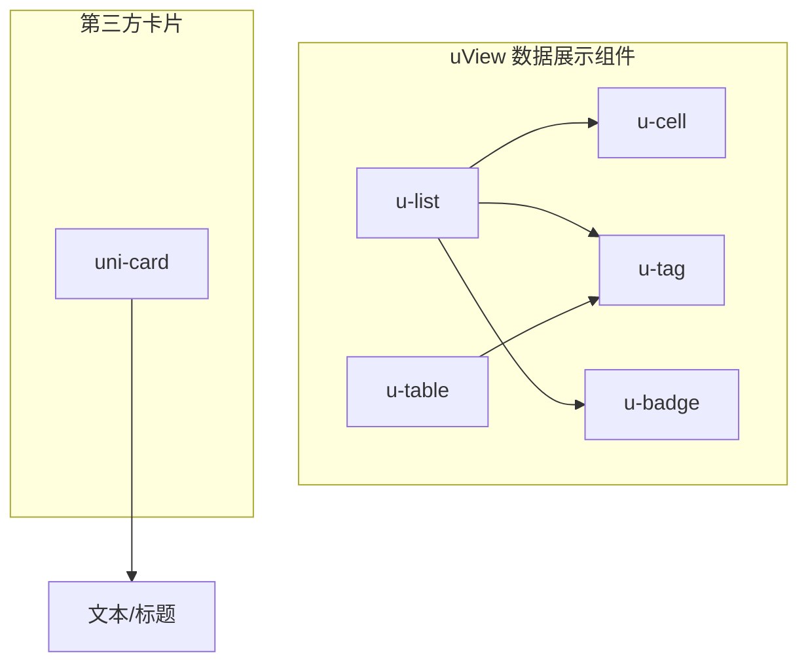
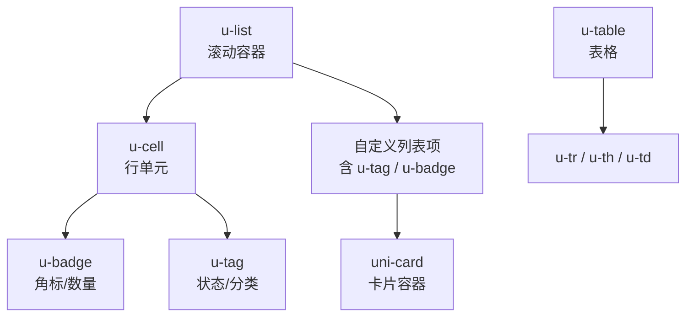
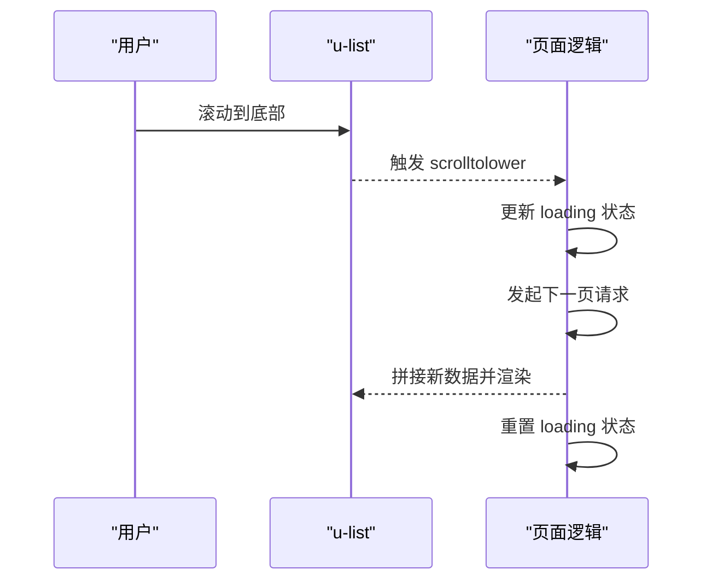
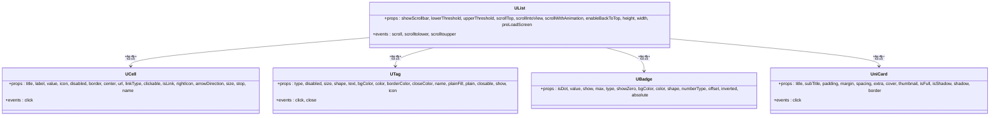

# 数据展示组件

<cite>
**本文引用的文件**
- [u-list.vue](file://uni_modules/uview-ui/components/u-list/u-list.vue)
- [u-list/props.js](file://uni_modules/uview-ui/components/u-list/props.js)
- [u-cell.vue](file://uni_modules/uview-ui/components/u-cell/u-cell.vue)
- [u-cell/props.js](file://uni_modules/uview-ui/components/u-cell/props.js)
- [u-tag.vue](file://uni_modules/uview-ui/components/u-tag/u-tag.vue)
- [u-tag/props.js](file://uni_modules/uview-ui/components/u-tag/props.js)
- [u-badge.vue](file://uni_modules/uview-ui/components/u-badge/u-badge.vue)
- [u-badge/props.js](file://uni_modules/uview-ui/components/u-badge/props.js)
- [uni-card.vue](file://uni_modules/uni-card/components/uni-card/uni-card.vue)
- [u-table.vue](file://uni_modules/uview-ui/components/u-table/u-table.vue)
- [u-table/props.js](file://uni_modules/uview-ui/components/u-table/props.js)
</cite>

## 目录
1. [简介](#简介)
2. [项目结构](#项目结构)
3. [核心组件](#核心组件)
4. [架构总览](#架构总览)
5. [详细组件分析](#详细组件分析)
6. [依赖关系分析](#依赖关系分析)
7. [性能与大数据优化](#性能与大数据优化)
8. [故障排查指南](#故障排查指南)
9. [结论](#结论)
10. [附录：常用属性速查](#附录常用属性速查)

## 简介
本文件面向在 uni-app 项目中基于 uView UI 的数据展示场景，系统梳理以下组件的使用方法与最佳实践：列表（u-list）、单元格（u-cell）、标签（u-tag）、徽章（u-badge）、卡片（card）、表格（u-table）。内容覆盖数据绑定、渲染优化、分页加载与虚拟滚动思路、大数据量展示的性能优化与内存管理策略、自定义模板与插槽使用、数据格式化、空状态与加载状态的实现方案。

## 项目结构
本项目采用模块化组织方式，UI 组件主要位于 uni_modules 下：
- uView UI 的列表、单元格、标签、徽章、表格等组件位于 uni_modules/uview-ui/components 对应目录
- 卡片组件来自 uni-card 插件，位于 uni_modules/uni-card/components/uni-card
- 各组件通常由“主组件 + props 定义”组成，便于统一配置与类型约束

图表来源
- [u-list.vue:1-158](file://uni_modules/uview-ui/components/u-list/u-list.vue#L1-L158)
- [u-cell.vue:1-230](file://uni_modules/uview-ui/components/u-cell/u-cell.vue#L1-L230)
- [u-tag.vue:1-359](file://uni_modules/uview-ui/components/u-tag/u-tag.vue#L1-L359)
- [u-badge.vue:1-172](file://uni_modules/uview-ui/components/u-badge/u-badge.vue#L1-L172)
- [uni-card.vue:1-271](file://uni_modules/uni-card/components/uni-card/uni-card.vue#L1-L271)
- [u-table.vue:1-30](file://uni_modules/uview-ui/components/u-table/u-table.vue#L1-L30)

章节来源
- [u-list.vue:1-158](file://uni_modules/uview-ui/components/u-list/u-list.vue#L1-L158)
- [u-cell.vue:1-230](file://uni_modules/uview-ui/components/u-cell/u-cell.vue#L1-L230)
- [u-tag.vue:1-359](file://uni_modules/uview-ui/components/u-tag/u-tag.vue#L1-L359)
- [u-badge.vue:1-172](file://uni_modules/uview-ui/components/u-badge/u-badge.vue#L1-L172)
- [uni-card.vue:1-271](file://uni_modules/uni-card/components/uni-card/uni-card.vue#L1-L271)
- [u-table.vue:1-30](file://uni_modules/uview-ui/components/u-table/u-table.vue#L1-L30)

## 核心组件
本节对数据展示相关组件进行概览式说明，后续章节将深入展开。

- u-list：高性能列表容器，支持 nvue/list 与 vue/scroll-view 双端适配，提供滚动事件、上拉触底、置顶回退、预渲染屏数等能力。
- u-cell：单元格，常用于信息展示与导航入口，支持图标、标题、描述、右侧值、箭头、点击反馈与跳转。
- u-tag：标签，用于标记、筛选或状态提示，支持多种主题、尺寸、形状、镂空与关闭交互。
- u-badge：徽标，用于数字或红点提示，支持最大值截断、省略、单位化显示与绝对定位偏移。
- uni-card：卡片，承载封面、标题、副标题、内容与操作区，适合聚合型信息展示。
- u-table：表格骨架已存在，当前为占位实现，可结合 u-tr/u-th/u-td 组合构建结构化数据展示。

章节来源
- [u-list.vue:1-158](file://uni_modules/uview-ui/components/u-list/u-list.vue#L1-L158)
- [u-cell.vue:1-230](file://uni_modules/uview-ui/components/u-cell/u-cell.vue#L1-L230)
- [u-tag.vue:1-359](file://uni_modules/uview-ui/components/u-tag/u-tag.vue#L1-L359)
- [u-badge.vue:1-172](file://uni_modules/uview-ui/components/u-badge/u-badge.vue#L1-L172)
- [uni-card.vue:1-271](file://uni_modules/uni-card/components/uni-card/uni-card.vue#L1-L271)
- [u-table.vue:1-30](file://uni_modules/uview-ui/components/u-table/u-table.vue#L1-L30)

## 架构总览
下图展示了数据展示组件的典型组合与交互流程：列表作为容器承载单元格、标签、徽章等子项；卡片可作为列表项的内容载体；表格用于结构化数据展示。

图表来源
- [u-list.vue:1-158](file://uni_modules/uview-ui/components/u-list/u-list.vue#L1-L158)
- [u-cell.vue:1-230](file://uni_modules/uview-ui/components/u-cell/u-cell.vue#L1-L230)
- [u-tag.vue:1-359](file://uni_modules/uview-ui/components/u-tag/u-tag.vue#L1-L359)
- [u-badge.vue:1-172](file://uni_modules/uview-ui/components/u-badge/u-badge.vue#L1-L172)
- [uni-card.vue:1-271](file://uni_modules/uni-card/components/uni-card/uni-card.vue#L1-L271)
- [u-table.vue:1-30](file://uni_modules/uview-ui/components/u-table/u-table.vue#L1-L30)

## 详细组件分析

### u-list 列表
- 功能要点
  - 双端适配：nvue 使用原生 list，非 nvue 使用 scroll-view，统一暴露滚动与触底事件。
  - 滚动控制：支持 scrollTop、scrollIntoView、scrollWithAnimation、enableBackToTop、lowerThreshold/upperThreshold 等。
  - 预渲染：preLoadScreen 控制前后预渲染屏数，提升长列表体验。
  - 事件：scroll、scrolltolower、scrolltoupper。
- 数据绑定与渲染
  - 通过 slot 插入子节点，常见搭配 u-cell、u-tag、u-badge、uni-card 等。
  - 列表高度默认取屏幕高度，也可通过 height/width 自定义。
- 分页加载与虚拟滚动
  - 分页加载：监听 scrolltolower 触发加载更多，配合业务层分页参数请求数据并追加到列表。
  - 虚拟滚动：组件文档注释中预留了虚拟列表开关位置，可按需扩展实现只渲染可视区域节点。
- 示例流程（上拉加载）

图表来源
- [u-list.vue:105-145](file://uni_modules/uview-ui/components/u-list/u-list.vue#L105-L145)
- [u-list/props.js:1-77](file://uni_modules/uview-ui/components/u-list/props.js#L1-L77)

章节来源
- [u-list.vue:1-158](file://uni_modules/uview-ui/components/u-list/u-list.vue#L1-L158)
- [u-list/props.js:1-77](file://uni_modules/uview-ui/components/u-list/props.js#L1-L77)

### u-cell 单元格
- 功能要点
  - 展示标题、描述、右侧值，支持左侧图标与右侧箭头。
  - 支持禁用、边框、居中、点击反馈、跳转链接与事件冒泡控制。
- 数据绑定与插槽
  - 通过 title、label、value、icon 等属性快速绑定数据。
  - 通过 icon、title、label、value、right-icon 插槽实现复杂布局。
- 交互与路由
  - 点击时触发 click 事件，并可配置 url/linkType 完成页面跳转。
- 使用建议
  - 在列表中作为行单元，结合 u-tag 标注状态、u-badge 显示数量。

章节来源
- [u-cell.vue:1-230](file://uni_modules/uview-ui/components/u-cell/u-cell.vue#L1-L230)
- [u-cell/props.js:1-111](file://uni_modules/uview-ui/components/u-cell/props.js#L1-L111)

### u-tag 标签
- 功能要点
  - 多主题（info/primary/success/warning/error）、多尺寸（large/medium/mini）、多形状（circle/square）。
  - 支持镂空模式、填充背景、关闭按钮与图标。
- 数据绑定与插槽
  - text、type、size、shape、plain、closable、icon 等属性驱动样式与行为。
  - 通过 icon 插槽可替换内置图标。
- 交互
  - 点击触发 click，关闭触发 close，返回 name 标识。

章节来源
- [u-tag.vue:1-359](file://uni_modules/uview-ui/components/u-tag/u-tag.vue#L1-L359)
- [u-tag/props.js:1-85](file://uni_modules/uview-ui/components/u-tag/props.js#L1-L85)

### u-badge 徽章
- 功能要点
  - 圆点与数值两种形态，支持最大值限制、溢出处理（overflow/ellipsis/limit）、反转色与绝对定位偏移。
- 数据绑定与计算
  - value 与 max 决定显示内容；numberType 控制显示策略；absolute+offset 控制位置。
- 使用建议
  - 常置于图标或单元格右上角，表示未读消息、待办数量等。

章节来源
- [u-badge.vue:1-172](file://uni_modules/uview-ui/components/u-badge/u-badge.vue#L1-L172)
- [u-badge/props.js:1-73](file://uni_modules/uview-ui/components/u-badge/props.js#L1-L73)

### uni-card 卡片
- 功能要点
  - 包含封面、标题/副标题、缩略图、额外信息与操作区，支持阴影、边框与通栏模式。
- 数据绑定与插槽
  - cover、title、subTitle、extra、thumbnail 等属性驱动头部与封面。
  - 通过 cover/title/content/actions 插槽自由定制。
- 使用建议
  - 作为列表项的复合内容容器，承载图文详情与操作。

章节来源
- [uni-card.vue:1-271](file://uni_modules/uni-card/components/uni-card/uni-card.vue#L1-L271)

### u-table 表格
- 现状说明
  - 当前为占位实现，props 为空，可通过 u-tr/u-th/u-td 组合构建表格结构。
- 使用建议
  - 小数据量可直接渲染；大数据量建议结合分页或虚拟滚动思路，避免一次性渲染过多 DOM。

章节来源
- [u-table.vue:1-30](file://uni_modules/uview-ui/components/u-table/u-table.vue#L1-L30)
- [u-table/props.js:1-6](file://uni_modules/uview-ui/components/u-table/props.js#L1-L6)

## 依赖关系分析
- 组件内聚与耦合
  - u-list 作为容器，低耦合地承载任意子节点，内部仅负责滚动与事件转发。
  - u-cell 独立性强，依赖 u-icon 与 u-line 等基础组件，适合复用。
  - u-tag 与 u-badge 均为轻量展示组件，无强外部依赖。
  - uni-card 自包含头部、内容、操作区，适合嵌套于列表项。
- 外部依赖
  - 均依赖 uView 工具库（如 addStyle、addUnit、deepMerge、sys 等），以及平台条件编译差异。

图表来源
- [u-list.vue:1-158](file://uni_modules/uview-ui/components/u-list/u-list.vue#L1-L158)
- [u-cell.vue:1-230](file://uni_modules/uview-ui/components/u-cell/u-cell.vue#L1-L230)
- [u-tag.vue:1-359](file://uni_modules/uview-ui/components/u-tag/u-tag.vue#L1-L359)
- [u-badge.vue:1-172](file://uni_modules/uview-ui/components/u-badge/u-badge.vue#L1-L172)
- [uni-card.vue:1-271](file://uni_modules/uni-card/components/uni-card/uni-card.vue#L1-L271)

## 性能与大数据优化
- 列表渲染优化
  - 使用 u-list 的 preLoadScreen 控制预渲染范围，减少首屏与滚动时的重排重绘。
  - 合理设置 lowerThreshold，避免频繁触发加载更多。
  - 在 nvue 环境下优先使用原生 list，获得更好的滚动性能。
- 虚拟滚动思路
  - 仅渲染可视区域及上下若干屏的节点，隐藏不可见节点以节省内存与渲染开销。
  - 维护可见窗口索引区间，动态计算 top/left 偏移，保持滚动条位置稳定。
- 数据与内存管理
  - 分页加载：按页获取数据，合并到列表末尾，避免一次性加载全部数据。
  - 图片懒加载：延迟加载非首屏图片，降低带宽与内存占用。
  - 对象引用：避免在循环中创建闭包或大对象，必要时释放不再使用的引用。
- 交互与动画
  - 谨慎使用复杂动画与过渡，尤其在大量节点场景下。
  - 使用 scrollWithAnimation 时注意性能权衡。
- 表格大数据
  - 小数据量直接渲染；大数据量建议分页或虚拟滚动，避免一次性生成过多 tr/td。

[本节为通用指导，不直接分析具体文件]

## 故障排查指南
- 滚动事件未触发
  - 检查是否设置了固定高度且内容不足一屏，导致无法滚动。
  - 确认 lowerThreshold/upperThreshold 阈值设置是否合理。
- 上拉加载重复触发
  - 在请求期间锁定 loading 状态，防止重复触发。
  - 确保数据拼接后正确更新视图，避免旧数据覆盖。
- 单元格点击无效
  - 检查 disabled 与 stop 属性，确认事件传播未被阻止。
  - 若配置了 url/linkType，确认路由权限与路径有效性。
- 徽章位置异常
  - 使用 absolute+offset 时，确保父级为相对定位容器。
  - 检查 numberType 与 max 的组合是否符合预期显示。
- 标签样式不生效
  - 确认 type/size/shape/plain 等属性组合是否正确。
  - 自定义样式优先级可能覆盖默认主题，检查 customStyle 与全局样式冲突。

章节来源
- [u-list.vue:105-145](file://uni_modules/uview-ui/components/u-list/u-list.vue#L105-L145)
- [u-cell.vue:83-96](file://uni_modules/uview-ui/components/u-cell/u-cell.vue#L83-L96)
- [u-badge.vue:36-82](file://uni_modules/uview-ui/components/u-badge/u-badge.vue#L36-L82)
- [u-tag.vue:134-144](file://uni_modules/uview-ui/components/u-tag/u-tag.vue#L134-L144)

## 结论
uView 的数据展示组件体系完整、职责清晰：u-list 提供高性能滚动容器，u-cell 提供标准行单元，u-tag/u-badge 提供丰富的状态与计数表达，uni-card 提供聚合信息容器，u-table 提供结构化数据展示骨架。通过合理的分页加载、虚拟滚动与资源管理策略，可在大数据量场景下获得流畅的用户体验。

[本节为总结性内容，不直接分析具体文件]

## 附录：常用属性速查
- u-list
  - 滚动与阈值：showScrollbar、lowerThreshold、upperThreshold、scrollTop、offsetAccuracy
  - 交互与体验：scrollIntoView、scrollWithAnimation、enableBackToTop、height、width、preLoadScreen
- u-cell
  - 内容：title、label、value、icon
  - 交互：disabled、clickable、isLink、url、linkType、stop、name
  - 外观：border、center、rightIcon、arrowDirection、size、iconStyle、rightIconStyle、titleStyle
- u-tag
  - 外观：type、size、shape、bgColor、color、borderColor、plain、plainFill
  - 交互：closable、closeColor、icon、show
  - 标识：name
- u-badge
  - 显示：isDot、value、show、max、showZero
  - 外观：type、bgColor、color、shape、inverted、absolute、offset
  - 数值格式：numberType
- uni-card
  - 头部：title、subTitle、extra、cover、thumbnail
  - 布局：padding、margin、spacing、isFull、isShadow、shadow、border

章节来源
- [u-list/props.js:1-77](file://uni_modules/uview-ui/components/u-list/props.js#L1-L77)
- [u-cell/props.js:1-111](file://uni_modules/uview-ui/components/u-cell/props.js#L1-L111)
- [u-tag/props.js:1-85](file://uni_modules/uview-ui/components/u-tag/props.js#L1-L85)
- [u-badge/props.js:1-73](file://uni_modules/uview-ui/components/u-badge/props.js#L1-L73)
- [uni-card.vue:60-111](file://uni_modules/uni-card/components/uni-card/uni-card.vue#L60-L111)