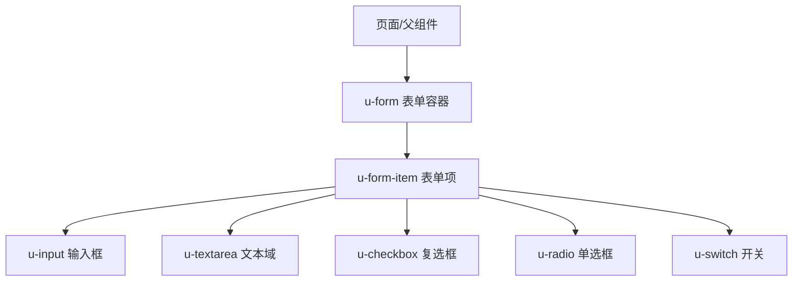
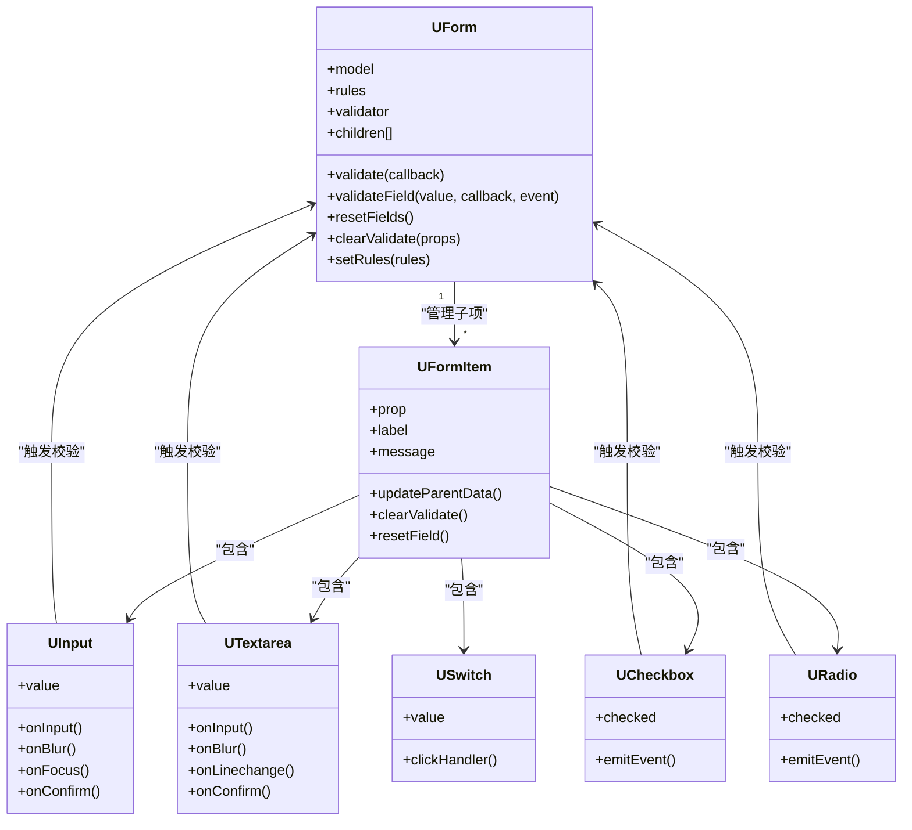
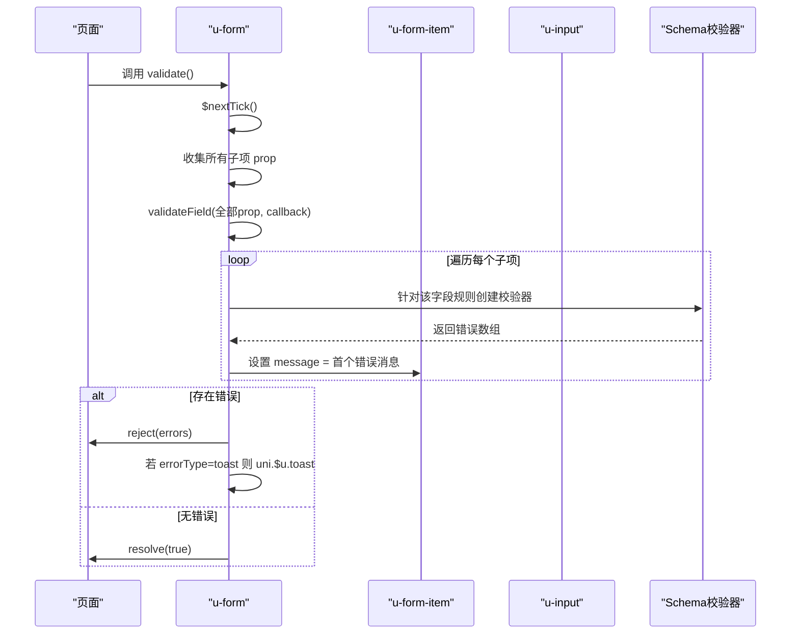
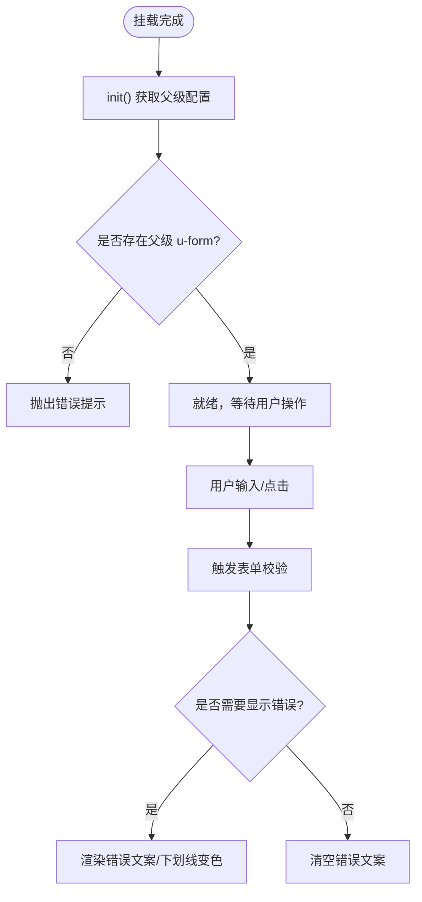
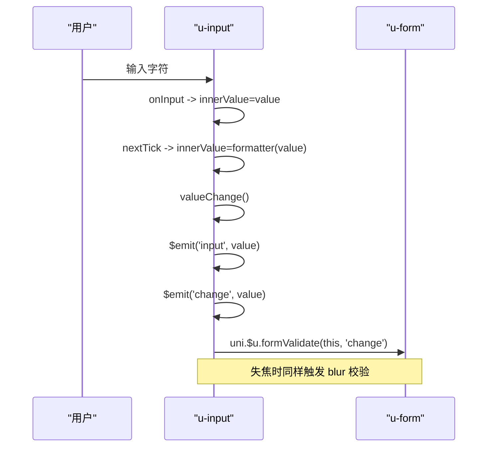
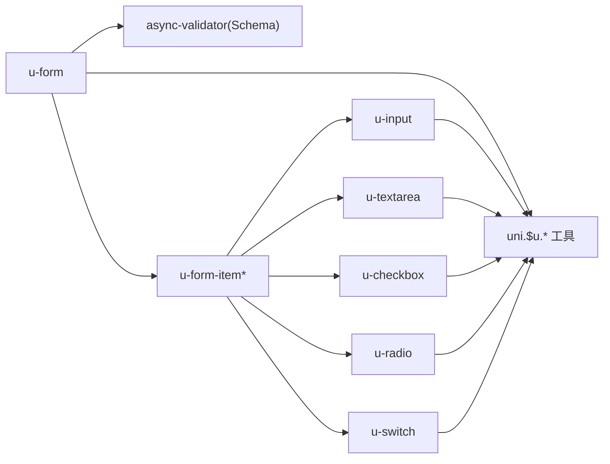

# 表单组件

<cite>
**本文引用的文件**   
- [u-form.vue](file://uni_modules/uview-ui/components/u-form/u-form.vue)
- [u-form-item.vue](file://uni_modules/uview-ui/components/u-form-item/u-form-item.vue)
- [u-input.vue](file://uni_modules/uview-ui/components/u-input/u-input.vue)
- [u-textarea.vue](file://uni_modules/uview-ui/components/u-textarea/u-textarea.vue)
- [u-checkbox.vue](file://uni_modules/uview-ui/components/u-checkbox/u-checkbox.vue)
- [u-radio.vue](file://uni_modules/uview-ui/components/u-radio/u-radio.vue)
- [u-switch.vue](file://uni_modules/uview-ui/components/u-switch/u-switch.vue)
</cite>

## 目录
1. [简介](#简介)
2. [项目结构](#项目结构)
3. [核心组件](#核心组件)
4. [架构总览](#架构总览)
5. [详细组件分析](#详细组件分析)
6. [依赖关系分析](#依赖关系分析)
7. [性能与移动端优化](#性能与移动端优化)
8. [故障排查指南](#故障排查指南)
9. [结论](#结论)
10. [附录：常用验证规则与最佳实践](#附录常用验证规则与最佳实践)

## 简介
本文件面向使用 uView UI 的开发者，系统化讲解表单相关组件的使用方式与组合模式，包括表单容器、表单项、输入框、文本域、复选框、单选框、开关等。重点覆盖：
- 表单验证机制（基于异步校验器）
- 数据绑定与双向绑定
- 错误提示与处理
- 提交流程与批量/局部校验
- 组合使用模式与最佳实践
- 移动端表单优化技巧与常见问题解决方案

## 项目结构
在项目中，表单相关组件位于 uView UI 的组件目录下，核心文件如下：
- 表单容器：u-form
- 表单项：u-form-item
- 输入控件：u-input、u-textarea
- 选择控件：u-checkbox、u-radio、u-switch

图表来源
- [u-form.vue:1-215](file://uni_modules/uview-ui/components/u-form/u-form.vue#L1-L215)
- [u-form-item.vue:1-236](file://uni_modules/uview-ui/components/u-form-item/u-form-item.vue#L1-L236)
- [u-input.vue:1-355](file://uni_modules/uview-ui/components/u-input/u-input.vue#L1-L355)
- [u-textarea.vue:1-240](file://uni_modules/uview-ui/components/u-textarea/u-textarea.vue#L1-L240)
- [u-checkbox.vue:1-345](file://uni_modules/uview-ui/components/u-checkbox/u-checkbox.vue#L1-L345)
- [u-radio.vue:1-340](file://uni_modules/uview-ui/components/u-radio/u-radio.vue#L1-L340)
- [u-switch.vue:1-178](file://uni_modules/uview-ui/components/u-switch/u-switch.vue#L1-L178)

章节来源
- [u-form.vue:1-215](file://uni_modules/uview-ui/components/u-form/u-form.vue#L1-L215)
- [u-form-item.vue:1-236](file://uni_modules/uview-ui/components/u-form-item/u-form-item.vue#L1-L236)

## 核心组件
- u-form（表单容器）
  - 职责：管理表单模型 model、规则 rules、统一校验入口 validate/validateField、重置 resetFields/clearValidate、提供子项访问 children 集合。
  - 关键能力：
    - 通过 provide/inject 向子组件注入 uForm 实例
    - 监听 rules/model 变化，初始化或更新校验器
    - 支持 errorType 控制错误提示方式（message/toast/border-bottom）
    - 支持 labelPosition/labelWidth/labelAlign/labelStyle 等布局样式
- u-form-item（表单项）
  - 职责：渲染标签、插槽内容、错误信息、下划线；维护 message 状态；与父级 u-form 联动。
  - 关键能力：
    - 读取父级 u-form 的配置（如 labelPosition、errorType 等）
    - 暴露 clearValidate/resetField 供父级调用
- u-input（输入框）
  - 职责：封装原生 input，提供格式化、清除、事件透传；在 change/blur 时触发表单校验。
- u-textarea（文本域）
  - 职责：封装原生 textarea，支持自动高度、字数统计、键盘事件；在 change/blur 时触发表单校验。
- u-checkbox（复选框）
  - 职责：多选状态切换，配合 u-checkbox-group 使用；在 change 时触发表单校验。
- u-radio（单选框）
  - 职责：单选状态切换，配合 u-radio-group 使用；在 change 时触发表单校验。
- u-switch（开关）
  - 职责：二值选择，支持 asyncChange 异步变更；change 事件可结合表单校验。

章节来源
- [u-form.vue:1-215](file://uni_modules/uview-ui/components/u-form/u-form.vue#L1-L215)
- [u-form-item.vue:1-236](file://uni_modules/uview-ui/components/u-form-item/u-form-item.vue#L1-L236)
- [u-input.vue:1-355](file://uni_modules/uview-ui/components/u-input/u-input.vue#L1-L355)
- [u-textarea.vue:1-240](file://uni_modules/uview-ui/components/u-textarea/u-textarea.vue#L1-L240)
- [u-checkbox.vue:1-345](file://uni_modules/uview-ui/components/u-checkbox/u-checkbox.vue#L1-L345)
- [u-radio.vue:1-340](file://uni_modules/uview-ui/components/u-radio/u-radio.vue#L1-L340)
- [u-switch.vue:1-178](file://uni_modules/uview-ui/components/u-switch/u-switch.vue#L1-L178)

## 架构总览
表单组件采用“容器-子项-控件”的分层协作模式：
- u-form 作为容器，持有 model 和 rules，并维护一个校验器实例
- u-form-item 作为表单项包装，负责展示 label、错误消息和下划线
- 具体控件（input/textarea/checkbox/radio/switch）在值变化或失焦时，通过全局方法 uni.$u.formValidate 通知 u-form 进行校验

图表来源
- [u-form.vue:1-215](file://uni_modules/uview-ui/components/u-form/u-form.vue#L1-L215)
- [u-form-item.vue:1-236](file://uni_modules/uview-ui/components/u-form-item/u-form-item.vue#L1-L236)
- [u-input.vue:1-355](file://uni_modules/uview-ui/components/u-input/u-input.vue#L1-L355)
- [u-textarea.vue:1-240](file://uni_modules/uview-ui/components/u-textarea/u-textarea.vue#L1-L240)
- [u-checkbox.vue:1-345](file://uni_modules/uview-ui/components/u-checkbox/u-checkbox.vue#L1-L345)
- [u-radio.vue:1-340](file://uni_modules/uview-ui/components/u-radio/u-radio.vue#L1-L340)
- [u-switch.vue:1-178](file://uni_modules/uview-ui/components/u-switch/u-switch.vue#L1-L178)

## 详细组件分析

### 表单容器 u-form
- 数据与生命周期
  - data：formRules、validator、originalModel（用于重置）
  - watch：监听 rules 变化以 setRules；监听 propsChange 通知子项刷新；监听 model 初始值保存快照
  - created：初始化 children 数组
- 校验流程
  - setRules：将 rules 转为 Schema 校验器实例
  - validate：遍历所有子项 prop，调用 validateField 执行全部校验；若错误且 errorType=toast，则弹出提示；返回 Promise
  - validateField：按字段收集错误，支持 trigger 过滤（如 blur/change），并将错误写入对应子项 message
  - clearValidate：清空指定字段或全部字段的错误信息
  - resetFields：基于 originalModel 还原 model 并清空错误
- 错误提示策略
  - errorType=message：在表单项下方显示错误文案
  - errorType=toast：首次错误弹出 toast
  - errorType=border-bottom：仅改变下划线颜色

图表来源
- [u-form.vue:184-208](file://uni_modules/uview-ui/components/u-form/u-form.vue#L184-L208)
- [u-form.vue:125-182](file://uni_modules/uview-ui/components/u-form/u-form.vue#L125-L182)

章节来源
- [u-form.vue:1-215](file://uni_modules/uview-ui/components/u-form/u-form.vue#L1-L215)

### 表单项 u-form-item
- 职责与交互
  - 渲染左侧 label（含必填星号、图标）、右侧插槽内容与右侧插槽
  - 根据 parentData.errorType 决定是否显示错误文案或仅改变下划线颜色
  - 提供 clearValidate/resetField 方法，供父级 u-form 调用
- 与父级通信
  - mounted/init：获取父级 u-form 配置（labelPosition、labelWidth、errorType 等）
  - updateParentData：当父级配置变化时，子项重新拉取最新配置

图表来源
- [u-form-item.vue:121-154](file://uni_modules/uview-ui/components/u-form-item/u-form-item.vue#L121-L154)
- [u-form-item.vue:1-74](file://uni_modules/uview-ui/components/u-form-item/u-form-item.vue#L1-L74)

章节来源
- [u-form-item.vue:1-236](file://uni_modules/uview-ui/components/u-form-item/u-form-item.vue#L1-L236)

### 输入框 u-input
- 数据流
  - innerValue 本地缓存，watch value 同步到 innerValue
  - onInput：先赋 innerValue，再在 nextTick 中应用 formatter 后触发 valueChange
  - valueChange：$emit('input', value)、$emit('change', value)，并调用 uni.$u.formValidate(this, 'change')
  - onBlur：$emit('blur', value)，延迟隐藏清除按钮，并调用 uni.$u.formValidate(this, 'blur')
- 特性
  - 支持前/后置图标、清除按钮、边框类型、形状、只读/禁用、光标位置、键盘事件等
  - 兼容 H5 外部 value 变化不触发 @input 的场景

图表来源
- [u-input.vue:213-261](file://uni_modules/uview-ui/components/u-input/u-input.vue#L213-L261)
- [u-input.vue:226-235](file://uni_modules/uview-ui/components/u-input/u-input.vue#L226-L235)

章节来源
- [u-input.vue:1-355](file://uni_modules/uview-ui/components/u-input/u-input.vue#L1-L355)

### 文本域 u-textarea
- 数据流
  - 与 u-input 类似，内部维护 innerValue，onInput 后通过 valueChange 触发 input/change 事件并调用 uni.$u.formValidate(this, 'change')
  - onBlur 触发 blur 校验
- 特性
  - 支持自动高度、字数统计、键盘高度变化事件、固定定位适配等

章节来源
- [u-textarea.vue:1-240](file://uni_modules/uview-ui/components/u-textarea/u-textarea.vue#L1-L240)

### 复选框 u-checkbox
- 行为
  - 与 u-checkbox-group 搭配使用，内部维护 isChecked
  - iconClickHandler/labelClickHandler 切换选中状态，emit('change', isChecked)
  - 在 change 事件后调用 uni.$u.formValidate(this, 'change')
- 注意
  - 需确保父级为 u-checkbox-group，否则报错

章节来源
- [u-checkbox.vue:1-345](file://uni_modules/uview-ui/components/u-checkbox/u-checkbox.vue#L1-L345)

### 单选框 u-radio
- 行为
  - 与 u-radio-group 搭配使用，内部维护 checked
  - 点击图标或文字触发选中，emit('change', name)
  - 在 change 事件后调用 uni.$u.formValidate(this, 'change')
- 注意
  - 需确保父级为 u-radio-group，否则报错

章节来源
- [u-radio.vue:1-340](file://uni_modules/uview-ui/components/u-radio/u-radio.vue#L1-L340)

### 开关 u-switch
- 行为
  - 支持 v-model 双向绑定，activeValue/inactiveValue 定义开/关值
  - clickHandler 在非禁用/非加载中切换，asyncChange=false 时直接 emit('input', oldValue)
  - 在下一个 tick 触发 change 事件，便于与表单校验联动

章节来源
- [u-switch.vue:1-178](file://uni_modules/uview-ui/components/u-switch/u-switch.vue#L1-L178)

## 依赖关系分析
- 组件耦合
  - u-form 与 u-form-item 强耦合（provide/inject + children 集合）
  - 各控件与 u-form 弱耦合（通过 uni.$u.formValidate 回调）
- 外部依赖
  - 校验器：基于 libs/util/async-validator（Schema）
  - 工具函数：uni.$u.deepClone、uni.$u.getProperty、uni.$u.setProperty、uni.$u.addUnit、uni.$u.addStyle、uni.$u.test.array 等

图表来源
- [u-form.vue:9-11](file://uni_modules/uview-ui/components/u-form/u-form.vue#L9-L11)
- [u-form.vue:90-100](file://uni_modules/uview-ui/components/u-form/u-form.vue#L90-L100)
- [u-input.vue:234-260](file://uni_modules/uview-ui/components/u-input/u-input.vue#L234-L260)
- [u-textarea.vue:159-187](file://uni_modules/uview-ui/components/u-textarea/u-textarea.vue#L159-L187)
- [u-checkbox.vue:217-223](file://uni_modules/uview-ui/components/u-checkbox/u-checkbox.vue#L217-L223)
- [u-radio.vue:215-223](file://uni_modules/uview-ui/components/u-radio/u-radio.vue#L215-L223)

章节来源
- [u-form.vue:1-215](file://uni_modules/uview-ui/components/u-form/u-form.vue#L1-L215)
- [u-input.vue:1-355](file://uni_modules/uview-ui/components/u-input/u-input.vue#L1-L355)
- [u-textarea.vue:1-240](file://uni_modules/uview-ui/components/u-textarea/u-textarea.vue#L1-L240)
- [u-checkbox.vue:1-345](file://uni_modules/uview-ui/components/u-checkbox/u-checkbox.vue#L1-L345)
- [u-radio.vue:1-340](file://uni_modules/uview-ui/components/u-radio/u-radio.vue#L1-L340)
- [u-switch.vue:1-178](file://uni_modules/uview-ui/components/u-switch/u-switch.vue#L1-L178)

## 性能与移动端优化
- 减少不必要的重渲染
  - 仅在必要时机触发校验（如 blur/change），避免频繁 validate
  - 使用 validateField 对单个字段校验，降低整体开销
- 键盘交互优化
  - 使用 adjustPosition 让页面随键盘上推
  - 使用 holdKeyboard 保持键盘常驻（微信小程序）
  - 使用 cursorSpacing 控制光标与键盘距离
- 输入体验优化
  - 合理设置 maxlength、placeholder、disabled/readonly
  - 使用 formatter 做轻量输入清洗（如去除首尾空格、数字格式化）
- 样式与布局
  - 使用 borderBottom 与 labelPosition/top/left 提升可读性
  - 在长表单中使用分页或分段提交，避免一次性校验过多字段

[本节为通用建议，无需源码引用]

## 故障排查指南
- 未设置 rules 或 model
  - 现象：开发环境会输出错误提示
  - 解决：确保同时设置 model 与 rules，并在页面加载后刷新
- 未包裹在 u-form 中使用 u-form-item
  - 现象：组件初始化时报错
  - 解决：将 u-form-item 置于 u-form 内
- checkbox/radio 未搭配 group 使用
  - 现象：组件初始化时报错
  - 解决：分别使用 u-checkbox-group / u-radio-group 包裹
- 校验未触发或结果不同步
  - 现象：输入后错误信息未及时显示
  - 解决：确认组件是否触发了 change/blur 事件；必要时手动调用 ref.validate()/validateField()
- 错误提示方式不符合预期
  - 现象：错误文案未显示或 toast 未弹出
  - 解决：检查 errorType 配置（message/toast/border-bottom）

章节来源
- [u-form.vue:93-96](file://uni_modules/uview-ui/components/u-form/u-form.vue#L93-L96)
- [u-form.vue:186-189](file://uni_modules/uview-ui/components/u-form/u-form.vue#L186-L189)
- [u-form-item.vue:128-131](file://uni_modules/uview-ui/components/u-form-item/u-form-item.vue#L128-L131)
- [u-checkbox.vue:181-183](file://uni_modules/uview-ui/components/u-checkbox/u-checkbox.vue#L181-L183)
- [u-radio.vue:186-188](file://uni_modules/uview-ui/components/u-radio/u-radio.vue#L186-L188)

## 结论
uView 表单体系以 u-form 为核心，通过 u-form-item 组织各个控件，借助异步校验器实现灵活强大的表单验证。通过合理的规则配置、事件触发与错误提示策略，可在移动端获得良好的表单体验。建议在复杂表单中采用分段校验与按需提示，以提升性能与可用性。

[本节为总结性内容，无需源码引用]

## 附录：常用验证规则与最佳实践
- 基础规则示例（参考路径）
  - 必填：在 rules 中对字段配置 required=true
  - 长度限制：min/max
  - 格式校验：pattern（正则）
  - 自定义校验：function(value, callback)
- 组合模式建议
  - 文本类：u-form + u-form-item + u-input/u-textarea
  - 选择类：u-form + u-form-item + u-checkbox-group/u-radio-group
  - 开关类：u-form + u-form-item + u-switch
- 提交流程建议
  - 使用 ref="form" 调用 validate()，成功后再进行网络请求
  - 对于大表单，优先使用 validateField(['fieldA','fieldB']) 局部校验
- 错误提示策略
  - 常规场景：errorType='message'
  - 快速反馈：errorType='toast'
  - 视觉强调：errorType='border-bottom'

[本节为概念性指导，无需源码引用]