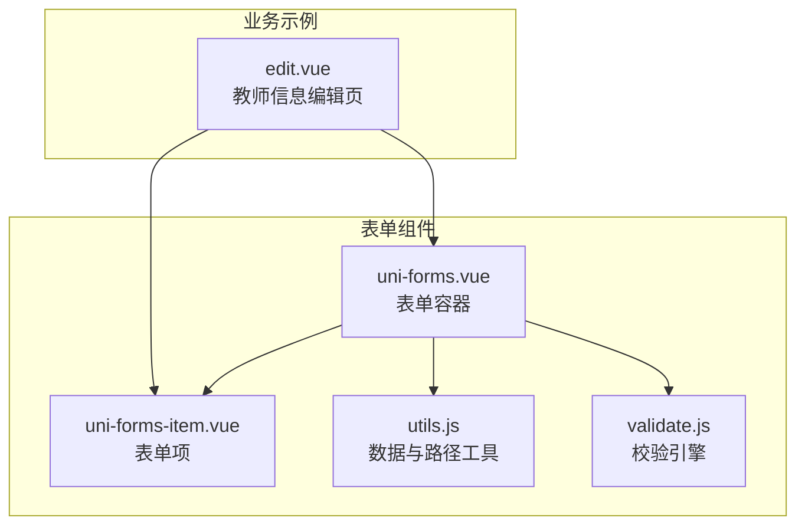
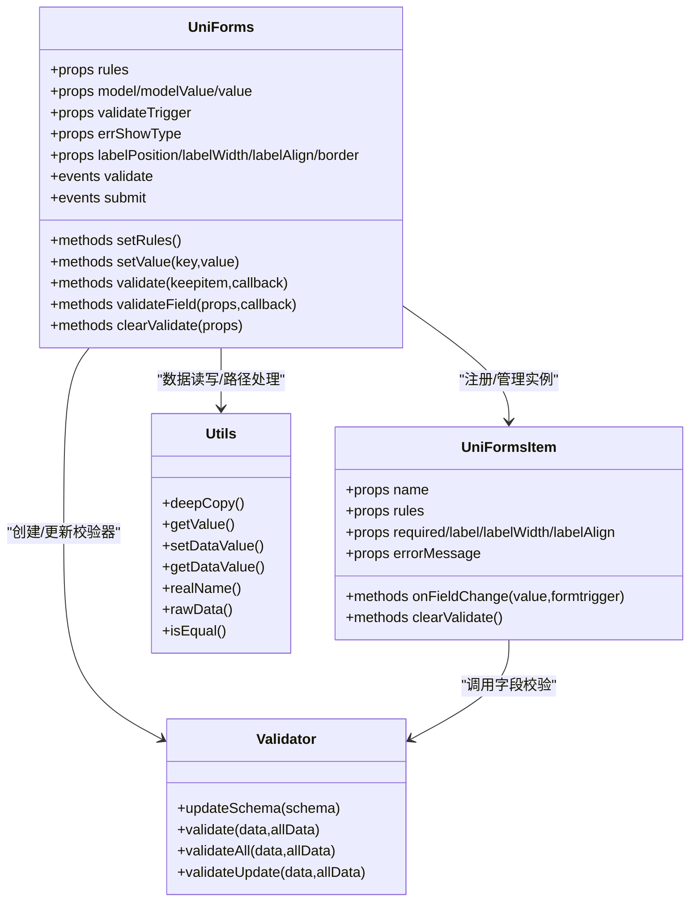
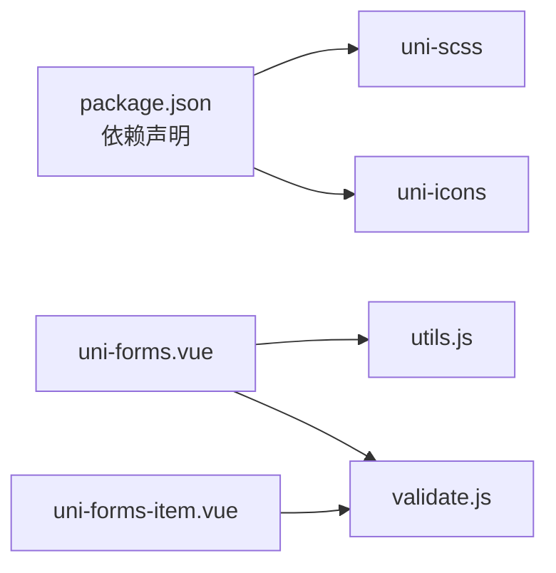

# uni-forms表单组件

<cite>
**本文引用的文件**   
- [package.json](file://uni_modules/uni-forms/package.json)
- [uni-forms.vue](file://uni_modules/uni-forms/components/uni-forms/uni-forms.vue)
- [uni-forms-item.vue](file://uni_modules/uni-forms/components/uni-forms-item/uni-forms-item.vue)
- [utils.js](file://uni_modules/uni-forms/components/uni-forms/utils.js)
- [validate.js](file://uni_modules/uni-forms/components/uni-forms/validate.js)
- [edit.vue](file://pages/sub-mine/info/edit.vue)
</cite>

## 目录
1. [简介](#简介)
2. [项目结构](#项目结构)
3. [核心组件与能力](#核心组件与能力)
4. [架构总览](#架构总览)
5. [详细组件分析](#详细组件分析)
6. [依赖关系分析](#依赖关系分析)
7. [性能与体验优化](#性能与体验优化)
8. [常见问题排查](#常见问题排查)
9. [结论](#结论)
10. [附录：API速查](#附录api速查)

## 简介
本文件面向在 uni-app 项目中集成和使用 uni-forms 表单组件的开发者，围绕安装配置、数据绑定、校验规则、错误提示、复杂表单（动态/嵌套/异步）、获取/重置/提交方法以及性能与体验优化进行系统化说明。文档内容严格基于仓库源码与页面示例进行分析与总结，避免臆造信息。

## 项目结构
uni-forms 以 uni_modules 形式提供，包含表单容器、表单项、工具函数与校验器四个核心部分；同时在业务页面中展示了实际使用方式。

图表来源
- [uni-forms.vue:1-405](file://uni_modules/uni-forms/components/uni-forms/uni-forms.vue#L1-L405)
- [uni-forms-item.vue:1-633](file://uni_modules/uni-forms/components/uni-forms-item/uni-forms-item.vue#L1-L633)
- [utils.js:1-294](file://uni_modules/uni-forms/components/uni-forms/utils.js#L1-L294)
- [validate.js:1-487](file://uni_modules/uni-forms/components/uni-forms/validate.js#L1-L487)
- [edit.vue:1-428](file://pages/sub-mine/info/edit.vue#L1-L428)

章节来源
- [package.json:1-90](file://uni_modules/uni-forms/package.json#L1-L90)
- [uni-forms.vue:1-405](file://uni_modules/uni-forms/components/uni-forms/uni-forms.vue#L1-L405)
- [uni-forms-item.vue:1-633](file://uni_modules/uni-forms/components/uni-forms-item/uni-forms-item.vue#L1-L633)
- [utils.js:1-294](file://uni_modules/uni-forms/components/uni-forms/utils.js#L1-L294)
- [validate.js:1-487](file://uni_modules/uni-forms/components/uni-forms/validate.js#L1-L487)
- [edit.vue:1-428](file://pages/sub-mine/info/edit.vue#L1-L428)

## 核心组件与能力
- 表单容器 uni-forms
  - 负责维护表单数据、合并并管理校验规则、统一触发校验时机、对外暴露校验与设置值的方法、分发 validate/submit 事件。
- 表单项 uni-forms-item
  - 负责渲染 label、输入插槽、错误消息展示；监听父级规则与数据变化，执行字段级校验与错误提示。
- 工具 utils
  - 提供深拷贝、类型转换、对象路径读写、真实 name 生成与还原、相等性比较等基础能力。
- 校验器 validate
  - 内置 required/format/pattern/range/length/自定义表达式与异步函数等校验能力，支持默认消息模板与占位符替换。

章节来源
- [uni-forms.vue:67-136](file://uni_modules/uni-forms/components/uni-forms/uni-forms.vue#L67-L136)
- [uni-forms-item.vue:78-130](file://uni_modules/uni-forms/components/uni-forms-item/uni-forms-item.vue#L78-L130)
- [utils.js:1-294](file://uni_modules/uni-forms/components/uni-forms/utils.js#L1-L294)
- [validate.js:1-487](file://uni_modules/uni-forms/components/uni-forms/validate.js#L1-L487)

## 架构总览
表单组件采用“容器-子项”模式，通过 provide/inject 建立父子通信；校验由独立类驱动，工具函数贯穿数据读写与路径解析。

图表来源
- [uni-forms.vue:67-136](file://uni_modules/uni-forms/components/uni-forms/uni-forms.vue#L67-L136)
- [uni-forms.vue:202-398](file://uni_modules/uni-forms/components/uni-forms/uni-forms.vue#L202-L398)
- [uni-forms-item.vue:57-130](file://uni_modules/uni-forms/components/uni-forms-item/uni-forms-item.vue#L57-L130)
- [uni-forms-item.vue:213-300](file://uni_modules/uni-forms/components/uni-forms-item/uni-forms-item.vue#L213-L300)
- [utils.js:1-294](file://uni_modules/uni-forms/components/uni-forms/utils.js#L1-L294)
- [validate.js:360-487](file://uni_modules/uni-forms/components/uni-forms/validate.js#L360-L487)

## 详细组件分析

### 表单容器 uni-forms
- 关键属性
  - rules：表单校验规则对象，键为字段名，值为包含 rules 数组的规则定义。
  - model/modelValue/value：表单数据源（注意版本兼容说明）。
  - validateTrigger：校验触发时机，支持 bind/submit/blur。
  - errShowType：错误提示方式，支持 undertext/toast/modal。
  - labelPosition/labelWidth/labelAlign/border：标签布局与边框样式控制。
- 关键方法
  - setRules(rules)：动态设置或合并规则，内部会重建校验器。
  - setValue(key, value)：按字段设置值并触发该字段校验。
  - validate(keepitem, callback)：全量校验，支持 Promise 或回调。
  - validateField(props, callback)：指定字段集合校验。
  - clearValidate(props)：清空指定字段或全部字段的错误状态。
- 事件
  - validate：校验结果变化时触发，携带错误数组。
  - submit：旧版提交事件，已建议迁移至 validate。
- 数据流要点
  - 通过 computed.localData 对传入数据做深拷贝，避免直接修改外部引用。
  - 通过 childrens 收集所有子项实例，统一调度校验。
  - 校验结果经 rawData 还原为原始数据结构后回传给回调。

章节来源
- [uni-forms.vue:78-136](file://uni_modules/uni-forms/components/uni-forms/uni-forms.vue#L78-L136)
- [uni-forms.vue:149-170](file://uni_modules/uni-forms/components/uni-forms/uni-forms.vue#L149-L170)
- [uni-forms.vue:202-398](file://uni_modules/uni-forms/components/uni-forms/uni-forms.vue#L202-L398)

### 表单项 uni-forms-item
- 关键属性
  - name：字段名，支持字符串或数组路径。
  - rules：字段级校验规则数组，覆盖或补充父级 rules。
  - required/label/labelWidth/labelAlign：显示与必填标记。
  - errorMessage：强制显示的错误文案。
- 行为与生命周期
  - created/init：注册到父级 childrens，合并规则，初始化本地数据。
  - watch form.formRules：当父级规则变更时重新初始化。
  - watch 表单数据：对比新旧值，仅在变化时触发校验。
- 校验流程
  - onFieldChange：根据 validateTrigger 与当前值，调用 validator.validateUpdate 进行校验；根据 errShowType 选择 undertext/toast/modal 展示错误。
  - clearValidate：清空自身错误信息。
- 样式与交互
  - 支持 label 顶部/左侧两种方向，支持 border 列表式布局与首项无边框处理。
  - 错误消息区域带过渡动画，提升反馈体验。

章节来源
- [uni-forms-item.vue:78-130](file://uni_modules/uni-forms/components/uni-forms-item/uni-forms-item.vue#L78-L130)
- [uni-forms-item.vue:148-200](file://uni_modules/uni-forms/components/uni-forms-item/uni-forms-item.vue#L148-L200)
- [uni-forms-item.vue:213-300](file://uni_modules/uni-forms/components/uni-forms-item/uni-forms-item.vue#L213-L300)
- [uni-forms-item.vue:464-633](file://uni_modules/uni-forms/components/uni-forms-item/uni-forms-item.vue#L464-L633)

### 校验引擎 validate
- 内置规则
  - required：必填校验。
  - format：类型校验，支持 integer/number/boolean/string/array/object/date/timestamp/file 等。
  - pattern：正则匹配。
  - range：枚举范围（含数组多选场景）。
  - rangeNumber：数值区间（含 exclusiveMinimum/exclusiveMaximum）。
  - rangeLength：长度区间（字符串/数组）。
  - validateExpr：同步表达式校验。
  - validateFunction：异步函数校验，支持回调返回错误消息。
- 消息系统
  - 支持占位符如 {label}、{minLength} 等，可全局覆盖默认消息。
- 校验入口
  - SchemaValidator.validate/validateAll/validateUpdate：分别用于单条、全部、增量更新校验。

章节来源
- [validate.js:1-119](file://uni_modules/uni-forms/components/uni-forms/validate.js#L1-L119)
- [validate.js:121-230](file://uni_modules/uni-forms/components/uni-forms/validate.js#L121-L230)
- [validate.js:232-358](file://uni_modules/uni-forms/components/uni-forms/validate.js#L232-L358)
- [validate.js:360-487](file://uni_modules/uni-forms/components/uni-forms/validate.js#L360-L487)

### 工具函数 utils
- 数据与类型
  - deepCopy：深拷贝。
  - getValue：根据 rules.format 将初始值转换为 number/boolean 等目标类型。
  - isRequiredField：判断是否存在必填规则。
  - isEqual：深度比较两个值是否相等。
- 路径与对象操作
  - realName/isRealName/rawData/name2arr：将 name 转为唯一标识并在提交前还原为原始结构。
  - objGet/objSet：安全地读取/写入对象路径。
  - setDataValue/getDataValue：封装表单数据的赋值与取值。

章节来源
- [utils.js:1-294](file://uni_modules/uni-forms/components/uni-forms/utils.js#L1-L294)

### 业务示例：教师信息编辑页
- 使用方式
  - 通过 ref 获取表单实例，结合 v-model 双向绑定 teacher 对象。
  - 使用 uni-forms-item 包裹各输入控件，name 对应字段名。
- 交互
  - 点击保存按钮弹出确认，随后组装提交数据并调用接口。
- 注意点
  - 当前示例未配置 rules 与 validateTrigger，如需实时校验可在 uni-forms 上添加相应属性与规则。

章节来源
- [edit.vue:17-99](file://pages/sub-mine/info/edit.vue#L17-L99)
- [edit.vue:278-321](file://pages/sub-mine/info/edit.vue#L278-L321)

## 依赖关系分析
- 组件耦合
  - uni-forms 与 uni-forms-item 通过 provide/inject 解耦，职责清晰。
  - 校验逻辑集中在 validate.js，便于扩展与维护。
- 外部依赖
  - package.json 声明依赖 uni-scss 与 uni-icons，确保主题与图标资源可用。
- 平台兼容性
  - 针对多端（App/H5/小程序）与 Vue2/Vue3 做了条件编译与兼容处理。

图表来源
- [package.json:40-44](file://uni_modules/uni-forms/package.json#L40-L44)
- [uni-forms.vue:10-21](file://uni_modules/uni-forms/components/uni-forms/uni-forms.vue#L10-L21)
- [uni-forms-item.vue:32-77](file://uni_modules/uni-forms/components/uni-forms-item/uni-forms-item.vue#L32-L77)

章节来源
- [package.json:1-90](file://uni_modules/uni-forms/package.json#L1-L90)
- [uni-forms.vue:10-21](file://uni_modules/uni-forms/components/uni-forms/uni-forms.vue#L10-L21)
- [uni-forms-item.vue:32-77](file://uni_modules/uni-forms/components/uni-forms-item/uni-forms-item.vue#L32-L77)

## 性能与体验优化
- 校验时机选择
  - 长表单建议使用 validateTrigger='submit'，减少频繁校验带来的重渲染开销；需要即时反馈时可设为 'bind' 或 'blur'。
- 局部校验
  - 使用 validateField 仅校验必要字段，降低计算成本。
- 错误提示策略
  - undertext 适合紧凑布局；toast/modal 适合强提醒，但注意 modal 会打断用户操作，谨慎使用。
- 数据更新与比较
  - 组件内部使用 isEqual 比较前后值，避免无意义校验；建议在大数据对象场景下合理拆分表单，减少不必要的 watcher 触发。
- 列表式布局
  - 开启 border 可获得更清晰的条目分割，但会增加样式计算，按需启用。
- 异步校验
  - 使用 validateFunction 实现网络校验时，务必做好防抖与超时处理，避免重复请求。

[本节为通用指导，不直接分析具体文件]

## 常见问题排查
- 为什么设置了 rules 没有生效？
  - 检查是否在 uni-forms 上正确传入 rules，且字段名与 uni-forms-item 的 name 一致。
  - 若动态修改规则，需调用 setRules 或确保 rules 响应式更新。
- 如何只校验某个字段？
  - 使用 validateField(['fieldName']) 或传入多个字段名数组。
- 如何清空错误提示？
  - 使用 clearValidate() 清空全部，或 clearValidate(['fieldA','fieldB']) 清空指定字段。
- 如何获取最终提交数据？
  - 校验成功后，回调中的 resetFormData 即为还原后的原始结构数据。
- 如何处理异步校验？
  - 在 rules 中使用 validateFunction，返回 Promise 或通过回调返回错误消息。

章节来源
- [uni-forms.vue:202-398](file://uni_modules/uni-forms/components/uni-forms/uni-forms.vue#L202-L398)
- [uni-forms-item.vue:213-300](file://uni_modules/uni-forms/components/uni-forms-item/uni-forms-item.vue#L213-L300)
- [validate.js:174-203](file://uni_modules/uni-forms/components/uni-forms/validate.js#L174-L203)

## 结论
uni-forms 提供了开箱即用的表单数据绑定、规则化校验与友好的错误提示机制，并通过工具函数与校验引擎实现了良好的可扩展性与跨端兼容性。在实际项目中，建议结合业务场景选择合适的校验时机与提示方式，合理使用局部校验与异步校验，以获得更佳的性能与用户体验。

[本节为总结性内容，不直接分析具体文件]

## 附录：API速查

- uni-forms 常用属性
  - rules：Object，表单校验规则
  - model/modelValue/value：Object，表单数据源
  - validateTrigger：String，'bind'|'submit'|'blur'
  - errShowType：String，'undertext'|'toast'|'modal'
  - labelPosition：String，'top'|'left'
  - labelWidth：String|Number，标签宽度
  - labelAlign：String，'left'|'center'|'right'
  - border：Boolean，是否使用列表式边框

- uni-forms 常用方法
  - setRules(rules)
  - setValue(key, value)
  - validate(keepitem?, callback?)
  - validateField(props?, callback?)
  - clearValidate(props?)

- uni-forms-item 常用属性
  - name：String|Array，字段名
  - rules：Array，字段级规则
  - required：Boolean，是否必填
  - label：String，标签文本
  - labelWidth：String|Number，标签宽度
  - labelAlign：String，对齐方式
  - errorMessage：String|Boolean，强制错误文案

- 校验规则关键字段
  - required：Boolean
  - format：String，类型映射
  - pattern：RegExp|String，正则
  - range：Array，枚举范围
  - minimum/maximum/exclusiveMinimum/exclusiveMaximum：Number，数值区间
  - minLength/maxLength：Number，长度区间
  - validateExpr：Function，同步表达式
  - validateFunction：Function，异步函数

章节来源
- [uni-forms.vue:78-136](file://uni_modules/uni-forms/components/uni-forms/uni-forms.vue#L78-L136)
- [uni-forms.vue:202-398](file://uni_modules/uni-forms/components/uni-forms/uni-forms.vue#L202-L398)
- [uni-forms-item.vue:78-130](file://uni_modules/uni-forms/components/uni-forms-item/uni-forms-item.vue#L78-L130)
- [validate.js:121-230](file://uni_modules/uni-forms/components/uni-forms/validate.js#L121-L230)
- [validate.js:232-358](file://uni_modules/uni-forms/components/uni-forms/validate.js#L232-L358)