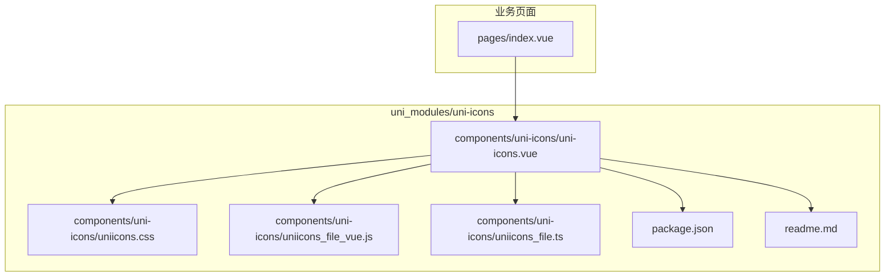
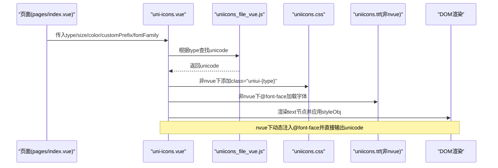
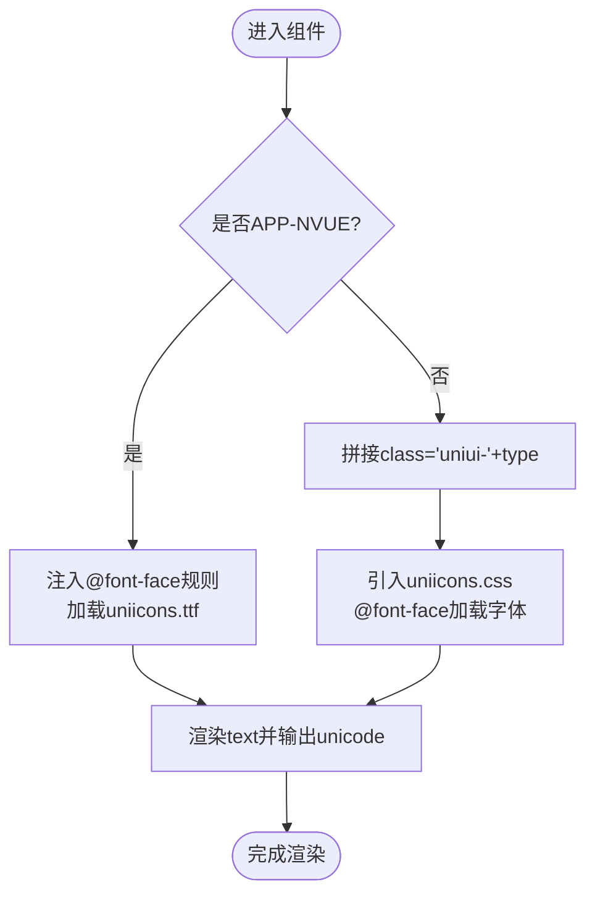
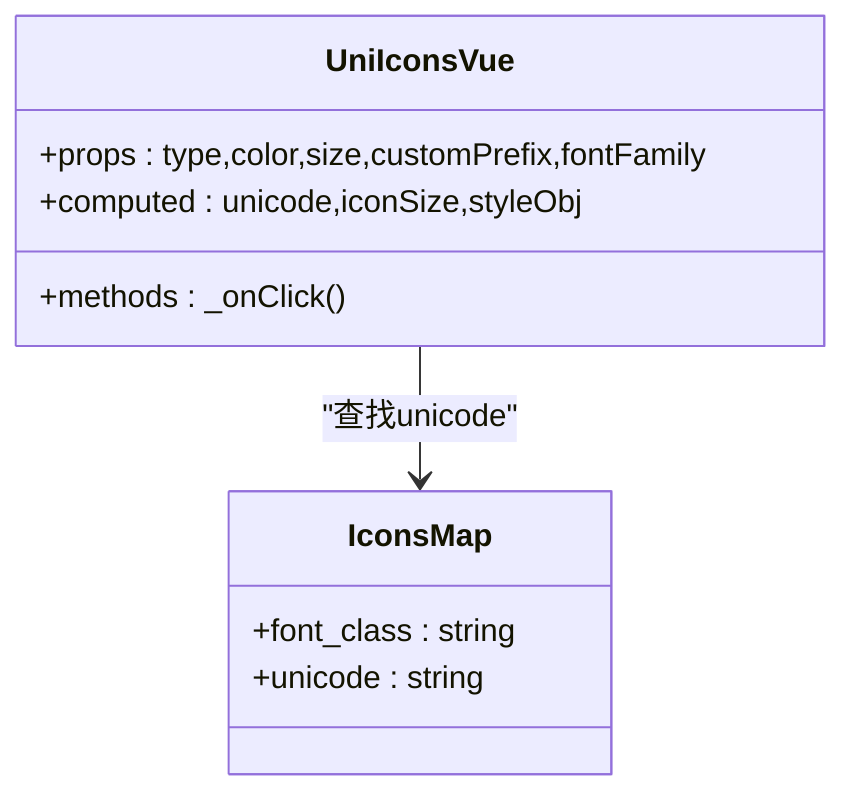
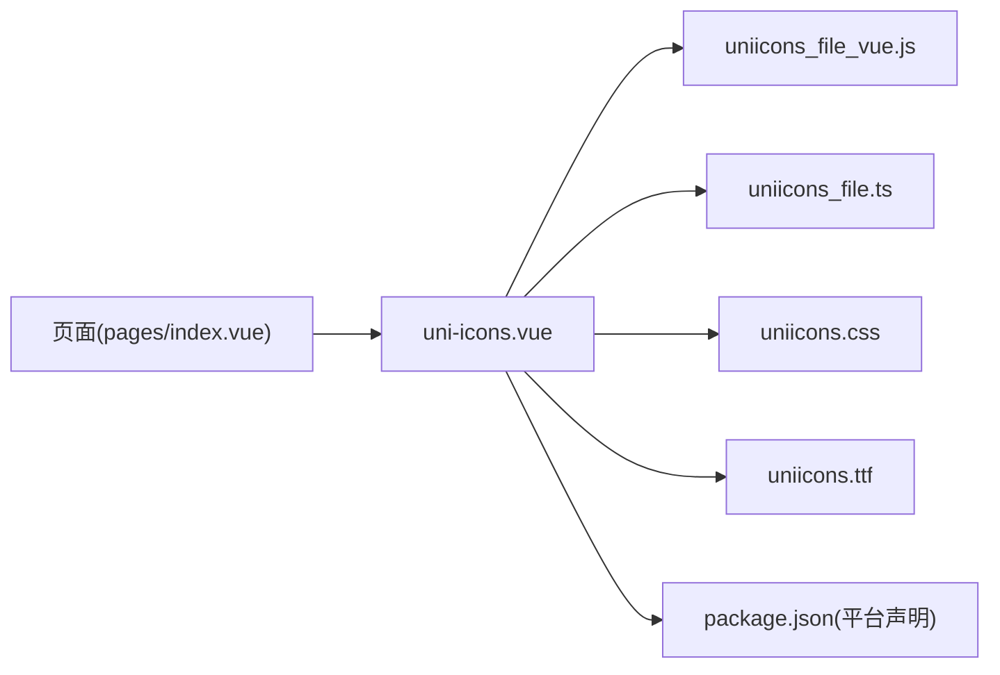

# uni-icons图标组件

<cite>
**本文引用的文件**
- [uni_modules/uni-icons/readme.md](file://uni_modules/uni-icons/readme.md)
- [uni_modules/uni-icons/package.json](file://uni_modules/uni-icons/package.json)
- [uni_modules/uni-icons/components/uni-icons/uni-icons.vue](file://uni_modules/uni-icons/components/uni-icons/uni-icons.vue)
- [uni_modules/uni-icons/components/uni-icons/uniicons.css](file://uni_modules/uni-icons/components/uni-icons/uniicons.css)
- [uni_modules/uni-icons/components/uni-icons/uniicons_file_vue.js](file://uni_modules/uni-icons/components/uni-icons/uniicons_file_vue.js)
- [uni_modules/uni-icons/components/uni-icons/uniicons_file.ts](file://uni_modules/uni-icons/components/uni-icons/uniicons_file.ts)
- [pages/index.vue](file://pages/index.vue)
</cite>

## 目录
1. [简介](#简介)
2. [项目结构](#项目结构)
3. [核心组件与属性](#核心组件与属性)
4. [架构总览](#架构总览)
5. [详细组件分析](#详细组件分析)
6. [依赖关系分析](#依赖关系分析)
7. [平台兼容性与显示效果](#平台兼容性与显示效果)
8. [性能优化与最佳实践](#性能优化与最佳实践)
9. [常见问题排查](#常见问题排查)
10. [结论](#结论)

## 简介
本文件面向在 uni-app 项目中集成和使用官方图标组件 uni-icons，提供安装配置、基础用法、图标名称规范、大小与颜色设置、常用图标示例、自定义图标集成方法、多平台兼容性说明以及性能优化建议。文档内容基于仓库内实际源码与页面使用示例进行整理。

## 项目结构
uni-icons 作为 uni_modules 插件被引入到项目中，核心实现位于 components/uni-icons 目录下，包含 Vue 与 uvue 两套模板、字体映射表与样式定义；项目中的多个页面已使用该组件展示系统图标。

图表来源
- [uni_modules/uni-icons/components/uni-icons/uni-icons.vue:1-111](file://uni_modules/uni-icons/components/uni-icons/uni-icons.vue#L1-L111)
- [uni_modules/uni-icons/components/uni-icons/uniicons.css:1-665](file://uni_modules/uni-icons/components/uni-icons/uniicons.css#L1-L665)
- [uni_modules/uni-icons/components/uni-icons/uniicons_file_vue.js:1-650](file://uni_modules/uni-icons/components/uni-icons/uniicons_file_vue.js#L1-L650)
- [uni_modules/uni-icons/components/uni-icons/uniicons_file.ts:1-665](file://uni_modules/uni-icons/components/uni-icons/uniicons_file.ts#L1-L665)
- [uni_modules/uni-icons/package.json:1-90](file://uni_modules/uni-icons/package.json#L1-L90)
- [uni_modules/uni-icons/readme.md:1-9](file://uni_modules/uni-icons/readme.md#L1-L9)
- [pages/index.vue:1-711](file://pages/index.vue#L1-L711)

章节来源
- [uni_modules/uni-icons/readme.md:1-9](file://uni_modules/uni-icons/readme.md#L1-L9)
- [uni_modules/uni-icons/package.json:1-90](file://uni_modules/uni-icons/package.json#L1-L90)
- [uni_modules/uni-icons/components/uni-icons/uni-icons.vue:1-111](file://uni_modules/uni-icons/components/uni-icons/uni-icons.vue#L1-L111)
- [uni_modules/uni-icons/components/uni-icons/uniicons.css:1-665](file://uni_modules/uni-icons/components/uni-icons/uniicons.css#L1-L665)
- [uni_modules/uni-icons/components/uni-icons/uniicons_file_vue.js:1-650](file://uni_modules/uni-icons/components/uni-icons/uniicons_file_vue.js#L1-L650)
- [uni_modules/uni-icons/components/uni-icons/uniicons_file.ts:1-665](file://uni_modules/uni-icons/components/uni-icons/uniicons_file.ts#L1-L665)
- [pages/index.vue:1-711](file://pages/index.vue#L1-L711)

## 核心组件与属性
- 组件名：uni-icons
- 代码块：uIcons（参考插件 readme）
- 主要用途：展示移动端常见图标，支持自定义颜色与大小

关键属性与方法
- type：字符串，指定图标名称（对应内置字体的 font_class）
- size：数字或字符串，控制图标大小（内部会统一为 px 单位）
- color：字符串，控制图标颜色
- customPrefix：字符串，用于自定义图标前缀（非 nvue 路径下生效）
- fontFamily：字符串，覆盖默认字体族（nvue 与非 nvue 均支持）
- click：事件，点击图标时触发

章节来源
- [uni_modules/uni-icons/readme.md:1-9](file://uni_modules/uni-icons/readme.md#L1-L9)
- [uni_modules/uni-icons/components/uni-icons/uni-icons.vue:29-91](file://uni_modules/uni-icons/components/uni-icons/uni-icons.vue#L29-L91)

## 架构总览
uni-icons 通过字体映射表将 type 值解析为 unicode，并在不同平台以 text 节点渲染。非 nvue 环境通过 CSS 类名选择器匹配图标字形；nvue 环境通过动态注入 @font-face 规则加载字体资源。

图表来源
- [uni_modules/uni-icons/components/uni-icons/uni-icons.vue:1-111](file://uni_modules/uni-icons/components/uni-icons/uni-icons.vue#L1-L111)
- [uni_modules/uni-icons/components/uni-icons/uniicons_file_vue.js:1-650](file://uni_modules/uni-icons/components/uni-icons/uniicons_file_vue.js#L1-L650)
- [uni_modules/uni-icons/components/uni-icons/uniicons.css:1-665](file://uni_modules/uni-icons/components/uni-icons/uniicons.css#L1-L665)

## 详细组件分析

### 组件结构与渲染逻辑
- 模板分支
  - APP-NVUE：直接输出 unicode 文本，并通过 weex domModule 注入 @font-face 规则
  - 非 NVUE：根据 type 生成 class="uniui-{type}"，由 CSS 伪元素 :before 显示字形
- 计算属性
  - unicode：从映射表中按 type 查找对应的 unicode
  - iconSize：对 size 做单位处理，确保最终为 px 字符串
  - styleObj：组装 color、font-size、font-family 等样式
- 事件
  - 点击触发 click 事件

图表来源
- [uni_modules/uni-icons/components/uni-icons/uni-icons.vue:1-111](file://uni_modules/uni-icons/components/uni-icons/uni-icons.vue#L1-L111)
- [uni_modules/uni-icons/components/uni-icons/uniicons.css:1-665](file://uni_modules/uni-icons/components/uni-icons/uniicons.css#L1-L665)

章节来源
- [uni_modules/uni-icons/components/uni-icons/uni-icons.vue:1-111](file://uni_modules/uni-icons/components/uni-icons/uni-icons.vue#L1-L111)

### 图标名称规范与映射
- 名称来源：type 对应映射表中的 font_class
- 映射文件：
  - Vue 环境：uniicons_file_vue.js
  - uvue 环境：uniicons_file.ts
- 样式关联：非 nvue 环境下，CSS 中 .uniui-{font_class}:before 的 content 即为该图标的 unicode

图表来源
- [uni_modules/uni-icons/components/uni-icons/uniicons_file_vue.js:1-650](file://uni_modules/uni-icons/components/uni-icons/uniicons_file_vue.js#L1-L650)
- [uni_modules/uni-icons/components/uni-icons/uniicons_file.ts:1-665](file://uni_modules/uni-icons/components/uni-icons/uniicons_file.ts#L1-L665)
- [uni_modules/uni-icons/components/uni-icons/uni-icons.vue:29-91](file://uni_modules/uni-icons/components/uni-icons/uni-icons.vue#L29-L91)

章节来源
- [uni_modules/uni-icons/components/uni-icons/uniicons_file_vue.js:1-650](file://uni_modules/uni-icons/components/uni-icons/uniicons_file_vue.js#L1-L650)
- [uni_modules/uni-icons/components/uni-icons/uniicons_file.ts:1-665](file://uni_modules/uni-icons/components/uni-icons/uniicons_file.ts#L1-L665)
- [uni_modules/uni-icons/components/uni-icons/uniicons.css:1-665](file://uni_modules/uni-icons/components/uni-icons/uniicons.css#L1-L665)

### 常用图标与使用示例
以下示例来自项目页面中对 uni-icons 的实际使用，展示了搜索、导航、用户、上传等常见场景。

- 搜索入口
  - type="search"，size="18"，color="#999"
- 右侧箭头
  - type="arrowright"，size="16"，color="#ccc"
- 左右切换
  - type="left"/"right"，size="16"，color="#999"
- 快捷入口图标
  - type="person-filled"/"plusempty"/"chat-filled"/"paperplane-filled"，size="26"，color="#fff"

章节来源
- [pages/index.vue:12-16](file://pages/index.vue#L12-L16)
- [pages/index.vue:47-66](file://pages/index.vue#L47-L66)
- [pages/index.vue:93-113](file://pages/index.vue#L93-L113)

### 自定义图标集成方法
- 非 nvue 环境
  - 通过 customPrefix 属性配合外部字体库的 class 前缀，使组件渲染出自定义字形
  - 需确保目标字体已在项目中引入，且 CSS 类名遵循“前缀+图标名”的约定
- nvue 环境
  - 通过 fontFamily 指定自定义字体族，同时保证字体资源可被加载
  - 若需要动态注册字体，可参考组件在 nvue 下的 @font-face 注入方式

章节来源
- [uni_modules/uni-icons/components/uni-icons/uni-icons.vue:55-62](file://uni_modules/uni-icons/components/uni-icons/uni-icons.vue#L55-L62)
- [uni_modules/uni-icons/components/uni-icons/uni-icons.vue:20-27](file://uni_modules/uni-icons/components/uni-icons/uni-icons.vue#L20-L27)

## 依赖关系分析
- 组件依赖
  - 字体映射表：uniicons_file_vue.js / uniicons_file.ts
  - 样式与字形：uniicons.css
  - 字体资源：uniicons.ttf（非 nvue 下通过 @font-face 引入）
  - nvue 特殊依赖：weex.domModule 动态注入字体
- 平台声明
  - package.json 中声明了支持的客户端与小程序平台范围

图表来源
- [uni_modules/uni-icons/components/uni-icons/uni-icons.vue:1-111](file://uni_modules/uni-icons/components/uni-icons/uni-icons.vue#L1-L111)
- [uni_modules/uni-icons/components/uni-icons/uniicons_file_vue.js:1-650](file://uni_modules/uni-icons/components/uni-icons/uniicons_file_vue.js#L1-L650)
- [uni_modules/uni-icons/components/uni-icons/uniicons_file.ts:1-665](file://uni_modules/uni-icons/components/uni-icons/uniicons_file.ts#L1-L665)
- [uni_modules/uni-icons/components/uni-icons/uniicons.css:1-665](file://uni_modules/uni-icons/components/uni-icons/uniicons.css#L1-L665)
- [uni_modules/uni-icons/package.json:1-90](file://uni_modules/uni-icons/package.json#L1-L90)
- [pages/index.vue:1-711](file://pages/index.vue#L1-L711)

章节来源
- [uni_modules/uni-icons/package.json:1-90](file://uni_modules/uni-icons/package.json#L1-L90)
- [uni_modules/uni-icons/components/uni-icons/uni-icons.vue:1-111](file://uni_modules/uni-icons/components/uni-icons/uni-icons.vue#L1-L111)

## 平台兼容性与显示效果
- 支持平台
  - App（app-vue、app-nvue、app-uvue）、H5（移动端与PC端主流浏览器）、小程序（微信、阿里、百度、字节跳动、QQ、钉钉、快手、飞书、京东）、快应用（华为、联盟）、Vue2/Vue3
- 渲染差异
  - 非 nvue：通过 CSS 类名与伪元素渲染字形
  - nvue：通过 weex.domModule.addRule('fontFace', ...) 动态注入字体，再输出 unicode 文本
- 注意事项
  - 自定义字体在 nvue 下需确保字体资源路径正确并可被加载
  - 在非 nvue 下，确保自定义字体的 CSS 类名与组件 class 拼接规则一致

章节来源
- [uni_modules/uni-icons/package.json:39-88](file://uni_modules/uni-icons/package.json#L39-L88)
- [uni_modules/uni-icons/components/uni-icons/uni-icons.vue:20-27](file://uni_modules/uni-icons/components/uni-icons/uni-icons.vue#L20-L27)
- [uni_modules/uni-icons/components/uni-icons/uni-icons.vue:95-110](file://uni_modules/uni-icons/components/uni-icons/uni-icons.vue#L95-L110)

## 性能优化与最佳实践
- 避免重复加载字体
  - 非 nvue 下字体通过 @font-face 引入一次即可，避免多处重复引入
- 合理使用 size 与 color
  - 优先使用数值型 size，减少运行时单位转换开销
  - 颜色尽量使用十六进制或变量集中管理，便于缓存与复用
- 控制图标数量与层级
  - 列表页中大量图标时，考虑分页或虚拟滚动，降低首屏渲染压力
- 自定义图标按需引入
  - 仅引入必要的字体与样式，减小包体
- 事件处理
  - 为可点击图标绑定 click 事件时，注意防抖与节流，避免频繁触发

[本节为通用指导，不直接分析具体文件]

## 常见问题排查
- 图标未显示
  - 检查 type 是否在映射表中存在
  - 确认 CSS 类名是否正确拼接（非 nvue 下应为 .uniui-{type}）
  - 确认字体资源是否成功加载（非 nvue 下查看 @font-face 是否生效）
- nvue 下图标异常
  - 检查 fontFamily 是否正确
  - 确认动态注入的 @font-face 规则是否成功执行
- 自定义图标不生效
  - 确认 customPrefix 与外部字体 class 前缀一致
  - 确认字体资源路径与引入方式符合平台要求

章节来源
- [uni_modules/uni-icons/components/uni-icons/uni-icons.vue:69-85](file://uni_modules/uni-icons/components/uni-icons/uni-icons.vue#L69-L85)
- [uni_modules/uni-icons/components/uni-icons/uni-icons.vue:20-27](file://uni_modules/uni-icons/components/uni-icons/uni-icons.vue#L20-L27)
- [uni_modules/uni-icons/components/uni-icons/uniicons.css:1-665](file://uni_modules/uni-icons/components/uni-icons/uniicons.css#L1-L665)

## 结论
uni-icons 提供了跨平台的轻量级图标解决方案，通过统一的 type 命名与映射表简化了图标使用。结合项目的实际页面示例，可以快速集成并满足常见的图标展示需求。对于自定义图标，建议在非 nvue 与 nvue 环境下分别验证字体加载与 class 前缀策略，以确保一致的显示效果。在生产环境中，应关注字体资源的体积与加载时机，并结合业务场景进行性能优化。