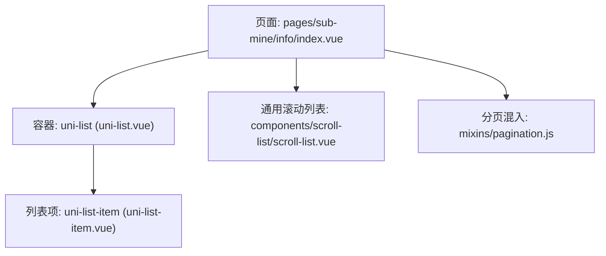
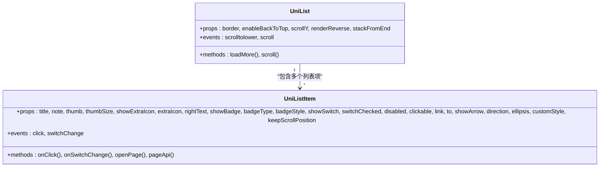
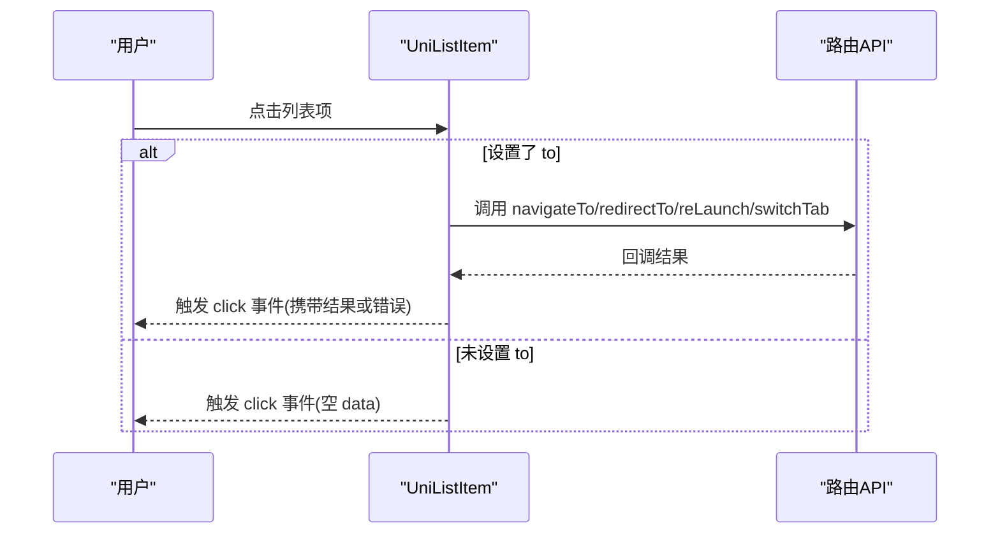
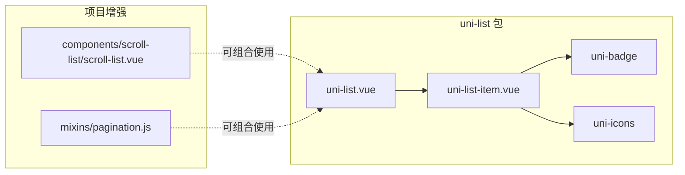
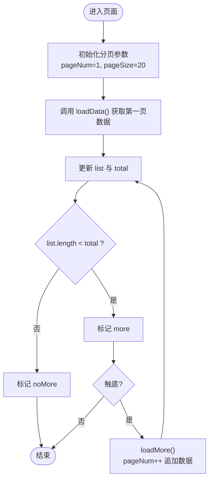
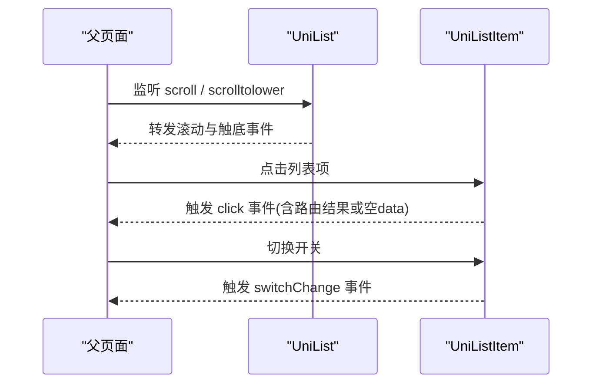

# uni-list列表组件

<cite>
**本文引用的文件**   
- [uni_modules/uni-list/readme.md](file://uni_modules/uni-list/readme.md)
- [uni_modules/uni-list/package.json](file://uni_modules/uni-list/package.json)
- [uni_modules/uni-list/components/uni-list/uni-list.vue](file://uni_modules/uni-list/components/uni-list/uni-list.vue)
- [uni_modules/uni-list/components/uni-list-item/uni-list-item.vue](file://uni_modules/uni-list/components/uni-list-item/uni-list-item.vue)
- [pages/sub-mine/info/index.vue](file://pages/sub-mine/info/index.vue)
- [components/scroll-list/scroll-list.vue](file://components/scroll-list/scroll-list.vue)
- [mixins/pagination.js](file://mixins/pagination.js)
</cite>

## 目录
1. [简介](#简介)
2. [项目结构](#项目结构)
3. [核心组件](#核心组件)
4. [架构总览](#架构总览)
5. [详细组件分析](#详细组件分析)
6. [依赖关系分析](#依赖关系分析)
7. [性能与长列表优化](#性能与长列表优化)
8. [交互能力与事件处理](#交互能力与事件处理)
9. [数据绑定与状态管理最佳实践](#数据绑定与状态管理最佳实践)
10. [故障排查指南](#故障排查指南)
11. [结论](#结论)
12. [附录：常用属性速查](#附录常用属性速查)

## 简介
本文件围绕 uni-list 列表组件，提供从安装配置、基础用法到高级优化的完整文档。重点覆盖：
- 列表容器 uni-list 与列表项 uni-list-item 的属性、插槽与样式定制
- 长列表性能优化方案（原生 list 渲染、虚拟滚动思路、分页加载）
- 交互能力（点击、跳转、开关切换等）
- 数据绑定、状态管理与事件处理的最佳实践

## 项目结构
在仓库中，uni-list 以 uni_modules 形式引入，包含容器与子项两个核心组件；项目中存在一个使用示例页面，以及通用的下拉刷新/上拉加载更多封装和分页混入，便于组合实现长列表体验。

图表来源
- [pages/sub-mine/info/index.vue:1-45](file://pages/sub-mine/info/index.vue#L1-L45)
- [uni_modules/uni-list/components/uni-list/uni-list.vue:1-124](file://uni_modules/uni-list/components/uni-list/uni-list.vue#L1-L124)
- [uni_modules/uni-list/components/uni-list-item/uni-list-item.vue:1-534](file://uni_modules/uni-list/components/uni-list-item/uni-list-item.vue#L1-L534)
- [components/scroll-list/scroll-list.vue:1-666](file://components/scroll-list/scroll-list.vue#L1-L666)
- [mixins/pagination.js:1-125](file://mixins/pagination.js#L1-L125)

章节来源
- [uni_modules/uni-list/readme.md:1-46](file://uni_modules/uni-list/readme.md#L1-L46)
- [uni_modules/uni-list/package.json:1-91](file://uni_modules/uni-list/package.json#L1-L91)
- [pages/sub-mine/info/index.vue:1-45](file://pages/sub-mine/info/index.vue#L1-L45)

## 核心组件
- uni-list：列表容器，负责在不同平台选择合适滚动方式（Vue 端使用 view 布局，nvue 端使用原生 list），并提供边框、回顶、滚动事件等能力。
- uni-list-item：列表项，支持标题、备注、缩略图、扩展图标、角标、右侧文字、开关、箭头导航、禁用态、点击反馈、自定义内边距与背景色等。

章节来源
- [uni_modules/uni-list/components/uni-list/uni-list.vue:1-124](file://uni_modules/uni-list/components/uni-list/uni-list.vue#L1-L124)
- [uni_modules/uni-list/components/uni-list-item/uni-list-item.vue:1-534](file://uni_modules/uni-list/components/uni-list-item/uni-list-item.vue#L1-L534)

## 架构总览
uni-list 的渲染策略：
- Vue 端：使用 view 容器 + Flex 布局，默认走页面级滚动。
- nvue 端：使用原生 list 组件，具备更好的长列表性能与内存回收机制。

图表来源
- [uni_modules/uni-list/components/uni-list/uni-list.vue:1-124](file://uni_modules/uni-list/components/uni-list/uni-list.vue#L1-L124)
- [uni_modules/uni-list/components/uni-list-item/uni-list-item.vue:1-534](file://uni_modules/uni-list/components/uni-list-item/uni-list-item.vue#L1-L534)

## 详细组件分析

### uni-list 容器
- 平台差异
  - Vue 端：view 容器，通过 CSS 绘制上下边框线。
  - nvue 端：原生 list，开启滚动、滚动条显示、回顶、底部触发阈值等。
- 关键属性
  - border：是否显示上下边框
  - enableBackToTop：是否允许快速回到顶部（nvue）
  - scrollY：是否允许纵向滚动（nvue）
  - renderReverse：反向渲染（nvue）
  - stackFromEnd：从末尾堆叠（nvue）
- 事件
  - scrolltolower：触底事件（nvue 内部转发）
  - scroll：滚动事件（nvue 内部转发）

章节来源
- [uni_modules/uni-list/components/uni-list/uni-list.vue:1-124](file://uni_modules/uni-list/components/uni-list/uni-list.vue#L1-L124)

### uni-list-item 列表项
- 展示能力
  - 左侧：缩略图（thumb/thumSize）、扩展图标（showExtraIcon/extraIcon）
  - 中间：标题（title）、备注（note）、省略行数（ellipsis）
  - 右侧：文本（rightText）、角标（showBadge/badgeType/badgeStyle）、开关（showSwitch/switchChecked）
  - 导航：箭头（showArrow/link）、路由跳转（to/link 类型）
- 交互能力
  - 点击反馈（clickable/link）
  - 点击事件（click）
  - 开关切换事件（switchChange）
- 样式定制
  - 方向（direction=row/column）
  - 内边距与背景色（customStyle.padding/customStyle.backgroundColor）
  - 禁用态（disabled）
  - 首项边框控制（isFirstChild 逻辑）

图表来源
- [uni_modules/uni-list/components/uni-list-item/uni-list-item.vue:265-316](file://uni_modules/uni-list/components/uni-list-item/uni-list-item.vue#L265-L316)

章节来源
- [uni_modules/uni-list/components/uni-list-item/uni-list-item.vue:1-534](file://uni_modules/uni-list/components/uni-list-item/uni-list-item.vue#L1-L534)

### 使用示例（信息页）
- 页面中使用 uni-list 包裹多个 uni-list-item，展示用户基本信息。
- 通过 showExtraIcon 与 extraIcon 展示小图标，配合 title 与 rightText 呈现键值对信息。

章节来源
- [pages/sub-mine/info/index.vue:1-45](file://pages/sub-mine/info/index.vue#L1-L45)

## 依赖关系分析
- uni-list 依赖 uni-badge 与 uni-icons（用于角标与图标展示）。
- uni-list-item 内部使用 uni-icons 与 uni-badge 进行渲染。
- 项目中的通用滚动列表与分页混入可作为增强能力，与 uni-list 组合使用。

图表来源
- [uni_modules/uni-list/package.json:41-46](file://uni_modules/uni-list/package.json#L41-L46)
- [uni_modules/uni-list/components/uni-list-item/uni-list-item.vue:1-534](file://uni_modules/uni-list/components/uni-list-item/uni-list-item.vue#L1-L534)
- [components/scroll-list/scroll-list.vue:1-666](file://components/scroll-list/scroll-list.vue#L1-L666)
- [mixins/pagination.js:1-125](file://mixins/pagination.js#L1-L125)

章节来源
- [uni_modules/uni-list/package.json:1-91](file://uni_modules/uni-list/package.json#L1-L91)

## 性能与长列表优化
- 原生渲染优势（nvue）
  - 在 app-nvue 环境下，uni-list 使用原生 list 组件，滚动出屏幕后系统会回收不可见区域渲染资源，避免“越滚越卡”。
- 虚拟滚动思路
  - 官方说明指出“长列表性能优化”，但未内置虚拟滚动组件。若需极致性能，可在外层使用第三方虚拟滚动容器（如 uview-ui 的 u-virtual-list）包裹 uni-list 内容，仅渲染可视区项。
- 分页加载
  - 结合项目提供的分页混入与通用滚动列表，可实现“上拉加载更多”和“下拉刷新”的标准体验。
  - 推荐模式：使用 scroll-list 作为滚动容器，监听其 load/refresh 事件，调用 loadData 接口并更新 list 数据；当 list.length >= total 时停止加载更多。

图表来源
- [mixins/pagination.js:1-125](file://mixins/pagination.js#L1-L125)
- [components/scroll-list/scroll-list.vue:132-191](file://components/scroll-list/scroll-list.vue#L132-L191)

章节来源
- [uni_modules/uni-list/readme.md:7-22](file://uni_modules/uni-list/readme.md#L7-L22)
- [components/scroll-list/scroll-list.vue:1-666](file://components/scroll-list/scroll-list.vue#L1-L666)
- [mixins/pagination.js:1-125](file://mixins/pagination.js#L1-L125)

## 交互能力与事件处理
- 点击与跳转
  - 通过 clickable/link 开启点击反馈；设置 to 与 link 类型可自动调用路由 API，并在 click 事件中返回成功或失败结果。
- 开关切换
  - 通过 showSwitch/switchChecked 启用开关，监听 switchChange 事件处理状态变更。
- 滚动与触底
  - 在 nvue 下，uni-list 转发 scroll 与 scrolltolower 事件；也可结合 scroll-list 统一处理上拉加载。

图表来源
- [uni_modules/uni-list/components/uni-list/uni-list.vue:61-68](file://uni_modules/uni-list/components/uni-list/uni-list.vue#L61-L68)
- [uni_modules/uni-list/components/uni-list-item/uni-list-item.vue:265-316](file://uni_modules/uni-list/components/uni-list-item/uni-list-item.vue#L265-L316)

章节来源
- [uni_modules/uni-list/components/uni-list/uni-list.vue:1-124](file://uni_modules/uni-list/components/uni-list/uni-list.vue#L1-L124)
- [uni_modules/uni-list/components/uni-list-item/uni-list-item.vue:1-534](file://uni_modules/uni-list/components/uni-list-item/uni-list-item.vue#L1-L534)

## 数据绑定与状态管理最佳实践
- 数据驱动
  - 将列表数据置于 data 或 store 中，通过 v-for 渲染 uni-list-item，确保 key 唯一且稳定。
- 状态集中管理
  - 使用分页混入统一管理 pageNum、pageSize、total、loading、loadStatus 等状态，减少重复逻辑。
- 事件解耦
  - 将网络请求封装为 loadData 方法，由 refresh/loadMore 统一调度，页面只关注 UI 状态与业务结果。
- 样式定制
  - 通过 customStyle.padding 与 customStyle.backgroundColor 调整行高与背景；注意 padding 支持单值、双值、四值语法。
- 首项边框
  - 首个子项会自动处理首项边框，避免多余上边框；如需自定义，可通过 slot 扩展 header/body/footer。

章节来源
- [mixins/pagination.js:1-125](file://mixins/pagination.js#L1-L125)
- [uni_modules/uni-list/components/uni-list-item/uni-list-item.vue:175-228](file://uni_modules/uni-list/components/uni-list-item/uni-list-item.vue#L175-L228)

## 故障排查指南
- 点击无响应
  - 检查 clickable/link 是否开启；若设置了 to，确认 link 类型与目标页面路径正确。
- 开关不生效
  - 确认 showSwitch 与 switchChecked 绑定正确，并监听 switchChange 事件更新状态。
- 触底不触发
  - 在 nvue 下确认 uni-list 的 scrolltolower 事件是否被捕获；或在 H5/小程序下改用 scroll-list 的 @scrolltolower 与 load 流程。
- 样式异常
  - 检查 customStyle.padding 格式是否正确；注意首项边框由 isFirstChild 控制，避免重复添加上边框。

章节来源
- [uni_modules/uni-list/components/uni-list-item/uni-list-item.vue:265-316](file://uni_modules/uni-list/components/uni-list-item/uni-list-item.vue#L265-L316)
- [components/scroll-list/scroll-list.vue:345-349](file://components/scroll-list/scroll-list.vue#L345-L349)

## 结论
uni-list 提供了跨端一致的列表基础能力，并通过 nvue 原生 list 获得长列表性能保障。结合项目中的 scroll-list 与 pagination 混入，可以高效构建具备下拉刷新与上拉加载的长列表页面。对于更复杂的交互（如滑动操作、拖拽排序），建议基于 uni-list-item 的插槽机制自行扩展或使用第三方手势库。

## 附录：常用属性速查
- uni-list
  - border：是否显示上下边框
  - enableBackToTop：是否允许回到顶部（nvue）
  - scrollY：是否允许纵向滚动（nvue）
  - renderReverse：反向渲染（nvue）
  - stackFromEnd：从末尾堆叠（nvue）
- uni-list-item
  - title/note：主标题与副标题
  - thumb/thumbSize：缩略图与尺寸
  - showExtraIcon/extraIcon：扩展图标
  - rightText：右侧文本
  - showBadge/badgeType/badgeStyle：角标
  - showSwitch/switchChecked：开关
  - disabled/clickable/link/to/showArrow：禁用、点击反馈、跳转、箭头
  - direction：排版方向
  - ellipsis：文本省略行数
  - customStyle：内边距与背景色
  - keepScrollPosition：保持滚动位置（nvue）

章节来源
- [uni_modules/uni-list/components/uni-list/uni-list.vue:31-52](file://uni_modules/uni-list/components/uni-list/uni-list.vue#L31-L52)
- [uni_modules/uni-list/components/uni-list-item/uni-list-item.vue:85-192](file://uni_modules/uni-list/components/uni-list-item/uni-list-item.vue#L85-L192)