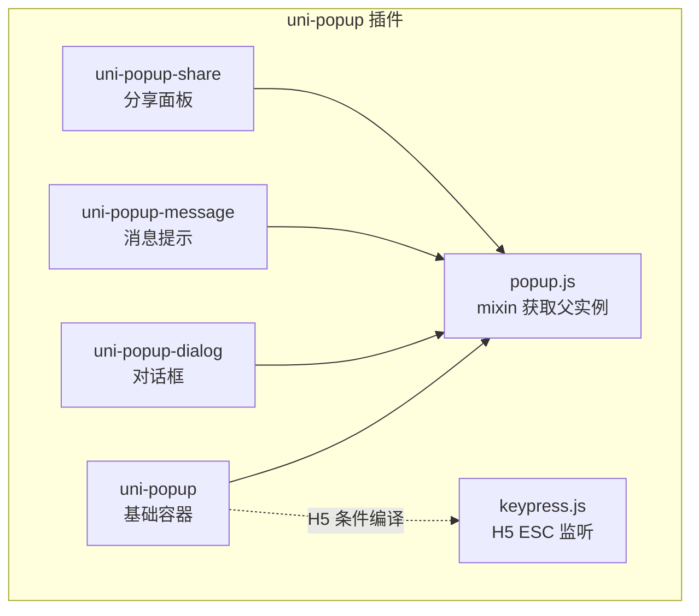
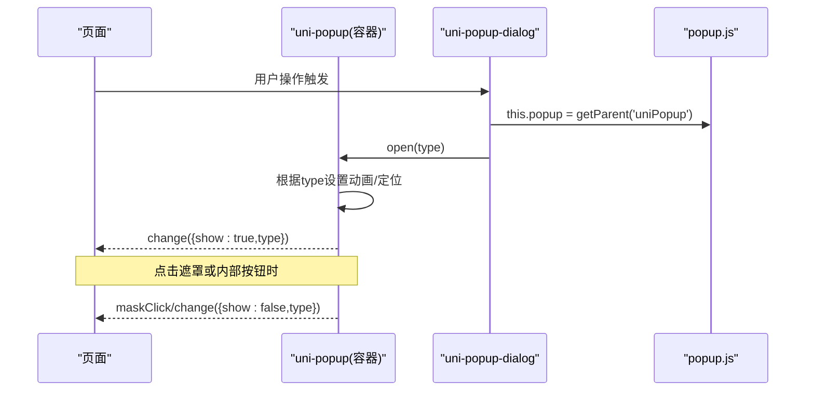
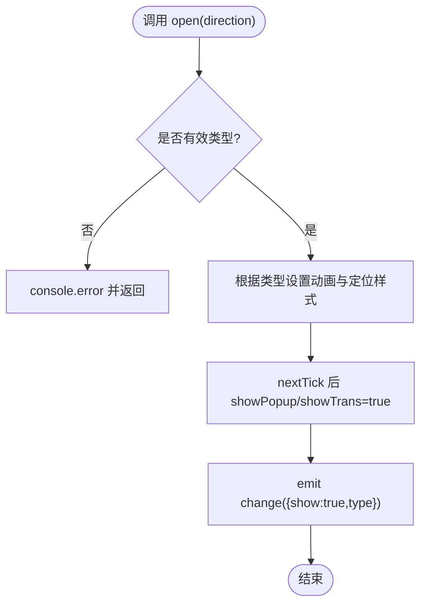
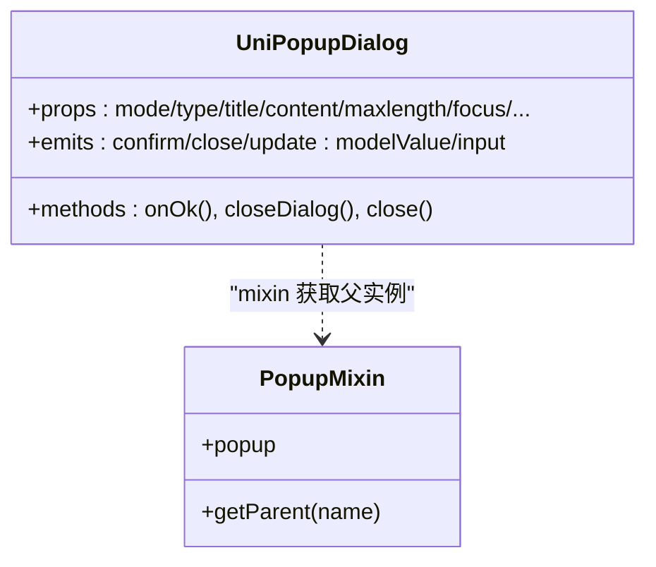
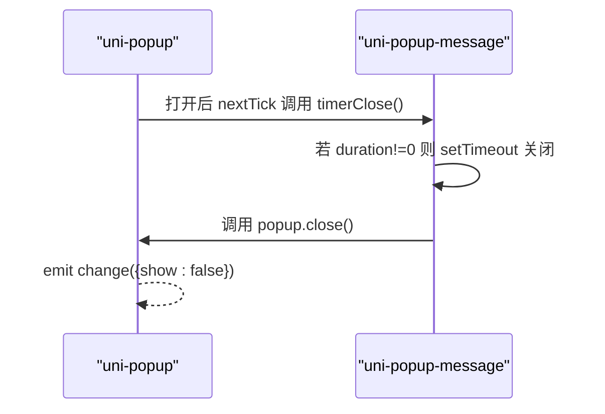
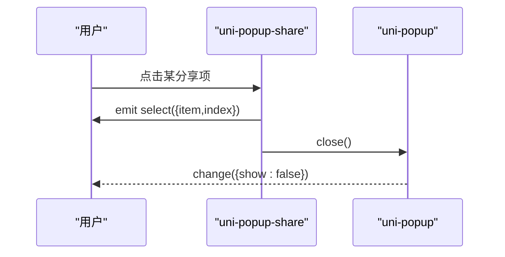
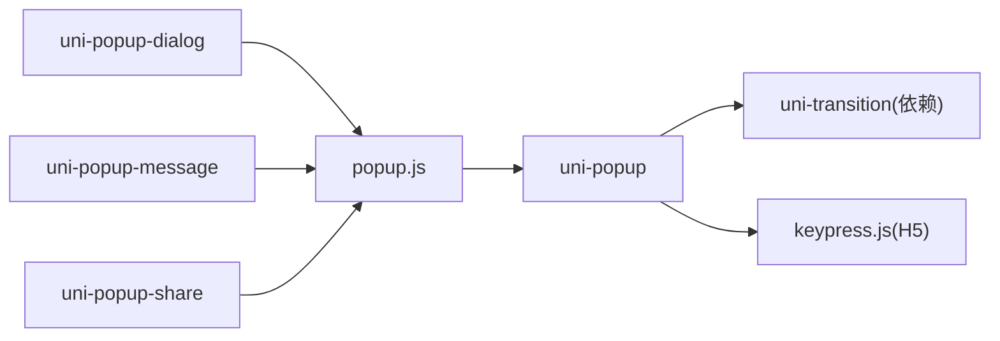

# uni-popup弹窗组件

<cite>
**本文引用的文件**   
- [uni_modules/uni-popup/readme.md](file://uni_modules/uni-popup/readme.md)
- [uni_modules/uni-popup/package.json](file://uni_modules/uni-popup/package.json)
- [uni_modules/uni-popup/components/uni-popup/uni-popup.vue](file://uni_modules/uni-popup/components/uni-popup/uni-popup.vue)
- [uni_modules/uni-popup/components/uni-popup/popup.js](file://uni_modules/uni-popup/components/uni-popup/popup.js)
- [uni_modules/uni-popup/components/uni-popup/keypress.js](file://uni_modules/uni-popup/components/uni-popup/keypress.js)
- [uni_modules/uni-popup/components/uni-popup-dialog/uni-popup-dialog.vue](file://uni_modules/uni-popup/components/uni-popup-dialog/uni-popup-dialog.vue)
- [uni_modules/uni-popup/components/uni-popup-message/uni-popup-message.vue](file://uni_modules/uni-popup/components/uni-popup-message/uni-popup-message.vue)
- [uni_modules/uni-popup/components/uni-popup-share/uni-popup-share.vue](file://uni_modules/uni-popup/components/uni-popup-share/uni-popup-share.vue)
- [pages/sub-work/stuinfo/index.vue](file://pages/sub-work/stuinfo/index.vue)
</cite>

## 目录
1. [简介](#简介)
2. [项目结构](#项目结构)
3. [核心组件与类型](#核心组件与类型)
4. [架构总览](#架构总览)
5. [详细组件分析](#详细组件分析)
6. [依赖关系分析](#依赖关系分析)
7. [性能与移动端适配](#性能与移动端适配)
8. [常见问题排查](#常见问题排查)
9. [结论](#结论)

## 简介
本文件围绕 uni-ui 提供的 uni-popup 弹出层组件，系统化说明其安装配置、基础用法、内置类型（对话框、消息提示、分享面板）、动画与定位、遮罩层配置、生命周期与事件机制，以及性能优化与移动端适配最佳实践。文档内容均基于仓库内源码与示例页面的实际实现进行提炼，便于快速上手与深入理解。

## 项目结构
uni-popup 以 uni_modules 插件形式提供，包含基础容器与多种业务型子组件：
- 基础容器：uni-popup（负责遮罩、动画、定位、尺寸与安全区适配）
- 内置类型：
  - uni-popup-dialog（对话框，支持基础与输入模式）
  - uni-popup-message（消息提示，支持自动关闭）
  - uni-popup-share（底部分享面板）
- 辅助能力：
  - popup.js（通过 mixin 获取父级 uniPopup 实例）
  - keypress.js（H5 下 ESC 键关闭）

图表来源
- [uni_modules/uni-popup/components/uni-popup/uni-popup.vue:1-519](file://uni_modules/uni-popup/components/uni-popup/uni-popup.vue#L1-L519)
- [uni_modules/uni-popup/components/uni-popup/popup.js:1-27](file://uni_modules/uni-popup/components/uni-popup/popup.js#L1-L27)
- [uni_modules/uni-popup/components/uni-popup/keypress.js:1-46](file://uni_modules/uni-popup/components/uni-popup/keypress.js#L1-L46)

章节来源
- [uni_modules/uni-popup/readme.md:1-18](file://uni_modules/uni-popup/readme.md#L1-L18)
- [uni_modules/uni-popup/package.json:1-91](file://uni_modules/uni-popup/package.json#L1-L91)

## 核心组件与类型
- 基础容器 uni-popup
  - 作用：统一处理遮罩、动画、定位、安全区适配、H5 滚动穿透修复等
  - 关键属性：type、animation、isMaskClick/maskClick、backgroundColor、maskBackgroundColor、borderRadius、safeArea
  - 关键方法：open(direction)、close()
  - 事件：change、maskClick
- 内置类型
  - uni-popup-dialog：主题样式、基础/输入两种模式、确认/取消事件、可拦截关闭
  - uni-popup-message：成功/警告/信息/错误主题、自动关闭时长控制、可隐藏遮罩
  - uni-popup-share：底部分享面板，选择项触发 select 事件

章节来源
- [uni_modules/uni-popup/components/uni-popup/uni-popup.vue:56-93](file://uni_modules/uni-popup/components/uni-popup/uni-popup.vue#L56-L93)
- [uni_modules/uni-popup/components/uni-popup/uni-popup.vue:300-331](file://uni_modules/uni-popup/components/uni-popup/uni-popup.vue#L300-L331)
- [uni_modules/uni-popup/components/uni-popup-dialog/uni-popup-dialog.vue:61-128](file://uni_modules/uni-popup/components/uni-popup-dialog/uni-popup-dialog.vue#L61-L128)
- [uni_modules/uni-popup/components/uni-popup-message/uni-popup-message.vue:26-55](file://uni_modules/uni-popup/components/uni-popup-message/uni-popup-message.vue#L26-L55)
- [uni_modules/uni-popup/components/uni-popup-share/uni-popup-share.vue:26-39](file://uni_modules/uni-popup/components/uni-popup-share/uni-popup-share.vue#L26-L39)

## 架构总览
uni-popup 采用“容器 + 子组件”的协作模式：子组件通过 mixin 向上查找父级 uniPopup 实例，调用 open/close 等方法完成显示与关闭；容器负责渲染遮罩与内容区域，并根据 type 计算动画与定位样式。

图表来源
- [uni_modules/uni-popup/components/uni-popup/uni-popup.vue:300-331](file://uni_modules/uni-popup/components/uni-popup/uni-popup.vue#L300-L331)
- [uni_modules/uni-popup/components/uni-popup/popup.js:8-24](file://uni_modules/uni-popup/components/uni-popup/popup.js#L8-L24)

## 详细组件分析

### 基础容器 uni-popup
- 功能要点
  - 支持 top/center/bottom/left/right/message/dialog/share 等多种弹出方式
  - 使用 uni-transition 驱动动画，duration 由 animation 控制
  - 遮罩层颜色、圆角、背景色均可配置
  - 自动计算窗口宽高与安全区，适配底部安全区
  - H5 下禁止 body 滚动，避免滚动穿透
  - 暴露 change 与 maskClick 事件
- 关键流程
  - open(direction)：校验类型后调用对应定位方法，触发 change(show=true)
  - close()：先触发 change(show=false)，延迟隐藏 DOM
  - onTap()：处理遮罩点击，若允许则关闭并触发 maskClick
  - mounted/created：初始化尺寸、安全区、遮罩行为与动画时长
- 典型属性与方法路径
  - 属性定义：[uni-popup.vue:56-93](file://uni_modules/uni-popup/components/uni-popup/uni-popup.vue#L56-L93)
  - 打开/关闭逻辑：[uni-popup.vue:300-331](file://uni_modules/uni-popup/components/uni-popup/uni-popup.vue#L300-L331)
  - 遮罩点击处理：[uni-popup.vue:337-346](file://uni_modules/uni-popup/components/uni-popup/uni-popup.vue#L337-L346)
  - 尺寸与安全区初始化：[uni-popup.vue:193-236](file://uni_modules/uni-popup/components/uni-popup/uni-popup.vue#L193-L236)
  - H5 滚动修复：[uni-popup.vue:130-135](file://uni_modules/uni-popup/components/uni-popup/uni-popup.vue#L130-L135)

图表来源
- [uni_modules/uni-popup/components/uni-popup/uni-popup.vue:300-331](file://uni_modules/uni-popup/components/uni-popup/uni-popup.vue#L300-L331)
- [uni_modules/uni-popup/components/uni-popup/uni-popup.vue:458-463](file://uni_modules/uni-popup/components/uni-popup/uni-popup.vue#L458-L463)

章节来源
- [uni_modules/uni-popup/components/uni-popup/uni-popup.vue:1-519](file://uni_modules/uni-popup/components/uni-popup/uni-popup.vue#L1-L519)

### 对话框 uni-popup-dialog
- 功能要点
  - 支持 base（纯文本）与 input（可输入）两种模式
  - 支持主题 success/warning/info/error
  - 支持 beforeClose 拦截关闭，confirm/close 事件回调
  - 输入模式下支持 maxlength、focus、placeholder 等
- 交互流程
  - created 中禁用遮罩点击（防止误触），并初始化 dialogType
  - onOk/closeDialog 触发 confirm/close 事件，必要时调用父级 close()
- 关键路径
  - 属性与事件：[uni-popup-dialog.vue:61-128](file://uni_modules/uni-popup/components/uni-popup-dialog/uni-popup-dialog.vue#L61-L128)
  - 创建期行为：[uni-popup-dialog.vue:176-189](file://uni_modules/uni-popup/components/uni-popup-dialog/uni-popup-dialog.vue#L176-L189)
  - 确认/取消逻辑：[uni-popup-dialog.vue:194-213](file://uni_modules/uni-popup/components/uni-popup-dialog/uni-popup-dialog.vue#L194-L213)

图表来源
- [uni_modules/uni-popup/components/uni-popup-dialog/uni-popup-dialog.vue:61-128](file://uni_modules/uni-popup/components/uni-popup-dialog/uni-popup-dialog.vue#L61-L128)
- [uni_modules/uni-popup/components/uni-popup/popup.js:1-27](file://uni_modules/uni-popup/components/uni-popup/popup.js#L1-L27)

章节来源
- [uni_modules/uni-popup/components/uni-popup-dialog/uni-popup-dialog.vue:1-317](file://uni_modules/uni-popup/components/uni-popup-dialog/uni-popup-dialog.vue#L1-L317)

### 消息提示 uni-popup-message
- 功能要点
  - 主题 success/warning/info/error
  - duration 控制自动关闭时间，为 0 表示不自动关闭
  - 可通过 maskShow 控制是否显示遮罩
- 生命周期
  - created 中将自身挂载到父级 messageChild，以便容器在打开时触发 timerClose
- 关键路径
  - 属性与定时器：[uni-popup-message.vue:26-71](file://uni_modules/uni-popup/components/uni-popup-message/uni-popup-message.vue#L26-L71)
  - 容器侧触发自动关闭：[uni-popup.vue:364-369](file://uni_modules/uni-popup/components/uni-popup/uni-popup.vue#L364-L369)

图表来源
- [uni_modules/uni-popup/components/uni-popup-message/uni-popup-message.vue:59-71](file://uni_modules/uni-popup/components/uni-popup-message/uni-popup-message.vue#L59-L71)
- [uni_modules/uni-popup/components/uni-popup/uni-popup.vue:364-369](file://uni_modules/uni-popup/components/uni-popup/uni-popup.vue#L364-L369)

章节来源
- [uni_modules/uni-popup/components/uni-popup-message/uni-popup-message.vue:1-144](file://uni_modules/uni-popup/components/uni-popup-message/uni-popup-message.vue#L1-L144)

### 分享面板 uni-popup-share
- 功能要点
  - 底部弹出，展示分享项列表，点击触发 select(item,index)
  - 支持 beforeClose 拦截关闭
- 关键路径
  - 数据与事件：[uni-popup-share.vue:26-104](file://uni_modules/uni-popup/components/uni-popup-share/uni-popup-share.vue#L26-L104)

图表来源
- [uni_modules/uni-popup/components/uni-popup-share/uni-popup-share.vue:85-104](file://uni_modules/uni-popup/components/uni-popup-share/uni-popup-share.vue#L85-L104)
- [uni_modules/uni-popup/components/uni-popup/uni-popup.vue:319-331](file://uni_modules/uni-popup/components/uni-popup/uni-popup.vue#L319-L331)

章节来源
- [uni_modules/uni-popup/components/uni-popup-share/uni-popup-share.vue:1-189](file://uni_modules/uni-popup/components/uni-popup-share/uni-popup-share.vue#L1-L189)

### 使用示例（来自项目页面）
- 在页面中使用 uni-popup 作为底部弹窗承载自定义内容，并通过 ref 调用 open/close
- 参考路径
  - 模板中使用：[pages/sub-work/stuinfo/index.vue:393-447](file://pages/sub-work/stuinfo/index.vue#L393-L447)
  - 打开弹窗方法：[pages/sub-work/stuinfo/index.vue:586-589](file://pages/sub-work/stuinfo/index.vue#L586-L589)

章节来源
- [pages/sub-work/stuinfo/index.vue:393-447](file://pages/sub-work/stuinfo/index.vue#L393-L447)
- [pages/sub-work/stuinfo/index.vue:586-589](file://pages/sub-work/stuinfo/index.vue#L586-L589)

## 依赖关系分析
- 组件间依赖
  - 子组件通过 mixin 获取父级 uniPopup 实例，形成松耦合的父子通信
  - 容器依赖 uni-transition 驱动动画（由插件声明依赖）
  - H5 平台引入 keypress 用于 ESC 关闭
- 外部依赖
  - uni-scss、uni-transition（见 package.json）
  - @dcloudio/uni-i18n（国际化文案）

图表来源
- [uni_modules/uni-popup/components/uni-popup/popup.js:1-27](file://uni_modules/uni-popup/components/uni-popup/popup.js#L1-L27)
- [uni_modules/uni-popup/components/uni-popup/keypress.js:1-46](file://uni_modules/uni-popup/components/uni-popup/keypress.js#L1-L46)
- [uni_modules/uni-popup/package.json:40-44](file://uni_modules/uni-popup/package.json#L40-L44)

章节来源
- [uni_modules/uni-popup/package.json:1-91](file://uni_modules/uni-popup/package.json#L1-L91)

## 性能与移动端适配
- 动画与过渡
  - 通过 animation 控制 duration，默认 300ms；关闭时使用 setTimeout 延迟隐藏 DOM，减少重排
  - 不同平台差异化动画策略（如微信小程序下组合动画特殊处理）
- 遮罩与层级
  - 桌面端提升 z-index，避免被其他元素遮挡
  - 遮罩点击可配置，避免误触导致频繁打开/关闭
- 安全区适配
  - 自动读取系统信息，计算 safeAreaInsets，底部弹窗增加 paddingBottom 适配刘海屏
- H5 滚动穿透修复
  - 打开时设置 body overflow:hidden，关闭/销毁时恢复 visible
- 建议
  - 复杂内容尽量懒加载，避免一次性渲染大量节点
  - 合理设置 duration，兼顾体验与性能
  - 对长列表使用虚拟滚动或分页加载

章节来源
- [uni_modules/uni-popup/components/uni-popup/uni-popup.vue:130-135](file://uni_modules/uni-popup/components/uni-popup/uni-popup.vue#L130-L135)
- [uni_modules/uni-popup/components/uni-popup/uni-popup.vue:193-236](file://uni_modules/uni-popup/components/uni-popup/uni-popup.vue#L193-L236)
- [uni_modules/uni-popup/components/uni-popup/uni-popup.vue:319-331](file://uni_modules/uni-popup/components/uni-popup/uni-popup.vue#L319-L331)
- [uni_modules/uni-popup/components/uni-popup/uni-popup.vue:467-518](file://uni_modules/uni-popup/components/uni-popup/uni-popup.vue#L467-L518)

## 常见问题排查
- 遮罩点击无效或意外关闭
  - 检查 isMaskClick/maskClick 配置；对话框默认禁用遮罩点击
  - 参考：[uni-popup-dialog.vue:176-189](file://uni_modules/uni-popup/components/uni-popup-dialog/uni-popup-dialog.vue#L176-L189)
- 自动关闭未生效
  - 确认 message 组件的 duration 不为 0；容器会在打开后调用 timerClose
  - 参考：[uni-popup-message.vue:59-71](file://uni_modules/uni-popup/components/uni-popup-message/uni-popup-message.vue#L59-L71)
- H5 页面滚动穿透
  - 确认容器已正确设置 body overflow；组件已在 mounted/watch/unmounted 中处理
  - 参考：[uni-popup.vue:130-135](file://uni_modules/uni-popup/components/uni-popup/uni-popup.vue#L130-L135)
- ESC 无法关闭
  - 仅在 H5 平台启用 keypress 监听；确保未在其它地方阻止冒泡
  - 参考：[keypress.js:1-46](file://uni_modules/uni-popup/components/uni-popup/keypress.js#L1-L46)

章节来源
- [uni_modules/uni-popup/components/uni-popup-dialog/uni-popup-dialog.vue:176-189](file://uni_modules/uni-popup/components/uni-popup-dialog/uni-popup-dialog.vue#L176-L189)
- [uni_modules/uni-popup/components/uni-popup-message/uni-popup-message.vue:59-71](file://uni_modules/uni-popup/components/uni-popup-message/uni-popup-message.vue#L59-L71)
- [uni_modules/uni-popup/components/uni-popup/uni-popup.vue:130-135](file://uni_modules/uni-popup/components/uni-popup/uni-popup.vue#L130-L135)
- [uni_modules/uni-popup/components/uni-popup/keypress.js:1-46](file://uni_modules/uni-popup/components/uni-popup/keypress.js#L1-L46)

## 结论
uni-popup 提供了统一的弹层容器与常用类型组件，具备完善的动画、定位、遮罩与安全区适配能力。通过 mixin 解耦父子通信，既保证了易用性，也便于扩展。结合项目中的实际使用示例，可以快速落地各类弹窗场景，并在多端环境下获得一致体验。