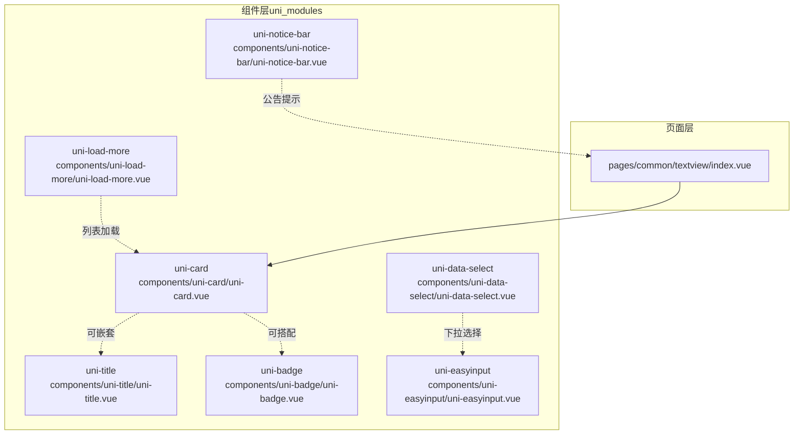
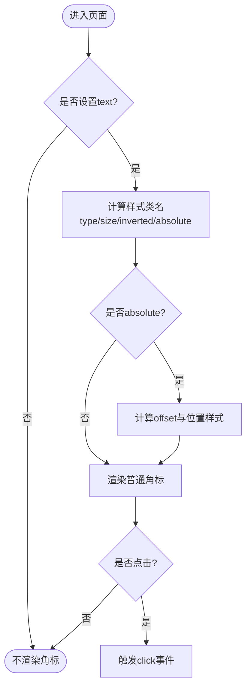
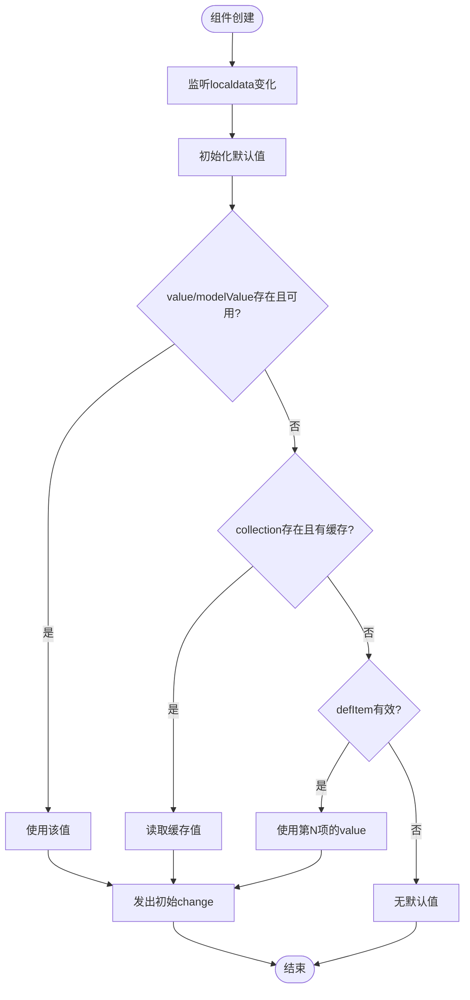
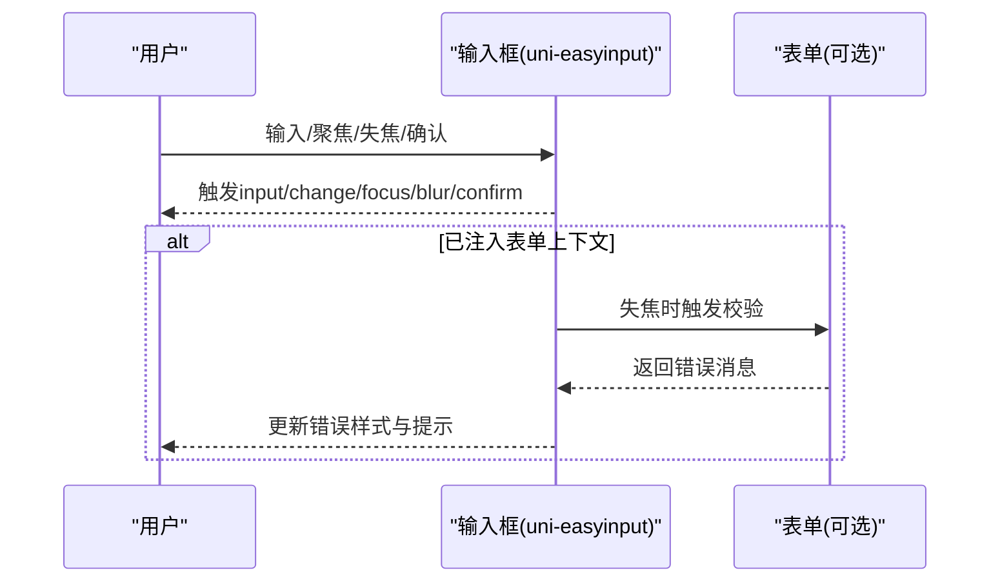
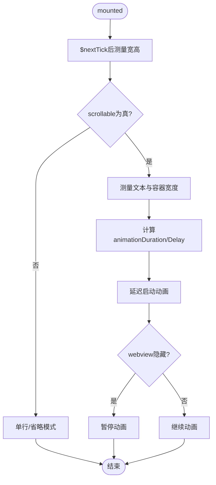
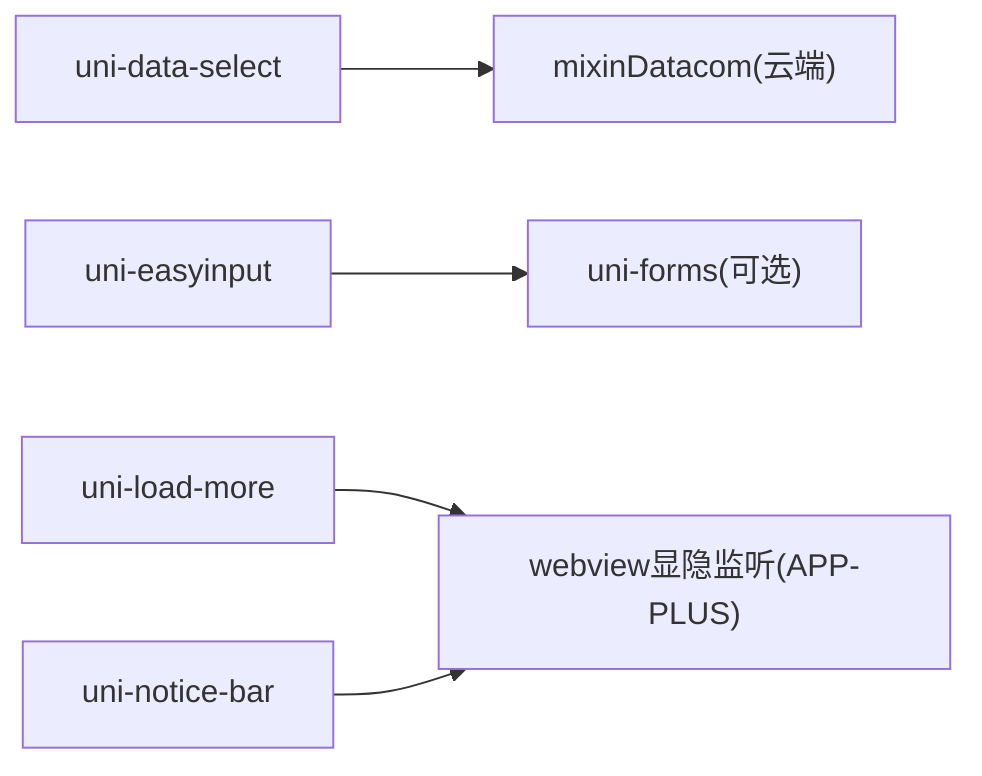

# 其他uni-app官方组件

<cite>
**本文引用的文件**   
- [uni-badge.vue](file://uni_modules/uni-badge/components/uni-badge/uni-badge.vue)
- [uni-card.vue](file://uni_modules/uni-card/components/uni-card/uni-card.vue)
- [uni-data-select.vue](file://uni_modules/uni-data-select/components/uni-data-select/uni-data-select.vue)
- [uni-easyinput.vue](file://uni_modules/uni-easyinput/components/uni-easyinput/uni-easyinput.vue)
- [uni-load-more.vue](file://uni_modules/uni-load-more/components/uni-load-more/uni-load-more.vue)
- [uni-notice-bar.vue](file://uni_modules/uni-notice-bar/components/uni-notice-bar/uni-notice-bar.vue)
- [uni-title.vue](file://uni_modules/uni-title/components/uni-title/uni-title.vue)
- [textview/index.vue](file://pages/common/textview/index.vue)
</cite>

## 目录
1. [简介](#简介)
2. [项目结构](#项目结构)
3. [核心组件](#核心组件)
4. [架构总览](#架构总览)
5. [详细组件分析](#详细组件分析)
6. [依赖关系分析](#依赖关系分析)
7. [性能与体验优化](#性能与体验优化)
8. [故障排查指南](#故障排查指南)
9. [结论](#结论)
10. [附录：常用配置速查](#附录常用配置速查)

## 简介
本文件面向在 uni-app 项目中使用的“其他官方组件”，聚焦以下七个组件的安装配置、基本用法、常用属性与事件，以及在实际页面中的组合使用与性能优化建议：
- 徽章 uni-badge
- 卡片 uni-card
- 数据选择器 uni-data-select
- 输入框 uni-easyinput
- 加载更多 uni-load-more
- 通知栏 uni-notice-bar
- 标题 uni-title

这些组件均位于 uni_modules 下，属于 uni-ui 生态。通过按需引入或全局注册即可在项目中使用。

## 项目结构
本项目采用 uni_modules 插件化组织方式，各组件以独立包形式提供，便于复用与维护。示例页面 pages/common/textview/index.vue 展示了 uni-card 的实际使用场景。



图表来源
- [textview/index.vue:1-44](file://pages/common/textview/index.vue#L1-L44)
- [uni-card.vue:1-271](file://uni_modules/uni-card/components/uni-card/uni-card.vue#L1-L271)
- [uni-badge.vue:1-269](file://uni_modules/uni-badge/components/uni-badge/uni-badge.vue#L1-L269)
- [uni-data-select.vue:1-563](file://uni_modules/uni-data-select/components/uni-data-select/uni-data-select.vue#L1-L563)
- [uni-easyinput.vue:1-675](file://uni_modules/uni-easyinput/components/uni-easyinput/uni-easyinput.vue#L1-L675)
- [uni-load-more.vue:1-405](file://uni_modules/uni-load-more/components/uni-load-more/uni-load-more.vue#L1-L405)
- [uni-notice-bar.vue:1-432](file://uni_modules/uni-notice-bar/components/uni-notice-bar/uni-notice-bar.vue#L1-L432)
- [uni-title.vue:1-172](file://uni_modules/uni-title/components/uni-title/uni-title.vue#L1-L172)

章节来源
- [textview/index.vue:1-44](file://pages/common/textview/index.vue#L1-L44)

## 核心组件
本节对每个组件进行安装说明、基础用法、关键属性与事件概览，并给出最佳实践要点。为避免冗长代码，具体实现路径以“章节来源”标注。

### 徽章 uni-badge
- 安装与引入
  - 通过 uni_modules 管理，无需额外安装；在页面中直接使用 <uni-badge>。
- 基本用法
  - 作为角标包裹在其他控件外部，显示数量或状态提示。
- 常用属性
  - text：角标内容
  - type：颜色类型（如 info/primary/success/warning/error）
  - size：尺寸（small/normal）
  - inverted：是否透明背景仅显示文字色
  - isDot：是否显示为小圆点
  - maxNum：数字上限，超过显示 N+
  - absolute：绝对定位位置（rightTop/rightBottom/leftTop/leftBottom）
  - offset：相对定位角的偏移量数组
  - customStyle：自定义样式对象
- 常用事件
  - click：点击角标触发
- 最佳实践
  - 列表项右上角常配合 absolute + offset 微调对齐
  - 大数据量时使用 maxNum 避免过长文本
  - 与图标或按钮组合时注意 z-index 层级

章节来源
- [uni-badge.vue:1-269](file://uni_modules/uni-badge/components/uni-badge/uni-badge.vue#L1-L269)

### 卡片 uni-card
- 安装与引入
  - 通过 uni_modules 管理，直接 <uni-card> 使用。
- 基本用法
  - 用于承载内容区块，支持封面、标题、副标题、缩略图、操作区等插槽。
- 常用属性
  - title/subTitle：主副标题
  - cover/thumbnail：封面图与左侧头像
  - padding/margin/spacing：内容与外边距控制
  - extra：标题右侧扩展信息
  - is-full/is-shadow/border：通栏、阴影、边框开关
  - shadow：自定义阴影样式
- 常用事件
  - click：点击区域回调，返回区域标识（cover/title/content/actions）
- 最佳实践
  - 列表页推荐开启 is-shadow 提升层次
  - 长文本结合 uni-title 统一排版风格
  - actions 插槽内放置按钮或标签

章节来源
- [uni-card.vue:1-271](file://uni_modules/uni-card/components/uni-card/uni-card.vue#L1-L271)
- [textview/index.vue:1-44](file://pages/common/textview/index.vue#L1-L44)

### 数据选择器 uni-data-select
- 安装与引入
  - 通过 uni_modules 管理，直接 <uni-data-select> 使用。
- 基本用法
  - 本地数据 localdata 或云端集合 collection 渲染下拉选项。
- 常用属性
  - value/modelValue：当前选中值（兼容 Vue2/Vue3）
  - localdata：本地数据 [{text, value}]
  - label：左侧标签
  - placeholder：占位提示
  - clear：是否显示清空
  - disabled：禁用
  - placement：弹出方向（top/bottom）
  - format：格式化输出模板
- 常用事件
  - change：选中变化回调
- 最佳实践
  - 大数据集建议使用 collection 并结合分页/筛选
  - 使用 format 定制展示文案
  - 与表单组件联用时注意 v-model 双向绑定

章节来源
- [uni-data-select.vue:1-563](file://uni_modules/uni-data-select/components/uni-data-select/uni-data-select.vue#L1-L563)

### 输入框 uni-easyinput
- 安装与引入
  - 通过 uni_modules 管理，直接 <uni-easyinput> 使用。
- 基本用法
  - 增强型输入框，支持前缀/后缀图标、密码可见切换、清除、校验联动等。
- 常用属性
  - type：text/password/textarea/number/idcard/digit
  - clearable：显示清除图标
  - prefixIcon/suffixIcon：前后图标
  - passwordIcon：密码可见切换
  - placeholder/placeholderStyle：占位符及样式
  - maxlength：最大长度
  - confirmType：键盘右下角按钮文案
  - trim：自动去除空格策略
  - inputBorder：是否显示边框
  - styles：主题色与边框色等
- 常用事件
  - input/change/focus/blur/confirm/clear/iconClick/eyes/keyboardheightchange
- 最佳实践
  - 与 uni-forms 集成时利用其校验能力
  - 移动端注意 adjustPosition 与键盘高度监听
  - 密码输入建议开启 passwordIcon

章节来源
- [uni-easyinput.vue:1-675](file://uni_modules/uni-easyinput/components/uni-easyinput/uni-easyinput.vue#L1-L675)

### 加载更多 uni-load-more
- 安装与引入
  - 通过 uni_modules 管理，直接 <uni-load-more> 使用。
- 基本用法
  - 列表底部加载状态指示，支持多种平台动画与文案。
- 常用属性
  - status：more/loading/noMore
  - showIcon/showText：是否显示图标/文字
  - iconType：snow/circle/auto
  - iconSize/color：图标大小与颜色
  - contentText：多语言文案覆盖
- 常用事件
  - clickLoadMore：点击加载更多触发
- 最佳实践
  - 与滚动容器配合，根据接口返回判断 noMore
  - 隐藏 webview 时自动暂停动画，减少资源消耗

章节来源
- [uni-load-more.vue:1-405](file://uni_modules/uni-load-more/components/uni-load-more/uni-load-more.vue#L1-L405)

### 通知栏 uni-notice-bar
- 安装与引入
  - 通过 uni_modules 管理，直接 <uni-notice-bar> 使用。
- 基本用法
  - 通告栏，支持单行省略与横向滚动，可关闭与“查看更多”。
- 常用属性
  - text：公告文本
  - single/scrollable：单行/滚动模式
  - speed：滚动速度
  - showIcon/showClose/showGetMore：图标与交互开关
  - backgroundColor/color/fontSize/moreColor：外观定制
- 常用事件
  - click/getmore/close
- 最佳实践
  - 长文本启用 scrollable 提升可读性
  - 重要公告可配合 showClose 允许用户关闭

章节来源
- [uni-notice-bar.vue:1-432](file://uni_modules/uni-notice-bar/components/uni-notice-bar/uni-notice-bar.vue#L1-L432)

### 标题 uni-title
- 安装与引入
  - 通过 uni_modules 管理，直接 <uni-title> 使用。
- 基本用法
  - 语义化标题，支持多级标题与统计上报。
- 常用属性
  - type：h1/h2/h3/h4/h5
  - title：标题文本
  - align：left/center/right
  - color：字体颜色
  - stat：是否开启统计上报
- 最佳实践
  - 与卡片组合形成标准内容块
  - 开启统计有助于埋点分析

章节来源
- [uni-title.vue:1-172](file://uni_modules/uni-title/components/uni-title/uni-title.vue#L1-L172)

## 架构总览
下图展示组件在页面中的典型组合关系与数据流向。

```mermaid
sequenceDiagram
participant Page as "页面(textview)"
participant Card as "卡片(uni-card)"
participant Title as "标题(uni-title)"
participant Badge as "徽章(uni-badge)"
participant Select as "选择器(uni-data-select)"
participant Input as "输入框(uni-easyinput)"
participant Load as "加载更多(uni-load-more)"
participant Notice as "通知栏(uni-notice-bar)"
Page->>Card : 渲染卡片区块
Card->>Title : 渲染标题
Card->>Badge : 在标题旁显示角标
Page->>Select : 选择分类/筛选
Select-->>Page : 触发change事件
Page->>Input : 搜索/备注输入
Input-->>Page : 触发input/change
Page->>Load : 列表滚动到底部
Load-->>Page : 触发clickLoadMore
Page->>Notice : 顶部公告提示
Notice-->>Page : 触发getmore/close
```

图表来源
- [textview/index.vue:1-44](file://pages/common/textview/index.vue#L1-L44)
- [uni-card.vue:1-271](file://uni_modules/uni-card/components/uni-card/uni-card.vue#L1-L271)
- [uni-title.vue:1-172](file://uni_modules/uni-title/components/uni-title/uni-title.vue#L1-L172)
- [uni-badge.vue:1-269](file://uni_modules/uni-badge/components/uni-badge/uni-badge.vue#L1-L269)
- [uni-data-select.vue:1-563](file://uni_modules/uni-data-select/components/uni-data-select/uni-data-select.vue#L1-L563)
- [uni-easyinput.vue:1-675](file://uni_modules/uni-easyinput/components/uni-easyinput/uni-easyinput.vue#L1-L675)
- [uni-load-more.vue:1-405](file://uni_modules/uni-load-more/components/uni-load-more/uni-load-more.vue#L1-L405)
- [uni-notice-bar.vue:1-432](file://uni_modules/uni-notice-bar/components/uni-notice-bar/uni-notice-bar.vue#L1-L432)

## 详细组件分析

### 徽章 uni-badge 行为流程


图表来源
- [uni-badge.vue:1-269](file://uni_modules/uni-badge/components/uni-badge/uni-badge.vue#L1-L269)

章节来源
- [uni-badge.vue:1-269](file://uni_modules/uni-badge/components/uni-badge/uni-badge.vue#L1-L269)

### 数据选择器 uni-data-select 初始化与默认值


图表来源
- [uni-data-select.vue:1-563](file://uni_modules/uni-data-select/components/uni-data-select/uni-data-select.vue#L1-L563)

章节来源
- [uni-data-select.vue:1-563](file://uni_modules/uni-data-select/components/uni-data-select/uni-data-select.vue#L1-L563)

### 输入框 uni-easyinput 输入与校验联动


图表来源
- [uni-easyinput.vue:1-675](file://uni_modules/uni-easyinput/components/uni-easyinput/uni-easyinput.vue#L1-L675)

章节来源
- [uni-easyinput.vue:1-675](file://uni_modules/uni-easyinput/components/uni-easyinput/uni-easyinput.vue#L1-L675)

### 通知栏 uni-notice-bar 滚动动画


图表来源
- [uni-notice-bar.vue:1-432](file://uni_modules/uni-notice-bar/components/uni-notice-bar/uni-notice-bar.vue#L1-L432)

章节来源
- [uni-notice-bar.vue:1-432](file://uni_modules/uni-notice-bar/components/uni-notice-bar/uni-notice-bar.vue#L1-L432)

## 依赖关系分析
- 组件间耦合度低，主要通过页面编排组合使用
- uni-data-select 内部混入 uniCloud.mixinDatacom，具备云端数据查询能力
- uni-easyinput 可与 uni-forms 协作完成表单校验
- uni-load-more 与 uni-notice-bar 在 APP-PLUS 环境下会监听 webview 显隐以暂停动画，降低资源占用



图表来源
- [uni-data-select.vue:1-563](file://uni_modules/uni-data-select/components/uni-data-select/uni-data-select.vue#L1-L563)
- [uni-easyinput.vue:1-675](file://uni_modules/uni-easyinput/components/uni-easyinput/uni-easyinput.vue#L1-L675)
- [uni-load-more.vue:1-405](file://uni_modules/uni-load-more/components/uni-load-more/uni-load-more.vue#L1-L405)
- [uni-notice-bar.vue:1-432](file://uni_modules/uni-notice-bar/components/uni-notice-bar/uni-notice-bar.vue#L1-L432)

章节来源
- [uni-data-select.vue:1-563](file://uni_modules/uni-data-select/components/uni-data-select/uni-data-select.vue#L1-L563)
- [uni-easyinput.vue:1-675](file://uni_modules/uni-easyinput/components/uni-easyinput/uni-easyinput.vue#L1-L675)
- [uni-load-more.vue:1-405](file://uni_modules/uni-load-more/components/uni-load-more/uni-load-more.vue#L1-L405)
- [uni-notice-bar.vue:1-432](file://uni_modules/uni-notice-bar/components/uni-notice-bar/uni-notice-bar.vue#L1-L432)

## 性能与体验优化
- 列表加载
  - 合理使用 uni-load-more 的 status 控制 more/loading/noMore，避免重复请求
  - 大数据集优先使用 uni-data-select 的 collection 分页与筛选
- 动画与资源
  - 通知栏与加载更多组件在 APP-PLUS 下会自动暂停不可见动画，建议在复杂页面中减少同时运行的动画数量
- 输入体验
  - 使用 uni-easyinput 的 adjustPosition 与 keyboardheightchange 处理键盘遮挡
  - 合理设置 maxlength 与 trim，减少无效输入与重绘
- 视觉层次
  - 卡片开启阴影提升层次感；徽章使用 absolute + offset 精准定位
  - 标题统一使用 uni-title，保持字号与权重一致

[本节为通用指导，不涉及具体文件分析]

## 故障排查指南
- 选择器未显示数据
  - 检查 localdata 是否为数组格式，或 collection 是否正确配置
  - 确认 defItem 索引是否在数据范围内
- 输入框无法提交或校验不生效
  - 若与表单集成，确保 validateTrigger 为 blur 并在失焦时触发 onFieldChange
  - 检查 errorMessage/localMsg 是否正确传入
- 加载更多无响应
  - 确认 clickLoadMore 事件是否被页面正确监听
  - 检查 status 从 loading 到 noMore 的状态流转逻辑
- 通知栏不滚动
  - 确认 scrollable 为 true，且文本长度大于容器宽度
  - 检查 speed 与 animationDuration/Delay 的计算结果

章节来源
- [uni-data-select.vue:1-563](file://uni_modules/uni-data-select/components/uni-data-select/uni-data-select.vue#L1-L563)
- [uni-easyinput.vue:1-675](file://uni_modules/uni-easyinput/components/uni-easyinput/uni-easyinput.vue#L1-L675)
- [uni-load-more.vue:1-405](file://uni_modules/uni-load-more/components/uni-load-more/uni-load-more.vue#L1-L405)
- [uni-notice-bar.vue:1-432](file://uni_modules/uni-notice-bar/components/uni-notice-bar/uni-notice-bar.vue#L1-L432)

## 结论
上述组件覆盖了常见的 UI 需求：信息提示（badge）、内容组织（card）、数据选择（data-select）、输入交互（easyinput）、列表加载（load-more）、公告提示（notice-bar）与标题规范（title）。通过合理的组合与参数配置，可在保证用户体验的同时提升开发效率。建议在大型项目中建立统一的组件使用规范与样式变量，以提升一致性。

[本节为总结，不涉及具体文件分析]

## 附录：常用配置速查
- 徽章 uni-badge
  - 关键属性：text/type/size/inverted/isDot/maxNum/absolute/offset/customStyle
  - 事件：click
- 卡片 uni-card
  - 关键属性：title/subTitle/cover/thumbnail/padding/margin/spacing/extra/is-full/is-shadow/border/shadow
  - 事件：click（返回区域标识）
- 数据选择器 uni-data-select
  - 关键属性：value/modelValue/localdata/label/placeholder/clear/disabled/placement/format
  - 事件：change
- 输入框 uni-easyinput
  - 关键属性：type/clearable/prefixIcon/suffixIcon/passwordIcon/placeholder/maxlength/confirmType/trim/inputBorder/styles
  - 事件：input/change/focus/blur/confirm/clear/iconClick/eyes/keyboardheightchange
- 加载更多 uni-load-more
  - 关键属性：status/showIcon/iconType/iconSize/color/contentText/showText
  - 事件：clickLoadMore
- 通知栏 uni-notice-bar
  - 关键属性：text/single/scrollable/speed/showIcon/showClose/showGetMore/backgroundColor/color/fontSize/moreColor
  - 事件：click/getmore/close
- 标题 uni-title
  - 关键属性：type/title/align/color/stat

章节来源
- [uni-badge.vue:1-269](file://uni_modules/uni-badge/components/uni-badge/uni-badge.vue#L1-L269)
- [uni-card.vue:1-271](file://uni_modules/uni-card/components/uni-card/uni-card.vue#L1-L271)
- [uni-data-select.vue:1-563](file://uni_modules/uni-data-select/components/uni-data-select/uni-data-select.vue#L1-L563)
- [uni-easyinput.vue:1-675](file://uni_modules/uni-easyinput/components/uni-easyinput/uni-easyinput.vue#L1-L675)
- [uni-load-more.vue:1-405](file://uni_modules/uni-load-more/components/uni-load-more/uni-load-more.vue#L1-L405)
- [uni-notice-bar.vue:1-432](file://uni_modules/uni-notice-bar/components/uni-notice-bar/uni-notice-bar.vue#L1-L432)
- [uni-title.vue:1-172](file://uni_modules/uni-title/components/uni-title/uni-title.vue#L1-L172)