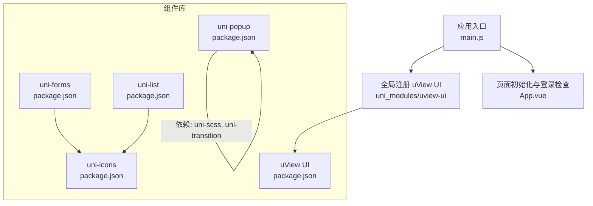
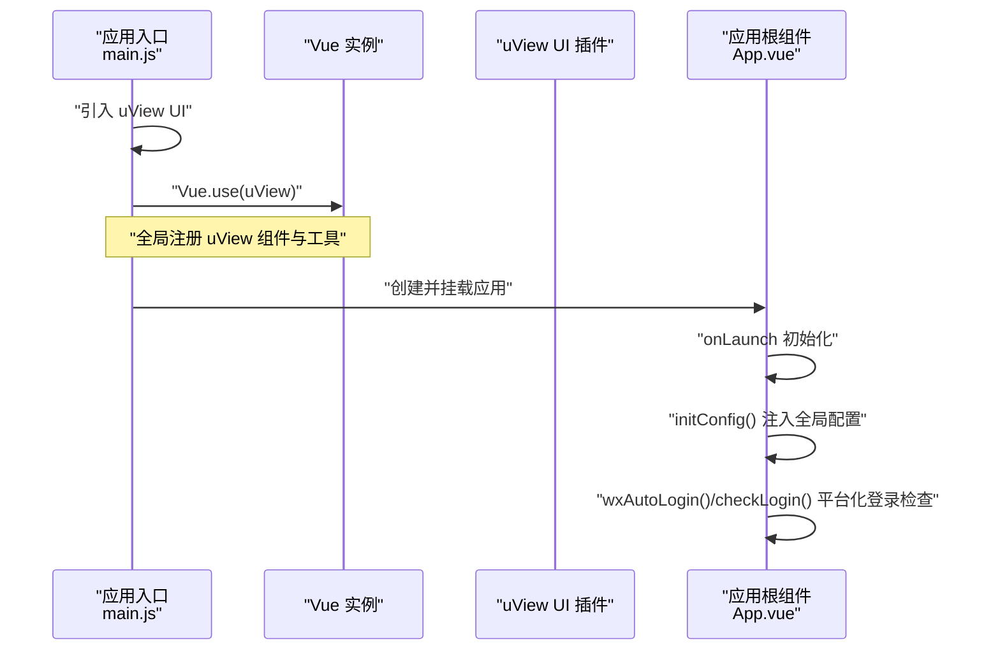
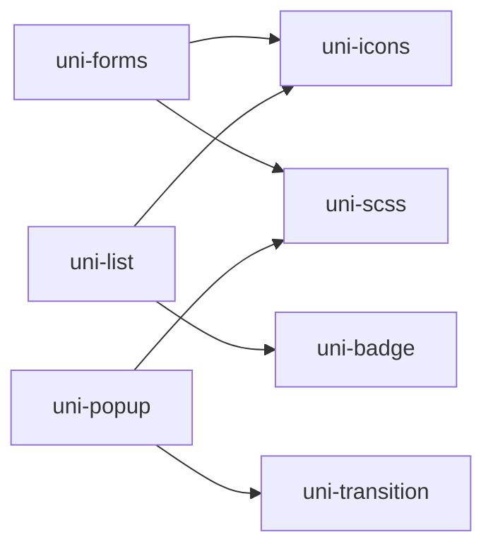

# 第三方组件库

<cite>
**本文引用的文件**   
- [main.js](file://main.js)
- [App.vue](file://App.vue)
- [uview-ui/package.json](file://uni_modules/uview-ui/package.json)
- [uni-icons/package.json](file://uni_modules/uni-icons/package.json)
- [uni-forms/package.json](file://uni_modules/uni-forms/package.json)
- [uni-popup/package.json](file://uni_modules/uni-popup/package.json)
- [uni-list/package.json](file://uni_modules/uni-list/package.json)
- [uni-icons/components/uni-icons/uni-icons.uvue](file://uni_modules/uni-icons/components/uni-icons/uni-icons.uvue)
- [uni-icons/components/uni-icons/uni-icons.vue](file://uni_modules/uni-icons/components/uni-icons/uni-icons.vue)
- [uni-forms/components/uni-forms/uni-forms.vue](file://uni_modules/uni-forms/components/uni-forms/uni-forms.vue)
- [uni-forms/components/uni-forms-item/uni-forms-item.vue](file://uni_modules/uni-forms/components/uni-forms-item/uni-forms-item.vue)
- [uni-popup/components/uni-popup/popup.js](file://uni_modules/uni-popup/components/uni-popup/popup.js)
- [uni-popup/components/uni-popup/uni-popup.vue](file://uni_modules/uni-popup/components/uni-popup/uni-popup.vue)
- [uni-popup/components/uni-popup-dialog/uni-popup-dialog.vue](file://uni_modules/uni-popup/components/uni-popup-dialog/uni-popup-dialog.vue)
- [uni-popup/components/uni-popup-message/uni-popup-message.vue](file://uni_modules/uni-popup/components/uni-popup-message/uni-popup-message.vue)
- [uni-list/readme.md](file://uni_modules/uni-list/readme.md)
- [uni-list/components/uni-list-item/uni-list-item.vue](file://uni_modules/uni-list/components/uni-list-item/uni-list-item.vue)
</cite>

## 目录
1. [简介](#简介)
2. [项目结构](#项目结构)
3. [核心组件库概览](#核心组件库概览)
4. [架构总览](#架构总览)
5. [详细组件分析](#详细组件分析)
6. [依赖关系与版本兼容](#依赖关系与版本兼容)
7. [性能优化建议](#性能优化建议)
8. [故障排查指南](#故障排查指南)
9. [结论](#结论)
10. [附录：常用配置与事件速查](#附录常用配置与事件速查)

## 简介
本文件面向 RuoYi-App 项目的开发者，系统性梳理并说明项目中使用的第三方组件库：uView UI、uni-icons、uni-forms、uni-popup、uni-list。内容覆盖安装与全局引入方式、基础用法与高级特性、常见配置项与事件、版本兼容性与依赖关系、更新策略、选型建议以及性能优化与最佳实践。文档中的示例以“代码片段路径”形式给出，便于快速定位源码实现。

## 项目结构
本项目采用 uni_modules 组织第三方组件，入口通过 main.js 全局注册 uView UI；各组件包位于 uni_modules 下，遵循 DCloud 插件规范，提供 package.json 描述版本、平台支持与依赖。

图表来源
- [main.js:8-10](file://main.js#L8-L10)
- [App.vue:6-21](file://App.vue#L6-L21)
- [uview-ui/package.json:1-85](file://uni_modules/uview-ui/package.json#L1-L85)
- [uni-icons/package.json:1-90](file://uni_modules/uni-icons/package.json#L1-L90)
- [uni-forms/package.json:1-90](file://uni_modules/uni-forms/package.json#L1-L90)
- [uni-popup/package.json:1-91](file://uni_modules/uni-popup/package.json#L1-L91)
- [uni-list/package.json:1-91](file://uni_modules/uni-list/package.json#L1-L91)

章节来源
- [main.js:1-31](file://main.js#L1-L31)
- [App.vue:1-48](file://App.vue#L1-L48)

## 核心组件库概览
- uView UI（v2.0.34）
  - 作用：提供丰富的移动端 UI 组件与工具函数，已在 main.js 中全局注册。
  - 平台支持：Vue2、App（含 nvue）、H5、小程序等广泛平台。
  - 参考：[uview-ui/package.json:1-85](file://uni_modules/uview-ui/package.json#L1-L85)
- uni-icons（v2.0.10）
  - 作用：图标展示，支持自定义颜色、大小，多端兼容。
  - 依赖：uni-scss。
  - 参考：[uni-icons/package.json:1-90](file://uni_modules/uni-icons/package.json#L1-L90)、[uni-icons/components/uni-icons/uni-icons.uvue:1-60](file://uni_modules/uni-icons/components/uni-icons/uni-icons.uvue#L1-L60)、[uni-icons/components/uni-icons/uni-icons.vue:1-52](file://uni_modules/uni-icons/components/uni-icons/uni-icons.vue#L1-L52)
- uni-forms（v1.4.13）
  - 作用：表单收集、校验、提交；支持多种触发时机与错误提示方式。
  - 依赖：uni-scss、uni-icons。
  - 参考：[uni-forms/package.json:1-90](file://uni_modules/uni-forms/package.json#L1-L90)、[uni-forms/components/uni-forms/uni-forms.vue:1-152](file://uni_modules/uni-forms/components/uni-forms/uni-forms.vue#L1-L152)、[uni-forms/components/uni-forms-item/uni-forms-item.vue:37-126](file://uni_modules/uni-forms/components/uni-forms-item/uni-forms-item.vue#L37-L126)
- uni-popup（v1.9.6）
  - 作用：弹出层容器及消息、对话框等子组件，支持遮罩点击关闭、动画开关等。
  - 依赖：uni-scss、uni-transition。
  - 参考：[uni-popup/package.json:1-91](file://uni_modules/uni-popup/package.json#L1-L91)、[uni-popup/components/uni-popup/uni-popup.vue:48-93](file://uni_modules/uni-popup/components/uni-popup/uni-popup.vue#L48-L93)、[uni-popup/components/uni-popup/popup.js:1-26](file://uni_modules/uni-popup/components/uni-popup/popup.js#L1-L26)
- uni-list（v1.2.15）
  - 作用：高性能列表容器与行项，内置导航、设置、聊天等多种场景属性，支持扩展插槽。
  - 依赖：uni-badge、uni-icons。
  - 参考：[uni-list/package.json:1-91](file://uni_modules/uni-list/package.json#L1-L91)、[uni-list/readme.md:1-30](file://uni_modules/uni-list/readme.md#L1-L30)、[uni-list/components/uni-list-item/uni-list-item.vue:71-123](file://uni_modules/uni-list/components/uni-list-item/uni-list-item.vue#L71-L123)

章节来源
- [uview-ui/package.json:1-85](file://uni_modules/uview-ui/package.json#L1-L85)
- [uni-icons/package.json:1-90](file://uni_modules/uni-icons/package.json#L1-L90)
- [uni-forms/package.json:1-90](file://uni_modules/uni-forms/package.json#L1-L90)
- [uni-popup/package.json:1-91](file://uni_modules/uni-popup/package.json#L1-L91)
- [uni-list/package.json:1-91](file://uni_modules/uni-list/package.json#L1-L91)

## 架构总览
下图展示了应用启动时如何加载并注册 uView UI，并在 App 生命周期中进行平台化初始化与登录检查。

图表来源
- [main.js:8-10](file://main.js#L8-L10)
- [App.vue:6-21](file://App.vue#L6-L21)

## 详细组件分析

### uView UI
- 安装与引入
  - 通过 uni_modules 引入后，在 main.js 使用 Vue.use 进行全局注册。
  - 参考路径：[main.js:8-10](file://main.js#L8-L10)
- 基础用法
  - 在任意页面直接使用 uView 提供的组件（如按钮、表单、弹窗等），无需再次引入。
- 高级特性
  - 主题定制、样式变量、工具函数与跨端适配能力。
  - 平台兼容性由 package.json 的 platforms 字段声明。
- 参考
  - [uview-ui/package.json:1-85](file://uni_modules/uview-ui/package.json#L1-L85)

章节来源
- [main.js:8-10](file://main.js#L8-L10)
- [uview-ui/package.json:1-85](file://uni_modules/uview-ui/package.json#L1-L85)

### uni-icons
- 安装与引入
  - 作为 uni_modules 插件直接可用，无需额外注册。
- 基础用法
  - 通过 type 指定图标名称，size 控制大小，color 控制颜色，支持 click 事件。
  - 参考路径：
    - [uni-icons/components/uni-icons/uni-icons.uvue:14-18](file://uni_modules/uni-icons/components/uni-icons/uni-icons.uvue#L14-L18)
    - [uni-icons/components/uni-icons/uni-icons.vue:33-37](file://uni_modules/uni-icons/components/uni-icons/uni-icons.vue#L33-L37)
- 高级特性
  - 支持自定义前缀 customPrefix，适配自有图标集。
  - 在 APP-NVUE 环境下动态注入字体资源。
  - 参考路径：
    - [uni-icons/components/uni-icons/uni-icons.uvue:17-18](file://uni_modules/uni-icons/components/uni-icons/uni-icons.uvue#L17-L18)
    - [uni-icons/components/uni-icons/uni-icons.vue:20-27](file://uni_modules/uni-icons/components/uni-icons/uni-icons.vue#L20-L27)
- 依赖关系
  - 依赖 uni-scss。
  - 参考路径：[uni-icons/package.json:40-44](file://uni_modules/uni-icons/package.json#L40-L44)

章节来源
- [uni-icons/components/uni-icons/uni-icons.uvue:1-60](file://uni_modules/uni-icons/components/uni-icons/uni-icons.uvue#L1-L60)
- [uni-icons/components/uni-icons/uni-icons.vue:1-52](file://uni_modules/uni-icons/components/uni-icons/uni-icons.vue#L1-L52)
- [uni-icons/package.json:1-90](file://uni_modules/uni-icons/package.json#L1-L90)

### uni-forms
- 安装与引入
  - 作为 uni_modules 插件直接可用，配合 uni-forms-item 使用。
- 基础用法
  - 在父组件定义 rules、validateTrigger、labelPosition、labelWidth、labelAlign、errShowType 等属性，子项通过 name 绑定字段。
  - 参考路径：
    - [uni-forms/components/uni-forms/uni-forms.vue:47-66](file://uni_modules/uni-forms/components/uni-forms/uni-forms.vue#L47-L66)
    - [uni-forms/components/uni-forms-item/uni-forms-item.vue:37-55](file://uni_modules/uni-forms/components/uni-forms-item/uni-forms-item.vue#L37-L55)
- 高级特性
  - 校验触发器支持 bind/submit/blur；错误提示支持 undertext/toast/modal。
  - 提供 validate 与 submit 事件，便于统一处理校验结果与提交逻辑。
  - 参考路径：
    - [uni-forms/components/uni-forms/uni-forms.vue:107-136](file://uni_modules/uni-forms/components/uni-forms/uni-forms.vue#L107-L136)
    - [uni-forms/components/uni-forms/uni-forms.vue:67-69](file://uni_modules/uni-forms/components/uni-forms/uni-forms.vue#L67-L69)
- 依赖关系
  - 依赖 uni-scss、uni-icons。
  - 参考路径：[uni-forms/package.json:40-44](file://uni_modules/uni-forms/package.json#L40-L44)

章节来源
- [uni-forms/components/uni-forms/uni-forms.vue:1-152](file://uni_modules/uni-forms/components/uni-forms/uni-forms.vue#L1-L152)
- [uni-forms/components/uni-forms-item/uni-forms-item.vue:37-126](file://uni_modules/uni-forms/components/uni-forms-item/uni-forms-item.vue#L37-L126)
- [uni-forms/package.json:1-90](file://uni_modules/uni-forms/package.json#L1-L90)

### uni-popup
- 安装与引入
  - 作为 uni_modules 插件直接可用，包含基础容器与消息、对话框等子组件。
- 基础用法
  - 通过 type 控制弹出位置（top/bottom/center/message/dialog），isMaskClick 控制遮罩点击关闭，animation 控制动画开关。
  - 参考路径：
    - [uni-popup/components/uni-popup/uni-popup.vue:56-93](file://uni_modules/uni-popup/components/uni-popup/uni-popup.vue#L56-L93)
- 高级特性
  - 子组件封装：
    - 对话框：支持 base/input 模式、确认/取消事件、输入类型与占位符等。
      - 参考路径：[uni-popup/components/uni-popup-dialog/uni-popup-dialog.vue:1-89](file://uni_modules/uni-popup/components/uni-popup-dialog/uni-popup-dialog.vue#L1-L89)
    - 消息提示：支持 success/warning/info/error 主题、自动关闭时长。
      - 参考路径：[uni-popup/components/uni-popup-message/uni-popup-message.vue:1-59](file://uni_modules/uni-popup/components/uni-popup-message/uni-popup-message.vue#L1-L59)
  - 父级查找：通过 mixin 获取父级 uniPopup 实例，便于子组件调用显示/隐藏方法。
    - 参考路径：[uni-popup/components/uni-popup/popup.js:1-26](file://uni_modules/uni-popup/components/uni-popup/popup.js#L1-L26)
- 依赖关系
  - 依赖 uni-scss、uni-transition。
  - 参考路径：[uni-popup/package.json:40-44](file://uni_modules/uni-popup/package.json#L40-L44)

章节来源
- [uni-popup/components/uni-popup/uni-popup.vue:48-93](file://uni_modules/uni-popup/components/uni-popup/uni-popup.vue#L48-L93)
- [uni-popup/components/uni-popup/popup.js:1-26](file://uni_modules/uni-popup/components/uni-popup/popup.js#L1-L26)
- [uni-popup/components/uni-popup-dialog/uni-popup-dialog.vue:1-89](file://uni_modules/uni-popup/components/uni-popup-dialog/uni-popup-dialog.vue#L1-L89)
- [uni-popup/components/uni-popup-message/uni-popup-message.vue:1-59](file://uni_modules/uni-popup/components/uni-popup-message/uni-popup-message.vue#L1-L59)
- [uni-popup/package.json:1-91](file://uni_modules/uni-popup/package.json#L1-L91)

### uni-list
- 安装与引入
  - 作为 uni_modules 插件直接可用，结合 uni-list-item 构建列表。
- 基础用法
  - 使用 uni-list 作为容器，内部放置多个 uni-list-item；通过 title、note、showArrow、clickable、link、to 等属性快速实现导航、设置、小图标等场景。
  - 参考路径：
    - [uni-list/readme.md:1-30](file://uni_modules/uni-list/readme.md#L1-L30)
    - [uni-list/components/uni-list-item/uni-list-item.vue:71-123](file://uni_modules/uni-list/components/uni-list-item/uni-list-item.vue#L71-L123)
- 高级特性
  - 长列表性能优化：在 app-nvue 下默认使用原生 list 滚动，不可见区域回收渲染内存。
  - 扩展插槽机制：当内置属性无法满足需求时，可通过插槽自定义复杂列表项。
  - 参考路径：
    - [uni-list/readme.md:7-21](file://uni_modules/uni-list/readme.md#L7-L21)
- 依赖关系
  - 依赖 uni-badge、uni-icons。
  - 参考路径：[uni-list/package.json:40-44](file://uni_modules/uni-list/package.json#L40-L44)

章节来源
- [uni-list/readme.md:1-30](file://uni_modules/uni-list/readme.md#L1-L30)
- [uni-list/components/uni-list-item/uni-list-item.vue:71-123](file://uni_modules/uni-list/components/uni-list-item/uni-list-item.vue#L71-L123)
- [uni-list/package.json:1-91](file://uni_modules/uni-list/package.json#L1-L91)

## 依赖关系与版本兼容
- 版本信息
  - uView UI：2.0.34
  - uni-icons：2.0.10
  - uni-forms：1.4.13
  - uni-popup：1.9.6
  - uni-list：1.2.15
- 依赖图

图表来源
- [uni-forms/package.json:40-44](file://uni_modules/uni-forms/package.json#L40-L44)
- [uni-list/package.json:40-44](file://uni_modules/uni-list/package.json#L40-L44)
- [uni-popup/package.json:40-44](file://uni_modules/uni-popup/package.json#L40-L44)

- 平台兼容性要点
  - uView UI 明确支持 Vue2、App（含 nvue）、H5、小程序等多端。
  - uni-icons、uni-forms、uni-popup、uni-list 均声明对 Vue2/Vue3 的支持情况，具体以各自 package.json 为准。
  - 参考路径：
    - [uview-ui/package.json:40-83](file://uni_modules/uview-ui/package.json#L40-L83)
    - [uni-icons/package.json:39-87](file://uni_modules/uni-icons/package.json#L39-L87)
    - [uni-forms/package.json:40-87](file://uni_modules/uni-forms/package.json#L40-L87)
    - [uni-popup/package.json:40-89](file://uni_modules/uni-popup/package.json#L40-L89)
    - [uni-list/package.json:40-89](file://uni_modules/uni-list/package.json#L40-L89)

章节来源
- [uview-ui/package.json:1-85](file://uni_modules/uview-ui/package.json#L1-L85)
- [uni-icons/package.json:1-90](file://uni_modules/uni-icons/package.json#L1-L90)
- [uni-forms/package.json:1-90](file://uni_modules/uni-forms/package.json#L1-L90)
- [uni-popup/package.json:1-91](file://uni_modules/uni-popup/package.json#L1-L91)
- [uni-list/package.json:1-91](file://uni_modules/uni-list/package.json#L1-L91)

## 性能优化建议
- 列表性能
  - 优先使用 uni-list 的内置属性减少自定义渲染开销；在 app-nvue 下利用原生 list 提升滚动性能。
  - 避免在列表项中嵌套重型组件或过多层级节点。
  - 参考路径：[uni-list/readme.md:7-21](file://uni_modules/uni-list/readme.md#L7-L21)
- 表单性能
  - 合理选择 validateTrigger：大数据量表单建议使用 submit 触发以减少频繁校验；必要时使用 bind 提升交互体验但注意性能。
  - 将复杂校验规则拆分到独立模块，避免在模板中执行重计算。
  - 参考路径：[uni-forms/components/uni-forms/uni-forms.vue:112-116](file://uni_modules/uni-forms/components/uni-forms/uni-forms.vue#L112-L116)
- 图标与资源
  - 合理使用 uni-icons 的 size/color，避免过大尺寸导致重绘开销。
  - 自定义图标尽量使用矢量字体或 SVG，减少图片资源体积。
  - 参考路径：[uni-icons/components/uni-icons/uni-icons.uvue:31-38](file://uni_modules/uni-icons/components/uni-icons/uni-icons.uvue#L31-L38)
- 弹窗与遮罩
  - 仅在需要时打开弹窗，避免长时间持有遮罩影响交互与内存占用。
  - 合理设置 animation 与 isMaskClick，减少不必要的动画与事件处理。
  - 参考路径：[uni-popup/components/uni-popup/uni-popup.vue:56-93](file://uni_modules/uni-popup/components/uni-popup/uni-popup.vue#L56-L93)

## 故障排查指南
- 表单校验不生效
  - 检查是否设置了 name 与 rules，并确保 validateTrigger 符合预期。
  - 参考路径：
    - [uni-forms/components/uni-forms-item/uni-forms-item.vue:86-90](file://uni_modules/uni-forms/components/uni-forms-item/uni-forms-item.vue#L86-L90)
    - [uni-forms/components/uni-forms/uni-forms.vue:100-116](file://uni_modules/uni-forms/components/uni-forms/uni-forms.vue#L100-L116)
- 弹窗无法关闭
  - 检查 isMaskClick 与 maskClick 的设置，确保遮罩点击事件未被拦截。
  - 参考路径：[uni-popup/components/uni-popup/uni-popup.vue:68-77](file://uni_modules/uni-popup/components/uni-popup/uni-popup.vue#L68-L77)
- 图标未显示
  - 确认 type 值与图标集一致，APP-NVUE 环境需确保字体资源正确注入。
  - 参考路径：
    - [uni-icons/components/uni-icons/uni-icons.uvue:44-50](file://uni_modules/uni-icons/components/uni-icons/uni-icons.uvue#L44-L50)
    - [uni-icons/components/uni-icons/uni-icons.vue:20-27](file://uni_modules/uni-icons/components/uni-icons/uni-icons.vue#L20-L27)
- 列表卡顿
  - 检查是否在列表项中使用大量图片或复杂布局，考虑使用 uni-list 的内置属性与插槽精简渲染。
  - 参考路径：[uni-list/readme.md:7-21](file://uni_modules/uni-list/readme.md#L7-L21)

章节来源
- [uni-forms/components/uni-forms/uni-forms.vue:100-116](file://uni_modules/uni-forms/components/uni-forms/uni-forms.vue#L100-L116)
- [uni-forms/components/uni-forms-item/uni-forms-item.vue:86-90](file://uni_modules/uni-forms/components/uni-forms-item/uni-forms-item.vue#L86-L90)
- [uni-popup/components/uni-popup/uni-popup.vue:68-77](file://uni_modules/uni-popup/components/uni-popup/uni-popup.vue#L68-L77)
- [uni-icons/components/uni-icons/uni-icons.uvue:44-50](file://uni_modules/uni-icons/components/uni-icons/uni-icons.uvue#L44-L50)
- [uni-icons/components/uni-icons/uni-icons.vue:20-27](file://uni_modules/uni-icons/components/uni-icons/uni-icons.vue#L20-L27)
- [uni-list/readme.md:7-21](file://uni_modules/uni-list/readme.md#L7-L21)

## 结论
RuoYi-App 通过 uni_modules 集成 uView UI、uni-icons、uni-forms、uni-popup、uni-list 等成熟组件库，覆盖了表单、列表、弹窗、图标等高频场景。建议在开发中遵循以下原则：
- 按需选用组件，避免过度引入造成包体膨胀。
- 充分利用组件内置属性与插槽，减少重复实现。
- 关注版本兼容与依赖关系，定期评估升级风险与收益。
- 针对长列表与复杂表单进行专项性能优化。

## 附录：常用配置与事件速查
- uni-icons
  - 常用属性：type、size、color、customPrefix
  - 事件：click
  - 参考路径：
    - [uni-icons/components/uni-icons/uni-icons.uvue:14-18](file://uni_modules/uni-icons/components/uni-icons/uni-icons.uvue#L14-L18)
    - [uni-icons/components/uni-icons/uni-icons.vue:33-37](file://uni_modules/uni-icons/components/uni-icons/uni-icons.vue#L33-L37)
- uni-forms
  - 常用属性：rules、validateTrigger、labelPosition、labelWidth、labelAlign、errShowType
  - 事件：validate、submit
  - 参考路径：
    - [uni-forms/components/uni-forms/uni-forms.vue:47-66](file://uni_modules/uni-forms/components/uni-forms/uni-forms.vue#L47-L66)
    - [uni-forms/components/uni-forms/uni-forms.vue:107-136](file://uni_modules/uni-forms/components/uni-forms/uni-forms.vue#L107-L136)
- uni-popup
  - 常用属性：type、isMaskClick、maskClick、animation、backgroundColor、safeArea、maskBackgroundColor、borderRadius
  - 事件：change、maskClick
  - 参考路径：
    - [uni-popup/components/uni-popup/uni-popup.vue:56-93](file://uni_modules/uni-popup/components/uni-popup/uni-popup.vue#L56-L93)
- uni-list
  - 常用属性（uni-list-item）：title、note、ellipsis、disabled、clickable、showArrow、link、to、showBadge、direction
  - 事件：click、switchChange
  - 参考路径：
    - [uni-list/components/uni-list-item/uni-list-item.vue:71-123](file://uni_modules/uni-list/components/uni-list-item/uni-list-item.vue#L71-L123)