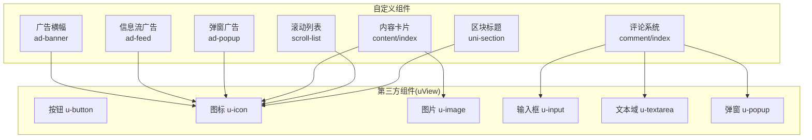
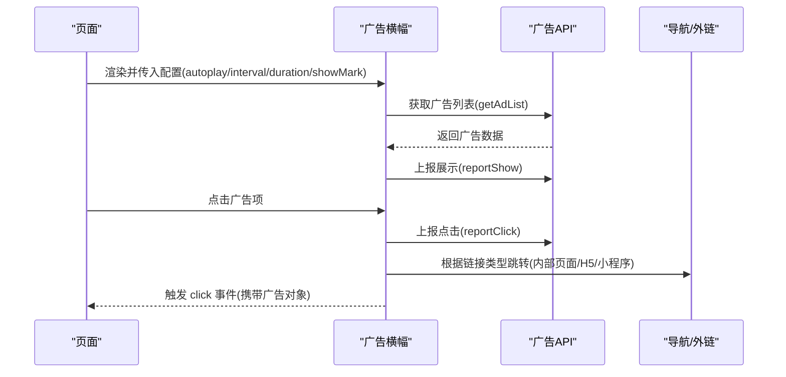
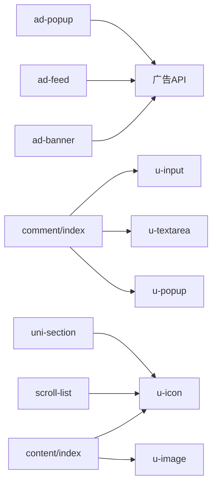

# 组件库文档

<cite>
**本文引用的文件**   
- [README.md](file://README.md)
- [ad-banner.vue](file://components/ad-banner/ad-banner.vue)
- [ad-feed.vue](file://components/ad-feed/ad-feed.vue)
- [ad-popup.vue](file://components/ad-popup/ad-popup.vue)
- [comment/index.vue](file://components/comment/index.vue)
- [content/index.vue](file://components/content/index.vue)
- [scroll-list.vue](file://components/scroll-list/scroll-list.vue)
- [uni-section.vue](file://components/uni-section/uni-section.vue)
- [u-button.vue](file://uni_modules/uview-ui/components/u-button/u-button.vue)
- [u-icon.vue](file://uni_modules/uview-ui/components/u-icon/u-icon.vue)
- [u-image.vue](file://uni_modules/uview-ui/components/u-image/u-image.vue)
- [u-input.vue](file://uni_modules/uview-ui/components/u-input/u-input.vue)
- [u-textarea.vue](file://uni_modules/uview-ui/components/u-textarea/u-textarea.vue)
- [u-popup.vue](file://uni_modules/uview-ui/components/u-popup/u-popup.vue)
</cite>

## 目录
1. [简介](#简介)
2. [项目结构](#项目结构)
3. [核心组件](#核心组件)
4. [架构总览](#架构总览)
5. [详细组件分析](#详细组件分析)
6. [依赖关系分析](#依赖关系分析)
7. [性能与可访问性](#性能与可访问性)
8. [故障排查指南](#故障排查指南)
9. [结论](#结论)
10. [附录：开发规范与命名约定](#附录开发规范与命名约定)

## 简介
本仓库为基于 uni-app 的移动端解决方案，提供业务级自定义组件与第三方 UI 组件（uView、uni-ui）的组合使用方式。本文聚焦于组件库的使用说明、属性/事件/插槽/样式定制、组合模式与最佳实践，帮助开发者快速上手并高效扩展。

## 项目结构
- 自定义组件位于 components 目录，按功能域划分，如广告、评论、内容卡片、滚动列表等。
- 第三方组件以 uni_modules 形式引入，包含 uView 与 uni-ui 生态组件。
- 页面与业务逻辑通过 pages、api、utils、store 等模块组织。

图表来源
- [ad-banner.vue:1-140](file://components/ad-banner/ad-banner.vue#L1-L140)
- [ad-feed.vue:1-199](file://components/ad-feed/ad-feed.vue#L1-L199)
- [ad-popup.vue:1-200](file://components/ad-popup/ad-popup.vue#L1-L200)
- [comment/index.vue:1-476](file://components/comment/index.vue#L1-L476)
- [content/index.vue:1-213](file://components/content/index.vue#L1-L213)
- [scroll-list.vue:1-666](file://components/scroll-list/scroll-list.vue#L1-L666)
- [uni-section.vue:1-168](file://components/uni-section/uni-section.vue#L1-L168)
- [u-button.vue:1-491](file://uni_modules/uview-ui/components/u-button/u-button.vue#L1-L491)
- [u-icon.vue:1-235](file://uni_modules/uview-ui/components/u-icon/u-icon.vue#L1-L235)
- [u-image.vue:1-233](file://uni_modules/uview-ui/components/u-image/u-image.vue#L1-L233)
- [u-input.vue:1-355](file://uni_modules/uview-ui/components/u-input/u-input.vue#L1-L355)
- [u-textarea.vue:1-240](file://uni_modules/uview-ui/components/u-textarea/u-textarea.vue#L1-L240)
- [u-popup.vue:1-305](file://uni_modules/uview-ui/components/u-popup/u-popup.vue#L1-L305)

章节来源
- [README.md:1-52](file://README.md#L1-L52)

## 核心组件
本节对常用组件进行概览式说明，后续章节将给出更详细的 API 与示例路径。

- 广告横幅 ad-banner：轮播展示广告图，支持自动播放、间隔、时长、是否显示“广告”标识；点击上报并跳转内部或外部链接。
- 信息流广告 ad-feed：列表型广告，支持自动加载、展示/点击上报、时间格式化、手动刷新。
- 弹窗广告 ad-popup：全屏遮罩弹窗，支持图片/视频/文本三种类型，每日仅展示一次，点击上报并跳转。
- 评论 comment/index：一级评论分页加载、二级回复、底部固定输入框、键盘高度自适应、作者标签等。
- 内容卡片 content/index：用户头像、昵称、分类、状态、时间、图文/视频文件、点赞态、分享配置。
- 滚动列表 scroll-list：下拉刷新、上拉加载更多、空数据占位、自定义文案与颜色、安全区域适配。
- 区块标题 uni-section：带装饰条的主副标题区，支持右侧插槽与点击事件。
- uView 基础组件：按钮、图标、图片、输入框、文本域、弹窗等，提供丰富的 props/events/customStyle。

章节来源
- [ad-banner.vue:1-140](file://components/ad-banner/ad-banner.vue#L1-L140)
- [ad-feed.vue:1-199](file://components/ad-feed/ad-feed.vue#L1-L199)
- [ad-popup.vue:1-200](file://components/ad-popup/ad-popup.vue#L1-L200)
- [comment/index.vue:1-476](file://components/comment/index.vue#L1-L476)
- [content/index.vue:1-213](file://components/content/index.vue#L1-L213)
- [scroll-list.vue:1-666](file://components/scroll-list/scroll-list.vue#L1-L666)
- [uni-section.vue:1-168](file://components/uni-section/uni-section.vue#L1-L168)
- [u-button.vue:1-491](file://uni_modules/uview-ui/components/u-button/u-button.vue#L1-L491)
- [u-icon.vue:1-235](file://uni_modules/uview-ui/components/u-icon/u-icon.vue#L1-L235)
- [u-image.vue:1-233](file://uni_modules/uview-ui/components/u-image/u-image.vue#L1-L233)
- [u-input.vue:1-355](file://uni_modules/uview-ui/components/u-input/u-input.vue#L1-L355)
- [u-textarea.vue:1-240](file://uni_modules/uview-ui/components/u-textarea/u-textarea.vue#L1-L240)
- [u-popup.vue:1-305](file://uni_modules/uview-ui/components/u-popup/u-popup.vue#L1-L305)

## 架构总览
组件间交互遵循“容器 + 子组件 + 第三方 UI”的分层模式：
- 业务容器负责数据获取、状态管理、路由跳转与埋点上报。
- 自定义组件封装业务场景（广告、评论、内容卡片）。
- 第三方 UI 提供通用原子能力（按钮、图标、输入、弹窗等）。

图表来源
- [ad-banner.vue:1-140](file://components/ad-banner/ad-banner.vue#L1-L140)

## 详细组件分析

### 广告横幅 ad-banner
- 设计目标：在首页或重要位置展示轮播广告，兼顾曝光与点击转化。
- 关键特性：
  - 自动轮播、循环播放、圆角图片、右上角“广告”标识。
  - 自动上报展示，点击上报点击，统一处理内部页面与外部链接跳转。
- 属性(props)
  - autoplay: Boolean，默认 true
  - interval: Number，默认 3000
  - duration: Number，默认 500
  - showMark: Boolean，默认 true
- 事件(events)
  - click(ad): 点击某条广告时触发，参数为广告对象
- 插槽(slots)
  - 无
- 样式定制
  - 根容器 .ad-banner、轮播 .banner-swiper、图片 .banner-image、标识 .ad-mark
- 使用示例路径
  - 参考 [ad-banner.vue:1-140](file://components/ad-banner/ad-banner.vue#L1-L140)

章节来源
- [ad-banner.vue:1-140](file://components/ad-banner/ad-banner.vue#L1-L140)

### 信息流广告 ad-feed
- 设计目标：在信息流中插入广告条目，保持与内容一致的阅读体验。
- 关键特性：
  - 自动加载、展示/点击上报、时间格式化、手动刷新。
- 属性(props)
  - autoLoad: Boolean，默认 true
- 事件(events)
  - click(ad): 点击广告项时触发
- 插槽(slots)
  - 无
- 样式定制
  - 外层 .ad-feed、条目 .ad-feed-item、头部 .ad-feed-header、内容 .ad-feed-content、底部 .ad-feed-footer
- 使用示例路径
  - 参考 [ad-feed.vue:1-199](file://components/ad-feed/ad-feed.vue#L1-L199)

章节来源
- [ad-feed.vue:1-199](file://components/ad-feed/ad-feed.vue#L1-L199)

### 弹窗广告 ad-popup
- 设计目标：强曝光的弹窗广告，限制每日展示次数。
- 关键特性：
  - 支持图片/视频/文本三种类型，关闭按钮，本地记录今日已展示。
- 属性(props)
  - 无显式 props，内部维护 visible/currentAd/shownToday
- 事件(events)
  - click(ad): 点击广告内容时触发
  - close(): 关闭弹窗时触发
- 插槽(slots)
  - 无
- 样式定制
  - 遮罩 .ad-popup-mask、内容 .ad-popup-content、图片/视频/文本区域、关闭按钮 .close-btn、标识 .ad-mark
- 使用示例路径
  - 参考 [ad-popup.vue:1-200](file://components/ad-popup/ad-popup.vue#L1-L200)

章节来源
- [ad-popup.vue:1-200](file://components/ad-popup/ad-popup.vue#L1-L200)

### 评论系统 comment/index
- 设计目标：承载文章/动态的评论与回复，支持分页、空态、键盘自适应。
- 关键特性：
  - 一级评论分页加载、二级回复、底部固定输入框、作者标签、更多回复折叠。
- 属性(props)
  - contentObj: Object，包含 contentId、params(头像/昵称等)、status 等
- 事件(events)
  - 通过 ref 调用 loadSuccess/refresh 等方法完成数据注入与刷新
- 插槽(slots)
  - 无
- 样式定制
  - 列表 .comment-list、行 .comment-row、工具栏 .comment-info、底部输入 .footer、对话框 .comment-dialog
- 使用示例路径
  - 参考 [comment/index.vue:1-476](file://components/comment/index.vue#L1-L476)

章节来源
- [comment/index.vue:1-476](file://components/comment/index.vue#L1-L476)

### 内容卡片 content/index
- 设计目标：展示一条内容的完整元信息与媒体资源，并提供操作入口。
- 关键特性：
  - 头像/昵称/分类/状态/时间、图文/视频文件、点赞态、分享配置。
- 属性(props)
  - contentObj: Object，内容主体数据
  - loveContentIds: Array，已点赞的内容ID集合
- 事件(events)
  - openPopup(data): 打开弹出菜单时触发
- 插槽(slots)
  - 无
- 样式定制
  - 头部 .content-box-top、正文 .content-feed-ogText、标签 .content-category-tag、时间 .content-box-time
- 使用示例路径
  - 参考 [content/index.vue:1-213](file://components/content/index.vue#L1-L213)

章节来源
- [content/index.vue:1-213](file://components/content/index.vue#L1-L213)

### 滚动列表 scroll-list
- 设计目标：通用的下拉刷新+上拉加载容器，内置空态与多种文案/颜色配置。
- 关键特性：
  - 下拉刷新、上拉加载、空数据提示、安全区域适配、自定义动画与文案。
- 属性(props)
  - option: Object，包含 page/size/auto/disabled/background/emptyImage/offsetBottom/pullDownSpeed/lowerThreshold/refresherThreshold/refreshDelayed/refreshFinishDelayed/safeArea/各种文案与颜色等
- 事件(events)
  - load(paging): 请求下一页数据
  - refresh(paging): 请求刷新数据
  - loadSuccess(list): 加载成功回调
  - loadFail(): 加载失败回调
  - refreshSuccess(list)/refreshError(): 刷新结果回调
  - scrolltolower(e)/scroll(e)/touchStart(e)/touchMove(e)/touchEnd(e): 滚动与触摸事件
- 插槽(slots)
  - pulldown: 自定义下拉头部
  - empty: 自定义空态
  - pullup: 自定义上拉尾部
  - default: 列表内容
- 样式定制
  - 容器 .scroll-list-wrap、滚动视图 .scroll-view、下拉刷新 .pull-down-wrap、空态 .empty-wrap、上拉 .pull-up-wrap
- 使用示例路径
  - 参考 [scroll-list.vue:1-666](file://components/scroll-list/scroll-list.vue#L1-L666)

章节来源
- [scroll-list.vue:1-666](file://components/scroll-list/scroll-list.vue#L1-L666)

### 区块标题 uni-section
- 设计目标：统一的区块标题展示，支持装饰条、主副标题与右侧插槽。
- 属性(props)
  - type: String，装饰类型 line/circle/square
  - title: String，必填
  - titleFontSize/titleColor: String
  - subTitle/subTitleFontSize/subTitleColor: String
  - padding: Boolean|String
- 事件(events)
  - click: 点击标题区域触发
- 插槽(slots)
  - decoration: 自定义装饰元素
  - right: 右侧内容
  - default: 内容区域
- 样式定制
  - 头部 .uni-section-header、装饰 .uni-section-header__decoration、内容 .uni-section-header__content、右侧 .uni-section-header__slot-right、内容区 .uni-section-content
- 使用示例路径
  - 参考 [uni-section.vue:1-168](file://components/uni-section/uni-section.vue#L1-L168)

章节来源
- [uni-section.vue:1-168](file://components/uni-section/uni-section.vue#L1-L168)

### uView 基础组件

#### 按钮 u-button
- 属性(props)
  - type/size/shape/plain/disabled/loading/loadingText/loadingMode/loadingSize/openType/formType/appParameter/hoverStopPropagation/lang/sessionFrom/sendMessageTitle/sendMessagePath/sendMessageImg/showMessageCard/dataName/throttleTime/hoverStartTime/hoverStayTime/text/icon/iconColor/color/customStyle 等
- 事件(events)
  - click/getphonenumber/getuserinfo/error/opensetting/launchapp
- 插槽(slots)
  - 默认插槽用于自定义按钮内容
- 样式定制
  - 通过 customStyle 与主题变量覆盖，支持渐变背景、细边框、禁用态等
- 使用示例路径
  - 参考 [u-button.vue:1-491](file://uni_modules/uview-ui/components/u-button/u-button.vue#L1-L491)

章节来源
- [u-button.vue:1-491](file://uni_modules/uview-ui/components/u-button/u-button.vue#L1-L491)

#### 图标 u-icon
- 属性(props)
  - name/color/size/bold/index/hoverClass/customPrefix/label/labelPos/labelSize/labelColor/space/imgMode/width/height/top/stop/customStyle
- 事件(events)
  - click(index)
- 插槽(slots)
  - 无
- 样式定制
  - 支持主题色类名、自定义前缀、图片模式与尺寸
- 使用示例路径
  - 参考 [u-icon.vue:1-235](file://uni_modules/uview-ui/components/u-icon/u-icon.vue#L1-L235)

章节来源
- [u-icon.vue:1-235](file://uni_modules/uview-ui/components/u-icon/u-icon.vue#L1-L235)

#### 图片 u-image
- 属性(props)
  - src/mode/width/height/shape/radius/lazyLoad/showMenuByLongpress/loadingIcon/errorIcon/showLoading/showError/fade/webp/duration/bgColor/customStyle
- 事件(events)
  - click/error/load
- 插槽(slots)
  - loading/error 自定义占位
- 样式定制
  - 圆角/圆形、淡入过渡、背景色融合
- 使用示例路径
  - 参考 [u-image.vue:1-233](file://uni_modules/uview-ui/components/u-image/u-image.vue#L1-L233)

章节来源
- [u-image.vue:1-233](file://uni_modules/uview-ui/components/u-image/u-image.vue#L1-L233)

#### 输入框 u-input
- 属性(props)
  - value/type/fixed/disabled/disabledColor/clearable/password/maxlength/placeholder/placeholderClass/placeholderStyle/confirmType/confirmHold/holdKeyboard/focus/autoBlur/disableDefaultPadding/cursor/cursorSpacing/selectionStart/selectionEnd/adjustPosition/inputAlign/fontSize/color/formatter/prefixIcon/prefixIconStyle/suffixIcon/suffixIconStyle/border/readonly/shape/customStyle/ignoreCompositionEvent
- 事件(events)
  - input/change/blur/focus/confirm/clear/keyboardheightchange
- 插槽(slots)
  - prefix/suffix 自定义前后图标
- 样式定制
  - 边框类型、形状、禁用态、清除按钮样式
- 使用示例路径
  - 参考 [u-input.vue:1-355](file://uni_modules/uview-ui/components/u-input/u-input.vue#L1-L355)

章节来源
- [u-input.vue:1-355](file://uni_modules/uview-ui/components/u-input/u-input.vue#L1-L355)

#### 文本域 u-textarea
- 属性(props)
  - value/placeholder/placeholderClass/placeholderStyle/height/confirmType/disabled/count/focus/autoHeight/fixed/cursorSpacing/cursor/showConfirmBar/selectionStart/selectionEnd/adjustPosition/disableDefaultPadding/holdKeyboard/maxlength/border/ignoreCompositionEvent
- 事件(events)
  - focus/blur/linechange/input/confirm/keyboardheightchange
- 插槽(slots)
  - 无
- 样式定制
  - 边框类型、禁用态、字数统计样式
- 使用示例路径
  - 参考 [u-textarea.vue:1-240](file://uni_modules/uview-ui/components/u-textarea/u-textarea.vue#L1-L240)

章节来源
- [u-textarea.vue:1-240](file://uni_modules/uview-ui/components/u-textarea/u-textarea.vue#L1-L240)

#### 弹窗 u-popup
- 属性(props)
  - show/overlay/mode/duration/overlayDuration/closeable/overlayStyle/overlayOpacity/closeOnClickOverlay/zIndex/safeAreaInsetBottom/safeAreaInsetTop/closeIconPos/round/zoom/customStyle
- 事件(events)
  - open/close/click
- 插槽(slots)
  - 默认插槽放置弹窗内容
- 样式定制
  - 遮罩透明度、圆角、安全区域、背景色
- 使用示例路径
  - 参考 [u-popup.vue:1-305](file://uni_modules/uview-ui/components/u-popup/u-popup.vue#L1-L305)

章节来源
- [u-popup.vue:1-305](file://uni_modules/uview-ui/components/u-popup/u-popup.vue#L1-L305)

## 依赖关系分析
- 广告组件依赖广告 API 进行数据获取与埋点上报，并在点击后执行跨端跳转。
- 评论与内容卡片依赖 uView 的基础组件（图标、图片、输入、弹窗等）构建交互。
- 滚动列表作为通用容器，被评论等复杂列表场景复用。

图表来源
- [ad-banner.vue:1-140](file://components/ad-banner/ad-banner.vue#L1-L140)
- [ad-feed.vue:1-199](file://components/ad-feed/ad-feed.vue#L1-L199)
- [ad-popup.vue:1-200](file://components/ad-popup/ad-popup.vue#L1-L200)
- [comment/index.vue:1-476](file://components/comment/index.vue#L1-L476)
- [content/index.vue:1-213](file://components/content/index.vue#L1-L213)
- [scroll-list.vue:1-666](file://components/scroll-list/scroll-list.vue#L1-L666)
- [uni-section.vue:1-168](file://components/uni-section/uni-section.vue#L1-L168)
- [u-input.vue:1-355](file://uni_modules/uview-ui/components/u-input/u-input.vue#L1-L355)
- [u-textarea.vue:1-240](file://uni_modules/uview-ui/components/u-textarea/u-textarea.vue#L1-L240)
- [u-popup.vue:1-305](file://uni_modules/uview-ui/components/u-popup/u-popup.vue#L1-L305)
- [u-icon.vue:1-235](file://uni_modules/uview-ui/components/u-icon/u-icon.vue#L1-L235)
- [u-image.vue:1-233](file://uni_modules/uview-ui/components/u-image/u-image.vue#L1-L233)

## 性能与可访问性
- 响应式设计
  - 使用 rpx 单位与 flex 布局，适配不同屏幕尺寸。
  - 滚动列表支持安全区域适配，避免刘海屏遮挡。
- 无障碍访问
  - 为可点击区域提供明确的交互反馈（hover-class、active 态）。
  - 图片组件支持长按菜单与懒加载，减少首屏压力。
- 性能优化
  - 图片懒加载、按需加载第三方组件。
  - 滚动列表采用 IntersectionObserver 与节流策略，避免频繁重排。
  - 弹窗与遮罩使用过渡动画，提升观感同时控制开销。

[本节为通用指导，不直接分析具体文件]

## 故障排查指南
- 广告无法展示
  - 检查 getAdList 返回值是否为空或 code 非 200。
  - 确认 reportShow/reportClick 上报接口是否被拦截。
  - 参考 [ad-banner.vue:54-75](file://components/ad-banner/ad-banner.vue#L54-L75)、[ad-feed.vue:59-84](file://components/ad-feed/ad-feed.vue#L59-L84)、[ad-popup.vue:60-76](file://components/ad-popup/ad-popup.vue#L60-L76)
- 弹窗广告重复出现
  - 检查本地存储 key 与日期比较逻辑是否正确。
  - 参考 [ad-popup.vue:50-73](file://components/ad-popup/ad-popup.vue#L50-L73)
- 评论列表未更新
  - 确认 loadSuccess/refresh 调用时机与数据结构是否符合预期。
  - 参考 [comment/index.vue:207-246](file://components/comment/index.vue#L207-L246)
- 滚动列表上拉无效
  - 检查 lowerThreshold、auto、disabled 配置与 loadCompute 高度计算。
  - 参考 [scroll-list.vue:329-343](file://components/scroll-list/scroll-list.vue#L329-L343)

章节来源
- [ad-banner.vue:54-75](file://components/ad-banner/ad-banner.vue#L54-L75)
- [ad-feed.vue:59-84](file://components/ad-feed/ad-feed.vue#L59-L84)
- [ad-popup.vue:50-73](file://components/ad-popup/ad-popup.vue#L50-L73)
- [comment/index.vue:207-246](file://components/comment/index.vue#L207-L246)
- [scroll-list.vue:329-343](file://components/scroll-list/scroll-list.vue#L329-L343)

## 结论
本组件库围绕业务场景构建了广告、评论、内容卡片等复合组件，并结合 uView 与 uni-ui 提供了稳定的基础能力。通过清晰的 props/events/slots 设计与良好的样式定制能力，可在多端保持一致体验。建议在实际项目中遵循本文档的规范与最佳实践，确保可维护性与可扩展性。

[本节为总结，不直接分析具体文件]

## 附录：开发规范与命名约定
- 组件命名
  - 自定义组件使用小写短横线命名，如 ad-banner、ad-feed、ad-popup、comment、content、scroll-list、uni-section。
  - 第三方组件保持原命名，如 u-button、u-icon、u-image、u-input、u-textarea、u-popup。
- Props 设计
  - 布尔值默认值明确，数值型提供合理默认，字符串提供可选枚举值。
  - 复杂对象通过 option 聚合配置，便于扩展与维护。
- 事件设计
  - 事件名使用小写短横线，参数语义清晰，必要时携带上下文对象。
- 插槽设计
  - 优先使用具名插槽，避免过度耦合；默认插槽用于主要内容的透传。
- 样式定制
  - 使用 scoped 样式与 CSS 变量/主题变量，避免全局污染。
  - 对外暴露 customStyle 与主题变量，方便覆盖。
- 组合模式
  - 容器组件只负责编排与状态，具体展示交由子组件与第三方 UI。
  - 通过 provide/inject 或事件总线实现跨层级通信（谨慎使用）。
- 可访问性与国际化
  - 为关键交互提供 aria 相关属性（平台允许时），预留 i18n 键值。
- 错误处理
  - 网络请求与上报失败需降级处理，保证用户体验。
  - 提供统一的错误提示与重试机制。

[本节为通用指导，不直接分析具体文件]