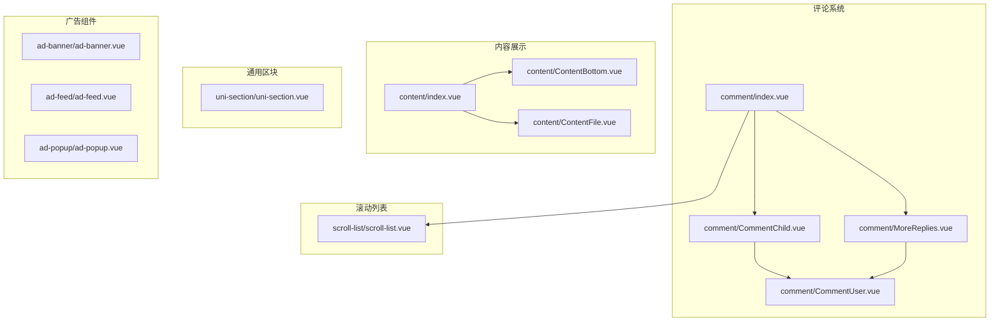
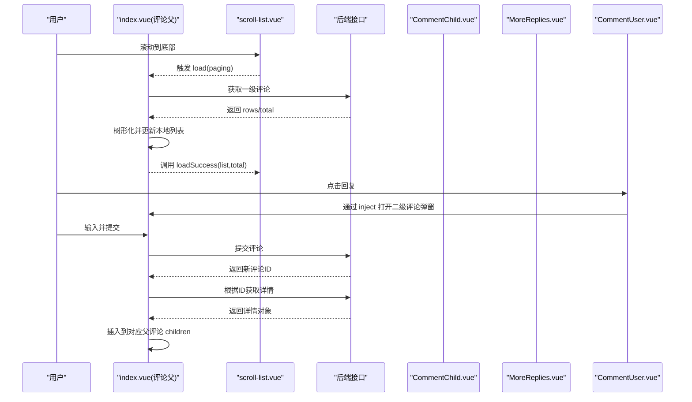
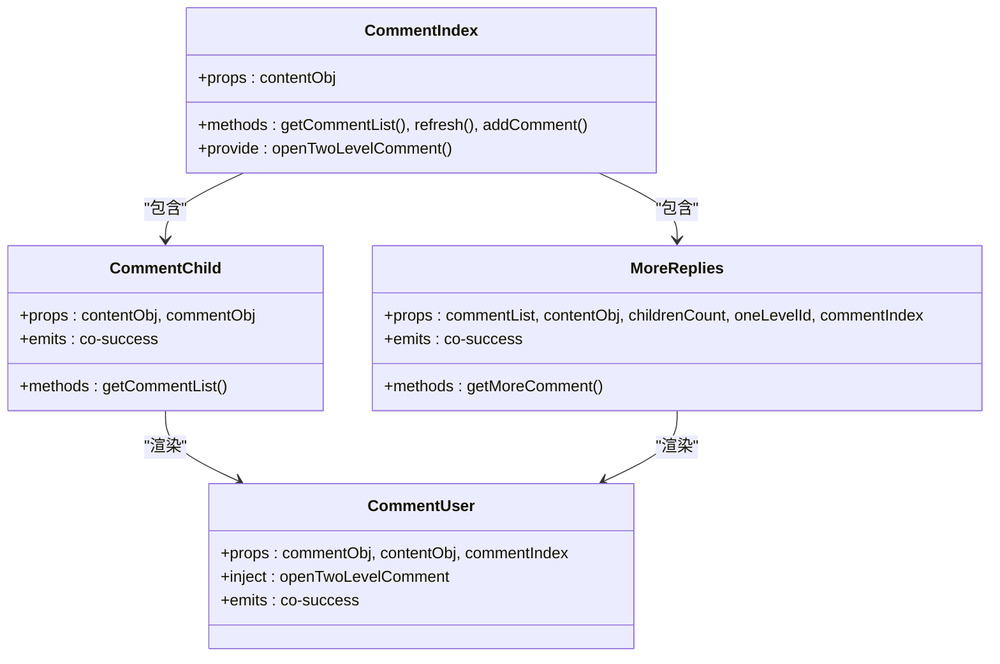
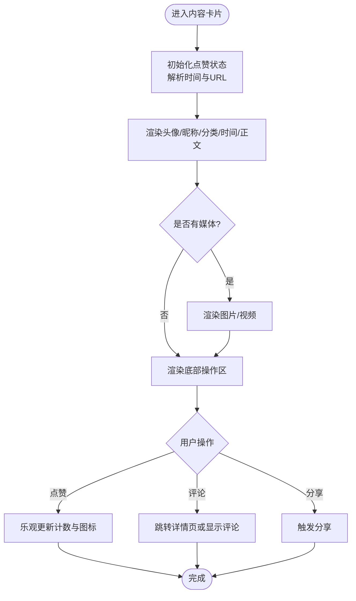
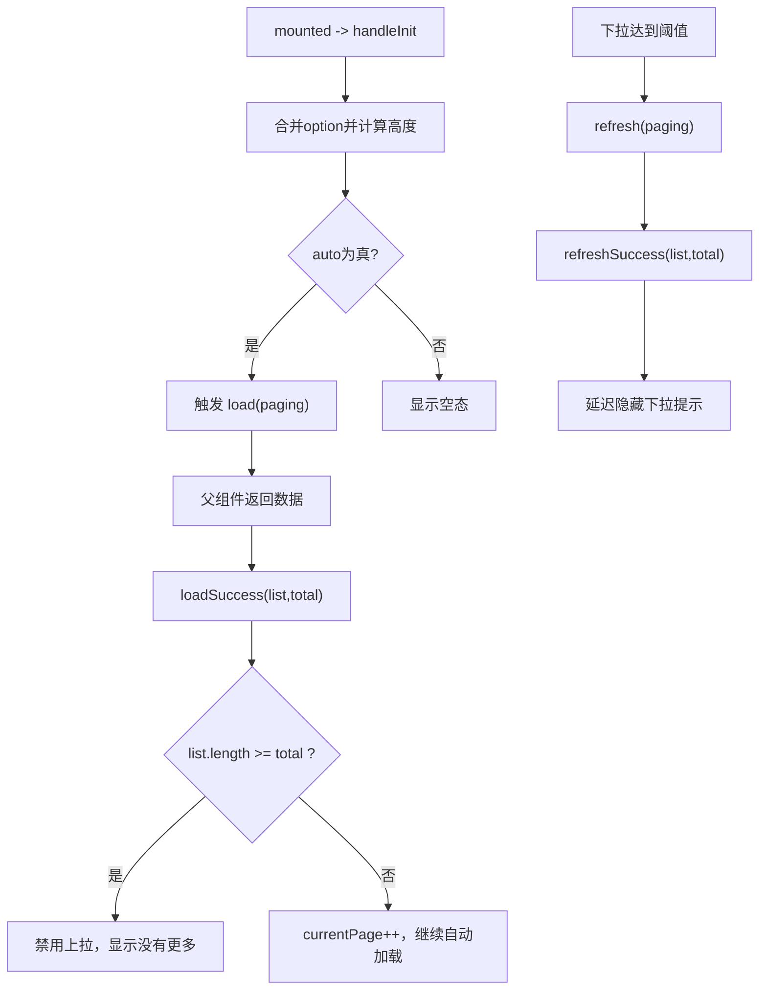
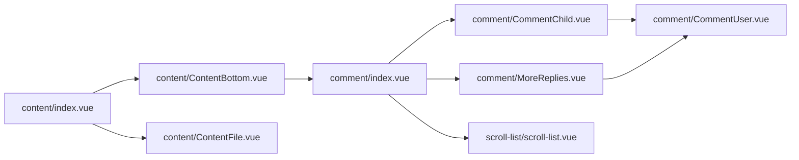

# 自定义组件

<cite>
**本文引用的文件**   
- [components/comment/index.vue](file://components/comment/index.vue)
- [components/comment/CommentChild.vue](file://components/comment/CommentChild.vue)
- [components/comment/MoreReplies.vue](file://components/comment/MoreReplies.vue)
- [components/comment/CommentUser.vue](file://components/comment/CommentUser.vue)
- [components/content/index.vue](file://components/content/index.vue)
- [components/content/ContentBottom.vue](file://components/content/ContentBottom.vue)
- [components/content/ContentFile.vue](file://components/content/ContentFile.vue)
- [components/scroll-list/scroll-list.vue](file://components/scroll-list/scroll-list.vue)
- [components/uni-section/uni-section.vue](file://components/uni-section/uni-section.vue)
- [components/ad-banner/ad-banner.vue](file://components/ad-banner/ad-banner.vue)
- [components/ad-feed/ad-feed.vue](file://components/ad-feed/ad-feed.vue)
- [components/ad-popup/ad-popup.vue](file://components/ad-popup/ad-popup.vue)
</cite>

## 目录
1. [简介](#简介)
2. [项目结构](#项目结构)
3. [核心组件](#核心组件)
4. [架构总览](#架构总览)
5. [详细组件分析](#详细组件分析)
6. [依赖关系分析](#依赖关系分析)
7. [性能与优化建议](#性能与优化建议)
8. [故障排查指南](#故障排查指南)
9. [结论](#结论)
10. [附录：使用示例与组合模式](#附录使用示例与组合模式)

## 简介
本文件面向 RuoYi-App 的自定义业务组件，聚焦评论系统、内容展示、滚动列表与通用区块等核心能力。文档从属性（props）、事件（events）、插槽（slots）与样式定制角度全面说明各组件，并提供数据流、状态管理与性能优化的实践指导，帮助开发者快速集成与扩展。

## 项目结构
自定义组件主要位于 components 目录下，按功能域划分：
- comment：评论系统（一级评论、子评论、更多回复、用户评论项）
- content：内容卡片（头部信息、媒体文件、底部操作区）
- scroll-list：下拉刷新与上拉加载的通用滚动容器
- uni-section：通用区块标题栏
- ad-*：广告相关组件（横幅、信息流、弹窗）

图表来源
- [components/comment/index.vue:1-476](file://components/comment/index.vue#L1-L476)
- [components/comment/CommentChild.vue:1-206](file://components/comment/CommentChild.vue#L1-L206)
- [components/comment/MoreReplies.vue:1-193](file://components/comment/MoreReplies.vue#L1-L193)
- [components/comment/CommentUser.vue:1-189](file://components/comment/CommentUser.vue#L1-L189)
- [components/content/index.vue:1-213](file://components/content/index.vue#L1-L213)
- [components/content/ContentBottom.vue:1-276](file://components/content/ContentBottom.vue#L1-L276)
- [components/content/ContentFile.vue:1-83](file://components/content/ContentFile.vue#L1-L83)
- [components/scroll-list/scroll-list.vue:1-666](file://components/scroll-list/scroll-list.vue#L1-L666)
- [components/uni-section/uni-section.vue:1-168](file://components/uni-section/uni-section.vue#L1-L168)
- [components/ad-banner/ad-banner.vue:1-140](file://components/ad-banner/ad-banner.vue#L1-L140)
- [components/ad-feed/ad-feed.vue:1-199](file://components/ad-feed/ad-feed.vue#L1-L199)
- [components/ad-popup/ad-popup.vue:1-200](file://components/ad-popup/ad-popup.vue#L1-L200)

章节来源
- [components/comment/index.vue:1-476](file://components/comment/index.vue#L1-L476)
- [components/content/index.vue:1-213](file://components/content/index.vue#L1-L213)
- [components/scroll-list/scroll-list.vue:1-666](file://components/scroll-list/scroll-list.vue#L1-L666)
- [components/uni-section/uni-section.vue:1-168](file://components/uni-section/uni-section.vue#L1-L168)

## 核心组件
- 评论系统：提供一级评论分页、二级评论展开、作者标签、回复输入框与键盘适配。
- 内容展示：统一渲染头像、昵称、分类、时间、正文与多媒体；底部支持分享、评论入口与点赞。
- 滚动列表：封装下拉刷新与上拉加载，支持空态、自定义文案与动画。
- 通用区块：可配置装饰、主副标题与右侧插槽的标题栏。
- 广告组件：横幅轮播、信息流卡片与全屏弹窗，内置曝光与点击上报。

章节来源
- [components/comment/index.vue:1-476](file://components/comment/index.vue#L1-L476)
- [components/content/index.vue:1-213](file://components/content/index.vue#L1-L213)
- [components/scroll-list/scroll-list.vue:1-666](file://components/scroll-list/scroll-list.vue#L1-L666)
- [components/uni-section/uni-section.vue:1-168](file://components/uni-section/uni-section.vue#L1-L168)
- [components/ad-banner/ad-banner.vue:1-140](file://components/ad-banner/ad-banner.vue#L1-L140)
- [components/ad-feed/ad-feed.vue:1-199](file://components/ad-feed/ad-feed.vue#L1-L199)
- [components/ad-popup/ad-popup.vue:1-200](file://components/ad-popup/ad-popup.vue#L1-L200)

## 架构总览
评论系统采用“父组件管理数据与交互，子组件专注渲染”的分层设计：
- 父级 index.vue 负责分页、树形化、新增评论与弹窗定位。
- CommentChild.vue 负责二级评论列表与分页。
- MoreReplies.vue 负责“查看更多回复”的增量加载。
- CommentUser.vue 负责单条评论渲染与回复弹窗触发。

图表来源
- [components/comment/index.vue:200-349](file://components/comment/index.vue#L200-L349)
- [components/scroll-list/scroll-list.vue:131-191](file://components/scroll-list/scroll-list.vue#L131-L191)
- [components/comment/CommentChild.vue:86-109](file://components/comment/CommentChild.vue#L86-L109)
- [components/comment/MoreReplies.vue:115-143](file://components/comment/MoreReplies.vue#L115-L143)
- [components/comment/CommentUser.vue:112-140](file://components/comment/CommentUser.vue#L112-L140)

## 详细组件分析

### 评论系统（comment）
- 组件职责
  - index.vue：一级评论分页、树形结构、新增评论、弹窗定位与键盘高度适配。
  - CommentChild.vue：二级评论列表与分页。
  - MoreReplies.vue：增量加载更多回复。
  - CommentUser.vue：单条评论渲染、作者标签、回复弹窗触发。
- 关键 props
  - index.vue: contentObj
  - CommentChild.vue: contentObj, commentObj
  - MoreReplies.vue: commentList, contentObj, childrenCount, oneLevelId, commentIndex
  - CommentUser.vue: commentObj, contentObj, commentIndex
- 关键事件
  - index.vue: 监听 scroll-list 的 load、refresh；内部 emit 未暴露对外事件
  - CommentChild.vue: co-success（子评论成功回调）
  - MoreReplies.vue: co-success（子评论成功回调）
  - CommentUser.vue: co-success（子评论成功回调）
- 插槽
  - index.vue: 无自定义插槽
  - CommentChild.vue: 无自定义插槽
  - MoreReplies.vue: 无自定义插槽
  - CommentUser.vue: 无自定义插槽
- 数据流与状态
  - 一级评论：请求后 push 至本地数组，再树形化，最后通过 ref 调用 loadSuccess 通知滚动容器。
  - 新增评论：先提交，再根据返回 ID 拉取详情，插入到目标位置（一级或二级）。
  - 二级评论：CommentChild 独立分页；MoreReplies 增量追加。
- 样式定制
  - 通过类名覆盖实现主题色、字号、间距等调整（如 .comment-nick、.comment-info、.footer-input 等）。
- 典型用法路径
  - 在页面中引入并使用 <Comment :contentObj="..."/>，由外层传入 contentObj 即可。

图表来源
- [components/comment/index.vue:132-198](file://components/comment/index.vue#L132-L198)
- [components/comment/CommentChild.vue:51-109](file://components/comment/CommentChild.vue#L51-L109)
- [components/comment/MoreReplies.vue:44-145](file://components/comment/MoreReplies.vue#L44-L145)
- [components/comment/CommentUser.vue:82-141](file://components/comment/CommentUser.vue#L82-L141)

章节来源
- [components/comment/index.vue:1-476](file://components/comment/index.vue#L1-L476)
- [components/comment/CommentChild.vue:1-206](file://components/comment/CommentChild.vue#L1-L206)
- [components/comment/MoreReplies.vue:1-193](file://components/comment/MoreReplies.vue#L1-L193)
- [components/comment/CommentUser.vue:1-189](file://components/comment/CommentUser.vue#L1-L189)

### 内容展示（content）
- 组件职责
  - index.vue：渲染作者信息、分类、时间、正文与媒体；点击跳转详情页；向上层弹出菜单。
  - ContentBottom.vue：分享、评论入口、点赞；条件显示评论模块。
  - ContentFile.vue：图片/视频渲染与预览。
- 关键 props
  - index.vue: contentObj, loveContentIds
  - ContentBottom.vue: zanBoolean, contentObj
  - ContentFile.vue: fileUrls, contentType
- 关键事件
  - index.vue: openPopup（向父级传递弹窗数据）
  - ContentBottom.vue: 无对外事件（内部处理点赞与评论跳转）
- 插槽
  - 均无自定义插槽
- 数据流与状态
  - 是否已点赞：由外部传入 loveContentIds 初始化 zanBoolean。
  - 点赞交互：本地乐观更新数量与图标，失败回滚。
  - 媒体渲染：根据 contentType 切换图片/视频，图片支持懒加载与预览。
- 样式定制
  - 通过 .content-box-top、.content-feed-ogText、.content-category-tag 等类名覆盖。
- 典型用法路径
  - 在列表页渲染 <Content :contentObj="item" :loveContentIds="ids"/>，并在父组件监听 openPopup 以控制弹出层。

图表来源
- [components/content/index.vue:86-164](file://components/content/index.vue#L86-L164)
- [components/content/ContentBottom.vue:61-181](file://components/content/ContentBottom.vue#L61-L181)
- [components/content/ContentFile.vue:28-74](file://components/content/ContentFile.vue#L28-L74)

章节来源
- [components/content/index.vue:1-213](file://components/content/index.vue#L1-L213)
- [components/content/ContentBottom.vue:1-276](file://components/content/ContentBottom.vue#L1-L276)
- [components/content/ContentFile.vue:1-83](file://components/content/ContentFile.vue#L1-L83)

### 滚动列表（scroll-list）
- 组件职责
  - 封装下拉刷新与上拉加载，提供空态、加载态与自定义文案，自动计算高度与阈值。
- 关键 props
  - option: Object，包含 page、size、auto、height、disabled、background、emptyImage、offsetBottom、lowerThreshold、refresherThreshold、refreshDelayed、refreshFinishDelayed、safeArea、emptyTextColor、loadTextColor、loadIconColor、refresherTextColor、refresherIconColor、emptyText、loadingText、loadFailText、noMoreText、refreshingText、refreshFailText、refreshSuccessText、pulldownText、pulldownFinishText 等。
- 关键事件
  - load(paging)：触发上拉加载
  - refresh(paging)：触发下拉刷新
  - loadSuccess(list)、loadFail、refreshSuccess(list)、refreshError、scrolltolower、scroll、touchStart、touchMove、touchEnd、refreshStop
- 插槽
  - pulldown：自定义下拉区域
  - empty：自定义空态
  - pullup：自定义上拉区域
  - 默认插槽：列表内容
- 数据流与状态
  - 初始化合并配置，计算高度，若 auto=true 则立即触发 load。
  - loadSuccess/loadFail 控制禁用上拉、空态显示与分页推进。
  - refresh 重置分页并延迟触发 refresh 事件，完成后延迟隐藏下拉提示。
- 样式定制
  - 通过 computed 样式与 CSS 变量控制背景、安全区域、动画旋转与颜色。
- 典型用法路径
  - 在父组件绑定 @load/@refresh，调用 $refs.scrollList.loadSuccess({list,total}) 完成一次加载。

图表来源
- [components/scroll-list/scroll-list.vue:112-343](file://components/scroll-list/scroll-list.vue#L112-L343)

章节来源
- [components/scroll-list/scroll-list.vue:1-666](file://components/scroll-list/scroll-list.vue#L1-L666)

### 通用区块（uni-section）
- 组件职责
  - 提供带装饰的主标题栏，支持副标题与右侧插槽。
- 关键 props
  - type: line | circle | square
  - title: String（必填）
  - titleFontSize / titleColor
  - subTitle / subTitleFontSize / subTitleColor
  - padding: Boolean | String
- 关键事件
  - click：点击标题区域时触发
- 插槽
  - decoration：自定义装饰
  - right：右侧内容
  - 默认插槽：主体内容
- 样式定制
  - 通过 SCSS 变量与类名覆盖装饰形状、字体大小与颜色。
- 典型用法路径
  - <UniSection title="标题" subTitle="副标题" @click="onHeaderClick">...</UniSection>

章节来源
- [components/uni-section/uni-section.vue:1-168](file://components/uni-section/uni-section.vue#L1-L168)

### 广告组件（ad-*）
- 组件职责
  - ad-banner：横幅轮播，支持自动播放、间隔与时长配置，点击上报与跳转。
  - ad-feed：信息流广告卡片，支持文本+图片，点击上报与跳转。
  - ad-popup：全屏弹窗广告，支持图片/视频/文本三种类型，每日仅展示一次。
- 关键 props
  - ad-banner: autoplay, interval, duration, showMark
  - ad-feed: autoLoad
  - ad-popup: 无公开 props（内部维护 visible/currentAd/shownToday）
- 关键事件
  - 三者均对外 emit click(ad)，ad-popup 额外 emit close()
- 数据流与状态
  - 组件内调用广告接口，成功后渲染并上报展示；点击时上报点击并执行跳转逻辑。
  - ad-popup 使用本地存储记录今日是否已展示。
- 样式定制
  - 通过各自 scoped 样式覆盖尺寸、圆角、遮罩透明度等。
- 典型用法路径
  - 在首页顶部放置 <AdBanner/>，在信息流中插入 <AdFeed/>，在合适时机调用 <AdPopup ref="popup"/>.show()。

章节来源
- [components/ad-banner/ad-banner.vue:1-140](file://components/ad-banner/ad-banner.vue#L1-L140)
- [components/ad-feed/ad-feed.vue:1-199](file://components/ad-feed/ad-feed.vue#L1-L199)
- [components/ad-popup/ad-popup.vue:1-200](file://components/ad-popup/ad-popup.vue#L1-L200)

## 依赖关系分析
- 组件耦合
  - 评论系统：index.vue 作为聚合器，向下依赖 CommentChild、MoreReplies、CommentUser；CommentUser 通过 provide/inject 与 index.vue 通信。
  - 内容展示：index.vue 组合 ContentBottom 与 ContentFile；ContentBottom 条件渲染 Comment。
  - 滚动列表：被评论系统复用，解耦于业务逻辑。
- 外部依赖
  - 认证工具：isLogin/getUserId/getToken
  - 工具函数：handleCampusUrl、parseTime
  - API 模块：operateApi、touristApi、ad 相关接口
- 潜在循环依赖
  - 当前未发现直接循环引用；注意避免在 CommentUser 中反向引用 index.vue 实例。

图表来源
- [components/comment/index.vue:129-138](file://components/comment/index.vue#L129-L138)
- [components/content/index.vue:74-93](file://components/content/index.vue#L74-L93)
- [components/content/ContentBottom.vue:59-66](file://components/content/ContentBottom.vue#L59-L66)
- [components/scroll-list/scroll-list.vue:48-56](file://components/scroll-list/scroll-list.vue#L48-L56)

章节来源
- [components/comment/index.vue:1-476](file://components/comment/index.vue#L1-L476)
- [components/content/index.vue:1-213](file://components/content/index.vue#L1-L213)
- [components/scroll-list/scroll-list.vue:1-666](file://components/scroll-list/scroll-list.vue#L1-L666)

## 性能与优化建议
- 列表渲染
  - 使用 key 稳定标识（评论项已使用 commentId），避免不必要的重排。
  - 大数据量场景下，优先使用虚拟列表或分页增量加载（scroll-list 已内置）。
- 网络请求
  - 对重复请求做缓存与去抖；评论新增后按需拉取详情而非全量刷新。
- 图片与媒体
  - 图片启用懒加载与合理尺寸；视频仅在可见区域加载。
- DOM 与布局
  - 减少频繁 reflow，利用 transform 与 opacity 做动画（scroll-list 已采用）。
- 状态管理
  - 将全局状态（如登录态、已点赞集合）集中管理，避免多层透传。

[本节为通用建议，不直接分析具体文件]

## 故障排查指南
- 评论无法加载
  - 检查 contentObj.contentId 是否正确传入。
  - 确认 scroll-list 的 load 事件是否被正确监听，并在回调中调用 loadSuccess。
- 新增评论无效
  - 检查 operateApi.toComment 返回值与后续根据 ID 拉取详情的流程。
  - 确认 dialogIndex 指向的一级评论存在且 children 字段可写。
- 弹窗定位异常
  - 键盘弹起时需监听高度变化并动态设置 top（index.vue 已实现）。
- 点赞状态不同步
  - 确保外部传入的 loveContentIds 与实际点赞结果一致，失败时回滚本地状态。
- 滚动加载卡死
  - 检查 list 是否为数组、total 是否准确；当 list.length >= total 时应禁用上拉。

章节来源
- [components/comment/index.vue:207-349](file://components/comment/index.vue#L207-L349)
- [components/scroll-list/scroll-list.vue:145-204](file://components/scroll-list/scroll-list.vue#L145-L204)
- [components/content/ContentBottom.vue:142-181](file://components/content/ContentBottom.vue#L142-L181)

## 结论
上述组件围绕“内容-互动-展示”的核心链路构建，具备清晰的职责边界与良好的可扩展性。通过统一的滚动容器与通用的标题区块，能够快速拼装出丰富的业务页面。建议在项目中遵循现有 props/events/slots 约定，结合样式覆盖与插槽定制，满足差异化需求。

[本节为总结性内容，不直接分析具体文件]

## 附录：使用示例与组合模式
- 组合一：内容卡片 + 评论
  - 在详情页中渲染 <Content :contentObj="detail"/>，其底部自动挂载 <Comment :contentObj="detail"/>。
  - 参考路径：
    - [components/content/index.vue:66-67](file://components/content/index.vue#L66-L67)
    - [components/content/ContentBottom.vue:39-41](file://components/content/ContentBottom.vue#L39-L41)
- 组合二：滚动列表 + 评论
  - 使用 <scroll-list ref="commentList" @load="getCommentList" @refresh="refresh"> 包裹评论条目，在回调中调用 loadSuccess。
  - 参考路径：
    - [components/comment/index.vue:11-12](file://components/comment/index.vue#L11-L12)
    - [components/scroll-list/scroll-list.vue:131-191](file://components/scroll-list/scroll-list.vue#L131-L191)
- 组合三：广告位嵌入
  - 在首页顶部放置 <AdBanner/>，在信息流中穿插 <AdFeed/>，在营销节点触发 <AdPopup>.show()。
  - 参考路径：
    - [components/ad-banner/ad-banner.vue:49-65](file://components/ad-banner/ad-banner.vue#L49-L65)
    - [components/ad-feed/ad-feed.vue:52-70](file://components/ad-feed/ad-feed.vue#L52-L70)
    - [components/ad-popup/ad-popup.vue:44-77](file://components/ad-popup/ad-popup.vue#L44-L77)

章节来源
- [components/content/index.vue:66-67](file://components/content/index.vue#L66-L67)
- [components/content/ContentBottom.vue:39-41](file://components/content/ContentBottom.vue#L39-L41)
- [components/comment/index.vue:11-12](file://components/comment/index.vue#L11-L12)
- [components/scroll-list/scroll-list.vue:131-191](file://components/scroll-list/scroll-list.vue#L131-L191)
- [components/ad-banner/ad-banner.vue:49-65](file://components/ad-banner/ad-banner.vue#L49-L65)
- [components/ad-feed/ad-feed.vue:52-70](file://components/ad-feed/ad-feed.vue#L52-L70)
- [components/ad-popup/ad-popup.vue:44-77](file://components/ad-popup/ad-popup.vue#L44-L77)