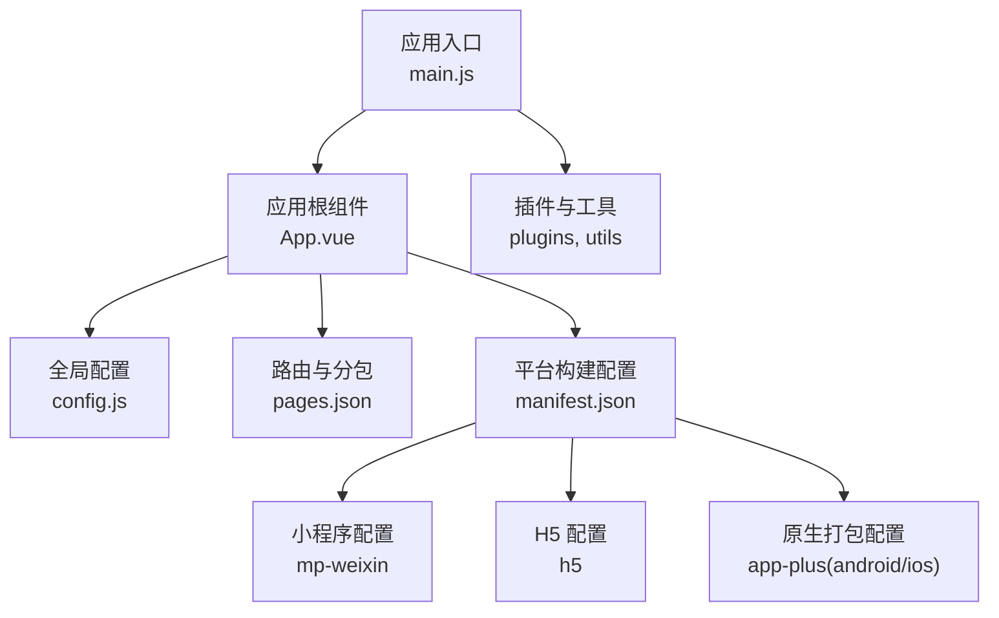
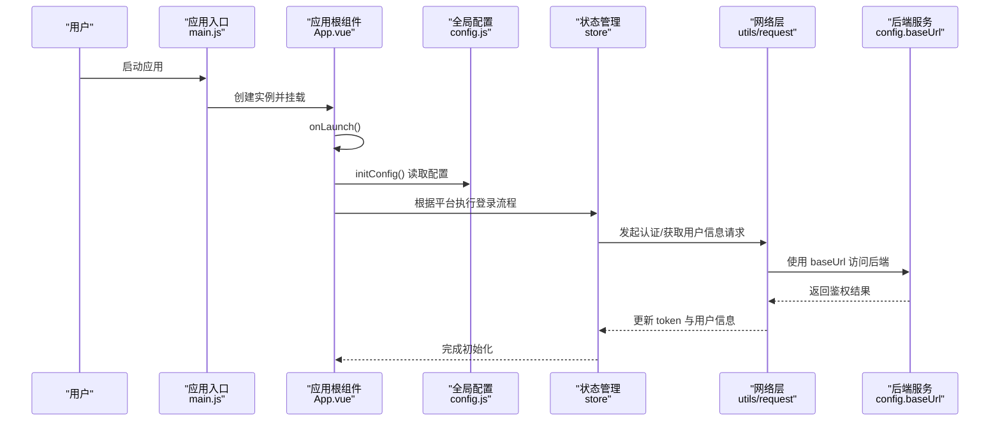
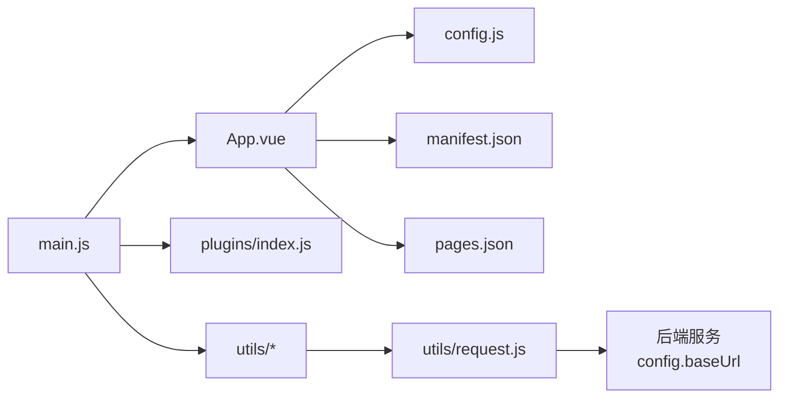

# 部署与发布

<cite>
**本文引用的文件**   
- [README.md](file://README.md)
- [config.js](file://config.js)
- [manifest.json](file://manifest.json)
- [pages.json](file://pages.json)
- [main.js](file://main.js)
- [App.vue](file://App.vue)
</cite>

## 目录
1. [简介](#简介)
2. [项目结构](#项目结构)
3. [核心组件](#核心组件)
4. [架构总览](#架构总览)
5. [详细组件分析](#详细组件分析)
6. [依赖分析](#依赖分析)
7. [性能考虑](#性能考虑)
8. [故障排查指南](#故障排查指南)
9. [结论](#结论)
10. [附录](#附录)

## 简介
本指南面向 RuoYi-App（基于 uni-app）的部署与发布，覆盖多端打包配置与流程（微信小程序、H5、Android、iOS）、生产环境优化（代码压缩、资源优化、缓存策略）、CI/CD 流水线示例与自动化部署、域名与 SSL 证书配置、安全加固、上线前检查、性能监控与日志收集、版本管理与发布最佳实践、常见问题排查、回滚与灾难恢复方案。

## 项目结构
RuoYi-App 采用 uni-app 工程结构，关键配置文件如下：
- manifest.json：应用元信息、各平台构建与权限配置
- pages.json：页面路由、分包、TabBar、全局样式等
- config.js：后端接口协议、主机、端口、API 前缀与应用信息
- main.js：应用入口，注册插件、工具方法、初始化 store
- App.vue：应用生命周期与跨端登录逻辑

图表来源
- [main.js:1-31](file://main.js#L1-L31)
- [App.vue:1-48](file://App.vue#L1-L48)
- [config.js:1-38](file://config.js#L1-L38)
- [pages.json:1-235](file://pages.json#L1-L235)
- [manifest.json:1-77](file://manifest.json#L1-L77)

章节来源
- [README.md:1-52](file://README.md#L1-L52)
- [main.js:1-31](file://main.js#L1-L31)
- [App.vue:1-48](file://App.vue#L1-L48)
- [config.js:1-38](file://config.js#L1-L38)
- [pages.json:1-235](file://pages.json#L1-L235)
- [manifest.json:1-77](file://manifest.json#L1-L77)

## 核心组件
- 应用配置中心（config.js）
  - 定义后端协议、主机、端口、API 前缀，并动态拼接 baseUrl，便于统一切换环境
  - 提供应用名称、版本、Logo、站点地址与协议链接等基础信息
- 平台构建与权限（manifest.json）
  - 小程序：appid、编译设置、分包优化、权限声明
  - H5：模板、开发服务器、路由模式与 base
  - app-plus：Android/iOS 权限、启动页、模块与 SDK 配置
- 路由与分包（pages.json）
  - 主包与 subPackages 分包组织，减少首屏体积
  - tabBar 与全局导航栏样式
- 应用初始化与登录（App.vue、main.js）
  - 在 onLaunch 中加载配置，按平台执行自动登录或校验登录态
  - 通过 store 与工具方法完成鉴权与跳转

章节来源
- [config.js:1-38](file://config.js#L1-L38)
- [manifest.json:1-77](file://manifest.json#L1-L77)
- [pages.json:1-235](file://pages.json#L1-L235)
- [App.vue:1-48](file://App.vue#L1-L48)
- [main.js:1-31](file://main.js#L1-L31)

## 架构总览
下图展示从应用启动到网络请求的关键路径，以及配置注入与平台差异处理。

图表来源
- [main.js:1-31](file://main.js#L1-L31)
- [App.vue:1-48](file://App.vue#L1-L48)
- [config.js:1-38](file://config.js#L1-L38)

## 详细组件分析

### 配置与环境切换（config.js）
- 作用
  - 集中管理后端协议、主机、端口、API 前缀，并提供 baseUrl 计算属性
  - 维护应用基本信息（名称、版本、Logo、站点、协议链接）
- 部署要点
  - 生产环境将 protocol 设置为 https，host 指向正式域名，port 为 443
  - apiPrefix 需与 Nginx 代理路径一致（如 /prod-api）
  - 如需多环境，可结合环境变量或构建脚本替换该文件内容
- 建议
  - 保持 baseUrl 唯一出口，避免散落的硬编码地址
  - 对敏感信息（如内部域名）进行隔离与最小化暴露

章节来源
- [config.js:1-38](file://config.js#L1-L38)

### 平台构建与权限（manifest.json）
- 小程序（mp-weixin）
  - 配置 appid、编译选项（minified、postcss）、分包优化（subPackages）、懒加载（lazyCodeLoading）
  - 权限与隐私接口声明（scope.userLocation、requiredPrivateInfos）
- H5（h5）
  - 指定模板、开发服务器端口与 HTTPS 开关、标题、路由模式与 base
- 原生（app-plus）
  - Android 权限列表、启动页行为、模块与 SDK 配置
  - iOS 占位配置，可按需扩展
- 部署要点
  - 小程序：确保 appid 正确，urlCheck 在生产环境建议开启；分包已启用
  - H5：路由模式为 hash，base 为相对路径，适合静态托管
  - app-plus：按需裁剪权限，减少审核风险

章节来源
- [manifest.json:1-77](file://manifest.json#L1-L77)

### 路由与分包（pages.json）
- 作用
  - 定义主包页面与多个 subPackages，降低首屏体积
  - 配置 tabBar、全局导航栏样式
- 部署要点
  - 确认所有首次进入所需页面在主包，其余放入分包
  - 分包命名与路径与实际目录保持一致
- 优化建议
  - 控制单包大小，必要时进一步拆分
  - 图片等资源走 CDN，减小包体

章节来源
- [pages.json:1-235](file://pages.json#L1-L235)

### 应用初始化与登录（App.vue、main.js）
- 初始化流程
  - main.js 引入 uView、插件、工具方法，挂载 store
  - App.vue 在 onLaunch 中加载配置，并按平台执行自动登录或登录态检查
- 登录态
  - 未登录时跳转到登录页；小程序支持自动登录流程
- 部署要点
  - 确保 baseUrl 指向正确的后端地址
  - 若使用 Token 持久化，注意存储安全与过期刷新策略

章节来源
- [main.js:1-31](file://main.js#L1-L31)
- [App.vue:1-48](file://App.vue#L1-L48)

### 多端打包流程（微信小程序、H5、Android、iOS）
- 通用准备
  - 安装依赖与构建工具（依据 uni-app 官方文档）
  - 核对 manifest.json 中的 appid、权限与分包
  - 核对 config.js 的 baseUrl 与 apiPrefix
- 微信小程序
  - 在开发者工具中选择“微信”平台，导入项目
  - 填写小程序 appid，开启必要的权限与隐私接口
  - 点击“上传”，提交至微信公众平台进行审核与发布
- H5
  - 本地预览：运行 H5 开发服务器
  - 构建产物：生成静态资源，部署至静态托管或 Nginx
  - 路由模式为 hash，base 为相对路径，无需服务端重写
- Android
  - 在开发者工具选择“原生 App-云打包/本地打包”
  - 配置签名与权限，按需裁剪 Android 权限
  - 生成 APK/AAB，进行内测分发或上架
- iOS
  - 配置 Apple 开发者账号与证书描述文件
  - 在开发者工具选择“原生 App-iOS 云打包/本地打包”
  - 生成 ipa，通过 TestFlight 或 App Store 发布

[本节为流程性说明，不直接分析具体源码文件]

### 生产环境配置与优化
- 代码压缩与构建
  - 小程序：manifest.json 中 minified 与 postcss 已启用
  - H5：建议使用构建工具开启 JS/CSS 压缩与 Tree Shaking
- 资源优化
  - 图片转 WebP、按需加载、CDN 加速
  - 字体与图标按需引入，减少体积
- 缓存策略
  - H5：利用浏览器缓存与 CDN 缓存，合理设置 Cache-Control
  - 小程序：利用分包与懒加载，减少首屏资源
- 安全加固
  - 全站 HTTPS，强制重定向
  - 配置 CSP、X-Frame-Options、X-Content-Type-Options 等响应头
  - 限制 API 访问频率与白名单

[本节为通用指导，不直接分析具体源码文件]

### CI/CD 流水线与自动化部署
- 推荐步骤
  - 拉取代码 → 安装依赖 → 构建多端产物 → 上传制品 → 部署到目标环境
- 示例思路
  - 微信小程序：调用 CLI 上传，或使用平台提供的 CI 集成
  - H5：构建后 rsync/sync 到对象存储或 Nginx 目录
  - Android/iOS：云端打包生成安装包，上传至分发平台
- 注意事项
  - 密钥与证书使用环境变量注入
  - 构建产物带版本号与哈希，便于回滚与灰度

[本节为通用指导，不直接分析具体源码文件]

### 域名配置、SSL 证书与安全上线
- 域名与 DNS
  - 解析域名至服务器或 CDN，确保 A/AAAA 记录生效
- SSL 证书
  - 申请并部署证书至 Nginx/网关，开启 HTTP→HTTPS 重定向
  - 配置强加密套件与 HSTS（谨慎评估）
- 安全基线
  - 关闭不必要的调试接口
  - 校验 Referer、Origin，防止越权访问
  - 对上传文件做类型与大小限制

[本节为通用指导，不直接分析具体源码文件]

### 性能监控与日志收集
- 前端埋点
  - 页面访问、错误上报、接口耗时统计
- 日志采集
  - 统一日志格式，接入 ELK/SLS 等系统
- 指标看板
  - 建立可用性、错误率、首屏时间、接口 P95/P99 等指标

[本节为通用指导，不直接分析具体源码文件]

### 版本管理与发布流程最佳实践
- 分支模型
  - 主干稳定，功能分支开发，发布分支合并
- 标签与变更日志
  - 每次发布打 tag，维护 CHANGELOG
- 灰度与回滚
  - 先灰度小流量，验证后再全量
  - 保留上一版本制品，快速回滚

[本节为通用指导，不直接分析具体源码文件]

## 依赖分析
- 运行时依赖
  - Vue 2 与 uni-app 生态组件（uView、uni-ui）
- 构建期依赖
  - uni-app CLI、平台特定编译器与打包器
- 外部服务
  - 后端 API（由 config.js 的 baseUrl 决定）
  - 第三方平台（微信小程序、Apple/Google 商店等）

图表来源
- [main.js:1-31](file://main.js#L1-L31)
- [App.vue:1-48](file://App.vue#L1-L48)
- [config.js:1-38](file://config.js#L1-L38)
- [manifest.json:1-77](file://manifest.json#L1-L77)
- [pages.json:1-235](file://pages.json#L1-L235)

章节来源
- [main.js:1-31](file://main.js#L1-L31)
- [App.vue:1-48](file://App.vue#L1-L48)
- [config.js:1-38](file://config.js#L1-L38)
- [manifest.json:1-77](file://manifest.json#L1-L77)
- [pages.json:1-235](file://pages.json#L1-L235)

## 性能考虑
- 首屏优化
  - 分包与懒加载，仅加载必要页面与组件
  - 预渲染关键数据，骨架屏提升感知速度
- 网络优化
  - 接口合并、分页与增量更新
  - 启用 gzip/brotli，HTTP/2 与 CDN
- 资源优化
  - 图片压缩与懒加载，字体子集化
- 内存与卡顿
  - 避免大对象常驻，及时释放监听与定时器
  - 长列表虚拟滚动与分页加载

[本节为通用指导，不直接分析具体源码文件]

## 故障排查指南
- 无法连接后端
  - 检查 config.js 的 protocol/host/port/apiPrefix 是否与线上一致
  - 确认 Nginx 代理路径与后端服务端口
- 小程序权限问题
  - 核对 manifest.json 中权限与 requiredPrivateInfos 是否匹配业务
  - 在微信公众平台后台开启对应能力
- H5 路由异常
  - 当前使用 hash 模式，确保静态托管无需服务端重写
- 登录态丢失
  - 检查 Token 存储与刷新逻辑，确认跨域与 Cookie 策略
- 构建失败
  - 清理缓存与 node_modules，重新安装依赖
  - 核对 manifest.json 的 appid 与平台配置

章节来源
- [config.js:1-38](file://config.js#L1-L38)
- [manifest.json:1-77](file://manifest.json#L1-L77)
- [App.vue:1-48](file://App.vue#L1-L48)

## 结论
通过统一的配置中心、合理的分包与平台构建配置，RuoYi-App 可实现多端高效打包与稳定发布。配合完善的 CI/CD、安全加固、性能优化与监控体系，能够保障上线质量与运维效率。建议在每次发布前执行上线检查清单，并建立回滚与灾备预案，确保业务连续性。

## 附录

### 上线前检查清单
- 配置核对
  - config.js 的 baseUrl 与 apiPrefix 指向生产环境
  - manifest.json 的 appid、权限与分包配置正确
- 安全与合规
  - 全站 HTTPS，敏感信息不出现在客户端
  - 小程序隐私接口与权限声明完整
- 性能与体验
  - 首屏时间与包体达标，关键路径无阻塞
- 监控与日志
  - 错误上报与关键指标接入正常

[本节为通用指导，不直接分析具体源码文件]

### 回滚与灾难恢复
- 快速回滚
  - 保留上一版本制品，优先回滚前端静态资源与小程序版本
- 灰度发布
  - 小流量灰度，观察错误率与性能指标
- 灾难恢复
  - 备份构建产物与配置，确保可在任意节点重建
  - 制定演练计划，定期验证恢复流程

[本节为通用指导，不直接分析具体源码文件]