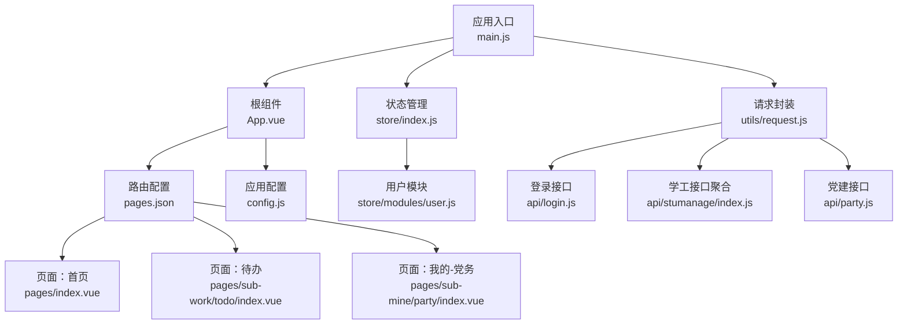
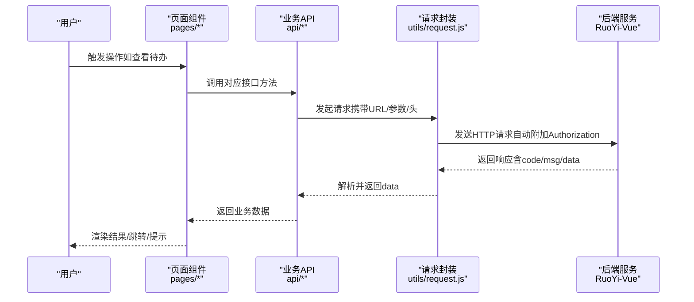
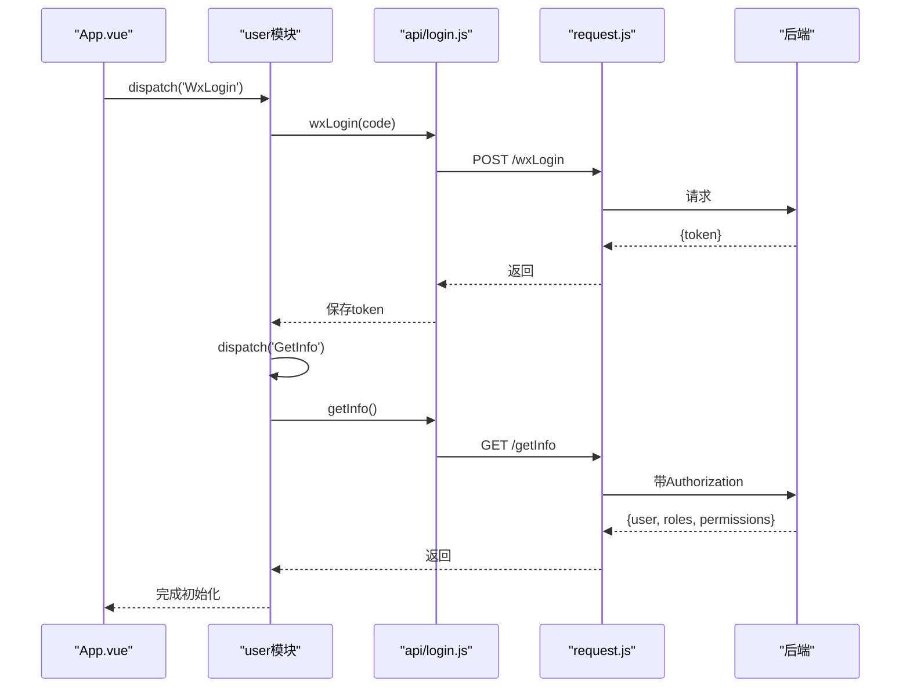
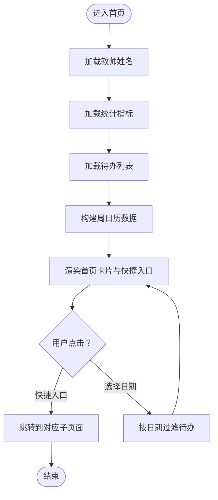
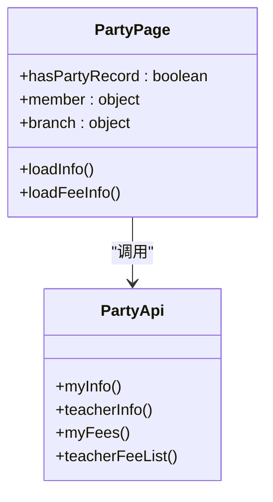
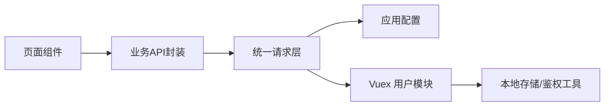

# 项目概述

<cite>
**本文引用的文件列表**   
- [README.md](file://README.md)
- [main.js](file://main.js)
- [App.vue](file://App.vue)
- [pages.json](file://pages.json)
- [config.js](file://config.js)
- [store/index.js](file://store/index.js)
- [store/modules/user.js](file://store/modules/user.js)
- [utils/request.js](file://utils/request.js)
- [api/login.js](file://api/login.js)
- [api/stumanage/index.js](file://api/stumanage/index.js)
- [api/party.js](file://api/party.js)
- [pages/index.vue](file://pages/index.vue)
- [pages/sub-work/todo/index.vue](file://pages/sub-work/todo/index.vue)
- [pages/sub-mine/party/index.vue](file://pages/sub-mine/party/index.vue)
</cite>

## 目录
1. [简介](#简介)
2. [项目结构](#项目结构)
3. [核心组件](#核心组件)
4. [架构总览](#架构总览)
5. [详细组件分析](#详细组件分析)
6. [依赖关系分析](#依赖关系分析)
7. [性能与体验优化建议](#性能与体验优化建议)
8. [故障排查指南](#故障排查指南)
9. [结论](#结论)

## 简介
本项目为“RuoYi-App 智慧学工教师端”，是基于 uni-app 的跨平台移动应用，面向高校辅导员和教师，提供学生管理、日常管理、工作待办、统计分析、党务管理等能力。前端采用 Vue + Vuex 技术栈，结合 uView UI 组件库，实现一份代码多端适配（微信小程序、H5、APP），并与 RuoYi-Vue 后端无缝对接。

- 目标用户：高校辅导员、教师
- 核心价值：统一移动端学工入口，提升日常管理与沟通效率
- 多端部署：小程序、H5、APP 三端一致体验
- 后端对接：与 RuoYi-Vue/RuoYi-Cloud 完美集成

章节来源
- [README.md:12-20](file://README.md#L12-L20)

## 项目结构
整体采用“页面 + 模块 API + 工具 + 状态管理”的分层组织方式：
- pages：路由与页面视图（首页、工作台、我的、子包）
- api：按业务域划分接口封装（学工、系统、党建等）
- store：Vuex 全局状态（用户信息、权限等）
- utils：通用工具（请求封装、鉴权、存储、校验等）
- components/uni_modules：UI 组件与第三方插件（uView、uni-ui 等）
- static：静态资源（图标、样式、图片等）
- config：应用配置（协议、域名、API 前缀、应用信息等）

图表来源
- [main.js:1-31](file://main.js#L1-L31)
- [App.vue:1-48](file://App.vue#L1-L48)
- [pages.json:1-235](file://pages.json#L1-L235)
- [store/index.js:1-16](file://store/index.js#L1-L16)
- [store/modules/user.js:1-283](file://store/modules/user.js#L1-L283)
- [utils/request.js:1-117](file://utils/request.js#L1-L117)
- [api/login.js:1-168](file://api/login.js#L1-L168)
- [api/stumanage/index.js:1-32](file://api/stumanage/index.js#L1-L32)
- [api/party.js:1-88](file://api/party.js#L1-L88)
- [pages/index.vue:1-711](file://pages/index.vue#L1-L711)
- [pages/sub-work/todo/index.vue:1-629](file://pages/sub-work/todo/index.vue#L1-L629)
- [pages/sub-mine/party/index.vue:1-206](file://pages/sub-mine/party/index.vue#L1-L206)
- [config.js:1-38](file://config.js#L1-L38)

章节来源
- [pages.json:1-235](file://pages.json#L1-L235)
- [config.js:1-38](file://config.js#L1-L38)

## 核心组件
- 应用初始化与生命周期
  - main.js 注册 uView、挂载插件、注入全局方法与字典接口；设置 App.mpType 并启动应用
  - App.vue 在 onLaunch 中初始化配置，并按平台执行自动登录或登录态检查
- 全局状态管理
  - store/index.js 使用 Vuex 组织模块，当前包含 user 模块
  - store/modules/user.js 维护 token、用户信息、角色权限、用户类型等，并提供登录、获取信息、微信绑定、手机号快捷登录、退出等 action
- 网络请求与鉴权
  - utils/request.js 统一封装 uni.request，自动注入 Authorization、处理 401 会话过期、错误码映射与提示
  - api/login.js 封装登录、注册、获取用户信息、退出、验证码、微信/手机号相关接口
- 页面与功能
  - pages/index.vue 首页聚合统计、待办周日历、快捷入口
  - pages/sub-work/todo/index.vue 待办事项（日历/清单双视图、筛选排序、未读计数）
  - pages/sub-mine/party/index.vue 党务信息展示（支持学生/教师两套数据源回退）

章节来源
- [main.js:1-31](file://main.js#L1-L31)
- [App.vue:1-48](file://App.vue#L1-L48)
- [store/index.js:1-16](file://store/index.js#L1-L16)
- [store/modules/user.js:1-283](file://store/modules/user.js#L1-L283)
- [utils/request.js:1-117](file://utils/request.js#L1-L117)
- [api/login.js:1-168](file://api/login.js#L1-L168)
- [pages/index.vue:1-711](file://pages/index.vue#L1-L711)
- [pages/sub-work/todo/index.vue:1-629](file://pages/sub-work/todo/index.vue#L1-L629)
- [pages/sub-mine/party/index.vue:1-206](file://pages/sub-mine/party/index.vue#L1-L206)

## 架构总览
从“前端页面 → 业务 API 封装 → 统一请求层 → 后端服务”的链路如下：

图表来源
- [pages/index.vue:1-711](file://pages/index.vue#L1-L711)
- [pages/sub-work/todo/index.vue:1-629](file://pages/sub-work/todo/index.vue#L1-L629)
- [api/stumanage/index.js:1-32](file://api/stumanage/index.js#L1-L32)
- [api/party.js:1-88](file://api/party.js#L1-L88)
- [utils/request.js:1-117](file://utils/request.js#L1-L117)

## 详细组件分析

### 认证与会话流程
- 登录与获取用户信息
  - 页面通过 store.dispatch('Login') 提交用户名/密码/验证码，成功后写入 token 并持久化
  - 随后调用 GetInfo 拉取用户详情、角色与权限，并更新本地存储
- 微信自动登录（小程序）
  - App.vue 在小程序环境自动触发 WxLogin，成功后再获取用户信息；若未绑定则跳转登录页
- 会话过期处理
  - request.js 对 401 进行拦截：非登录接口时尝试微信自动登录并重试；否则清理会话并跳转登录页

图表来源
- [App.vue:1-48](file://App.vue#L1-L48)
- [store/modules/user.js:113-132](file://store/modules/user.js#L113-L132)
- [store/modules/user.js:73-111](file://store/modules/user.js#L73-L111)
- [api/login.js:76-98](file://api/login.js#L76-L98)
- [api/login.js:33-39](file://api/login.js#L33-L39)
- [utils/request.js:41-88](file://utils/request.js#L41-L88)

章节来源
- [App.vue:1-48](file://App.vue#L1-L48)
- [store/modules/user.js:1-283](file://store/modules/user.js#L1-L283)
- [api/login.js:1-168](file://api/login.js#L1-L168)
- [utils/request.js:1-117](file://utils/request.js#L1-L117)

### 首页与待办概览
- 首页聚合指标
  - 加载教师姓名、学生总数、待审请假数、未读待办数、本周查课数
  - 提供快捷入口：我的学生、查课登记、记录谈话、请假审批
- 待办周日历
  - 基于本地计算构建周视图，标记有任务的日期点，点击切换周并筛选当天待办
- 待办详情页
  - 支持日历/清单两种视图，具备搜索、筛选（时间范围/状态/类型）、排序（时间/紧急程度）、未读计数与点击跳转

图表来源
- [pages/index.vue:128-379](file://pages/index.vue#L128-L379)
- [pages/sub-work/todo/index.vue:226-351](file://pages/sub-work/todo/index.vue#L226-L351)

章节来源
- [pages/index.vue:1-711](file://pages/index.vue#L1-L711)
- [pages/sub-work/todo/index.vue:1-629](file://pages/sub-work/todo/index.vue#L1-L629)

### 党务管理（教师/学生兼容）
- 数据源兼容
  - 优先加载学生端党员档案接口，若无记录则回退到教师端接口
- 信息展示
  - 展示政治面貌、所属支部、申请日期、阶段状态、最近党费缴纳情况
- 功能导航
  - 组织信息、发展过程、培训记录、党费记录等入口

图表来源
- [pages/sub-mine/party/index.vue:76-166](file://pages/sub-mine/party/index.vue#L76-L166)
- [api/party.js:1-88](file://api/party.js#L1-L88)

章节来源
- [pages/sub-mine/party/index.vue:1-206](file://pages/sub-mine/party/index.vue#L1-L206)
- [api/party.js:1-88](file://api/party.js#L1-L88)

## 依赖关系分析
- 模块耦合
  - 页面依赖 api 层，api 层依赖 request 层，request 层依赖 config 与 store（用于鉴权）
  - 用户模块集中管理登录态与用户信息，被多处页面复用
- 外部依赖
  - uView UI 组件库、uni-ui 系列组件、Vuex 状态管理
- 潜在风险
  - 登录态与权限判断集中在 user 模块，需确保异常路径下能正确清理状态并引导重新登录

图表来源
- [pages/index.vue:1-711](file://pages/index.vue#L1-L711)
- [api/stumanage/index.js:1-32](file://api/stumanage/index.js#L1-L32)
- [utils/request.js:1-117](file://utils/request.js#L1-L117)
- [store/modules/user.js:1-283](file://store/modules/user.js#L1-L283)
- [config.js:1-38](file://config.js#L1-L38)

章节来源
- [api/stumanage/index.js:1-32](file://api/stumanage/index.js#L1-L32)
- [utils/request.js:1-117](file://utils/request.js#L1-L117)
- [store/modules/user.js:1-283](file://store/modules/user.js#L1-L283)

## 性能与体验优化建议
- 首屏加载
  - 按需引入 uView 组件，避免全量打包；合理使用分包与懒加载
- 网络请求
  - 合理设置超时与重试策略；对热点数据增加本地缓存与失效策略
- 列表与日历
  - 大数据量场景采用虚拟滚动或分页加载；日历节点仅渲染必要信息
- 状态同步
  - 减少不必要的重复请求，利用事件总线或全局状态驱动刷新

[本节为通用建议，不直接分析具体文件]

## 故障排查指南
- 无法登录或频繁跳回登录页
  - 检查后端地址与协议配置是否正确（config.js）
  - 确认 401 分支是否误判登录接口导致未触发自动登录（request.js）
- 微信自动登录失败
  - 确认小程序授权流程与 code 获取成功（store/modules/user.js）
  - 检查后端 /wxLogin 与 /wxBind 接口可用性（api/login.js）
- 数据为空或显示异常
  - 核对各模块 API 返回值结构与字段命名（api/stumanage/index.js、api/party.js）
  - 页面侧对空值与异常分支做了兜底处理，可据此定位问题

章节来源
- [config.js:1-38](file://config.js#L1-L38)
- [utils/request.js:41-88](file://utils/request.js#L41-L88)
- [store/modules/user.js:113-164](file://store/modules/user.js#L113-L164)
- [api/login.js:76-168](file://api/login.js#L76-L168)
- [api/stumanage/index.js:1-32](file://api/stumanage/index.js#L1-L32)
- [api/party.js:1-88](file://api/party.js#L1-L88)

## 结论
RuoYi-App 智慧学工教师端以 uni-app 为核心，结合 Vue/Vuex 与 uView UI，实现了跨端一致的学工管理体验。通过清晰的模块化设计与统一的请求/鉴权层，项目具备良好的可维护性与扩展性。配合 RuoYi-Vue 后端，能够快速落地学生管理、日常管理、待办、统计与党务等核心场景，满足高校辅导员的移动办公需求。